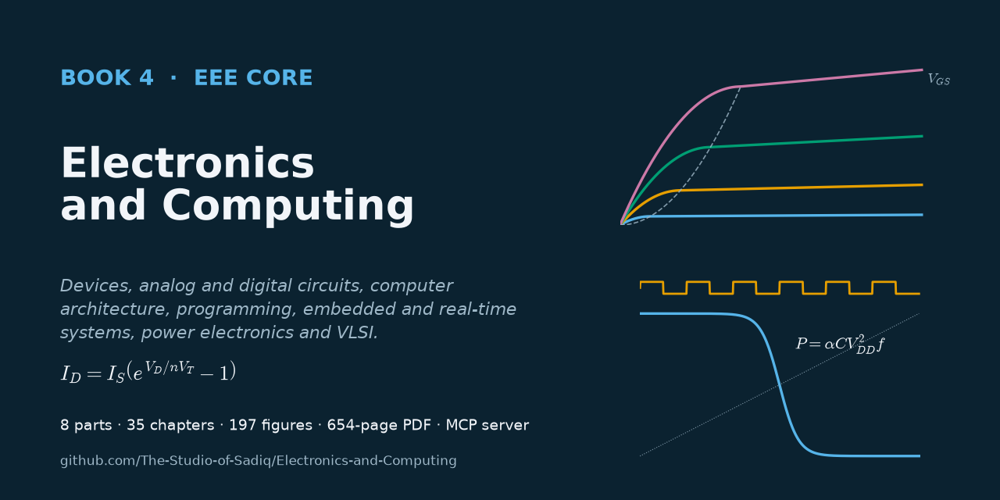

# Electronics and Computing

[](https://github.com/The-Studio-of-Sadiq/Electronics-and-Computing/actions/workflows/check.yml)
[](https://github.com/The-Studio-of-Sadiq/Electronics-and-Computing/actions/workflows/release.yml)
[](pdf/Electronics-and-Computing.pdf)
[](https://github.com/The-Studio-of-Sadiq/Electronics-and-Computing/wiki)
[](LICENSE)



**Book 4 — The Electronics & Computing Core**

Electronic devices, analog and digital hardware, computer architecture, programming, embedded computation and hardware–software interaction: diodes, transistors and power devices; rectifiers, amplifiers, op-amps, oscillators and analog ICs; number systems, logic, combinational and sequential design; processors, microcontrollers, memory, FPGAs and HDLs; C/C++, Python, algorithms and scientific computing; embedded architecture, interfaces and real-time systems; power-electronic converters and drives; CMOS, VLSI and hardware–software co-design.

The book picks up where its siblings stop. [*Engineering Physics*](https://github.com/The-Studio-of-Sadiq/Engineering-Physics) carries the solid state down to bands, carriers, doping and drift–diffusion and sketches the diode, transistor and op-amp in a section each; [*Circuits, Signals and Communications*](https://github.com/The-Studio-of-Sadiq/Circuits-Signals-and-Communications) supplies circuit analysis, frequency response, sampling, DSP and control theory. This book cites those results with links to the exact sections and spends its pages on what they do not cover: real devices with datasheet parameters, circuits that bias, amplify, switch, compute and convert, the digital and software abstractions built on top of them, and the limits of voltage, current, time, power and temperature where each abstraction fails. [*Electrical Energy and Machines*](https://github.com/The-Studio-of-Sadiq/Electrical-Energy-and-Machines) takes the power converters of Part VII on into drives, grids and machines.

**Read the book as a PDF:** [`pdf/Electronics-and-Computing.pdf`](pdf/Electronics-and-Computing.pdf) or from the [latest release](https://github.com/The-Studio-of-Sadiq/Electronics-and-Computing/releases/latest) · **Wiki:** [chapter guide, figures, tooling](https://github.com/The-Studio-of-Sadiq/Electronics-and-Computing/wiki)

## Contents

| Part | Chapters |
|---|---|
| [I — Electronic Devices](part-1-electronic-devices/README.md) | 1 Electronic device fundamentals · 2 Semiconductor junction devices · 3 Bipolar junction transistors · 4 Field-effect transistors · 5 Advanced semiconductor devices |
| [II — Analog Electronics](part-2-analog-electronics/README.md) | 6 Diode circuits · 7 Transistor amplifiers · 8 Operational amplifiers · 9 Feedback and oscillators · 10 Analog integrated circuits |
| [III — Digital Electronics](part-3-digital-electronics/README.md) | 11 Digital number systems · 12 Boolean algebra and logic gates · 13 Combinational digital systems · 14 Sequential digital systems · 15 Digital system design |
| [IV — Computer Architecture and Digital Hardware](part-4-computer-architecture-and-digital-hardware/README.md) | 16 Computer architecture · 17 Microprocessors and microcontrollers · 18 Memory and programmable logic · 19 Hardware description languages |
| [V — Programming and Computational Systems](part-5-programming-and-computational-systems/README.md) | 20 Programming fundamentals · 21 C/C++ for engineering · 22 Python for engineering · 23 Algorithms and data structures · 24 Scientific computing |
| [VI — Embedded and Real-Time Systems](part-6-embedded-and-real-time-systems/README.md) | 25 Embedded-system architecture · 26 Embedded interfaces · 27 Real-time computing · 28 Embedded system design |
| [VII — Power Electronics](part-7-power-electronics/README.md) | 29 Power-electronic fundamentals · 30 DC–DC converters · 31 AC–DC and DC–AC conversion · 32 Motor drives and power conversion |
| [VIII — Integrated Circuits and VLSI](part-8-integrated-circuits-and-vlsi/README.md) | 33 CMOS fundamentals · 34 VLSI design · 35 Hardware–software co-design |

**Boundary.** This book owns devices as circuit elements, analog and digital circuits, computer architecture, HDLs, programming and scientific computing as engineering tools, embedded and real-time systems, power-electronic converters, and CMOS and VLSI design. Band physics belongs to *Engineering Physics*, semiconductor materials to *Materials Science and Engineering*, circuit, signal and control theory to *Circuits, Signals and Communications*, machines, drive control and grid integration to *Electrical Energy and Machines* (see [`TOC.md`](TOC.md#relation-to-the-other-books)).

## Repository layout

| Path | Contents |
|---|---|
| `part-N-*/` | one folder per part: `README.md` is the part opener, `NN-*.md` are the chapters (Markdown, LaTeX math, code listings in C, C++, Python, Verilog/SystemVerilog and VHDL) |
| [`figures/`](figures) | all figures; each `figures/chNN/` folder is generated by `figures/scripts/chNN.py` |
| [`TOC.md`](TOC.md) | master syllabus and boundaries with the other books |
| [`CONTRIBUTING.md`](CONTRIBUTING.md) | house style, including how this book extends *Engineering Physics* and Book 3 |
| [`FIGURES.md`](FIGURES.md) | figure plan: every figure, where it goes and what it shows |
| [`scripts/`](scripts) | PDF, figure, figure-plan, book-check, social-preview and wiki scripts |
| [`docs/`](docs) | social preview image |
| [`.github/`](.github) | CI and release workflows, issue and pull-request templates |
| [`mcp/`](mcp) | an MCP server so Claude and other clients can search, read and typeset the book ([README](mcp/README.md)); Claude Code picks it up from [`.mcp.json`](.mcp.json) |
| [`pdf/`](pdf) | the compiled book |

## Build the PDF

Requires Node.js ≥ 18 and a local Chrome, Edge or Chromium (set `CHROME_PATH` if it is not found automatically).

```bash
npm install
```

```bash
npm run pdf
```

This writes `dist/Electronics-and-Computing.pdf` (KaTeX-rendered math, clickable contents, PDF bookmarks). Build selected part openers or chapters with:

```bash
node scripts/build-pdf.mjs --parts P3,14,15 --out dist/excerpt.pdf
```

## Figures

Every figure is specified by a `<!-- FIGURE ... -->` marker at the point it belongs in its chapter and drawn by `figures/scripts/chNN.py`. Requires Python 3 with numpy, scipy, matplotlib and schemdraw.

Regenerate all figures (or `python scripts/build-figures.py ch07 ch30` for some):

```bash
npm run figures
```

Place newly drawn figures below their markers:

```bash
node scripts/insert-figures.mjs
```

Regenerate the figure plan [`FIGURES.md`](FIGURES.md):

```bash
npm run figures:plan
```

## MCP server

```bash
claude mcp add electronics-computing -- node /absolute/path/to/this/repo/mcp/server.mjs
```

Tools: `list_contents`, `read_part`, `search_book`, `list_figures`, `get_figure`, `build_pdf`. See [`mcp/README.md`](mcp/README.md).

## Contributing

Corrections, clearer explanations and better figures are welcome. Read [CONTRIBUTING.md](CONTRIBUTING.md) (workflow and house style) and report errors with the **Erratum** issue template. Everyone taking part follows the [Code of Conduct](CODE_OF_CONDUCT.md). Security issues in the tooling: see [SECURITY.md](SECURITY.md). Release history: [CHANGELOG.md](CHANGELOG.md).

CI (`.github/workflows/check.yml`) checks the sources, the figure plan, the MCP server and every figure script on each push; pushing a `v*` tag builds the PDF and publishes a release (`.github/workflows/release.yml`).

## Citation and license

To cite the book, use [CITATION.cff](CITATION.cff) (GitHub's "Cite this repository" button reads it). Content and code are under the [MIT License](LICENSE).
