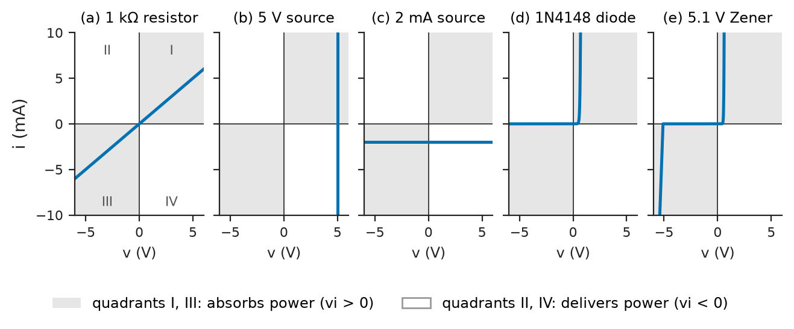
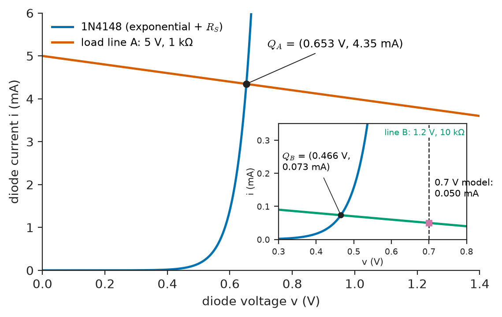
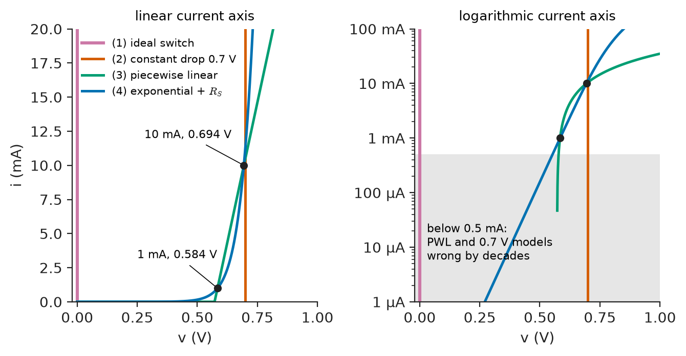
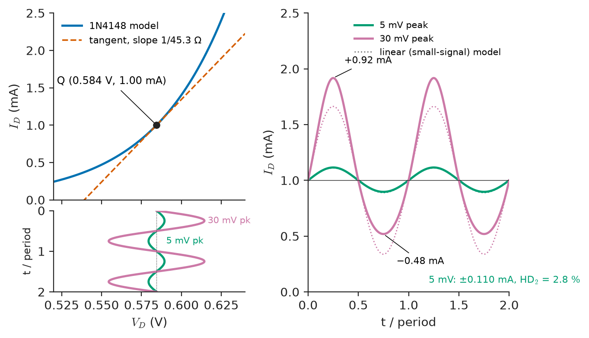
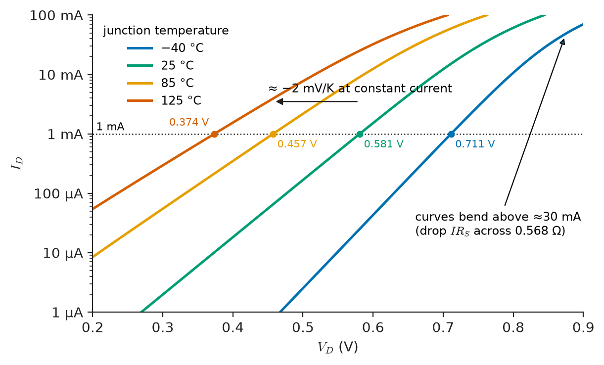
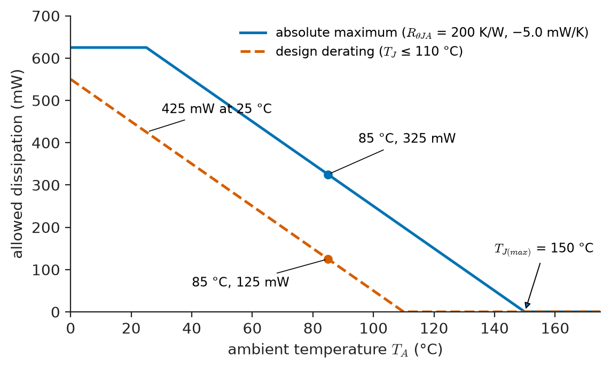

# Chapter 1 — Electronic Device Fundamentals

*Part I · Electronic Devices*

A battery-powered soil-moisture logger is redesigned to run from a single 1.2 V nickel-metal-hydride cell instead of a 3.3 V regulator. The designer keeps the old status-LED and diode-OR circuits and recalculates the currents with the rule everyone learns first: "a silicon diode drops 0.7 V". On the bench every current is 30 to 50 % higher than calculated, a small-signal detector that worked at 3.3 V now distorts, and in a cold-chamber test at −40 °C the diode-OR stops sharing current between the cell and the backup supply. Nothing is faulty. The 0.7 V rule is a *model*, chosen once for one range of current and temperature, and the redesign moved the circuit outside that range. Every electronic device used in this book, from a signal diode to a 1200 V SiC MOSFET, is a nonlinear element whose behaviour can be summarised by simpler models only inside stated limits of voltage, current, frequency and temperature. This chapter is about those models and those limits: how a device is described by its voltage–current characteristic, how a circuit containing it is solved, how it is biased at an operating point and linearised about that point, how its parameters move with temperature, and how to read the datasheet that defines what can be relied on.

> **How is a nonlinear device described, and how do engineers choose a model simple enough to design with but accurate enough to trust?**
> **What is an operating point, why must it be set and stabilised, and when may the device be treated as linear around it?**
> **Which parameters on a datasheet are guaranteed, which drift with temperature, and which practical limits end the validity of every model?**

| Concept | Engineering destination |
|---|---|
| Voltage–current characteristics | Reading datasheet curves; identifying sources, sinks and power flow |
| Nonlinear devices | Rectifiers, mixers, log amplifiers, switches; numerical circuit solution |
| Device models | Hand analysis, SPICE compact models, worst-case design |
| Operating regions | Choosing the right model; checking a design's assumptions |
| Biasing | Amplifier operating points, LED currents, reference circuits |
| Small-signal concepts | Gain, impedance and distortion of amplifiers and sensor front ends |
| Temperature effects | Diode thermometers, bandgap references, thermal runaway, derating |
| Device parameters | Datasheet interpretation, part selection, guaranteed versus typical design |
| Practical limitations | Breakdown, safe operating area, parasitics, noise, reliability |

**Roadmap.** The characteristic as the device's description (1.1) → what nonlinearity does to circuit solution (1.2) → the hierarchy of models (1.3) and the regions in which each holds (1.4) → fixing an operating point (1.5) and linearising about it (1.6) → how temperature moves everything (1.7) → what a datasheet promises (1.8) → the limits that end every model (1.9).

---

## 1.1 Voltage–current characteristics

### Where *Engineering Physics* leaves off

*Engineering Physics* carries the semiconductor from bands and the Fermi level ([Ch. 6 §6.5](https://github.com/The-Studio-of-Sadiq/Engineering-Physics/blob/main/CHAPTERS/CHAPTER%206.md)) through carrier concentrations, doping and the mass-action law $np=n_i^2$ (§6.6), to drift–diffusion transport and the ideal p–n junction law $I=I_0(e^{eV/k_BT}-1)$ ([Ch. 14 §14.5](https://github.com/The-Studio-of-Sadiq/Engineering-Physics/blob/main/CHAPTERS/CHAPTER%2014.md)), and in [Ch. 18 §18.3](https://github.com/The-Studio-of-Sadiq/Engineering-Physics/blob/main/CHAPTERS/CHAPTER%2018.md) it sketches how the diode, the BJT and the MOSFET become circuit models with an ideality factor, a small-signal resistance $r_d=\eta V_T/I_D$ and a transconductance. The material side (dopant ionisation, mobility, lifetime and their temperature dependence) is in *Materials Science and Engineering*, [Ch. 32](https://github.com/The-Studio-of-Sadiq/Materials-Science-and-Engineering/blob/main/Chapters/CHAPTER%2032.md). This book takes those results as given. It starts where the physics stops: with the terminal behaviour an engineer measures, the models a designer chooses among, the regions where each model holds, and the ratings, spreads and failure limits that a real part carries. Where a device is pushed beyond the validity of the physics sketch (high injection, breakdown, self-heating, high frequency), we say so.

### The characteristic as the description of a two-terminal device

For a circuit designer a two-terminal device *is* its static voltage–current characteristic $i=f(v)$, measured with the passive sign convention (current entering the terminal marked +), plus whatever stores charge or energy (capacitance, inductance, thermal mass) when signals change quickly. Figure 1.1 shows five characteristics side by side. A resistor is a straight line through the origin. An ideal voltage source is a vertical line, an ideal current source a horizontal one. A diode is a curve that is nearly flat for negative voltage and rises exponentially for positive voltage. A Zener diode adds a second steep branch at a negative breakdown voltage.

<!-- FIGURE 1.1 | figures/ch01/fig-1-1-iv-characteristics.png | plot | Static voltage–current characteristics of five two-terminal elements, with the power-absorbing and power-delivering quadrants shaded. | Content: five small panels in a row, common axes v from -6 V to +6 V and i from -10 mA to +10 mA, passive sign convention. (a) 1 kOhm resistor: straight line through origin, slope 1 mA/V. (b) ideal 5 V voltage source: vertical line at v = 5 V. (c) ideal 2 mA current source: horizontal line at i = -2 mA. (d) 1N4148 diode: near zero current for v < 0, exponential rise to 10 mA at about 0.69 V. (e) 5.1 V Zener: forward exponential near 0.7 V, flat reverse current, steep breakdown branch at v = -5.1 V. Quadrants I and III shaded light grey and labelled absorbs power (vi > 0); quadrants II and IV unshaded and labelled delivers power (vi < 0). -->



*Figure 1.1 — Static voltage–current characteristics of five two-terminal elements, with the power-absorbing and power-delivering quadrants shaded.*

The quadrant in which the operating point lies tells whether the element absorbs or delivers power. With the passive sign convention ([*Circuits, Signals and Communications*, Ch. 1](https://github.com/The-Studio-of-Sadiq/Circuits-Signals-and-Communications/blob/main/part-1-circuit-fundamentals/01-electrical-quantities-and-circuit-models.md)), $p=vi>0$ means absorption: a resistor, a forward-biased diode and a reverse-biased Zener in breakdown live in quadrants I and III. A battery being discharged, an illuminated solar cell and a photodiode in photovoltaic mode deliver power and operate in quadrant IV.

### Static and dynamic resistance

Two different "resistances" can be read off any characteristic at an operating point $(V_Q, I_Q)$:

- the **static (chordal) resistance** $R=V_Q/I_Q$, the slope of the line from the origin to the point;
- the **dynamic (incremental, differential) resistance** $r=dv/di$ evaluated at the point, the inverse slope of the tangent.

For a resistor they are equal. For a diode carrying 1 mA they differ by an order of magnitude: a 1N4148 at 1 mA has $V_Q\approx0.58$ V, so $R\approx580\ \Omega$, while $r_d\approx45\ \Omega$ (Section 1.6). The static value sets DC power ($P=V_QI_Q$); the dynamic value sets what happens to small signals, ripple and noise. Confusing them is the most common source of factor-of-ten errors in first designs.

### Three- and four-terminal devices: families of curves

A transistor has a characteristic for each pair of terminals, and one terminal voltage or current acts as a parameter. The usual presentation is a family of **output characteristics** ($I_C$ against $V_{CE}$ with $I_B$ or $V_{BE}$ as parameter for a BJT; $I_D$ against $V_{DS}$ with $V_{GS}$ as parameter for a MOSFET) together with a **transfer characteristic** ($I_C$ against $V_{BE}$, $I_D$ against $V_{GS}$). The output family shows the regions of Section 1.4 directly: a steep region near the origin where the device behaves as a low resistance, a flat region where it behaves as a controlled current source, and a breakdown region at high voltage. Chapters 3 and 4 read these families in detail. Table 1.1 classifies the characteristics met in this book by their dominant mathematical form.

**Table 1.1 — Dominant forms of device characteristics (typical, small-signal silicon devices near 25 °C).**

| Device and region | Dominant law | Typical scale parameter |
|---|---|---|
| p–n diode, forward | exponential, $I\propto e^{V/nV_T}$ | 60–120 mV per decade of current |
| Schottky diode, forward | exponential (thermionic) | 60–70 mV per decade |
| BJT, forward active | exponential in $V_{BE}$, nearly linear in $I_B$ | 60 mV per decade; $\beta$ = 100–400 |
| MOSFET, saturation (long channel) | square law in $V_{GS}-V_{th}$ | $k'W/L$ = 0.1–100 mA/V² |
| MOSFET, subthreshold | exponential, $I\propto e^{V_{GS}/nV_T}$ | 70–100 mV per decade |
| MOSFET, triode (small $V_{DS}$) | linear resistor, $R_{DS(on)}$ | 1 mΩ (power) to 10 Ω (small signal) |
| Zener/avalanche breakdown | near-vertical, small slope | dynamic resistance 1–100 Ω |
| Thermistor (NTC) | exponential in $1/T$ (via self-heating) | B = 3000–4500 K |

---

## 1.2 Nonlinear devices

### What linearity buys and what nonlinearity costs

A network of resistors and linear sources obeys superposition, has a unique solution that a single matrix inversion produces, and can be replaced at any port by a Thévenin equivalent ([*Circuits, Signals and Communications*, Ch. 3–4](https://github.com/The-Studio-of-Sadiq/Circuits-Signals-and-Communications/blob/main/part-1-circuit-fundamentals/04-network-theorems.md)). Insert one diode and all three properties are lost. The response to two inputs is no longer the sum of the responses; a circuit with positive feedback may have several solutions; and a Thévenin equivalent exists only for the linear part *seen by* the device, not through it.

Nonlinearity is not a defect to be minimised: it is the reason electronics works. Rectification (Chapter 6), mixing and frequency conversion, logarithmic compression, the regenerative switching of a logic gate (Chapter 33) and the on/off action of every power switch (Chapter 29) all exist because a characteristic is curved. The engineering task is to exploit the curvature where it is wanted and to suppress it where a linear response is required, usually by biasing (Section 1.5) and linearisation (Section 1.6), or by negative feedback (Chapter 9).

### The load-line method

The simplest nonlinear circuit is a device in series with a linear network. Replace the linear part by its Thévenin equivalent $(V_{Th}, R_{Th})$. KVL gives the **load line**

$$
i=\frac{V_{Th}-v}{R_{Th}}
$$

a straight line in the $(v,i)$ plane with intercepts $V_{Th}$ on the voltage axis and $V_{Th}/R_{Th}$ on the current axis. The device must also lie on its own characteristic, so the operating point is the intersection (Figure 1.2). The construction separates what the device does from what the circuit does, and it is still how engineers think about bias points, the swing of an amplifier (Chapter 3, Section 3.7) and the transitions of a switch.

<!-- FIGURE 1.2 | figures/ch01/fig-1-2-diode-load-line.png | plot | Load-line solution of a diode in series with a resistor, for two supply and resistor combinations. | Content: linear axes v from 0 to 1.4 V and i from 0 to 6 mA. 1N4148 exponential characteristic (Is = 2.52 nA, n = 1.752, Rs = 0.568 Ohm, 300 K). Load line A for 5 V and 1 kOhm, entering the plot from the top (slope -1 mA/V), meeting the curve at Q_A = (0.653 V, 4.35 mA). Inset magnifying the region 0.3 to 0.8 V and 0 to 0.35 mA shows load line B for 1.2 V and 10 kOhm, intersect Q_B = (0.466 V, 0.073 mA), and a dashed vertical line at 0.7 V showing where the constant-drop model would put the point (0.050 mA). Label intersections. -->



*Figure 1.2 — Load-line solution of a diode in series with a resistor, for two supply and resistor combinations.*

### Numerical solution

Graphical intersection is not a design method for circuits with many devices. Circuit simulators solve the nonlinear nodal equations by **Newton–Raphson iteration**: guess the node voltages, replace each device by its tangent (a conductance in parallel with a current source, the "companion model"), solve the resulting linear network, and repeat. The method converges quadratically near the solution, but the exponential characteristic can throw a guess far beyond the physical range, so simulators limit the voltage step across each junction. The mathematics of Newton's method and its convergence is in [*The Mathematics Universe*, Ch. 22 §22.4](https://github.com/The-Studio-of-Sadiq/engineering-mathematics/blob/main/part-7-numerical-computational/22-numerical-methods.md); the listing below applies it to the diode circuit with the published SPICE parameters of a 1N4148 ($I_S=2.52$ nA, $n=1.752$, $R_S=0.568\ \Omega$).

```python
import math

def diode_bias(Vs, R, Is=2.52e-9, n=1.752, Rs=0.568, T=300.0):
    """Solve Vs = V + (R + Rs) * Is*(exp(V/(n*VT)) - 1) for V by damped Newton."""
    VT = 1.380649e-23 * T / 1.602176634e-19
    V = 0.5                                   # starting guess
    for k in range(50):
        e = math.exp(V / (n * VT))
        f = Vs - V - (R + Rs) * Is * (e - 1.0)
        df = -1.0 - (R + Rs) * Is * e / (n * VT)
        step = max(-0.1, min(0.1, -f / df))   # limit the step (SPICE does the same)
        V += step
        if abs(step) < 1e-12:
            break
    I = Is * (math.exp(V / (n * VT)) - 1.0)
    return V + I * Rs, I, k + 1               # terminal voltage, current, iterations

for Vs, R in [(5.0, 1e3), (3.3, 10e3), (1.2, 10e3)]:
    V, I, k = diode_bias(Vs, R)
    print(f"Vs={Vs:4.1f} V R={R/1e3:4.0f}k: V_D={V:.4f} V  I_D={I*1e3:.4f} mA  "
          f"(0.7 V model: {(Vs-0.7)/R*1e3:.4f} mA, {k} iterations)")
```

The variable `V` is the voltage across the ideal junction; the series resistance is added back to give the terminal voltage. The step limit of 0.1 V is the same device that SPICE calls junction voltage limiting. Running it gives:

```text
Vs= 5.0 V R=   1k: V_D=0.6529 V  I_D=4.3471 mA  (0.7 V model: 4.3000 mA, 8 iterations)
Vs= 3.3 V R=  10k: V_D=0.5260 V  I_D=0.2774 mA  (0.7 V model: 0.2600 mA, 6 iterations)
Vs= 1.2 V R=  10k: V_D=0.4656 V  I_D=0.0734 mA  (0.7 V model: 0.0500 mA, 6 iterations)
```

**Worked example — the logger's diode at 5 V and at 1.2 V.** With a 5 V supply and 1 kΩ the exponential model gives $V_D=0.653$ V and $I_D=4.347$ mA. The 0.7 V rule gives $(5-0.7)/1000=4.300$ mA, an error of 1.1 %: the resistor drops 4.35 V, so a 47 mV error in the diode voltage hardly matters. With 1.2 V and 10 kΩ the diode sits at 0.466 V and 73.4 µA, while the rule predicts $(1.2-0.7)/10\,000=50.0$ µA, an error of −32 %. The diode voltage is now a large fraction of the supply, and its 234 mV departure from the assumed 0.7 V (the diode carries only 73 µA, two decades below the current at which 0.7 V is right) feeds straight into the current. This is the logger's first symptom. The general lesson: a device model is accurate in *relative* terms only when the device voltage is a small part of the total, or when the model's parameters were fitted at the actual operating current.

> **Status of the principle: Load line and Newton solution of a nonlinear circuit**
> *Derived.* The load line is KVL applied to a Thévenin equivalent, and Newton iteration solves the resulting equations exactly to within a tolerance; the accuracy of the answer is limited only by the accuracy of the device model, not by the method.

### Multiple solutions and negative resistance

When a characteristic has a region of negative slope (the tunnel diode, the snapback of an ESD clamp, a thyristor's switching region, Chapter 5) a load line can cross it three times. The middle intersection is unstable: any small disturbance grows, and the circuit jumps to one of the outer points. The same mechanism, created by positive feedback rather than device physics, gives the two stable states of a latch (Chapter 14) and the hysteresis of a Schmitt trigger (Chapter 8). With a device of negative incremental resistance $-r$ in series with $R_{Th}$, the rule depends on the shape of the characteristic. For a voltage-controlled (N-shaped) characteristic such as the tunnel diode's, a single stable intersection requires $R_{Th}<r$, so such devices are biased from a stiff, low-resistance source. For a current-controlled (S-shaped) characteristic such as a thyristor's or a gas discharge's, stability requires $R_{Th}>r$, which is why such devices always need a series ballast resistor.

---

## 1.3 Device models

### A hierarchy, not a single truth

Every device is described by a ladder of models of increasing accuracy and cost. Choosing the rung is an engineering decision: the model must capture the effect the design depends on, and nothing more. Figure 1.3 compares four diode models, and Table 1.2 lists where each is used.

<!-- FIGURE 1.3 | figures/ch01/fig-1-3-diode-model-hierarchy.png | plot | Four diode models compared with the exponential characteristic of a 1N4148. | Content: linear axes v from 0 to 1.0 V, i from 0 to 20 mA. Curves: (1) ideal switch, vertical line at v = 0; (2) constant-drop model, vertical line at v = 0.7 V; (3) piecewise-linear model, zero current below 0.572 V then a straight line of slope 1/12.2 Ohm (82 mS), passing through (0.584 V, 1 mA) and (0.694 V, 10 mA); (4) full exponential with series resistance, Is = 2.52 nA, n = 1.752, Rs = 0.568 Ohm. Mark the 1 mA and 10 mA fitting points as dots. Second panel: same curves on a log current axis from 1 uA to 100 mA, showing that the PWL and constant-drop models are wrong by orders of magnitude below 0.5 mA. -->



*Figure 1.3 — Four diode models compared with the exponential characteristic of a 1N4148.*

**Table 1.2 — The diode model hierarchy.**

| Model | Equation | Where it is adequate | Where it fails |
|---|---|---|---|
| Ideal switch | $v=0$ if $i>0$; $i=0$ if $v<0$ | Rectifiers and switches whose voltages are ≫ 1 V; logic of steering circuits | Low supply voltages; precision; power loss |
| Constant drop | $v=V_{D0}$ (0.6–0.7 V Si, 0.2–0.4 V Schottky) when on | Bias estimates when $V_D\ll$ other voltages | Low supplies; currents far from the fitting point; temperature |
| Piecewise linear | $v=V_{D0}+r_Di$ when on | Conduction loss in power diodes ($V_{F0}$, $r_T$ on datasheets) | Low currents; temperature unless refitted |
| Exponential with $n$, $R_S$ | $i=I_S(e^{(v-iR_S)/nV_T}-1)$ | Bias, logarithmic circuits, small-signal design, temperature | Breakdown, high injection, reverse leakage (generation), fast transients |
| Compact model (SPICE) | Exponential + $C_j(v)$, transit time, breakdown, temperature laws | Transient and AC simulation, worst-case and Monte Carlo analysis | Only as good as its fitted parameters and their range |

The piecewise-linear model in the third row is fitted by drawing a straight line through two points of the exponential curve. Through the 1N4148's points at 1 mA (0.584 V) and 10 mA (0.694 V), it has $r_D=(0.694-0.584)/9\ \mathrm{mA}=12.2\ \Omega$ and intercept $V_{D0}=0.572$ V. It predicts 4.37 mA in the 5 V/1 kΩ circuit (0.6 % high) but 62.7 µA in the 1.2 V/10 kΩ circuit (15 % low), because 73 µA lies outside the range over which it was fitted.

> **Status of the principle: Constant-drop and piecewise-linear diode models**
> *Approximate.* They replace an exponential by a straight-line fit valid over roughly one decade of current around the fitting point, at the fitting temperature; outside that window the error grows by about $nV_T\ln 10\approx100$ mV per decade.

### Large-signal, small-signal and switching models

Models are also classified by the signals they serve:

- **Large-signal (static) models** relate total DC voltages and currents and are used to find the operating point: the exponential diode law, Ebers–Moll for the BJT (Chapter 3), the square law and its short-channel corrections for the MOSFET (Chapter 4).
- **Small-signal models** are linear circuits of resistances, transconductances and capacitances, valid for small excursions about the operating point (Section 1.6): $r_d$ for the diode, hybrid-π for the BJT and MOSFET. Their parameter values depend on the operating point found with the large-signal model.
- **Switching models** describe a device that moves between two extreme regions: an on-resistance or saturation voltage, an off-state leakage, and the charges or capacitances that set the transition times. They are used for logic (Chapter 33) and power converters (Chapter 29).
- **Thermal models** convert dissipated power into junction temperature through a thermal-resistance and capacitance network (Section 1.7).

### Compact models in simulators

A SPICE diode model card for the 1N4148 reads, in part, `IS=2.52n N=1.752 RS=0.568 CJO=4p M=0.4 VJ=0.5 TT=20n BV=100 IBV=100u`. Each parameter has a physical origin in *Engineering Physics* (saturation current and ideality from §14.5.4 and §18.3.1, junction capacitance from §18.3.1, transit time from minority-carrier storage), but in a model card they are fitted numbers, extracted from measurements on sample parts. Two consequences follow. First, a model card represents a *typical* part at nominal temperature; it says nothing about the spread guaranteed by the datasheet unless the manufacturer supplies corner models. Second, the fitted values are trustworthy only within the measured range; a model extracted between 1 µA and 100 mA predicts nothing reliable about leakage at 150 °C or the voltage during a 10 A surge. MOSFET compact models (BSIM, PSP, EKV) carry hundreds of parameters (Chapters 4 and 33).

---

## 1.4 Operating regions

### A region is the domain of a simpler model

The characteristic of a real device is a single smooth curve. Engineers divide it into **operating regions** because inside each region a much simpler model holds. A forward-biased diode is an exponential, a reverse-biased diode a small constant leakage plus a capacitance, a diode in breakdown a voltage source with a small series resistance. The boundaries are not sharp: they are chosen where one term of the full model becomes negligible compared with another, and the choice depends on the accuracy required.

**Table 1.3 — Operating regions of the main devices, with the simplified model used in each.**

| Device | Region | Condition (silicon, typical) | Simplified model |
|---|---|---|---|
| Diode | Forward | $V_D>0.3$ V and $I_D\gg I_S$ | $I=I_Se^{V/nV_T}$, or constant drop |
| Diode | Reverse | $-V_{BR}<V_D<-3V_T$ | $I\approx-I_R$ (nA–µA), $C_j(V)$ |
| Diode | Breakdown | $V_D<-V_{BR}$ | $V\approx-V_{BR}-r_zI$ |
| BJT | Forward active | B–E forward, B–C reverse | $I_C=\beta I_B$, $I_C=I_Se^{V_{BE}/V_T}$ |
| BJT | Saturation | Both junctions forward | $V_{CE}=V_{CE(sat)}$ ≈ 0.05–0.3 V |
| BJT | Cutoff | Both junctions reverse | All currents ≈ leakage |
| MOSFET | Cutoff/subthreshold | $V_{GS}<V_{th}$ | Exponential leakage, ≈ 0 |
| MOSFET | Triode (linear) | $V_{GS}>V_{th}$, $V_{DS}<V_{GS}-V_{th}$ | Voltage-controlled resistor |
| MOSFET | Saturation | $V_{GS}>V_{th}$, $V_{DS}>V_{GS}-V_{th}$ | Square law, current source |

Device names for regions are inconsistent across the field, and one example causes real errors. The *saturation* region of a MOSFET is where its drain current saturates and it acts as a current source, the analogue of the BJT's *forward-active* region. The *saturation* region of a BJT is where the transistor is fully on and acts as a closed switch, the analogue of the MOSFET's *triode* region. An engineer moving between the two families must translate.

### The assume–solve–check procedure

Because the region decides the model, every hand analysis of a circuit with devices follows the same loop:

1. **Assume** a region for each device (e.g. the BJT is forward-active, the diode is on).
2. **Solve** the circuit with the corresponding simple models.
3. **Check** that the solution satisfies the region's conditions (is $V_{CE}>V_{CE(sat)}$? is $I_D>0$?).
4. If a check fails, change the assumption and repeat.

Simulators use a single all-region model instead, but the loop remains the engineer's main tool for catching nonsense from a simulator.

> **Status of the principle: Region-by-region device modelling**
> *Approximate.* Each region's model is an asymptote of the full characteristic, valid where the neglected terms are small; results near a region boundary (a diode at a few $V_T$ of forward bias, a MOSFET near $V_{th}$, a BJT at the edge of saturation) carry the largest error and must be checked with the full model.

### Regions and abstraction

The rest of this book can be read as a list of abstractions built on one region each. Linear amplifiers (Chapters 7–10) keep the transistor in its current-source region. Logic gates (Chapters 12 and 33) drive transistors hard between cutoff and the low-resistance region and treat the transit as a delay. Power converters (Chapters 29–31) do the same with large currents and voltages, and count the energy lost in the transit. Voltage references (Chapter 10) use the forward diode's predictable temperature behaviour or the breakdown region of a Zener. An abstraction fails when a device leaves its region, which is why the regions' boundaries reappear as specifications: an amplifier's output swing, a gate's noise margin, a converter's maximum duty cycle.

---

## 1.5 Biasing

### The operating point

**Biasing** fixes the DC voltages and currents of a device, its **quiescent** or **operating point** (Q-point), so that the device sits in the intended region with the intended small-signal parameters. A diode used as a small-signal resistor needs a fixed DC current, because $r_d$ is set by it. An LED needs a fixed current, because its light output is proportional to current while its forward voltage varies from part to part. A transistor amplifier needs its Q-point placed so that the largest expected signal does not drive it out of the forward-active region (Section 3.7). In each case the bias network defines the Q-point, and the quality of a bias design is measured by how little the Q-point moves when things it does not control change.

### Voltage bias versus current bias

The exponential characteristic makes the choice between imposing a voltage and imposing a current decisive. Imposing a voltage on a forward junction is a poor way to set its current: a change of $nV_T\ln10$, about 60–120 mV, changes the current tenfold, and the voltage needed for a given current falls by about 2 mV/K (Section 1.7). Imposing a current is robust: the junction voltage adjusts itself logarithmically and the current stays where it was set. The rule "bias junctions with currents, not voltages" runs through every bias circuit in this book, from the series resistor of an LED (Chapter 2) to the emitter resistor of a BJT stage (Chapter 3) and the current mirrors of integrated circuits (Chapter 10).

**Worked example — biasing an indicator LED for part-to-part spread.** A green InGaN LED with a datasheet forward voltage of 3.0 V typical (2.7 V minimum, 3.4 V maximum) at 5 mA is driven from a 3.3 V rail. With a series resistor sized for the typical part, $R=(3.3-3.0)/5\ \mathrm{mA}=60\ \Omega$, the current would range from $(3.3-2.7)/60=10.0$ mA to $(3.3-3.4)/60<0$, i.e. from double brightness to dark. The resistor drop of 0.3 V is too small compared with the 0.7 V spread of $V_F$. Driving from the 5 V rail with $R=(5.0-3.0)/5\ \mathrm{mA}=400\ \Omega$ (390 Ω standard) gives currents between $(5-3.4)/390=4.1$ mA and $(5-2.7)/390=5.9$ mA, a ±18 % spread that the eye barely notices. A true current source (a constant-current LED driver, Chapter 10) removes the dependence entirely. The design principle is quantitative: the fractional current error equals $\Delta V_F/V_R$, the device-voltage spread divided by the voltage across the current-setting element.

### Sensitivity and stability of the operating point

For a Q-point quantity $X$ that depends on a parameter $p$, the normalised **sensitivity**

$$
S_p^X=\frac{p}{X}\,\frac{\partial X}{\partial p}
$$

is the percentage change in $X$ per percent change in $p$. A good bias design makes $S$ small for the parameters that vary most: the BJT's current gain $\beta$ (a factor of three between minimum and maximum on most datasheets), its $V_{BE}$ (−2 mV/K), the MOSFET threshold $V_{th}$ (±0.5 V or more between parts) and the supply voltage. In the LED example, the sensitivity of current to $V_F$ is $S=-V_F/V_R$: −10 with a 3.3 V supply and −1.5 with a 5 V supply. Section 3.6 applies the same measure to BJT bias networks, where negative feedback through an emitter resistor reduces the sensitivity to $\beta$ by a factor of ten or more.

> **Status of the principle: Bias sensitivity**
> *Derived.* The sensitivity is the first-order Taylor coefficient of the Q-point with respect to a parameter; it predicts the effect of small parameter changes accurately and of large ones (a factor-of-three spread in $\beta$) only approximately, so worst-case corners should be recomputed with the full equations.

---

## 1.6 Small-signal concepts

### Linearisation about the operating point

Once a device is biased at $(V_Q, I_Q)$, a small change $v$ in voltage produces a change $i$ in current. Expanding the characteristic $I=f(V)$ in a Taylor series about the Q-point,

$$
i=f'(V_Q)\,v+\tfrac12f''(V_Q)\,v^2+\tfrac16f'''(V_Q)\,v^3+\dots
$$

Keeping only the first term gives a linear relation $i=g\,v$ with the **small-signal conductance** $g=f'(V_Q)=1/r$. The device is replaced, for signals only, by a resistor (or a transconductance, for a three-terminal device) whose value depends on the bias. The DC and signal problems then separate: the bias is found with the large-signal model, the signal response with a linear network in which DC sources are set to zero (DC voltage sources become shorts and DC current sources open circuits) and capacitors that are large at signal frequencies become shorts. All the linear-network methods of Book 3 then apply to the signal circuit. Book 3 introduces exactly this linearisation as the origin of dependent sources ([*Circuits, Signals and Communications*, Ch. 1](https://github.com/The-Studio-of-Sadiq/Circuits-Signals-and-Communications/blob/main/part-1-circuit-fundamentals/01-electrical-quantities-and-circuit-models.md)).

For the exponential diode, $I=I_Se^{V/nV_T}$ gives

$$
r_d=\frac{nV_T}{I_Q}
$$

which is the result stated in *Engineering Physics* Ch. 18 §18.3.1. It is remarkable for not depending on $I_S$, the parameter that varies most between parts and with temperature. A 1N4148 ($n=1.752$) at 1 mA and 300 K has $r_d=1.752\times25.85\ \mathrm{mV}/1\ \mathrm{mA}=45.3\ \Omega$; an ideal junction ($n=1$) would have 25.9 Ω. The same structure gives the BJT transconductance $g_m=I_C/V_T$, which depends only on bias current, and the MOSFET $g_m=2I_D/(V_{GS}-V_{th})$ (Chapters 3 and 4).

<!-- FIGURE 1.4 | figures/ch01/fig-1-4-small-signal-linearisation.png | plot | Linearisation of the diode characteristic about a 1 mA operating point, and the distortion of the current when the signal is not small. | Content: left panel, I_D (0 to 2.5 mA) versus V_D (0.52 to 0.64 V) for the 1N4148 model at 300 K, Q-point at (0.584 V, 1.00 mA), tangent line with slope 1/45.3 Ohm drawn dashed, input voltage sinusoids of 5 mV and 30 mV peak drawn below the voltage axis. Right panel, current versus time over two cycles: for 5 mV peak a nearly sinusoidal current of 0.110 mA peak (second harmonic 2.8 percent); for 30 mV peak a visibly asymmetric current with peaks of about +0.92 mA and -0.48 mA about 1 mA (model including Rs). -->



*Figure 1.4 — Linearisation of the diode characteristic about a 1 mA operating point, and the distortion of the current when the signal is not small.*

### How small is small?

The linear model is useful only if the neglected terms are small. For the exponential with a sinusoidal signal $v=V_p\cos\omega t$, write $x=V_p/nV_T$. The current is $I_Qe^{x\cos\omega t}$, whose harmonic amplitudes are modified Bessel functions; for small $x$ the ratio of the second harmonic to the fundamental is

$$
\mathrm{HD_2}\approx\frac{x}{4}=\frac{V_p}{4nV_T}
$$

so the linear model holds to 1 % second-harmonic distortion only for $V_p<0.04\,nV_T$, about 1.8 mV for the 1N4148 and 1.0 mV for an ideal junction or the BJT's base–emitter junction. Above roughly $nV_T$ the waveform is visibly distorted (Figure 1.4). Square-law devices are more forgiving: the MOSFET in saturation has $\mathrm{HD_2}=V_p/[4(V_{GS}-V_{th})]$, so a 200 mV overdrive tolerates a signal some eight times larger than an exponential junction. This is one of the main trade-offs between bipolar and MOS amplifiers, and Chapter 7 returns to it.

**Worked example — a diode as a small-signal attenuator.** A 1N4148 biased at 1 mA is used as the shunt arm of a signal attenuator fed from a 1 kΩ source, a classic gain-control element in old AGC circuits. The small-signal attenuation is $r_d/(R+r_d)=45.3/1045.3=0.0433$, i.e. −27.3 dB. Doubling the bias to 2 mA halves $r_d$ to 22.6 Ω and gives −33.1 dB: the attenuation is set electronically by the bias current. For a 5 mV peak signal at the diode, $x=5/45.29=0.110$, and the second harmonic is $x/4=2.8$ % of the fundamental (the exact Bessel-function ratio $I_2(x)/I_1(x)$ also gives 2.76 %). If the signal across the diode is to stay below 1 % distortion, it must be below 1.8 mV peak, which caps the useful input at about $1.8\ \mathrm{mV}/0.0433=42$ mV peak at the source. These are the numbers that made diode attenuators acceptable only for low-level signals, and that motivated the multiplier and variable-gain amplifier circuits of Chapter 10.

> **Status of the principle: Small-signal linearisation**
> *Derived.* The small-signal model is the first-order Taylor expansion of the large-signal characteristic; it is *approximate* in use, valid when the signal is small compared with the characteristic voltage scale ($nV_T$ for junctions, $V_{GS}-V_{th}$ for MOSFETs) and at frequencies where the bias-point capacitances are included.

### Small-signal capacitances

At higher frequency the linearisation must include the incremental capacitances $dQ/dV$ of the device's stored charges: the **depletion (junction) capacitance** $C_j(V)$ stated in *Engineering Physics* Ch. 18 §18.3.1, and the **diffusion capacitance** $C_d=\tau_TI_Q/nV_T$ of the minority carriers stored in a forward-biased junction with transit time $\tau_T$. For the 1N4148 ($\tau_T=20$ ns in its model) at 1 mA, $C_d=20\ \mathrm{ns}/45.3\ \Omega=0.44$ nF, a hundred times its 4 pF zero-bias junction capacitance. Diffusion capacitance is why a forward-biased junction is slow to turn off (Chapter 2, Section 2.2) and why the BJT's $C_\pi$ grows with collector current (Chapter 3, Section 3.11).

---

## 1.7 Temperature effects

### Why everything moves

Device characteristics depend on temperature through the thermal voltage $V_T=k_BT/q$ (25.85 mV at 300 K), through the intrinsic concentration $n_i^2\propto T^3e^{-E_g/k_BT}$ that sets saturation and leakage currents ([*Engineering Physics*, Ch. 6 §6.6.1](https://github.com/The-Studio-of-Sadiq/Engineering-Physics/blob/main/CHAPTERS/CHAPTER%206.md)), through mobility, which falls roughly as $T^{-2.4}$ for electrons in lightly doped silicon, and through the breakdown mechanisms, whose temperature coefficients differ in sign ([*Materials Science and Engineering*, Ch. 32 §32.9](https://github.com/The-Studio-of-Sadiq/Materials-Science-and-Engineering/blob/main/Chapters/CHAPTER%2032.md)). The engineering task is to know the size and sign of each effect at the device terminals.

### The forward junction voltage: −2 mV/K

The saturation current of a p–n junction is the steepest temperature function in electronics. Compact models write it as

$$
I_S(T)=I_S(T_0)\left(\frac{T}{T_0}\right)^{X_{TI}/n}\exp\!\left[\frac{E_g}{nV_T}\left(\frac{T}{T_0}-1\right)\right]
$$

with $X_{TI}\approx3$ and $E_g\approx1.11$ eV for silicon. For the 1N4148 near room temperature this is a rise of 9.2 % per kelvin: $I_S$ doubles every 7.9 K and grows by a factor of 85 between 25 °C and 85 °C. At constant current the forward voltage must therefore fall. Differentiating $V_D=nV_T\ln(I/I_S)$ at constant $I$ gives

$$
\frac{dV_D}{dT}=\frac{V_D-E_g/q-X_{TI}V_T}{T}
$$

which, for $V_D=0.6$ V and $T=300$ K, is $(0.6-1.11-0.078)/300=-1.96$ mV/K. The familiar "−2 mV/K" is therefore not an empirical rule but a derived result, and it is less negative at higher currents (larger $V_D$). It is the basis of diode and transistor thermometers in every CPU and power module, of the PTAT and CTAT voltages combined in bandgap references (Chapter 10), and of the main bias-stability problem of BJT amplifiers (Chapter 3).

> **Status of the principle: Temperature coefficient of the forward junction voltage**
> *Derived.* It follows from the Shockley law with the Boltzmann temperature dependence of $n_i^2$; the value, about −1.5 to −2.5 mV/K for silicon junctions, holds in the diffusion-dominated range of current and is modified at high current by the positive temperature coefficient of the series resistance.

**Worked example — a 1N4148 from −40 °C to 125 °C.** At a constant 1 mA, the model with $X_{TI}=3$ gives $V_D=0.711$ V at −40 °C, 0.581 V at 25 °C, 0.457 V at 85 °C and 0.374 V at 125 °C. Between 25 °C and 85 °C the average slope is −2.06 mV/K. Over the automotive range (−40 °C to 125 °C, AEC-Q101) the forward voltage moves by 337 mV, more than half its room-temperature value. Return to the logger of the chapter opening: at −40 °C, a diode-OR made of two diodes from different batches, each forced to the same voltage by the common output, shares current according to $I_S$, which may differ by a factor of two between parts; and the battery-side diode now needs 0.71 V where 0.58 V was budgeted, leaving a 1.2 V cell too little headroom to supply the load. A Schottky diode or an "ideal diode" MOSFET controller (Chapter 2) would have avoided both problems.

### Reverse leakage

Reverse current in silicon has two parts: the diffusion current $I_S$, which follows $n_i^2$, and the generation current from the depletion region, which follows $n_i$ and dominates at room temperature in silicon. The practical rule is that silicon junction leakage roughly **doubles every 10 K**, and Schottky leakage (Chapter 2) every 6–8 K. A 1N4148 with 25 nA at 25 °C and 20 V therefore leaks of the order of 1.6 µA at 85 °C and 25 µA at 125 °C, enough to discharge a sample-and-hold capacitor or offset a high-impedance sensor input.

### Self-heating and junction temperature

A device dissipating power $P$ heats its junction above the ambient temperature $T_A$ by

$$
T_J=T_A+P\,R_{\theta JA}
$$

where $R_{\theta JA}$ is the junction-to-ambient thermal resistance, the series sum of junction-to-case, case-to-heatsink and heatsink-to-ambient resistances. The thermal-resistance network, its electrical analogy and the transient thermal RC are derived in [*Engineering Physics*, Ch. 14 §14.7](https://github.com/The-Studio-of-Sadiq/Engineering-Physics/blob/main/CHAPTERS/CHAPTER%2014.md); here they are design tools. Datasheets give $R_{\theta JC}$ for the package and $R_{\theta JA}$ for a specified board (JEDEC JESD51 test boards), and the device's maximum junction temperature $T_{J(max)}$, typically 150 °C for silicon signal and power devices, 175 °C for automotive-grade MOSFETs and up to 200 °C for some SiC devices.

**Worked example — junction temperature of a rectifier on a small pad.** A 1 A rectifier diode in an SMA package carries 1.0 A DC in a 24 V industrial input, with $V_F\approx0.95$ V at the operating temperature. Its datasheet gives $R_{\theta JA}=75$ K/W on a minimum-pad FR-4 board. The dissipation is $0.95$ W, the temperature rise $0.95\times75=71$ K, and in a cabinet at 40 °C the junction reaches 111 °C. That is inside the 150 °C limit with a 39 K margin, but every extra 10 K of cabinet temperature or a smaller copper pad eats a quarter of it.

### Thermal runaway and electrothermal feedback

Self-heating closes a feedback loop: dissipation raises temperature, and temperature changes the characteristic. If a temperature rise *increases* dissipation, the loop has positive feedback, and if the loop gain exceeds one the temperature runs away. A BJT biased at constant $V_{BE}$ is the classic case: $I_C$ rises about 7 % per kelvin at fixed $V_{BE}$, so the collector power rises with temperature. Parallel-connected bipolar devices and diodes suffer the same instability, with the hottest device taking more current, so they need emitter or series ballast resistors. MOSFETs at high gate drive are the opposite case: their on-resistance rises with temperature (mobility falls), a hot device takes less current, and paralleled MOSFETs share current naturally, a property of the material (*Materials Science and Engineering* Ch. 32 §32.9) that power electronics relies on (Chapter 29). The stability condition can be stated in one line: the loop is stable if $R_{\theta JA}\,\partial P/\partial T_J<1$.

<!-- FIGURE 1.5 | figures/ch01/fig-1-5-diode-temperature.png | plot | Forward characteristic of a silicon signal diode at four junction temperatures. | Content: semilog axes, x = V_D from 0.2 to 0.9 V, y = I_D from 1 uA to 100 mA (log). Curves for -40, 25, 85 and 125 degrees C from the 1N4148 model (Is = 2.52 nA at 25 C, n = 1.752, Rs = 0.568 Ohm, XTI = 3, Eg = 1.11 eV). Horizontal dotted line at 1 mA crossing the curves at 0.711, 0.581, 0.457 and 0.374 V, labelled. Annotate the shift of about -2 mV/K and the bending of all curves above 30 mA caused by Rs. -->



*Figure 1.5 — Forward characteristic of a silicon signal diode at four junction temperatures.*

---

## 1.8 Device parameters

### How a datasheet is organised

A datasheet is a contract between the manufacturer and the designer, and its structure tells which numbers can be designed on. Most follow the layout of the IEC 60747 series and the JEDEC registration format:

1. **Absolute maximum ratings.** Limits that must never be exceeded, even momentarily, under any condition: maximum reverse or collector–emitter voltage, continuous and peak current, power dissipation at a stated case or ambient temperature, junction and storage temperature, ESD withstand. They are not operating conditions. A device operated at its absolute maximum has no margin and an undefined lifetime.
2. **Recommended operating conditions** (for ICs and some discrete devices): the range over which the electrical characteristics apply.
3. **Electrical characteristics.** Parameters with minimum, typical and maximum values, each at stated test conditions (current, voltage, temperature, pulse width). Minimum and maximum values are guaranteed, by test or by design and characterisation. Typical values are the mean of a sample and are not guaranteed.
4. **Typical characteristic curves.** Graphs of parameters against current, voltage and temperature for a typical part. They show trends and are essential for understanding a device, but they carry no guarantee.
5. **Thermal characteristics and package data**, including $R_{\theta JC}$, $R_{\theta JA}$ on a specified board, and derating curves.

The single most important habit in reading a datasheet is to design on guaranteed limits and to use typical curves only to understand behaviour. A bias circuit that works only with a $\beta$ of 200 when the datasheet guarantees a minimum of 100 is not a design.

**Table 1.4 — Key parameters of four common small-signal devices (datasheet values; typical where marked).**

| Parameter | 1N4148 (signal diode) | 1N4007 (rectifier) | 2N3904 (NPN BJT) | 2N7002 (N-MOSFET) |
|---|---|---|---|---|
| Maximum blocking voltage | $V_{RRM}=100$ V | $V_{RRM}=1000$ V | $V_{CEO}=40$ V | $V_{DS}=60$ V |
| Maximum continuous current | 200 mA | 1 A average | $I_C=200$ mA | 115–300 mA (by vendor) |
| Forward/on voltage | $V_F\le1.0$ V at 10 mA | $V_F\le1.1$ V at 1 A | $V_{CE(sat)}\le0.2$ V at 10 mA/1 mA | $R_{DS(on)}$ ≈ 1–2 Ω typ at 10 V |
| Leakage | $I_R\le25$ nA at 20 V | $I_R\le5$ µA at 1000 V | $I_{CEX}\le50$ nA | $I_{DSS}\le1$ µA |
| Gain or threshold | — | — | $h_{FE}$ = 100–300 at 10 mA | $V_{GS(th)}$ = 1.0–2.5 V |
| Speed | $t_{rr}\le4$ ns | $t_{rr}$ ≈ 2 µs (typ, unspecified) | $f_T\ge300$ MHz | $t_{on}$, $t_{off}$ ≈ 20 ns |
| Capacitance | $C_j\le4$ pF at 0 V | ≈ 15 pF at 4 V | $C_{obo}\le4$ pF | $C_{iss}$ ≈ 20–50 pF |
| Power, package | 500 mW, DO-35 | — , DO-41 | 625 mW, TO-92 | 200–350 mW, SOT-23 |

Two features of this table recur throughout the book. Gains and thresholds have wide guaranteed ranges (a factor of three for $h_{FE}$, 1.5 V for $V_{GS(th)}$), and good circuits are designed so that the result does not depend on them. And the same part number from different manufacturers can differ in ratings (the 2N7002's current rating ranges from 115 mA to 300 mA by vendor), so a bill of materials must name the actual source or a qualified set of sources.

### Test conditions and derating

Every guaranteed parameter carries test conditions, and a value is meaningless without them. A MOSFET's $R_{DS(on)}$ at $V_{GS}=10$ V and 25 °C may be half its value at $V_{GS}=4.5$ V and 125 °C. A diode's $V_F$ is often measured with a 300 µs pulse to keep the junction at 25 °C, so it is lower than the voltage the same diode shows when it has warmed up under continuous current. Power ratings are given at $T_C=25$ °C for power devices, a condition that requires an infinite heatsink, or at $T_A=25$ °C on a specified board for small packages. The **derating curve** reduces the allowed dissipation linearly to zero at $T_{J(max)}$:

$$
P_{max}(T_A)=\frac{T_{J(max)}-T_A}{R_{\theta JA}}
$$

For the 2N3904, 625 mW at 25 °C with $T_{J(max)}=150$ °C implies $R_{\theta JA}=200$ K/W and a derating of 5.0 mW/K; at 85 °C only 325 mW are allowed (Figure 1.6). Professional practice adds **design derating**: voltages and junction temperatures are commonly kept to 70–80 % of their ratings in industrial equipment, and space standards (ECSS-Q-ST-30-11) are stricter still.

<!-- FIGURE 1.6 | figures/ch01/fig-1-6-power-derating.png | plot | Power derating of a small-signal transistor in a TO-92 package, with a design-derating envelope. | Content: x axis ambient temperature from 0 to 175 C, y axis allowed dissipation from 0 to 700 mW. Solid line: 625 mW flat up to 25 C, then linear fall of 5.0 mW/K to zero at 150 C (R_thetaJA = 200 K/W). Dashed line: design-derated envelope with junction limited to 110 C, falling to zero at 110 C (425 mW at 25 C). Mark the point 85 C, 325 mW on the solid line and 125 mW on the dashed line. Label T_J(max) = 150 C. -->



*Figure 1.6 — Power derating of a small-signal transistor in a TO-92 package, with a design-derating envelope.*

> **Status of the principle: Absolute maximum ratings versus characteristics**
> *Empirical.* Ratings and guaranteed limits come from the manufacturer's characterisation and production testing of a population of parts, often with statistical guard bands; they are valid only at the stated test conditions and say nothing about behaviour outside them.

---

## 1.9 Practical limitations

Every model in this chapter fails somewhere. The failures are not arbitrary: each is a piece of physics the model leaves out, or a change of regime. The list below is the checklist an experienced designer runs through for every device in a circuit.

### Voltage: breakdown

Every junction breaks down at a high enough reverse voltage, by avalanche multiplication above about 6 V in silicon and by band-to-band tunnelling (the Zener effect) below about 5 V ([*Materials Science and Engineering*, Ch. 32 §32.10](https://github.com/The-Studio-of-Sadiq/Materials-Science-and-Engineering/blob/main/Chapters/CHAPTER%2032.md)). Breakdown is not destructive in itself, and Zener and TVS diodes are designed to operate in it (Chapter 2), but the dissipation $V_{BR}I$ is large and concentrated. Gate oxides break down irreversibly: the 20 V $V_{GS}$ limit of a typical power MOSFET is set by a gate oxide 50–100 nm thick, and the 1–4 V limits of logic transistors by oxides a few nanometres thick. Voltage ratings must survive transients (inductive kick, ESD, line surges), which is why protection devices exist (Chapter 2, Section 2.10).

### Current and power: the safe operating area

Current is limited by bond wires and metallisation (fusing, electromigration under JEDEC JEP122 lifetimes) and, more usually, by heat. For transistors the combined limits are drawn as a **safe operating area** (SOA) in the $I$–$V$ plane: a current limit, a power-dissipation hyperbola $IV=P_{max}$, a voltage limit, and for bipolar transistors a **second-breakdown** line where current crowds into hot spots and the device fails below its average power rating. Short pulses are allowed larger areas because the die's thermal capacitance absorbs the energy (the transient thermal impedance $Z_{\theta JC}(t)$). Power-device SOA and its use in switching design belong to Chapters 5 and 29.

### Frequency: capacitance and transit time

Static models ignore stored charge. Junction and diffusion capacitances (Section 1.6) form RC time constants with the circuit, and the transit time of carriers across a base or channel sets the fastest response the device can give, summarised in the transition frequency $f_T$ (Chapter 3, Section 3.11). Package parasitics add series inductance, about 1 nH per millimetre of lead and 0.5–5 nH for surface-mount packages, which matters for fast edges: a 10 A/ns current slope in a power stage through 5 nH induces 50 V. When the device or its interconnections approach a fraction of a wavelength, lumped models fail altogether ([*Engineering Physics*, Ch. 18 §18.9](https://github.com/The-Studio-of-Sadiq/Engineering-Physics/blob/main/CHAPTERS/CHAPTER%2018.md); transmission lines in [*Circuits, Signals and Communications*, Ch. 14](https://github.com/The-Studio-of-Sadiq/Circuits-Signals-and-Communications/blob/main/part-3-advanced-network-theory/14-transmission-lines.md)).

### Noise

Every device adds random fluctuations to the signals it carries. The thermal noise of resistances ($\sqrt{4k_BTR}=4.07\ \mathrm{nV/\sqrt{Hz}}$ for 1 kΩ at 300 K), the shot noise of currents crossing a junction ($\sqrt{2qI}=17.9\ \mathrm{pA/\sqrt{Hz}}$ at 1 mA) and flicker ($1/f$) noise are defined in [*Circuits, Signals and Communications*, Ch. 29 §29.3](https://github.com/The-Studio-of-Sadiq/Circuits-Signals-and-Communications/blob/main/part-6-communication-theory/29-random-signals-and-communication-noise.md). What this book adds is their device origin and scale: shot noise follows the bias current, so low-noise amplifiers choose the bias that balances current and voltage noise against source impedance; flicker noise is far larger in MOSFETs than in BJTs, with corner frequencies from a few hertz in precision bipolar op-amps to hundreds of kilohertz in minimum-size CMOS (Chapters 8 and 10).

### Spread, tolerance and worst-case design

No two devices are identical. Gains, thresholds and saturation currents vary by factors of two or three between parts and between lots; matching between adjacent transistors on one die is far better (0.1–1 % in $I_S$, a few millivolts in $V_{BE}$ or $V_{th}$), which is why integrated circuits rely on ratios rather than absolute values (Chapter 10). A design must work at every combination of tolerances it can meet. **Worst-case analysis** sets each parameter to the limit that pushes the output in the same direction; it is safe but can be very pessimistic when many parameters vary. **Root-sum-square** and **Monte Carlo** analyses treat parameters as independent random variables and predict a distribution and a yield. Safety-critical, aerospace and medical designs usually require the worst-case method; consumer products often accept a statistical yield of a few sigma.

### Reliability and ageing

Devices wear out. Electromigration in metal, hot-carrier injection and bias-temperature instability in MOSFETs, time-dependent dielectric breakdown of oxides, and solder and bond-wire fatigue under thermal cycling all depend on temperature. Their rates are usually modelled with an Arrhenius acceleration factor

$$
AF=\exp\!\left[\frac{E_a}{k_B}\left(\frac{1}{T_{use}}-\frac{1}{T_{stress}}\right)\right]
$$

with activation energies $E_a$ of 0.3–1.0 eV depending on mechanism. With $E_a=0.7$ eV, a part operated at a junction temperature of 85 °C ages about 9.8 times faster at 125 °C and about 8 times slower at 55 °C. This is the quantitative reason for the design derating of Section 1.8 and for the 1000-hour high-temperature operating-life tests of JEDEC JESD22-A108 and AEC-Q101.

> **Status of the principle: Arrhenius acceleration of failure mechanisms**
> *Empirical.* The exponential temperature dependence is motivated by thermally activated processes, but activation energies are fitted per mechanism and per technology; extrapolating far outside the stress range, or to mechanisms driven by cycling rather than steady temperature, is unreliable.

### ESD and handling

A person walking on carpet can charge to 10–15 kV. The IEC 61000-4-2 test models a discharge from a human finger through 330 Ω and 150 pF, with a peak current of 30 A within 1 ns at an 8 kV contact discharge. Component-level models (human-body model, 1.5 kΩ and 100 pF, ANSI/ESDA/JEDEC JS-001; charged-device model, JS-002) set the handling ratings of 0.5–8 kV printed on datasheets. MOSFET gates and the inputs of CMOS ICs are the most vulnerable; on-chip clamps protect them during handling, and external TVS arrays protect connectors in the field (Chapter 2).

---

## What remains open

| Open question | Where it is answered |
|---|---|
| How does a real p–n junction depart from the ideal law, and how are diodes specialised for rectification, regulation, light, varactor tuning and protection? | [Chapter 2](02-semiconductor-junction-devices.md) |
| How is the BJT modelled from Ebers–Moll to hybrid-π, biased against $\beta$ and temperature spread, and switched? | [Chapter 3](03-bipolar-junction-transistors.md) |
| How do threshold voltage, short-channel effects and the power-MOSFET structure change the square-law model? | [Chapter 4](04-field-effect-transistors.md) |
| What do safe operating areas, thyristor latching and wide-bandgap devices add to the limits of this chapter? | [Chapter 5](05-advanced-semiconductor-devices.md) |
| How are biased devices assembled into amplifiers, and how does negative feedback reduce sensitivity to device spread and nonlinearity? | [Chapter 7](../part-2-analog-electronics/07-transistor-amplifiers.md), [Chapter 9](../part-2-analog-electronics/09-feedback-and-oscillators.md) |
| How do matching and temperature behaviour become current mirrors and bandgap references? | [Chapter 10](../part-2-analog-electronics/10-analog-integrated-circuits.md) |
| How are switching losses, junction temperature and protection handled in power converters? | [Chapter 29](../part-7-power-electronics/29-power-electronic-fundamentals.md) |
| What are noise processes and noise figure as signal-level quantities? | [*Circuits, Signals and Communications*, Ch. 29](https://github.com/The-Studio-of-Sadiq/Circuits-Signals-and-Communications/blob/main/part-6-communication-theory/29-random-signals-and-communication-noise.md) |
| What physics sets $I_S$, $n_i$, mobility and lifetime in the first place? | [*Engineering Physics*, Ch. 6 and 14](https://github.com/The-Studio-of-Sadiq/Engineering-Physics/blob/main/CHAPTERS/CHAPTER%2014.md); [*Materials Science and Engineering*, Ch. 32](https://github.com/The-Studio-of-Sadiq/Materials-Science-and-Engineering/blob/main/Chapters/CHAPTER%2032.md) |

**Next:** Chapter 2 applies these ideas to the p–n junction and its specialised descendants, the rectifier, Zener, Schottky, photodiode, LED, solar cell, varactor and protection diodes.
