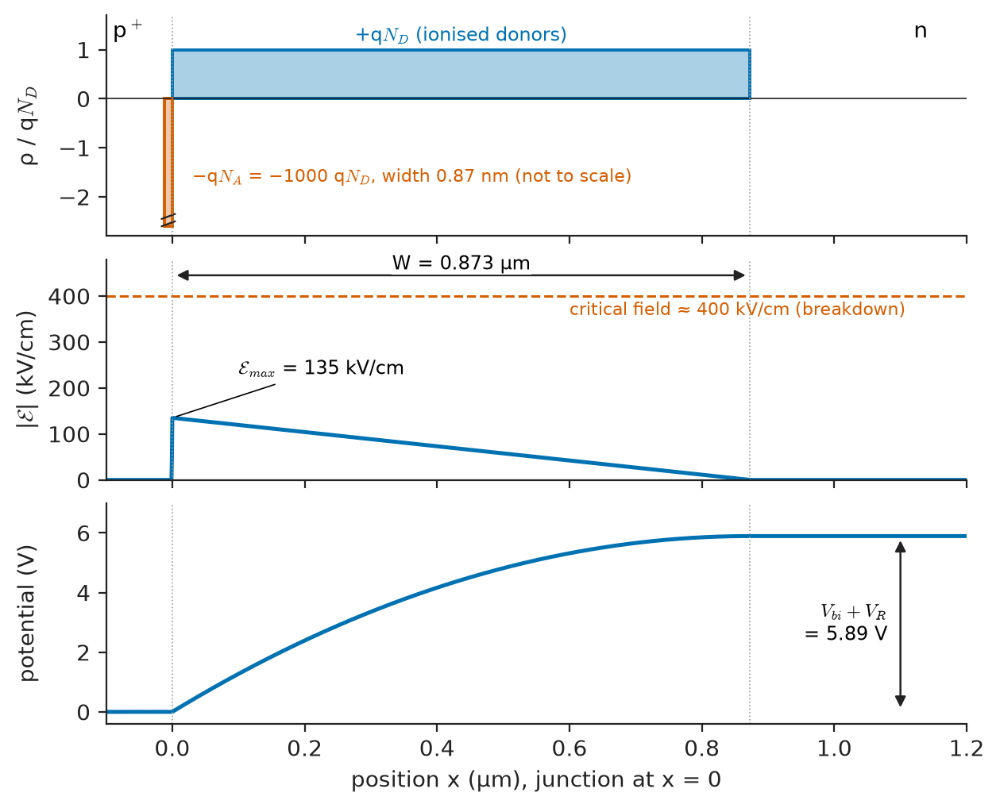
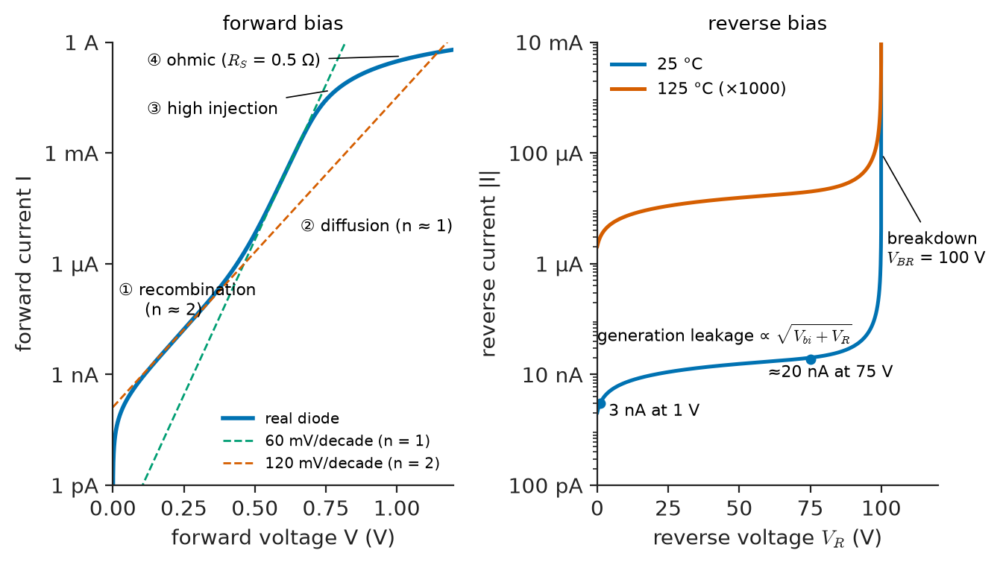
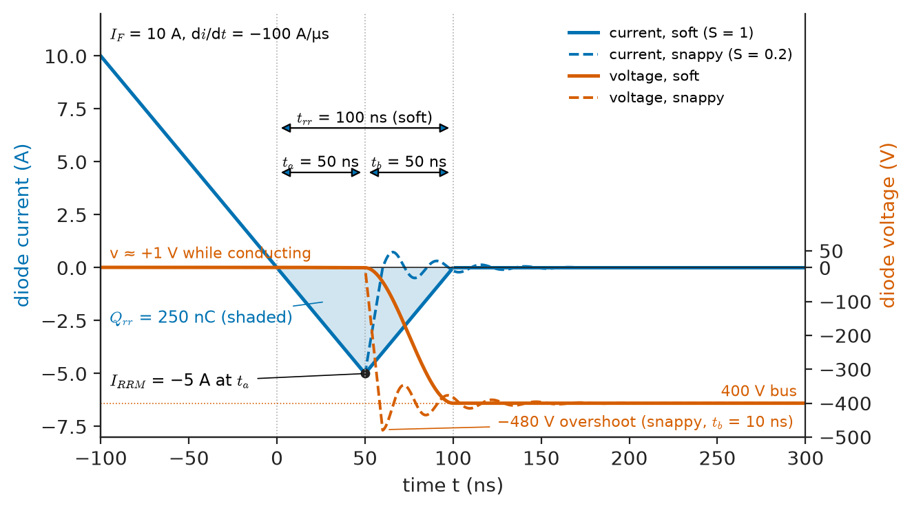
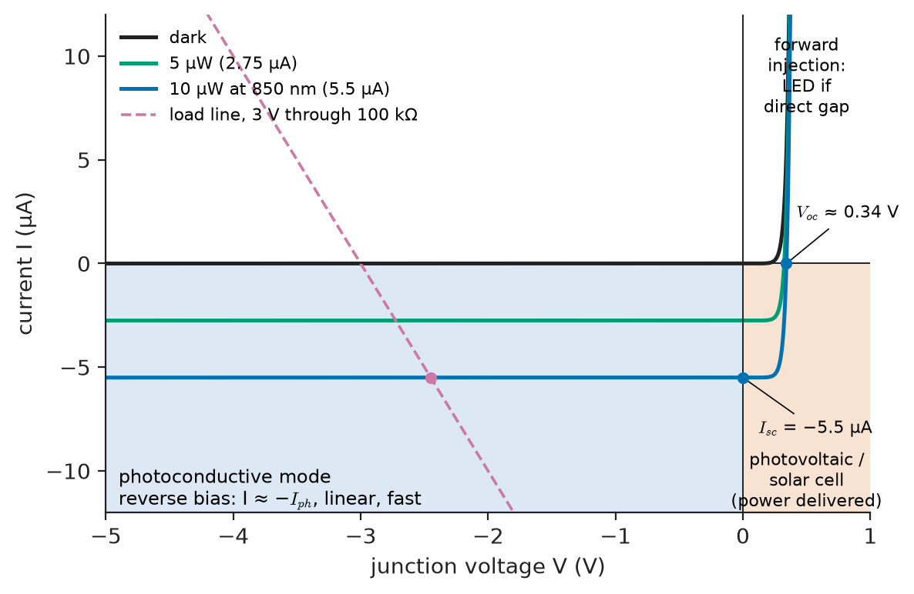
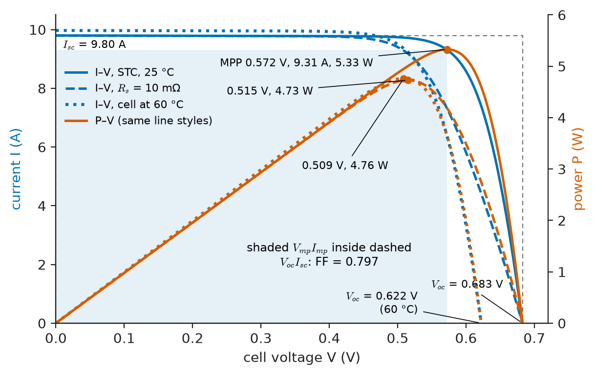
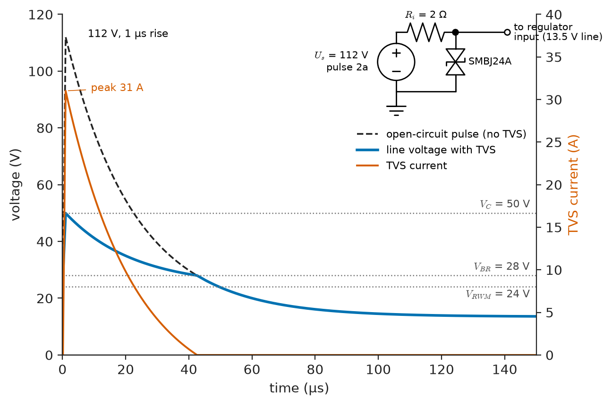

# Chapter 2 — Semiconductor Junction Devices

*Part I · Electronic Devices*

A 24 V industrial sensor module passes every bench test and then fails in the field at a rate of a few per thousand, always on lines fed by long cables through the plant. The post-mortem finds three different junction devices at fault. A reverse-polarity diode in the supply input has run hot enough in a 60 °C cabinet to discolour the board. The transient-voltage suppressor on the same line is rated for the right working voltage but clamps too high during the surges of nearby contactors, so the regulator behind it breaks down. And an infrared photodiode in the optical position sensor, run with no reverse bias to "save a component", is too slow for the new, faster conveyor. Each failure comes from a property the ideal diode law does not contain: series resistance and heating, avalanche breakdown and its dynamic resistance, voltage-dependent junction capacitance. This chapter takes the junction from that law to the specialised devices built on it and the datasheet parameters by which each is chosen.

> **How does a real p–n junction depart from the ideal Shockley law in forward bias, reverse bias, breakdown and switching?**
> **How are junctions specialised to rectify, regulate, switch fast, detect and emit light, convert sunlight, tune circuits and absorb transients, and what limits each?**
> **Which datasheet parameters decide the choice of each device, and how are its losses and temperatures estimated?**

| Concept | Engineering destination |
|---|---|
| PN-junction operation | Depletion width, field and capacitance; breakdown voltage; stored charge |
| Diode characteristics | Ideality, series resistance, leakage, reverse recovery in every diode circuit |
| Rectifier diodes | Mains rectifiers, freewheel and boost diodes, surge and recovery ratings |
| Zener diodes | Shunt references, clamps, gate protection, level shifting |
| Schottky diodes | Low-voltage rectification, OR-ing, SiC boost diodes in PFC and EV chargers |
| Photodiodes | Optical receivers, lidar, pulse oximeters, encoders, light sensors |
| LEDs | Indicators, lighting, backlights, optocouplers and IR links |
| Solar cells | PV modules, energy harvesting for IoT nodes, spacecraft power |
| Varactor diodes | VCOs, PLL synthesisers, tuners, RF phase shifters |
| Protection diodes | ESD and surge protection (IEC 61000-4-2/-5, ISO 7637-2), flyback clamps, reverse-polarity protection |

**Roadmap.** The junction's electrostatics and switching (2.1) → the real diode characteristic (2.2) → specialised by voltage, current and speed: rectifier (2.3), Zener (2.4) and Schottky (2.5) diodes → junctions and light: photodiode (2.6), LED (2.7), solar cell (2.8) → the junction as a capacitor (2.9) → the junction as a protector (2.10).

---

## 2.1 PN-junction operation

### Where *Engineering Physics* leaves off

*Engineering Physics* derives the ideal diode law $I=I_0(e^{eV/k_BT}-1)$ from minority-carrier diffusion, with $I_0$ set by diffusion lengths and the minority densities $n_{p0}=n_i^2/N_A$ and $p_{n0}=n_i^2/N_D$ ([Ch. 14 §14.5.4](https://github.com/The-Studio-of-Sadiq/Engineering-Physics/blob/main/CHAPTERS/CHAPTER%2014.md)); it adds the ideality factor, the small-signal resistance and the junction capacitance $C_j=C_{j0}(1-V_D/\phi_B)^{-m}$ in [Ch. 18 §18.3.1](https://github.com/The-Studio-of-Sadiq/Engineering-Physics/blob/main/CHAPTERS/CHAPTER%2018.md), and gives the solar cell's ideal $I_{SC}$ and $V_{OC}$ in Ch. 14 §14.5.5, thermionic emission over a metal–semiconductor barrier in §14.6, and light absorption and emission in Ch. 12. Recombination, lifetime and impact ionisation as material properties are in *Materials Science and Engineering*, [Ch. 32 §32.7–32.10](https://github.com/The-Studio-of-Sadiq/Materials-Science-and-Engineering/blob/main/Chapters/CHAPTER%2032.md), and the optoelectronic materials in [Ch. 35](https://github.com/The-Studio-of-Sadiq/Materials-Science-and-Engineering/blob/main/Chapters/CHAPTER%2035.md). Chapter 1 supplied the modelling vocabulary. This chapter adds what lies beyond the ideal law: depletion-region numbers, the real characteristic, breakdown, stored charge, and the specialised junction devices with their ratings.

### Depletion-region numbers

In the depletion approximation, an abrupt junction with doping $N_A$ on the p side and $N_D$ on the n side has a built-in potential and, for the common one-sided case $N_A\gg N_D$, a depletion width, peak field and capacitance per unit area

$$
V_{bi}=V_T\ln\frac{N_AN_D}{n_i^2},\qquad W=\sqrt{\frac{2\varepsilon_s(V_{bi}+V_R)}{qN_D}},\qquad \mathcal E_{max}=\frac{qN_DW}{\varepsilon_s},\qquad \frac{C_j}{A}=\frac{\varepsilon_s}{W}
$$

The depletion region spreads almost entirely into the lightly doped side, which therefore decides breakdown voltage and capacitance, while the heavily doped side decides injection.

**Worked example — a p⁺n junction at 0, 5 and 10 V.** Take $N_A=10^{19}\ \mathrm{cm^{-3}}$, $N_D=10^{16}\ \mathrm{cm^{-3}}$, silicon at 300 K ($n_i=1.0\times10^{10}\ \mathrm{cm^{-3}}$, $\varepsilon_s=11.7\varepsilon_0$, $V_T=25.85$ mV). Then $V_{bi}=0.02585\ln(10^{35}/10^{20})=0.893$ V. At zero bias $W=0.340$ µm, $\mathcal E_{max}=52.6$ kV/cm and $C_j/A=30.5\ \mathrm{nF/cm^2}$, i.e. 30.5 pF for a 0.1 mm² die. At 5 V reverse: $W=0.873$ µm, $\mathcal E_{max}=135$ kV/cm, 11.9 pF. At 10 V: $W=1.19$ µm, $\mathcal E_{max}=184$ kV/cm, 8.7 pF. The capacitance follows $(V_{bi}+V_R)^{-1/2}$, the abrupt-junction case $m=0.5$ of the physics book's formula. Breakdown occurs when the peak field reaches the critical field, about 0.40 MV/cm at this doping (*Materials Science and Engineering* Ch. 32 §32.10), which gives $V_{BR}\approx\varepsilon_s\mathcal E_c^2/(2qN_D)=52$ V. Repeating the estimate at $10^{15}$ and $10^{17}\ \mathrm{cm^{-3}}$ gives about 290 V and 9 V: every decade less doping buys roughly a factor of 5.6 in blocking voltage, at the price of a wider, more resistive drift region, the trade-off that SiC, with ten times the critical field, relaxes (Chapter 5).

<!-- FIGURE 2.1 | figures/ch02/fig-2-1-depletion-electrostatics.png | plot | Charge density, electric field and potential across an abrupt p+n silicon junction at 5 V reverse bias. | Content: three stacked panels sharing x from -0.1 to 1.2 um (junction at x = 0). Doping NA = 1e19 cm^-3, ND = 1e16 cm^-3. Top: space-charge density, a tall thin negative rectangle on the p side (width about 0.9 nm, not to scale) and a positive rectangle of height q ND extending to W = 0.873 um on the n side. Middle: electric field magnitude, triangle peaking at 135 kV/cm at x = 0 and falling linearly to zero at 0.873 um. Bottom: potential rising by Vbi + VR = 5.89 V across the depletion region, parabolic. Annotate W, Emax and the critical field 400 kV/cm as a dashed line in the middle panel. -->



*Figure 2.1 — Charge density, electric field and potential across an abrupt p+n silicon junction at 5 V reverse bias.*

### Breakdown: avalanche and Zener

Two mechanisms end the blocking region. In **avalanche breakdown** carriers accelerated by the depletion field gain enough energy to create electron–hole pairs by impact ionisation, and the multiplication runs away; it dominates in silicon junctions breaking down above about 6 V, and its voltage *rises* with temperature, about +0.06 to +0.1 %/K, because phonon scattering steals energy from the carriers. In **Zener (tunnelling) breakdown**, in heavily doped junctions with depletion widths under about 10 nm, electrons tunnel directly from the valence band on the p side to the conduction band on the n side; it dominates below about 5 V, and its voltage *falls* with temperature because the band gap shrinks. Between about 5 and 6 V both contribute and the temperature coefficients cancel (Section 2.4). Both mechanisms are reversible; the device fails by heating, not by breakdown itself.

### Stored charge and switching

A forward-biased junction holds a charge of injected minority carriers, $Q_s=\tau_TI_F$, where the transit time $\tau_T$ is close to the minority-carrier lifetime for a long-base diode and much shorter for a thin, narrow-base one. Before the junction can block reverse voltage this charge must be removed, by reverse current and by recombination. That is the origin of **reverse recovery** (Section 2.2), of the turn-off delay of saturated BJTs (Chapter 3), and of the switching losses of every bipolar power device. Lifetime is therefore a design variable: power-diode makers shorten it deliberately with gold, platinum or electron irradiation, accepting higher leakage and forward voltage to switch faster (*Materials Science and Engineering* Ch. 32 §32.8).

> **Status of the principle: Depletion approximation**
> *Approximate.* It assumes the depletion region is free of mobile carriers and has abrupt edges; it predicts width, field and capacitance to within a few per cent when $V_{bi}+V_R\gg V_T$, and fails in forward bias near and beyond $V_{bi}$, where injected carriers fill the depletion region.

---

## 2.2 Diode characteristics

### The four regimes of forward current

Plotted on a logarithmic current axis, a real silicon diode's forward characteristic is not one straight line but four segments (Figure 2.2):

1. **Recombination current** (low current, typically below 1–10 µA in a signal diode): carriers recombine inside the depletion region through mid-gap traps, giving $I\propto e^{V/2V_T}$, a slope of 120 mV per decade.
2. **Diffusion current** (the ideal law): $I\propto e^{V/V_T}$, 60 mV per decade at 300 K. Over this range the device follows the physics book's equation.
3. **High injection**: when the injected minority density approaches the doping of the lightly doped side, the slope returns towards 120 mV per decade. The physics book's low-injection assumption is violated here.
4. **Ohmic region**: at the highest currents the drop across the bulk, contacts and leads, $IR_S$, dominates, and the curve bends towards a straight line on a linear plot.

A single exponential with an average ideality factor $n$ between 1 and 2 and a series resistance $R_S$, the model of Chapter 1, fits about three decades of current around the range it was extracted from. The 1N4148's fitted $n=1.752$ is such an average. Precision circuits (log amplifiers, temperature sensors, bandgap references) therefore use transistor base–emitter junctions, whose collector current keeps $n$ within 1.00–1.01 over six or more decades because recombination current flows in the base (Chapter 3).

<!-- FIGURE 2.2 | figures/ch02/fig-2-2-real-diode-characteristic.png | plot | Complete characteristic of a real silicon diode on a logarithmic current scale, showing the four forward regimes and the reverse leakage and breakdown. | Content: left panel forward bias, x = V from 0 to 1.2 V, y = I from 1 pA to 1 A log. Dashed straight reference lines of slope 60 mV/decade (n = 1) and 120 mV/decade (n = 2). Solid curve: n = 2 recombination segment below 1 uA, n = 1 diffusion segment 10 uA to 10 mA, high-injection bend above 30 mA, ohmic bend above 100 mA due to Rs = 0.5 Ohm. Label the four regimes. Right panel reverse bias, x = reverse voltage 0 to 120 V, y = reverse current magnitude 100 pA to 10 mA log: generation leakage rising slowly as the square root of voltage from 3 nA at 1 V to 20 nA at 75 V (25 C), a second curve 1000 times higher for 125 C, and a vertical breakdown knee at 100 V. -->



*Figure 2.2 — Complete characteristic of a real silicon diode on a logarithmic current scale, showing the four forward regimes and the reverse leakage and breakdown.*

### Reverse current

In reverse bias the ideal law predicts a constant $-I_0$, picoamperes or less for a small silicon diode. Measured leakage is several orders of magnitude larger and grows with voltage, because it is dominated by **generation current** in the depletion region (proportional to $n_iW$, and so to roughly $\sqrt{V_{bi}+V_R}$) and by **surface leakage** at the edges of the die. It doubles roughly every 10 K in silicon (Chapter 1, Section 1.7). The hot value on the datasheet is the one that matters for sample-and-hold circuits, high-impedance inputs and battery standby current.

### Capacitances

The **junction capacitance** $C_j$ (Section 2.1) dominates in reverse bias: a few picofarads for signal diodes, tens to hundreds for rectifiers, and the working element of varactors (Section 2.9). The **diffusion capacitance** $C_d=\tau_TI_F/nV_T$ dominates in forward bias; it is the small-signal face of the stored charge, and it makes forward-biased PIN diodes useful as current-controlled RF resistors in attenuators and transmit–receive switches.

### Reverse recovery

A conducting diode driven into reverse does not stop conducting at once. Figure 2.3 shows a diode commutated at a fixed $di/dt$ (set by a switch and the commutation inductance). The current falls through zero and continues negative, supported by the stored charge, until the junction edge is depleted at the peak reverse-recovery current $I_{RRM}$; it then decays to the leakage value. The total time is the reverse-recovery time $t_{rr}=t_a+t_b$, the integral of the reverse current the **recovered charge** $Q_{rr}\approx\tfrac12I_{RRM}t_{rr}$, and the ratio $S=t_b/t_a$ the **softness**. A snappy diode ($S\ll1$) cuts off its reverse current abruptly, and $L\,di/dt$ in the circuit inductance then produces voltage overshoot and ringing, a common source of EMI and of overvoltage failure in converters.

<!-- FIGURE 2.3 | figures/ch02/fig-2-3-reverse-recovery.png | waveform | Reverse-recovery current and voltage of a fast power diode commutated at a fixed rate, comparing soft and snappy recovery. | Content: x axis time from -100 to 300 ns, left y axis diode current from -8 A to +12 A, right y axis diode voltage from -500 to +50 V. Current ramps down from IF = 10 A at di/dt = -100 A/us, crosses zero at t = 0, reaches peak reverse current IRRM = -5 A at ta = 50 ns. Soft diode (solid): recovers to zero over tb = 50 ns (S = 1), trr = 100 ns, Qrr = 250 nC shaded. Snappy diode (dashed): recovers over tb = 10 ns with the reverse voltage overshooting to -480 V against a 400 V bus and ringing. Voltage trace: near +1 V while conducting, then rising to -400 V during tb. Label ta, tb, trr, IRRM, Qrr. -->



*Figure 2.3 — Reverse-recovery current and voltage of a fast power diode commutated at a fixed rate, comparing soft and snappy recovery.*

The loss caused by recovery appears mostly in the *opposite* switch, which must carry the load current plus the reverse current while it still supports most of the supply voltage. A rough upper estimate of the extra loss is $P_{rr}\approx Q_{rr}V_Rf_{sw}$: a fast diode with $Q_{rr}=50$ nC in a 400 V converter at 100 kHz costs about 2 W. This is why silicon PN diodes are replaced by SiC Schottky diodes, which have no stored charge, in high-voltage power-factor correctors and EV on-board chargers (Section 2.5 and Chapter 29).

> **Status of the principle: Recovered charge equals stored charge**
> *Approximate.* $Q_{rr}$ is at most the stored charge $\tau_TI_F$ and is reduced by recombination during the fall of the current, so it depends on $di/dt$, forward current and temperature; datasheet values hold only at the stated test conditions, and $Q_{rr}$ typically doubles between 25 °C and 125 °C.

---

## 2.3 Rectifier diodes

### What a rectifier is specified for

A rectifier diode is a p–i–n structure optimised for current and blocking voltage, not for speed: a heavily doped p⁺ anode, a lightly doped n⁻ drift region whose thickness and doping set the voltage rating (Section 2.1), and an n⁺ cathode. In conduction the drift region is flooded with stored carriers (conductivity modulation), which keeps the forward voltage near 1 V even through tens of micrometres of nearly intrinsic silicon, but makes the diode slow to recover. The datasheet parameters are:

- $V_{RRM}$, the repetitive peak reverse voltage, and $V_{RSM}$, the non-repetitive surge value;
- $I_{F(AV)}$, the average forward current at a stated lead or case temperature, usually for half-sine conduction;
- $I_{FSM}$, the non-repetitive surge current, typically a single 8.3 ms or 10 ms half-sine (one half cycle of 60 or 50 Hz), and the fusing integral $I^2t$, which sets protection against capacitor-charging inrush;
- $V_F$ at rated current, and for power devices the threshold–slope model $V_F=V_{F0}+r_TI_F$;
- $I_R$ at $V_{RRM}$, at 25 °C and at high temperature;
- $t_{rr}$ (or $Q_{rr}$) at stated $I_F$, $di/dt$ and $V_R$.

**Table 2.1 — Representative rectifier and fast diodes (datasheet maxima unless marked typical).**

| Part (class) | $V_{RRM}$ | $I_{F(AV)}$ | $I_{FSM}$ | $V_F$ at rated $I_F$ | $t_{rr}$ |
|---|---|---|---|---|---|
| 1N4007 (standard recovery) | 1000 V | 1 A | 30 A | 1.1 V | ≈ 2 µs (typ) |
| 1N5408 (standard recovery) | 1000 V | 3 A | 200 A | 1.2 V | ≈ 2 µs (typ) |
| UF4007 (ultrafast) | 1000 V | 1 A | 30 A | 1.7 V | 75 ns |
| MUR460 (ultrafast) | 600 V | 4 A | 110 A | 1.28 V | 75 ns |
| 650 V, 10 A SiC Schottky | 650 V | 10 A | 70–90 A | 1.5 V (typ, 25 °C) | none (capacitive charge ≈ 25 nC) |

Standard-recovery diodes belong in 50/60 Hz rectifiers, where their slow, gentle recovery is harmless and generates little conducted noise. At 20 kHz and above, ultrafast silicon or SiC devices are required. The general trade-off is visible in the table: faster recovery costs forward voltage, because the lifetime-killing that speeds recovery also reduces conductivity modulation.

### Conduction loss and junction temperature

With the threshold–slope model, the average conduction loss of a diode carrying a current of average $I_{av}$ and RMS value $I_{rms}$ is

$$
P_F=V_{F0}\,I_{av}+r_T\,I_{rms}^2
$$

because $V_{F0}$ multiplies the instantaneous current and $r_T$ its square. The RMS value matters because rectifier currents are peaky: a diode feeding a reservoir capacitor conducts in short pulses whose RMS value is two to three times the average (Chapter 6 computes them).

**Worked example — a 3 A rectifier in a capacitor-input supply.** Each diode of a bridge in a 60 W, 24 V linear supply carries $I_{av}=1.5$ A with $I_{rms}=3.2$ A (pulsed conduction). For a 1N5408 class device, fit $V_{F0}=0.75$ V and $r_T=0.07\ \Omega$ to the typical curve (0.96 V at 3 A, inside the 1.2 V maximum). The loss is $0.75\times1.5+0.07\times3.2^2=1.13+0.72=1.84$ W per diode. With leads soldered to a board at 9.5 mm length, the datasheet gives $R_{\theta JA}\approx20$ K/W, so in a 50 °C enclosure $T_J=50+1.84\times20=87$ °C, comfortably below the 150–175 °C limit. The $r_TI_{rms}^2$ term is 39 % of the loss; using the average current in it instead of the RMS value would have underestimated the total by 30 %.

---

## 2.4 Zener diodes

### Breakdown as a feature

A Zener diode is a junction doped so that it breaks down at a controlled voltage $V_Z$, from about 2.4 V to 200 V, and built to dissipate the power of operating in breakdown. Despite the name, only devices below about 5 V break down by the Zener (tunnelling) mechanism; above about 6 V they are avalanche diodes (Section 2.1). In breakdown the device is modelled as a voltage source $V_Z$ in series with a **dynamic (Zener) impedance** $r_z=dV/dI$, specified at a test current $I_{ZT}$. Below a knee current $I_{ZK}$, the characteristic rounds off and $r_z$ rises by an order of magnitude, especially for low-voltage parts, where the tunnelling knee is soft.

**Table 2.2 — Zener diode behaviour versus voltage (typical small-signal 300–500 mW parts).**

| $V_Z$ | Mechanism | $r_z$ at 5 mA | Temperature coefficient | Comment |
|---|---|---|---|---|
| 2.4–3.9 V | Zener (tunnelling) | 70–100 Ω | about −2 mV/K | Soft knee; poor reference |
| 4.7–5.6 V | Mixed | 10–60 Ω | near zero (±1 mV/K) | Best temperature stability of plain Zeners |
| 6.2–6.8 V | Avalanche | 5–15 Ω | +2 to +3 mV/K | Lowest $r_z$; with a forward diode in series, a compensated reference |
| 10 V | Avalanche | 15–20 Ω | about +7 mV/K (+0.07 %/K) | |
| 15–24 V | Avalanche | 30–70 Ω | +12 to +20 mV/K | Clamps, gate protection |

A 6.2 V avalanche diode in series with a forward-biased junction (whose −2 mV/K cancels the Zener's +2 mV/K) gives the temperature-compensated references of the 1N821–1N829 family, with coefficients down to 5 ppm/K. Buried Zeners in precision ICs reach a few ppm/K; bandgap references (Chapter 10) have replaced Zeners for most low-voltage references, but Zeners remain the simplest clamps.

### The shunt regulator as a device application

The classic use of a Zener is a shunt clamp fed through a resistor from an unregulated supply, a direct exercise in the device's ratings (regulators proper are in Chapter 10).

**Worked example — a 5.1 V Zener shunt from a 12 V ±10 % rail.** The load draws 0 to 10 mA, and the Zener (BZX84C5V1 class, 300 mW in SOT-23, $r_z\approx30\ \Omega$ typical at 5 mA) needs at least about 2 mA to stay beyond its knee. The worst case for starving the Zener is minimum input and maximum load: $R\le(10.8-5.1)/(10+2)\ \mathrm{mA}=475\ \Omega$; choose 470 Ω. The worst case for the Zener's dissipation is maximum input and no load: $I_Z=(13.2-5.1)/470=17.2$ mA and $P_Z=5.1\times17.2=88$ mW, well inside 300 mW; the resistor dissipates $8.1^2/470=0.14$ W, so a 0.25 W part is the minimum. Regulation follows from the small-signal model: a 2.4 V change of input moves the output by $2.4\times30/(470+30)=144$ mV (line regulation 6 %), and a 10 mA load step moves it by $10\ \mathrm{mA}\times(30\parallel470)=0.28$ V.
> **Status of the principle: Zener model, $V=V_Z+r_zI$**
> *Approximate.* A straight-line fit to the breakdown characteristic around $I_{ZT}$; it fails below the knee current, where $r_z$ rises sharply, and at high dissipation, where self-heating shifts $V_Z$ by the temperature coefficient times $P_ZR_{\theta JA}$.

---

## 2.5 Schottky diodes

### The metal–semiconductor junction

A Schottky diode replaces the p⁺ region with a metal (or a metal silicide) on lightly doped n-type silicon. The rectifying barrier of height $\phi_B$ (0.5–0.9 eV for practical metals on n-Si) passes current by thermionic emission of majority carriers over the barrier, the Richardson–Dushman physics of *Engineering Physics* [Ch. 14 §14.6](https://github.com/The-Studio-of-Sadiq/Engineering-Physics/blob/main/CHAPTERS/CHAPTER%2014.md), so the saturation current is

$$
I_S=AA^{*}T^2e^{-\phi_B/V_T}
$$

with $A^{*}\approx110$–$120\ \mathrm{A\,cm^{-2}K^{-2}}$ for n-type silicon. Two engineering consequences follow.

- **Lower forward voltage.** For a 1 mm² die, $\phi_B=0.60$ eV gives $I_S=9.0$ µA at 300 K, against the order of $10^{-12}$ A for a silicon PN junction of similar area. At 1 A the ideal Schottky drop is $V_T\ln(1/I_S)=0.30$ V, versus 0.71 V for the PN junction: a saving of about 0.4 V at every current. Lowering the barrier to 0.55 eV saves another 50 mV.
- **No stored minority charge.** Current is carried by majority carriers, so there is no reverse recovery: only the junction capacitance must be charged. Schottky diodes switch in nanoseconds, limited by $C_j$.

The cost is leakage. The same small barrier that lowers $V_F$ raises the reverse saturation current exponentially, and image-force barrier lowering under reverse field makes leakage grow with voltage. Schottky leakage is milliamperes in a 3 A power part at 100 °C and doubles every 6–8 K. Each 0.1 eV of barrier trades about 100 mV of forward drop against a factor of 50 in leakage. Silicon Schottky diodes are also limited to about 200 V, because the thick drift region needed for higher voltage would add series resistance without the conductivity modulation that keeps PN rectifiers' forward drops low.

**Table 2.3 — Representative Schottky diodes (datasheet values).**

| Part (class) | $V_{RRM}$ | $I_{F(AV)}$ | $V_F$ | $I_R$ at $V_{RRM}$ |
|---|---|---|---|---|
| BAT54 (small signal) | 30 V | 200 mA | 0.32 V at 1 mA; 0.40 V at 10 mA (max) | 2 µA at 25 V |
| 1N5819 | 40 V | 1 A | 0.60 V at 1 A (max) | 1 mA (25 °C), 10 mA (100 °C) |
| SS34 (SMC) | 40 V | 3 A | 0.50 V at 3 A (max) | 0.5 mA (25 °C), 20 mA (100 °C) |
| 650 V SiC Schottky (TO-220) | 650 V | 10 A | 1.5 V at 10 A (typ, 25 °C) | 1–50 µA |

**Worked example — Schottky versus fast PN diode at 1.75 A average.** A freewheeling diode in a 3 A, 5 V point-of-load supply carries 1.75 A average. An SS34-class Schottky at its operating temperature drops about 0.45 V, losing $0.45\times1.75=0.79$ W; a fast-recovery silicon PN diode at about 0.85 V would lose $1.49$ W plus its recovery loss. The Schottky saves about 0.7 W, roughly 5 % of a 15 W output. Its price is leakage: at a junction temperature of 100 °C and 12 V reverse, a few milliamperes flow for the 42 % of the time the diode blocks, some 20–40 mW, negligible here. In a sealed automotive enclosure where the junction runs 15 K hotter, leakage grows a further factor of four, and since leakage heats the junction, a poorly cooled Schottky can run away thermally in reverse, a failure PN rectifiers do not show. Low-voltage converters avoid both losses with a synchronous MOSFET (Chapter 30).

### SiC Schottky diodes

In silicon carbide, with ten times silicon's critical field, a Schottky drift region for 650 or 1200 V is thin enough to have low resistance (Chapter 5). SiC Schottky diodes have only a small, temperature-independent capacitive charge and a positive temperature coefficient of $V_F$ at rated current, so they parallel well; they are standard as boost diodes in server and telecom power-factor correctors and EV on-board chargers, removing the $Q_{rr}V_Rf_{sw}$ loss of Section 2.2.

> **Status of the principle: Thermionic-emission Schottky law**
> *Approximate.* The ideal law with $n$ close to 1.02–1.1 describes Schottky diodes over several decades of forward current; it fails at reverse bias, where barrier lowering and edge leakage make the current voltage-dependent, and at high current, where series resistance dominates.

---

## 2.6 Photodiodes

### The junction as a light detector

A photon of energy $h\nu>E_g$ absorbed in or near the depletion region creates an electron–hole pair; the junction field separates it and a **photocurrent** $I_{ph}$ flows in the reverse direction. The physics of absorption, cut-off wavelength and detector materials is in *Engineering Physics* [Ch. 12](https://github.com/The-Studio-of-Sadiq/Engineering-Physics/blob/main/CHAPTERS/CHAPTER%2012.md) and *Materials Science and Engineering* [Ch. 35 §35.5](https://github.com/The-Studio-of-Sadiq/Materials-Science-and-Engineering/blob/main/Chapters/CHAPTER%2035.md). At the terminals the photodiode is an ordinary diode with a current source in parallel,

$$
I=I_S\left(e^{V/nV_T}-1\right)-I_{ph},\qquad I_{ph}=\mathcal R\,P_{opt},\qquad \mathcal R=\frac{\eta q\lambda}{hc}=\eta\,\frac{\lambda\,[\mathrm{nm}]}{1239.8}\ \mathrm{A/W}
$$

where $\mathcal R$ is the **responsivity** and $\eta$ the external quantum efficiency (electrons collected per incident photon). A perfect detector at 850 nm would deliver 0.686 A/W; a good silicon PIN photodiode reaches 0.55–0.6 A/W there ($\eta$ ≈ 80–90 %).

The same equation describes three uses of one junction (Figure 2.4). In the **photoconductive mode** the diode is reverse biased (third quadrant), the current is $-I_{ph}$ almost independent of voltage, and the response is linear in light over eight to ten decades. In the **photovoltaic mode** the diode drives a high-impedance load or an open circuit, delivering power (fourth quadrant) and a voltage $V_{oc}=nV_T\ln(1+I_{ph}/I_S)$ that is logarithmic in light; at zero voltage (into a transimpedance amplifier) the current is linear and dark current vanishes, the preferred mode for precision low-light work. The solar cell (Section 2.8) is the photovoltaic mode at large area; in the first quadrant a direct-gap junction emits light (Section 2.7).

<!-- FIGURE 2.4 | figures/ch02/fig-2-4-illuminated-junction-quadrants.png | plot | One junction, three uses: the current–voltage characteristic of a p–n junction in the dark and under two illumination levels, with the photoconductive, photovoltaic and light-emitting operating regions. | Content: linear axes V from -5 V to +1 V and I from -12 uA to +12 uA. Dark curve (diode with Is = 10 pA, n = 1). Illuminated curves shifted down by Iph = 5.5 uA (10 uW at 850 nm, responsivity 0.55 A/W) and 2.75 uA (5 uW). Third quadrant shaded and labelled photoconductive (reverse bias, linear, fast), with a load line for 3 V bias through 100 kOhm. Fourth quadrant shaded and labelled photovoltaic and solar cell (power delivered), marking Voc about 0.34 V and Isc = -5.5 uA. First quadrant labelled forward injection: LED if direct gap. -->



*Figure 2.4 — One junction, three uses: the current–voltage characteristic of a p–n junction in the dark and under two illumination levels, with the photoconductive, photovoltaic and light-emitting operating regions.*

### PN, PIN and avalanche photodiodes

Speed and efficiency both want the light absorbed inside the depletion region, where carriers are collected by drift rather than by slow diffusion. A **PIN** photodiode inserts a nearly intrinsic layer, tens of micrometres thick in silicon, that is fully depleted at a few volts. Its bandwidth is set by the smaller of the RC limit $1/(2\pi R_LC_j)$ and the transit-time limit, roughly $0.45\,v_{sat}/W$: for a 50 µm drift region and $v_{sat}\approx10^7$ cm/s, about 0.9 GHz. An **avalanche photodiode** (APD) adds a high-field multiplication region and provides internal gain $M$ of 10–20 in InGaAs and 50–200 in silicon, at bias voltages of 30–60 V (InGaAs) and 100–400 V (Si), with an excess-noise penalty and a gain that falls with temperature (the avalanche coefficients of Section 2.1), so APD bias is temperature-compensated. APDs serve lidar, rangefinders and long-reach fibre receivers; single-photon avalanche diodes (SPADs), biased beyond breakdown, count photons in time-of-flight sensors.

**Table 2.4 — Representative photodiodes (typical values).**

| Type (example class) | Spectral range | $\mathcal R$ at peak | Dark current | Capacitance | Typical use |
|---|---|---|---|---|---|
| Si PIN, 7.5 mm² (BPW34 class) | 400–1100 nm | 0.6 A/W at 900 nm | 2 nA at 10 V | 70 pF at 0 V, 25 pF at 3 V | Light sensors, IR remote, pulse oximetry |
| Si PIN, 1 mm², fast | 320–1100 nm | 0.5 A/W at 800 nm | 0.1 nA at 10 V | 3 pF at 10 V | Encoders, optical links to 100 MHz |
| InGaAs PIN, 75 µm | 900–1700 nm | 0.95 A/W at 1550 nm | 0.5 nA | 0.5 pF | Telecom receivers to 10 Gb/s |
| Si APD, 0.5 mm | 400–1100 nm | 50 A/W at $M=100$ | 1 nA (unity gain) | 1–2 pF | Lidar, rangefinders |
| InGaAs APD | 900–1700 nm | 9 A/W at $M=10$ | 10 nA at $M=10$ | 0.3 pF | Long-reach fibre, OTDR |

**Worked example — reverse bias and speed in the conveyor sensor.** The position sensor of the chapter opening uses a BPW34-class photodiode receiving 10 µW of 850 nm light, with responsivity 0.55 A/W ($\eta=0.55\times1239.8/850=0.80$), so $I_{ph}=5.5$ µA. Read across a 1 kΩ load resistor it gives 5.5 mV, with an RC bandwidth of $1/(2\pi\cdot1\ \mathrm{k\Omega}\cdot70\ \mathrm{pF})=2.3$ MHz at zero bias. A 3 V reverse bias reduces $C_j$ to 25 pF and raises the bandwidth to 6.4 MHz, what the faster conveyor needed. Noise sets the other limit: the photocurrent's shot noise, $\sqrt{2qI_{ph}}=1.33\ \mathrm{pA/\sqrt{Hz}}$, is below the resistor's thermal noise current, $\sqrt{4k_BT/R}=4.07\ \mathrm{pA/\sqrt{Hz}}$, so the resistor limits the signal-to-noise ratio; a transimpedance amplifier (Chapter 8) breaks this trade-off. In the dark, the 2 nA leakage at 10 V contributes a shot noise of 25 fA/√Hz, which corresponds to a **noise-equivalent power** of $25\ \mathrm{fA/\sqrt{Hz}}/0.55\ \mathrm{A/W}=46\ \mathrm{fW/\sqrt{Hz}}$, the ultimate sensitivity of the diode itself.

> **Status of the principle: Photocurrent proportional to optical power**
> *Fundamental.* Each absorbed photon creates at most one electron–hole pair (outside avalanche gain), so $I_{ph}=\eta qP_{opt}/h\nu$ holds exactly; the linearity of real photodiodes fails only at high photocurrent, when series and load resistance forward-bias the junction, and at low bias, when space charge slows collection.

---

## 2.7 LEDs

### Forward voltage, photon energy and efficiency

A light-emitting diode is a forward-biased junction in a direct-gap semiconductor, where injected electrons and holes recombine radiatively and emit photons of energy close to $E_g$ ([*Engineering Physics*, Ch. 6 §6.6.3](https://github.com/The-Studio-of-Sadiq/Engineering-Physics/blob/main/CHAPTERS/CHAPTER%206.md); emitter materials and alloys in *Materials Science and Engineering* Ch. 35 §35.4). Modern LEDs use heterostructures with quantum wells to confine carriers, so their electrical behaviour is that of a diode whose forward voltage sits slightly above the **photon voltage** $h\nu/q=1239.8/\lambda[\mathrm{nm}]$: 2.76 V at 450 nm, 1.98 V at 625 nm, 1.46 V at 850 nm. Series resistance and heterobarriers add a few hundred millivolts at rated current.

Three efficiencies describe an LED: the **internal quantum efficiency** (IQE, the fraction of injected carriers that recombine radiatively), the **external quantum efficiency** (EQE = IQE × light-extraction efficiency, photons out per electron in) and the **wall-plug efficiency** WPE $=P_{opt}/(I_FV_F)$. Blue InGaN LEDs reach EQE above 70 % at low current density, and white power LEDs (a blue die with a yellow phosphor) reach WPE of 35–50 % and luminous efficacies of 150–200 lm/W in production. All of them lose efficiency at high current density (**efficiency droop**, mainly from Auger recombination) and at high temperature. Every watt that is not light is heat in a tiny junction, so thermal design governs brightness, colour and life.

**Table 2.5 — Representative LED characteristics (typical values at 25 °C).**

| Colour (material) | Peak wavelength | $V_F$ at rated current | Light-output temperature coefficient | Use |
|---|---|---|---|---|
| Infrared (GaAs) | 940 nm | 1.2–1.4 V at 50 mA | −0.3 to −0.5 %/K | Remote controls, optocouplers |
| Infrared (AlGaAs) | 850 nm | 1.4–1.7 V at 100 mA | −0.3 to −0.5 %/K | Proximity sensing, IR illumination, IrDA |
| Red (AlInGaP) | 625 nm | 2.0–2.4 V at 20 mA | −0.5 to −1 %/K | Indicators, signals, automotive tail lights |
| Green (InGaN) | 525 nm | 2.9–3.4 V at 20 mA | −0.2 to −0.3 %/K | Indicators, displays, traffic lights |
| Blue (InGaN) | 450 nm | 2.8–3.2 V at 20 mA | −0.1 to −0.2 %/K | Displays, phosphor pump |
| White (InGaN + phosphor) | broadband | 2.8–3.2 V at 350 mA | −0.1 to −0.3 %/K | Lighting, backlights, headlamps |
| UV-C (AlGaN) | 275 nm | 5–7 V at 100 mA | −0.3 to −0.5 %/K | Disinfection (EQE only a few %) |

### Driving an LED

An LED must be driven with a controlled current, for the reasons of Chapter 1 Section 1.5: light output follows current, while $V_F$ varies by ±10 % between parts and falls by 2 to 4 mV/K as the junction heats. A series resistor from a supply well above $V_F$ is adequate for indicators; lighting and backlights use constant-current drivers (linear or switching, Chapters 10 and 30). Brightness is controlled by **PWM dimming** of the rated current at hundreds of hertz to tens of kilohertz, which keeps colour constant (IEEE 1789 recommends flicker limits), or by **analog dimming**, which shifts the colour of phosphor-converted LEDs slightly. Parallel LEDs without ballast resistors share current badly (the hottest has the lowest $V_F$, the runaway of Chapter 1 Section 1.7), so LEDs are connected in series strings. They tolerate only about 5 V of reverse voltage, and InGaN dies are ESD-sensitive, so LED modules include protection diodes (Section 2.10).

**Worked example — thermal design of a 1 W white LED.** A white power LED runs at 350 mA with $V_F=3.0$ V, so the electrical input is 1.05 W. With a wall-plug efficiency of 40 % it emits 0.42 W of light and dissipates 0.63 W as heat. The package has a junction-to-solder-point thermal resistance of 8 K/W, and the metal-core board and heatsink add 25 K/W to an ambient of 45 °C inside a luminaire. The junction runs at $45+0.63\times(8+25)=65.8$ °C. Light output falls by roughly 0.2 %/K for InGaN, so this LED gives about 8 % less light than at 25 °C, and its forward voltage is about 0.1 V lower. Lumen-maintenance life (L70, the hours until output falls to 70 %, extrapolated from LM-80 data by the TM-21 method) roughly halves for every 10–20 K of junction temperature, so a heatsink 10 K/W worse (+6.3 K) would cost 20–35 % of rated life while barely changing initial brightness.

> **Status of the principle: LED forward voltage near the photon voltage**
> *Approximate.* Energy conservation requires $qV_F$ to exceed roughly $h\nu$ for efficient emission at useful current; actual $V_F$ exceeds $h\nu/q$ by heterobarrier and resistive drops (0.1–0.5 V), and in deep-UV AlGaN devices by several volts, so the photon voltage is a lower bound, not a prediction.

---

## 2.8 Solar cells

### From the ideal cell to the single-diode model

*Engineering Physics* Ch. 14 §14.5.5 gives the ideal solar cell, a photocurrent in parallel with a Shockley diode, its short-circuit current and the logarithmic open-circuit voltage $V_{OC}\approx V_T\ln(I_{SC}/I_0)$, and the Shockley–Queisser efficiency limit of about 33 % for a single junction. A real cell needs three more elements, giving the **single-diode model** used in every PV datasheet fit and system simulator:

$$
I=I_{ph}-I_0\left[\exp\!\left(\frac{V+IR_s}{nV_T}\right)-1\right]-\frac{V+IR_s}{R_{sh}}
$$

with an ideality factor $n$ (1.0–1.5), a **series resistance** $R_s$ (fingers, busbars, contacts, emitter sheet resistance) and a **shunt resistance** $R_{sh}$ (edge leakage, crystal defects). The equation is implicit in $I$, so it is solved numerically. The figure of merit for how "square" the characteristic is, the **fill factor** $FF=P_{max}/(V_{OC}I_{SC})$, is the parameter most sensitive to $R_s$ and $R_{sh}$.

Ratings are given at **standard test conditions** (STC: 1000 W/m², AM1.5G spectrum per IEC 60904-3, cell temperature 25 °C). The listing below fits a single-diode model to a modern 156.75 mm (M2, 244.3 cm²) monocrystalline PERC cell and explores series resistance, shunt resistance and temperature.

```python
import numpy as np
from scipy.optimize import brentq, minimize_scalar

K_EV = 8.617333e-5                      # Boltzmann constant in eV/K

def cell_current(V, T=298.15, Iph=9.80, I0=1.0e-10, n=1.05, Rs=0.003, Rsh=20.0):
    """Single-diode model, I0 scaled from its 25 C value with T^3*exp(-Eg/kT)."""
    VT = K_EV * T
    I0T = I0 * (T / 298.15)**(3 / n) * np.exp(1.12 / (n * K_EV) * (1 / 298.15 - 1 / T))
    IphT = Iph * (1 + 0.0005 * (T - 298.15))          # Isc tempco +0.05 %/K
    f = lambda I: IphT - I0T * np.expm1((V + I * Rs) / (n * VT)) - (V + I * Rs) / Rsh - I
    return brentq(f, -10 * Iph, 2 * Iph)               # implicit in I: solve numerically

def summary(**p):
    Isc = cell_current(0.0, **p)
    Voc = brentq(lambda V: cell_current(V, **p), 0.0, 0.8)
    res = minimize_scalar(lambda V: -V * cell_current(V, **p), bounds=(0, Voc), method="bounded")
    Vm = res.x; Im = cell_current(Vm, **p)
    return Isc, Voc, Vm, Im, Vm * Im, Vm * Im / (Isc * Voc)

for label, p in [("STC 25 C", {}), ("Rs = 10 mOhm", {"Rs": 0.010}),
                 ("Rsh = 2 Ohm", {"Rsh": 2.0}), ("cell at 60 C", {"T": 333.15})]:
    Isc, Voc, Vm, Im, Pm, FF = summary(**p)
    print(f"{label:12s} Isc={Isc:5.2f} A  Voc={Voc:.3f} V  Vmp={Vm:.3f} V  Imp={Im:4.2f} A  "
          f"Pmax={Pm:4.2f} W  FF={FF:.3f}  eta={Pm / (0.02443 * 1000) * 100:4.1f} %")
```

`cell_current` solves the implicit model with a bracketing root finder, scaling $I_0$ with temperature as in Chapter 1 Section 1.7; `summary` finds $I_{SC}$, $V_{OC}$ and the maximum-power point:

```text
STC 25 C     Isc= 9.80 A  Voc=0.683 V  Vmp=0.572 V  Imp=9.31 A  Pmax=5.33 W  FF=0.797  eta=21.8 %
Rs = 10 mOhm Isc= 9.80 A  Voc=0.683 V  Vmp=0.515 V  Imp=9.19 A  Pmax=4.73 W  FF=0.707  eta=19.4 %
Rsh = 2 Ohm  Isc= 9.79 A  Voc=0.682 V  Vmp=0.572 V  Imp=9.06 A  Pmax=5.18 W  FF=0.777  eta=21.2 %
cell at 60 C Isc= 9.97 A  Voc=0.622 V  Vmp=0.509 V  Imp=9.36 A  Pmax=4.76 W  FF=0.768  eta=19.5 %
```

**Worked example — what the numbers say about a cell.** At STC the model cell delivers 5.33 W at 0.572 V and 9.31 A, 21.8 % efficient with a fill factor of 0.797. Raising $R_s$ from 3 to 10 mΩ, the effect of a cracked finger or a poor solder joint to the ribbon, costs 11 % of the power and drops the fill factor to 0.707 without changing $V_{OC}$ or $I_{SC}$: series resistance hides from the two numbers most often measured. A shunt of 2 Ω costs 2.8 % at full sun, and much more at low irradiance, where the shunt current is a larger fraction of the photocurrent. Heating the cell to 60 °C, a normal operating temperature on a sunny roof, lowers $V_{OC}$ by 61 mV (−1.74 mV/K, or −0.26 %/K) and the power by 10.7 % (−0.31 %/K), while $I_{SC}$ rises slightly. Datasheets of crystalline-silicon modules give power coefficients of −0.29 to −0.40 %/K; module temperatures are characterised by the nominal module operating temperature (NMOT, IEC 61215), typically 41–45 °C at 800 W/m² and 20 °C ambient.

<!-- FIGURE 2.5 | figures/ch02/fig-2-5-solar-cell-iv.png | plot | Current–voltage and power–voltage curves of a single-diode model of a 244 cm2 PERC silicon cell, showing the effect of series resistance and temperature. | Content: x axis V from 0 to 0.72 V; left y axis I from 0 to 10.5 A; right y axis P from 0 to 6 W. Curves computed with Iph = 9.80 A, I0 = 1.0e-10 A, n = 1.05, Rs = 3 mOhm, Rsh = 20 Ohm. Solid: STC 25 C, I-V and P-V, MPP marked at 0.572 V, 9.31 A, 5.33 W, Voc = 0.683 V, Isc = 9.80 A. Dashed: Rs = 10 mOhm, MPP 0.515 V, 4.73 W. Dotted: cell at 60 C, Voc = 0.622 V, MPP 0.509 V, 4.76 W. Shade the fill-factor rectangle Vmp x Imp inside Voc x Isc for the STC curve. -->



*Figure 2.5 — Current–voltage and power–voltage curves of a single-diode model of a 244 cm2 PERC silicon cell, showing the effect of series resistance and temperature.*

### Cells in series, mismatch and bypass diodes

A 60-cell module connects its cells in series to reach about 34 V at the maximum-power point, so all cells carry the same current. A shaded cell is forced into reverse bias by the string current and dissipates the power of the others: a **hot spot** that can exceed 100 °C and crack glass or burn the backsheet. Modules therefore carry **bypass diodes**, usually three Schottky diodes in the junction box each across 20 cells. The shaded cell's reverse voltage is then limited to the other 19 cells' voltages plus one diode drop, about 11–12 V, and the module loses a third of its voltage rather than its whole output. The bypass diodes carry 10–14 A for hours at 70–85 °C, hence Schottky or MOSFET-based devices. Partial shading also gives the power–voltage curve several local maxima, which complicates maximum-power-point tracking (Chapter 32). The plant-level design of PV systems, inverters and their grid connection belongs to *Electrical Energy and Machines*, [Ch. 15](https://github.com/The-Studio-of-Sadiq/Electrical-Energy-and-Machines/blob/main/part-4-power-generation/15-renewable-energy-systems.md).

> **Status of the principle: Single-diode solar-cell model**
> *Approximate.* A lumped equivalent circuit fitted to measured I–V curves; it reproduces commercial silicon cells to within about 1 % near the maximum-power point, but distributed series resistance, a second recombination diode, reverse-bias breakdown of shaded cells and spectral effects require extended models.

---

## 2.9 Varactor diodes

### The junction as a voltage-controlled capacitor

A reverse-biased junction is a capacitor whose value depends on the voltage, $C_j=C_{j0}(1+V_R/\phi)^{-m}$ in the reverse-bias form of the physics book's law. A **varactor** (varicap) is a diode optimised for that capacitance: a controlled doping profile to set the exponent $m$, a low series resistance $R_s$ for high quality factor $Q=1/(\omega R_sC_j)$, and low leakage. An abrupt junction has $m=0.5$ (Section 2.1); **hyperabrupt** junctions, with doping that falls away from the junction, have $m$ from 0.75 to about 2 over part of their range, and give a larger capacitance ratio for a given voltage swing, the key specification for wide tuning from a low supply. Representative devices have capacitance ratios of 2–15 over 1–25 V, with $C$ from below 1 pF (microwave) to several hundred picofarads (AM broadcast tuners) and $Q$ of 50–500 at their rated frequency.

Varactors tune the LC tanks of voltage-controlled oscillators in PLL frequency synthesisers (Chapter 9), in TV and radio tuners and in RF phase shifters and tunable filters. Because the capacitance depends on the *total* junction voltage, a large RF swing modulates its own capacitance, distorting the waveform and adding phase noise; tanks therefore use two varactors back to back, so that the modulation of one cancels the other's.

**Worked example — a varactor-tuned FM-band oscillator.** An oscillator tank with $L=100$ nH must tune 88–108 MHz. The required total tank capacitance is $C=1/(4\pi^2f^2L)$: 32.7 pF at 88 MHz and 21.7 pF at 108 MHz. With 5 pF of fixed parasitic and transistor capacitance, the varactor must swing from 27.7 pF to 16.7 pF, a ratio of 1.66. An abrupt varactor ($m=0.5$, $\phi=0.75$ V) starting at 1 V reverse bias needs $(V_R+0.75)/(1+0.75)=1.66^2$, so the top of the band is at $V_R=4.06$ V, within a 5 V supply, and the varactor's zero-bias capacitance must be $C_{j0}=27.7\sqrt{1.75/0.75}=42.3$ pF. The average tuning sensitivity is $(108-88)/(4.06-1)=6.5$ MHz/V, but it is not constant: 10.7 MHz/V at the bottom of the band and 4.3 MHz/V at the top, a variation of loop gain that the PLL designer must accommodate. With $R_s=0.5\ \Omega$, the varactor's $Q$ at 88 MHz is $1/(2\pi\cdot88\ \mathrm{MHz}\cdot0.5\ \Omega\cdot27.7\ \mathrm{pF})=131$, adequate for a broadcast VCO.

---

## 2.10 Protection diodes

### The threats

Electronic equipment must survive transients far larger than its working voltages. The main ones, each defined by a standard test waveform, are:

- **electrostatic discharge** (IEC 61000-4-2): up to 8 kV contact and 15 kV air discharge, a 30 A peak (at 8 kV contact) with a 0.7–1 ns rise and about 60 ns duration;
- **surges** (IEC 61000-4-5): 1.2/50 µs voltage and 8/20 µs current waveforms of 0.5–4 kV from lightning and power-system switching;
- **automotive transients** (ISO 7637-2, ISO 16750-2): inductive switching, load dump and reverse battery;
- **inductive kickback** from relays, solenoids and windings switched off by a transistor.

The diode answers are the **transient-voltage suppressor** (TVS, a large-area avalanche diode), **steering-diode arrays**, **flyback diodes** and **reverse-polarity** diodes or MOSFETs.

### TVS diodes and their parameters

A TVS is specified by four voltages and a pulse rating:

- the **reverse stand-off (working) voltage** $V_{RWM}$, the largest voltage at which it conducts only leakage (choose it above the highest normal line voltage);
- the **breakdown voltage** $V_{BR}$ at a test current of 1 mA, about 10–20 % above $V_{RWM}$;
- the **clamping voltage** $V_C$ at the peak pulse current $I_{PP}$, the voltage the protected circuit actually sees;
- the **peak pulse power** $P_{PP}$, usually for a 10/1000 µs waveform (400 W for SMA, 600 W for SMB, 1500 W for SMC packages), with a derating curve versus pulse width: shorter pulses are allowed more power because less heat reaches the die's surroundings.

In breakdown, a TVS behaves like a Zener: $V\approx V_{BR}+r_dI$, with dynamic resistance $r_d=(V_C-V_{BR})/I_{PP}$ of a fraction of an ohm for power types. Because $V_C$ is typically 1.4–1.6 times $V_{RWM}$, the protected circuit must withstand that much more than its working voltage; the opening example's regulator was rated below the TVS's clamping voltage. Bidirectional TVS diodes protect AC or bipolar lines.

**Worked example — clamping an ISO 7637-2 pulse on a 12 V automotive input.** Test pulse 2a (interruption of current in a series inductance) reaches $U_s=+112$ V at the highest severity, from a 2 Ω source, with a 50 µs duration. An SMBJ24A-class TVS has $V_{RWM}=24$ V (above a 24 V jump-start), $V_{BR}\approx28$ V typical and $V_C=38.9$ V at 15.4 A, so $r_d\approx(38.9-28.0)/15.4=0.71\ \Omega$. The clamped current is $I=(112-28)/(2+0.71)=31$ A and the clamping voltage $V_C=28+0.71\times31=50$ V, a peak power of 1.55 kW. The SMB package's 600 W rating is for 10/1000 µs; its derating curve allows roughly 2.5–3 kW for a 50 µs pulse, so the device survives, but every component behind it, the regulator input above all, must be rated for 50 V, not 24 V. If the downstream parts are rated only 40 V, a larger SMC device (lower $r_d$) or a series resistance or inductance ahead of the TVS is needed.

<!-- FIGURE 2.6 | figures/ch02/fig-2-6-tvs-clamping.png | waveform | Clamping of an automotive ISO 7637-2 pulse 2a by a 24 V TVS diode. | Content: inset circuit: pulse generator Us = 112 V with Ri = 2 Ohm feeding a 12 V supply line, TVS SMBJ24A from line to ground, downstream regulator input. Main plot: x axis time 0 to 150 us, y axis voltage 0 to 120 V. Dashed: unclamped open-circuit pulse rising in 1 us to 112 V and decaying exponentially with 50 us duration. Solid: line voltage with TVS, rising to and flattening at about 50 V while the current exceeds a few amps, then following the decaying pulse down past the 28 V breakdown back to 13.5 V. Second y axis: TVS current peaking at 31 A. Horizontal dotted lines at VRWM = 24 V, VBR = 28 V and VC = 50 V. -->



*Figure 2.6 — Clamping of an automotive ISO 7637-2 pulse 2a by a 24 V TVS diode.*

### Data lines and ESD arrays

ESD arrays for USB, HDMI, Ethernet and CAN combine low-capacitance steering diodes, which route the discharge to the supply rail or ground, with one larger TVS from rail to ground. Line capacitance must stay below about 1 pF for USB 2.0 high speed (480 Mb/s) and 0.3–0.5 pF for USB 3.x and HDMI 2.x. The array must sit at the connector, with the shortest possible path to ground, because the 30 A, sub-nanosecond ESD edge drops about 30 V across each nanohenry of trace inductance ($L\,di/dt$ with $di/dt\approx30\ \mathrm{A/ns}$).

### Flyback diodes on inductive loads

When a transistor switches off a relay coil, solenoid or small motor, the inductor maintains its current, and with no path the collector voltage rises until something breaks down. A diode across the coil (cathode to the supply) gives the current a path, clamping the transistor voltage to the supply plus one diode drop. The penalty is slow release: the current then decays with the coil's own time constant. For a 12 V relay with a 400 Ω, 0.5 H coil (30 mA), the decay through a plain diode takes about $\tau\ln(1+RI/V_D)=1.25\ \mathrm{ms}\times\ln(1+12/0.8)=3.5$ ms, which delays contact opening and increases arcing. Adding an 18 V Zener in series with the diode lets the collector rise to $12+18.8=30.8$ V, within a 40 V transistor's rating, and shortens the decay to $1.25\ \mathrm{ms}\times\ln(1+12/18.8)=0.62$ ms. Section 3.10 uses this in a transistor relay driver.

### Reverse-polarity protection

A series diode in the supply input blocks reverse polarity but costs its forward drop continuously: 0.7–1 V and the corresponding loss, as in the overheating diode of the opening example (1 A at 0.95 V is nearly 1 W). A Schottky halves the loss. A P-channel MOSFET (or an N-channel MOSFET with an "ideal diode" controller), oriented so that its body diode conducts in the correct polarity and its gate is enhanced only by correct polarity, reduces the drop to $IR_{DS(on)}$, a few millivolts at 1 A; it is the standard automotive and industrial solution.

> **Status of the principle: TVS clamping model, $V_C=V_{BR}+r_dI$**
> *Approximate.* A linear fit to the avalanche characteristic at the datasheet test current; the clamping voltage also rises with junction heating during the pulse (the positive temperature coefficient of avalanche breakdown, about +0.1 %/K) and with the inductance of the connection, so measured clamping on a board is usually higher than the datasheet value.

---

## What remains open

| Open question | Where it is answered |
|---|---|
| How do two junctions sharing a thin base make a transistor, and how is it biased, modelled and switched? | [Chapter 3](03-bipolar-junction-transistors.md) |
| How do field-effect devices, body diodes and power MOSFETs compare with junction devices as switches and synchronous rectifiers? | [Chapter 4](04-field-effect-transistors.md) |
| How do thyristors, IGBTs, SiC and GaN devices, laser diodes, optocouplers and other optoelectronic devices extend the junction? | [Chapter 5](05-advanced-semiconductor-devices.md) |
| How are rectifiers, filters, clippers, clampers and multipliers designed around these diodes? | [Chapter 6](../part-2-analog-electronics/06-diode-circuits.md) |
| How are photodiode transimpedance amplifiers designed for bandwidth and noise? | [Chapter 8](../part-2-analog-electronics/08-operational-amplifiers.md) |
| How do varactor-tuned oscillators and bandgap references work as circuits? | [Chapter 9](../part-2-analog-electronics/09-feedback-and-oscillators.md), [Chapter 10](../part-2-analog-electronics/10-analog-integrated-circuits.md) |
| How are diode reverse recovery and SiC Schottky diodes handled in converter loss budgets? | [Chapter 29](../part-7-power-electronics/29-power-electronic-fundamentals.md), [Chapter 30](../part-7-power-electronics/30-dc-dc-converters.md) |
| How is maximum-power-point tracking done, and how are PV plants designed and connected to the grid? | [Chapter 32](../part-7-power-electronics/32-motor-drives-and-power-conversion.md); [*Electrical Energy and Machines*, Ch. 15](https://github.com/The-Studio-of-Sadiq/Electrical-Energy-and-Machines/blob/main/part-4-power-generation/15-renewable-energy-systems.md) |
| Which materials set LED colour, photodetector cut-off and solar absorber efficiency? | [*Materials Science and Engineering*, Ch. 35](https://github.com/The-Studio-of-Sadiq/Materials-Science-and-Engineering/blob/main/Chapters/CHAPTER%2035.md) |

**Next:** Chapter 3 places two junctions back to back across a thin base and obtains the bipolar junction transistor, the first device in this book that amplifies.
