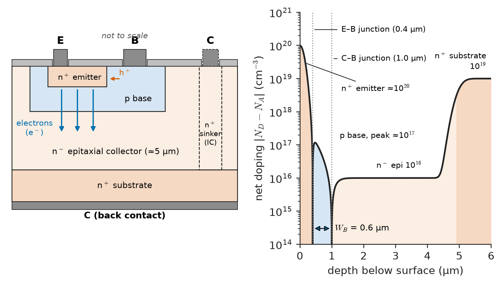
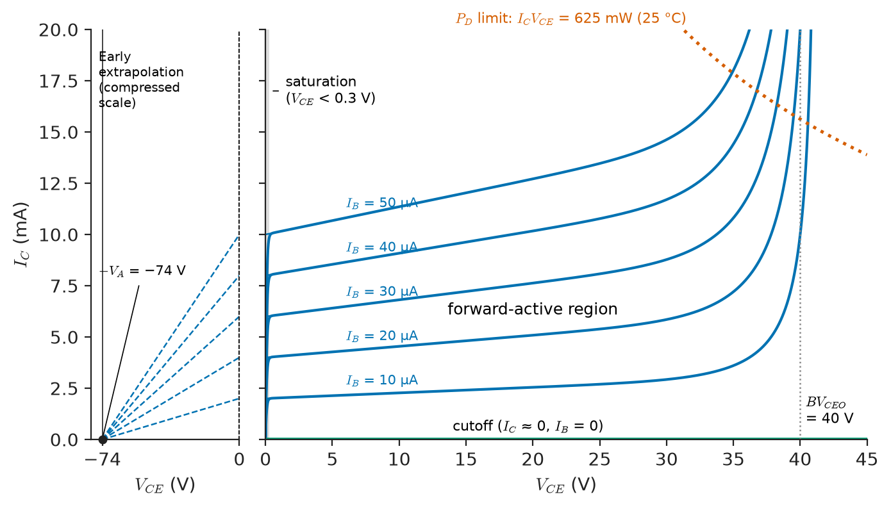
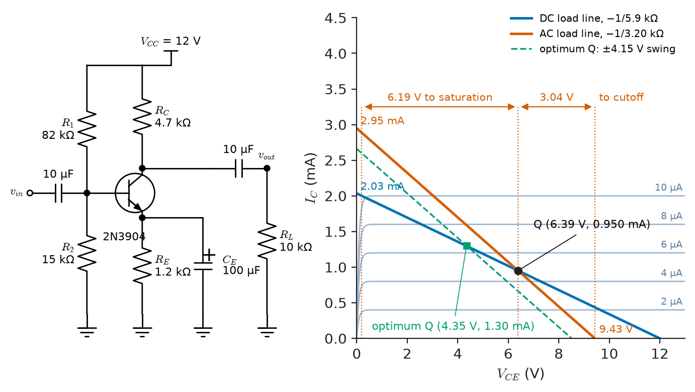
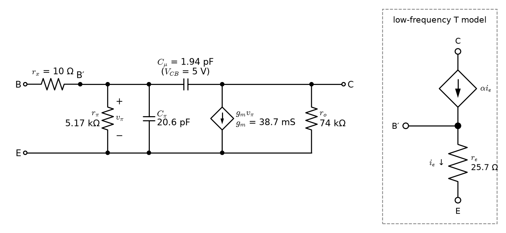
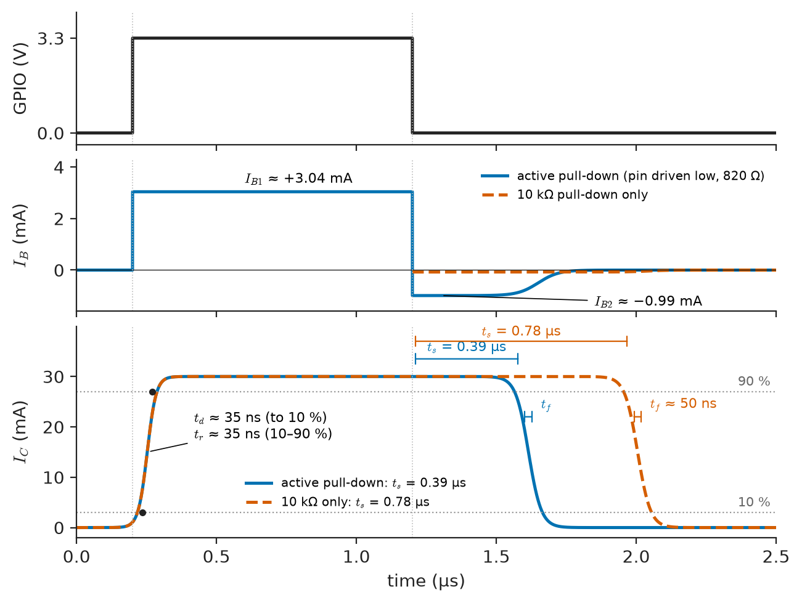
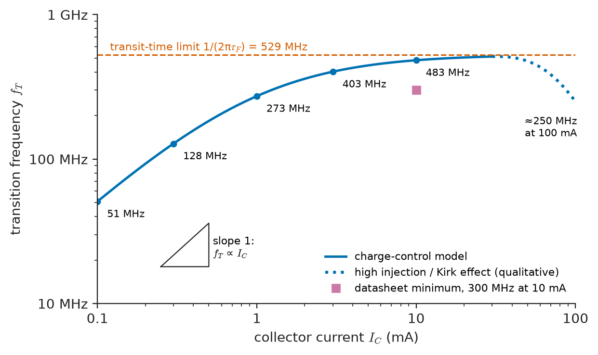

# Chapter 3 — Bipolar Junction Transistors

*Part I · Electronic Devices*

An industrial controller board uses a single 2N3904 per channel to drive a 12 V relay from a 3.3 V microcontroller pin, and a second 2N3904 as a small preamplifier for a 4–20 mA loop monitor. Production starts with transistors from one supplier and every board passes. Six months later a second-source lot arrives. The relay drivers still work, but they release the relays half a microsecond later and a few of them fail when an engineer removes the flyback diode "to save cost". The preamplifiers are worse: their output sits a volt away from where it used to, and on hot days some of them clip. The new transistors are within their datasheet in every respect; their current gain is simply near the top of the guaranteed 100–300 range, where the old ones were near the bottom. A circuit whose behaviour depends on $\beta$ is a circuit that will change with every lot and every degree. The bipolar junction transistor is an excellent amplifier and switch exactly because its collector current is an exponential function of one voltage and nearly independent of another, but its current gain, its base–emitter voltage and its stored charge are among the least controlled numbers in electronics. This chapter shows how the BJT works as a circuit element, how its configurations differ, how it is biased so that the circuit does not depend on $\beta$ or temperature, how it is modelled for small signals, and how it behaves as a switch and at high frequency.

> **How do the BJT's structure and Ebers–Moll model explain its operating regions, current gain and saturation voltage?**
> **How are the common-emitter, common-base and common-collector configurations different, and how is a transistor biased so that its operating point survives $\beta$ spread and temperature?**
> **What limits a BJT's gain, switching speed and frequency response, and how are those limits calculated from datasheet parameters?**

| Concept | Engineering destination |
|---|---|
| BJT structure | Reading datasheets; choosing small-signal, power, Darlington and SiGe devices |
| Operating regions | Amplifier versus switch design; checking hand analyses |
| Common-base configuration | Cascodes, RF and current-buffer stages, transimpedance inputs |
| Common-emitter configuration | Voltage-gain stages in discrete and integrated amplifiers |
| Common-collector configuration | Buffers, output stages, regulator pass elements |
| DC biasing | Operating points that survive $\beta$ spread, temperature and supply variation |
| Load lines | Signal swing, clipping limits, choice of quiescent current |
| Small-signal models | Gain, impedance and frequency-response calculation; SPICE interpretation |
| Amplification | Intrinsic gain, degeneration, linearity limits |
| Switching behavior | Relay, LED and solenoid drivers; level shifters; storage-time limits |
| Frequency response | $f_T$, Miller effect, bandwidth of transistor stages |

**Roadmap.** Structure and the Ebers–Moll model (3.1) → the four regions they imply (3.2) → the three configurations seen at device level (3.3–3.5) → setting the operating point (3.6) and seeing the signal swing on load lines (3.7) → the hybrid-π model (3.8) and what it says about gain (3.9) → the transistor as a switch (3.10) → charge, capacitance and $f_T$ (3.11).

---

## 3.1 BJT structure

### Where *Engineering Physics* leaves off

*Engineering Physics* [Ch. 18 §18.3.2](https://github.com/The-Studio-of-Sadiq/Engineering-Physics/blob/main/CHAPTERS/CHAPTER%2018.md) introduces the BJT as two back-to-back junctions, states the active-region law $I_C=\beta I_B=I_Se^{V_{BE}/V_T}$, names the Ebers–Moll model and lists the hybrid-π parameters $g_m=I_C/V_T$, $r_\pi=\beta/g_m$ and $r_o=V_A/I_C$, with a common-emitter gain of $-g_mR_C$; the underlying minority-carrier diffusion and diffusion length are in [Ch. 14 §14.5.3](https://github.com/The-Studio-of-Sadiq/Engineering-Physics/blob/main/CHAPTERS/CHAPTER%2014.md). Chapter 1 of this book provided the modelling vocabulary (regions, biasing, linearisation, temperature) and Chapter 2 the junction itself (depletion, breakdown, stored charge). This chapter builds the working engineering model: what sets $\beta$ in a real structure, the Ebers–Moll equations used to find saturation voltages, the bias networks that make circuits independent of $\beta$, the complete small-signal model with its capacitances, and the switching and frequency limits that the one-section sketch leaves out. It also goes beyond the physics sketch's validity at high current (where $\beta$ falls) and at high voltage (breakdown).

### The real structure

A modern small-signal NPN transistor is a vertical, planar device (Figure 3.1). A heavily doped n⁺ emitter ($10^{19}$–$10^{20}\ \mathrm{cm^{-3}}$) is diffused or implanted into a thin p-type base ($10^{17}$–$10^{18}\ \mathrm{cm^{-3}}$, 0.1–1 µm wide), which sits in a lightly doped n-type collector epitaxial layer ($10^{15}$–$10^{16}\ \mathrm{cm^{-3}}$) on an n⁺ substrate that carries the collector current to the back contact. The structure is deliberately asymmetric. The emitter is far more heavily doped than the base, so that the base–emitter junction injects mostly electrons into the base rather than holes into the emitter. The base is thinner than the electrons' diffusion length, so that almost all injected electrons reach the collector junction before recombining. The collector is lightly doped, so that the collector–base junction can block a large voltage, with its depletion region spreading mostly into the collector (Chapter 2, Section 2.1).

<!-- FIGURE 3.1 | figures/ch03/fig-3-1-npn-structure.png | cross-section | Cross-section and doping profile of a vertical planar NPN transistor. | Content: left, cross-section not to scale: n+ substrate at bottom (collector contact on back), n- epitaxial collector layer 5 um, p base diffusion 1 um deep, n+ emitter diffusion 0.4 um deep inside the base, oxide openings and metal contacts labelled E, B, C (top collector contact via n+ sinker for an IC version shown dashed). Arrows show electron flow from emitter down through the base to the collector and a small hole current from base into emitter. Right, net doping magnitude versus depth on a log axis 1e14 to 1e21 cm^-3: emitter about 1e20, base peak about 1e17 with base width WB = 0.6 um between the junctions, collector epi 1e16, substrate 1e19. Mark the emitter-base and collector-base junctions. -->



*Figure 3.1 — Cross-section and doping profile of a vertical planar NPN transistor.*

Three numbers describe how well the structure works. The **emitter injection efficiency** $\gamma$ is the fraction of emitter current carried by electrons injected into the base; it approaches 1 when the emitter's Gummel number (doping times width) greatly exceeds the base's. The **base transport factor** $\alpha_T$ is the fraction of injected electrons that cross the base without recombining, approximately $1-W_B^2/2L_n^2$ for base width $W_B$ and diffusion length $L_n$. Their product is the common-base current gain $\alpha_F=I_C/I_E$, and the common-emitter current gain is

$$
\beta_F=\frac{\alpha_F}{1-\alpha_F}
$$

so that $\alpha_F=0.995$ gives $\beta_F=199$ and $\alpha_F=0.998$ gives $\beta_F=499$. A small change in the fraction of carriers lost, which depends on base doping and width, lifetime and surface condition, changes $\beta$ by a large factor. That is why $\beta$ varies so much between devices and lots: it is the reciprocal of a small, poorly controlled number.

> **Status of the principle: $\beta_F=\alpha_F/(1-\alpha_F)$**
> *Derived.* It follows from KCL, $I_E=I_C+I_B$, and the definitions of the two gains; it is exact at a given operating point, and the sensitivity it reveals ($d\beta/\beta=(1+\beta)\,d\alpha/\alpha$) explains the wide spread of $\beta$.

### The Ebers–Moll model

The Ebers–Moll model treats the transistor as two coupled diodes and is valid in all four regions. In its transport form, with $V_{BE}$ and $V_{BC}$ as the junction voltages,

$$
I_C=I_S\left(e^{V_{BE}/V_T}-e^{V_{BC}/V_T}\right)-\frac{I_S}{\beta_R}\left(e^{V_{BC}/V_T}-1\right),\qquad
I_B=\frac{I_S}{\beta_F}\left(e^{V_{BE}/V_T}-1\right)+\frac{I_S}{\beta_R}\left(e^{V_{BC}/V_T}-1\right)
$$

The first term of $I_C$ is the transport current that crosses the base, driven by the difference of the two junctions' exponentials; the other terms are the base currents of the two junctions, scaled by the forward and reverse current gains $\beta_F$ and $\beta_R$. Because the structure is asymmetric, $\beta_R$ is small, typically 0.1–5. With $V_{BC}$ strongly negative the equations reduce to the physics book's active-region law $I_C=I_Se^{V_{BE}/V_T}$, $I_C=\beta_FI_B$. The SPICE Gummel–Poon model adds to Ebers–Moll the effects that matter in practice: the Early effect, the fall of $\beta$ at low current (base–emitter recombination current, Chapter 2 Section 2.2) and at high current (high injection), and series resistances and capacitances. For the 2N3904 the commonly used model has $I_S=6.73$ fA, $\beta_F=416$, $\beta_R=0.74$, $V_A=74$ V, $\tau_F=301$ ps.

> **Status of the principle: Ebers–Moll model**
> *Approximate.* It assumes low-level injection, one-dimensional current flow, constant base width and negligible series resistance; it predicts the regions and saturation voltages of a BJT well at moderate currents and must be extended (Gummel–Poon, VBIC, HICUM) for the Early effect, high injection, $\beta$ roll-off and high-frequency behaviour.

### Device families

**Table 3.1 — Representative bipolar transistors (datasheet values; typical where marked).**

| Device (class) | $V_{CEO}$ | $I_{C(max)}$ | $h_{FE}$ (at $I_C$) | $f_T$ | $P_D$ | Typical use |
|---|---|---|---|---|---|---|
| 2N3904 (NPN, TO-92) | 40 V | 200 mA | 100–300 (10 mA) | ≥ 300 MHz | 625 mW | General purpose |
| BC547B (NPN) | 45 V | 100 mA | 200–450 (2 mA) | 300 MHz (typ) | 500 mW | Audio, low noise |
| 2N2222A (NPN) | 40 V | 600 mA | 100–300 (150 mA) | ≥ 300 MHz | 625 mW (TO-92) | Switching |
| BC807 (PNP, SOT-23) | 45 V | 500 mA | 100–600 (100 mA) | 100 MHz (typ) | 310 mW | High-side switches |
| TIP31C (NPN, TO-220) | 100 V | 3 A | ≥ 25 (1 A) | 3 MHz | 40 W ($T_C$ = 25 °C) | Medium power |
| 2SC5200 class (NPN, TO-264) | 230 V | 15 A | 55–160 (1 A) | 30 MHz | 150 W | Audio output stages |
| TIP120 (Darlington) | 60 V | 5 A | ≥ 1000 (3 A) | — | 65 W | Solenoid, motor drivers |
| SiGe HBT (RF) | 4 V | 50 mA | 150–300 | 40–50 GHz | 0.2 W | LNAs, GNSS, Wi-Fi front ends |

PNP transistors are the complement, with all voltages and currents reversed; for equal size they have lower $f_T$ and somewhat lower $\beta$ because holes are less mobile than electrons. A **Darlington** pair multiplies current gains (≥ 1000) at the cost of a saturation voltage of 1–2 V (one $V_{BE}$ plus one $V_{CE(sat)}$) and slow turn-off. **Heterojunction bipolar transistors** (HBTs), with a SiGe base or in InP and GaAs, use a band-gap difference to block reverse injection, so the base can be heavily doped and very thin: SiGe BiCMOS processes reach $f_T$ of 300 GHz and $f_{max}$ of 500 GHz, the basis of automotive 77 GHz radar and optical-link transceivers, and GaAs HBTs dominate mobile-phone power amplifiers. In power electronics the bipolar transistor has been displaced by the MOSFET and IGBT (Chapters 4 and 5), whose gates need no steady drive current.

---

## 3.2 Operating regions

### Four combinations of two junctions

Each junction may be forward or reverse biased, giving four regions (Table 3.2). For an NPN in a circuit, the region is decided by $V_{BE}$ and $V_{BC}$, or equivalently $V_{BE}$ and $V_{CE}=V_{BE}-V_{BC}$.

**Table 3.2 — BJT operating regions (NPN, silicon, typical values).**

| Region | B–E junction | B–C junction | Behaviour | Use |
|---|---|---|---|---|
| Forward active | Forward ($V_{BE}$ ≈ 0.6–0.75 V) | Reverse ($V_{CE}\gtrsim0.3$ V) | $I_C=\beta_FI_B$; current source controlled by $V_{BE}$ | Amplifiers, current sources |
| Saturation | Forward | Forward | $V_{CE}=V_{CE(sat)}$ ≈ 0.05–0.3 V; $I_C<\beta_FI_B$ | Closed switch |
| Cutoff | Reverse or < 0.4 V | Reverse | All currents ≈ leakage (nA) | Open switch |
| Reverse active | Reverse | Forward | $\beta_R$ ≈ 0.1–5 | Rare: some analogue switches, TTL inputs |

The output characteristics of Figure 3.2 display the regions directly. In the forward-active region the curves are nearly horizontal, $I_C$ set by $I_B$ (or $V_{BE}$) and almost independent of $V_{CE}$. Their small upward slope is the **Early effect**: increasing $V_{CB}$ widens the collector depletion region, narrows the effective base and raises $I_C$. Extrapolated backwards, the curves meet near $V_{CE}=-V_A$, the **Early voltage**, 50–150 V for small-signal devices, and the model becomes

$$
I_C=I_Se^{V_{BE}/V_T}\left(1+\frac{V_{CE}}{V_A}\right)
$$

Near the origin the curves collapse together into the saturation region; at high $V_{CE}$ they turn upward into breakdown.

<!-- FIGURE 3.2 | figures/ch03/fig-3-2-bjt-output-characteristics.png | plot | Output characteristics of a small-signal NPN transistor with operating regions and the Early-voltage construction. | Content: x axis VCE from -80 V (left inset only) and 0 to 45 V, y axis IC from 0 to 20 mA. Curves for IB = 10, 20, 30, 40, 50 uA with beta = 200 at VCE = 0 extrapolation, i.e. IC = 2, 4, 6, 8, 10 mA times (1 + VCE/74 V). Saturation region shaded near VCE < 0.3 V, cutoff along IC = 0, forward-active region labelled. Dashed extrapolations of each curve converging at VCE = -VA = -74 V (shown in a compressed left inset). Breakdown upturn at BVCEO = 40 V for each curve. Hyperbola IC VCE = 625 mW dotted (PD limit at 25 C). -->



*Figure 3.2 — Output characteristics of a small-signal NPN transistor with operating regions and the Early-voltage construction.*

### Saturation voltage from Ebers–Moll

A transistor used as a switch is driven with more base current than needed, so that $I_C<\beta_FI_B$. The ratio $\beta_{forced}=I_C/I_B$ is the **forced beta**. Solving the Ebers–Moll equations for $V_{CE}$ with both junctions forward biased gives

$$
V_{CE(sat)}=V_T\ln\frac{1/\alpha_R+\beta_{forced}/\beta_R}{1-\beta_{forced}/\beta_F}
$$

with $\alpha_R=\beta_R/(1+\beta_R)$. For the 2N3904 model ($\beta_F=416$, $\beta_R=0.74$) at a forced beta of 10, the intrinsic saturation voltage is $V_T\ln(16.3)=72$ mV; at forced betas of 20 and 50 it rises to 89 and 113 mV. As $\beta_{forced}$ approaches $\beta_F$ the denominator vanishes and the transistor leaves saturation. Measured values are higher because of the collector series resistance: the datasheet guarantees $V_{CE(sat)}\le0.2$ V at 10 mA with 1 mA of base current and $\le0.3$ V at 50 mA with 5 mA. The rule of thumb $\beta_{forced}\approx10$ comes from this curve: it gives a low, flat $V_{CE(sat)}$ with margin against the lowest $\beta_F$ of a production lot at the lowest temperature.

> **Status of the principle: Saturation voltage from Ebers–Moll**
> *Derived.* It follows algebraically from the Ebers–Moll equations with both junctions forward biased; in practice it gives the intrinsic part only, and the collector and emitter series resistances add $I_C(R_C+R_E)$, which dominates in power transistors.

### Breakdown

The collector–base junction breaks down by avalanche at $BV_{CBO}$ (emitter open). With the base open, the breakdown voltage $BV_{CEO}$ is lower, because holes generated by impact ionisation in the collector junction flow into the base, act as base current and are amplified by $\beta$, so runaway needs an avalanche multiplication factor $M$ exceeding 1 by only about $1/\beta$ ($M-1\approx1/\beta$). For the 2N3904, $V_{CBO}=60$ V but $V_{CEO}=40$ V. A low base–emitter resistance (the $BV_{CER}$ rating) or a reverse-biased base ($BV_{CEX}$) restores most of the difference, which is one reason switching transistors should never be left with a floating base. The base–emitter junction itself breaks down at only 5–7 V reverse ($V_{EBO}$), and repeated reverse breakdown degrades $\beta$ permanently; inputs that can swing negative need a clamp diode.

---

## 3.3 Common-base configuration

### Three ways to connect three terminals

A transistor used as an amplifier has one terminal common to input and output. The three choices give three configurations with very different impedances and gains. This chapter characterises each at device level, with the small-signal parameters of Section 3.8; Chapter 7 designs complete single- and multistage amplifiers around them. Throughout, the numbers refer to a transistor at $I_C=1$ mA with $\beta=200$, $V_A=74$ V, so $g_m=38.7$ mS, $r_\pi=5.17$ kΩ and $r_o=74$ kΩ, with a 4.7 kΩ collector load and no external load.

### Common base

In the **common-base** (CB) configuration the signal enters at the emitter and leaves at the collector, and the base is held at signal ground. The input sees the emitter's small-signal resistance

$$
r_e=\frac{\alpha}{g_m}\approx\frac{V_T}{I_E}
$$

25.7 Ω at 1 mA, because a small change in $V_{BE}$ produces a large change in emitter current. The current gain is $\alpha$, just below 1: the stage passes current from emitter to collector almost unchanged, but from a low impedance to a high one. The voltage gain is $+g_mR_C=+182$ ignoring $r_o$, the same magnitude as the common-emitter stage but non-inverting. The output resistance looking into the collector is very high, of the order of $\beta r_o$ when the emitter is driven from a high impedance, because the base is fixed and there is no internal feedback through the base.

Three properties make the CB stage valuable despite its low input impedance. It is a **current buffer**, taking a signal current from a low-impedance node and delivering it into a high-impedance load; this is the transimpedance input of photodiode receivers and the core of the **cascode**, where a CB transistor on top of a CE transistor shields it from the output voltage (Chapter 7, Chapter 10). The collector–base capacitance is not connected between input and output, so there is no Miller multiplication (Section 3.11) and the CB stage has the widest bandwidth of the three; it is a classic RF and video amplifier stage. And its low input impedance matches low-impedance sources such as 50 Ω transmission lines.

---

## 3.4 Common-emitter configuration

### The voltage-gain stage

In the **common-emitter** (CE) configuration the signal drives the base, the output is taken from the collector and the emitter is at signal ground (directly or through a bypass capacitor). It is the only configuration with both voltage and current gain substantially greater than one, and therefore the highest power gain. Its small-signal properties are:

- input resistance $r_\pi=\beta/g_m=5.17$ kΩ (plus the base spreading resistance $r_x$, 10–200 Ω);
- voltage gain $A_v=-g_m(R_C\parallel r_o)=-0.0387\times4.42\ \mathrm{k\Omega}=-171$;
- current gain $\beta$;
- output resistance $R_C\parallel r_o=4.42$ kΩ.

The gain $-g_mR_C=-I_CR_C/V_T$ is the ratio of the DC voltage across the collector load to the thermal voltage, a result *Engineering Physics* §18.3.2 states and that is worth remembering as a design rule: a CE stage with 4.7 V across its collector resistor has a gain near $-180$ regardless of the transistor type or the current, as long as $r_o\gg R_C$.

### Emitter degeneration

An unbypassed emitter resistor $R_E$ (emitter degeneration) introduces local negative feedback (Chapter 9). The gain becomes

$$
A_v=-\frac{g_mR_C}{1+g_mR_E}\approx-\frac{R_C}{R_E}\quad(g_mR_E\gg1)
$$

and the input resistance rises to $r_\pi+(\beta+1)R_E$. Gain is traded for three benefits: the gain is set by a resistor ratio instead of the transistor's $g_m$, so it no longer depends on $I_C$, temperature or the device; the input resistance is raised; and the linear input range grows by the factor $1+g_mR_E$, because the base–emitter junction sees only a fraction of the input signal (Section 3.9). The same resistor, bypassed for signals but present at DC, is the main element of stable biasing (Section 3.6).

---

## 3.5 Common-collector configuration

### The emitter follower

In the **common-collector** (CC) configuration, the **emitter follower**, the signal drives the base and the output is taken from the emitter, with the collector at signal ground (the supply). The emitter follows the base at one $V_{BE}$ below it. With an emitter resistance $R_E$ (here 4.7 kΩ):

- voltage gain $A_v=\dfrac{g_mR_E}{1+g_mR_E}=0.9945$, just below unity;
- input resistance $r_\pi+(\beta+1)R_E=950$ kΩ, the load multiplied by $\beta+1$;
- output resistance $\dfrac{1}{g_m}+\dfrac{R_s}{\beta+1}=25.9+5.0=30.8\ \Omega$ for a 1 kΩ source, the source resistance divided by $\beta+1$.

The emitter follower is an **impedance transformer**: it presents a high impedance to its source and a low impedance to its load, with no voltage gain but a current gain of $\beta+1$. It buffers high-impedance nodes before low-impedance loads, forms the output stages of amplifiers and op-amps (Chapter 7, Chapter 10), and is the pass element of linear regulators. Its two practical hazards are worth knowing at device level. The output can sink current only through $R_E$ (or a current source), so a capacitive load driven by a fast negative-going signal can make the transistor cut off. And an emitter follower driving a capacitive load from an inductive source can present a negative real input impedance at high frequency and oscillate, a classic problem cured by a small series base resistor of tens to hundreds of ohms.

**Table 3.3 — The three configurations at $I_C$ = 1 mA, $\beta$ = 200, $R_C$ or $R_E$ = 4.7 kΩ (device-level small-signal values).**

| Property | Common emitter | Common base | Common collector |
|---|---|---|---|
| Input terminal / output terminal | Base / collector | Emitter / collector | Base / emitter |
| Input resistance | $r_\pi$ = 5.17 kΩ | $r_e$ = 25.7 Ω | $r_\pi+(\beta+1)R_E$ = 950 kΩ |
| Output resistance | $R_C\parallel r_o$ = 4.42 kΩ | ≈ $R_C$ = 4.7 kΩ | $1/g_m+R_s/(\beta+1)$ = 31 Ω ($R_s$ = 1 kΩ) |
| Voltage gain | $-g_m(R_C\parallel r_o)$ = −171 | $+g_mR_C$ ≈ +180 | 0.9945 |
| Current gain | $\beta$ = 200 | $\alpha$ = 0.995 | $\beta+1$ = 201 |
| Phase | Inverting | Non-inverting | Non-inverting |
| Main use | Voltage gain | Current buffer, cascode, RF | Buffer, output stage |

> **Status of the principle: Configuration gain and impedance formulas**
> *Approximate.* They come from the hybrid-π model with $r_x$ and $r_o$ neglected where stated; they hold at low and mid frequencies and for small signals, and fail when source or load impedances become comparable with the neglected elements or when the capacitances of Section 3.11 matter.

---

## 3.6 DC biasing

### What must stay constant

Biasing (Chapter 1, Section 1.5) sets the quiescent collector current $I_{CQ}$ and voltage $V_{CEQ}$. A BJT bias network must hold them against three variations: **$\beta$ spread**, a factor of three in a production lot, plus about +0.5 %/K with temperature; **$V_{BE}$ drift**, about −2 mV/K, which at fixed $V_{BE}$ would raise $I_C$ by about 7 %/K (Chapter 1, Section 1.7); and **leakage** $I_{CBO}$, which doubles every 10 K but is negligible in modern silicon below about 100 °C.

### Fixed bias: a cautionary circuit

The simplest network feeds the base from the supply through a large resistor $R_B$, fixing $I_B=(V_{CC}-V_{BE})/R_B$, so that $I_C=\beta I_B$. The collector current is directly proportional to $\beta$: the sensitivity $S_\beta^{I_C}=1$. With $R_B=2.2$ MΩ from 12 V, $I_C$ is 0.52 mA for $\beta=100$ and 1.55 mA for $\beta=300$, a factor of three, and with a 4.7 kΩ collector resistor the quiescent output voltage moves by almost 5 V. This is the preamplifier of the chapter opening.

### Voltage-divider bias with emitter degeneration

The standard discrete network (Figure 3.3) sets the base voltage with a divider $R_1$, $R_2$ and puts a resistor $R_E$ in the emitter, bypassed for signals if gain is needed. Replacing the divider by its Thévenin equivalent $V_{Th}=V_{CC}R_2/(R_1+R_2)$, $R_{Th}=R_1\parallel R_2$, KVL around the base–emitter loop gives

$$
I_C=\frac{\beta\,(V_{Th}-V_{BE})}{R_{Th}+(\beta+1)R_E}\;\approx\;\frac{V_{Th}-V_{BE}}{R_E}\quad\text{when }(\beta+1)R_E\gg R_{Th}
$$

The emitter resistor turns the base voltage into an emitter current, and the current no longer depends on $\beta$. The stage is a negative-feedback loop: if $I_C$ rises, $V_E$ rises, $V_{BE}$ falls and $I_C$ is pulled back. Two design rules follow from the equation. To reduce the $\beta$ dependence, make $(\beta_{min}+1)R_E$ at least ten times $R_{Th}$. To reduce the $V_{BE}$ dependence, make $V_E=I_ER_E$ large compared with the expected change in $V_{BE}$: a 0.12 V shift (60 K at −2 mV/K) changes $I_C$ by 0.12/$V_E$, i.e. by 10 % if $V_E=1.2$ V. A common starting point is $V_E\approx V_{CC}/10$ and $V_{CE}\approx V_{CC}/2$.

> **Status of the principle: Emitter-degenerated bias**
> *Derived.* The bias equation follows from KVL and the active-region model; its insensitivity to $\beta$ is a consequence of local negative feedback, holding to the extent that $(\beta+1)R_E\gg R_{Th}$ and $V_E\gg\Delta V_{BE}$.

**Worked example — a bias network that survives a second-source lot.** Design for $V_{CC}=12$ V and $I_C\approx1$ mA with a 2N3904 ($\beta$ = 100–300). Choose $R_E=1.2$ kΩ ($V_E\approx1.2$ V) and $R_C=4.7$ kΩ. The base must sit at about $1.2+0.65=1.85$ V; with the divider current about ten times the largest base current (10 µA at $\beta=100$), take $R_2=15$ kΩ and $R_1=82$ kΩ, so $V_{Th}=1.856$ V and $R_{Th}=12.7$ kΩ. The condition $(\beta_{min}+1)R_E=121\ \mathrm{k\Omega}\gg12.7$ kΩ is met by a factor of 9.5. The listing below evaluates both this network and the fixed-bias circuit over the $\beta$ range and at 25 °C and 85 °C, with $V_{BE}$ falling 2 mV/K and $\beta$ rising 0.5 %/K.

```python
VCC, RC, RE = 12.0, 4.7e3, 1.2e3              # supply and resistors of the CE stage
R1, R2, RB = 82e3, 15e3, 2.2e6                # divider bias, and fixed-bias resistor

def divider_bias(beta, vbe):
    vth, rth = VCC * R2 / (R1 + R2), R1 * R2 / (R1 + R2)
    ic = beta * (vth - vbe) / (rth + (beta + 1) * RE)
    return ic, VCC - ic * RC - ic * (beta + 1) / beta * RE

def fixed_bias(beta, vbe):
    ic = beta * (VCC - vbe) / RB
    return ic, VCC - ic * RC                  # no emitter resistor

print("   T    beta | divider: IC (mA)  VCE (V) | fixed: IC (mA)  VCE (V)")
for t in (25, 85):
    vbe = 0.65 - 0.002 * (t - 25)             # -2 mV/K
    for beta in (100, 200, 300):
        b = beta * (1 + 0.005 * (t - 25))     # beta rises about 0.5 %/K
        icd, vd = divider_bias(b, vbe)
        icf, vf = fixed_bias(b, vbe)
        print(f"{t:4d} C {b:6.0f} |        {icd*1e3:6.3f}   {vd:6.2f}   |"
              f"       {icf*1e3:6.3f}   {vf:6.2f}")
```

```text
   T    beta | divider: IC (mA)  VCE (V) | fixed: IC (mA)  VCE (V)
  25 C    100 |         0.901     6.68   |        0.516     9.58
  25 C    200 |         0.950     6.39   |        1.032     7.15
  25 C    300 |         0.967     6.29   |        1.548     4.73
  85 C    130 |         1.014     6.01   |        0.678     8.81
  85 C    260 |         1.058     5.75   |        1.356     5.63
  85 C    390 |         1.073     5.67   |        2.033     2.44
```

Over the full lot and a 60 K temperature range, the divider-biased stage keeps $I_C$ within 0.90–1.07 mA and $V_{CE}$ within 5.7–6.7 V. The fixed-bias stage spans 0.52–2.03 mA, a factor of four, and at the hot, high-$\beta$ corner its $V_{CE}$ has collapsed to 2.4 V, leaving little room for signal: this is the preamplifier that clipped on hot days. Integrated circuits go further and bias transistors with current mirrors whose collector current is copied from a reference (Chapter 10).

<!-- FIGURE 3.3 | figures/ch03/fig-3-3-bias-and-load-lines.png | plot | Voltage-divider-biased common-emitter stage with its DC and AC load lines on the output characteristics. | Content: left, circuit: VCC = 12 V, R1 = 82 kOhm, R2 = 15 kOhm, RC = 4.7 kOhm, RE = 1.2 kOhm bypassed by CE = 100 uF, 2N3904, input coupling 10 uF, output coupling 10 uF to RL = 10 kOhm. Right, IC (0 to 4.5 mA) versus VCE (0 to 13 V) with output characteristics for IB = 2 to 10 uA (beta = 200). DC load line from (12 V, 0) to (0, 2.03 mA), slope -1/5.9 kOhm. Q-point at (6.39 V, 0.950 mA). AC load line through Q with slope -1/3.20 kOhm, intercepts at VCE = 9.43 V and IC = 2.95 mA. Mark available swing: 3.04 V toward cutoff, 6.19 V toward saturation (VCE(sat) = 0.2 V). Dashed: optimum Q for maximum symmetrical swing at (4.35 V, 1.30 mA) with plus/minus 4.15 V swing. -->



*Figure 3.3 — Voltage-divider-biased common-emitter stage with its DC and AC load lines on the output characteristics.*

---

## 3.7 Load lines

### DC and AC load lines

The load-line construction of Chapter 1, Section 1.2 applies to the transistor's output. At DC, with the emitter resistor and collector resistor in series with $V_{CE}$, KVL gives the **DC load line**

$$
V_{CE}=V_{CC}-I_C\,(R_C+R_E)
$$

which runs from $(V_{CC},0)$ to $(0,V_{CC}/(R_C+R_E))$; the Q-point is its intersection with the output characteristic for the bias current. For signals the coupling and bypass capacitors are shorts, so the collector sees $R_{ac}=R_C\parallel R_L$ and the emitter is grounded. Signal excursions therefore follow the **AC load line**, through the Q-point with slope $-1/R_{ac}$, steeper than the DC line. The transistor can swing along the AC line until it reaches cutoff ($I_C=0$), a change of $I_{CQ}R_{ac}$ in $V_{CE}$, or saturation, a change of $V_{CEQ}-V_{CE(sat)}$. The smaller of the two sets the largest undistorted output amplitude.

**Worked example — swing of the biased stage.** For the stage of Section 3.6 with $R_L=10$ kΩ, the DC load line runs from 12 V to $12/5.9\ \mathrm{k\Omega}=2.03$ mA, and the Q-point is (6.39 V, 0.950 mA). The AC load resistance is $4.7\parallel10=3.20$ kΩ. Toward cutoff the collector can rise by $0.950\ \mathrm{mA}\times3.20\ \mathrm{k\Omega}=3.04$ V; toward saturation it can fall by $6.39-0.2=6.19$ V. The output therefore clips first at the positive peak, at 3.04 V amplitude. For maximum symmetrical swing the Q-point should satisfy $I_{CQ}R_{ac}=V_{CEQ}-V_{CE(sat)}$ together with the DC load line, which gives $I_{CQ}=(V_{CC}-V_{CE(sat)})/(R_{ac}+R_C+R_E)=11.8/9.10\ \mathrm{k\Omega}=1.30$ mA, $V_{CEQ}=4.35$ V and a symmetrical swing of ±4.15 V (Figure 3.3). Note what this swing demands at the input: with $R_E$ bypassed the gain is $g_mR_{ac}=36.7\ \mathrm{mS}\times3.20\ \mathrm{k\Omega}=118$, so a 3 V output needs 26 mV at the base, about one $V_T$, where the exponential distorts heavily (Section 3.9). The load line tells how far the output can swing; linearity at that swing requires degeneration or feedback.

> **Status of the principle: Load-line analysis**
> *Derived.* It is KVL in the output loop plotted against the device characteristic; the AC line assumes the coupling and bypass capacitors are short circuits at the signal frequency, so it holds in the mid-band only.

---

## 3.8 Small-signal models

### The hybrid-π model

Linearising the Ebers–Moll (or Gummel–Poon) model about the Q-point (Chapter 1, Section 1.6) gives the **hybrid-π model** of Figure 3.4, the standard small-signal BJT model for hand analysis and the form a simulator reports in its operating-point listing. Its elements and their values at $I_C=1$ mA for a 2N3904-class transistor are listed in Table 3.4.

<!-- FIGURE 3.4 | figures/ch03/fig-3-4-hybrid-pi-model.png | circuit | Complete hybrid-pi small-signal model of a bipolar transistor with element values at IC = 1 mA. | Content: external nodes B, C, E. Base spreading resistance rx = 10 Ohm from B to internal node B'. From B' to E: r_pi = 5.17 kOhm in parallel with C_pi = 20.6 pF. From B' to C: C_mu = 1.94 pF (at VCB = 5 V). From C to E: voltage-controlled current source gm v_pi with gm = 38.7 mS (arrow from C to E), in parallel with ro = 74 kOhm. Label v_pi across B'-E with + at B'. Small inset: the low-frequency T-model equivalent with re = 25.7 Ohm in the emitter and alpha ie source. -->



*Figure 3.4 — Complete hybrid-pi small-signal model of a bipolar transistor with element values at IC = 1 mA.*

**Table 3.4 — Hybrid-π elements and representative values (2N3904 class, $I_C$ = 1 mA, $V_{CE}$ = 5 V, 300 K).**

| Element | Expression | Value at 1 mA | Scaling with $I_C$ |
|---|---|---|---|
| Transconductance $g_m$ | $I_C/V_T$ | 38.7 mS | $\propto I_C$ |
| Input resistance $r_\pi$ | $\beta/g_m$ | 5.17 kΩ ($\beta$ = 200) | $\propto1/I_C$ |
| Output resistance $r_o$ | $V_A/I_C$ | 74 kΩ | $\propto1/I_C$ |
| Base spreading resistance $r_x$ | from layout | 10–200 Ω | ≈ constant |
| Base–emitter capacitance $C_\pi$ | $g_m\tau_F+C_{je}$ | 20.6 pF | rises with $I_C$ |
| Base–collector capacitance $C_\mu$ | junction capacitance at $V_{CB}$ | 1.9 pF at 5 V | falls with $V_{CB}$ |
| Intrinsic gain $g_mr_o$ | $V_A/V_T$ | 2860 (69 dB) | independent of $I_C$ |

The model has three remarkable properties. The transconductance depends only on bias current and temperature, not on the device: every silicon BJT at 1 mA has $g_m=38.7$ mS at 300 K, whatever its size or type. The input resistance $r_\pi$ inherits all of $\beta$'s spread, which is why circuit gains that depend on $r_\pi$ are as poorly defined as $\beta$ itself. And the product $g_mr_o=V_A/V_T$, the **intrinsic gain**, is the largest voltage gain a single transistor can provide with an ideal current-source load, a few thousand for a BJT, compared with tens to a few hundred for short-channel MOSFETs (Chapter 4).

The **T-model** is an equivalent rearrangement with the emitter resistance $r_e=\alpha/g_m$ in the emitter lead and a current source $\alpha i_e$ from collector to base node; it gives the same answers and is more convenient for common-base and degenerated stages. The **h-parameter** description used on older datasheets maps onto hybrid-π as $h_{ie}=r_x+r_\pi$, $h_{fe}=\beta$, $h_{oe}=1/r_o$ and $h_{re}\approx r_\pi/r_\mu$ (very small); two-port theory and the h-parameter conversions are developed in *Circuits, Signals and Communications*, [Ch. 12](https://github.com/The-Studio-of-Sadiq/Circuits-Signals-and-Communications/blob/main/part-3-advanced-network-theory/12-two-port-networks.md).

> **Status of the principle: Hybrid-π small-signal model**
> *Derived.* It is the first-order linearisation of the large-signal model about the operating point; it is *approximate* in use, accurate for signals small compared with $V_T$ at the base–emitter junction and up to frequencies of about $f_T/3$, beyond which distributed effects and excess phase require more elaborate models.

---

## 3.9 Amplification

### Where gain comes from

A BJT amplifies because a small voltage at its input controls a current through a large resistance at its output: power from the supply is modulated by a signal that supplies very little. In small-signal terms the voltage gain of any stage built on one transistor is the product of the transconductance and the total resistance at the collector, $A_v=-g_mR_{out,total}$. Three limits follow.

1. **Gain is bounded by the intrinsic gain.** With an ideal current-source load the collector resistance is $r_o$ and $\lvert A_v\rvert=g_mr_o=V_A/V_T$, about 2860 for the 2N3904. With a resistor load, $\lvert A_v\rvert=I_CR_C/V_T$ is limited by the supply: to get a gain of 1000 a resistor would need 26 V across it. This is why integrated amplifiers use active (current-source) loads (Chapter 10).
2. **Gain is set by bias.** Since $g_m\propto I_C$, any change in bias current changes gain proportionally. Stable gain requires stable bias, or degeneration that removes $g_m$ from the gain expression.
3. **Gain is limited by linearity.** The collector current is an exponential function of $v_{be}$, so the input must stay well below $V_T$ for linear operation.

### Linearity and degeneration

The second-harmonic distortion of an exponential driven by a sinusoid of amplitude $V_p$ is $\mathrm{HD_2}\approx V_p/4V_T$ (Chapter 1, Section 1.6), 1 % at about 1 mV for an undegenerated CE stage. With emitter degeneration only the fraction $1/(1+g_mR_E)$ of the input appears across the junction, and the distortion falls by the same factor (to first order; the feedback also reduces the third harmonic). A stage with $I_C=1$ mA and $R_E=470\ \Omega$ has $g_mR_E=18.2$; its gain falls from $-182$ to $-R_C/(R_E+r_e)=-4700/496=-9.5$, but its input can be 19 times larger for the same distortion. This trade of gain for linearity, input range and predictability is the elementary form of negative feedback, which Chapter 9 generalises.

**Worked example — gain of the biased stage with partial bypass.** In the stage of Section 3.6 ($I_C=0.950$ mA, $g_m=36.7$ mS, $R_C\parallel R_L=3.20$ kΩ), the 1.2 kΩ emitter resistor is split into 100 Ω unbypassed and 1.1 kΩ bypassed. The mid-band gain is $-g_mR_{ac}/(1+g_mR_{E1})=-117.5/(1+3.67)=-25.1$, equal to the ratio form $-3200/(100+27.2)=-25.1$. The input resistance at the base rises from $r_\pi=5.44$ kΩ to $r_\pi+(\beta+1)\times100=25.5$ kΩ at $\beta=200$, and the divider's 12.7 kΩ in parallel gives 8.5 kΩ. For a 3 V output the base now needs 119 mV, of which only $119/4.67=25$ mV appears across the junction; the second harmonic is the open-junction value $25.5/(4\times25.85)=25$ % divided by the loop factor 4.67, about 5 %, and a designer who needs less adds overall feedback (Chapter 9) or lowers the swing. The gain now changes by only about 0.2 % per 1 % change in $I_C$, instead of 1 % per 1 %.

---

## 3.10 Switching behavior

### The transistor as a switch

As a switch a BJT alternates between cutoff (off, $I_C\approx0$, the full supply across $V_{CE}$) and saturation (on, $V_{CE}=V_{CE(sat)}$). In both states its dissipation is small: leakage times voltage when off, $V_{CE(sat)}I_C$ when on. The design rules are to supply enough base current to saturate the transistor at the lowest $\beta$ and the largest load current (forced beta 10–20, Section 3.2), to hold the base firmly off when the driver is off, and to protect the collector from inductive voltage spikes (Chapter 2, Section 2.10).

### Stored charge and switching times

The transitions are not instantaneous. Datasheets specify four intervals (Figure 3.5), measured with a stated collector current and base drive:

- **delay time** $t_d$: charging the junction capacitances until the transistor starts conducting;
- **rise time** $t_r$: building up the base charge $\tau_FI_C$ needed to carry the collector current;
- **storage time** $t_s$: removing the *excess* base charge stored in saturation, during which the collector current does not change at all;
- **fall time** $t_f$: removing the active-region charge as the current falls.

For the 2N3904 the guaranteed maxima are $t_d=35$ ns, $t_r=35$ ns, $t_s=200$ ns and $t_f=50$ ns at $I_C=10$ mA with $I_{B1}=I_{B2}=1$ mA. Storage time dominates. In saturation both junctions are forward biased and the base and collector regions hold excess charge proportional to the overdrive $I_{B1}-I_C/\beta_F$. The charge-control model gives

$$
t_s=\tau_s\ln\frac{I_{B1}+I_{B2}}{I_C/\beta_F+I_{B2}}
$$

where $I_{B1}$ is the forward base drive, $I_{B2}$ the reverse current pulled out of the base at turn-off, and $\tau_s$ the storage time constant. Hard overdrive (large $I_{B1}$) speeds turn-on but lengthens storage; a strong reverse base current shortens it. Practical remedies are a **speed-up capacitor** across the base resistor, which supplies a pulse of charge at both edges, a **Baker clamp** (a Schottky diode from base to collector, as in Schottky TTL) that prevents deep saturation, and a low-impedance turn-off path.

> **Status of the principle: Charge-control model of switching**
> *Approximate.* It lumps the stored minority charge into one or two time constants and assumes constant $\beta_F$ and drive currents; it predicts trends and order-of-magnitude storage times well, but quantitative values must be taken from datasheet test conditions or simulation.

<!-- FIGURE 3.5 | figures/ch03/fig-3-5-switching-waveforms.png | timing-diagram | Switching waveforms of a saturated NPN relay driver, showing delay, rise, storage and fall times. | Content: three traces on a shared time axis 0 to 2.5 us. Top: GPIO voltage, 0 to 3.3 V step at t = 0.2 us, back to 0 V at t = 1.2 us. Middle: base current, +3.04 mA during the on interval, a negative spike of about -0.99 mA at turn-off decaying as the base discharges (case with active pull-down through 820 Ohm). Bottom: collector current, 0 to 30 mA: delay td about 35 ns, rise tr about 35 ns, flat at 30 mA, then after turn-off a storage interval ts = 0.39 us (solid, active pull-down) or 0.78 us (dashed, 10 kOhm pull-down only) before the fall tf about 50 ns. Label td, tr, ts, tf and the 10 percent and 90 percent levels. -->



*Figure 3.5 — Switching waveforms of a saturated NPN relay driver, showing delay, rise, storage and fall times.*

**Worked example — a relay driver from a 3.3 V microcontroller pin.** A 12 V relay with a 400 Ω coil (30 mA) is switched by a 2N3904 from a 3.3 V GPIO pin. At 30 mA the minimum guaranteed $h_{FE}$ is between 60 (at 50 mA) and 100 (at 10 mA), so a forced beta of 10 gives a generous margin: $I_B=3$ mA. With $V_{BE}\approx0.75$ V in saturation, $R_B=(3.3-0.75)/3\ \mathrm{mA}=850\ \Omega$; choose 820 Ω, which passes 3.11 mA; the 10 kΩ base–emitter resistor described next takes 75 µA of it, so the base drive is $I_{B1}\approx3.04$ mA, within a typical MCU pin's 4–8 mA rating. The collector saturates at about 0.1–0.2 V and dissipates under 6 mW. A 10 kΩ resistor from base to emitter holds the transistor off while the pin is a floating input during reset. The coil needs a flyback diode (Chapter 2, Section 2.10); without it the collector would exceed the 40 V $V_{CEO}$ at every turn-off, which is the failure the opening example's cost-cutting produced.

Storage time decides how soon the relay begins to release. Back-calculating from the datasheet ($t_s=200$ ns at 10 mA, 1 mA, 1 mA, with $\beta_F\approx150$) gives $\tau_s\approx320$ ns. If the pin is switched to a high-impedance input, only the 10 kΩ pull-down removes base charge, $I_{B2}=0.75\ \mathrm{V}/10\ \mathrm{k\Omega}=75$ µA, and $t_s=320\ \mathrm{ns}\times\ln[(3.04+0.075)/(0.2+0.075)]=0.78$ µs. Driving the pin actively low pulls about $0.75/820=0.91$ mA out of the base through the 820 Ω, plus the 75 µA in the pull-down, so $I_{B2}\approx0.99$ mA and $t_s=320\ \mathrm{ns}\times\ln(4.03/1.19)=0.39$ µs. A higher-$\beta$ lot stores more excess charge for the same drive, which is the half-microsecond change seen after the second-source lot. For a relay, whose contacts take milliseconds, none of this matters; for a 100 kHz PWM drive, a storage time of 0.8 µs would be 8 % of the period, and a MOSFET (Chapter 4) or a Baker-clamped transistor would be chosen.

---

## 3.11 Frequency response

### Charge, capacitance and the transition frequency

The hybrid-π capacitances of Section 3.8 make the transistor's gain fall at high frequency. $C_\pi$ has two parts: the base–emitter junction capacitance $C_{je}$ and the diffusion capacitance $g_m\tau_F$ of the minority charge in transit across the base, where the **forward transit time** $\tau_F$ is about $W_B^2/2D_n$ plus collector transit time, a few hundred picoseconds for a 2N3904 and under a picosecond in SiGe HBTs. $C_\mu$ is the collector–base junction capacitance.

With the collector shorted to AC ground, the current gain $h_{fe}(j\omega)=i_c/i_b$ falls from $\beta$ at low frequency with a pole at $f_\beta=1/[2\pi r_\pi(C_\pi+C_\mu)]$, and crosses unity at the **transition frequency**

$$
f_T=\frac{g_m}{2\pi(C_\pi+C_\mu)}=\beta f_\beta
$$

Inverting this, $1/(2\pi f_T)=\tau_F+(C_{je}+C_\mu)V_T/I_C$: at low current the junction capacitances dominate and $f_T$ rises in proportion to $I_C$; at moderate current $f_T$ approaches the transit-time limit $1/(2\pi\tau_F)$; and at high current it falls again as high injection and the base push-out (Kirk) effect widen the effective base. Figure 3.6 shows the curve. For the 2N3904 model at $V_{CE}=5$ V, $f_T$ is about 51 MHz at 0.1 mA, 273 MHz at 1 mA and 480 MHz at 10 mA; the datasheet guarantees at least 300 MHz at 10 mA and 20 V. The usable bandwidth of real stages is far below $f_T$, because of the Miller effect.

<!-- FIGURE 3.6 | figures/ch03/fig-3-6-ft-versus-ic.png | plot | Transition frequency of a small-signal NPN transistor versus collector current. | Content: log-log axes, x = IC from 0.1 mA to 100 mA, y = fT from 10 MHz to 1 GHz. Solid curve from the model fT = gm / (2 pi (gm tauF + Cje + Cmu)) with tauF = 301 ps, Cje = 9.0 pF, Cmu = 1.94 pF, VT = 25.85 mV: 51 MHz at 0.1 mA, 128 MHz at 0.3 mA, 273 MHz at 1 mA, 403 MHz at 3 mA, 483 MHz at 10 mA, approaching the transit-time limit 529 MHz (dashed horizontal line). Above 30 mA a dotted curve falls to about 250 MHz at 100 mA, labelled high injection and Kirk effect (qualitative). Mark the datasheet minimum 300 MHz at 10 mA as a point. Annotate the low-current region slope of one decade per decade. -->



*Figure 3.6 — Transition frequency of a small-signal NPN transistor versus collector current.*

### The Miller effect

In a common-emitter stage, $C_\mu$ connects the input (base) to the output (collector), which swings $-A_v$ times as much as the base. The current through $C_\mu$ is therefore $(1+\lvert A_v\rvert)$ times larger than if its far end were grounded, and seen from the base it acts as a capacitance

$$
C_M=C_\mu\,(1+g_mR_L')
$$

where $R_L'$ is the total collector load. This **Miller capacitance** usually dominates the input capacitance and sets the stage's upper cut-off frequency. The Miller approximation, its exactness conditions and the open-circuit time-constant method belong to amplifier analysis in Chapter 7; the frequency-response tools themselves (poles, Bode plots) are in *Circuits, Signals and Communications*, [Ch. 13](https://github.com/The-Studio-of-Sadiq/Circuits-Signals-and-Communications/blob/main/part-3-advanced-network-theory/13-network-frequency-response.md). At device level the lesson is that the transistor's $C_\mu$, not its $f_T$, usually limits the bandwidth of a voltage-gain stage, and that configurations that keep $C_\mu$ away from the gain (common base, cascode, emitter follower) are the cure.

**Worked example — bandwidth of a CE stage at 1 mA.** A 2N3904 at $I_C=1$ mA ($g_m=38.7$ mS, $r_\pi=5.17$ kΩ, $C_\pi=20.6$ pF, $C_\mu=1.94$ pF at $V_{CB}=5$ V, $r_x=10\ \Omega$) drives a total collector load of 2.5 kΩ from a 1 kΩ source. The mid-band gain from base to collector is $-g_mR_L'=-96.7$. The Miller capacitance is $1.94\times97.7=190$ pF, so the input capacitance is $20.6+190=210$ pF, ten times $C_\pi$. The resistance seen by it is $(1\ \mathrm{k\Omega}+10\ \Omega)\parallel5.17\ \mathrm{k\Omega}=845\ \Omega$, and the input pole is at $1/(2\pi\times845\times210\ \mathrm{pF})=0.90$ MHz. The transistor's $f_T$ is 273 MHz at this current and $f_\beta$ is 1.36 MHz, yet the stage's bandwidth is under 1 MHz, and 90 % of the limiting capacitance is $C_\mu$ multiplied by the gain. The output node, with $C_\mu$ seen from the collector, has its pole at about 32 MHz and does not matter here. A cascode would hold the first transistor's collector at nearly constant voltage, reduce its Miller multiplication to about 2 and move the input pole to about 8 MHz (Chapter 7).

> **Status of the principle: Transition frequency $f_T=g_m/2\pi(C_\pi+C_\mu)$**
> *Approximate.* It follows from the hybrid-π model with the collector at AC ground and neglects $r_x$, excess phase and the feed-forward current through $C_\mu$; it describes the device's intrinsic speed accurately to within 10–20 % below about $f_T/2$, and the maximum oscillation frequency $f_{max}=\sqrt{f_T/(8\pi r_xC_\mu)}$ is the better figure of merit for power gain at RF.

### Speed versus current and size

The $f_T$ curve gives the BJT designer a quantitative trade-off. Running a transistor at a current where $f_T$ is near its peak maximises speed but costs power; running it at low current saves power but makes the junction capacitances dominate. Physically smaller devices have lower capacitances and reach a given $f_T$ at lower current, which is why RF transistors are small and why the high-current fall-off sets a maximum current per unit emitter area. The same balance between current, capacitance and speed reappears in the MOSFET as the $g_m/I_D$ design method (Chapter 4) and in CMOS logic as the power–delay product (Chapter 33).

---

## What remains open

| Open question | Where it is answered |
|---|---|
| How does a field-effect transistor compare with the BJT in gain, linearity, input current, switching and power capability? | [Chapter 4](04-field-effect-transistors.md) |
| How do thyristors, IGBTs and wide-bandgap devices extend bipolar action to kilovolts and kiloamperes? | [Chapter 5](05-advanced-semiconductor-devices.md) |
| How are complete CE, CB and CC stages, multistage amplifiers, the Miller approximation and amplifier distortion analysed and designed? | [Chapter 7](../part-2-analog-electronics/07-transistor-amplifiers.md) |
| How does negative feedback make gain, impedance and linearity independent of $\beta$? | [Chapter 9](../part-2-analog-electronics/09-feedback-and-oscillators.md) |
| How are differential pairs, current mirrors, active loads and bandgap references built from matched BJTs? | [Chapter 10](../part-2-analog-electronics/10-analog-integrated-circuits.md) |
| How do bipolar saturated switching and its storage time compare with MOSFET gate driving in power stages? | [Chapter 29](../part-7-power-electronics/29-power-electronic-fundamentals.md) |
| How are two-port parameters and frequency responses manipulated in general? | [*Circuits, Signals and Communications*, Ch. 12–13](https://github.com/The-Studio-of-Sadiq/Circuits-Signals-and-Communications/blob/main/part-3-advanced-network-theory/13-network-frequency-response.md) |
| What sets minority-carrier diffusion length and lifetime in the base? | [*Engineering Physics*, Ch. 14 §14.5](https://github.com/The-Studio-of-Sadiq/Engineering-Physics/blob/main/CHAPTERS/CHAPTER%2014.md); [*Materials Science and Engineering*, Ch. 32](https://github.com/The-Studio-of-Sadiq/Materials-Science-and-Engineering/blob/main/Chapters/CHAPTER%2032.md) |

**Next:** Chapter 4 turns to the field-effect transistor, in which a gate voltage controls a channel through an insulator instead of a junction, and compares its models, biasing and switching with those of the BJT.
