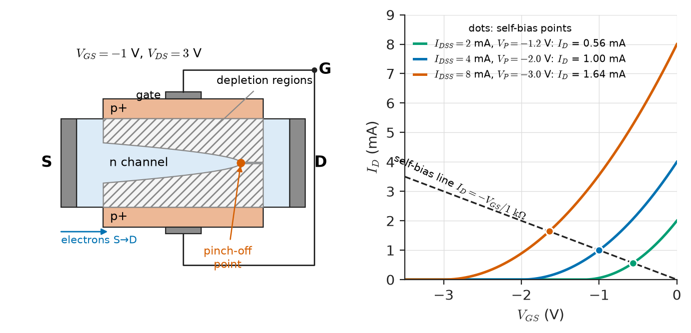
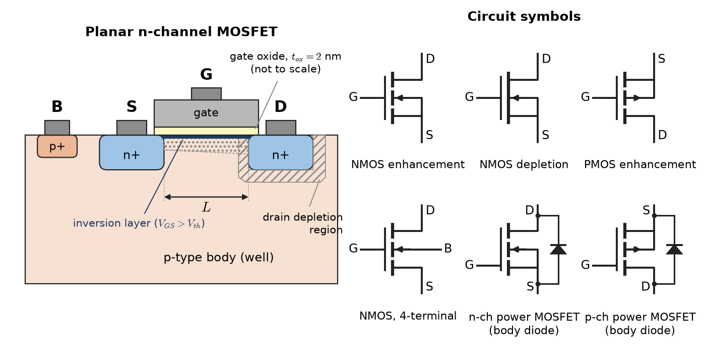
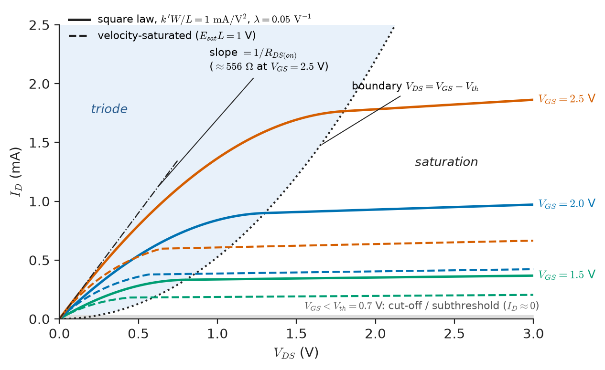
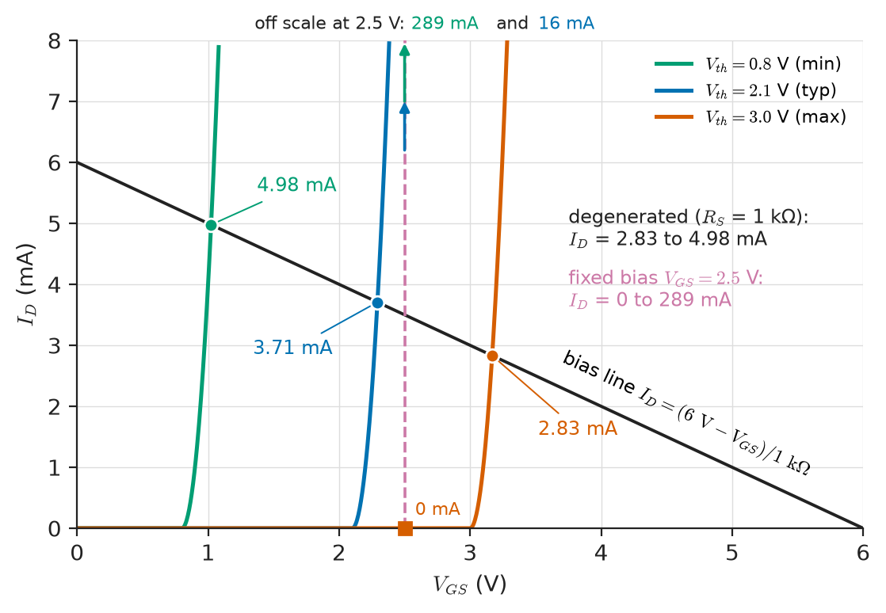
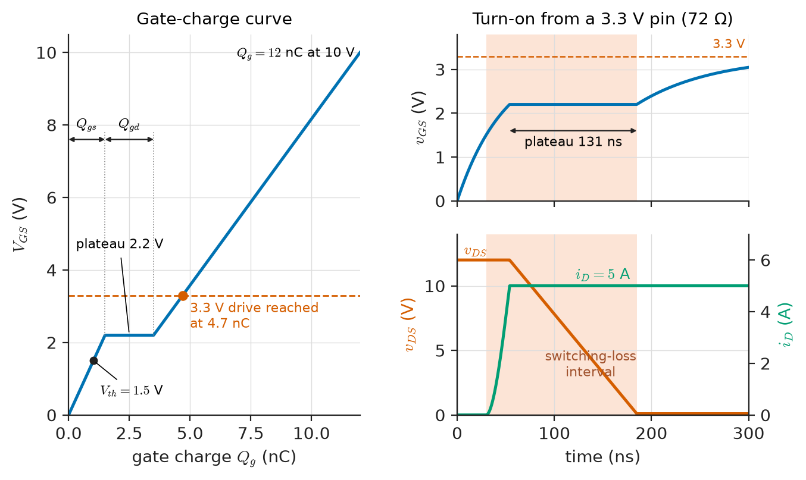
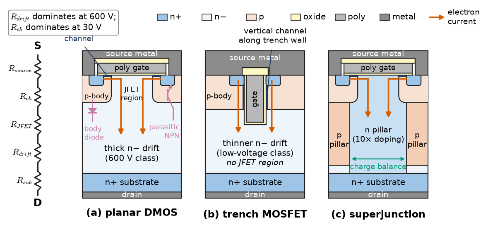

# Chapter 4 — Field-Effect Transistors

*Part I · Electronic Devices*

A firmware engineer adds a 12 V, 5 A solenoid valve to an irrigation controller and switches it with an IRF540N, a 100 V power MOSFET with a datasheet on-resistance of 44 mΩ, driven straight from a 3.3 V microcontroller pin. On the bench the valve clicks. In the field, on a warm afternoon, the MOSFET reaches 150 °C and the board browns. Nothing was out of specification on the front page of the datasheet: the 44 mΩ is guaranteed at a gate-source voltage of 10 V, and the threshold voltage of that part lies anywhere between 2 and 4 V. At 3.3 V of gate drive, a part near the top of its threshold spread is below threshold and barely conducts at all; one near 3 V conducts with a channel resistance of ohms rather than milliohms, and the 5 A load turns it into a heater. This chapter is about reading those lines: how a field-effect transistor's channel is formed and controlled, which model describes it in which region, how its threshold moves with process, body bias and temperature, how it is biased so that a circuit survives that spread, and how it behaves as an amplifier, as a logic switch and as a power switch.

> **How does a gate voltage control a channel, and which model of the drain current holds where?**
> **How do threshold spread, body effect and temperature decide whether a biasing scheme or a switch design survives production?**
> **What separates a power MOSFET from a signal MOSFET, and which datasheet limits govern it?**

| Concept | Engineering destination |
|---|---|
| JFET operation | Low-noise preamplifiers for piezo, microphone and photodiode sensors; current-regulator diodes; analog switches |
| MOSFET structure | Reading symbols and datasheets; body diodes; oxide limits on gate voltage |
| Enhancement and depletion modes | Normally-off logic and power switches; normally-on start-up circuits and current sources |
| Threshold voltage | Logic-level versus standard gate drive; body effect in stacked and source-follower stages; leakage at temperature |
| Operating regions | Choosing square-law, short-channel or subthreshold models; switch versus amplifier operation |
| DC biasing | Discrete amplifier stages that survive a 2:1 threshold spread |
| Small-signal models | Gain, impedance and bandwidth estimates; $g_m/I_D$ design |
| MOSFET amplification | Common-source, follower and cascode stages (developed in Ch. 7 and Ch. 10) |
| MOSFET switching | Load switches, low-side drivers, gate-charge timing from an MCU pin |
| Power MOSFET fundamentals | Motor drives, DC–DC converters, battery disconnects, hot-swap controllers |

**Roadmap.** The junction FET as the simplest field-effect device (4.1) → the MOSFET's structure (4.2), its two modes (4.3) and its threshold (4.4) → the operating regions and the models that describe them (4.5) → biasing a discrete stage against spread (4.6) → the small-signal model (4.7) and what it gives an amplifier (4.8) → the MOSFET as a switch (4.9) → the vertical power MOSFET and its ratings (4.10).

---

## 4.1 JFET operation

### Where *Engineering Physics* leaves off

*Engineering Physics* sketches the MOSFET in a single section ([Ch. 18 §18.3.3](https://github.com/The-Studio-of-Sadiq/Engineering-Physics/blob/main/CHAPTERS/CHAPTER%2018.md)): the inversion channel formed when $V_{GS}>V_{th}$, the triode and saturation square laws with a $(1+\lambda V_{DS})$ correction, the transconductance $g_m=2I_D/(V_{GS}-V_{th})$, and a remark that short-channel effects and gate tunnelling break the simple model. The doping and carrier-density results that set the threshold are in [Ch. 6 §6.6](https://github.com/The-Studio-of-Sadiq/Engineering-Physics/blob/main/CHAPTERS/CHAPTER%206.md), and the thermal-resistance network that turns dissipated power into junction temperature is in [Ch. 14 §14.7](https://github.com/The-Studio-of-Sadiq/Engineering-Physics/blob/main/CHAPTERS/CHAPTER%2014.md). This chapter takes those results as given and does not re-derive them. It adds what the sketch leaves out: the junction FET, depletion-mode devices, the threshold's dependence on body bias and temperature, subthreshold conduction, the short-channel and velocity-saturated models that real devices follow, biasing against production spread, capacitances and gate charge, and the vertical power MOSFET with its datasheet ratings, safe operating area and electrothermal behaviour. Where it goes beyond the validity of the sketch (high fields, short channels, self-heating, avalanche), it says so.

### Structure and pinch-off

A junction field-effect transistor (JFET) is a bar of doped semiconductor, the **channel**, with ohmic contacts at each end, the **source** and **drain**, and a reverse-biased PN junction along its side, the **gate** (Figure 4.1). In an n-channel JFET the channel is n-type and the gate p+. Making the gate more negative widens the depletion region that the junction pushes into the channel, narrowing the conducting cross-section. At the **pinch-off voltage** $V_P$ (datasheets write $V_{GS(off)}$), negative for an n-channel device, the depletion regions meet and the channel closes. The gate junction is always kept reverse-biased (or at most forward-biased by less than about 0.5 V), so the gate draws only junction leakage: picoamperes in a small-signal JFET at 25 °C, doubling roughly every 10 °C.

With $V_{DS}$ applied, the channel near the drain is more reverse-biased than near the source and pinches first. Beyond $V_{DS}=V_{GS}-V_P$ the drain current stops rising and the JFET is in **saturation** (the "pinch-off region" of older texts). There the drain current follows, to a good approximation, the Shockley square law

$$
I_D=I_{DSS}\left(1-\frac{V_{GS}}{V_P}\right)^2,\qquad V_P\le V_{GS}\le0
$$

where $I_{DSS}$ is the saturated drain current at $V_{GS}=0$. The JFET is therefore a **normally-on** (depletion-mode) device: it conducts its largest current with the gate tied to the source, and the gate can only turn it down.

> **Status of the principle: JFET square law**
> *Approximate.* It follows from the gradual-channel approximation for an abrupt junction and uniform channel doping; real channels are graded, so the exponent fitted to measured transfer curves is 1.8–2.2, and the law does not cover the subthreshold tail near $V_P$ or the triode region at low $V_{DS}$.

Differentiating gives the transconductance

$$
g_m=\frac{2I_{DSS}}{\lvert V_P\rvert}\sqrt{\frac{I_D}{I_{DSS}}}=g_{m0}\sqrt{\frac{I_D}{I_{DSS}}}
$$

with $g_{m0}=2I_{DSS}/\lvert V_P\rvert$ the value at $V_{GS}=0$.

<!-- FIGURE 4.1 | figures/ch04/fig-4-1-jfet-structure-transfer.png | cross-section | N-channel JFET cross-section with depletion regions, and its transfer characteristic. | Content: left panel, cross-section of an n-channel JFET: n-type channel bar with source (S) and drain (D) ohmic contacts at the ends, p+ gate regions top and bottom tied together (G), depletion regions drawn shaded and wedge-shaped, wider near the drain, for VGS = -1 V and VDS = 3 V; label the pinch-off point near the drain. Right panel, transfer characteristic ID versus VGS, x-axis -3.5 to 0 V, y-axis 0 to 9 mA, three square-law curves for (IDSS, VP) = (2 mA, -1.2 V), (4 mA, -2.0 V), (8 mA, -3.0 V), with the self-bias load line ID = -VGS/1 kOhm drawn and the three intersections marked at 0.56 mA, 1.00 mA and 1.64 mA. -->



*Figure 4.1 — N-channel JFET cross-section with depletion regions, and its transfer characteristic.*

### Why a JFET is still used

The JFET has no gate oxide and no surface channel. Its carriers flow in the bulk, away from the interface traps that make a MOSFET noisy at low frequency, and its gate leakage is a junction current rather than a tunnelling current. Three applications survive on these properties:

- **Low-noise, high-impedance front ends.** A piezoelectric accelerometer, an electret or condenser microphone, a pH electrode or a photodiode in photoconductive mode presents a source impedance of megohms to gigohms. A bipolar input would load it with base current and add shot noise. The JFET's picoampere gate current and voltage noise of about 1 nV/√Hz (LSK170/2SK170 class, at $I_D\approx2$ mA) make it the input device of discrete preamplifiers and of JFET-input op-amps (TL072, OPA1641).
- **Current-regulator diodes.** A JFET with gate tied to source, or with a small source resistor, is a two-terminal constant-current source (the J500 and 1N5283 families, 0.24–4.7 mA), used to bias LEDs, references and sensor bridges.
- **Analog switches and voltage-controlled resistors.** In the triode region a JFET is a resistor controlled by $V_{GS}$, used for automatic gain control and in sample-and-hold switches.

**Table 4.1 — Representative small-signal FETs (datasheet ranges at 25 °C).**

| Part (class) | Type | $I_{DSS}$ or $I_D$ rating | $V_P$ or $V_{GS(th)}$ | Other key data |
|---|---|---|---|---|
| J201 | n-JFET | 0.2–1.0 mA | −0.3 to −1.5 V | $I_{GSS}\le100$ pA |
| 2N5457 | n-JFET | 1–5 mA | −0.5 to −6 V | $g_{fs}=1$–5 mS |
| LSK170 (grade B) | n-JFET | 6–12 mA | −0.2 to −2 V | $e_n\approx0.9$ nV/√Hz at 1 kHz |
| LND150 | depletion n-MOSFET | 1–3 mA | −1 to −3 V | 500 V rating |
| 2N7000 | enhancement n-MOSFET | 200 mA | 0.8–3.0 V | $R_{DS(on)}\le5\ \Omega$ at 10 V |
| BSS138 | enhancement n-MOSFET | 220 mA | 0.8–1.5 V | logic level, level shifters |

The spreads in the table are real: pinch-off depends on channel doping and thickness, which vary across a wafer, so manufacturers sort JFETs into $I_{DSS}$ grades rather than control them tightly. A circuit that depends on the nominal $I_{DSS}$ or $V_P$ will not survive a production run.

**Worked example — Self-biasing a JFET preamplifier against spread.** A charge-amplifier front end for a piezoelectric vibration sensor uses an n-JFET with nominal $I_{DSS}=4$ mA and $V_P=-2.0$ V, to be biased at $I_D=1$ mA by a source resistor $R_S$ with the gate returned to ground through 100 MΩ.

At 1 mA the required gate-source voltage is $V_{GS}=V_P\left(1-\sqrt{I_D/I_{DSS}}\right)=-2.0(1-0.5)=-1.0$ V, so $R_S=1.0\ \mathrm V/1\ \mathrm{mA}=1\ \mathrm{k\Omega}$. The transconductance there is $g_m=(2\times4/2.0)\sqrt{0.25}=2$ mS.

Now suppose production parts span $(I_{DSS},V_P)=(2\ \mathrm{mA},-1.2\ \mathrm V)$ to $(8\ \mathrm{mA},-3.0\ \mathrm V)$. With $V_{GS}=-I_DR_S$, the bias point solves $I_D=I_{DSS}(1+I_DR_S/V_P)^2$, a quadratic in $I_D$. Taking the root with $V_{GS}>V_P$:

- low corner: $I_D=0.56$ mA, $V_{GS}=-0.56$ V;
- nominal: $I_D=1.00$ mA, $V_{GS}=-1.00$ V;
- high corner: $I_D=1.64$ mA, $V_{GS}=-1.64$ V.

A 4:1 spread in $I_{DSS}$ becomes a 2.9:1 spread in bias current. Fixed bias at $V_{GS}=-1.0$ V would have given 0.056 mA at the low corner and 3.56 mA at the high one, a 64:1 spread. The source resistor is negative feedback: more current raises $\lvert V_{GS}\rvert$, which reduces the current. Figure 4.1 shows the three intersections. A larger $R_S$ returned to a negative supply tightens the spread further, at the cost of headroom.

---

## 4.2 MOSFET structure

### The four terminals

A planar n-channel MOSFET (Figure 4.2) is built in a p-type **body** (or well). Two heavily doped n+ regions form the **source** and **drain**; between them, the **gate**, a conductor (heavily doped polysilicon in older processes, a metal on a high-κ dielectric since the 45 nm node), sits on a thin gate insulator over the channel region. The MOSFET is therefore a four-terminal device: gate (G), drain (D), source (S) and body (B). The gate is insulated: its DC current is tunnelling leakage, negligible in discrete devices and in processes with oxides thicker than about 3 nm, but amperes per square centimetre in the thinnest oxides, which is why high-κ dielectrics were introduced.

The gate insulator sets the gate capacitance per unit area,

$$
C_{ox}=\frac{\varepsilon_{ox}}{t_{ox}}
$$

For SiO$_2$ ($\varepsilon_{ox}=3.9\varepsilon_0$) at $t_{ox}=2$ nm, $C_{ox}=17\ \mathrm{fF/\mu m^2}$; at 10 nm, 3.5 fF/µm²; in a 60 V discrete power MOSFET with a 50 nm oxide, 0.69 fF/µm². The same thickness sets the gate's voltage limit: SiO$_2$ breaks down near 10 MV/cm, so a 2 nm oxide is limited to about 1 V in long-term use, and discrete power MOSFETs with 50–100 nm oxides are rated at $V_{GS(max)}=\pm20$ V. Exceeding $V_{GS(max)}$ even briefly, for example by ringing on a long gate trace, punctures the oxide; it is the commonest way to destroy a MOSFET during bring-up.

In an integrated circuit the source and body are separate terminals, the body of every NMOS device being the common p-substrate tied to ground, and the body of PMOS devices an n-well tied to $V_{DD}$. In a discrete MOSFET the body is shorted to the source inside the package. That short turns the body–drain PN junction into an **intrinsic body diode** from source to drain (anode at source in an n-channel device), drawn in every power-MOSFET symbol. The body diode conducts whenever the drain is pulled below the source: an inductive load turning off, a synchronous rectifier, a reverse-connected battery. It is a real PN diode with forward drop, stored charge and reverse recovery, which matters in Section 4.10 and in [Chapter 29](../part-7-power-electronics/29-power-electronic-fundamentals.md).

### Symmetry and the PMOS device

A planar MOSFET is symmetric: for an n-channel device the source is whichever n+ terminal is at the lower potential, which matters in analog switches where current flows both ways. The p-channel MOSFET is the complementary device. Hole mobility in silicon inversion layers is 2.5–3 times lower than electron mobility, so a PMOS device needs about 2.5 times the width for the same current, and discrete p-channel power MOSFETs are used only where their simple high-side gate drive outweighs their higher $R_{DS(on)}$: reverse-polarity protection, load switches, small motor bridges.

<!-- FIGURE 4.2 | figures/ch04/fig-4-2-mosfet-structure-symbols.png | cross-section | Planar n-channel MOSFET cross-section and the common circuit symbols for enhancement, depletion and discrete power devices. | Content: left, cross-section of a planar NMOS: p-type body with body contact B (p+), n+ source S and n+ drain D, gate oxide of thickness tox (2 nm labelled) under a gate electrode G, channel length L between source and drain junctions, inversion layer drawn as a thin dark strip when VGS > Vth, depletion region shaded around drain junction. Right, a 2 by 3 grid of symbols: NMOS enhancement (broken channel line), NMOS depletion (solid channel line), PMOS enhancement, four-terminal NMOS with separate body, discrete n-channel power MOSFET with internal source-body short and body diode drawn from source to drain, discrete p-channel power MOSFET with body diode. -->



*Figure 4.2 — Planar n-channel MOSFET cross-section and the common circuit symbols for enhancement, depletion and discrete power devices.*

---

## 4.3 Enhancement and depletion modes

An **enhancement-mode** MOSFET has no channel at $V_{GS}=0$; a channel must be induced by a gate voltage beyond the threshold, positive for NMOS, negative for PMOS. It is **normally off**, and almost every MOSFET in logic and power is of this kind, because a switch that is off when its driver is unpowered fails safe.

A **depletion-mode** MOSFET has a channel at $V_{GS}=0$, built in by an implant of donors (for n-channel) under the gate. Its threshold is negative, typically −1 to −3 V for an n-channel device, and it is **normally on**: like the JFET, the gate must be driven negative to turn it off. Unlike the JFET, its gate is insulated, so it can also be driven positive to enhance the channel beyond $I_{DSS}$.

Depletion-mode MOSFETs are niche devices with distinctive jobs:

- **Start-up circuits for offline power supplies.** A 500–1000 V depletion MOSFET (LND150, BSS126) charges the controller's supply capacitor from the rectified mains at power-on and is turned off once the auxiliary winding takes over, saving the watts a bleeder resistor would waste.
- **Constant-current sources and inrush limiters**, using a source resistor exactly as in the JFET self-bias of Section 4.1.
- **Normally-on GaN HEMTs.** The two-dimensional electron gas of an AlGaN/GaN heterostructure exists without gate bias, so the natural GaN power transistor is a depletion-mode device; making it normally off for safety is one of the central device problems of wide-bandgap power electronics ([Chapter 5](05-advanced-semiconductor-devices.md)).

**Table 4.2 — The four MOSFET types.**

| Type | Channel at $V_{GS}=0$ | Threshold | To turn on | To turn off | Typical use |
|---|---|---|---|---|---|
| n-channel enhancement | none | $V_{th}>0$ (0.3–4 V) | $V_{GS}>V_{th}$ | $V_{GS}<V_{th}$ | logic, low-side and bridge switches |
| p-channel enhancement | none | $V_{th}<0$ (−0.3 to −4 V) | $V_{GS}<V_{th}$ | $V_{GS}>V_{th}$ | CMOS pull-up, high-side load switch |
| n-channel depletion | present | $V_{th}<0$ (−1 to −3 V) | $V_{GS}=0$ suffices | $V_{GS}<V_{th}$ | start-up, current sources |
| p-channel depletion | present | $V_{th}>0$ | $V_{GS}=0$ suffices | $V_{GS}>V_{th}$ | rare |

---

## 4.4 Threshold voltage

### What sets it

The threshold voltage is the gate-source voltage at which the surface under the gate inverts strongly enough to form a conducting channel. For an NMOS device it is the sum of three terms: the flat-band voltage $V_{FB}$ (the work-function difference between gate and body minus the effect of fixed oxide charge), the band bending $2\phi_F$ needed to invert the surface (where $\phi_F$ is the body's Fermi potential, set by its doping through the carrier-density results of *Engineering Physics* [Ch. 6 §6.6](https://github.com/The-Studio-of-Sadiq/Engineering-Physics/blob/main/CHAPTERS/CHAPTER%206.md)), and the voltage across the oxide needed to hold the depletion charge:

$$
V_{th}=V_{FB}+2\phi_F+\frac{\sqrt{2q\varepsilon_{Si}N_A\,(2\phi_F+V_{SB})}}{C_{ox}}
$$

The process engineer adjusts $V_{th}$ with a shallow channel implant and, in modern processes, with the gate metal's work function. The circuit engineer cares about three consequences: it depends on the source-body voltage, it depends on temperature, and it spreads.

### Body effect

When the source is above the body ($V_{SB}>0$), the depletion charge grows and the threshold rises:

$$
V_{th}=V_{th0}+\gamma\left(\sqrt{2\phi_F+V_{SB}}-\sqrt{2\phi_F}\right)
$$

where $V_{th0}$ is the threshold at $V_{SB}=0$ and $\gamma=\sqrt{2q\varepsilon_{Si}N_A}/C_{ox}$ is the **body-effect coefficient**, typically 0.2–0.6 V$^{1/2}$ in CMOS processes.

> **Status of the principle: Body-effect threshold shift**
> *Approximate.* It follows from charge balance under the depletion approximation with uniform body doping; retrograde wells and halo implants in short-channel processes make the measured shift smaller and only approximately square-root, so foundry models (BSIM) fit it with extra parameters.

**Worked example — Threshold of a stacked transistor.** In a CMOS NAND gate, or in the upper device of a cascode, an NMOS transistor's source sits above ground. Take $V_{th0}=0.50$ V, $\gamma=0.4\ \mathrm V^{1/2}$, $2\phi_F=0.70$ V and a source 1.5 V above the grounded body:

$$
V_{th}=0.50+0.4\left(\sqrt{2.2}-\sqrt{0.7}\right)=0.50+0.4(1.483-0.837)=0.759\ \mathrm V
$$

The threshold has risen by 0.26 V, more than half its nominal value. In a 1.8 V circuit this cuts the stacked device's overdrive, and with it its current, substantially. It is one reason that NAND gates with many inputs are slow, and why source followers in ICs have gains below one even with ideal current-source loads (Section 4.7).

### Temperature and subthreshold leakage

Through $\phi_F$ and the intrinsic carrier density, the threshold falls by about 1–3 mV/K in CMOS logic devices and 3–7 mV/K in power MOSFETs. Meanwhile, mobility falls roughly as $T^{-1.5}$. At high gate overdrive the mobility term wins and drain current *falls* with temperature; at low overdrive the threshold term wins and current *rises*. The two cancel at the **temperature-compensation point**, a gate voltage marked on power-MOSFET transfer curves (typically 4–6 V for a standard-gate part). Below it, a MOSFET in linear operation has positive thermal feedback, the root of the Spirito instability discussed in Section 4.10.

Below threshold the channel does not switch off abruptly. Drain current falls exponentially with $V_{GS}$, carried by diffusion over the source barrier, exactly as in a BJT:

$$
I_D\approx I_{th}\exp\!\left(\frac{V_{GS}-V_{th}}{nV_T}\right),\qquad S=nV_T\ln10
$$

where $V_T=kT/q$, $I_{th}$ is the current defined as "threshold" (datasheets use $I_D=250\ \mu\mathrm A$ for power parts, foundries a few hundred nanoamperes per µm of width), $n=1.2$–1.6 is the subthreshold slope factor, and $S$ is the **subthreshold swing**, the gate voltage per decade of current: 60 mV/decade is the limit at 300 K for $n=1$.

> **Status of the principle: Subthreshold exponential**
> *Approximate.* It follows from Boltzmann statistics of carriers crossing the source barrier, valid in weak inversion with $V_{DS}$ above a few $V_T$; drain-induced barrier lowering in short channels makes $I_{th}$ depend on $V_{DS}$, and at very low currents junction and gate leakage set a floor.

**Worked example — Leakage of a low-threshold device at 100 °C.** A low-$V_{th}$ logic transistor has $V_{th}=0.35$ V and $I_D=1\ \mu\mathrm A$ at threshold at 25 °C, with $n=1.4$. Its swing is $S=1.4\times25.85\ \mathrm{mV}\times2.303=83.3$ mV/decade, so with the gate at 0 V its off-current is $1\ \mu\mathrm A\times10^{-0.35/0.0833}=63$ pA.

At 100 °C the swing scales with absolute temperature to $83.3\times373/298=104.3$ mV/decade, and with $dV_{th}/dT=-1$ mV/K the threshold falls to 0.275 V. The off-current becomes $1\ \mu\mathrm A\times10^{-0.275/0.1043}=2.3$ nA, 37 times larger. A processor with $10^9$ such devices therefore leaks tens of times more at its hot corner than on a cool bench, which is why static power is specified at maximum junction temperature (Ch. 33) and why a phone's standby current rises in a hot car.

### Threshold on a datasheet

Datasheets give $V_{GS(th)}$ as a minimum and maximum at a stated current, usually 250 µA or 1 mA with $V_{DS}=V_{GS}$. It is the voltage at which the device *starts* to conduct, not one at which it is usefully on. The useful number is the gate voltage at which $R_{DS(on)}$ is guaranteed: 10 V for standard-gate parts, 4.5 V (sometimes also 2.5 V or 1.8 V) for logic-level parts. The opening failure is the result of confusing the two: an IRF540N with $V_{GS(th)}=2$–4 V is guaranteed only at 10 V, whereas an IRLZ44N, with $V_{GS(th)}=1$–2 V, carries guaranteed $R_{DS(on)}$ figures of 22, 25 and 35 mΩ at 10, 5 and 4 V. Neither is specified at 3.3 V; a 3.3 V drive needs a part with a 2.5 V rating, or a gate driver.

---

## 4.5 Operating regions

### The long-channel model and its regions

The square-law model of the inversion channel is summarised in *Engineering Physics* [Ch. 18 §18.3.3](https://github.com/The-Studio-of-Sadiq/Engineering-Physics/blob/main/CHAPTERS/CHAPTER%2018.md); with $k_n'=\mu_nC_{ox}$ and overdrive $V_{ov}=V_{GS}-V_{th}$, it gives $I_D=k_n'(W/L)\left[V_{ov}V_{DS}-V_{DS}^2/2\right]$ in triode and $I_D=\tfrac12k_n'(W/L)V_{ov}^2(1+\lambda V_{DS})$ in saturation. Table 4.3 collects the regions an engineer actually uses, including the ones the sketch does not cover.

**Table 4.3 — MOSFET operating regions (n-channel; reverse all signs for p-channel).**

| Region | Condition | Drain current | Used for |
|---|---|---|---|
| Cut-off / subthreshold | $V_{GS}<V_{th}$ | exponential in $V_{GS}$, slope $S$ | off state, leakage; ultra-low-power analog (nA–µA) |
| Triode (ohmic, linear) | $V_{ov}>0$, $V_{DS}<V_{ov}$ | ≈ $V_{DS}/R_{DS(on)}$ for small $V_{DS}$ | switches, analog switches, voltage-controlled resistors |
| Saturation (active) | $V_{ov}>0$, $V_{DS}\ge V_{ov}$ | ≈ $\tfrac12k_n'(W/L)V_{ov}^2(1+\lambda V_{DS})$ | amplifiers, current sources, linear regulators |
| Velocity saturation | short $L$, high $V_{DS}$ | ≈ $WC_{ox}v_{sat}(V_{ov}-V_{DS,sat})$, nearly linear in $V_{ov}$ | digital CMOS below about 250 nm |
| Third quadrant | $V_{DS}<0$ | channel conducts in reverse; body diode beyond about −0.6 V | synchronous rectification |
| Breakdown / avalanche | $V_{DS}>V_{(BR)DSS}$ | limited only externally | inductive clamping (rated in $E_{AS}$) |

Two things in the table deserve comment. The "linear" region of a MOSFET is the triode region, where it behaves as a resistor, whereas the "linear" region of a BJT is its active region, where it amplifies; the vocabulary is a perennial trap. And for small $V_{DS}$ the triode law reduces to a resistance

$$
R_{DS(on)}\approx\frac{1}{k_n'(W/L)\,(V_{GS}-V_{th})}
$$

which falls as the gate overdrive rises. Doubling the overdrive halves the channel resistance; at an overdrive near zero the resistance goes to infinity, which is the opening failure in one formula.

### Where the square law fails

The square law assumes a constant mobility and a channel long enough that carriers never approach their saturation velocity. Three effects break it in modern devices.

**Mobility degradation.** The vertical field from the gate pushes carriers against the oxide interface, where surface-roughness scattering lowers their mobility. The effective mobility falls as $\mu_{eff}=\mu_0/(1+\theta V_{ov})$, with $\theta\approx0.1$–$1\ \mathrm V^{-1}$, so drain current rises more slowly than $V_{ov}^2$ at high gate drive.

**Velocity saturation.** In silicon the electron drift velocity saturates near $v_{sat}\approx10^7$ cm/s at fields above about 30 kV/cm. A 1 V drain-source voltage across a 100 nm channel is 100 kV/cm, so carriers in every short-channel device travel at or near $v_{sat}$. The saturation current then becomes

$$
I_{D,sat}\approx WC_{ox}v_{sat}\left(V_{ov}-V_{DS,sat}\right)
$$

nearly linear in the overdrive, and it no longer improves as $1/L$. The empirical **alpha-power law**, $I_{D,sat}\propto V_{ov}^{\alpha}$ with $\alpha$ between 1.2 and 1.5 in current processes, is the compact form used in delay estimates.

**Short-channel electrostatics.** When the drain's depletion region reaches toward the source, the drain helps the gate lower the source barrier: **drain-induced barrier lowering** (DIBL), of order 50–100 mV per volt of $V_{DS}$ in a planar device. The threshold then falls with $V_{DS}$ and with shorter $L$ ($V_{th}$ roll-off), and output resistance falls. FinFET and gate-all-around structures exist to restore gate control.

> **Status of the principle: Square-law MOSFET**
> *Approximate.* It assumes constant mobility, a gradual channel and no velocity saturation; it is a good model for channels longer than about 1 µm at modest overdrive (discrete small-signal parts and analog devices drawn long on purpose), and it overestimates current and transconductance in short-channel devices by factors of 1.5–3 at high overdrive.

<!-- FIGURE 4.3 | figures/ch04/fig-4-3-mosfet-output-regions.png | plot | Output characteristics of an n-channel MOSFET with operating regions marked, comparing long-channel square-law and velocity-saturated behaviour. | Content: x-axis VDS 0 to 3 V, y-axis ID 0 to 2.5 mA. Solid curves: square-law model with k'W/L = 1 mA/V2, Vth = 0.7 V, lambda = 0.05 per V, for VGS = 1.5, 2.0, 2.5 V (saturation currents about 0.32, 0.85, 1.62 mA at VDS = 0). Dashed curves for the same VGS: velocity-saturated model with lower, more evenly spaced saturation currents and earlier saturation. Dotted parabola VDS = VGS - Vth separating triode (left, shaded light) from saturation (right). Annotate small-VDS slope as 1/RDS(on) and the region below VGS = Vth as cut-off/subthreshold. -->



*Figure 4.3 — Output characteristics of an n-channel MOSFET with operating regions marked, comparing long-channel square-law and velocity-saturated behaviour.*

Figure 4.3 compares the two families of curves. Use the square law for insight on long-channel and discrete devices, the $g_m/I_D$ method of Section 4.7 for short-channel analog design, and the foundry's compact model (BSIM-CMG, PSP) for anything that must be right to better than about 30 %.

---

## 4.6 DC biasing

### The design problem

A MOSFET amplifier stage must sit in saturation, at a drain current chosen for gain, bandwidth, noise and power, with enough $V_{DS}$ headroom for the signal swing. The obstacle is the threshold spread. A discrete 2N7000 has $V_{GS(th)}$ between 0.8 and 3.0 V; a production power MOSFET may span 2 V. Integrated circuits avoid the problem by matching (two transistors side by side share their threshold within millivolts) and bias with current mirrors (Ch. 10). Discrete stages must use feedback.

### Fixed gate bias fails

Suppose a 2N7000-class part, modelled by the square law with $\tfrac12k_n'W/L=K=0.1\ \mathrm{A/V^2}$, is biased by a divider at $V_{GS}=2.5$ V. At the low threshold, 0.8 V, it would conduct $0.1\times1.7^2=289$ mA, beyond its 200 mA rating; at the typical 2.1 V, 16 mA; at the high threshold, 3.0 V, nothing. A fixed gate bias is a design for one part, not for a production run.

### Source degeneration

A resistor $R_S$ in the source puts the bias current in series with the gate-source loop. With the gate held at $V_G$ by a divider,

$$
V_G=V_{GS}+I_DR_S=V_{th}+V_{ov}+I_DR_S
$$

If $I_DR_S$ is large compared with the spread of $V_{th}+V_{ov}$, then $I_D\approx(V_G-V_{th})/R_S$, and a threshold change $\Delta V_{th}$ moves the current by only about $\Delta V_{th}/R_S$. The design rule is to make the voltage across $R_S$ several times the expected threshold spread, within the supply headroom. The other schemes are variations on the same feedback idea: **drain-to-gate feedback** (a resistor from drain to gate, which puts the device at $V_{GS}=V_{DS}$ and so guarantees saturation), **self-bias** for JFETs and depletion devices (Section 4.1), and **current-source bias**, where a mirror or a second transistor sets $I_D$ directly.

> **Status of the principle: Bias stabilisation by source degeneration**
> *Derived.* It is series negative feedback around the gate-source junction: the sensitivity of $I_D$ to $V_{th}$ is $-1/(R_S+1/g_m)$, reduced compared with fixed bias by the loop gain $g_mR_S$; it holds wherever the device stays in saturation.

**Worked example — A degenerated 2N7000 stage.** Use the same part from a 12 V supply with a divider setting $V_G=6$ V, $R_S=1$ kΩ and $R_D=1$ kΩ. The bias point satisfies $V_G-V_{th}=V_{ov}+KR_SV_{ov}^2$, a quadratic in $V_{ov}$:

| $V_{GS(th)}$ | $V_{ov}$ | $I_D$ | $V_{GS}$ | $V_{DS}=12-I_D(R_S+R_D)$ |
|---|---|---|---|---|
| 0.8 V (min) | 0.223 V | 4.98 mA | 1.02 V | 2.05 V |
| 2.1 V (typ) | 0.193 V | 3.71 mA | 2.29 V | 4.59 V |
| 3.0 V (max) | 0.168 V | 2.83 mA | 3.17 V | 6.34 V |

Over the full datasheet threshold range the current spans 1.76:1 instead of 0-to-289 mA, and at every corner $V_{DS}$ exceeds $V_{ov}$ by more than 1.8 V, so the device stays in saturation. Notice that the overdrive is only about 0.2 V: with this large $K$ the device needs very little overdrive for milliamperes, so almost all of $V_G-V_{th}$ appears across $R_S$, which is exactly what makes the bias robust. The price is signal gain, recovered by bypassing $R_S$ with a capacitor at signal frequencies (Ch. 7). Figure 4.4 shows the construction graphically.

<!-- FIGURE 4.4 | figures/ch04/fig-4-4-bias-spread.png | plot | Bias point of a source-degenerated MOSFET stage for minimum, typical and maximum threshold voltage, compared with fixed gate bias. | Content: x-axis VGS 0 to 6 V, y-axis ID 0 to 8 mA. Three square-law transfer curves ID = 0.1 (VGS - Vth)^2 A for Vth = 0.8, 2.1, 3.0 V (steep, clipped at 8 mA). Bias line ID = (6 V - VGS)/1 kOhm from (6 V, 0) to (0, 6 mA), intersections marked at 4.98, 3.71, 2.83 mA. A vertical dashed line at VGS = 2.5 V for fixed bias, crossing the Vth = 0.8 V curve at 289 mA and the Vth = 2.1 V curve at 16 mA (both off scale, arrows) and giving 0 for Vth = 3.0 V; annotate the fixed-bias range 0 to 289 mA. -->



*Figure 4.4 — Bias point of a source-degenerated MOSFET stage for minimum, typical and maximum threshold voltage, compared with fixed gate bias.*

---

## 4.7 Small-signal models

### The hybrid-π model of the MOSFET

Around a bias point in saturation, the MOSFET is linearised exactly as the diode and BJT are (Chapter 1 and Chapter 3). The low-frequency model has a voltage-controlled current source $g_mv_{gs}$, an output resistance $r_o$, and, when the source is not at the body potential, a second source $g_{mb}v_{bs}$ for the body effect. The gate draws no current at low frequency: there is no $r_\pi$.

The transconductance in saturation, from the square law, has three equivalent forms,

$$
g_m=k_n'\frac WLV_{ov}=\sqrt{2k_n'\frac WLI_D}=\frac{2I_D}{V_{ov}}
$$

and the others follow:

$$
r_o=\frac{1}{\lambda I_D}=\frac{V_A}{I_D},\qquad g_{mb}=\chi g_m,\quad \chi=\frac{\gamma}{2\sqrt{2\phi_F+V_{SB}}}\approx0.1\text{–}0.3
$$

with $V_A=1/\lambda$ the Early voltage, proportional to channel length (roughly 5–50 V per µm of $L$ in current processes).

> **Status of the principle: MOSFET hybrid-π model**
> *Derived.* It is the first-order Taylor expansion of the large-signal drain-current law about the bias point, valid for signal amplitudes small compared with the overdrive (the square law makes the second harmonic $v_{gs}/(4V_{ov})$ of the fundamental, Section 4.8); the numerical values of $g_m$ inherit the accuracy of whichever large-signal model was differentiated.

### Capacitances and $f_T$

At high frequency the model adds the gate-source capacitance $C_{gs}$ (about $\tfrac23WLC_{ox}$ in saturation plus overlap), the gate-drain capacitance $C_{gd}$ (overlap only in saturation, but multiplied by the stage gain through the Miller effect), and the drain-body and source-body junction capacitances $C_{db}$, $C_{sb}$. The **transition frequency**, at which the short-circuit current gain falls to one,

$$
f_T=\frac{g_m}{2\pi\left(C_{gs}+C_{gd}\right)}\approx\frac{3\mu_nV_{ov}}{4\pi L^2}\ \text{(long channel)},\qquad f_T\approx\frac{v_{sat}}{2\pi L}\ \text{(velocity-saturated)}
$$

summarises the device's speed. It rises as $1/L^2$ for long channels but only as $1/L$ once velocity saturation sets in: about 300 GHz for a 22 nm FinFET, 0.1–few GHz for discrete small-signal and RF MOSFETs, and tens of megahertz for a power MOSFET whose input capacitance is nanofarads.

### MOSFET versus BJT, and the $g_m/I_D$ view

At the same bias current, a BJT has more transconductance: $g_m=I_C/V_T=38.7$ mS at 1 mA, against $g_m=2I_D/V_{ov}=10$ mS for a MOSFET at $V_{ov}=0.2$ V. The ratio $g_m/I_D$, the transconductance efficiency, is $1/V_T\approx38.7\ \mathrm{V^{-1}}$ for a BJT at any current, but for a MOSFET it depends on the inversion level: about $2/V_{ov}$ (5–15 V$^{-1}$) in strong inversion, approaching $1/(nV_T)$ (25–30 V$^{-1}$) in weak inversion, where the MOSFET behaves like a BJT with a poorer ideality. Modern analog design picks $g_m/I_D$ first, trading efficiency (weak inversion) against speed (strong inversion, high $f_T$), and reads device widths from simulated lookup tables.

**Table 4.4 — Representative small-signal parameters at $I_D=1$ mA.**

| Device | $g_m$ | $r_o$ | $g_mr_o$ | $f_T$ |
|---|---|---|---|---|
| BJT, 2N3904 class ($V_A\approx100$ V) | 38.7 mS | 100 kΩ | ≈ 3900 | 300 MHz |
| n-JFET, 2N5457 class | 2–4 mS | 50–200 kΩ | 100–800 | 50–100 MHz |
| NMOS, 180 nm, $L=0.18$ µm, $V_{ov}=0.2$ V | 10 mS | 5–10 kΩ | 50–100 | 20–40 GHz |
| NMOS, 180 nm, $L=1$ µm, $V_{ov}=0.2$ V | 10 mS | 50 kΩ | ≈ 500 | ≈ 1.5 GHz |
| Discrete 2N7000 (near weak inversion) | 15–25 mS | 50–200 kΩ | > 1000 | ≈ 100 MHz |

---

## 4.8 MOSFET amplification

The transistor-amplifier configurations, with their gain, impedance and frequency-response analysis, belong to [Chapter 7](../part-2-analog-electronics/07-transistor-amplifiers.md), and the differential pairs, mirrors and active loads of integrated amplifiers to [Chapter 10](../part-2-analog-electronics/10-analog-integrated-circuits.md). This section records only what the device itself contributes.

### The intrinsic gain

A common-source stage with drain load $R_D$ has small-signal voltage gain

$$
A_v=-g_m\left(R_D\parallel r_o\right)
$$

Its upper bound, reached with an ideal current-source load, is the **intrinsic gain** $A_i=g_mr_o=2V_A/V_{ov}$. It is a property of the device and bias alone, and it is low in short-channel MOSFETs: 10–30 for a minimum-length device in a 28 nm process, against thousands for a BJT. It explains the cascode (which multiplies output resistance by roughly another $g_mr_o$), non-minimum channel lengths in analog blocks, and digital calibration in fine processes.

**Worked example — Gain of a common-source stage.** An NMOS device biased at $I_D=1$ mA with $V_{ov}=0.2$ V and $\lambda=0.02\ \mathrm V^{-1}$ has $g_m=2(1\ \mathrm{mA})/0.2\ \mathrm V=10$ mS and $r_o=1/(0.02\times1\ \mathrm{mA})=50$ kΩ, so its intrinsic gain is 500. With $R_D=5$ kΩ the gain is $-10\ \mathrm{mS}\times(5\parallel50)\ \mathrm{k\Omega}=-10\times4.545=-45.5$; loaded by a 10 kΩ input of the next stage, $R_D\parallel r_o\parallel R_L=3.125$ kΩ and $A_v=-31.3$. A BJT at the same current would give $-38.7\ \mathrm{mS}\times3.125\ \mathrm{k\Omega}=-121$ in the same circuit. The MOSFET's compensation is its infinite low-frequency input resistance, which lets it be driven by high-impedance sources and AC-coupled with small capacitors.

### Followers, common gate and linearity

The source follower's gain, $g_mR_S/(1+(g_m+g_{mb})R_S)$, stays below one even for $R_S\to\infty$ because of the body effect, and its output resistance is about $1/g_m$, 100 Ω at 10 mS. The square law also makes distortion predictable: a common-source stage driven by $v_{gs}=V\cos\omega t$ produces a second harmonic of relative amplitude $V/(4V_{ov})$, so keeping second-harmonic distortion below 1 % requires $V<0.04V_{ov}$ in an open-loop stage, or feedback (Ch. 7 and Ch. 9).

---

## 4.9 MOSFET switching

### The MOSFET as a switch

As a switch the MOSFET operates in two states: cut-off, with leakage $I_{DSS}$ (nanoamperes to microamperes, note the clash with the JFET's $I_{DSS}$), and deep triode, as a resistance $R_{DS(on)}$. It needs no steady gate current, which makes it the universal switch of logic (Ch. 33), load switching and power conversion. In the on state it is bidirectional: current can flow from source to drain through the channel, with a drop $I_DR_{DS(on)}$ smaller than the body-diode drop, which is the basis of synchronous rectification.

Three switch arrangements cover most designs:

- **Low-side switch.** An n-channel MOSFET between load and ground, gate driven relative to ground. The simplest and cheapest; used for solenoids, relays, LEDs and motors from a microcontroller.
- **High-side switch.** The switch is in the supply line of a grounded load. A p-channel MOSFET is driven by pulling its gate below the supply; an n-channel device needs a gate above the supply, from a charge pump or bootstrap (Ch. 29). Automotive loads are high-side switched, so that a wiring short to chassis does not energise them, by smart switches (BTS, VNQ families) with built-in current limit and diagnostics.
- **Load switch with reverse blocking.** Two MOSFETs source-to-source, so that their body diodes oppose, block in both directions: battery selection, USB power-path switching, analog multiplexers.

With an inductive load (solenoid, relay coil, motor) the switch must not be the only path for the load current at turn-off: the inductance drives the drain voltage up until something conducts. A freewheeling diode across the load ([Chapter 2](02-semiconductor-junction-devices.md)), a TVS or Zener clamp from drain to gate or drain to source, or the MOSFET's own avalanche capability (Section 4.10) must absorb the stored energy $\tfrac12LI^2$.

### Gate charge and switching time

The MOSFET's gate is a nonlinear capacitor. Rather than give $C_{gs}$ and $C_{gd}$, which vary strongly with voltage, power-MOSFET datasheets give the **gate-charge curve** (Figure 4.5), measured by driving the gate with a constant current while the device switches a clamped inductive load. It has three segments:

1. **Charging $C_{gs}$** up to the threshold and then to the **Miller plateau** voltage $V_{plateau}$, at which the device carries the full load current; the charge used is $Q_{gs}$.
2. **The Miller plateau.** The drain voltage falls from the supply to nearly zero; the gate voltage stays flat at $V_{plateau}$ while the driver supplies the charge $Q_{gd}$ to discharge the gate-drain capacitance. This is when the device dissipates most of its switching energy.
3. **Overdrive** from $V_{plateau}$ to the final drive voltage, which completes the total gate charge $Q_g$ and brings $R_{DS(on)}$ down to its rated value.

The plateau voltage is the gate voltage needed for the load current: $V_{plateau}\approx V_{th}+\sqrt{I_D/K}$. The drain-voltage transition time is then set by the gate current during the plateau:

$$
t_{v}\approx\frac{Q_{gd}}{I_G},\qquad I_G=\frac{V_{drive}-V_{plateau}}{R_{G,total}}
$$

> **Status of the principle: Gate-charge switching estimate**
> *Approximate.* It treats the driver as a voltage source behind a resistance and the gate-drain charge as delivered at constant gate voltage; it ignores source inductance (which subtracts $L_S\,di/dt$ from the effective drive) and the voltage dependence of $C_{gd}$ within the plateau, and is good to about a factor of 1.5 for estimating edge times.

**Worked example — Driving a logic-level MOSFET from a 3.3 V MCU pin.** A logic-level 30 V MOSFET with $Q_{gs}=1.5$ nC, $Q_{gd}=2.0$ nC and $V_{plateau}=2.2$ V at the 5 A load current is driven from a 3.3 V GPIO pin with an output resistance of about 50 Ω through a 22 Ω series gate resistor. During the plateau the gate current is $I_G=(3.3-2.2)/72\ \Omega=15.3$ mA, and the drain-voltage edge takes $t_v=2.0\ \mathrm{nC}/15.3\ \mathrm{mA}=131$ ns. That is fine for a solenoid switched a few times per second and far too slow for a 200 kHz converter.

Two warnings follow. First, the pin's 1.1 V of overdrive beyond the plateau is all there is: if a hot part's plateau rises toward 3 V (higher current, higher-threshold sample), the gate current collapses and the device lingers in the plateau. Second, the opening's IRF540N, with a threshold up to 4 V, would have its plateau *above* 3.3 V at 5 A: the drain voltage would never fall fully, and the device would sit in its saturation region dissipating watts. The fix is a part whose $R_{DS(on)}$ is guaranteed at 2.5 V, or a gate driver (an MCP1416-class driver delivers 1.5 A peak and 12 V of drive); the driver design, the loss calculation and the switching-frequency trade-off belong to [Chapter 29](../part-7-power-electronics/29-power-electronic-fundamentals.md).

<!-- FIGURE 4.5 | figures/ch04/fig-4-5-gate-charge-switching.png | waveform | Gate-charge curve of a power MOSFET and the corresponding turn-on waveforms in a clamped inductive circuit. | Content: left panel, VGS (0 to 10 V) versus gate charge Qg (0 to 12 nC): rising line to Vth = 1.5 V, continuing to plateau at 2.2 V at Qgs = 1.5 nC, flat plateau from 1.5 to 3.5 nC (Qgd = 2.0 nC), then rising more slowly to 10 V at Qg = 12 nC; mark the 3.3 V drive level at about 5 nC. Right panel, time axis 0 to 300 ns: VGS rising exponentially to the plateau at 2.2 V, staying flat for 131 ns, then rising to 3.3 V; drain current ID rising from 0 to 5 A during the Qgs interval (before the plateau); drain voltage VDS falling from 12 V to near 0 during the plateau. Shade the overlap of VDS and ID as the switching-loss interval. -->



*Figure 4.5 — Gate-charge curve of a power MOSFET and the corresponding turn-on waveforms in a clamped inductive circuit.*

---

## 4.10 Power MOSFET fundamentals

### Vertical structures

A planar MOSFET carries current along the surface, and its blocking voltage needs a long drift region in the same plane, wasting area. Power MOSFETs are **vertical**: source and gate on the top surface, drain on the back of the die, current flowing down through a lightly doped n− **drift region** that supports the blocking voltage (Figure 4.6). Thousands to millions of cells are paralleled on one die. Three generations dominate:

- **Planar DMOS (VDMOS)**: the channel is formed laterally at the surface in a double-diffused p-body, then current turns down into the drift region. Robust, used at 200–1000 V where the drift region dominates anyway.
- **Trench MOSFET**: the gate is buried in etched trenches and the channel runs vertically along the trench wall, eliminating the JFET region between cells and packing far more channel per area. Dominant below 250 V: a 40 V trench MOSFET in a 5 × 6 mm package reaches 1–2 mΩ.
- **Superjunction (SJ) MOSFET**: alternating n and p pillars in the drift region compensate each other's charge, so the drift region can be doped an order of magnitude more heavily for the same blocking voltage. Dominant at 500–900 V in silicon (CoolMOS, MDmesh, SuperFET families), with specific on-resistances near 1 Ω·mm² at 600 V.

### On-resistance and the silicon limit

$R_{DS(on)}$ is a series sum: source and package resistance, channel, the JFET neck between cells (in planar devices), drift region and substrate. At low voltage the channel and package dominate; at high voltage the drift region dominates. For a conventional (non-superjunction) unipolar drift region the specific on-resistance rises steeply with blocking voltage: as $V_B^2$ for a constant critical field, as derived with the material figure of merit in *Materials Science and Engineering*, [Ch. 33 §33.10](https://github.com/The-Studio-of-Sadiq/Materials-Science-and-Engineering/blob/main/Chapters/CHAPTER%2033.md), and closer to $V_B^{2.5}$ in silicon once the critical field's fall at the light doping of high-voltage drift regions is included. The consequence for selection is direct: a 600 V planar MOSFET has 100–300 times the specific on-resistance of a 60 V device. Superjunctions break the one-dimensional limit in silicon; wide-bandgap materials lower it by orders of magnitude (Chapter 5).

**Table 4.5 — Representative silicon power MOSFETs (typical datasheet values).**

| Class | $V_{(BR)DSS}$ | $R_{DS(on)}$ at 10 V, 25 °C | $Q_g$ | $R_{\theta JC}$ | Typical use |
|---|---|---|---|---|---|
| 30 V trench, logic level, 3 × 3 mm | 30 V | 3–6 mΩ | 10–20 nC | 2–4 K/W | point-of-load buck, laptop power |
| 40 V trench, 5 × 6 mm | 40 V | 1–2 mΩ | 50–100 nC | 0.5–1 K/W | 12 V motor drives, battery switches |
| 100 V trench, TO-220 / D²PAK | 100 V | 3–8 mΩ | 70–150 nC | 0.4–0.8 K/W | 48 V telecom and server, e-bike controllers |
| IRF540N (planar, legacy) | 100 V | 44 mΩ max | 71 nC max | 1.15 K/W | general purpose |
| 650 V superjunction, TO-247 | 650 V | 40–190 mΩ | 30–110 nC | 0.3–1 K/W | PFC, LLC converters, server PSUs |

### Temperature coefficient and paralleling

The on-resistance of a silicon MOSFET rises with temperature, because mobility falls: typically by a factor of 1.5–1.8 from 25 °C to 150 °C at rated gate drive, read from the normalised $R_{DS(on)}$ curve on the datasheet. The positive coefficient makes paralleled MOSFETs share current in the fully-on state: the hotter device's resistance rises and pushes current to its cooler neighbours. It also closes the electrothermal loop of Section 1.7: dissipation raises $T_j$, which raises $R_{DS(on)}$, which raises dissipation. With $R_{DS(on)}=R_{25}\left[1+\alpha(T_j-25)\right]$ and junction-to-ambient thermal resistance $R_{\theta JA}$ (the series network of *Engineering Physics* [Ch. 14 §14.7](https://github.com/The-Studio-of-Sadiq/Engineering-Physics/blob/main/CHAPTERS/CHAPTER%2014.md)), the steady state is

$$
T_j=\frac{T_a+I^2R_{25}(1-25\alpha)R_{\theta JA}}{1-G},\qquad G=I^2R_{25}\,\alpha\,R_{\theta JA}
$$

The electrothermal loop gain $G$ must be less than one for an equilibrium to exist; as $G\to1$ the temperature diverges, which is thermal runaway.

> **Status of the principle: Electrothermal equilibrium of a conducting MOSFET**
> *Derived.* It combines the linear temperature model of $R_{DS(on)}$ with a single thermal resistance; it is accurate for steady DC conduction, while pulsed loads need the transient thermal impedance $Z_{\theta JC}(t)$ from the datasheet, and the linear coefficient $\alpha$ is a fit valid between about 25 °C and 175 °C.

**Worked example — A 48 V battery disconnect switch.** An 80 V trench MOSFET in a battery-management unit for a 48 V e-bike pack (54.6 V at full charge) has $R_{25}=4.0$ mΩ, rising 1.7 times by 150 °C ($\alpha=0.7/125=0.0056\ \mathrm{K^{-1}}$). Mounted on a copper pour, it sees $R_{\theta JA}=3.3$ K/W in a 60 °C enclosure. Listing 4.1 solves the equilibrium for several currents.

```python
# Junction temperature of a conducting power MOSFET whose R_DS(on) rises with T_j
R25, alpha = 4.0e-3, 0.0056   # ohm at 25 C; per kelvin (1.7x at 150 C)
Rth_ja, Ta = 3.3, 60.0        # K/W junction to ambient; ambient in C
Tj_max = 175.0

def operating_point(I):
    G = I**2 * R25 * alpha * Rth_ja          # electrothermal loop gain
    if G >= 1.0:
        return G, float("inf"), float("inf")  # no equilibrium: runaway
    Tj = (Ta + I**2 * R25 * (1 - 25*alpha) * Rth_ja) / (1 - G)
    P = (Tj - Ta) / Rth_ja
    return G, P, Tj

for I in (20, 30, 40, 50, 60, 70):
    G, P, Tj = operating_point(I)
    flag = "OK" if Tj <= Tj_max else "exceeds Tj,max"
    print(f"I = {I:2d} A   G = {G:4.2f}   P = {P:5.2f} W   Tj = {Tj:6.1f} C  {flag}")
print(f"runaway current (G = 1): {(1/(R25*alpha*Rth_ja))**0.5:.0f} A")
```

Its output:

```text
I = 20 A   G = 0.03   P =  1.97 W   Tj =   66.5 C  OK
I = 30 A   G = 0.07   P =  4.61 W   Tj =   75.2 C  OK
I = 40 A   G = 0.12   P =  8.68 W   Tj =   88.6 C  OK
I = 50 A   G = 0.18   P = 14.67 W   Tj =  108.4 C  OK
I = 60 A   G = 0.27   P = 23.47 W   Tj =  137.4 C  OK
I = 70 A   G = 0.36   P = 36.75 W   Tj =  181.3 C  exceeds Tj,max
runaway current (G = 1): 116 A
```

At the pack's 30 A continuous rating the junction runs at 75 °C with 4.6 W, a comfortable margin. Without the temperature coefficient, the 30 A estimate would have been $30^2\times4\ \mathrm{m\Omega}=3.6$ W: 22 % low. The 175 °C limit is reached at about 69 A, so the useful continuous rating is set by $T_{j,max}$, well before the 116 A at which the loop gain reaches one; note how the dissipation grows faster than $I^2$ as the current approaches that limit. For headroom, a designer would parallel two devices, which share current thanks to the positive coefficient.

### Ratings, safe operating area and avalanche

The front page of a power-MOSFET datasheet is a list of absolute maximum ratings, defined in IEC 60747-8 and IEC 60134 as limits never to be exceeded under any condition:

- $V_{DS}$ (equal to the guaranteed $V_{(BR)DSS}$ at 25 °C, rising about 0.1 %/K) and $V_{GS}$ (typically ±20 V).
- $I_D$ continuous, usually quoted at a case temperature of 25 °C and computed from $R_{\theta JC}$, a number no real heatsink achieves; the value at $T_C=100$ °C is more honest, and the package lead rating (often 75–120 A for a TO-220) can be lower still.
- $I_{DM}$ pulsed, and $P_D$ at $T_C=25$ °C.
- $T_j$ from −55 °C to 150 °C or 175 °C.
- $E_{AS}$, the single-pulse **avalanche energy**: the energy the device can absorb in breakdown when an unclamped inductive load turns off (UIS). A device rated $E_{AS}=200$ mJ can absorb the energy of 20 A in a 1 mH inductance once, starting from 25 °C; repetitive avalanche is rated separately, if at all.

The **safe operating area** (SOA) chart bounds $I_D$ versus $V_{DS}$ on log axes for single pulses of 10 µs to DC at $T_C=25$ °C: a horizontal line at $I_{DM}$, a sloped line where $R_{DS(on)}$ limits current, constant-power lines set by the transient thermal impedance, and a vertical line at $V_{DS(max)}$. Modern trench MOSFETs add a steeper boundary at long pulse widths, the **Spirito** or linear-mode instability: in linear operation (hot-swap inrush limiting, eFuses, electronic loads) the device sits below its temperature-compensation point, so a hot spot draws more current and gets hotter. Hot-swap controllers in servers and telecom backplanes are therefore paired with MOSFETs whose SOA is guaranteed for linear mode, not with the lowest-$R_{DS(on)}$ part.

The body diode carries its own ratings: forward voltage (0.7–1.2 V), continuous and pulsed current, and the reverse-recovery charge $Q_{rr}$ and time $t_{rr}$. In superjunction MOSFETs $Q_{rr}$ is large (several microcoulombs), which rules out using their body diodes in hard-switched bridges; this, and the remedies (fast-recovery body-diode variants, SiC MOSFETs, GaN HEMTs), are taken up in Chapter 5 for the devices and in Chapter 29 for the circuits.

<!-- FIGURE 4.6 | figures/ch04/fig-4-6-power-mosfet-structures.png | cross-section | Cross-sections of planar DMOS, trench and superjunction power MOSFET cells, with the components of on-resistance. | Content: three side-by-side unit cells, each about 5 to 10 um wide. (a) Planar DMOS: top source metal, polysilicon gate on oxide at surface, p-body and n+ source diffusions, lateral surface channel, JFET region between p-bodies, thick n- drift region, n+ substrate, drain metal at bottom; current path arrows. (b) Trench MOSFET: gate in trench lined with oxide, vertical channel along trench wall, thinner drift region, no JFET region. (c) Superjunction: alternating n and p pillars extending through the drift region under planar or trench cells, labelled charge balance. Beside (a), a series resistor stack: R_source, R_ch, R_JFET, R_drift, R_sub, with a note that R_drift dominates at 600 V and R_ch at 30 V. Show the parasitic body diode (p-body to n- drift) and parasitic NPN (n+ source, p-body, n- drift) in (a). -->



*Figure 4.6 — Cross-sections of planar DMOS, trench and superjunction power MOSFET cells, with the components of on-resistance.*

The parasitic NPN transistor formed by source, body and drift region (Figure 4.6) is held off by the source metal shorting body to source; under extreme $dv/dt$ or avalanche current the lateral body resistance can let it turn on, and the device fails in second breakdown. Ruggedness ratings ($E_{AS}$, body-diode $dv/dt$) measure how well it is suppressed; Chapter 5 meets the same parasite as the latch-up mechanism of the IGBT.

---

## What remains open

| Open question | Where it is answered |
|---|---|
| How are thyristors, IGBTs, SiC MOSFETs and GaN HEMTs built, rated and chosen? | [Chapter 5](05-advanced-semiconductor-devices.md) |
| How are common-source, follower and multistage FET amplifiers designed and analysed in frequency? | [Chapter 7](../part-2-analog-electronics/07-transistor-amplifiers.md) |
| How do current mirrors, differential pairs and cascodes exploit matched MOSFETs in an IC? | [Chapter 10](../part-2-analog-electronics/10-analog-integrated-circuits.md) |
| How large are switching and conduction losses, and how is a power MOSFET's gate driven and protected? | [Chapter 29](../part-7-power-electronics/29-power-electronic-fundamentals.md) |
| How do MOSFETs become CMOS gates, with delay, noise margins and dynamic power? | [Chapter 33](../part-8-integrated-circuits-and-vlsi/33-cmos-fundamentals.md) |
| What material properties set the unipolar limit and make SiC and GaN better? | *Materials Science and Engineering*, [Ch. 33](https://github.com/The-Studio-of-Sadiq/Materials-Science-and-Engineering/blob/main/Chapters/CHAPTER%2033.md) |
| How is heat removed from a junction through a package and heatsink? | *Engineering Physics*, [Ch. 14 §14.7](https://github.com/The-Studio-of-Sadiq/Engineering-Physics/blob/main/CHAPTERS/CHAPTER%2014.md); Chapter 29 for converter thermal design |

**Next:** Chapter 5 moves beyond the three classical transistors to the four-layer thyristor family, the IGBT and the wide-bandgap, optoelectronic and compound-semiconductor devices, and to the ratings by which any of them is selected.
