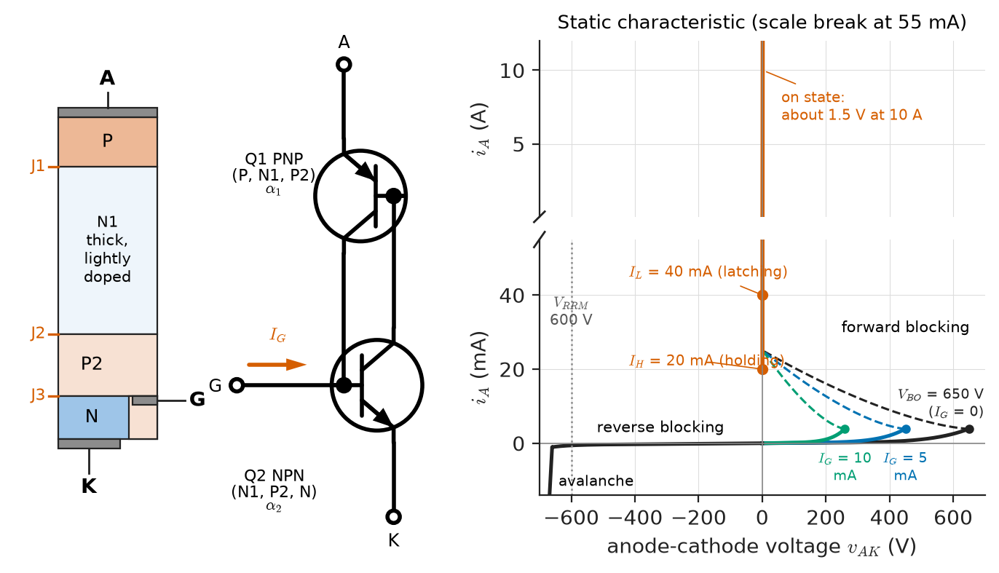
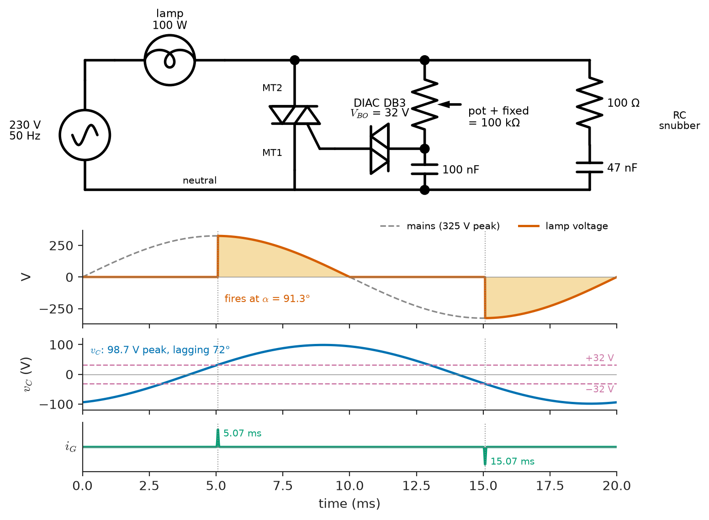
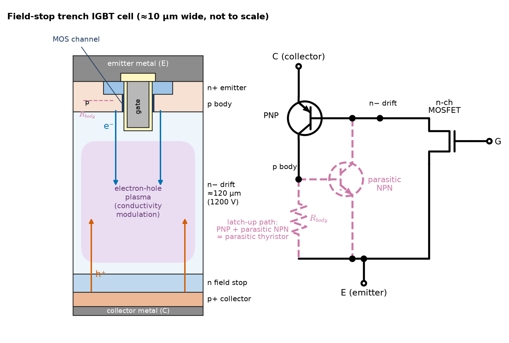
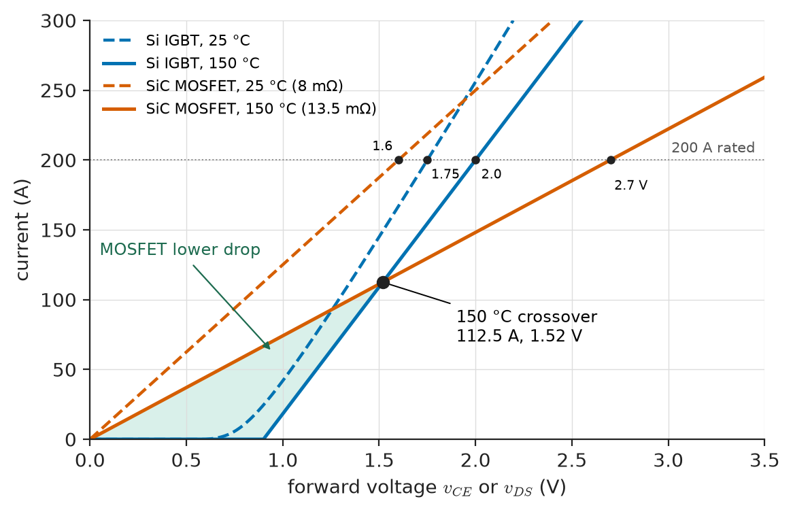
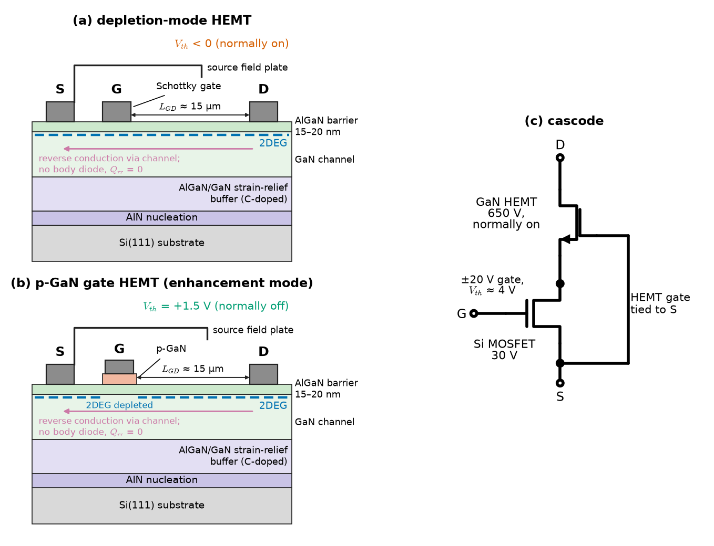
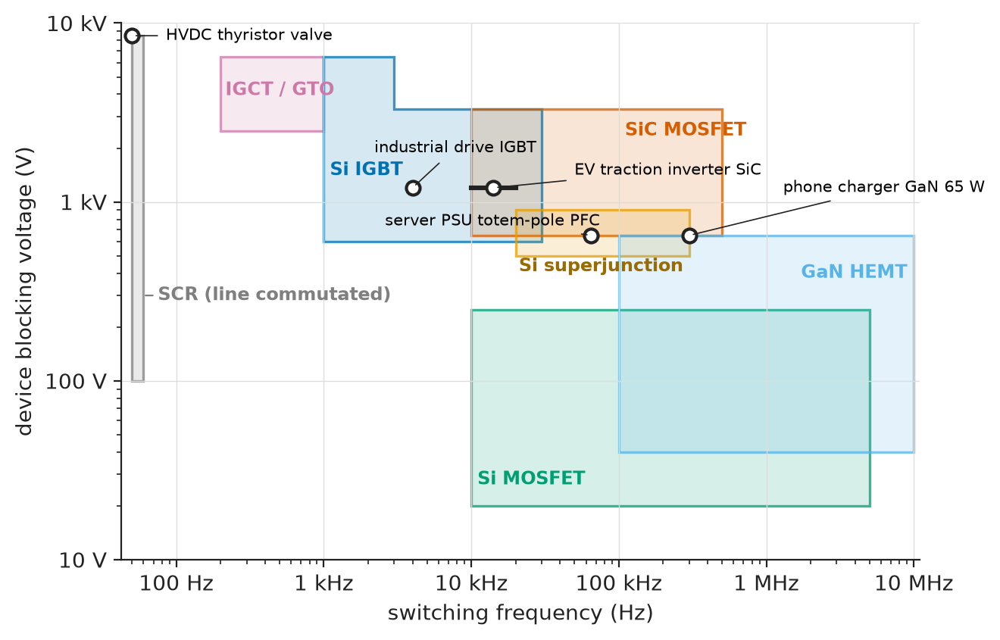

# Chapter 5 — Advanced Semiconductor Devices

*Part I · Electronic Devices*

An HVAC manufacturer replaces the relay that starts a 600 W single-phase fan motor with a triac, to remove contact wear and switching noise. The prototypes pass every test. In production, about one unit in fifty keeps the motor running after the controller removes the gate drive: the triac does not turn off. Nothing is broken. The motor draws 6 A at a power factor of 0.6, so when its current passes through zero the mains voltage is already at 260 V, and that voltage reappears across the triac within microseconds. The charge still stored in the triac from the half-cycle just ended is enough to turn it back on. The cure is a different class of triac, rated for a higher commutating current slope, or a snubber, and it comes from reading a line of the datasheet that relay designers never needed. The same factory's drives are moving from silicon IGBTs to SiC MOSFETs, and its control boards rely on optocouplers whose gain fades over a decade. Each of these devices extends the diode, BJT and MOSFET of Chapters 2–4 by adding a layer, a material or a photon, and each has limits of its own. This chapter covers how they work, how they are rated, and how one is chosen.

> **How do four-layer devices latch, and what makes them turn off or fail to?**
> **What does an IGBT, a SiC MOSFET or a GaN HEMT offer that a silicon MOSFET does not, and at what price?**
> **How are optoelectronic and compound-semiconductor devices specified, and how is any power device selected against its ratings?**

| Concept | Engineering destination |
|---|---|
| Thyristors | Phase-controlled rectifiers, HVDC valves, crowbars, soft starters |
| SCRs | Battery chargers, controlled rectifiers, motor soft starters, overvoltage crowbars |
| TRIACs | AC switches for heaters, fans, pumps and lamps in appliances and HVAC |
| DIACs | Trigger devices for dimmers and phase controllers |
| IGBTs | Industrial drives, traction, induction cooking, welding, wind and solar inverters |
| Wide-bandgap power devices | EV inverters and chargers, data-centre and telecom power supplies, compact adapters |
| Optoelectronic devices | Galvanic isolation, gate-drive isolation, LiDAR, optical links, imaging |
| Compound-semiconductor devices | RF power amplifiers, low-noise receivers, radar, satellite and 5G front ends |
| Device selection and ratings | Choosing voltage class, current rating and technology; derating for life and cosmic rays |

**Roadmap.** The four-layer structure and latching (5.1) → its three members: the SCR (5.2), the bidirectional TRIAC (5.3) and its trigger, the DIAC (5.4) → the MOS-gated bipolar IGBT (5.5) → silicon carbide and gallium nitride power devices (5.6) → devices that convert between photons and electrons beyond Chapter 2's LEDs and photodiodes (5.7) → III–V transistors for high frequency (5.8) → ratings and selection across all of them (5.9).

---

## 5.1 Thyristors

### Where *Engineering Physics* leaves off

*Engineering Physics* carries the solid state as far as the PN junction, the BJT and the MOSFET in one section ([Ch. 18 §18.3](https://github.com/The-Studio-of-Sadiq/Engineering-Physics/blob/main/CHAPTERS/CHAPTER%2018.md)) and tabulates the band gaps of Si, GaAs, InP, SiC and GaN with their direct or indirect character ([Ch. 6 §6.6.3](https://github.com/The-Studio-of-Sadiq/Engineering-Physics/blob/main/CHAPTERS/CHAPTER%206.md)); semiconductor lasers are sketched in [Ch. 12 §12.8.3](https://github.com/The-Studio-of-Sadiq/Engineering-Physics/blob/main/CHAPTERS/CHAPTER%2012.md), and junction temperature from a thermal-resistance network in [Ch. 14 §14.7](https://github.com/The-Studio-of-Sadiq/Engineering-Physics/blob/main/CHAPTERS/CHAPTER%2014.md). The material properties that make silicon carbide and gallium nitride attractive (critical field, saturation velocity, thermal conductivity, the polarization-induced two-dimensional electron gas and the Baliga figure of merit) are developed in *Materials Science and Engineering*, [Ch. 33 §33.4–33.5 and §33.10](https://github.com/The-Studio-of-Sadiq/Materials-Science-and-Engineering/blob/main/Chapters/CHAPTER%2033.md). None of these sources treats four-layer devices, MOS-gated bipolar devices or the ratings of real power, optoelectronic and RF parts. This chapter starts there. It uses the BJT of Chapter 3 to explain latching, the MOSFET of Chapter 4 to explain the IGBT, and the materials results above, without re-deriving them, to explain what wide-bandgap devices do in a circuit.

### The four-layer structure

A thyristor is a PNPN stack with three junctions, J1 (anode P to N1), J2 (N1 to P2) and J3 (P2 to cathode N), and a gate contact on the P2 layer (Figure 5.1). With the anode positive, J1 and J3 are forward-biased and J2 blocks: the device is in **forward blocking**. With the anode negative, J1 and J3 block (**reverse blocking**). The lightly doped N1 base, tens to hundreds of micrometres thick, supports the voltage in both directions, which is why a thyristor, unlike a MOSFET, can block thousands of volts in either polarity.

The key to its behaviour is the **two-transistor model**: the stack is a PNP transistor (P–N1–P2) and an NPN transistor (N1–P2–N) sharing two layers, each transistor's collector driving the other's base. If $\alpha_1$ and $\alpha_2$ are their common-base current gains and $I_{CO}$ the leakage of J2, the anode current is

$$
I_A=\frac{\alpha_2I_G+I_{CO}}{1-(\alpha_1+\alpha_2)}
$$

> **Status of the principle: Thyristor latching condition**
> *Derived.* It follows from current continuity in the two-transistor model with each transistor described by its common-base gain; it predicts latching when $\alpha_1+\alpha_2\to1$ and is qualitative rather than quantitative because both gains vary strongly with current, temperature and the lateral spread of conduction across the die.

At low current both gains are small (recombination dominates at low injection), the denominator is close to one and the device blocks. As the current rises, the gains rise; when $\alpha_1+\alpha_2$ reaches one, the loop is regenerative and the current is limited only by the external circuit. Both transistors saturate, J2 becomes forward-biased, and the whole stack behaves like a single PIN diode with a forward drop of 1–2 V at rated current. The device has **latched**: removing the gate current changes nothing.

Anything that raises the current through J2 can trigger the loop: gate current (the intended method); forward voltage reaching the **breakover voltage** $V_{BO}$, where J2 avalanches; a fast-rising anode voltage, whose displacement current $C_{J2}\,dv/dt$ acts as gate current, so the datasheet's critical $dv/dt$ (50–1000 V/µs) must exceed what the circuit applies; temperature, which raises leakage and gains together; and light, in the light-triggered thyristors of HVDC valves. Only the first is wanted; the circuit must keep the others away.

### Holding, latching and turn-off

A thyristor turns off only when its anode current falls below the **holding current** $I_H$ (milliamperes to a few hundred milliamperes) long enough for the stored charge in the bases to recombine. Right after triggering, the current must exceed the somewhat larger **latching current** $I_L$ before the gate pulse ends, otherwise the device drops out again; a gate pulse that is too short into an inductive load, whose current rises slowly, is the classic cause of erratic firing. After the current reaches zero, the device needs the **circuit-commutated turn-off time** $t_q$ (10–30 µs for fast inverter-grade thyristors, 100–500 µs for phase-control types) under reverse bias before forward voltage can be reapplied without retriggering.

Latching gives the thyristor the lowest forward drop per unit area of any high-voltage switch, no sustained gate drive and an enormous surge rating; it also means the gate cannot turn it off. The family (Table 5.1) answers that defect and the need for bidirectional conduction.

**Table 5.1 — The thyristor family (representative ratings).**

| Device | Conducts | Turned off by | Typical ratings | Main uses |
|---|---|---|---|---|
| SCR (phase control) | one way | current zero (line commutation) | 0.4–8.5 kV, 1 A–6 kA | controlled rectifiers, soft starters, HVDC |
| TRIAC | both ways | current zero | 400–1000 V, 0.8–40 A RMS | appliance and HVAC AC switching, dimmers |
| DIAC | both ways (two-terminal) | current below holding | $V_{BO}$ 28–45 V | trigger for TRIACs |
| GTO thyristor | one way | negative gate current (a third to a fifth of anode current) | 2.5–6 kV, 1–6 kA | largely replaced by IGBT and IGCT |
| IGCT | one way | hard-driven gate (whole anode current diverted) | 4.5–6.5 kV, 2–6 kA | medium-voltage drives, interties |
| Light-triggered thyristor | one way | current zero | 8 kV, 3–5 kA | HVDC valves, static VAR compensators |

<!-- FIGURE 5.1 | figures/ch05/fig-5-1-thyristor-structure-iv.png | cross-section | Thyristor PNPN structure, its two-transistor model, and the static current-voltage characteristic. | Content: left, vertical PNPN stack labelled anode A (top, P), N1 base (thick, lightly doped), P2 base with gate contact G, N cathode K, junctions J1, J2, J3 marked. Centre, two-transistor equivalent: PNP Q1 (P, N1, P2) and NPN Q2 (N1, P2, N) with cross-coupled collector-base connections, gate current IG into the base of Q2, gains alpha1 and alpha2. Right, I-V characteristic: x-axis anode-cathode voltage -700 to +700 V, y-axis anode current (break in scale): reverse blocking branch with leakage to VRRM = 600 V then avalanche; forward blocking branch with leakage up to breakover VBO at 650 V for IG = 0, with lower breakover points for IG = 5 mA and 10 mA; negative-resistance dashed segment back to the on-state branch (about 1.5 V at 10 A); holding current IH = 20 mA and latching current IL = 40 mA marked on the on-state branch. -->



*Figure 5.1 — Thyristor PNPN structure, its two-transistor model, and the static current-voltage characteristic.*

---

## 5.2 SCRs

### Characteristics and gate

The silicon-controlled rectifier (SCR) is the basic thyristor, and the name is often used for the whole family. Its static characteristic (Figure 5.1) has three branches: reverse blocking up to the repetitive peak reverse voltage $V_{RRM}$, forward blocking up to the repetitive peak off-state voltage $V_{DRM}$, and the on-state branch reached by gate triggering. On the on-state branch it is modelled, like a power diode, by a threshold voltage and a slope resistance, $v_T=V_{T0}+r_Ti_T$ (for a 12 A part, about 0.85 V and 30 mΩ).

The gate–cathode junction is a PN diode. The datasheet gives the **gate trigger current** $I_{GT}$ and **voltage** $V_{GT}$ that guarantee firing at 25 °C (for a 12 A device, $I_{GT}$ = 5–15 mA at $V_{GT}\approx1.3$ V; sensitive-gate types fire at 50–200 µA), rising two to three times at −40 °C, together with the **non-trigger** voltage $V_{GD}$ (about 0.2 V at maximum temperature) that the gate must stay below in the off state. Good gate-drive practice is a pulse of two to five times $I_{GT}$ with a fast rise, held long enough for the anode current to pass $I_L$, and a resistor (often 1 kΩ) from gate to cathode to divert noise and $dv/dt$ current.

### Ratings

An SCR's ratings, defined in IEC 60747-6, follow from its role as a line-commutated rectifier:

- **Average and RMS on-state current**, $I_{T(AV)}$ and $I_{T(RMS)}$. The average rating is quoted for half-sine conduction (180°) at a stated case temperature; the RMS rating is set by the internal leads and bond wires and holds at any waveform.
- **Surge current** $I_{TSM}$ for a single 10 ms (50 Hz) or 8.3 ms (60 Hz) half-sine, typically 10–15 times $I_{T(AV)}$, and the **fusing integral** $I^2t$ for coordination with a fuse: for a 10 ms half-sine, $I^2t=I_{TSM}^2\times0.005$ s.
- **Critical $di/dt$** at turn-on (50–200 A/µs). Conduction starts in a small region near the gate and spreads across the cathode at about 0.1 mm/µs; a current that rises faster than the conducting area concentrates its dissipation and burns a hole near the gate. Series inductance, or a hard gate pulse that turns on a larger area at once, keeps $di/dt$ within the rating.
- **Critical $dv/dt$**, $t_q$, and the voltage ratings above.

> **Status of the principle: Average current rating versus conduction angle**
> *Derived.* The RMS-to-average ratio (form factor) of a phase-controlled half-sine follows from integrating the waveform; it is exact for sinusoidal supply and a resistive load and is the basis of every datasheet derating curve of $I_{T(AV)}$ versus conduction angle.

**Worked example — Rating an SCR for phase control.** A battery charger uses a TYN612-class SCR: $I_{T(RMS)}=12$ A, $I_{T(AV)}=8$ A, $I_{TSM}=140$ A for 10 ms. For a half-sine of peak $I_m$ conducting from firing angle $\alpha$ to $\pi$, the average and RMS currents are

$$
I_{AV}=\frac{I_m(1+\cos\alpha)}{2\pi},\qquad I_{RMS}=I_m\sqrt{\frac{\pi-\alpha+\tfrac12\sin2\alpha}{4\pi}}
$$

At $\alpha=0$ the form factor $I_{RMS}/I_{AV}$ is $\pi/2=1.571$, so the 8 A average rating corresponds to 12.6 A RMS, slightly above the 12 A RMS limit; the RMS rating binds, and the usable average is $12/1.571=7.64$ A. At $\alpha=120°$ (a deeply phased-back charger near the end of charge) the form factor is 2.78 and the usable average falls to $12/2.78=4.32$ A, with a peak of 54 A. Narrow conduction means high peaks for a given average, so an SCR in phase control must be derated by conduction angle, exactly as the datasheet curves show. The $I^2t$ of the device is $140^2\times0.005=98\ \mathrm{A^2s}$; the protecting fuse must clear a short circuit with a total $I^2t$ below this, for example a 16 A semiconductor fuse ("aR" class) with a clearing $I^2t$ of 60 A²s or less at the working voltage.

SCRs remain the choice wherever turn-off at the current zero is acceptable: controlled rectifiers and chargers ([Chapter 31](../part-7-power-electronics/31-ac-dc-and-dc-ac-conversion.md)), soft starters, overvoltage crowbars, and HVDC valves stacking a hundred or more 8 kV thyristors.

---

## 5.3 TRIACs

### Structure and quadrants

A TRIAC (triode for alternating current) is in effect two thyristors in antiparallel on one die, with a single gate. Its main terminals are MT1 (the reference, next to the gate) and MT2. It conducts in both directions and can be triggered by either polarity of gate current, which gives four **triggering quadrants**, defined by the polarity of MT2 and of the gate, both with respect to MT1:

| Quadrant | MT2 | Gate | Sensitivity |
|---|---|---|---|
| I (1+) | + | + | best |
| II (1−) | + | − | good |
| III (3−) | − | − | good |
| IV (3+) | − | + | poor: needs two to three times $I_{GT}$ |

Because quadrant IV is insensitive and slow, modern designs drive the gate negative (quadrants II and III), which works with a microcontroller whose supply rail is referenced to MT1, and **three-quadrant** triacs ("snubberless", "Hi-Com" or "alternistor" types) are not specified in quadrant IV at all. Removing that capability lets the manufacturer optimise the structure for commutation, the subject of the opening problem.

### Commutation

With a resistive load, current and voltage pass through zero together and the triac turns off with only a gently rising voltage across it. With an inductive load, the current lags. At the current zero the supply voltage is already at $V_m\sin\varphi$, and as soon as the triac stops conducting that voltage appears across it, limited in rate only by stray capacitance. Meanwhile, charge stored during the half-cycle just ended is still being removed. If the current was falling quickly before its zero (high $di/dt$) the stored charge is larger; if the voltage then rises quickly (high $dv/dt$) the displacement current is larger. Together they can fire the half of the triac that is about to block. Datasheets therefore specify a **commutating** pair: the rate of fall of current $(dI/dt)_c$ in A/ms that the device survives while a given reapplied $(dV/dt)_c$ in V/µs appears.

**Worked example — Commutation of a fan-motor triac.** The opening's motor draws 6 A RMS at a power factor of 0.6 from 230 V, 50 Hz. Its current slope at the zero crossing is

$$
\left(\frac{dI}{dt}\right)_c=\omega\sqrt2I_{RMS}=314.2\times8.49=2.67\ \mathrm{A/ms}
$$

and the voltage that reappears at the current zero is $V_m\sin\varphi=325\times0.8=260$ V, applied through the wiring and the triac's capacitance in a few microseconds. A standard four-quadrant 8 A triac rated for, say, 2–3 A/ms at a $(dV/dt)_c$ of 10 V/µs is marginal, and spread in stored charge between parts explains the one-in-fifty failures. Two cures exist. A three-quadrant (snubberless) 8–12 A triac, with commutating ratings typically of 5–20 A/ms at 20 V/µs or more, solves it at the device level. Alternatively an RC snubber across the triac (typically 100 Ω and 47–100 nF) slows the reapplied $dv/dt$, at the cost of a leakage current through the capacitor when the triac is off and some dissipation.

### Applications and drivers

Triacs switch AC loads up to a few kilowatts (heaters, fans, pumps, appliance motors, lamp dimmers); their on-state drop of 1.0–1.5 V costs 1–1.5 W per ampere. Isolation from the control electronics comes from an **optotriac** driven by an infrared LED. Zero-crossing optotriacs (MOC3063 class) fire only near the voltage zero, removing inrush and interference with resistive loads, but are unsuitable for phase control and for transformers, whose magnetising inrush is worst when switched at a voltage zero; random-phase types (MOC3023 class) serve phase control. Both burst-fire and phase control must meet the flicker and harmonic limits of IEC 61000-3-3 and IEC 61000-3-2.

---

## 5.4 DIACs

### A bidirectional trigger

A DIAC is a two-terminal, symmetrical trigger device: in effect a triac without a gate, or an NPN structure whose two junctions break over symmetrically. Below its **breakover voltage** $V_{BO}$ (typically 28–36 V for the DB3 class, with a symmetry tolerance of ±3 V) it passes only microamperes. At $V_{BO}$ it switches into a negative-resistance region and its voltage drops by the **breakback** $\Delta V$ (at least 5 V, typically 10 V), dumping charge from a timing capacitor into the triac gate as a sharp current pulse of a few hundred milliamperes. Its symmetry makes the triac fire at the same angle in each half-cycle, which avoids a DC component in the load current, and its breakback produces a clean pulse whatever the slope of the voltage that charges it.

### The phase-control dimmer

The classic DIAC application is the leading-edge dimmer (Figure 5.2): an RC network across the triac charges a capacitor through a potentiometer; when the capacitor voltage reaches $V_{BO}$ the DIAC fires the triac, which conducts for the rest of the half-cycle. Larger resistance delays the capacitor voltage and reduces its amplitude, delaying firing. Treating the network as a lossless RC phase shifter driven by the full mains (valid before the triac fires, and ignoring the capacitor's partial discharge at each firing), the capacitor voltage lags the mains by $\arctan(\omega RC)$ with amplitude $V_m/\sqrt{1+(\omega RC)^2}$, and firing occurs where it reaches $V_{BO}$. Listing 5.1 computes the firing angle and the RMS voltage that a resistive load receives.

```python
# Firing angle of a DIAC-triggered triac dimmer (single RC timing network)
import math

Vm, f, C, Vbo = 230*math.sqrt(2), 50.0, 100e-9, 32.0   # DIAC breakover 32 V
w = 2*math.pi*f

def firing_angle(R):
    x = w*R*C
    Vc = Vm/math.sqrt(1 + x*x)            # capacitor voltage amplitude
    lag = math.degrees(math.atan(x))      # phase lag behind the mains
    if Vc <= Vbo:
        return Vc, None                   # never reaches breakover: lamp off
    return Vc, lag + math.degrees(math.asin(Vbo/Vc))

for R in (10e3, 33e3, 68e3, 100e3, 150e3, 220e3):
    Vc, a = firing_angle(R)
    shown = f"{a:6.1f} deg" if a is not None else "   off    "
    # fraction of full-wave RMS voltage delivered to a resistive load
    if a is not None:
        ar = math.radians(a)
        frac = math.sqrt((math.pi - ar + math.sin(2*ar)/2)/math.pi)
        shown += f"   Vload = {230*frac:5.1f} V rms"
    print(f"R = {R/1e3:5.0f} k   Vc,pk = {Vc:5.1f} V   alpha = {shown}")
```

```text
R =    10 k   Vc,pk = 310.3 V   alpha =   23.4 deg   Vload = 228.4 V rms
R =    33 k   Vc,pk = 225.8 V   alpha =   54.2 deg   Vload = 212.1 V rms
R =    68 k   Vc,pk = 137.9 V   alpha =   78.3 deg   Vload = 182.2 V rms
R =   100 k   Vc,pk =  98.7 V   alpha =   91.3 deg   Vload = 160.3 V rms
R =   150 k   Vc,pk =  67.5 V   alpha =  106.3 deg   Vload = 130.8 V rms
R =   220 k   Vc,pk =  46.6 V   alpha =  125.2 deg   Vload =  90.5 V rms
```

**Worked example — The dimming range of a single RC network.** With $C=100$ nF and $R$ from 10 kΩ to 220 kΩ, the firing angle moves from 23° to 125° and the lamp voltage from 228 V to 91 V RMS. At 100 kΩ, $\omega RC=\pi$, the capacitor voltage has an amplitude of only 98.7 V and lags by 72.3°, and firing occurs at $72.3°+\arcsin(32/98.7)=91.3°$. A single RC network cannot push the angle much beyond about 130° before the capacitor amplitude falls below $V_{BO}$ and the lamp abruptly goes out: the angle-versus-resistance curve flattens and then ends. It also shows **snap-on hysteresis**: once the triac fires, the partial discharge of $C$ in each half-cycle shifts the next charging cycle, so the lamp turns on at a higher setting than it turns off. Commercial dimmers use a second RC stage to extend the range and reduce the hysteresis. Phase-controlled dimmers also generate strong odd harmonics and are incompatible with many LED lamps, whose capacitive input stages draw a current spike at each firing edge; trailing-edge (MOSFET or IGBT) dimmers are the modern answer.

<!-- FIGURE 5.2 | figures/ch05/fig-5-2-diac-triac-dimmer.png | waveform | Leading-edge DIAC-TRIAC dimmer: circuit and waveforms at a firing angle of 91 degrees. | Content: top, circuit: 230 V 50 Hz source, lamp load 100 W, triac (MT2 to load, MT1 to neutral), timing network of potentiometer plus fixed resistor set to 100 kOhm total and 100 nF capacitor across the triac, DIAC (DB3, VBO = 32 V) from capacitor node to triac gate, RC snubber 100 Ohm plus 47 nF across the triac. Bottom, time axis 0 to 20 ms: mains voltage (325 V peak), capacitor voltage (98.7 V peak, lagging 72 degrees) with the plus and minus 32 V breakover levels dashed, gate current pulses at about 5.1 ms and 15.1 ms, and the lamp voltage, zero until firing at 91 degrees then following the mains to the current zero in each half-cycle. -->



*Figure 5.2 — Leading-edge DIAC-TRIAC dimmer: circuit and waveforms at a firing angle of 91 degrees.*

---

## 5.5 IGBTs

### Structure

The insulated-gate bipolar transistor (IGBT) combines a MOSFET's voltage-controlled gate with a bipolar transistor's conductivity modulation. Its structure (Figure 5.3) is that of a vertical n-channel power MOSFET (Section 4.10) with one change: the n+ drain substrate is replaced by a p+ **collector** layer. When the gate turns the MOS channel on, electrons flow from the emitter through the channel into the n− drift region, and the p+ collector injects holes into the drift region to meet them. The drift region fills with an electron–hole plasma whose density far exceeds its doping, and its resistance collapses. That is **conductivity modulation**, the same effect that gives a PIN diode its low forward drop, and it frees the IGBT from the unipolar limit that makes a high-voltage MOSFET's on-resistance rise as roughly the 2.5th power of its blocking voltage.

The equivalent circuit is a MOSFET driving the base of a wide-base PNP transistor. Its output characteristic therefore has a knee: no current flows until the collector junction is forward-biased (about 0.7 V), after which the voltage rises slowly with current. A useful conduction model is

$$
v_{CE}=V_{CE0}+r_{CE}\,i_C
$$

with $V_{CE0}\approx0.7$–1.0 V and $r_{CE}$ a few milliohms for a 200 A, 1200 V device.

> **Status of the principle: Threshold-plus-slope conduction model of the IGBT**
> *Approximate.* A piecewise-linear fit to the datasheet output characteristic at a given gate voltage and temperature, adequate from about 10 % to 100 % of rated current; it misrepresents the knee region at low current and must be refitted at each junction temperature.

### Generations, tail current and latch-up

Early **punch-through** IGBTs had a negative temperature coefficient of $V_{CE(sat)}$, which made paralleling hazardous; **non-punch-through** devices fixed that. Today's **field-stop trench** IGBTs combine a trench gate, a thin drift region and a lightly doped n field-stop layer before the collector, giving low $V_{CE(sat)}$, a positive temperature coefficient at rated current and 5–10 µs short-circuit capability.

Two penalties come with the bipolar action. At turn-off the MOS channel closes at once, but the stored plasma must recombine or be swept out, and the collector current decays with a **tail** lasting hundreds of nanoseconds to microseconds. The tail dominates turn-off energy and keeps hard-switched silicon IGBTs mostly below about 20 kHz. And the p+ collector, n− drift, p body and n+ emitter form a parasitic **thyristor**: if lateral hole current under the emitter turns on the parasitic NPN, the structure **latches** and the gate loses control. Modern cells push the latching current far above operating currents, but the parasite still sets the limit in short circuit and in the reverse-bias safe operating area (RBSOA).

<!-- FIGURE 5.3 | figures/ch05/fig-5-3-igbt-structure.png | cross-section | Field-stop trench IGBT cell cross-section with carrier flows, and its equivalent circuit including the parasitic thyristor. | Content: left, vertical cell about 10 um wide: emitter metal on top contacting n+ emitter and p body, trench gate with oxide, vertical MOS channel, thick n- drift region (about 120 um for 1200 V) with electron flow (from channel) and hole flow (from collector) arrows meeting in a shaded plasma region, n field-stop layer, thin p+ collector, collector metal at bottom. Right, equivalent circuit: n-channel MOSFET whose drain feeds the base of a PNP transistor (emitter = IGBT collector), with a parasitic NPN (n+ emitter, p body, n- drift) and the lateral p-body resistance R_body drawn dashed, forming the parasitic thyristor; label the latch-up path. -->



*Figure 5.3 — Field-stop trench IGBT cell cross-section with carrier flows, and its equivalent circuit including the parasitic thyristor.*

### Ratings

An IGBT datasheet (IEC 60747-9) adds to the MOSFET's list:

- $V_{CES}$ (600, 650, 1200, 1700, 3300, 4500, 6500 V) and $V_{GES}$ (±20 V; drive is typically +15 V on, 0 to −15 V off).
- **Nominal current** $I_{C,nom}$ at a stated case temperature, and the repetitive peak $I_{CRM}$ (usually $2I_{C,nom}$).
- $V_{CE(sat)}$ at $I_{C,nom}$ at 25 °C and at 125 or 150 °C: 1.45–2.0 V for 1200 V field-stop trench devices.
- Switching energies $E_{on}$, $E_{off}$ at stated voltage, current, gate resistance and temperature, and for the antiparallel diode $E_{rec}$ and $Q_{rr}$ (the circuit use of these numbers is in [Chapter 29](../part-7-power-electronics/29-power-electronic-fundamentals.md)).
- **Short-circuit withstand time** $t_{sc}$ (5–10 µs at $V_{GE}=15$ V and a stated DC-link voltage and $T_j$), within which the desaturation detector of the gate driver must act.
- RBSOA and SCSOA, and the thermal resistances $R_{th(j-c)}$ per switch and per diode.

**Table 5.2 — Representative 1200 V devices for a 200 A half-bridge (typical datasheet values at rated current).**

| Quantity | Si field-stop trench IGBT + diode | SiC MOSFET module |
|---|---|---|
| Conduction at 25 °C | $V_{CE(sat)}\approx1.75$ V | $R_{DS(on)}\approx8$ mΩ (1.6 V at 200 A) |
| Conduction at 150 °C | $V_{CE(sat)}\approx2.0$ V | $R_{DS(on)}\approx13.5$ mΩ (2.7 V at 200 A) |
| Reverse conduction | antiparallel PIN diode, $V_F\approx1.8$ V, $Q_{rr}$ 10–30 µC | channel (synchronous) or body diode, $V_F\approx3.5$ V, $Q_{rr}$ < 1 µC |
| Turn-off | tail current, $E_{off}$ 10–20 mJ at 600 V | no tail, $E_{off}$ 1–3 mJ |
| Short-circuit withstand | 6–10 µs | 2–3 µs |
| Gate drive | +15 / −8 to −15 V | +15 to +18 / −3 to −5 V |
| Typical switching frequency | 4–20 kHz | 10–100 kHz |

**Worked example — Where an IGBT and a SiC MOSFET cross over.** At 150 °C, fit the IGBT as $v_{CE}=0.9\ \mathrm V+5.5\ \mathrm{m\Omega}\cdot i_C$ (2.0 V at 200 A) and the SiC MOSFET as a pure resistance of 13.5 mΩ. Equal drops occur at $0.9=(13.5-5.5)\times10^{-3}\,I$, that is $I=112.5$ A. Below it the MOSFET conducts with less drop: at 50 A it drops 0.68 V against the IGBT's 1.18 V, dissipating 34 W instead of 59 W. Above it the IGBT wins: at 200 A, 400 W against 540 W. An electric-vehicle traction inverter rated for 200 A spends most of a drive cycle at a fraction of its peak current, where the MOSFET's lack of a knee pays, and the MOSFET's switching energy is a fraction of the IGBT's at every current; this is the device-level reason behind the shift to SiC traction inverters described in *Materials Science and Engineering* [Ch. 33](https://github.com/The-Studio-of-Sadiq/Materials-Science-and-Engineering/blob/main/Chapters/CHAPTER%2033.md). Figure 5.4 plots both characteristics. Industrial drives at 4–8 kHz, where switching loss matters less and cost more, remain IGBT territory.

<!-- FIGURE 5.4 | figures/ch05/fig-5-4-igbt-vs-sic-output.png | plot | Forward conduction characteristics of a 1200 V, 200 A IGBT and a 1200 V SiC MOSFET at 25 and 150 degrees C. | Content: x-axis forward voltage 0 to 3.5 V, y-axis current 0 to 300 A. IGBT at 25 C: knee near 0.8 V, 1.75 V at 200 A; IGBT at 150 C: line 0.9 V + 5.5 mOhm times I (2.0 V at 200 A). SiC MOSFET at 25 C: straight line through origin, 8 mOhm (1.6 V at 200 A); at 150 C: 13.5 mOhm (2.7 V at 200 A). Mark the 150 C crossover at 112.5 A, 1.52 V. Shade the region below the crossover labelled MOSFET lower drop. -->



*Figure 5.4 — Forward conduction characteristics of a 1200 V, 200 A IGBT and a 1200 V SiC MOSFET at 25 and 150 degrees C.*

---

## 5.6 Wide-bandgap power devices

### Why the material matters

The specific on-resistance of a unipolar drift region varies inversely with the cube of the critical field (*Materials Science and Engineering*, [Ch. 33 §33.10](https://github.com/The-Studio-of-Sadiq/Materials-Science-and-Engineering/blob/main/Chapters/CHAPTER%2033.md)). 4H-SiC and GaN have critical fields about ten times silicon's, so for the same blocking voltage a unipolar SiC or GaN device needs a drift region a tenth as thick and a hundred times more heavily doped, and its drift resistance per area is several hundred times lower. Three consequences reach the circuit: unipolar devices become practical at 650–3300 V, where silicon needs bipolar devices with stored charge; for a given $R_{DS(on)}$ the die is smaller, so capacitances and gate charge are smaller and switching faster; and intrinsic leakage stays negligible far above 200 °C, so the package, not the semiconductor, sets the temperature limit.

### Silicon carbide devices

**SiC Schottky diodes** (650–1700 V), with only capacitive recovery charge, are covered as junction devices in [Section 2.5](02-semiconductor-junction-devices.md); they are the standard boost diode of continuous-conduction PFC stages and the usual freewheeling partner of fast IGBTs.

**SiC MOSFETs** (650 V–3.3 kV) are vertical DMOS or trench devices like their silicon cousins, with distinctive properties that follow from the SiC/SiO$_2$ interface and the wide gap:

- **Gate drive.** The poor channel mobility (*Materials Science and Engineering* [Ch. 33 §33.4](https://github.com/The-Studio-of-Sadiq/Materials-Science-and-Engineering/blob/main/Chapters/CHAPTER%2033.md)) means $R_{DS(on)}$ keeps falling well above $V_{GS}=10$ V, so SiC devices are driven at +15 to +20 V. Their threshold is low (2–4.5 V at 25 °C, falling to 1.5–2.5 V at 175 °C) and the Miller charge is a larger fraction of the total, so a negative off-voltage of −3 to −5 V is used to prevent false turn-on from $dv/dt$ of 50–100 V/ns. The allowed gate range is asymmetric (for example +22/−8 V), and the threshold drifts under prolonged bias and switching, a reliability point covered by JEDEC JEP184 and AEC-Q101 qualification.
- **Temperature.** $R_{DS(on)}$ rises less with temperature than in silicon (typically 1.3–1.7 times from 25 °C to 175 °C), because the channel, whose resistance falls with temperature, is a large part of the total.
- **Body diode.** The PN body diode has a 3–4 V drop, because of the wide gap, and small reverse-recovery charge. Recombination at basal-plane dislocations can grow stacking faults that raise the drift resistance, a degradation now screened out by epitaxial processing; the usual practice is synchronous conduction through the channel, using the diode only during dead time.
- **Short circuit.** The small die heats faster than an IGBT, so the withstand time is only 2–3 µs, demanding fast desaturation or current-sense protection.

### Gallium nitride devices

GaN power transistors are lateral **high-electron-mobility transistors** (HEMTs) on silicon substrates, whose channel is the polarization-induced two-dimensional electron gas at an AlGaN/GaN interface (*Materials Science and Engineering*, [Ch. 33 §33.5](https://github.com/The-Studio-of-Sadiq/Materials-Science-and-Engineering/blob/main/Chapters/CHAPTER%2033.md)). Since the 2DEG exists without gate bias, the basic HEMT is normally on (Section 4.3). Three ways of making a normally-off switch are in use (Figure 5.5):

- **p-GaN gate (enhancement mode)**: a p-doped GaN layer under the gate depletes the 2DEG at zero bias. The threshold is low (1.1–1.7 V) and the gate is a diode-like junction with a tight voltage range (typically −10 to +7 V absolute maximum, driven at +5 to +6 V), so gate overshoot must be controlled carefully.
- **Cascode**: a normally-on high-voltage GaN HEMT in series with a low-voltage silicon MOSFET, which provides a conventional ±20 V gate and a 4 V threshold at the cost of a package with two dies and less control of switching speed.
- **Integrated GaN ICs**, with driver and protection on the GaN die, removing gate-loop inductance.

A GaN HEMT has no body diode and no minority carriers, so its reverse recovery charge is zero. It still conducts in reverse: with the gate off, the channel turns on when the drain is pulled below the source by about the threshold plus the off-state gate bias, giving a "diode" drop of 2–3 V (more with negative gate bias), which makes dead time costly. It has no avalanche rating; instead it is specified for transient overvoltage (for example 750 V for 1 µs on a 650 V part). Charge trapping in the buffer and surface layers can raise the on-resistance for some time after high-voltage blocking (**dynamic $R_{DS(on)}$**, or current collapse), which manufacturers now specify and screen.

<!-- FIGURE 5.5 | figures/ch05/fig-5-5-gan-hemt-structures.png | cross-section | Lateral GaN power HEMT on silicon: depletion-mode, p-GaN enhancement-mode and cascode configurations. | Content: (a) depletion-mode HEMT cross-section: Si(111) substrate, AlN nucleation and AlGaN/GaN strain-relief buffer (C-doped), GaN channel layer, 15 to 20 nm AlGaN barrier, 2DEG drawn as a dashed line under the barrier, source, Schottky gate, field plate and drain on top, gate-drain spacing of about 15 um for 650 V. (b) p-GaN gate HEMT: same stack with a p-GaN layer under the gate depleting the 2DEG locally (gap in the dashed line), labelled Vth = +1.5 V. (c) cascode: schematic of a low-voltage Si MOSFET (30 V) whose drain connects to the source of a normally-on GaN HEMT whose gate is tied to the MOSFET source, with external gate G, drain D and source S terminals. Annotate in (a) and (b) the reverse-conduction path through the channel and the absence of a body diode. -->



*Figure 5.5 — Lateral GaN power HEMT on silicon: depletion-mode, p-GaN enhancement-mode and cascode configurations.*

**Table 5.3 — Representative 650 V switches near 50 mΩ (typical datasheet values).**

| Quantity | Si superjunction MOSFET | SiC MOSFET | GaN HEMT (p-GaN gate) |
|---|---|---|---|
| $R_{DS(on)}$ ratio, 150 °C to 25 °C | 2.2–2.5 | 1.2–1.5 | 1.9–2.3 |
| Total gate charge $Q_g$ | 70–100 nC | 40–60 nC | 5–7 nC |
| Reverse-recovery charge $Q_{rr}$ | 6–12 µC | 60–150 nC | 0 |
| Gate drive | 0 / +10 to +12 V | −4 / +15 to +18 V | 0 or −3 / +6 V |
| Reverse-conduction drop (gate off) | 0.9 V (body diode) | 3–4 V (body diode) | 2–3 V (channel) |
| Avalanche rating | yes | yes | no (transient overvoltage rating) |
| Typical role | PFC and LLC stages, soft-switched | hard-switched bridges, PFC, chargers | high-frequency adapters, server PSUs, LiDAR |

> **Status of the principle: Wide-bandgap advantage in on-resistance and charge**
> *Approximate.* The material figure of merit predicts orders-of-magnitude lower drift resistance; real devices realise much less because channel, contact and substrate resistances, packaging and reliability margins add to the drift term, so the practical gain at 650 V is a factor of 5–20 in charge for equal on-resistance, not the material factor of several hundred.

**Worked example — What the body diode costs in a hard-switched bridge.** In a half-bridge with a 400 V DC link switching at 100 kHz, each time the upper switch turns on it must sweep out the reverse-recovery charge of the lower device's body diode, drawing roughly $Q_{rr}V_{DC}$ of energy from the link per cycle (a first estimate; the loss mechanism is detailed in Chapter 29). With the values of Table 5.3:

- Si superjunction, $Q_{rr}=8\ \mu\mathrm C$: $8\ \mu\mathrm C\times400\ \mathrm V=3.2$ mJ per cycle, 320 W at 100 kHz.
- SiC, $Q_{rr}=100$ nC: 40 µJ per cycle, 4 W.
- GaN, $Q_{rr}=0$: none, leaving only the output-capacitance charge ($Q_{oss}=57$ nC in a typical 50 mΩ part, so $Q_{oss}V_{DC}=22.8$ µJ drawn from the 400 V link per cycle).

The silicon number is absurd, and that is the point: a superjunction MOSFET's body diode cannot be hard-commutated, which is why the bridgeless totem-pole PFC, which depends on exactly that, became practical only with SiC and GaN. Gate-drive power tells the same story: $Q_gV_{drive}f$ is 0.11 W for the superjunction device at 12 V and 100 kHz, 0.10 W for SiC at a 22 V swing, but only 3.5 mW for GaN at 6 V.

---

## 5.7 Optoelectronic devices

> **Boundary.** LEDs, photodiodes and solar cells as junction devices are covered in [Chapter 2](02-semiconductor-junction-devices.md); the optics and laser physics in *Engineering Physics* [Ch. 12](https://github.com/The-Studio-of-Sadiq/Engineering-Physics/blob/main/CHAPTERS/CHAPTER%2012.md); optical sources and receivers in fibre links in *Circuits, Signals and Communications*, [Ch. 31 §31.5–31.6](https://github.com/The-Studio-of-Sadiq/Circuits-Signals-and-Communications/blob/main/part-6-communication-theory/31-optical-communications.md); emitter and detector materials in *Materials Science and Engineering* [Ch. 35](https://github.com/The-Studio-of-Sadiq/Materials-Science-and-Engineering/blob/main/Chapters/CHAPTER%2035.md). This section covers the composite and specialised devices a circuit designer specifies.

### Laser diodes

A laser diode is an LED with optical feedback whose output above a **threshold current** $I_{th}$ rises with slope efficiency $\eta_s$ (W/A). For the circuit designer it is a current-driven load with three hazards: its threshold rises and slope falls with temperature (constant power needs a monitor photodiode and a loop, or a thermoelectric cooler); nanosecond current or ESD transients destroy the facet; and its output may exceed the limits of IEC 60825-1, whose classes (1 to 4) dictate interlocks and labelling. Representative types: 850 and 940 nm **VCSELs** ($I_{th}$ 0.5–2 mA; data-centre links, face-recognition and flash LiDAR), 905 nm **pulsed edge-emitters** for automotive and robot LiDAR (tens of watts peak in 2–10 ns pulses of 10–40 A, driven by GaN switches), and 1310/1550 nm DFB lasers for telecom.

### Phototransistors and optocouplers

A **phototransistor** is a BJT whose collector-base junction is a large photodiode; the photocurrent is amplified by $\beta$, giving responsivities of tens to hundreds of mA per mW/cm² at the cost of speed (rise times of 5–20 µs at kilohm loads, from the Miller-multiplied junction capacitance). Paired with an infrared LED in one package across an insulating gap, it forms the **optocoupler**, the oldest means of galvanic isolation for signals.

The optocoupler's transfer is specified by its **current-transfer ratio**, $\mathrm{CTR}=I_C/I_F$, which spreads widely (50–600 % for a PC817-class part, sold in rank bins), falls at low and high temperatures, and decreases over life as the LED's output degrades, faster at high forward current and temperature. Its isolation is rated by test voltage (5 kV RMS for one minute per UL 1577), working voltage and creepage under IEC 60747-5-5 or IEC 60747-17, and its **common-mode transient immunity** (CMTI, 15–50 kV/µs for standard optocouplers) states the $dv/dt$ between the two sides that it tolerates without a false output.

**Worked example — Designing an optocoupler link for a ten-year life.** A PC817-class optocoupler with minimum CTR 50 % at $I_F=5$ mA isolates a fault signal into a 3.3 V microcontroller input, with a pull-up $R_L$ on the transistor side; the output must reach $V_{CE}\le0.4$ V. Allowing a factor of 0.7 for LED degradation over ten years at the operating temperature and 0.8 for the CTR fall at −20 °C gives a design CTR of $0.50\times0.7\times0.8=28\ \%$. At $I_F=5$ mA the guaranteed collector current is then 1.4 mA. The pull-up must satisfy $(3.3-0.4)/R_L\le1.4$ mA, so $R_L\ge2.07$ kΩ; choosing 4.7 kΩ needs only 0.62 mA and gives an overdrive of 2.3, comfortable margin. The LED resistor from a 3.3 V GPIO with $V_F\approx1.2$ V is $(3.3-1.2)/5\ \mathrm{mA}=420\ \Omega$, so 390 Ω (5.4 mA). The cost of the large $R_L$ is speed: the transistor's turn-off time at 4.7 kΩ is tens of microseconds, limiting the link to roughly 10 kbit/s. Fast links use digital-output optocouplers (6N137 class, 10 Mbit/s) or the alternatives below.

### Isolation alternatives and gate-drive couplers

**Digital isolators** transmit across a thin silicon-dioxide or polyimide barrier capacitively (TI ISO77xx class) or through on-chip transformers (ADI iCoupler class), at 100–150 Mbit/s, with CMTI of 100–200 kV/µs and no wear-out mechanism comparable to LED degradation. **Gate-drive optocouplers and isolated gate drivers** (HCPL-3120 class at 2.5 A, and isolator-based drivers at 4–10 A with desaturation detection) carry the gate signal to IGBTs and SiC MOSFETs whose emitters swing hundreds of volts at 50–100 V/ns; CMTI is their decisive parameter. **Photovoltaic couplers** generate a floating gate voltage and, with MOSFETs, form contactless **solid-state relays** (PhotoMOS class) for test equipment and battery-pack monitoring.

### Detectors with gain and imagers

**Avalanche photodiodes** (Section 2.6) biased beyond breakdown and quenched after each event become **single-photon avalanche diodes** (SPADs); arrays of them form silicon photomultipliers (SiPMs) for LiDAR receivers, PET scanners and particle detectors, with bias that must track the breakdown voltage's temperature drift. **CMOS image sensors** integrate a pinned photodiode, a transfer gate and a source-follower readout in each pixel (the 4T pixel), with full-well capacities of 5–50 thousand electrons and read noise of 1–3 electrons.

---

## 5.8 Compound-semiconductor devices

### Why III–V and III–N transistors

Silicon CMOS and SiGe dominate integration, but where power, noise or frequency at the device level decide a design, III–V and III–N transistors win. GaAs and InP offer high electron mobility and velocity overshoot for speed; GaN offers a high critical field together with the dense 2DEG, for power at frequency (*Materials Science and Engineering*, [Ch. 35 §35.8](https://github.com/The-Studio-of-Sadiq/Materials-Science-and-Engineering/blob/main/Chapters/CHAPTER%2035.md), whose Johnson figure of merit ranks them). The heterojunction is the tool in every case: a wider-gap barrier on a narrower-gap channel, either to form a high-mobility 2DEG (the HEMT) or to block holes from flowing back into the emitter (the heterojunction bipolar transistor, HBT).

### The device families

GaAs pseudomorphic HEMTs (pHEMTs) serve low-noise amplifiers and antenna switches, with noise figures of 0.3–1 dB at 10 GHz. InP HEMTs give the lowest noise at any frequency and, cooled to 4 K, read out radio telescopes and superconducting quantum computers. GaN-on-SiC HEMTs, at 28–50 V and 5–10 W per millimetre of gate width, have taken over radar, base-station and satellite power amplifiers, the SiC substrate removing the heat. GaAs/InGaP HBTs are the power amplifiers of nearly every handset; SiGe HBTs, built in BiCMOS processes, power 77 GHz automotive radar transceivers; InP HBTs drive 100 Gbaud optical modulators. Table 5.4 compares them.

**Table 5.4 — Representative RF transistor technologies (typical).**

| Technology | $f_T$ | $f_{max}$ | Supply | Output power density | Main uses |
|---|---|---|---|---|---|
| Si LDMOS | 10–20 GHz | 20–30 GHz | 28–50 V | about 1 W/mm | sub-3 GHz base stations, broadcast, RF heating |
| GaAs pHEMT | 50–150 GHz | 100–250 GHz | 3–8 V | 0.5–1 W/mm | LNAs, switches, millimetre-wave |
| GaN-on-SiC HEMT | 30–150 GHz | 60–300 GHz | 28–50 V | 5–10 W/mm | radar, 5G massive-MIMO, satellite PAs |
| InP HEMT | 500–700 GHz | 1 THz class | 1–2 V | low | cryogenic and sub-THz LNAs |
| GaAs/InGaP HBT | 40–60 GHz | 60–100 GHz | 3.4–5 V | high current density | handset power amplifiers |
| SiGe HBT | 300–500 GHz | 400–700 GHz | 1.5–3 V | low | automotive radar, optical drivers |

**Worked example — Why radar amplifiers moved to GaN.** A 40 W X-band power-amplifier stage needs a total gate periphery of $40/5=8$ mm in GaN at 5 W/mm, against $40/1=40$ mm in GaAs at 1 W/mm. The optimum load resistance for a class-B-like stage is about $R_{opt}=(V_{DD}-V_{knee})^2/(2P_{out})$. For GaN at 28 V with a 3 V knee, $R_{opt}=25^2/80=7.8\ \Omega$; for GaAs at 8 V with a 1 V knee, $7^2/80=0.61\ \Omega$. Matching 7.8 Ω to a 50 Ω system is an impedance ratio of 6.4; matching 0.61 Ω is a ratio of 82, which needs a lossy, narrowband multi-section network and a combiner across a 40 mm die. Smaller periphery also means smaller parasitic capacitance and wider bandwidth. The matching theory itself is in *Circuits, Signals and Communications*, [Ch. 32](https://github.com/The-Studio-of-Sadiq/Circuits-Signals-and-Communications/blob/main/part-6-communication-theory/32-rf-and-microwave-fundamentals.md).

GaN RF HEMTs are depletion-mode, so their negative gate bias must be applied before the drain supply (bias sequencing).

---

## 5.9 Device selection and ratings

### Absolute maximum ratings and characteristics

The distinction between absolute maximum ratings, which must hold under every condition including faults, and guaranteed characteristics, which hold only at their test conditions, is set out in [Section 1.8](01-electronic-device-fundamentals.md). For power devices it has a sharp consequence: selection works from the absolute maxima with margins, while losses and temperatures are computed from the maximum (not typical) characteristics at the hottest junction temperature.

### Voltage class

The blocking rating must cover the highest DC or peak voltage, plus switching overshoot $L_{\sigma}\,di/dt$ from the commutation loop's stray inductance, plus grid and load transients, with a margin for life. For power devices that margin is set largely by **cosmic-ray-induced failure**: neutrons from cosmic-ray showers occasionally trigger a destructive local avalanche in a device blocking high voltage, at a rate that rises roughly exponentially with the applied voltage as a fraction of rating, and with altitude. Manufacturers publish failure rates (FIT, failures per $10^9$ device-hours) versus DC voltage, and the usual result is a sustained DC voltage of no more than 55–70 % of the rating for silicon and similar or lower for SiC. Table 5.5 shows the resulting classes.

**Table 5.5 — Typical voltage classes by application.**

| System | Highest working voltage | Device class |
|---|---|---|
| 12 V automotive (ISO 16750-2 load dump suppressed to about 35 V) | 16 V working, 35 V transient | 40 V MOSFET |
| 24 V industrial, 48 V telecom and server | 30 V, 60 V | 60 V, 80–100 V MOSFET |
| 230 V single-phase, PFC bus | 400 V DC, 450 V peak | 600–650 V SJ, SiC, GaN |
| 400 V three-phase drive | 565–750 V DC | 1200 V IGBT or SiC |
| 800 V EV battery | 900 V DC at full charge | 1200 V SiC |
| 690 V three-phase drive, 1500 V solar (three-level) | 1100 V DC; 750 V per device | 1700 V IGBT; 1200 V devices in NPC |

### Current, temperature and technology

Current capability is a thermal statement. The useful rating is the current at which the junction reaches its design limit, typically 25 °C below $T_{j,max}$ for long life, with the device's conduction and switching losses at that temperature and the whole thermal path of *Engineering Physics* [Ch. 14 §14.7](https://github.com/The-Studio-of-Sadiq/Engineering-Physics/blob/main/CHAPTERS/CHAPTER%2014.md). The datasheet's continuous current at $T_C=25$ °C is a comparison figure only. Power cycling, the repeated heating and cooling of the bond wires and solder layers, sets the life of power modules in traction and wind, and its empirical models (LESIT and CIPS fits of cycles to failure against $\Delta T_j$ and mean temperature) are part of selection for those duty cycles.

> **Status of the principle: Voltage derating for cosmic-ray robustness**
> *Empirical.* Failure rates are measured in neutron and proton beams and fitted per technology to exponential functions of applied voltage and altitude; the margins are manufacturers' and industry practice, not consequences of a closed-form law, and they differ between suppliers of the same voltage class.

With voltage class and current settled, the technology choice follows the map of Figure 5.6: silicon MOSFETs below about 200 V at any frequency; superjunction, SiC and GaN contesting 650 V, with GaN winning at the highest frequencies and lowest powers and SiC at higher powers and in hard switching; IGBTs and SiC at 1200–1700 V, with SiC wherever efficiency, frequency or size pays for its price; IGBT modules and press-pack IGBTs and IGCTs at 3.3–6.5 kV; and thyristors where line commutation suffices and power is highest.

<!-- FIGURE 5.6 | figures/ch05/fig-5-6-device-technology-map.png | plot | Application map of power semiconductor technologies by blocking voltage and switching frequency. | Content: log x-axis switching frequency 50 Hz to 10 MHz, log y-axis device blocking voltage 10 V to 10 kV. Overlapping shaded regions: Si MOSFET (20 to 250 V, 10 kHz to 5 MHz), Si superjunction (500 to 900 V, 20 to 300 kHz), GaN HEMT (40 to 650 V, 100 kHz to 10 MHz), SiC MOSFET (650 V to 3.3 kV, 10 kHz to 500 kHz), Si IGBT (600 V to 6.5 kV, 1 to 30 kHz, narrowing above 3.3 kV to below 3 kHz), IGCT and GTO (2.5 to 6.5 kV, 200 Hz to 1 kHz), SCR (100 V to 8.5 kV at 50 to 60 Hz line commutation). Mark example applications as points: phone charger GaN 65 W (650 V, 300 kHz), server PSU totem-pole PFC (650 V, 65 kHz), EV traction inverter SiC (1200 V, 10 to 20 kHz), industrial drive IGBT (1200 V, 4 kHz), HVDC thyristor valve (8.5 kV, 50 Hz). -->



*Figure 5.6 — Application map of power semiconductor technologies by blocking voltage and switching frequency.*

**Worked example — First-pass selection for an 800 V traction inverter.** A 150 kW motor inverter runs from an 800 V battery that reaches 900 V at full charge. A commutation loop of 10 nH carrying 600 A switched in 100 ns adds $10\ \mathrm{nH}\times600\ \mathrm A/100\ \mathrm{ns}=60$ V of overshoot, so the device sees 960 V, 80 % of a 1200 V rating at the worst instant; the sustained 900 V is 75 %, which the manufacturer's FIT curve must show to be acceptable at the vehicle's altitude profile. At full power with sinusoidal space-vector modulation, the highest linear line voltage is $800/\sqrt2=566$ V RMS, so at a power factor of 0.85 the phase current is $150\ \mathrm{kW}/(\sqrt3\times566\times0.85)=180$ A RMS, 255 A peak. With synchronous conduction, each switch carries roughly $180/\sqrt2=127$ A RMS. A SiC module with 2.2 mΩ per switch at 25 °C, 3.5 mΩ hot (factor 1.6), dissipates about $127^2\times3.5\ \mathrm{m\Omega}=57$ W in conduction; allowing an equal amount for switching (to be checked properly with the methods of Chapter 29) and a junction-to-coolant resistance of 0.22 K/W, the junction rises 25 K above 65 °C coolant to about 90 °C. The candidate passes the first check with room for the peak-torque transient, and the detailed loss, gate-drive and short-circuit protection design can begin.

---

## What remains open

| Open question | Where it is answered |
|---|---|
| How are switching and conduction losses of IGBTs, SiC and GaN devices calculated, and how are they gated, snubbed and protected? | [Chapter 29](../part-7-power-electronics/29-power-electronic-fundamentals.md) |
| How are thyristor-controlled and three-phase rectifiers and PWM inverters built from these devices? | [Chapter 31](../part-7-power-electronics/31-ac-dc-and-dc-ac-conversion.md) |
| How do these switches appear in motor drives, battery chargers and grid-connected converters? | [Chapter 32](../part-7-power-electronics/32-motor-drives-and-power-conversion.md); drive control in *Electrical Energy and Machines*, [Ch. 12](https://github.com/The-Studio-of-Sadiq/Electrical-Energy-and-Machines/blob/main/part-3-motor-drives/12-ac-motor-drives.md) |
| How are uncontrolled rectifiers for power supplies designed around diodes? | [Chapter 6](../part-2-analog-electronics/06-diode-circuits.md) |
| How are optocoupler, photodiode and laser-driver interface circuits designed? | Chapters 8 and 26; optical links in *Circuits, Signals and Communications*, [Ch. 31](https://github.com/The-Studio-of-Sadiq/Circuits-Signals-and-Communications/blob/main/part-6-communication-theory/31-optical-communications.md) |
| How are RF amplifiers matched and characterised? | *Circuits, Signals and Communications*, [Ch. 32](https://github.com/The-Studio-of-Sadiq/Circuits-Signals-and-Communications/blob/main/part-6-communication-theory/32-rf-and-microwave-fundamentals.md) |
| Why do SiC and GaN have the critical fields and defects they do? | *Materials Science and Engineering*, [Ch. 33–34](https://github.com/The-Studio-of-Sadiq/Materials-Science-and-Engineering/blob/main/Chapters/CHAPTER%2033.md) |

**Next:** Chapter 6 opens Part II by putting the simplest of these devices, the diode, to work in rectifiers, filters, clippers, clampers and multipliers.
