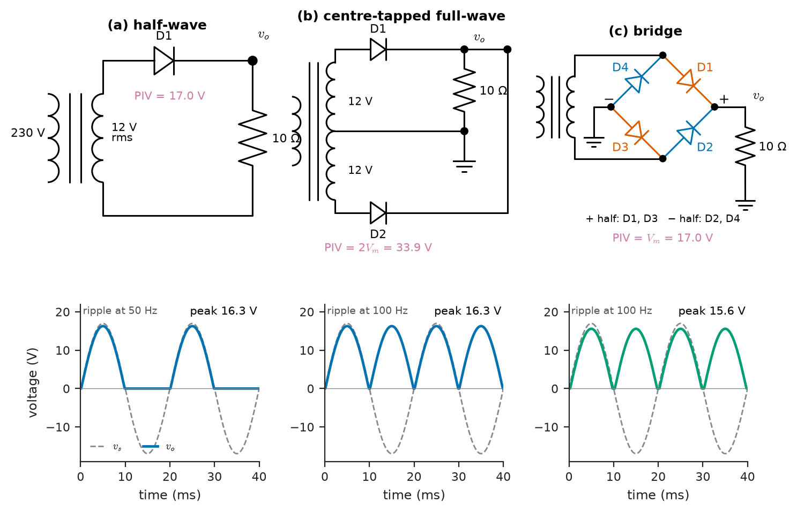
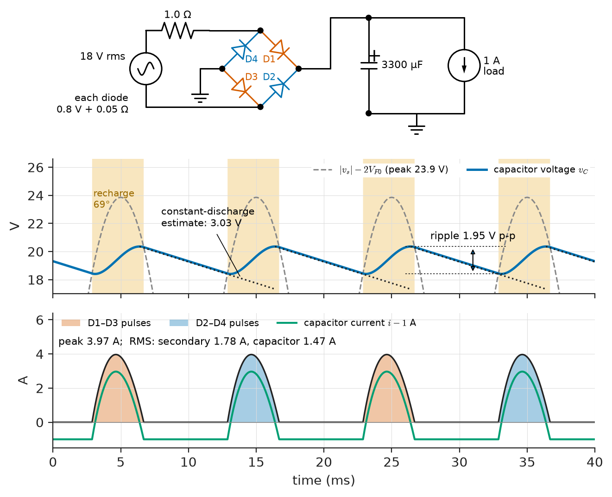
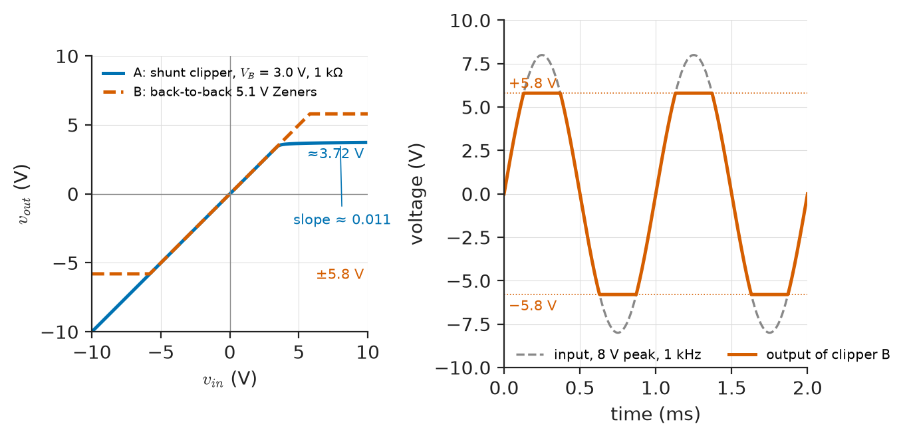
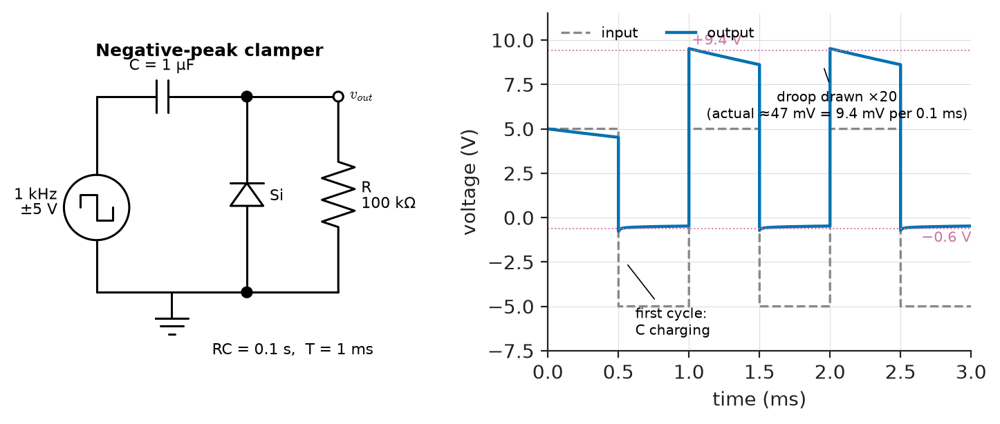
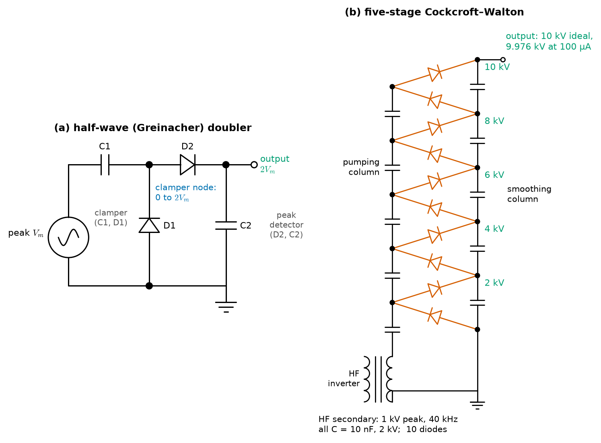
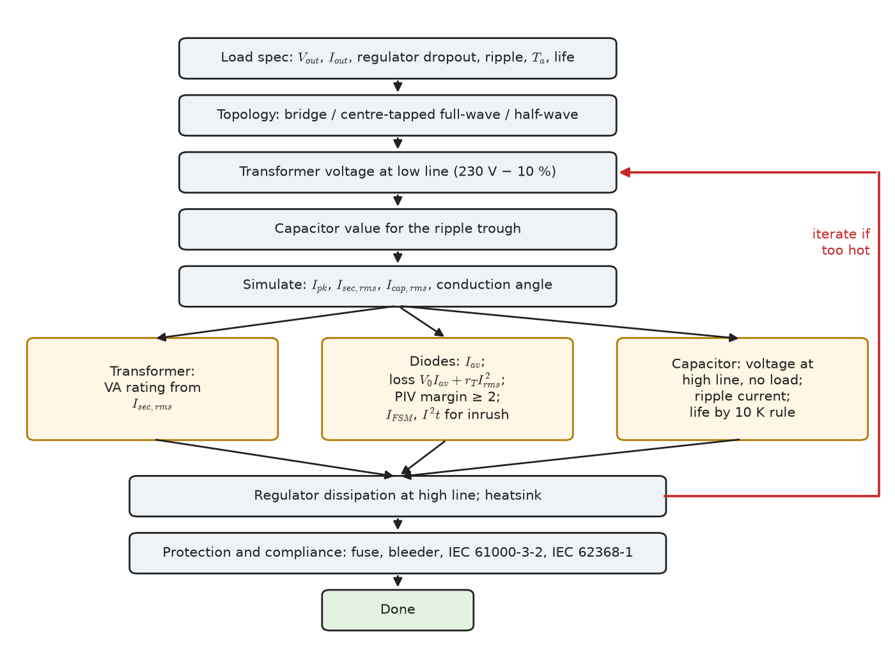

# Chapter 6 — Diode Circuits

*Part II · Analog Electronics*

An industrial sensor hub takes its 12 V supply from a small linear power supply: a 230 V transformer, a bridge rectifier, a reservoir capacitor and a 7812 regulator delivering 1 A. The designer sized the transformer from the DC power, 12 W plus the regulator's headroom, and bought a 3300 µF capacitor because the ripple formula asked for about that much capacitance. Two summers later units start to fail. The transformer runs at 85 °C, and the reservoir capacitor's vent has bulged. Neither part was misused in the sense its designer understood. The bridge does not draw a sinusoid from the transformer: it draws pulses about 70° wide and four times the load current at their peak, so the secondary carries 1.8 A RMS to deliver 1 A DC, and the capacitor carries 1.5 A RMS of ripple current at 100 Hz, which heats it from inside. A rectifier is the simplest nonlinear circuit in electronics, and it is also the one in which the nonlinearity most directly sets the size, temperature and life of the parts around it. This chapter treats the diode as a circuit element, first in rectifiers and their filters, then in the waveshaping circuits that clip, clamp and multiply, and ends with a design procedure that would have kept the sensor hub alive.

> **How much DC, ripple and stress does each rectifier circuit produce, and how are those numbers computed when a capacitor makes the diode current a pulse?**
> **How do diodes reshape, limit, shift and multiply signals and protect inputs, and where do their non-ideal characteristics show?**
> **What procedure turns a load specification into a transformer, diodes, capacitor and fuse that survive mains tolerance, inrush and a ten-year life?**

| Concept | Engineering destination |
|---|---|
| Half-wave rectifiers | Auxiliary and bias supplies, envelope and peak detectors, AC voltmeters |
| Full-wave rectifiers | Low-voltage high-current supplies, SMPS secondaries with centre-tapped windings |
| Bridge rectifiers | Mains input of every linear and switch-mode supply, battery chargers, LED drivers |
| Rectifier performance | Comparing topologies; sizing transformers and diodes |
| Ripple | Regulator headroom, hum in audio, ADC reference noise |
| Capacitor filtering | Reservoir-capacitor and inrush design; transformer and capacitor heating |
| Clipping circuits | ADC and MCU input protection, signal limiting, waveform shaping |
| Clamping circuits | DC restoration, negative gate bias for SiC drives, detector biasing |
| Voltage multipliers | Photomultiplier, X-ray and ionizer supplies, gate-drive and bias rails |
| Practical rectifier design | Linear supplies for instrumentation, industrial control and audio |

**Roadmap.** The three rectifier circuits (6.1–6.3) → the figures of merit that compare them (6.4) → ripple (6.5) and the capacitor-input filter that dominates practice (6.6) → waveshaping with diodes: clippers (6.7), clampers (6.8) and multipliers (6.9) → a complete rectifier design (6.10).

---

## 6.1 Half-wave rectifiers

> **Boundary.** The average and RMS values of rectified sinusoids are tabulated in *Circuits, Signals and Communications*, [Ch. 8 §8.2](https://github.com/The-Studio-of-Sadiq/Circuits-Signals-and-Communications/blob/main/part-2-transient-and-ac-analysis/08-sinusoidal-steady-state-analysis.md); the harmonic content of rectifier input current and the resulting distortion power factor are treated in [Ch. 9 §9.8](https://github.com/The-Studio-of-Sadiq/Circuits-Signals-and-Communications/blob/main/part-2-transient-and-ac-analysis/09-ac-power.md); RC time constants in [Ch. 6](https://github.com/The-Studio-of-Sadiq/Circuits-Signals-and-Communications/blob/main/part-2-transient-and-ac-analysis/06-first-order-circuits.md). *Engineering Physics* [Ch. 18 §18.8.1](https://github.com/The-Studio-of-Sadiq/Engineering-Physics/blob/main/CHAPTERS/CHAPTER%2018.md) sketches the half-wave and bridge averages and the full-wave ripple estimate. Rectifier diode ratings ($V_{RRM}$, $I_{F(AV)}$, $I_{FSM}$, $I^2t$, recovery) and the threshold–slope loss model are in [Chapter 2](../part-1-electronic-devices/02-semiconductor-junction-devices.md). Controlled (thyristor) and three-phase rectifiers for power conversion belong to [Chapter 31](../part-7-power-electronics/31-ac-dc-and-dc-ac-conversion.md); this chapter covers uncontrolled single-phase rectifiers for power supplies and low-power diode circuits.

### The circuit and the diode model

A single diode in series with a resistive load passes the half-cycles that forward-bias it (Figure 6.1a). The analysis depends on how much of the diode's nonlinearity is kept. Three models cover practice:

- the **ideal diode**, a short circuit forward and an open circuit reverse, adequate when the peak voltage is tens of volts or more;
- the **constant-drop** model, a 0.7 V source for silicon (0.3–0.5 V for Schottky) in series with an ideal diode, the standard for supply design;
- the **threshold–slope** model $v_F=V_{F0}+r_Ti_F$ of Chapter 2, needed when the peak current is large enough that $r_T$ matters, as it is in capacitor-input filters.

> **Status of the principle: Constant-drop diode model**
> *Approximate.* It replaces the exponential characteristic by a fixed voltage, valid when the current varies over less than about two decades so that the true drop changes by less than about 0.1–0.2 V; it ignores reverse recovery, junction capacitance and leakage, which matter at high frequency and in precision circuits.

With the constant-drop model, the diode conducts only while $V_m\sin\omega t>V_D$, from $\theta_0=\arcsin(V_D/V_m)$ to $\pi-\theta_0$. For $V_m\gg V_D$ the DC output approaches the familiar

$$
V_{dc}\approx\frac{V_m-V_D}{\pi}
$$

which overestimates slightly at low voltage because it ignores the dead zone near the zero crossings. The diode must block the full negative peak, so its **peak inverse voltage** (PIV) is $V_m$ with a resistive load and $2V_m$ when a reservoir capacitor holds the cathode at $+V_m$ while the anode swings to $-V_m$.

### Where half-wave rectification is used

The half-wave rectifier's defects are severe at power: the output ripple is at the supply frequency, so filtering needs twice the capacitance of a full-wave circuit; the transformer secondary carries a DC component that biases the core toward saturation and raises its magnetising current; and the input current contains even harmonics and DC, which IEC 61000-3-2 effectively prohibits above small powers. It survives where these do not matter:

- **Low-power auxiliary supplies**: a few milliamperes for a standby microcontroller, often transformerless from the mains through a capacitive dropper.
- **Envelope (AM) and peak detectors.** A diode feeding a parallel RC recovers the envelope of a modulated carrier if $1/f_c\ll RC\ll1/(2\pi f_m)$: for a 455 kHz IF carrying 5 kHz audio, RC must lie between 2.2 µs and 32 µs, and 10 kΩ with 1 nF (10 µs) is the classic choice. The same circuit with a long time constant is a peak detector, used in RF power meters and signal-strength indicators, with a Schottky diode to reduce the drop.
- **Flyback converter secondaries**, where the transformer is driven by pulses and the half-wave rectifier is natural (Chapter 30).

<!-- FIGURE 6.1 | figures/ch06/fig-6-1-rectifier-circuits.png | circuit | The three single-phase rectifier circuits with resistive load and their output waveforms. | Content: three columns. (a) Half-wave: transformer secondary 12 V rms, one diode D1, load 10 Ohm; output waveform over two 50 Hz cycles (0 to 40 ms) showing positive half-sines of peak 16.3 V (16.97 V minus 0.7 V) and zero during negative half-cycles; mark PIV = 17.0 V across D1. (b) Centre-tapped full-wave: secondary 12-0-12 V rms, diodes D1 and D2 from each end to the load, centre tap to ground; output: every half-cycle rectified, peak 16.3 V, ripple at 100 Hz; mark PIV = 2Vm = 33.9 V. (c) Bridge: single 12 V rms secondary, four diodes D1 to D4 in a bridge, load 10 Ohm; output peaks 15.6 V (two drops), ripple at 100 Hz; mark conduction paths D1-D3 on positive and D2-D4 on negative half-cycles, PIV = Vm = 17.0 V. -->



*Figure 6.1 — The three single-phase rectifier circuits with resistive load and their output waveforms.*

---

## 6.2 Full-wave rectifiers

### The centre-tapped circuit

A transformer with a centre-tapped secondary supplies two voltages in antiphase; one diode on each end conducts on alternate half-cycles into a common load (Figure 6.1b). Every half-cycle is used, so the ripple frequency doubles to $2f$ and the DC output doubles:

$$
V_{dc}\approx\frac{2(V_m-V_D)}{\pi}
$$

where $V_m$ is the peak of each half-winding. Only one diode is in the current path at a time, which saves one diode drop compared with the bridge. The price is the diode's PIV, which is $2V_m$ (strictly $2V_m-V_D$): while one diode conducts, the other sees the full voltage of the whole secondary. Each half of the secondary also carries current only half of the time, so the winding copper is used less effectively than in a bridge.

### Where it wins

The saved diode drop is decisive at low output voltage. In a 5 V, 20 A supply, a 0.5 V Schottky drop is 10 % of the output; a bridge would lose 1 V, 20 %, and 20 W. Centre-tapped full-wave rectification is therefore the norm on the secondaries of push-pull, half-bridge and full-bridge switch-mode converters for low-voltage, high-current outputs (server, telecom and PC supplies), where the diodes are Schottky types or, increasingly, synchronous-rectifier MOSFETs whose drop is $I\cdot R_{DS(on)}$. It is also the standard way of producing a symmetrical dual supply: a centre-tapped secondary feeding a bridge gives $+V$ and $-V$ about the centre tap, the classic ±15 V rails of an analog instrument or audio amplifier.

---

## 6.3 Bridge rectifiers

### Operation

Four diodes in a bridge rectify a single secondary winding (Figure 6.1c). On the positive half-cycle D1 and D3 conduct; on the negative, D2 and D4. The load current always flows the same way, the ripple is at $2f$, and

$$
V_{dc}\approx\frac{2(V_m-2V_D)}{\pi}
$$

since two diodes are always in series. Each non-conducting diode sees the peak $V_m$ (plus one diode drop) in reverse, half the PIV of the centre-tapped circuit, and the transformer secondary carries current in both half-cycles with no DC component.

### Packages and active bridges

Bridges are sold as single components: DB and MB packages (0.5–1 A, surface mount), KBP and GBU in-line packages (2–8 A, the latter with a heatsink tab), and KBPC square packages (15–50 A, bolted to a heatsink). Their ratings are those of rectifier diodes (Chapter 2), stated for the whole bridge: $V_{RRM}$ of 50–1000 V, $I_{F(AV)}$ for the bridge's DC output, $I_{FSM}$ per diode, and a forward drop per diode.

At low voltage the two diode drops cost a large fraction of the output: 1.4–2 V out of a 12 V or 24 V supply. **Active bridges** replace the diodes with four MOSFETs controlled by an ideal-diode bridge controller (the LT4320 class), cutting the drop to tens of millivolts. They are used in Power-over-Ethernet powered devices, whose input polarity is unknown, and on 24 V AC control circuits and thermostat wiring, where every watt of heat in a sealed enclosure counts. The three-phase six-diode bridge, with ripple at $6f$, is the input stage of industrial drives and large supplies; it belongs, with its controlled thyristor relatives, to Chapter 31.

---

## 6.4 Rectifier performance

### Figures of merit

Rectifiers are compared by a small set of ratios, all computed for an ideal diode and a resistive load unless stated otherwise:

- **DC output** $V_{dc}$ and **RMS output** $V_{rms}$, from which the **form factor** $V_{rms}/V_{dc}$ follows.
- **Ripple factor** $r=V_{ac,rms}/V_{dc}=\sqrt{(V_{rms}/V_{dc})^2-1}$, the ratio of the RMS of the AC part of the output to its DC value.
- **Rectification efficiency** $\eta=P_{dc}/P_{ac}=V_{dc}^2/V_{rms}^2$, the fraction of the load power that is DC.
- **Transformer utilisation factor** (TUF), the DC load power divided by the VA rating the transformer winding must have; it measures how much copper and iron a given DC output costs.
- **Peak inverse voltage** across each diode, and the **ripple frequency**.

> **Status of the principle: Rectifier figures of merit**
> *Derived.* Each ratio follows by integrating the ideal rectified waveform over a period; the values in Table 6.1 are exact for ideal diodes, sinusoidal supply and resistive load, and are only a starting point for capacitor-input rectifiers, whose current waveform is set by the filter (Section 6.6).

**Table 6.1 — Rectifier figures of merit (ideal diodes, resistive load, peak $V_m$ per winding).**

| Quantity | Half-wave | Centre-tapped full-wave | Bridge |
|---|---|---|---|
| $V_{dc}$ | $V_m/\pi=0.318V_m$ | $2V_m/\pi=0.637V_m$ | $2V_m/\pi=0.637V_m$ |
| $V_{rms}$ | $V_m/2$ | $V_m/\sqrt2$ | $V_m/\sqrt2$ |
| Form factor | 1.571 | 1.111 | 1.111 |
| Ripple factor | 1.211 | 0.483 | 0.483 |
| Rectification efficiency | 40.5 % | 81.1 % | 81.1 % |
| TUF | 0.287 | 0.693 (average of primary 0.812 and secondary 0.574) | 0.812 |
| Diodes in conduction path | 1 | 1 | 2 |
| PIV per diode | $V_m$ | $2V_m$ | $V_m$ |
| Ripple frequency | $f$ | $2f$ | $2f$ |

The table explains the field's habits. The bridge has the best transformer utilisation and the lowest diode PIV at the cost of a second diode drop; the centre-tapped circuit saves that drop and pays in transformer size and PIV; the half-wave circuit is poor on every count except part count.

**Worked example — Half-wave versus bridge at 12 V RMS.** A 12 V RMS secondary ($V_m=16.97$ V) feeds a 10 Ω load through silicon diodes modelled as 0.7 V drops. Integrating the clipped half-sines with their dead zones:

- Half-wave: $V_{dc}=5.06$ V, $V_{rms}=8.04$ V, so $P_{dc}=5.06^2/10=2.56$ W out of a total load power of $8.04^2/10=6.47$ W; $\eta=39.5\ \%$ against the ideal 40.5 %.
- Bridge: $V_{dc}=9.44$ V, $V_{rms}=10.76$ V, $P_{dc}=8.91$ W of 11.57 W; $\eta=77.0\ \%$ against the ideal 81.1 %.

The bridge delivers 1.87 times the DC voltage, not 2, because it loses two drops instead of one, and its efficiency suffers more from the drops for the same reason. The simple formulas give 5.18 V and 9.91 V: 2–5 % high, because they ignore the dead zones. Both diodes must block 17.0 V; a 50 V part gives the usual margin of at least two for mains transients.

---

## 6.5 Ripple

### Ripple with a resistive load

Without a filter, the rectifier output is mostly ripple: Table 6.1's ripple factors of 1.21 and 0.48 mean that the AC component is larger than or half the DC. Its spectrum (Fourier series per *Circuits, Signals and Communications* [Ch. 18 §18.1](https://github.com/The-Studio-of-Sadiq/Circuits-Signals-and-Communications/blob/main/part-4-signals-and-systems/18-frequency-domain-system-analysis.md)) is dominated by the lowest component: for full-wave rectification, a second harmonic of amplitude $4V_m/(3\pi)$, two-thirds of the DC value, followed by the fourth harmonic at a fifth of that. Every filter is designed around the lowest ripple frequency, $f$ for half-wave and $2f$ for full-wave, which is the main reason full-wave rectification dominates.

### Ripple with a reservoir capacitor

A capacitor across the load charges to nearly the peak voltage when the diodes conduct and discharges into the load between peaks (Figure 6.2). If the load draws a constant current $I_{dc}$ and the capacitor discharges for nearly the whole interval between charging pulses, charge balance gives the peak-to-peak ripple

$$
\Delta V\approx\frac{I_{dc}}{pfC}
$$

with $p=1$ pulse per supply cycle for half-wave and $p=2$ for full-wave rectification (the full-wave case is quoted in *Engineering Physics* [Ch. 18 §18.8.1](https://github.com/The-Studio-of-Sadiq/Engineering-Physics/blob/main/CHAPTERS/CHAPTER%2018.md)). The ripple waveform is roughly a sawtooth, so its RMS value is about $\Delta V/(2\sqrt3)$, and the DC output is about $V_{pk}-\Delta V/2$, where $V_{pk}$ is the peak capacitor voltage.

> **Status of the principle: Reservoir-capacitor ripple estimate**
> *Approximate.* It assumes constant load current, a ripple small compared with the peak ($\Delta V\lesssim0.2V_{pk}$) and discharge throughout the period $1/(pf)$; because the capacitor actually recharges during a conduction interval of 40–80° per half-cycle, the formula overestimates the ripple by 20–40 % in typical mains supplies, which makes it conservative for design but useless for predicting diode and capacitor currents.

The estimate makes the trade-offs visible. Ripple falls in proportion to capacitance and to the number of pulses; a 50 Hz half-wave supply needs twice the capacitance of a full-wave one; and a switch-mode converter's rectifier at 100 kHz needs a thousandth of the capacitance of a mains rectifier for the same ripple, which is one of the reasons switch-mode supplies are small. What it does not tell is the cost of the small ripple: the smaller the ripple, the shorter and taller the current pulses that recharge the capacitor.

---

## 6.6 Capacitor filtering

### Conduction angle and peak current

The capacitor charges only while the rectified source exceeds its voltage, in a short interval before each peak. All the charge the load takes in a half-cycle, $I_{dc}/(2f)$, must flow in during that interval, so the diode current is a pulse whose height is several times the DC load current. Its shape is set not by the capacitor but by the impedance in series with the source: the transformer's winding resistance and leakage inductance, the diodes' slope resistance, and the mains impedance. A stiff source gives a narrow, tall pulse; a soft source gives a wider, lower one. The quantities that heat the parts all depend on this pulse: the RMS secondary current (transformer copper loss), the capacitor's RMS ripple current (ESR heating), and the diode RMS current (the $r_TI_{rms}^2$ term of Chapter 2's loss model). None of them is given by the ripple formula, so they are computed numerically.

Listing 6.1 time-steps a bridge rectifier feeding a reservoir capacitor and a constant-current load (a regulator is close to one). The transformer is modelled as a sinusoidal EMF behind its winding resistance referred to the secondary, and each diode as 0.8 V plus 50 mΩ.

```python
# Bridge rectifier + reservoir capacitor + constant-current load, time-stepped
import numpy as np

def bridge(Vrms=18.0, f=50.0, Rs=1.0, Vd=0.8, rd=0.05, C=3300e-6, Iload=1.0,
           cycles=40, n=4000):
    dt = 1/(f*n)
    t = np.arange(cycles*n)*dt
    vs = np.sqrt(2)*Vrms*np.sin(2*np.pi*f*t)
    vc = np.zeros_like(t); i = np.zeros_like(t)
    v = 0.0                                # capacitor starts discharged
    for k in range(len(t)):
        drive = abs(vs[k]) - 2*Vd - v      # two diodes conduct per half-cycle
        i[k] = drive/(Rs + 2*rd) if drive > 0 else 0.0
        v = max(v + (i[k] - Iload)*dt/C, 0.0)
        vc[k] = v
    s = slice((cycles-2)*n, cycles*n)      # last two cycles: steady state
    vo, io = vc[s], i[s]
    return dict(Vdc=vo.mean(), Vmin=vo.min(), ripple=vo.max()-vo.min(),
                Ipk=io.max(), Isec=np.sqrt(np.mean(io**2)),
                Icap=np.sqrt(np.mean((io - Iload)**2)),
                cond=180*np.mean(io > 0),  # conduction angle per half-cycle
                PF=np.mean(np.abs(vs[s])*io)/(Vrms*np.sqrt(np.mean(io**2))))

for line in (0.9, 1.0, 1.1):
    r = bridge(Vrms=18.0*line)
    print(f"line {line:.1f}: Vdc={r['Vdc']:5.2f} Vmin={r['Vmin']:5.2f} "
          f"ripple={r['ripple']:4.2f} V  Ipk={r['Ipk']:4.2f} Isec={r['Isec']:4.2f} "
          f"Icap={r['Icap']:4.2f} A  cond={r['cond']:4.1f} deg  PF={r['PF']:4.2f}")
print(f"constant-discharge estimate I/(2fC) = {1.0/(2*50*3300e-6):.2f} V")
```

```text
line 0.9: Vdc=17.00 Vmin=16.03 ripple=1.92 V  Ipk=3.83 Isec=1.75 Icap=1.43 A  cond=71.2 deg  PF=0.78
line 1.0: Vdc=19.40 Vmin=18.41 ripple=1.95 V  Ipk=3.97 Isec=1.78 Icap=1.47 A  cond=68.6 deg  PF=0.76
line 1.1: Vdc=21.80 Vmin=20.79 ripple=1.99 V  Ipk=4.10 Isec=1.81 Icap=1.51 A  cond=66.4 deg  PF=0.75
constant-discharge estimate I/(2fC) = 3.03 V
```

**Worked example — The sensor-hub supply, simulated.** For the opening's supply, an 18 V RMS open-circuit secondary behind 1.0 Ω (a 30–40 VA transformer), 3300 µF and a 1 A load, at nominal mains:

- The DC output is 19.4 V with 1.95 V peak-to-peak ripple; the constant-discharge formula predicts 3.03 V, 55 % high, because the capacitor recharges for 69° of each 180° half-cycle and so discharges for only about 62 % of it.
- The diodes conduct in pulses of 3.97 A peak, four times the load current.
- The secondary carries 1.78 A RMS to deliver 1 A DC. A transformer rated in VA for its DC output of about 19 W would be overloaded; the winding must be rated for $18\times1.78=32$ VA, 1.7 times the DC power.
- The capacitor's RMS ripple current is 1.47 A, nearly one and a half times the load current.
- The power factor at the secondary is 0.76: distortion, not displacement, since the current pulses are centred on the voltage peaks.

These four currents, not the ripple voltage, decide the transformer's VA rating, the capacitor's ripple-current rating and the diode losses, and they explain both failures of the opening. The simulation also shows how strongly the source impedance matters: with the same parts but a stiffer 0.3 Ω source, the peak diode current rises to 5.5 A, the capacitor current to 1.84 A and the secondary current to 2.10 A, while the conduction angle narrows to 50°.

<!-- FIGURE 6.2 | figures/ch06/fig-6-2-capacitor-filter-waveforms.png | waveform | Bridge rectifier with reservoir capacitor: output voltage, diode current pulses and capacitor current over two mains cycles. | Content: circuit inset: 18 V rms source with 1.0 Ohm series resistance, bridge of four diodes (0.8 V + 0.05 Ohm each), 3300 uF capacitor, 1 A constant-current load. Main plot, time axis 0 to 40 ms: top panel, rectified source magnitude minus two diode drops (dashed, peak 23.9 V) and capacitor voltage (solid) between 18.4 and 20.4 V with ripple 1.95 V peak to peak, recharge interval of 69 degrees before each peak shaded, and the straight-line constant-discharge estimate of 3.03 V dotted for comparison; bottom panel, diode-pair current pulses of 3.97 A peak (alternating D1-D3 and D2-D4 shading) and capacitor current (pulse minus 1 A, negative 1 A between pulses), with RMS values 1.78 A (secondary) and 1.47 A (capacitor) annotated. -->



*Figure 6.2 — Bridge rectifier with reservoir capacitor: output voltage, diode current pulses and capacitor current over two mains cycles.*

### Choosing the capacitor

An aluminium electrolytic reservoir capacitor is chosen for four ratings, not one:

1. **Capacitance**, from the ripple the load tolerates; allow for the −20 % tolerance and for the 10–20 % loss of capacitance over life.
2. **Voltage**, above the highest no-load peak at maximum mains with at least 10–20 % margin.
3. **Ripple current** at 100 or 120 Hz at the operating temperature, from simulation, since the ESR dissipation $I_{cap,rms}^2\,\mathrm{ESR}$ heats the core.
4. **Life**, which electrolytic-capacitor makers specify as hours at the maximum rated temperature (2000 h at 105 °C for a general-purpose part, 5000–12 000 h for long-life types).

> **Status of the principle: Ten-degree rule for electrolytic-capacitor life**
> *Empirical.* Life roughly doubles for every 10 K reduction of core temperature below the rated maximum, an Arrhenius-type fit to the evaporation of electrolyte through the seal; it holds over roughly 40–105 °C and manufacturers add ripple-current and voltage terms of their own.

A 2000 h, 105 °C capacitor whose core runs at 65 °C has an expected life of about $2000\times2^{(105-65)/10}=32\ 000$ h, under four years of continuous service; if the ripple current and a hot enclosure push the core to 75 °C, the life halves again. That is the opening failure. A 10 000 h, 105 °C part at the same 65 °C would last about $1.6\times10^5$ h, eighteen years.

### Inrush

At switch-on the capacitor is a short circuit. If the mains is applied at its peak, the initial current is limited only by the source and diode resistances: $(\sqrt2\times19.8-1.6)/1.1=24$ A at high line for the sensor-hub supply. That must lie within the bridge's surge rating $I_{FSM}$ and its $I^2t$ (Chapter 2). In small transformer supplies the winding resistance usually suffices. In transformerless and switch-mode supplies, whose bulk capacitors charge directly from the rectified mains through milliohms, the inrush would be hundreds of amperes, so an **NTC thermistor** (5–10 Ω cold, falling to a fraction of an ohm when hot), or a resistor bypassed by a relay or thyristor after start-up, limits it. A thermistor has a weakness: if the supply is switched off and on again before it cools, it no longer limits.

### Choke-input and π filters

An inductor in series before the capacitor (the **choke-input** or LC filter) forces the rectifier current to flow over most of each half-cycle. Provided the inductance exceeds a critical value, the diode current never falls to zero, and the output tends to the average of the rectified wave, $2V_m/\pi$, rather than the peak. For a full-wave rectifier, the dominant second-harmonic ripple current, of peak $4V_m/(3\pi)/(2\omega L)$, must not exceed the DC current $V_{dc}/R_L$, which gives the critical inductance

$$
L_c\approx\frac{R_L}{3\omega}
$$

With $L>L_c$ the current is continuous, the output voltage is nearly independent of load, the peak and RMS currents fall close to the DC value, and the input power factor rises to about 0.9. The penalty is the inductor's size and weight at 50 Hz. Choke-input filters therefore survive in high-power battery chargers, valve amplifiers and passive power-factor correction of small drives, where a DC-link choke serves the same purpose (Chapter 31). The **π filter** (C–L–C or C–R–C) follows a reservoir capacitor with a second LC or RC section that attenuates the ripple by a further factor of roughly $1/(\omega_r^2LC)$ at the ripple frequency $\omega_r$, used where hum must be very low and a regulator is not, such as audio preamplifier rails.

---

## 6.7 Clipping circuits

### Series and shunt clippers

A **clipper** (limiter) removes the part of a waveform above or below a set level. In a **shunt clipper** a diode, in series with a bias voltage $V_B$, is placed across the output, fed through a series resistor $R$: while the input is below $V_B+V_D$ the diode is off and the output follows the input; above it, the diode conducts and the output stays at about $V_B+V_D$, the excess dropping across $R$. A **series clipper** places the diode in the signal path, passing only the part of the waveform that forward-biases it. Two shunt branches of opposite polarity clip both sides; two Zener diodes in series, anode to anode, clip symmetrically at $\pm(V_Z+V_D)$ without bias sources.

The transfer characteristic of a clipper (Figure 6.3) is linear with unit slope in the pass region and nearly flat in the clipped region, with a slope equal to $r_d/(R+r_d)$, the divider formed by the diode's small-signal resistance and the series resistor. Because the diode's knee is exponential, not sharp, the transition is rounded over about 0.1–0.2 V, which matters for small signals. For precise clipping at small levels, the diode is placed inside an op-amp's feedback loop (the precision limiters and rectifiers of [Chapter 8](08-operational-amplifiers.md)).

<!-- FIGURE 6.3 | figures/ch06/fig-6-3-clipper-transfer.png | plot | Transfer characteristics of diode clippers: biased shunt clipper and symmetrical Zener clipper, with an input and clipped output waveform. | Content: left panel, vout versus vin, both axes -10 to +10 V. Curve A: shunt clipper with 1 kOhm series resistor, silicon diode and VB = 3.0 V: unit slope up to about 3.6 V, rounded knee (exponential model, n = 1.8, Is = 1 nA), then slope near 0.01 above. Curve B: back-to-back 5.1 V Zeners: flat at plus and minus 5.8 V, unit slope between. Right panel, time domain 0 to 2 ms: 1 kHz sine input of 8 V peak (dashed) and output of curve B, flat-topped at plus and minus 5.8 V (solid). -->



*Figure 6.3 — Transfer characteristics of diode clippers: biased shunt clipper and symmetrical Zener clipper, with an input and clipped output waveform.*

### Input protection as a clipper

The most common clipper in modern electronics is not a waveshaper but a protection network: a series resistor and two diodes to the supply rails at the input of an ADC, a microcontroller pin or an op-amp. The input is clipped at about one diode drop above the positive rail and below ground, and the series resistor limits the fault current. Microcontroller inputs contain such diodes internally, rated for an injected current of typically ±5 mA per pin, beyond which the injected current can disturb neighbouring channels or trigger latch-up. External Schottky diodes, with a lower forward drop than the internal silicon ones, take the current first. Against fast transients (ESD, surge) the same arrangement is augmented by the TVS and steering arrays of Chapter 2.

**Worked example — Protecting a 3.3 V ADC input against a 24 V miswire.** A 0–3.3 V ADC input on an industrial controller must survive an accidental connection to the 24 V field supply, of either polarity. Use a 4.7 kΩ series resistor and a BAT54S-class dual Schottky to the 3.3 V rail and ground (drop about 0.3 V at a few milliamperes).

- Positive fault: $(24-3.3-0.3)/4.7\ \mathrm{k\Omega}=4.34$ mA flows into the 3.3 V rail. The pin sees about 3.6 V. If the board's 3.3 V regulator cannot sink current and the rest of the circuit draws less than 4.34 mA, the fault pumps the rail up; a Zener or TVS on the rail, or a minimum load, prevents it.
- Negative fault: $(24-0.3)/4.7\ \mathrm{k\Omega}=5.04$ mA through the lower diode to ground.
- Resistor dissipation: at most $24^2/4.7\ \mathrm{k\Omega}=0.12$ W if the diode end were shorted, so a 0.25 W part (or a pulse-rated 0805) is adequate.

The protection costs accuracy. A Schottky's reverse leakage rises steeply with temperature, from a few hundred nanoamperes at 25 °C to several microamperes at 85 °C. At 5 µA, the 4.7 kΩ resistor drops $5\ \mu\mathrm A\times4.7\ \mathrm{k\Omega}=23.5$ mV, which is 29 LSB of a 12-bit, 3.3 V converter (0.81 mV/LSB), varying with temperature. Low-leakage silicon diodes (BAV199 class, picoamperes typical) or a smaller series resistor with a TVS, or an op-amp buffer with its own clamp, restore accuracy. Protection, leakage and source impedance must be designed together.

---

## 6.8 Clamping circuits

### The DC restorer

A **clamper** shifts a waveform's DC level without changing its shape, so that one extreme sits at a chosen voltage. The basic circuit is a series capacitor followed by a shunt diode to ground (Figure 6.4). On the first negative excursion the diode conducts and charges the capacitor to the negative peak; thereafter the capacitor holds that charge and the output is the input shifted up by $V_m-V_D$, so that its negative peak sits at $-V_D$ (about −0.6 V for silicon, −0.3 V for Schottky). Reversing the diode clamps the positive peak; adding a bias source in series with the diode clamps the extreme at $V_B\pm V_D$.

> **Status of the principle: Ideal clamper level shift**
> *Approximate.* With an ideal diode and $RC\gg T$, the capacitor charges to the peak and the waveform is shifted rigidly; with a load resistance $R$ the capacitor discharges between peaks, so each cycle sags by about $(V_{pp}-V_D)T_{off}/(RC)$ and the diode must restore the lost charge, rounding the clamped extreme.

The design condition is that the capacitor must not discharge appreciably through the load between the diode's conduction intervals: $RC$ must be large compared with the signal period. The fractional droop over an interval $t$ is about $t/(RC)$.

<!-- FIGURE 6.4 | figures/ch06/fig-6-4-clamper.png | circuit | Negative-peak diode clamper (DC restorer): circuit and input and output waveforms. | Content: left, circuit: square-wave source 1 kHz, plus and minus 5 V (10 V peak to peak), series capacitor C = 1 uF, shunt silicon diode with anode to ground and cathode to the output node, conducting on negative peaks, load R = 100 kOhm. Right, waveforms over 3 ms: input square wave between -5 and +5 V; output square wave between about -0.6 V and +9.4 V, with the top of each high half-cycle drooping by about 47 mV (about 9.4 mV per 0.1 ms) exaggerated for visibility, and the first cycle showing the initial charging transient. Annotate RC = 0.1 s and T = 1 ms. -->



*Figure 6.4 — Negative-peak diode clamper (DC restorer): circuit and input and output waveforms.*

**Worked example — Droop of a clamped square wave.** A 1 kHz square wave of 10 V peak-to-peak is clamped by a 1 µF capacitor into a 100 kΩ load ($RC=0.1$ s, 100 times the period). During each 0.5 ms half-cycle in which the diode is off, the output, about $V_{pp}-V_D\approx9.4$ V above the clamp level, sags by about $9.4\ \mathrm V\times0.5\ \mathrm{ms}/0.1\ \mathrm s\approx47$ mV, 0.5 % of the swing, and the diode restores the charge at the start of the next negative half-cycle. With a 10 nF capacitor the sag would be 5 V and the clamp would no longer work. For signals with a long, variable duty cycle, such as a video line or a data stream with long runs, the time constant must cover the longest interval between clamping events.

### Where clampers are used

- **Gate drives with negative off-bias.** A gate driver supplied from a single 0–20 V rail can produce +15 V on and −5 V off for a SiC MOSFET or IGBT through a coupling capacitor and a 5.1 V Zener clamp from gate to source: the capacitor charges to the Zener voltage and shifts the drive down by that amount. The same principle sets the DC level in pulse-transformer gate drives. Its limits, the duty-cycle dependence and the start-up transient, are discussed with gate drives in [Chapter 29](../part-7-power-electronics/29-power-electronic-fundamentals.md).
- **DC restoration of AC-coupled signals**: video sync-tip clamps, optical-receiver baseline restoration, and the input of diode detectors.
- **Voltage multipliers**, which are clampers followed by peak detectors (Section 6.9).

---

## 6.9 Voltage multipliers

### The half-wave doubler

A clamper followed by a peak detector doubles the voltage (Figure 6.5a). The clamper (C1, D1) shifts the input so that it swings from about 0 to $2V_m$; the peak detector (D2, C2) holds the peak, $2V_m$ less two diode drops at no load. This is the **Greinacher** or **Villard cascade** doubler. Its ripple is at the input frequency, and its output sags under load faster than a rectifier's because the charge reaches C2 through C1. The **full-wave (Delon) doubler** instead charges two series capacitors on alternate half-cycles, each to $V_m$; it was used in the switchable 115/230 V input stage of older PC supplies, where at 115 V a link turned the bridge into a doubler to deliver the same 325 V bus.

### The Cockcroft–Walton cascade

Stacking $N$ doubler stages gives the **Cockcroft–Walton** multiplier, with an ideal no-load output of $2NV_m$ (Figure 6.5b). Each diode and capacitor sees only $2V_m$, so a high voltage is built from low-voltage parts. Its weakness is output impedance: the load charge passes through every stage in series, and with equal capacitors $C$, supply frequency $f$ and load current $I$, the voltage drop and peak-to-peak ripple are approximately

$$
\Delta V\approx\frac{I}{fC}\left(\frac{2N^3}{3}+\frac{N^2}{2}-\frac N6\right),\qquad \delta V\approx\frac{I}{fC}\cdot\frac{N(N+1)}{2}
$$

> **Status of the principle: Cockcroft–Walton droop and ripple**
> *Approximate.* It follows from charge balance through the ladder with ideal diodes, equal capacitors and a ripple small compared with the stage voltage; stray capacitance from the upper stages to ground, diode drops and capacitor tolerance make real droop larger, especially for large $N$.

The cube of $N$ is the dominant fact: doubling the number of stages multiplies the droop by about eight. Cockcroft–Walton multipliers are therefore driven at tens of kilohertz from a small inverter and transformer, and kept to as few stages as the transformer insulation allows.

<!-- FIGURE 6.5 | figures/ch06/fig-6-5-voltage-multipliers.png | circuit | Voltage multipliers: half-wave (Greinacher) doubler and a five-stage Cockcroft-Walton cascade. | Content: (a) doubler: AC source of peak Vm, series capacitor C1, diode D1 to ground (clamper), diode D2 to output capacitor C2 to ground (peak detector); annotate node voltages: clamper node swinging 0 to 2Vm, output 2Vm. (b) Five-stage Cockcroft-Walton ladder: a high-frequency transformer secondary of 1 kV peak at 40 kHz, a left column of five series capacitors (the pumping column) and a right column of five series capacitors (the smoothing column), ten diodes zigzagging between them, each capacitor 10 nF and rated 2 kV; output node at the top labelled 10 kV ideal, 9.976 kV at 100 uA. Show stage voltages 2, 4, 6, 8, 10 kV on the smoothing column. -->



*Figure 6.5 — Voltage multipliers: half-wave (Greinacher) doubler and a five-stage Cockcroft-Walton cascade.*

**Worked example — A 10 kV supply for a photomultiplier or ionizer.** A five-stage Cockcroft–Walton multiplier is driven at $f=40$ kHz with $V_m=1$ kV, using 10 nF capacitors, and delivers 100 µA. The scale factor is $I/(fC)=10^{-4}/(4\times10^4\times10^{-8})=0.25$ V. The droop is $0.25\times(83.33+12.5-0.83)=0.25\times95=23.75$ V and the ripple $0.25\times15=3.75$ V peak-to-peak, so the output is 9.976 kV with 0.04 % ripple: excellent. Run from the 50 Hz mains instead, the same ladder would droop by $0.25\times800\times95=19$ kV, more than its whole output: the multiplier would deliver nothing useful. Every practical high-voltage multiplier, from X-ray generators and electrostatic precipitators to the bias supplies of photomultiplier tubes and CRT anodes, runs at high frequency for this reason. At the other end of the scale, the same diode–capacitor pumping, with transistors replacing the diodes, generates gate-drive and flash-memory programming rails inside integrated circuits (charge pumps, Chapter 30).

---

## 6.10 Practical rectifier design

### A procedure

A transformer–rectifier–capacitor supply is designed backwards from the load, at the worst corners of mains voltage and temperature:

1. **Specify** the load: output voltage and current, the regulator's minimum input voltage (output plus dropout), ripple tolerance, ambient temperature and life.
2. **Choose the topology**: a bridge for most supplies; a centre-tapped full-wave rectifier with Schottky diodes for low output voltages; half-wave only for milliamperes.
3. **Choose the transformer voltage** so that the ripple trough at minimum mains (230 V −10 % per IEC 60038) stays above the regulator's minimum input, allowing for diode drops and the winding's regulation.
4. **Choose the capacitor** for that trough, then simulate (or use published design curves) to obtain the peak, RMS secondary and RMS capacitor currents.
5. **Rate the transformer** by the RMS secondary current, not the DC power.
6. **Rate the diodes or bridge**: average current, the loss $V_{F0}I_{av}+r_TI_{rms}^2$ per diode with its heatsinking, PIV with a margin of at least two, $I_{FSM}$ and $I^2t$ for inrush.
7. **Rate the capacitor** for voltage at maximum mains no-load, ripple current, and life at its core temperature.
8. **Check the regulator's dissipation** at maximum mains, where the input is highest.
9. **Add protection and compliance**: a primary fuse (time-lag, to ride through transformer magnetising inrush) and often a secondary fuse; a bleeder resistor across large capacitors; harmonic limits (IEC 61000-3-2, which sets no limits for most equipment of 75 W or less input power) and safety (IEC 62368-1 for ICT and audio-video equipment, IEC 61010-1 for instruments). Small RC snubbers across the bridge diodes are sometimes added to damp the ringing of the transformer's leakage inductance with the diodes' capacitance at turn-off, a source of conducted interference in sensitive receivers.

<!-- FIGURE 6.6 | figures/ch06/fig-6-6-rectifier-design-flow.png | flowchart | Design procedure for a transformer-rectifier-capacitor power supply. | Content: boxes top to bottom: Load spec (Vout, Iout, regulator dropout, ripple, Ta, life) -> Topology (bridge, CT full-wave, half-wave) -> Transformer voltage at low line (230 V -10 percent) -> Capacitor value for ripple trough -> Simulate: Ipk, Isec rms, Icap rms, conduction angle -> branch to three rating boxes in parallel: Transformer VA from Isec rms; Diodes: Iav, loss V0 Iav + rT Irms^2, PIV margin 2, IFSM and I2t for inrush; Capacitor: voltage at high line no load, ripple current, life by 10 K rule -> Regulator dissipation at high line and heatsink -> Protection and compliance (fuse, bleeder, IEC 61000-3-2, IEC 62368-1) -> Done. A feedback arrow from the transformer-voltage box back from the regulator-dissipation box labelled iterate if too hot. -->



*Figure 6.6 — Design procedure for a transformer-rectifier-capacitor power supply.*

**Worked example — Completing the sensor-hub supply.** The load is a 7812-class regulator delivering 12 V at 1 A. Its dropout at 1 A is about 2 V, so the input must never fall below 14 V; the procedure is followed in Figure 6.6.

*Transformer voltage.* Using Listing 6.1 at 0.9 of nominal mains with 3300 µF, a 15 V secondary gives a trough of 12.5 V, below the 14 V needed, and even 16 V with 4700 µF only just reaches 14.0 V. An 18 V secondary gives a trough of 16.03 V at low line, a 2 V margin, with 3300 µF.

*Transformer rating.* The secondary RMS current is 1.81 A at high line, so the winding must be rated about $18\times1.81=33$ VA; a 40 VA transformer, which also has lower winding resistance, is the sensible choice. The original design's 15 VA part, rated on DC power, ran at more than twice its rated current, hence its 85 °C.

*Diodes.* Each diode carries an average of 0.5 A and an RMS current of $1.78/\sqrt2=1.26$ A. With 0.8 V plus 50 mΩ, the loss per diode is $0.8\times0.5+0.05\times1.26^2=0.48$ W, about 1.9 W for the bridge, which a 2 A in-line bridge (KBP class, $I_{FSM}=60$ A) dissipates at a modest temperature rise on a board, or a GBU-class bridge with a tab handles with margin. The highest no-load peak is $1.1\times18\sqrt2=28$ V, so a 100 V bridge gives ample PIV margin against mains surges. The worst-case inrush of 24 A lies within $I_{FSM}$.

*Capacitor.* 3300 µF, 35 V (no-load peak at high line about 26.4 V after the diode drops), with a ripple-current rating of at least 1.5 A at 100 Hz and 105 °C, and a long-life (10 000 h) series, for the reasons computed in Section 6.6.

*Regulator.* At high line the average input is 21.8 V, so the regulator dissipates $(21.8-12)\times1=9.8$ W. To keep its junction at 125 °C in a 50 °C enclosure requires a total junction-to-ambient resistance of $(125-50)/9.8=7.7$ K/W; with about 5 K/W junction-to-case for a TO-220 regulator, the heatsink and interface must provide 2.7 K/W or better, using the thermal network of *Engineering Physics* [Ch. 14 §14.7](https://github.com/The-Studio-of-Sadiq/Engineering-Physics/blob/main/CHAPTERS/CHAPTER%2014.md). The supply's efficiency is $12/(21.8\times1+1.9+\text{transformer losses})$, about 45 %: the price of a linear design, and the reason a switching pre-regulator or a complete switch-mode supply is chosen above a few watts (Chapter 30).

*Protection and compliance.* The input power is about 30 W, below the 75 W threshold of IEC 61000-3-2, so no harmonic limits apply despite the 0.76 power factor at the secondary. A time-lag primary fuse of about 250 mA rides through the transformer's magnetising inrush; a 2.2 kΩ bleeder across the capacitor discharges it within a minute of disconnection for service safety.

> **Status of the principle: Worst-corner design of rectifier supplies**
> *Derived.* Each limit (regulator headroom at low line, regulator and capacitor heating at high line, PIV and inrush at high line no-load) is a monotonic function of the supply voltage, so checking the extreme corners bounds every intermediate case; it presumes that mains tolerance, component tolerance and ambient temperature are specified, which is a design input, not a result.

The redesign costs a larger transformer and a heatsink, and its numbers come from three places: the circuit topology of Sections 6.1–6.4, the filter behaviour of Sections 6.5–6.6 computed rather than estimated, and the device ratings of Chapter 2. That combination, device ratings plus circuit computation at worst-case corners, is the method of every chapter of Part II.

---

## What remains open

| Open question | Where it is answered |
|---|---|
| How do transistors amplify the signals that these supplies power? | [Chapter 7](07-transistor-amplifiers.md) |
| How do op-amps make precision rectifiers and limiters that remove the diode drop? | [Chapter 8](08-operational-amplifiers.md) |
| How do linear regulators and references turn the rectified, filtered voltage into a stable rail? | [Chapter 10](10-analog-integrated-circuits.md) |
| How are thyristor-controlled and three-phase rectifiers designed, and how is their harmonic current filtered? | [Chapter 31](../part-7-power-electronics/31-ac-dc-and-dc-ac-conversion.md) |
| How do switch-mode converters and charge pumps replace transformer–rectifier supplies? | [Chapter 30](../part-7-power-electronics/30-dc-dc-converters.md) |
| How do rectifier input currents distort the supply, and how is the distortion power factor measured and limited? | *Circuits, Signals and Communications*, [Ch. 9](https://github.com/The-Studio-of-Sadiq/Circuits-Signals-and-Communications/blob/main/part-2-transient-and-ac-analysis/09-ac-power.md); *Electrical Energy and Machines*, [Ch. 25](https://github.com/The-Studio-of-Sadiq/Electrical-Energy-and-Machines/blob/main/part-7-power-quality-and-grid-modernization/25-power-quality.md) |

**Next:** Chapter 7 turns from the two-terminal diode to the three-terminal transistor and builds single- and multistage amplifiers on the bias and small-signal models of Chapters 3 and 4.
