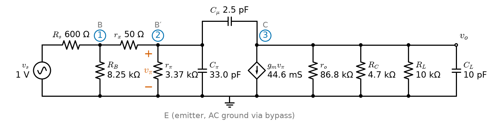
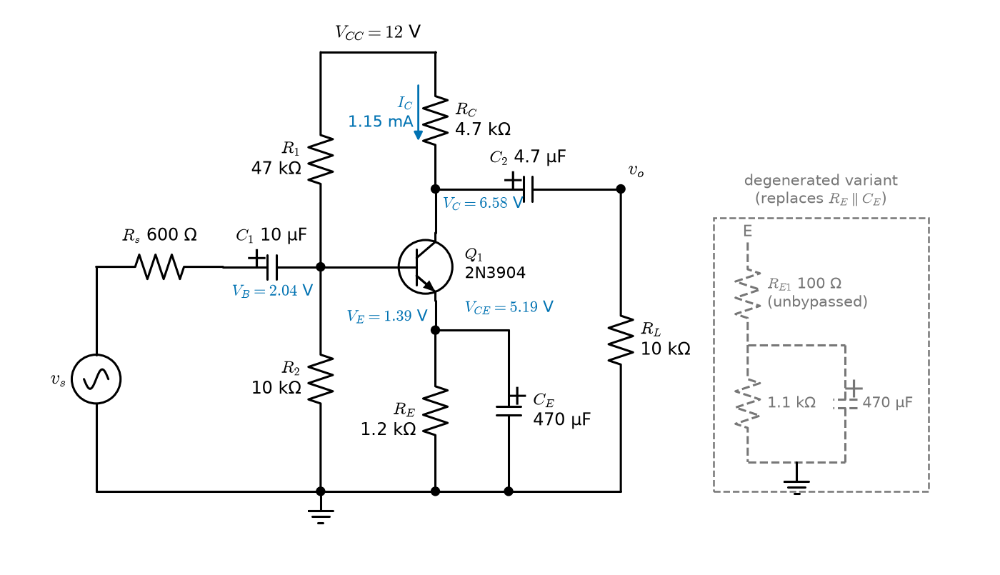
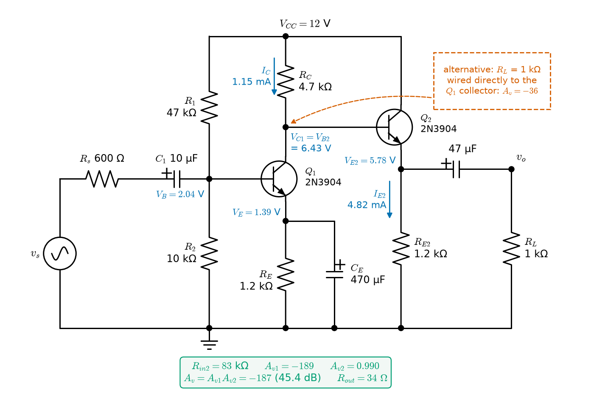
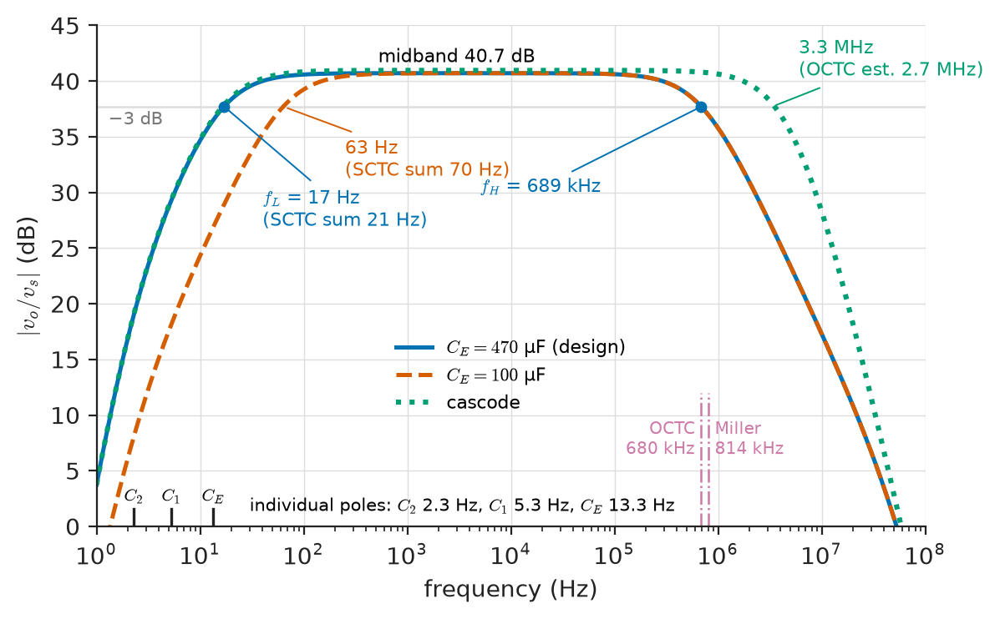
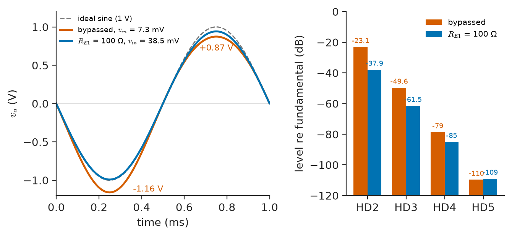

# Chapter 7 — Transistor Amplifiers

*Part II · Analog Electronics*

A car-audio supplier builds a discrete preamplifier for a head unit. On the bench, with a signal generator at the input and an oscilloscope probe at the output, the single common-emitter stage gives 46 dB of gain, flat to 1.5 MHz. Installed in the radio it gives 41 dB, its response falls off above 690 kHz, and a 1 V output carries 7 % second harmonic, enough to be heard on a sustained piano note. Nothing in the stage is faulty. The bench probe had a 10 MΩ input; the next stage presents 10 kΩ, so the stage was loaded. The generator had 50 Ω output resistance; the real source is a 600 Ω tuner output, so the base–collector capacitance, multiplied by the stage's own gain, now forms a low-pass filter with a resistance twelve times larger. And the 7 mV signal at the base is no longer small compared with the 26 mV thermal voltage that sets the curvature of the transistor's exponential law. Loading, the Miller effect and nonlinearity are the three things that separate a transistor amplifier on paper from one in a product, and all three are predictable from the device models of Part I.

> **How are the gain, input impedance and output impedance of a transistor stage computed, and how do they change when the stage is connected to a real source and load?**
> **What sets an amplifier's bandwidth and its distortion, and what does an engineer do to improve each?**

| Concept | Engineering destination |
|---|---|
| Single-stage configurations | Choosing CE/CS for gain, CB/CG for wide band and low input impedance, CC/CD for buffering |
| Common-emitter amplifier | Microphone and sensor preamplifiers, RF gain blocks, discrete audio stages |
| Common-source amplifier | Electret microphones, JFET instrument inputs, every gain stage inside a CMOS chip |
| Emitter and source followers | Line drivers, ADC drivers, output stages, level shifters |
| Multistage amplifiers | Preamplifier chains, cascode and Darlington stages, the inside of every op-amp |
| Voltage, current and power gain | Link budgets, sensor-chain gain allocation, decibel bookkeeping |
| Input and output impedance | Loading between stages, bootstrapped inputs, matching to cables and antennas |
| Small-signal analysis | Hand design and simulator checks of any transistor circuit |
| Frequency response | Coupling-capacitor sizing, Miller effect, wideband and video amplifiers |
| Distortion | Audio THD specifications, intermodulation in receivers, clipping and headroom |

**Roadmap.** The amplifier as a two-port and the three single-stage configurations (7.1) → a systematic small-signal method with a nodal solver (7.2) → the common-emitter stage, bypassed and degenerated (7.3) → the common-source stage and how it differs (7.4) → followers (7.5) → cascades, cascodes and Darlingtons (7.6) → input and output impedance as design variables (7.7) → frequency response at both ends of the band (7.8) → distortion, clipping and headroom (7.9).

---

## 7.1 Single-stage amplifiers

> **Boundary.** The BJT and MOSFET models used here (the exponential and square laws, the hybrid-π small-signal model with $g_m$, $r_\pi$, $r_o$, $C_\pi$, $C_\mu$, and DC bias with load lines) are developed in [Chapter 3](../part-1-electronic-devices/03-bipolar-junction-transistors.md) and [Chapter 4](../part-1-electronic-devices/04-field-effect-transistors.md), building on *Engineering Physics*, [Ch. 18 §18.3.2–18.3.3](https://github.com/The-Studio-of-Sadiq/Engineering-Physics/blob/main/CHAPTERS/CHAPTER%2018.md). Two-port parameters and terminated-two-port formulas are from *Circuits, Signals and Communications*, [Ch. 12](https://github.com/The-Studio-of-Sadiq/Circuits-Signals-and-Communications/blob/main/part-3-advanced-network-theory/12-two-port-networks.md); Bode plots and poles from [Ch. 13](https://github.com/The-Studio-of-Sadiq/Circuits-Signals-and-Communications/blob/main/part-3-advanced-network-theory/13-network-frequency-response.md). This chapter uses those models to design amplifier stages; feedback as a general principle is the subject of [Chapter 9](09-feedback-and-oscillators.md).

### The amplifier as a two-port

Whatever is inside, a linear amplifier stage seen from its terminals is a two-port with an input resistance $R_{in}$, an output resistance $R_{out}$ and a controlled source. Book 3 gives the full h-, y- and ABCD-parameter description ([Ch. 12 §12.10](https://github.com/The-Studio-of-Sadiq/Circuits-Signals-and-Communications/blob/main/part-3-advanced-network-theory/12-two-port-networks.md)); for design the **unilateral voltage-amplifier model** is almost always enough: an input resistance $R_{in}$, and a Thévenin output made of the open-circuit voltage gain $A_{vo}$ times the input voltage behind $R_{out}$. Driven from a source $v_s$ with resistance $R_s$ and loaded by $R_L$,

$$
\frac{v_o}{v_s}=\frac{R_{in}}{R_s+R_{in}}\;A_{vo}\;\frac{R_L}{R_{out}+R_L}
$$

Two voltage dividers sit on either side of the intrinsic gain. Every "lost" decibel in the opening story is one of these two fractions. The model is unilateral, meaning nothing at the output affects the input; at high frequency the base–collector capacitance breaks this assumption (Section 7.8), and Book 3 shows the size of the error at low frequency to be a few per cent.

> **Status of the principle: Unilateral two-port amplifier model**
> *Approximate.* Exact for an ideal controlled source; for a transistor stage it neglects reverse transmission (through $C_\mu$ and $r_\mu$), which is small at low frequency and becomes the Miller effect at high frequency.

### Voltage, current and power gain

Three gains describe a stage, and a datasheet or a specification may quote any of them:

- **Voltage gain** $A_v=v_o/v_i$, or from the source, $A_{vs}=v_o/v_s$; open-circuit $A_{vo}$ when $R_L\to\infty$.
- **Current gain** $A_i=i_o/i_i$. With $i_i=v_i/R_{in}$ and $i_o=v_o/R_L$, $A_i=A_v R_{in}/R_L$.
- **Power gain** $A_p=P_o/P_i=A_vA_i$, which is what an amplifier really provides: a passive transformer can step up voltage or current, but not both.

In decibels, $A_v$ and $A_i$ use $20\log_{10}$ and $A_p$ uses $10\log_{10}$. The voltage-gain decibel equals the power-gain decibel only when $R_{in}=R_L$, which is true in RF systems built around 50 Ω but almost never true in a sensor chain. A common-emitter stage with $\lvert A_v\rvert=137$ (42.8 dB), $R_{in}=2.39\ \mathrm{k\Omega}$ and $R_L=10\ \mathrm{k\Omega}$ has $\lvert A_i\rvert=32.8$ (30.3 dB) and $A_p=4515$ (36.5 dB); all three numbers are correct and they differ because the impedance levels at the two ports differ (Worked example in Section 7.3).

### The three configurations

A transistor has three terminals; one is common to input and output in the small-signal circuit, which gives three basic stages for each device type. Table 7.1 collects their approximate properties, ignoring $r_o$ except where it dominates, with $r_e=1/g_m$ (strictly $\alpha/g_m$) for the BJT.

**Table 7.1 — The single-stage configurations (small-signal, midband, $r_o$ neglected unless noted).**

| Stage | Voltage gain | Input resistance | Output resistance | Typical use |
|---|---|---|---|---|
| Common emitter (CE), $R_E$ bypassed | $-g_mR_C'$ | $r_\pi$ | $R_C\parallel r_o$ | Voltage gain |
| CE with unbypassed $R_E$ | $\approx -R_C'/(r_e+R_E)$ | $r_\pi+(\beta+1)R_E$ | $\approx R_C$ | Stable, linear gain |
| Common base (CB) | $+g_mR_C'$ | $\approx r_e$ | $R_C$ | Wideband, cascode, current buffer |
| Common collector (CC, emitter follower) | $\approx R_E'/(r_e+R_E')$ | $(\beta+1)(r_e+R_E')$ | $r_e+R_s/(\beta+1)$ | Voltage buffer |
| Common source (CS) | $-g_mR_D'$ | gate: $\approx\infty$ | $R_D\parallel r_o$ | Gain, high-$Z$ input |
| Common gate (CG) | $+g_mR_D'$ | $\approx 1/g_m$ | $R_D$ | Wideband, cascode, RF input |
| Common drain (CD, source follower) | $\approx g_mR_S'/(1+g_mR_S')$ | $\approx\infty$ | $\approx 1/g_m$ | Buffer, level shift |

Here a prime denotes the total small-signal resistance at that node ($R_C'=R_C\parallel R_L\parallel r_o$ and so on). In the table the "$\parallel$" symbol means parallel combination. The pattern is general: the terminal where the signal enters and the terminal where it leaves decide the stage. Signal into the base or gate and out of the collector or drain gives an inverting gain stage; into the emitter or source and out of the collector or drain gives a non-inverting stage with low input resistance; into the base or gate and out of the emitter or source gives a follower with gain just below one.

The common-base and common-gate stages appear in this chapter mainly as halves of the cascode (Section 7.6) and as low-impedance inputs: a common-gate low-noise amplifier presents $1/g_m=50\ \Omega$ to an antenna when $g_m=20\ \mathrm{mS}$, matching it without an inductor, and a common-base stage is the classic transimpedance input for a photodiode, holding the diode's capacitance at a near-constant voltage.

**Table 7.2 — Representative small-signal parameters ($\beta=150$, $V_A=100$ V for the BJT; overdrive $V_{ov}=0.2$ V and $\lambda=0.1\ \mathrm{V^{-1}}$ for the MOSFET; 300 K).**

| Bias current | BJT $g_m$ | BJT $r_\pi$ | BJT $r_o$ | MOSFET $g_m=2I_D/V_{ov}$ | MOSFET $r_o$ |
|---|---|---|---|---|---|
| 0.1 mA | 3.87 mS | 38.8 kΩ | 1 MΩ | 1 mS | 100 kΩ |
| 1 mA | 38.7 mS | 3.88 kΩ | 100 kΩ | 10 mS | 10 kΩ |
| 10 mA | 387 mS | 388 Ω | 10 kΩ | 100 mS | 1 kΩ |

The BJT's transconductance per ampere, $g_m/I_C=1/V_T=38.7\ \mathrm{V^{-1}}$, is fixed by physics; the MOSFET's, $2/V_{ov}$, is a design choice that is always smaller in strong inversion ($10\ \mathrm{V^{-1}}$ at 0.2 V overdrive). That single difference explains most of the contrasts between Sections 7.3 and 7.4.

---

## 7.2 Small-signal analysis

### The procedure

Every linear transistor-amplifier calculation follows the same five steps. They are worth stating because most errors come from skipping one.

1. **DC analysis.** Short the signal source, open all capacitors and find the operating point ($I_C$, $V_{CE}$ or $I_D$, $V_{DS}$). Check the region: $V_{CE}>V_{CE(sat)}$ (about 0.2 V) for a BJT, $V_{DS}>V_{ov}$ for a MOSFET.
2. **Parameters.** From the bias, compute $g_m=I_C/V_T$ (BJT) or $2I_D/V_{ov}$ (MOSFET), $r_\pi=\beta/g_m$, $r_o=V_A/I_C$ or $1/(\lambda I_D)$; take $C_\pi$, $C_\mu$ (or $C_{gs}$, $C_{gd}$) from the datasheet's $f_T$ and output capacitance.
3. **Small-signal circuit.** Replace every DC voltage source by a short and every DC current source by an open; replace coupling and bypass capacitors by shorts in the midband (or keep them for low-frequency analysis); replace the transistor by its hybrid-π model.
4. **Solve.** Nodal analysis, or for simple stages the rules of Table 7.1.
5. **Check.** Is the signal small? For a BJT, the base–emitter signal must be well below $V_T$ (Section 7.9). Does the output swing stay inside the bias headroom?

> **Status of the principle: Small-signal linearisation**
> *Approximate.* Replacing a device by the first-order Taylor expansion of its characteristic around the operating point is exact in the limit of vanishing signal; for a BJT the second-order term is $v_{be}/(2V_T)$ of the first, so the linear model is good to 1 % only for $v_{be}$ below about 0.5 mV, and acceptable for gain and impedance (not for distortion) up to a few millivolts.

### A nodal solver for transistor stages

Step 4 is ordinary nodal analysis with one extra element, the voltage-controlled current source $g_mv_\pi$, which makes the admittance matrix non-symmetric. A dozen lines of Python stamp the elements and solve at any frequency; the same function then gives the midband gain and, by sweeping frequency, the bandwidth. Listing 7.1 does this for the common-emitter stage designed in Section 7.3, including the base spreading resistance $r_x$ and both capacitances (Figure 7.1 shows the circuit it solves).

<!-- FIGURE 7.1 | figures/ch07/fig-7-1-ce-hybrid-pi.png | circuit | Small-signal hybrid-pi equivalent of the common-emitter stage of Worked example 7.1, as solved by Listing 7.1. | Content: source vs = 1 V with Rs = 600 ohm into node 1 (base pin); RB = R1 parallel R2 = 8.25 kilohm from node 1 to ground; rx = 50 ohm from node 1 to node 2 (internal base b'); from node 2 to ground r_pi = 3.37 kilohm in parallel with C_pi = 33.0 pF, voltage v_pi marked across them; C_mu = 2.5 pF bridging node 2 to node 3 (collector); at node 3 a controlled current source gm v_pi (gm = 44.6 mS) to ground in parallel with ro = 86.8 kilohm, RC = 4.7 kilohm, RL = 10 kilohm and CL = 10 pF; emitter drawn as ground (bypassed). Node numbers 1, 2, 3 circled to match the listing. -->



*Figure 7.1 — Small-signal hybrid-pi equivalent of the common-emitter stage of Worked example 7.1, as solved by Listing 7.1.*

```python
import numpy as np

# Hybrid-pi CE stage of Worked example 7.1 (2N3904, IC = 1.15 mA)
VT, beta, VA, IC = 0.02585, 150, 100.0, 1.152e-3
gm, rpi, ro = IC / VT, beta * VT / IC, VA / IC
rx, Cmu, fT = 50.0, 2.5e-12, 200e6           # base resistance, C_mu, f_T at 1 mA
Cpi = gm / (2 * np.pi * fT) - Cmu
Rs, RB, RC, RL, CL = 600.0, 8.246e3, 4.7e3, 10e3, 10e-12

def gain(f):
    """Nodal analysis: node 1 = base pin, 2 = internal base b', 3 = collector."""
    s = 2j * np.pi * f
    Y = np.zeros((3, 3), complex)
    def stamp(a, b, y):                       # admittance between nodes a, b (0 = ground)
        for n in (a, b):
            if n: Y[n-1, n-1] += y
        if a and b:
            Y[a-1, b-1] -= y; Y[b-1, a-1] -= y
    stamp(1, 0, 1/Rs + 1/RB); stamp(1, 2, 1/rx)
    stamp(2, 0, 1/rpi + s*Cpi); stamp(2, 3, s*Cmu)
    stamp(3, 0, 1/ro + 1/RC + 1/RL + s*CL)
    Y[2, 1] += gm                             # VCCS gm*v2 flowing from node 3 to ground
    i = np.array([1/Rs, 0, 0])                # Norton equivalent of a 1 V source behind Rs
    return np.linalg.solve(Y, i)[2]

f = np.logspace(3, 9, 6001)
A = np.array([abs(gain(x)) for x in f])
fH = f[np.argmax(A < A[0] / np.sqrt(2))]
print(f"Cpi = {Cpi*1e12:.1f} pF, midband |vo/vs| = {A[0]:.1f} ({20*np.log10(A[0]):.1f} dB)")
print(f"-3 dB upper corner fH = {fH/1e3:.0f} kHz")
```

Running it prints $C_\pi=33.0$ pF, a midband gain from the source of 108.5 (40.7 dB) and an upper corner of 689 kHz. The hand analysis of Section 7.3, which ignores $r_x$, gives 109.9; the 1 % difference is the 50 Ω base resistance in series with the source. The solver's value is not "more correct" than the hand result in any useful sense, because $\beta$ alone varies by a factor of three between parts; its value is that it confirms the hand model and handles the capacitances that hand analysis approximates (Section 7.8). A circuit simulator does exactly this, with nonlinear models re-linearised at the computed operating point.

---

## 7.3 Common-emitter amplifiers

### The bypassed stage

Figure 7.2 shows the classic discrete common-emitter amplifier: a voltage-divider bias ($R_1$, $R_2$), an emitter resistor $R_E$ that stabilises the DC operating point, a collector load $R_C$, coupling capacitors $C_1$ and $C_2$ and an emitter bypass capacitor $C_E$ that removes $R_E$ from the signal path. The bias design, with the rule that the divider current should be about ten times the base current so that $\beta$ barely affects $I_C$, belongs to [Chapter 3](../part-1-electronic-devices/03-bipolar-junction-transistors.md). The signal analysis is the subject here.

<!-- FIGURE 7.2 | figures/ch07/fig-7-2-ce-amplifier.png | circuit | Discrete common-emitter amplifier with divider bias and emitter bypass, with the values of Worked example 7.1. | Content: VCC = 12 V rail. 2N3904 NPN. R1 = 47 kilohm from VCC to base, R2 = 10 kilohm from base to ground. RC = 4.7 kilohm from VCC to collector. RE = 1.2 kilohm from emitter to ground with CE = 470 uF in parallel (optional split: RE1 = 100 ohm unbypassed in series above a 1.1 kilohm bypassed section, drawn dashed as the degenerated variant). Input: source vs with Rs = 600 ohm, coupling capacitor C1 = 10 uF to base. Output: C2 = 4.7 uF from collector to load RL = 10 kilohm. Annotate DC values: VB = 2.04 V, VE = 1.39 V, IC = 1.15 mA, VC = 6.58 V, VCE = 5.19 V. -->



*Figure 7.2 — Discrete common-emitter amplifier with divider bias and emitter bypass, with the values of Worked example 7.1.*

With $C_E$ a short at signal frequencies, the emitter is at AC ground and the stage is the textbook $A_v=-g_mR_C'$ of *Engineering Physics* [§18.3.2](https://github.com/The-Studio-of-Sadiq/Engineering-Physics/blob/main/CHAPTERS/CHAPTER%2018.md), with $R_C'=R_C\parallel R_L\parallel r_o$. The input resistance is $R_1\parallel R_2\parallel r_\pi$, and the output resistance seen by the load is $R_C\parallel r_o$. The unloaded gain $-g_m(R_C\parallel r_o)$ can be written $-I_C(R_C\parallel r_o)/V_T$: the DC voltage across the load divided by 25.85 mV. A stage with 5 V across its collector resistor can never give more than about 190 without an active load, whatever transistor is used; that ceiling is why integrated amplifiers replace $R_C$ by a current-source load ([Chapter 10](10-analog-integrated-circuits.md)), and the absolute ceiling is the intrinsic gain $g_mr_o=V_A/V_T$, about 3900 for $V_A=100$ V.

**Worked example 7.1 — A 2N3904 preamplifier stage.** Take Figure 7.2 with $V_{CC}=12$ V, $R_1=47\ \mathrm{k\Omega}$, $R_2=10\ \mathrm{k\Omega}$, $R_E=1.2\ \mathrm{k\Omega}$ (bypassed), $R_C=4.7\ \mathrm{k\Omega}$, a 2N3904 with $\beta=150$, $V_{BE}=0.65$ V and $V_A=100$ V, a source with $R_s=600\ \Omega$ and a load of $R_L=10\ \mathrm{k\Omega}$ (the next stage).

*DC.* The divider's Thévenin equivalent is $V_{Th}=12\times10/57=2.105$ V behind $R_{Th}=8.25\ \mathrm{k\Omega}$. Then

$$
I_B=\frac{V_{Th}-V_{BE}}{R_{Th}+(\beta+1)R_E}=\frac{1.455}{8.25\ \mathrm{k\Omega}+181.2\ \mathrm{k\Omega}}=7.68\ \mu\mathrm A,\qquad I_C=\beta I_B=1.152\ \mathrm{mA}
$$

so $V_E=1.39$ V, $V_C=12-1.152\times4.7=6.58$ V and $V_{CE}=5.19$ V: forward active, with room to swing.

*Parameters.* $g_m=1.152/25.85=44.6\ \mathrm{mS}$, $r_\pi=150/g_m=3.37\ \mathrm{k\Omega}$, $r_o=100/1.152\ \mathrm{mA}=86.8\ \mathrm{k\Omega}$.

*Gains.* $R_C'=4.7\parallel10\parallel86.8\ \mathrm{k\Omega}=3.08\ \mathrm{k\Omega}$, so $A_v=-44.6\ \mathrm{mS}\times3.08\ \mathrm{k\Omega}=-137.5$ (42.8 dB). Unloaded, $A_{vo}=-g_m(R_C\parallel r_o)=-198.7$; the 10 kΩ load costs 3.2 dB. $R_{in}=8.25\parallel3.37\ \mathrm{k\Omega}=2.39\ \mathrm{k\Omega}$, so the source divider gives $2.39/2.99=0.80$ and $A_{vs}=-109.9$ (40.8 dB). The current gain is $A_i=A_vR_{in}/R_L=-32.8$ and the power gain $A_p=4515$ (36.5 dB). The output resistance is $R_C\parallel r_o=4.46\ \mathrm{k\Omega}$.

*Sensitivity.* With $\beta=100$ the bias gives $I_C=1.124$ mA and $A_v=-134.2$; with $\beta=300$, $I_C=1.182$ mA and $A_v=-140.8$. The stiff bias holds the gain within $\pm2.5\ \%$ over a threefold spread of $\beta$. Temperature is worse: $g_m=I_C/V_T$ falls as $1/T$ at constant current, about 0.33 % per kelvin; the bias current rises somewhat as $V_{BE}$ falls by 2 mV/K, and the net gain still drops by about 22 % between −40 °C and +85 °C in an automotive unit (the $V_T$ temperature coefficient and the $V_{BE}$ drift of $-2$ mV/K are covered in [Chapter 1](../part-1-electronic-devices/01-electronic-device-fundamentals.md)).

### Emitter degeneration

The bypassed stage's gain depends on $g_m$, which depends on bias current, temperature and the instantaneous signal (Section 7.9). Leaving part of the emitter resistance unbypassed, $R_{E1}$ in Figure 7.2, trades gain for predictability. The emitter now follows the base, the signal current is set by $v_i/(r_e+R_{E1})$, and

$$
A_v=-\frac{\beta R_C'}{r_\pi+(\beta+1)R_{E1}}\approx-\frac{R_C'}{r_e+R_{E1}},\qquad R_{ib}=r_\pi+(\beta+1)R_{E1}
$$

When $R_{E1}\gg r_e$ the gain is a resistor ratio. The stage has become a feedback amplifier: the emitter voltage, proportional to the output current, is subtracted from the input. The factor by which gain falls, $1+g_mR_{E1}$, is the loop gain plus one, and the same factor raises the input resistance, flattens the gain against $\beta$ and temperature, and reduces distortion. This series-series feedback is the first example of the topologies classified in [Chapter 9](09-feedback-and-oscillators.md).

> **Status of the principle: Degenerated CE gain $A_v\approx-R_C'/(r_e+R_E)$**
> *Approximate.* Derived from the hybrid-π model with $\beta\gg1$ and $r_o\gg R_C'$; becomes a pure resistor ratio as $g_mR_E\gg1$, which is the general rule that negative feedback replaces device parameters by passive ones.

Continuing Worked example 7.1 with $R_E$ split into $R_{E1}=100\ \Omega$ unbypassed and 1.1 kΩ bypassed (bias unchanged): $R_{ib}=3.37+151\times0.1=18.5\ \mathrm{k\Omega}$, $R_{in}=8.25\parallel18.5=5.70\ \mathrm{k\Omega}$, and $A_v=-150\times3.20\ \mathrm{k\Omega}/18.5\ \mathrm{k\Omega}=-26.0$, with $R_C'=R_C\parallel R_L$ because degeneration raises the collector's output resistance far above $r_o$ (the approximation $-R_C'/(r_e+R_{E1})$ gives $-26.1$). From the 600 Ω source, $A_{vs}=-23.5$. For $\beta=100$ and 300 the gain is $-25.8$ and $-26.2$, a spread of $\pm0.8\ \%$, three times tighter than the bypassed stage, and its temperature coefficient drops by the factor $1+g_mR_{E1}=5.5$.

### Where the CE stage is used

Discrete CE stages survive where a single transistor beats an op-amp on noise, bandwidth or cost: moving-coil phono preamplifiers (a BJT at a few milliamps has a voltage noise near $1\ \mathrm{nV/\sqrt{Hz}}$), RF gain blocks (an MMIC such as a 50 Ω Darlington gain block is a degenerated CE stage with shunt feedback), ultrasound and LiDAR receivers, and the first stage of discrete audio power amplifiers. Inside integrated circuits the CE stage with an active load is the second, high-gain stage of most bipolar op-amps.

---

## 7.4 Common-source amplifiers

### Same topology, different numbers

The common-source stage is the MOSFET or JFET version of the CE stage: signal in at the gate, out at the drain, $A_v=-g_mR_D'$ (*Engineering Physics* [§18.3.3](https://github.com/The-Studio-of-Sadiq/Engineering-Physics/blob/main/CHAPTERS/CHAPTER%2018.md)). Three differences matter in design.

1. **Input resistance.** The gate draws no DC current, so $R_{in}$ is set entirely by the bias network, and can be 10 MΩ to 1 GΩ. That is why the CS stage, usually with a JFET, is the input of piezoelectric sensors, pH electrodes and electret microphones, all of which are capacitive sources that a $2\ \mathrm{k\Omega}$ BJT input would short out.
2. **Transconductance.** For the same current, $g_m/I_D=2/V_{ov}$ is several times smaller than the BJT's $1/V_T$, so the gain from a given voltage drop across $R_D$ is lower: $A_v=-2I_DR_D/V_{ov}$ against $-I_CR_C/V_T$.
3. **Linearity and threshold spread.** The square law is gentler than the exponential (Section 7.9), but the threshold voltage of discrete MOSFETs varies by ±0.5–1 V between parts, so a discrete CS stage almost always needs source degeneration or a feedback bias to set its current.

**Worked example 7.2 — An integrated common-source stage.** In a 0.18 µm CMOS process, an NMOS device with $\mu_nC_{ox}W/L=2\ \mathrm{mA/V^2}$, $V_{th}=0.5$ V and $\lambda=0.1\ \mathrm{V^{-1}}$ is biased at $I_D=200\ \mu$A with a drain resistor $R_D=10\ \mathrm{k\Omega}$.

$$
V_{ov}=\sqrt{\frac{2I_D}{\mu_nC_{ox}W/L}}=\sqrt{\frac{0.4\ \mathrm{mA}}{2\ \mathrm{mA/V^2}}}=0.447\ \mathrm V,\qquad g_m=\frac{2I_D}{V_{ov}}=0.894\ \mathrm{mS}
$$

so $g_m/I_D=4.47\ \mathrm{V^{-1}}$. With $r_o=1/(\lambda I_D)=50\ \mathrm{k\Omega}$, $A_v=-0.894\ \mathrm{mS}\times(10\parallel50)\ \mathrm{k\Omega}=-7.45$ (17.4 dB). The intrinsic gain is $g_mr_o=44.7$. A BJT at the same 200 µA has $g_m=7.74\ \mathrm{mS}$ ($g_m/I_C=38.7\ \mathrm{V^{-1}}$) and an intrinsic gain $V_A/V_T\approx3900$. Adding a 1 kΩ source resistor degenerates the MOSFET stage to $-g_mR_D/(1+g_mR_S)=-4.72$. Designers of CMOS amplifiers live with this low gain per stage by using cascodes and active loads ([Chapter 10](10-analog-integrated-circuits.md)) and by running devices at low overdrive, where $g_m/I_D$ approaches the weak-inversion limit of about $1/(nV_T)\approx25\ \mathrm{V^{-1}}$.

### The electret microphone: a CS stage in every phone headset

An electret capsule contains a charged diaphragm (a few picofarads) and a JFET, gate tied to the diaphragm through a gigaohm-level leakage path, so $V_{GS}\approx0$ and $I_D\approx I_{DSS}$. For a typical capsule JFET with $I_{DSS}=300\ \mu$A and $V_P=-0.4$ V, $g_{m0}=2I_{DSS}/\lvert V_P\rvert=1.5$ mS. The phone or headset supplies 2 V through a 2.2 kΩ drain resistor ("plug-in power"), giving $A_v=-g_{m0}R_D=-3.3$. The stage's real job is not gain but impedance conversion: from a 5 pF source, whose impedance at 100 Hz is 320 MΩ, to a 2.2 kΩ output that can drive a cable. The JFET is chosen for its gate leakage of picoamps, which a MOSFET matches but a BJT, whose base current would be tens of nanoamps, cannot.

> **Status of the principle: Transconductance efficiency $g_m/I$**
> *Derived.* From the exponential law, $g_m/I_C=1/V_T$ for a BJT at any current; from the square law, $g_m/I_D=2/V_{ov}$ for a MOSFET in strong inversion. The square-law result fails in weak inversion and in short-channel devices with velocity saturation, where $g_m/I_D$ is lower still at high overdrive.

---

## 7.5 Emitter and source followers

### The buffer

An emitter follower (common collector) takes the signal in at the base and out at the emitter. The emitter sits one $V_{BE}$ below the base and follows it, so the voltage gain is just under one; what the stage provides is current gain and a large impedance transformation. Looking into the base, a load $R_E'$ in the emitter appears multiplied by $\beta+1$; looking back into the emitter, the source resistance $R_s$ in the base appears divided by $\beta+1$:

$$
A_v=\frac{R_E'}{r_e+R_E'},\qquad R_{ib}=(\beta+1)(r_e+R_E'),\qquad R_{out}=R_E\parallel\left(r_e+\frac{R_s}{\beta+1}\right)
$$

with $R_E'=R_E\parallel R_L$. The source follower is the same with $1/g_m$ in place of $r_e$ and no $\beta$ division: its input resistance is that of the gate bias network and its output resistance is $1/g_m$, typically 100 Ω to 1 kΩ for a small device, much higher than an emitter follower's few ohms. The source follower also suffers from the **body effect** in an integrated circuit: when the source rises above the substrate, the threshold rises with it and the gain falls to $g_m/(g_m+g_{mb})$, about 0.8–0.9, unless the device sits in its own well ([Chapter 4](../part-1-electronic-devices/04-field-effect-transistors.md)).

> **Status of the principle: Impedance transformation by $\beta+1$ in the emitter follower**
> *Derived.* KCL at the emitter with $i_e=(\beta+1)i_b$ makes every impedance in the emitter look $\beta+1$ times larger from the base and every impedance in the base look $\beta+1$ times smaller from the emitter; valid while the device is active and at frequencies well below $f_T/\beta$, above which $\beta$ falls and the output impedance turns inductive.

### Swing limits and the follower's distortion

A follower can push current into its load through the transistor without limit (until the device's ratings), but it can only *sink* current through $R_E$. On the negative half-cycle the transistor's current falls; when it reaches zero the emitter can go no lower, and the output clips at a negative peak of

$$
V_{o,\min}=-I_E\,(R_E\parallel R_L)
$$

below its quiescent value. A follower biased at 4.8 mA with $R_E=1.2\ \mathrm{k\Omega}$ driving a 1 kΩ load can swing only 2.63 V negative, even with 5.8 V of DC headroom. The cure is more quiescent current, a current-source emitter load, or a complementary push-pull output in which an NPN follower sources and a PNP follower sinks. The push-pull pair has its own failure, crossover distortion near zero current (Section 7.9), and is the output stage of almost every op-amp and audio power amplifier.

A second, subtler limit appears with capacitive loads: an emitter follower driving a capacitor can see its output impedance become inductive above $f_T/\beta$, and the resulting resonance with the load capacitance can make the follower oscillate in the hundreds of megahertz. A 47–100 Ω base-stopper resistor kills the resonance; it is standard practice on discrete followers driving cables.

---

## 7.6 Multistage amplifiers

### Cascading with loading

One stage rarely meets all of a specification. A sensor preamplifier may need 40 dB of gain, a 10 kΩ input and the ability to drive a 1 kΩ load or a cable; no single stage does all three. Stages are cascaded, and the overall gain is the product of the individual gains **each evaluated with the next stage's input resistance as its load**:

$$
A_{v,\text{total}}=A_{v1}\big|_{R_L=R_{in2}}\times A_{v2}\big|_{R_L=R_{in3}}\times\cdots
$$

Multiplying unloaded gains is the classic mistake. Book 3 formalises the cascade with ABCD matrices ([Ch. 12 §12.8](https://github.com/The-Studio-of-Sadiq/Circuits-Signals-and-Communications/blob/main/part-3-advanced-network-theory/12-two-port-networks.md)); with the unilateral model the loaded-gain rule is the same thing written by hand.

> **Status of the principle: Loaded-gain product for cascades**
> *Derived.* Follows from the unilateral two-port model applied stage by stage; exact for unilateral stages, and accurate for real transistor stages as long as reverse transmission (Section 7.8) is negligible.

### The CE–CC pair

The commonest discrete cascade is a CE gain stage followed by an emitter follower, often direct-coupled to save a capacitor and the low-frequency pole it creates (Figure 7.3). The follower's input resistance, $\beta+1$ times its emitter load, isolates the CE stage from the real load, and its low output resistance drives the load.

<!-- FIGURE 7.3 | figures/ch07/fig-7-3-ce-cc-cascade.png | circuit | Two-stage amplifier: the common-emitter stage of Worked example 7.1 direct-coupled to an emitter follower driving a 1 kilohm load. | Content: Left: the CE stage of Figure 7.2 (12 V, R1 = 47 k, R2 = 10 k, RC = 4.7 k, RE = 1.2 k bypassed by 470 uF, Q1 2N3904, input from vs with Rs = 600 ohm via 10 uF). Collector of Q1 wired directly to base of Q2 (2N3904). Q2 collector to 12 V, emitter to RE2 = 1.2 kilohm to ground, output through 47 uF to RL = 1 kilohm. Annotate DC: VC1 = VB2 = 6.43 V, VE2 = 5.78 V, IE2 = 4.82 mA. Annotate small-signal: Rin2 = 83 kilohm, Av1 = -189, Av2 = 0.990, total -187, Rout = 34 ohm. A dashed box marks the alternative of connecting RL directly to the collector of Q1 (gain -36). -->



*Figure 7.3 — Two-stage amplifier: the common-emitter stage of Worked example 7.1 direct-coupled to an emitter follower driving a 1 kilohm load.*

**Worked example 7.3 — Adding a follower to drive 1 kΩ.** The CE stage of Worked example 7.1 must drive a 1 kΩ line. Connected directly, its gain would be $-g_m(R_C\parallel r_o\parallel1\ \mathrm{k\Omega})=-36.4$, a loss of 14.7 dB from the unloaded value. Add a direct-coupled 2N3904 follower with $R_{E2}=1.2\ \mathrm{k\Omega}$, as in Figure 7.3.

*DC.* The follower's base current, $I_{E2}/(\beta+1)$, also flows in $R_C$; iterating $V_{C1}=12-(I_{C1}+I_{B2})R_C$ with $I_{E2}=(V_{C1}-0.65)/R_{E2}$ converges to $V_{C1}=6.43$ V, $I_{E2}=4.82$ mA, $I_{B2}=31.9\ \mu$A and $V_{E2}=5.78$ V. (The base current shifted the first stage's collector by 0.15 V, a typical direct-coupling interaction.)

*Small signal.* $r_{e2}=25.85/4.82=5.36\ \Omega$; the follower's emitter load is $1.2\parallel1=0.545\ \mathrm{k\Omega}$, so $R_{in2}=151\times(5.36+545)=83.2\ \mathrm{k\Omega}$. The first stage now sees $R_C\parallel r_o\parallel R_{in2}=4.22\ \mathrm{k\Omega}$ and gives $A_{v1}=-188.6$. The follower gives $A_{v2}=545/(5.36+545)=0.990$. The total is $-186.8$ (45.4 dB), five times the directly loaded value. The output resistance is $R_{E2}\parallel[r_{e2}+(R_C\parallel r_o)/151]=1.2\ \mathrm{k\Omega}\parallel34.9\ \Omega=33.9\ \Omega$.

*Limit.* The follower clips negative at $I_{E2}(R_{E2}\parallel R_L)=2.63$ V peak, so the cascade's useful output is about 2.6 V peak; a larger swing needs more follower current or a push-pull output.

### Cascode, Darlington and differential pair

Three two-transistor combinations recur so often that they are treated as single "super-devices".

- **Cascode** (CE or CS followed by CB or CG, stacked on one current). The lower device sets $g_m$; the upper device holds the lower device's collector at a fixed voltage and passes its current to the output. The input sees almost no voltage gain across $C_\mu$, which removes the Miller effect (Section 7.8), and the output resistance rises to about $\beta r_o$ (BJT) or $g_mr_o^2$ (MOSFET), which raises the achievable gain with an active load. Cascodes are the standard RF low-noise amplifier, video amplifier and CMOS op-amp gain stage.
- **Darlington** (two followers in cascade, collectors joined). The current gain is about $\beta_1\beta_2$, 10 000 or more, at the price of a $2V_{BE}$ drop, a saturation voltage near 0.9 V and slow turn-off; it survives in relay and solenoid drivers (ULN2003 arrays) and in some linear regulators. The **Sziklai** (complementary feedback) pair gives similar gain with one $V_{BE}$ and is common in audio output stages.
- **Differential pair** (two emitter- or source-coupled devices on a tail current). It amplifies the difference between two inputs and rejects their common part, and it is the input stage of every op-amp and comparator. Its analysis, with current-mirror loads, belongs to [Chapter 10](10-analog-integrated-circuits.md).

---

## 7.7 Input and output impedance

### Impedance as a design variable

The terminated two-port formula of Section 7.1 shows that a stage's input and output resistances are not secondary details but halves of the gain calculation. The design rule depends on what is being transferred.

- **Voltage transfer** (sensor chains, audio, instrumentation): make $R_{in}\gg R_s$ and $R_{out}\ll R_L$, typically by a factor of 10 or more ("bridging"). A line output of 100 Ω into a 10 kΩ line input is standard audio practice.
- **Current transfer** (photodiodes, current-output DACs, current loops): the reverse, $R_{in}\ll R_s$ and $R_{out}\gg R_L$. This is why the common-base and transimpedance stages are used for photodiodes.
- **Power transfer and reflection-free lines** (RF, video, long cables): $R_{in}=R_s^{*}$ and $R_{out}=R_L^{*}$, usually 50 Ω or 75 Ω, so that power is maximised and the line is terminated ([Book 3 Ch. 14](https://github.com/The-Studio-of-Sadiq/Circuits-Signals-and-Communications/blob/main/part-3-advanced-network-theory/14-transmission-lines.md)).

**Table 7.3 — Typical source and load impedances an amplifier meets.**

| Interface | Source or load impedance | Design consequence |
|---|---|---|
| Piezo accelerometer, hydrophone | 0.5–5 nF capacitive (≈ 300 kΩ–3 MΩ at 100 Hz) | JFET/CMOS input or charge amplifier |
| Electret microphone capsule | ≈ 5 pF before its JFET, 2.2 kΩ after | Internal JFET source follower/CS stage |
| Dynamic microphone | 150–600 Ω | Low-noise BJT input, transformer optional |
| Thermocouple | 5–100 Ω | Low voltage noise and offset matter, not $R_{in}$ |
| Photodiode | Current source with 1–100 pF | Transimpedance input (Chapter 9) |
| Audio line in/out | 10 kΩ in / 100 Ω out | Bridging, not matching |
| RF and video | 50 Ω / 75 Ω | Matched input and output |
| SAR ADC input | Switched 10–40 pF sampling capacitor | Low-$R_{out}$ driver plus RC charge reservoir ([Chapter 26](../part-6-embedded-and-real-time-systems/26-embedded-interfaces.md)) |

### Raising input impedance: bootstrapping

A discrete stage's input resistance is often limited not by the transistor but by its bias divider: in Worked example 7.1 the 8.25 kΩ divider is in parallel with an 18.5 kΩ base. **Bootstrapping** feeds the output of a follower back to the bottom of a resistor in the bias path through a capacitor. If the resistor $R_B$ connects the base to a node that moves with gain $A\approx0.99$, the signal current through it is $(1-A)v_i/R_B$ and it looks like $R_B/(1-A)$, a hundred times larger. Bootstrapped followers give megohm inputs from a single BJT; the same trick, applied to a cable shield ("guard driving"), cancels cable capacitance in pH and electrometer inputs.

### Measuring impedance

Input resistance is measured by inserting a known series resistor $R_x$ and observing the drop in output: if the output halves, $R_{in}=R_x$. Output resistance is measured by loading the output with $R_x$ at small signal: if the output falls to half its open-circuit value, $R_{out}=R_x$. Both measurements must be done at small signal and in the midband; a large signal changes $g_m$ and clips, and above the corner frequency the impedances are complex.

---

## 7.8 Frequency response

### Two ends of the band

An amplifier's gain is flat only over its **midband**. At low frequencies, coupling and bypass capacitors stop behaving as shorts; at high frequencies, the transistor's internal capacitances stop behaving as opens. Both effects are poles of the transfer function and are drawn with the Bode asymptotes of [Book 3 Ch. 13 §13.3](https://github.com/The-Studio-of-Sadiq/Circuits-Signals-and-Communications/blob/main/part-3-advanced-network-theory/13-network-frequency-response.md). Figure 7.4 shows the complete response of the stage in Worked example 7.1.

<!-- FIGURE 7.4 | figures/ch07/fig-7-4-ce-frequency-response.png | plot | Magnitude response of the 2N3904 common-emitter stage from 1 Hz to 100 MHz, with the low-frequency poles of the coupling and bypass capacitors and the Miller-limited upper corner. | Content: log x-axis 1 Hz to 100 MHz; y-axis gain vo/vs in dB from 0 to 45 dB. Solid curve: full response with C1 = 10 uF, CE = 470 uF, C2 = 4.7 uF, midband 40.7 dB, lower -3 dB corner 17.1 Hz exact (short-circuit time-constant sum 21 Hz), upper -3 dB corner 689 kHz. Mark individual pole frequencies 5.3 Hz (C1), 13.3 Hz (CE), 2.3 Hz (C2). Dashed curve: same stage with CE = 100 uF, lower corner 63 Hz exact (sum 70 Hz). Dotted curve: cascode version, upper corner 3.3 MHz exact (open-circuit time-constant estimate 2.7 MHz). Vertical markers at 814 kHz (Miller estimate) and 680 kHz (open-circuit time-constant estimate). -->



*Figure 7.4 — Magnitude response of the 2N3904 common-emitter stage from 1 Hz to 100 MHz, with the low-frequency poles of the coupling and bypass capacitors and the Miller-limited upper corner.*

### Low-frequency poles: short-circuit time constants

Each coupling or bypass capacitor contributes a pole at $1/(2\pi RC)$, where $R$ is the resistance it sees with the signal source shorted and the other capacitors treated as shorts. When the poles are well separated the lower corner is close to the largest one; in general the **short-circuit time-constant** method gives

$$
f_L\approx\sum_k\frac{1}{2\pi R_kC_k}
$$

The emitter bypass capacitor sees the smallest resistance by far, because it looks into the emitter, where everything in the base circuit is divided by $\beta+1$:

$$
R_{C_E}=R_E\parallel\frac{r_\pi+(R_s\parallel R_1\parallel R_2)}{\beta+1}
$$

That is why bypass capacitors in discrete audio stages are hundreds of microfarads while coupling capacitors are a few.

> **Status of the principle: Short-circuit time-constant estimate of $f_L$**
> *Approximate.* Exact for a single low-frequency pole; with several poles it overestimates $f_L$ slightly (the sum is the coefficient of a polynomial, not the root) and is accurate within about 10–20 % unless two poles coincide.

**Worked example 7.4 — Sizing the capacitors and finding the bandwidth.** For the stage of Worked example 7.1:

*Low end.* $C_1$ sees $R_s+R_{in}=0.6+2.39=2.99\ \mathrm{k\Omega}$; $C_2$ sees $(R_C\parallel r_o)+R_L=14.46\ \mathrm{k\Omega}$; $C_E$ sees $1.2\ \mathrm{k\Omega}\parallel(3.37+0.56)\ \mathrm{k\Omega}/151=25.4\ \Omega$. With $C_1=10\ \mu$F, $C_2=4.7\ \mu$F and $C_E=100\ \mu$F the poles are 5.3 Hz, 2.3 Hz and 62.6 Hz, and $f_L\approx70$ Hz: bass is lost. Raising $C_E$ to 470 µF moves its pole to 13.3 Hz and $f_L$ to 21.0 Hz. By the same sum a 20 Hz design would need $C_E\approx510\ \mu$F, but the sum overestimates: the exact response (Figure 7.4) has its corner at 17 Hz with 470 µF and 63 Hz with 100 µF. Degeneration helps here too: with 100 Ω unbypassed, $C_E$ sees roughly 100 Ω more and can be four to five times smaller.

*High end, Miller estimate.* The 2N3904 has $C_\mu\approx2.5$ pF at this bias ($C_{ob}$ is 4 pF maximum on the datasheet) and $f_T\approx200$ MHz at 1 mA (300 MHz at 10 mA), so $C_\pi=g_m/(2\pi f_T)-C_\mu=33.0$ pF. $C_\mu$ connects the base to a collector that swings $-g_mR_C'=-137.5$ times the base voltage, so the current through it is $(1+137.5)$ times what it would be to ground: it looks like

$$
C_M=C_\mu(1+g_mR_C')=2.5\ \mathrm{pF}\times138.4=346\ \mathrm{pF}
$$

from the base. The total input capacitance is $C_\pi+C_M=379$ pF, ten times $C_\pi$. It is driven through $R_{sig}=r_\pi\parallel(r_x+R_s\parallel R_B)=516\ \Omega$, so

$$
f_H\approx\frac{1}{2\pi R_{sig}(C_\pi+C_M)}=814\ \mathrm{kHz}
$$

*High end, open-circuit time constants.* Summing the time constants each capacitor sees with the others open, $\tau_\pi=R_{sig}C_\pi=17.0$ ns, $\tau_\mu=[R_{sig}(1+g_mR_C')+R_C']C_\mu=186$ ns and $\tau_L=R_C'C_L=30.8$ ns for a 10 pF load and wiring capacitance; $f_H\approx1/(2\pi\sum\tau)=680$ kHz. Listing 7.1's exact nodal solution gives 689 kHz.

The numbers show where the bandwidth goes: 80 % of the total time constant is $C_\mu$, a 2.5 pF capacitance multiplied by the gain. Reducing $R_s$ from 600 Ω to 50 Ω triples $f_H$ to 2.2 MHz (Listing 7.1 with `Rs = 50`), and removing the 10 kΩ load as well gives the 1.5 MHz, 46 dB bench result of the opening paragraph: the bench and the product differ only in their terminations. A cascode, which holds the lower transistor's collector at nearly constant voltage so that the Miller multiplier falls from 138 to about 2, raises the estimate to about 2.7 MHz with the same transistors and gain (the exact solution gives 3.3 MHz).

> **Status of the principle: Miller approximation**
> *Approximate.* Replaces a bridging capacitance by an input capacitance $C(1-A_v)$ using the midband gain; it ignores the right-half-plane zero at $g_m/C_\mu$ and the output-side loading, and is accurate when the input pole is dominant, as it is here; the open-circuit time-constant sum is the safer estimate when it is not.

### Gain–bandwidth trade in a single stage

For a CE stage limited by the Miller input pole, $f_H\propto1/(1+g_mR_C')$ roughly, so the product of gain and bandwidth stays nearly constant as $R_C$ is changed. The degenerated stage shows the same trade by a different route: its lower gain reduces the Miller multiplication and its feedback widens the bandwidth. For a well-designed stage the gain–bandwidth product is a fraction of $f_T$, a few tens of megahertz for a 2N3904 and several gigahertz for an RF transistor such as a BFR92 ($f_T\approx5$ GHz). The general form of this trade, $A\cdot B\approx$ constant under feedback, and its use in op-amp design are developed in [Chapter 9](09-feedback-and-oscillators.md).

**Table 7.4 — Representative discrete small-signal transistors (typical datasheet values).**

| Device | Type | $\beta$ or $I_{DSS}$ | $f_T$ | $C_\mu$ / $C_{rss}$ | Typical role |
|---|---|---|---|---|---|
| 2N3904 / 2N3906 | NPN / PNP | 100–300 | 300 / 250 MHz | 2–4 pF | General-purpose discrete stages |
| BC547B / BC557B | NPN / PNP | 200–450 | 300 / 150 MHz | 2–4 pF | Audio, consumer |
| BFR92A | NPN RF | 50–150 | 5 GHz | 0.4 pF | VHF/UHF gain blocks |
| J201 | N-JFET | 0.2–1 mA | — | 1–3 pF | High-impedance inputs, electret-like stages |
| BF862 | N-JFET | 10–25 mA | 700 MHz (approx.) | 1.9 pF | Low-noise hydrophone and RF front ends |
| 2N7000 | N-MOSFET | $V_{th}$ 0.8–3 V | — | 5 pF | Switching; poor linear amplifier without degeneration |

---

## 7.9 Distortion

### Harmonic distortion from the exponential law

A BJT's collector current is $I_C\,e^{v_{be}/V_T}$. With $v_{be}=\hat V\cos\omega t$, the power series

$$
i_c=I_C\left[\frac{\hat V}{V_T}\cos\omega t+\frac12\left(\frac{\hat V}{V_T}\right)^2\cos^2\omega t+\frac16\left(\frac{\hat V}{V_T}\right)^3\cos^3\omega t+\cdots\right]
$$

shows that the second harmonic is $\hat V/(4V_T)$ of the fundamental and the third about $(\hat V/V_T)^2/24$. **Harmonic distortion** $\mathrm{HD}_n$ is the ratio of the $n$-th harmonic to the fundamental; **total harmonic distortion** is $\mathrm{THD}=\sqrt{\sum_{n\ge2}\mathrm{HD}_n^2}$. Equivalent results for the MOSFET square law give $\mathrm{HD}_2=\hat V/(4V_{ov})$ and, ideally, no third harmonic; the much larger $V_{ov}$ (0.2–0.5 V against 25.85 mV) is why MOSFET and JFET stages sound "cleaner" at the same input level, and why they need more input for the same output. For the stage of Worked example 7.2, a 50 mV gate signal gives $\mathrm{HD}_2=0.05/(4\times0.447)=2.8\ \%$.

> **Status of the principle: $\mathrm{HD}_2=\hat v_{be}/(4V_T)$ for a bypassed BJT stage**
> *Derived.* Taylor expansion of the exponential collector law with a sinusoidal base–emitter voltage; valid for $\hat v_{be}$ up to about $V_T$, ignoring $r_o$ nonlinearity, Early effect and high-level injection, which add distortion at large collector swings.

The output level of a bypassed CE stage therefore comes with its distortion attached. For 1 V peak out of Worked example 7.1 ($\lvert A_v\rvert=137.5$), $\hat v_{be}=7.3$ mV and $\mathrm{HD}_2\approx7\ \%$. Degeneration helps because the base–emitter junction sees only a fraction $1/(1+g_mR_{E1})$ of the input, and its distortion is then corrected by the same factor:

$$
\mathrm{HD}_2\approx\frac{\hat v_{be}}{4V_T}\cdot\frac{1}{1+g_mR_{E1}},\qquad \hat v_{be}=\frac{\hat v_i}{1+g_mR_{E1}}
$$

The second factor is the general feedback result of [Chapter 9](09-feedback-and-oscillators.md): distortion produced inside a loop is divided by one plus the loop gain.

**Worked example 7.5 — Distortion of the bypassed and degenerated stages.** Listing 7.2 solves the large-signal emitter-loop equation $v_i=v_{be}+i_cR_{E1}$ exactly at each sample by Newton iteration and takes the FFT of the output.

```python
import numpy as np

VT, IC = 0.02585, 1.152e-3          # bias of Worked example 7.1
RLp = 3.084e3                       # RC || RL || ro

def harmonics(v_in_pk, RE1, N=4096):
    """Large-signal CE stage: solve v_in = v_be + i_c*RE1 (AC parts) by Newton."""
    t = np.arange(N) / N
    v_in = v_in_pk * np.sin(2 * np.pi * t)
    x = np.zeros(N)                                  # x = AC part of v_be
    for _ in range(50):
        ic = IC * np.exp(x / VT)                     # total collector current
        f = x + (ic - IC) * RE1 - v_in
        x -= f / (1 + ic * RE1 / VT)
    vo = -(IC * np.exp(x / VT) - IC) * RLp           # AC output voltage
    H = np.abs(np.fft.rfft(vo)) / (N / 2)
    return H[1], H[2] / H[1], H[3] / H[1]

for RE1, vin in [(0.0, 7.3e-3), (100.0, 38.5e-3)]:
    a1, h2, h3 = harmonics(vin, RE1)
    print(f"RE1 = {RE1:5.0f} ohm, vin = {vin*1e3:4.1f} mV: "
          f"vo1 = {a1:.2f} V, HD2 = {100*h2:.2f} %, HD3 = {100*h3:.3f} %")
```

The output is:

```text
RE1 =     0 ohm, vin =  7.3 mV: vo1 = 1.01 V, HD2 = 7.04 %, HD3 = 0.331 %
RE1 =   100 ohm, vin = 38.5 mV: vo1 = 0.97 V, HD2 = 1.28 %, HD3 = 0.084 %
```

For the same 1 V output, the bypassed stage gives 7.0 % second harmonic, matching $\hat v_{be}/(4V_T)=7.06\ \%$; the degenerated stage gives 1.28 %, against the formula's 1.25 %, an improvement by the factor $1+g_mR_{E1}=5.5$. The price is the gain: 38.5 mV of input instead of 7.3 mV, so the preceding stage must deliver five times more, and its distortion matters in turn. A preamplifier for a moving-coil phono cartridge (signals of 0.2–0.5 mV) can run bypassed; a line-level stage cannot. Figure 7.5 shows the two output waveforms and spectra.

<!-- FIGURE 7.5 | figures/ch07/fig-7-5-ce-distortion.png | plot | Output waveform and harmonic spectrum of the CE stage at 1 V peak output, bypassed and with 100 ohm emitter degeneration. | Content: two panels. Left: one period of output voltage versus time (0 to 1 ms at 1 kHz), y from -1.2 to +1.2 V. Bypassed curve (vin = 7.3 mV peak) visibly asymmetric, negative peak about -1.16 V and positive peak about +0.87 V (output is inverted, so the large half corresponds to positive base swing); degenerated curve (vin = 38.5 mV) nearly sinusoidal; ideal sine dashed. Right: bar chart of harmonics 2 to 5 in dB relative to the fundamental: bypassed HD2 -23.0 dB, HD3 -49.6 dB; degenerated HD2 -37.9 dB, HD3 -61.5 dB. -->



*Figure 7.5 — Output waveform and harmonic spectrum of the CE stage at 1 V peak output, bypassed and with 100 ohm emitter degeneration.*

### Intermodulation

A single tone reveals harmonics; two tones reveal **intermodulation**. Driving a nonlinearity with $f_1$ and $f_2$ produces second-order products at $f_2\pm f_1$ and third-order products at $2f_1-f_2$ and $2f_2-f_1$. The third-order products are the dangerous ones in a receiver, because when $f_1$ and $f_2$ are two strong adjacent channels, $2f_1-f_2$ falls in the band next to them, where a weak wanted signal may be, and no filter can remove it after the stage. For small signals the two-tone third-order product is three times the single-tone $\mathrm{HD}_3$ at the same per-tone amplitude, and it rises 3 dB for every 1 dB of input; RF designers summarise this by the third-order intercept point, whose system use belongs to [Book 3 Ch. 32](https://github.com/The-Studio-of-Sadiq/Circuits-Signals-and-Communications/blob/main/part-6-communication-theory/32-rf-and-microwave-fundamentals.md). In audio, intermodulation between a bass note and a cymbal is more audible than the harmonics of either, which is why SMPTE and CCIF intermodulation tests accompany THD in amplifier specifications.

### Clipping and headroom

Every stage has a hard ceiling set by its bias. In the CE stage of Worked example 7.1 the collector can fall until the transistor saturates, about $V_{CE}-0.2\ \mathrm V=5.0$ V below its quiescent point; it can rise only until the transistor cuts off, which with the load AC-coupled happens when the signal current equals $I_C$, at $I_C(R_C\parallel R_L)=1.152\ \mathrm{mA}\times3.20\ \mathrm{k\Omega}=3.68$ V. The stage clips first on the positive output peak, asymmetrically: the classic asymmetric clipping of a single-ended stage. Maximum symmetric swing is obtained by placing the quiescent point at the centre of the **AC load line** rather than the DC one, which here would mean a larger $I_C$ or smaller $R_C$. **Headroom** is the ratio of the clipping level to the normal operating level, typically 12–20 dB in audio, and more in instrumentation where a fault transient must not saturate the chain.

### Crossover distortion in push-pull stages

A complementary push-pull follower (Section 7.5) biased at zero quiescent current (class B) has a dead band of about $\pm0.6$ V in which neither transistor conducts. The resulting **crossover distortion** is worst at low signal levels, rich in high-order harmonics and therefore audible far below the THD figure that would be acceptable for low-order distortion. Class AB biasing, a quiescent current of tens of milliamps set by a $V_{BE}$-multiplier between the bases, makes the two halves overlap; emitter resistors of 0.1–0.47 Ω stabilise the quiescent current against thermal runaway (the $V_{BE}$ drift of −2 mV/K with the output devices' heatsink temperature, [Chapter 3](../part-1-electronic-devices/03-bipolar-junction-transistors.md)). Global negative feedback then reduces the residue by the loop gain at the relevant frequency, which falls at high frequency and is the reason amplifier THD rises above a few kilohertz ([Chapter 9](09-feedback-and-oscillators.md)).

**Table 7.5 — Distortion and its remedies.**

| Mechanism | Signature | Remedy |
|---|---|---|
| Exponential $v_{be}$ law | Strong 2nd harmonic, asymmetric waveform | Degeneration, differential pair (cancels even orders), feedback |
| Square law | 2nd harmonic | Larger $V_{ov}$, differential pair |
| Early effect, $C_\mu$ voltage dependence | Rising distortion at large collector swing and high frequency | Cascode, lower swing per stage |
| Clipping | Flat-topped peaks, all harmonics | Bias at AC load-line centre, more supply, gain staging |
| Crossover (class B) | Notch at zero crossing, high-order harmonics | Class AB bias, feedback |
| Thermal (self-heating at signal rate) | Low-frequency distortion, memory effects | Larger devices, thermal coupling of pairs |

---

## What remains open

| Open question | Where it is answered |
|---|---|
| How are op-amps used as ideal-looking building blocks, and when does that ideal fail? | [Chapter 8](08-operational-amplifiers.md) (Operational Amplifiers) |
| What is negative feedback in general, which topology raises or lowers which impedance, and why can feedback make an amplifier oscillate? | [Chapter 9](09-feedback-and-oscillators.md) (Feedback and Oscillators) |
| How are differential pairs, current mirrors and active loads combined into integrated amplifiers, and how is the Miller effect used deliberately for compensation? | [Chapter 10](10-analog-integrated-circuits.md) (Analog Integrated Circuits) |
| How are the BJT and MOSFET bias points, $f_T$ and capacitances obtained from device physics and datasheets? | [Chapter 3](../part-1-electronic-devices/03-bipolar-junction-transistors.md) and [Chapter 4](../part-1-electronic-devices/04-field-effect-transistors.md) |
| What noise does a transistor stage add, and how is noise figure computed? | *Circuits, Signals and Communications*, [Ch. 29](https://github.com/The-Studio-of-Sadiq/Circuits-Signals-and-Communications/blob/main/part-6-communication-theory/29-random-signals-and-communication-noise.md); op-amp noise in [Chapter 8](08-operational-amplifiers.md) |
| How do transistors behave when used as switches rather than amplifiers, in logic and in power converters? | [Chapter 33](../part-8-integrated-circuits-and-vlsi/33-cmos-fundamentals.md) and [Chapter 29](../part-7-power-electronics/29-power-electronic-fundamentals.md) |
| How are amplifiers matched and characterised with S-parameters at microwave frequencies? | *Circuits, Signals and Communications*, [Ch. 32](https://github.com/The-Studio-of-Sadiq/Circuits-Signals-and-Communications/blob/main/part-6-communication-theory/32-rf-and-microwave-fundamentals.md) |

**Next:** Chapter 8 packages dozens of the transistors of this chapter into the operational amplifier and shows how feedback around it turns a high, poorly controlled gain into precise amplifiers, filters, comparators and signal processors.
