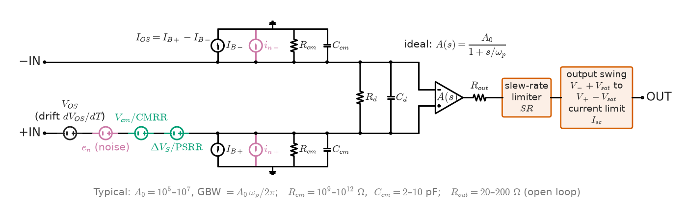
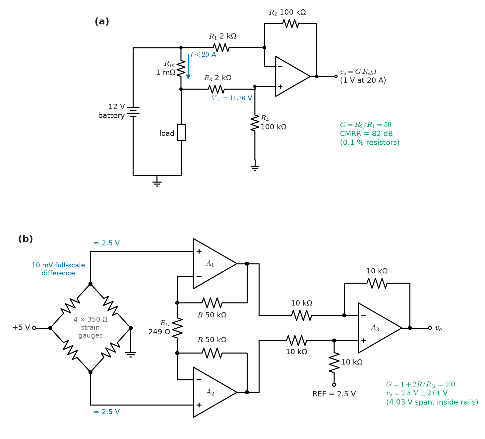
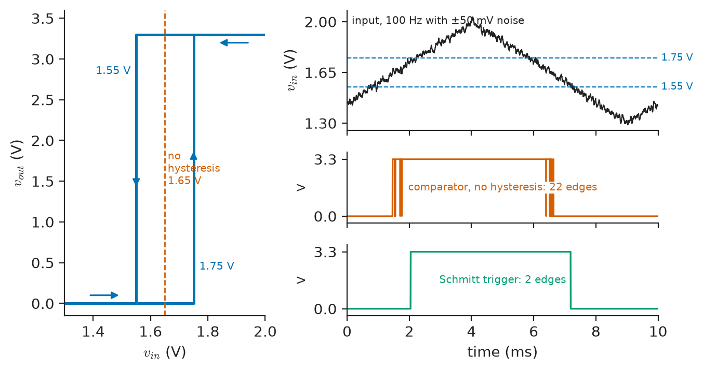
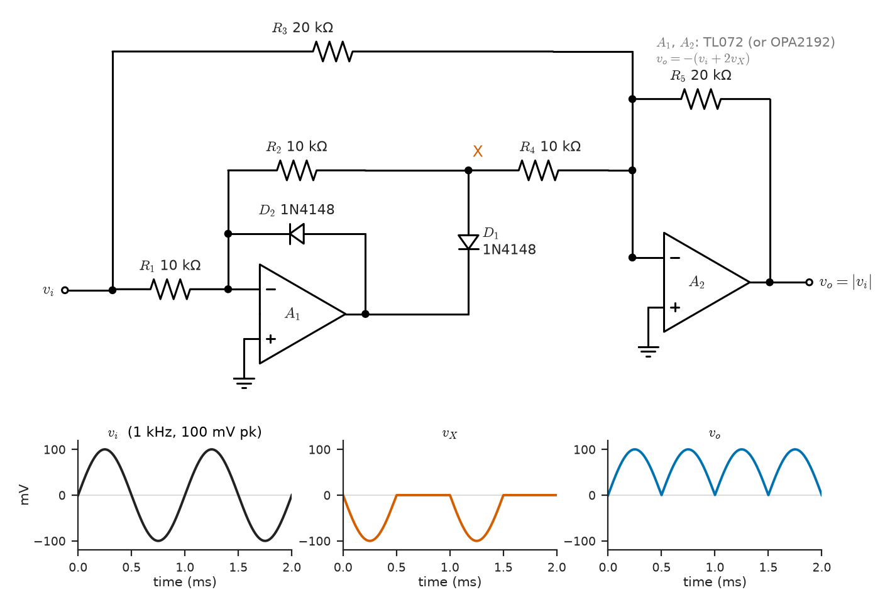
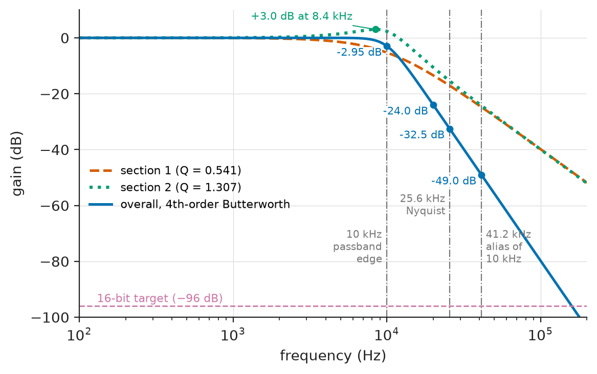
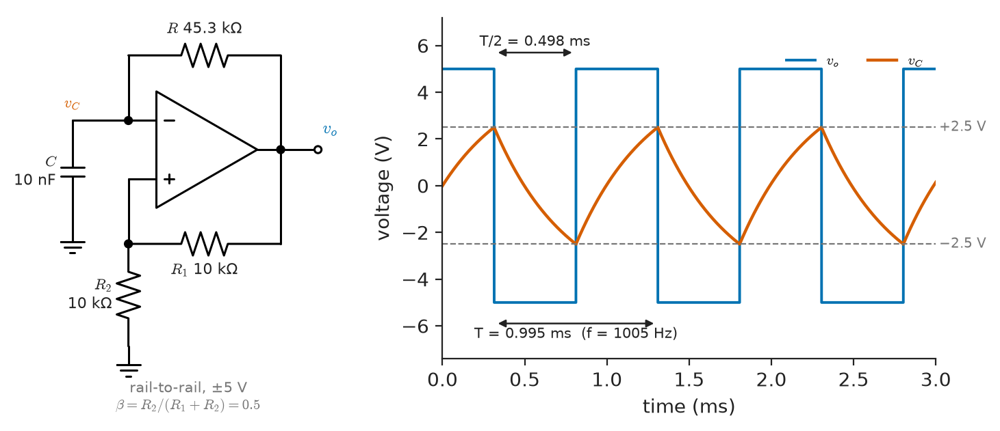

# Chapter 8 — Operational Amplifiers

*Part II · Analog Electronics*

An electric-vehicle battery pack measures its current through a 100 µΩ shunt in the negative bus. At the full 500 A the shunt develops 50 mV; at a 1 A parking load, 100 µV. The first prototype amplifies the shunt voltage with a general-purpose LM358 in a textbook gain-of-50 stage. On the bench, with a precision source, it reads correctly at 500 A. In the car, the battery-management system's coulomb counter, which integrates current to estimate state of charge, drifts by a fifth of the pack's capacity per hour while the car is parked. The amplifier is not faulty: its 2 mV input offset is the shunt voltage of a 20 A current that does not exist, and integrating 20 A for an hour on a 100 Ah pack is 20 % of its charge. A zero-drift op-amp with 10 µV offset reduces the phantom current to 0.1 A; a dedicated current-sense amplifier with laser-trimmed resistors adds the common-mode rejection needed when the shunt moves to the high side of a 400 V bus. The ideal op-amp of the textbook got the gain right. Everything else in the design was decided by the op-amp's departures from ideal.

> **How far can a circuit designer trust the two "golden rules" of the ideal op-amp, and which datasheet parameter breaks them first in a given application?**
> **How are the standard op-amp circuits (amplifiers, integrators, comparators, instrumentation amplifiers, rectifiers, filters and oscillators) designed to a numerical specification?**

| Concept | Engineering destination |
|---|---|
| Ideal and practical op-amps | Choosing a part: offset, bias current, bandwidth, slew rate, noise, supply |
| Inverting and non-inverting amplifiers | Sensor gain stages, buffers, ADC drivers, audio preamplifiers |
| Summing and difference amplifiers | Mixers, DAC outputs, current-shunt sensing, level shifting |
| Integrators and differentiators | Charge amplifiers, Rogowski-coil integrators, PID controllers, ramp generators |
| Comparators | Zero-crossing and overcurrent detectors, window monitors, PWM generation |
| Instrumentation amplifiers | Load cells, strain gauges, ECG and EEG front ends, thermocouples |
| Precision rectifiers | AC voltmeters, envelope detectors, AGC loops |
| Active filters | Anti-aliasing and reconstruction filters, audio crossovers, vibration analysers |
| Oscillators | Test-tone sources, relaxation timers, sensor excitation |
| Limitations and stability | Rail-to-rail swing, full-power bandwidth, noise budgets, capacitive loads |

**Roadmap.** The ideal model and the error sources of a real op-amp (8.1) → inverting and non-inverting stages with their real errors (8.2) → summing and difference amplifiers and the CMRR of resistor networks (8.3) → integrators and differentiators in practice (8.4) → comparators and hysteresis (8.5) → instrumentation amplifiers (8.6) → precision rectifiers (8.7) → active-filter design (8.8) → op-amp oscillator circuits (8.9) → the limits that decide every design: swing, slew, noise and stability (8.10).

---

## 8.1 Ideal and practical op-amps

> **Boundary.** The ideal op-amp, its two golden rules and the standard configurations with their gain formulas ($-R_f/R_1$, $1+R_f/R_1$, summing, integrator, differentiator) are stated in *Engineering Physics*, [Ch. 18 §18.4.1–18.4.2](https://github.com/The-Studio-of-Sadiq/Engineering-Physics/blob/main/CHAPTERS/CHAPTER%2018.md), with the gain-bandwidth product, slew rate and offset sketched in §18.4.3; filter approximations and the Sallen–Key section are in §18.5.3–18.5.4. The closed-loop gain formula $A/(1+A\beta)$ and loop gain come from *Circuits, Signals and Communications*, [Ch. 34 §34.2](https://github.com/The-Studio-of-Sadiq/Circuits-Signals-and-Communications/blob/main/part-7-control-system-fundamentals/34-feedback-and-stability.md); the active-filter network interface from [Ch. 13 §13.8](https://github.com/The-Studio-of-Sadiq/Circuits-Signals-and-Communications/blob/main/part-3-advanced-network-theory/13-network-frequency-response.md). Feedback topologies, stability margins in op-amp circuits and oscillator theory belong to [Chapter 9](09-feedback-and-oscillators.md); the transistor circuits inside the op-amp to [Chapter 10](10-analog-integrated-circuits.md). This chapter designs with op-amps.

### The ideal model and why it works

An op-amp is a differential amplifier with an open-loop gain $A$ of $10^5$ to $10^7$ at DC. With negative feedback through a network that returns a fraction $\beta$ of the output to the inverting input, the closed-loop gain is

$$
G=\frac{A}{1+A\beta}=\frac{1}{\beta}\cdot\frac{1}{1+1/(A\beta)}
$$

(Book 3 §34.2). When the loop gain $A\beta$ is large, $G\to1/\beta$ and the differential input voltage $v_o/A$ is negligible, which is the virtual short. The golden rules are therefore not a separate assumption; they are the limit of large loop gain. The quantity $1/\beta$, the closed-loop gain the circuit would have with an ideal op-amp *seen from the non-inverting input*, is called the **noise gain**. It sets how much of every input-referred error appears at the output and, because $A$ falls with frequency, how much bandwidth the circuit gets. The noise gain is $1+R_f/R_1$ for both the non-inverting stage and the inverting stage, even though the inverting stage's signal gain is $-R_f/R_1$.

> **Status of the principle: The ideal op-amp golden rules**
> *Approximate.* Virtual short and zero input current hold when the loop gain $A\beta\gg1$ and the input bias current is negligible against the currents in the feedback network; they fail as $A(f)$ falls at high frequency, when the output saturates or slews, and whenever the op-amp is used without negative feedback.

### The error model

A real op-amp is best described by adding error sources to an ideal one (Figure 8.1). Each source is referred to the input and multiplied by the noise gain (or by the feedback resistance, for currents) to find its output effect.

<!-- FIGURE 8.1 | figures/ch08/fig-8-1-opamp-error-model.png | block-diagram | Error model of a practical op-amp: an ideal differential amplifier with the input-referred error sources that a datasheet specifies. | Content: central triangle labelled ideal A(s) = A0 / (1 + s/wp), A0 = 10^5 to 10^7, GBW. Non-inverting input path: series voltage source VOS (with drift dVOS/dT) and noise voltage source en; current sources IB+ and IB- to ground from each input (difference IOS); in parallel with each input a common-mode resistance Rcm (10^9 to 10^12 ohm) and capacitance Ccm (2 to 10 pF), and differential Rd, Cd between the inputs; current noise sources in at each input. Output side: Rout (open-loop, 20 to 200 ohm) in series, a block marked "slew-rate limiter SR" and a block "output swing limits V- + Vsat to V+ - Vsat, current limit Isc". Annotate CMRR and PSRR as additional input-referred voltage sources equal to Vcm/CMRR and dVsupply/PSRR. -->



*Figure 8.1 — Error model of a practical op-amp: an ideal differential amplifier with the input-referred error sources that a datasheet specifies.*

**Table 8.1 — Representative op-amps (typical datasheet values at 25 °C; maxima are higher, check the current datasheet).**

| Part | Input | GBW | Slew rate | $V_{OS}$ | $V_{OS}$ drift | $I_B$ | $e_n$ at 1 kHz | Supply |
|---|---|---|---|---|---|---|---|---|
| LM358 | Bipolar | 0.7–1 MHz | 0.3 V/µs | 2 mV | 7 µV/°C | 20–45 nA | 40 nV/√Hz | 3–32 V |
| TL072 | JFET | 3 MHz | 13 V/µs | 3 mV | 18 µV/°C | 65 pA | 18 nV/√Hz | 7–36 V |
| OP07 | Bipolar precision | 0.6 MHz | 0.3 V/µs | 30 µV | 0.3 µV/°C | 1.2 nA | 10 nV/√Hz | ±3 to ±18 V |
| NE5532 | Bipolar low noise | 10 MHz | 9 V/µs | 0.5 mV | — | 200 nA | 5 nV/√Hz | ±5 to ±20 V |
| OPA1612 | Bipolar audio | 40 MHz | 27 V/µs | 0.1 mV | 1 µV/°C | 60 nA | 1.1 nV/√Hz | ±2.25 to ±18 V |
| OPA2188 | CMOS zero-drift | 2 MHz | 0.8 V/µs | 6 µV | 0.03 µV/°C | 160 pA | 8.8 nV/√Hz | 4–36 V |
| AD8065 | JFET high speed | 145 MHz | 180 V/µs | 0.4 mV | 1 µV/°C | 2 pA | 7 nV/√Hz | 5–24 V |
| MCP6001 | CMOS rail-to-rail | 1 MHz | 0.6 V/µs | ≤ 4.5 mV (max) | 2 µV/°C | 1 pA | 28 nV/√Hz | 1.8–6 V |

The table spans four orders of magnitude in offset, five in bias current and two in bandwidth. No part is best at everything: bipolar inputs give low voltage noise and offset but large bias current; JFET and CMOS inputs give picoamp bias current but more voltage noise and offset; zero-drift (chopper or auto-zero) parts give microvolt offsets with almost no drift, at the cost of switching ripple and modest bandwidth; high-speed parts give bandwidth at the cost of supply current and DC precision. Choosing an op-amp means finding which error dominates the application, which is what the rest of the chapter does.

> **Status of the principle: Single-pole op-amp model $A(f)\approx\mathrm{GBW}/(jf)$**
> *Approximate.* Internally compensated op-amps are designed so that one pole dominates from a few hertz up to near the unity-gain frequency; the model gives closed-loop bandwidth $\mathrm{GBW}\beta$ for noise gains above about 2 to 3, and fails near unity gain, where the second pole sets phase margin ([Chapter 9](09-feedback-and-oscillators.md)), and for large signals, where slew rate dominates.

---

## 8.2 Inverting and non-inverting amplifiers

### The basic stages and their real impedances

The inverting stage's gain is $-R_f/R_1$ and its input resistance is exactly $R_1$, because the inverting input is a virtual ground. That is a design constraint: a gain of $-100$ with a 10 kΩ input needs a 1 MΩ feedback resistor, whose bias-current error and thermal noise may be unacceptable. The **T-network** obtains high gain from moderate resistors: replacing $R_f$ by $R_2$ and $R_3$ in series with $R_4$ from their junction to ground gives

$$
G=-\frac{R_2+R_3+R_2R_3/R_4}{R_1}
$$

so $R_1=10\ \mathrm{k\Omega}$, $R_2=R_3=100\ \mathrm{k\Omega}$ and $R_4=1\ \mathrm{k\Omega}$ give $G=-1020$ without a 10 MΩ resistor; the price is a noise gain larger than the signal gain, because the T-network attenuates feedback.

The non-inverting stage's gain is $1+R_f/R_1$ and its input impedance is the op-amp's common-mode input impedance, $10^9$ to $10^{12}\ \Omega$ in parallel with a few picofarads, which is why it is the default buffer for high-impedance sensors. Its weakness is that the input common-mode voltage equals the signal, so the input stage must accept the full signal range: a single-supply op-amp whose common-mode range ends 1.5 V below the positive rail cannot buffer a signal that approaches it. **Rail-to-rail input** parts use two complementary input pairs to cover the whole supply, with a crossover region near one rail where offset shifts by hundreds of microvolts.

Single-supply circuits move the signal reference to mid-supply: an inverting stage on 3.3 V references its non-inverting input to a 1.65 V reference (buffered, or a divider with a decoupling capacitor), and AC coupling at the input removes the DC level of the source.

### Finite gain, offset and bias current

From the closed-loop formula, the fractional gain error due to finite open-loop gain is about $1/(A\beta)$. Input offset $V_{OS}$ appears at the output multiplied by the noise gain $1/\beta$. Input bias current $I_B$ flowing in the feedback resistor $R_f$ adds $I_BR_f$; if the non-inverting input is fed through a resistance equal to $R_1\parallel R_f$, the two bias currents produce equal and opposite errors and only the offset current $I_{OS}$ remains, giving $I_{OS}R_f$. The compensation resistor helps bipolar parts (where $I_{OS}\ll I_B$) and does nothing for CMOS parts, whose picoamp bias currents are dominated by ESD-diode leakage that doubles every 10 °C.

> **Status of the principle: Output error of a feedback stage $V_{o,err}=V_{OS}/\beta+I_{OS}R_f$**
> *Derived.* Superposition of the input-referred error sources through the linear closed-loop circuit; offsets add algebraically with unknown signs, so worst-case budgets add magnitudes and statistical budgets add squares.

**Worked example 8.1 — Error budget of a gain-of-101 sensor stage.** A thermocouple or bridge signal is amplified by a non-inverting stage with $R_f=100\ \mathrm{k\Omega}$ and $R_1=1\ \mathrm{k\Omega}$ ($G=1/\beta=101$), first with an OP07 (typical $A_0=4\times10^5$, $V_{OS}=30\ \mu$V, drift 0.3 µV/°C, $I_B=1.2$ nA, $I_{OS}=0.5$ nA, GBW 0.6 MHz).

*Gain error at DC.* $1/(A\beta)=101/(4\times10^5)=0.025\ \%$, so $G=100.97$.

*Gain error at 1 kHz.* The open-loop gain has fallen to $\mathrm{GBW}/f=600$ with a −90° phase, so $A\beta=-j5.94$ and $G=101/(1+j0.168)$: magnitude 99.6 (−1.4 %) and a phase lag of 9.6°. A 0.025 % amplifier at DC is a 1.4 % amplifier at 1 kHz; the closed-loop bandwidth is $0.6\ \mathrm{MHz}/101=5.9$ kHz.

*Offset.* $V_{OS}/\beta=30\ \mu\mathrm V\times101=3.03$ mV at the output; without bias compensation $I_BR_f=0.12$ mV; with a 990 Ω resistor in the non-inverting lead, $I_{OS}R_f=0.05$ mV. Over a 45 °C rise the drift adds $0.3\ \mu\mathrm V/°\mathrm C\times45\times101=1.36$ mV.

*The same stage with a TL072.* The 3 mV typical offset becomes 303 mV at the output, 100 times the OP07's; the bandwidth improves to $3\ \mathrm{MHz}/101=29.7$ kHz and the bias-current error vanishes. For a 10 mV full-scale sensor signal (1.01 V output), the TL072 stage has a 30 % offset error that must be calibrated out, and its 18 µV/°C drift makes calibration hold only over a few degrees. The OP07, or a zero-drift OPA2188 (6 µV, 0.03 µV/°C), is the right choice; the TL072 is the right choice for an AC-coupled audio or piezo stage, where offset is irrelevant and picoamp bias current matters.

---

## 8.3 Summing and difference amplifiers

### Summing amplifiers

An inverting stage with several input resistors sums currents into its virtual ground: $v_o=-R_f\sum v_k/R_k$ (*Engineering Physics* §18.4.2). Because the summing node is held at ground, the inputs do not interact; each source sees only its own resistor. That isolation is the reason the summer is the core of audio mixing consoles, of analog computers, and of the output stage of current-steering and R-2R DACs, where binary-weighted currents are summed and converted to voltage ([Chapter 26](../part-6-embedded-and-real-time-systems/26-embedded-interfaces.md)). The noise gain is $1+R_f/(R_1\parallel R_2\parallel\cdots)$, larger than any single channel's gain: a 16-channel mixer with unity gain per channel has a noise gain of 17, so each added channel raises the output noise even when its input is silent.

A non-inverting summer (inputs through equal resistors to the non-inverting input) averages rather than sums, and its inputs interact through the shared node; it is used where an inversion is unwelcome and the sources are low-impedance.

### The difference amplifier and its CMRR

The four-resistor difference amplifier ($R_1$ and $R_2$ on the inverting side, $R_3$ and $R_4$ on the non-inverting side, Figure 8.2a) gives

$$
v_o=\frac{R_2}{R_1}(v_2-v_1)\qquad\text{when}\qquad\frac{R_4}{R_3}=\frac{R_2}{R_1}
$$

It is the simplest way to measure a voltage that rides on a large common-mode level, such as the voltage across a current shunt in a supply rail. The difficulty is the "when". If the ratios differ, part of the common-mode voltage leaks to the output. For resistors of tolerance $t$ the worst-case common-mode rejection ratio of the network alone is

$$
\mathrm{CMRR}\approx\frac{1+G}{4t}
$$

with $G=R_2/R_1$. A gain-of-1 stage with 1 % resistors has a CMRR of only 50 (34 dB); the op-amp's own CMRR of 80–120 dB is irrelevant beside that. The source resistances count as part of $R_1$ and $R_3$, so an unequal source impedance destroys CMRR as surely as a resistor mismatch, and the two inputs present different impedances ($R_1$ on the inverting side, $R_3+R_4$ on the other), which loads unbalanced sources differently.

> **Status of the principle: Difference-amplifier CMRR $\approx(1+G)/(4t)$**
> *Approximate.* First-order worst-case result for four resistors each off by up to $\pm t$ in the most damaging directions, with an ideal op-amp; statistical (random) mismatch gives about twice this value, and the op-amp's own CMRR combines with the network's as a parallel sum of their reciprocals.

<!-- FIGURE 8.2 | figures/ch08/fig-8-2-difference-and-instrumentation-amplifiers.png | circuit | (a) Four-resistor difference amplifier across a 1 milliohm high-side shunt; (b) three-op-amp instrumentation amplifier reading a load-cell bridge. | Content: Panel (a): 12 V battery rail, shunt Rsh = 1 milliohm carrying load current up to 20 A to a load; R1 = 2 kilohm from the supply side of the shunt to the inverting input, R2 = 100 kilohm feedback, R3 = 2 kilohm from the load side of the shunt to the non-inverting input, R4 = 100 kilohm to ground; G = 50; annotate CMRR 82 dB with 0.1 percent resistors, common-mode at op-amp input 11.76 V. Panel (b): Wheatstone bridge of four 350 ohm strain gauges excited at 5 V, outputs at about 2.5 V with 10 mV full-scale difference; two input buffers A1 and A2 each with feedback resistor R = 50 kilohm and a single gain resistor RG = 249 ohm between their inverting inputs; output difference stage A3 with four equal 10 kilohm resistors (unity gain) and REF pin at 2.5 V; annotate overall G = 1 + 2R/RG = 403 and output 2.5 V +/- 2.01 V (4.03 V span) inside the rails. -->



*Figure 8.2 — (a) Four-resistor difference amplifier across a 1 milliohm high-side shunt; (b) three-op-amp instrumentation amplifier reading a load-cell bridge.*

**Worked example 8.2 — A high-side current sense with discrete resistors.** A 12 V automotive load draws up to 20 A through a 1 mΩ shunt in the positive rail, giving 20 mV full scale. A difference amplifier with $G=50$ ($R_1=R_3=2\ \mathrm{k\Omega}$, $R_2=R_4=100\ \mathrm{k\Omega}$) gives a 1 V full-scale output referred to ground (Figure 8.2a).

*CMRR.* With 0.1 % resistors, $\mathrm{CMRR}=51/0.004=12\,750$ (82.1 dB). The 12 V common mode therefore appears as an input-referred error of $12/12\,750=0.94$ mV, which on a 1 mΩ shunt is a phantom 0.94 A: 4.7 % of full scale, varying with battery voltage between 9 V and 16 V. With 0.01 % resistors the CMRR rises to 102 dB and the error to 94 µV (94 mA).

*Common-mode range.* The non-inverting input sits at $12\times R_4/(R_3+R_4)=11.76$ V, so the op-amp must be powered from at least about 13–14 V, or use a rail-to-rail input part on the 12 V rail itself, or the resistor ratio must attenuate the common mode further. A load-dump transient of 40 V or more on the automotive rail (ISO 16750-2) adds a survival requirement.

*The integrated answer.* Dedicated current-sense amplifiers (an INA240, for example, with −4 V to 80 V common-mode range) integrate laser-trimmed, thermally matched resistor networks and reach CMRR well above 120 dB, with rejection of the fast common-mode steps of a PWM-switched shunt. For a shunt on a 400 V traction bus, galvanic isolation is required, and an isolated amplifier or isolated delta-sigma modulator replaces the difference amplifier altogether.

---

## 8.4 Integrators and differentiators

### The practical integrator

The ideal inverting integrator, $v_o=-\frac{1}{RC}\int v_i\,dt$, has infinite gain at DC, so any offset is integrated until the output saturates: an op-amp with 1 mV of offset in an integrator with $RC=300\ \mu$s ramps at 3.3 V/s and hits the rail in a few seconds, before considering bias current, which charges the capacitor at $I_B/C$. Three practical cures exist, used in different applications:

- **A resistor across the capacitor** ($R_f\parallel C$) gives a finite DC gain $-R_f/R$ and turns the integrator into a first-order low-pass with corner $1/(2\pi R_fC)$. It integrates only above that corner, and it introduces magnitude and phase errors near it.
- **A reset switch** across the capacitor (an analog switch or MOSFET) zeroes the integrator at the start of each measurement: used in charge-integrating ADCs, photodiode integrators in CT scanners and X-ray detectors, and the dual-slope converter of a bench multimeter.
- **An outer loop** that holds the integrator output near zero, as in a PI controller, where the integrator is supposed to have infinite DC gain because the loop removes the offset by acting on the plant.

A special case is the **charge amplifier** for piezoelectric sensors: the sensor delivers a charge $q$, the integrator capacitor converts it to $v_o=-q/C_f$, independent of the sensor and cable capacitance (which sits at the virtual ground). An accelerometer giving 10 pC/g into $C_f=1$ nF produces 10 mV/g whatever the length of its cable; a large $R_f$ (often 1–10 GΩ) sets the low-frequency limit.

**Worked example 8.3 — A Rogowski-coil integrator.** A Rogowski coil around a busbar produces $v=M\,di/dt$; a coil with $M=0.3\ \mu$H gives $\omega MI=94$ mV rms for 1000 A rms at 50 Hz. An integrator must restore $v_o\propto i$, scaled to 1 V rms at 1000 A: $v_o=(M/RC)\,i$, so $RC=MI/v_o=0.3\ \mu\mathrm H\times1000\ \mathrm A/1\ \mathrm V=300\ \mu$s, for example $R=30\ \mathrm{k\Omega}$, $C=10$ nF (C0G or film, never X7R, whose capacitance moves with voltage and temperature).

A DC-stabilising $R_f=3\ \mathrm{M\Omega}$ gives a DC gain of 100 (an op-amp with 1 mV offset sits at 0.1 V output instead of the rail) and a corner at $1/(2\pi R_fC)=5.3$ Hz. At 50 Hz this corner costs a 0.56 % magnitude error and a 6.1° phase lead. For protection relays that is acceptable; for revenue-grade energy metering (IEC 62053-22 class 0.2S), where a 0.1° phase error between current and voltage matters at low power factor, it is not, and practical meters either correct the phase digitally or digitise the coil voltage and integrate in software after the ADC.

> **Status of the principle: Practical integrator $H(s)=-\dfrac{R_f/R}{1+sR_fC}$**
> *Derived.* Nodal analysis of the inverting stage with feedback impedance $R_f\parallel(1/sC)$ and an ideal op-amp; it integrates with phase error $\arctan[1/(\omega R_fC)]$ above the corner, and is further limited at high frequency by the op-amp's gain-bandwidth product.

### The differentiator, and why it is rarely used

The ideal differentiator, $v_o=-RC\,dv_i/dt$, has a gain rising at 20 dB/decade without limit. Two consequences make it unusable as drawn. It amplifies high-frequency noise in proportion to frequency. And it is a stability problem: the feedback network's $\beta$ falls with frequency while the op-amp's gain falls too, so the loop gain approaches −180° and the circuit forms a lightly damped resonance near $\sqrt{\mathrm{GBW}/(2\pi RC)}$: about 69 kHz for $R=10\ \mathrm{k\Omega}$, $C=10$ nF and a 3 MHz op-amp, where it rings or oscillates. The practical differentiator adds a resistor in series with the input capacitor and a small capacitor across the feedback resistor, so it differentiates only over a chosen band and rolls off above it. In control systems the same limit appears as the derivative filter of a PID controller ([Book 3 Ch. 35](https://github.com/The-Studio-of-Sadiq/Circuits-Signals-and-Communications/blob/main/part-7-control-system-fundamentals/35-control-design-fundamentals.md)).

---

## 8.5 Comparators

### Comparator versus op-amp

A comparator answers one question: is $v_+$ above $v_-$? An op-amp without feedback does answer it, slowly. Its compensation capacitor, which makes it stable with feedback, limits its slew rate, and its output stage recovers from saturation in microseconds; an LM358 used open-loop takes 10–30 µs to switch its output. A **comparator** has no compensation, an output stage designed to saturate cleanly (often open-drain or open-collector, for wired-OR and level translation), and a specified propagation delay that falls with input overdrive.

**Table 8.2 — Comparators and an op-amp used as one (typical propagation delays).**

| Part | Output | Propagation delay | Supply | Use |
|---|---|---|---|---|
| LM358 (op-amp, open loop) | Push-pull | 10–30 µs | 3–32 V | Slow thresholds only |
| LM393 | Open collector | 0.3–1.3 µs (overdrive dependent) | 2–36 V | Battery monitors, general purpose |
| TLV3201 | Push-pull | ≈ 40 ns | 2.7–5.5 V | Zero-crossing, PWM, encoders |
| TLV3501 | Push-pull | ≈ 4.5 ns | 2.7–5.5 V | Fast pulse detection, clock recovery |
| ADCMP600 | LVTTL/LVCMOS | ≈ 3.5 ns | 2.5–5.5 V | LiDAR time-of-flight, oscilloscope triggers |

Comparator internals (latch, hysteresis cells, output drivers) are covered in [Chapter 10](10-analog-integrated-circuits.md). Applications include overcurrent trip circuits in motor drives (a comparator on the shunt amplifier output can disable the gate drivers within 100 ns, far faster than a microcontroller interrupt), zero-crossing detectors for triac phase control, window comparators that flag under- and overvoltage on a battery cell, and the PWM comparator of an analog converter controller, which compares an error voltage with a sawtooth ([Chapter 30](../part-7-power-electronics/30-dc-dc-converters.md)).

### Hysteresis: the Schmitt trigger

A comparator fed with a slow, noisy signal near its threshold switches many times as the noise crosses back and forth, producing a burst of edges where one was wanted: a speed sensor reads ten times the true speed, a counter overflows. **Hysteresis** fixes this by positive feedback from the output to the non-inverting input, so the threshold moves away from the input each time the output switches (Figure 8.3).

For a non-inverting Schmitt trigger with a reference $V_{ref}$ at the inverting input, the input through $R_1$ to the non-inverting input and feedback $R_2$ from a rail-to-rail output (0 or $V_{DD}$),

$$
V_{TH+}=V_{ref}\left(1+\frac{R_1}{R_2}\right),\qquad V_{TH-}=V_{ref}\left(1+\frac{R_1}{R_2}\right)-V_{DD}\frac{R_1}{R_2},\qquad \Delta V=V_{DD}\frac{R_1}{R_2}
$$

> **Status of the principle: Schmitt-trigger thresholds**
> *Derived.* Superposition at the non-inverting input with the output at one rail or the other; assumes rail-to-rail output and negligible input current; with an open-drain output, the pull-up resistor adds to $R_2$ in the high state and the thresholds shift.

**Worked example 8.4 — A noise-immune threshold for a tachometer.** A conditioned Hall-sensor signal on a 3.3 V supply crosses mid-supply with ±50 mV of noise. A TLV3201 with hysteresis of 0.2 V centred at 1.65 V is required. Then $R_1/R_2=0.2/3.3=0.0606$, satisfied by $R_1=10\ \mathrm{k\Omega}$ and $R_2=165\ \mathrm{k\Omega}$ (E96). The centre of the hysteresis band is $V_{ref}(1+R_1/R_2)-V_{DD}R_1/(2R_2)$; setting it to 1.65 V gives $V_{ref}=1.65$ V exactly (a property of placing the band at $V_{DD}/2$). The thresholds are 1.75 V and 1.55 V: the ±50 mV noise is half the margin on either side, and each crossing produces one clean edge.

<!-- FIGURE 8.3 | figures/ch08/fig-8-3-schmitt-trigger.png | plot | Schmitt trigger of Worked example 8.4: transfer characteristic with hysteresis and its response to a noisy input, compared with a comparator without hysteresis. | Content: two panels. Left: output (0 to 3.3 V) versus input (1.3 to 2.0 V); rising path switches at 1.75 V, falling path at 1.55 V, arrows showing direction around the hysteresis loop; dashed vertical line at 1.65 V for the no-hysteresis comparator. Right: time axis 0 to 10 ms; input a 100 Hz triangle-like slow signal between 1.3 and 2.0 V with plus/minus 50 mV random noise; trace 2: comparator without hysteresis showing bursts of multiple edges at each crossing; trace 3: Schmitt output with exactly one edge per crossing; horizontal dashed lines at 1.75 V and 1.55 V on the input trace. -->



*Figure 8.3 — Schmitt trigger of Worked example 8.4: transfer characteristic with hysteresis and its response to a noisy input, compared with a comparator without hysteresis.*

Hysteresis is not free: it delays switching by the time the input takes to cross half the hysteresis band, which for a sinusoid adds a phase lag, and it sets a minimum detectable amplitude. Comparators driven from fast signals also need care with layout, since the output edge couples back to the input through ground and stray capacitance and can make even a hysteresis-free comparator oscillate during a slow transition.

---

## 8.6 Instrumentation amplifiers

### Why the difference amplifier is not enough

The difference amplifier of Section 8.3 has a CMRR limited by resistor matching, input impedances of only kilohms (unequal on the two inputs), and a gain that can be changed only by changing two matched resistors at once. A strain-gauge bridge, an ECG electrode pair or a thermocouple needs the opposite: very high, equal input impedances, high CMRR and gain set by one resistor. The **instrumentation amplifier** (in-amp) provides all three.

### The three-op-amp in-amp

In the classic topology (Figure 8.2b) two non-inverting buffers share a single gain resistor $R_G$ between their inverting inputs, followed by a unity-gain difference amplifier. The virtual shorts put the full differential input across $R_G$; the current $v_d/R_G$ flows through both feedback resistors $R$, so the first stage's differential gain is $1+2R/R_G$. A common-mode input moves both inverting inputs together, no current flows in $R_G$, and the first stage passes the common mode at unity gain. The difference stage then rejects it. The overall gain is

$$
G=\left(1+\frac{2R}{R_G}\right)\frac{R_{\text{out,2}}}{R_{\text{out,1}}}
$$

and, because the differential signal is amplified before the difference stage while the common mode is not, **the CMRR rises in proportion to gain**: a part with 80 dB at $G=1$ typically reaches 100–120 dB at $G=100$.

> **Status of the principle: Three-op-amp in-amp gain $1+2R/R_G$ and gain-proportional CMRR**
> *Derived.* Virtual-short analysis of the input stage with ideal op-amps; the CMRR improvement holds while the first stage's common-mode gain is unity and its op-amps are not saturated, and degrades at high frequency as the matching of the two input channels' gain and phase deteriorates.

Integrated in-amps set $R$ internally and specify the gain equation: $G=1+49.4\ \mathrm{k\Omega}/R_G$ for the AD620 and INA826 classes, $G=1+100\ \mathrm{k\Omega}/R_G$ for the zero-drift INA333. The single most common in-amp design error is not gain or noise but **common-mode range**: the internal nodes of the first stage swing to $V_{cm}\pm Gv_d/2$, so a high gain with a common mode near a rail saturates an internal amplifier while the output looks merely wrong. Manufacturers publish a "diamond plot" of allowed output swing against common-mode voltage for each gain and supply; a design is checked against it, not against the input-range line on the first page of the datasheet.

**Worked example 8.5 — A load-cell front end.** A 2 mV/V load cell excited at 5 V gives 10 mV at full load, riding on a common mode of 2.5 V. An INA333 on a 5 V supply with its REF pin at 2.5 V (from a buffered reference) is to produce a span of about 4 V for a 5 V ADC. The gain needed is 400; $R_G=100\ \mathrm{k\Omega}/399=250.6\ \Omega$, rounded to 249 Ω (E96), gives $G=402.6$ and a full-scale span of 4.03 V, $2.5\pm2.01$ V at the output for a bipolar load, within the INA333's rail-to-rail output. A CMRR of 100 dB at this gain turns the 2.5 V common mode into $2.5/10^5=25\ \mu$V of input-referred error: 0.25 % of full scale, but constant, so it is removed by the tare (zero) calibration of the scale. What tare cannot remove is drift; the INA333's 25 µV maximum offset drifts at 0.1 µV/°C, 0.001 % of full scale per kelvin. Exciting the bridge from the ADC's reference makes the measurement **ratiometric**, so the excitation voltage's own drift cancels ([Chapter 26](../part-6-embedded-and-real-time-systems/26-embedded-interfaces.md)). In a weighing system to OIML R76 class III, the remaining error budget goes to the load cell itself.

Medical front ends add requirements that the in-amp alone cannot meet. An ECG amplifier sees electrode offsets of up to ±300 mV (IEC 60601-2-25 requires tolerance of this), so its in-amp runs at a gain of only 5–10 before a high-pass filter; a "right-leg drive" amplifier feeds the inverted common-mode voltage back into the patient to reduce 50/60 Hz pickup; and RFI filters at the inputs prevent radio-frequency signals from being rectified in the input transistors into DC offsets.

---

## 8.7 Precision rectifiers

### The superdiode

A silicon diode does not conduct until its anode is about 0.6 V above its cathode ([Chapter 6](06-diode-circuits.md)), so a diode rectifier cannot rectify a 100 mV signal at all. Placing the diode inside an op-amp's feedback loop divides its threshold by the open-loop gain: in the **superdiode** half-wave rectifier, the op-amp drives the diode's anode and the output (the cathode, with a load to ground) is fed back to the inverting input. For positive inputs the loop closes through the conducting diode and the output follows the input; for negative inputs the diode is reverse-biased, the loop is open, and the output is held at zero by the load. The effective forward drop is $V_D/A$.

The weakness is speed. During the negative half-cycle the op-amp, with no feedback, saturates at its negative rail; when the input turns positive it must slew back up through the diode drop before the loop closes. Even before saturation, at frequency $f$ the dead zone is $V_D/A(f)=V_Df/\mathrm{GBW}$. A TL072 (3 MHz) at 10 kHz has $A=300$ and a dead zone of 0.6 V/300 = 2 mV, a 20 % error on a 10 mV signal.

### The improved half-wave and full-wave circuits

The **improved half-wave rectifier** is an inverting stage with two diodes: one in series with the feedback resistor (the output path) and one directly from output to inverting input. In one polarity the first diode conducts and the stage is an inverter of gain $-R_f/R_1$; in the other the second diode conducts and holds the op-amp output one diode drop from virtual ground, so the op-amp never saturates and recovers in tens of nanoseconds instead of microseconds. Adding a second op-amp that sums the half-wave output (with weight 2) and the input (with weight 1) gives the **precision full-wave rectifier**, or absolute-value circuit (Figure 8.4).

<!-- FIGURE 8.4 | figures/ch08/fig-8-4-precision-full-wave-rectifier.png | circuit | Two-op-amp precision full-wave rectifier (absolute-value circuit) with input and output waveforms. | Content: Stage A1: inverting half-wave rectifier, input vi through R1 = 10 kilohm to the inverting input; D1 (1N4148) with anode at node X, cathode at A1 output; R2 = 10 kilohm from node X back to the inverting input; D2 with anode at A1 output, cathode at the inverting input, clamping the op-amp; non-inverting input grounded. Stage A2: summing inverter with R3 = 20 kilohm from vi, R4 = 10 kilohm from node X, feedback R5 = 20 kilohm; output vo = abs(vi). Inset waveforms: vi a 1 kHz sine of 100 mV peak; node X a negative half-wave of -100 mV peak; vo a full-wave rectified waveform of 100 mV peak with no dead zone. Op-amp label TL072 or OPA2192. -->



*Figure 8.4 — Two-op-amp precision full-wave rectifier (absolute-value circuit) with input and output waveforms.*

> **Status of the principle: Superdiode dead zone $V_D/A(f)$**
> *Approximate.* Follows from the loop forcing the op-amp output to $v_i+V_D$ with differential input $(v_i+V_D)/A$; the real high-frequency error is larger, because recovery from saturation and the slew through $2V_D$ at each zero crossing add a delay independent of signal level.

### Applications and true RMS

Precision rectifiers are used in average-responding AC voltmeters, envelope detectors for ultrasound and radio, AGC loops and peak detectors. An average-responding meter is calibrated to read the RMS of a sine (scale factor $1.111=\pi/(2\sqrt2)$ times the average of the rectified waveform), and it misreads every other waveform: a square wave reads 11 % high, a triangle wave 3.8 % low, and the distorted current of a rectifier-input load can be 30–40 % in error. **True-RMS converters** (log-antilog circuits such as the AD737, or delta-sigma computing converters such as the LTC1966) compute $\sqrt{\overline{v^2}}$ directly; today most meters digitise and compute RMS in firmware.

---

## 8.8 Active filters

### Choosing a topology

The filter approximations (Butterworth, Chebyshev, Bessel, elliptic) and the decomposition of an $n$-th order filter into second-order sections, each with its own $f_0$ and $Q$, belong to *Engineering Physics* [§18.5.3](https://github.com/The-Studio-of-Sadiq/Engineering-Physics/blob/main/CHAPTERS/CHAPTER%2018.md) and Book 3 [§13.7–13.8](https://github.com/The-Studio-of-Sadiq/Circuits-Signals-and-Communications/blob/main/part-3-advanced-network-theory/13-network-frequency-response.md), which also gives the unity-gain Sallen–Key equations and the source-impedance pitfall. The circuit designer's task is to choose a topology for each section, compute component values, and check the result against the op-amp's limits.

**Table 8.3 — Second-order active-filter sections.**

| Topology | Op-amps per section | Sign of gain | Strengths | Weaknesses |
|---|---|---|---|---|
| Sallen–Key (unity gain) | 1 (as follower) | Non-inverting | Few parts, low noise gain (1), good for low $Q$ | Stopband "leakage" at high frequency through the op-amp output impedance; capacitor ratio grows as $4Q^2$ |
| Sallen–Key (gain $K$) | 1 | Non-inverting | Equal components possible ($Q=1/(3-K)$) | $Q$ very sensitive to $K$ near 3 |
| Multiple feedback (MFB) | 1 | Inverting | Good stopband, low sensitivity, natural with inverting stages | Higher noise gain, capacitor ratio $\ge4Q^2(1+K)$ |
| State-variable / KHN | 3 | Low-, high- and band-pass outputs | Independent tuning of $f_0$ and $Q$, high $Q$ | Three op-amps, more power |
| Tow–Thomas biquad | 3 | Band-pass, low-pass | High $Q$, easy tuning | Three op-amps |
| Switched-capacitor | Integrated | — | Corner set by clock, no precision RC needed | Needs anti-alias filter and clock; 1 Hz–100 kHz |

For the MFB low-pass with input resistor $R_1$, feedback resistor $R_2$ from the output to the internal node, capacitor $C_1$ from that node to ground, $R_3$ from the node to the inverting input and $C_2$ from the output to the inverting input, nodal analysis gives

$$
H(s)=-\frac{R_2/R_1}{s^2C_1C_2R_2R_3+sC_2\left(R_2+R_3+\dfrac{R_2R_3}{R_1}\right)+1}
$$

so $\omega_0=1/\sqrt{R_2R_3C_1C_2}$, the DC gain is $-K=-R_2/R_1$, and $Q=1/[\omega_0C_2(R_2+R_3(1+K))]$. Real resistor values exist only if $C_1/C_2\ge4Q^2(1+K)$, which is the design constraint: pick $C_2$, pick $C_1$ from a standard value above the bound, and solve a quadratic for $R_3$.

### Design procedure and component choice

Practical rules decide whether a filter meets its specification in production:

1. **Impedance level.** Resistors between about 1 kΩ and 100 kΩ: below, the op-amp's output current and the source impedance matter; above, thermal noise, bias current and stray capacitance matter.
2. **Capacitors.** C0G/NP0 ceramic (up to tens of nanofarads) or polypropylene film. Class-2 ceramics (X7R, X5R) lose 20–80 % of their capacitance with DC bias and change with temperature, and their voltage-dependent capacitance produces distortion of order 0.01–0.1 % in an audio filter.
3. **Order of sections.** In a cascade, put the low-$Q$ section first so that the high-$Q$ section's resonant peak does not clip the first stage; for noise, the opposite order is sometimes chosen.
4. **Op-amp bandwidth.** Keep $\mathrm{GBW}\ge100\,Q\,f_0$ (Book 3 §13.8); below that, the realised $Q$ rises and high-$Q$ sections can oscillate. The slew rate must cover the largest signal at the highest passband frequency (Section 8.10).
5. **Tolerances.** With 1 % resistors and 5 % capacitors, the pole frequency varies by about ±3 % and high-$Q$ sections vary in $Q$ by more; a Monte Carlo run in a simulator, or the few lines of Python below with random perturbations, confirms the spread.

> **Status of the principle: MFB low-pass realisability $C_1/C_2\ge4Q^2(1+K)$**
> *Derived.* The discriminant of the quadratic for $R_3$ from the $\omega_0$ and $Q$ equations must be non-negative; it holds for an ideal op-amp, and the finite gain-bandwidth product raises the realised $Q$ above the design value.

**Worked example 8.6 — A fourth-order anti-aliasing filter for a vibration analyser.** A machine-condition monitor samples accelerometer signals at 51.2 kS/s and analyses up to 10 kHz. A fourth-order Butterworth low-pass at $f_c=10$ kHz, built from two unity-gain MFB sections, precedes the ADC. The sections need $Q=0.5412$ and $Q=1.3066$, both with $f_0=f_c$. Listing 8.1 designs them with $C_2=1$ nF, chooses $C_1$ above the bound $8Q^2C_2$ (2.34 nF and 13.7 nF), rounds resistors to E96 and evaluates the realised response.

```python
import numpy as np

def mfb_lowpass(f0, Q, K, C2, C1):
    """Unity-sign MFB low-pass: returns R1, R2, R3 for gain -K, pole pair (f0, Q)."""
    w0 = 2 * np.pi * f0
    if C1 / C2 < 4 * Q**2 * (1 + K):
        raise ValueError("C1/C2 too small for this Q and gain")
    P = 1 / (w0**2 * C1 * C2)                 # R2*R3
    S = 1 / (w0 * Q * C2)                     # R2 + (1+K)*R3
    R3 = (S - np.sqrt(S**2 - 4 * (1 + K) * P)) / (2 * (1 + K))
    R2 = P / R3
    return R2 / K, R2, R3

def e96(r):
    """Round a resistance to the nearest E96 (1 %) value."""
    base = np.round(np.logspace(0, 2, 97)[:-1], 2)
    d = 10 ** np.floor(np.log10(r))
    return d * base[np.argmin(abs(base - r / d))]

def H(f, R1, R2, R3, C1, C2):
    s = 2j * np.pi * f
    return -(R2 / R1) / (s**2 * C1 * C2 * R2 * R3 + s * C2 * (R2 + R3 + R2 * R3 / R1) + 1)

fc, C2 = 10e3, 1e-9
sections = [(0.5412, 3.3e-9), (1.3066, 15e-9)]      # Butterworth Q values, chosen C1
parts = []
for Q, C1 in sections:
    R = [e96(r) for r in mfb_lowpass(fc, Q, 1.0, C2, C1)]
    parts.append((*R, C1, C2))
    print(f"Q = {Q}: C1 = {C1*1e9:.1f} nF, R1, R2, R3 = " + ", ".join(f"{r/1e3:.2f}k" for r in R))
for f in (1e3, 10e3, 20e3, 41.2e3):             # 41.2 kHz aliases onto 10 kHz at 51.2 kS/s
    g = np.prod([H(f, *p) for p in parts])
    print(f"f = {f/1e3:5.1f} kHz: {20*np.log10(abs(g)):7.2f} dB")
```

The output:

```text
Q = 0.5412: C1 = 3.3 nF, R1, R2, R3 = 22.60k, 22.60k, 3.32k
Q = 1.3066: C1 = 15.0 nF, R1, R2, R3 = 7.87k, 7.87k, 2.15k
f =   1.0 kHz:   -0.00 dB
f =  10.0 kHz:   -2.95 dB
f =  20.0 kHz:  -23.98 dB
f =  41.2 kHz:  -49.03 dB
```

Two inverting sections give a non-inverting overall gain of +1. After rounding, the response is −2.95 dB at 10 kHz (ideal −3.01 dB) and −24.0 dB at 20 kHz, as a fourth-order Butterworth should be (Figure 8.5). The op-amp needs $\mathrm{GBW}\ge100\times1.31\times10\ \mathrm{kHz}=1.3$ MHz; a 10 MHz NE5532 or an OPA1612 leaves margin, an LM358 does not.

The last line is the engineering conclusion. A tone at 41.2 kHz, the frequency that aliases onto 10 kHz at 51.2 kS/s ([Book 3 Ch. 19](https://github.com/The-Studio-of-Sadiq/Circuits-Signals-and-Communications/blob/main/part-4-signals-and-systems/19-sampling-and-reconstruction.md)), is attenuated by only 49 dB. A 16-bit system would want about 96 dB. Reaching that with an analog filter alone needs an eighth-order elliptic design with tight components; the modern answer is to oversample with a delta-sigma ADC and do the sharp filtering digitally, leaving the analog filter a gentle job at a much higher frequency ([Chapter 26](../part-6-embedded-and-real-time-systems/26-embedded-interfaces.md)).

<!-- FIGURE 8.5 | figures/ch08/fig-8-5-mfb-anti-alias-response.png | plot | Magnitude response of the fourth-order MFB Butterworth anti-aliasing filter of Worked example 8.6 and of its two sections. | Content: log x-axis 100 Hz to 200 kHz; y-axis gain from -100 to +10 dB. Curves: section 1 (Q = 0.541, f0 = 10 kHz, no peaking) dashed; section 2 (Q = 1.307, peak +3.0 dB at 8.4 kHz) dotted; overall fourth-order response solid, -2.95 dB at 10 kHz, -24.0 dB at 20 kHz, -32.5 dB at 25.6 kHz, -49.0 dB at 41.2 kHz. Vertical markers at 10 kHz (passband edge), 25.6 kHz (Nyquist) and 41.2 kHz (alias of 10 kHz). Horizontal dashed line at -96 dB labelled 16-bit target. -->



*Figure 8.5 — Magnitude response of the fourth-order MFB Butterworth anti-aliasing filter of Worked example 8.6 and of its two sections.*

---

## 8.9 Oscillators

> **Boundary.** The conditions for oscillation (the Barkhausen criterion), amplitude stabilisation, frequency stability and the RC, LC and crystal oscillator families are developed in [Chapter 9](09-feedback-and-oscillators.md). This section gives the two op-amp oscillator circuits most often built and their design equations.

### The Wien-bridge oscillator

An op-amp non-inverting stage of gain $1+R_f/R_1$ with a Wien network (series $R$–$C$ from the output to the non-inverting input, parallel $R$–$C$ from that input to ground) oscillates at

$$
f_0=\frac{1}{2\pi RC}
$$

where the network returns one third of the output in phase. Oscillation needs a gain of exactly 3 ($R_f=2R_1$) in steady state and slightly more at start-up, so every practical Wien oscillator has an amplitude-control element (antiparallel diodes, a JFET, a thermistor or a lamp) in the gain network. With $R=15.8\ \mathrm{k\Omega}$ and $C=10$ nF, $f_0=1007$ Hz. The amplitude and distortion that result from the choice of control element are computed in [Chapter 9](09-feedback-and-oscillators.md).

### The relaxation oscillator

A Schmitt trigger made from a comparator or op-amp (thresholds $\pm\beta V_{sat}$ with $\beta=R_2/(R_1+R_2)$ from the output divider), whose output charges a capacitor through $R$ that feeds its inverting input, toggles each time the capacitor reaches a threshold. The capacitor voltage is a sequence of exponential segments and the output is a square wave of period

$$
T=2RC\ln\frac{1+\beta}{1-\beta}
$$

For $\beta=0.5$, $T=2RC\ln3=2.197RC$. With $C=10$ nF and $R=45.3\ \mathrm{k\Omega}$ (E96), $f=1/T=1005$ Hz (Figure 8.6). The frequency depends on $\beta$ and $RC$ but not on the supply, provided the output saturates symmetrically; rail-to-rail CMOS outputs approach this, and an LM358, whose output does not reach its upper rail, gives an asymmetric duty cycle. At high frequency the slew rate and the comparator's delay add to each half-period, so op-amp relaxation oscillators are used below about 100 kHz; above that, a dedicated comparator or a 555-type timer is used ([Chapter 9](09-feedback-and-oscillators.md)).

<!-- FIGURE 8.6 | figures/ch08/fig-8-6-relaxation-oscillator.png | waveform | Op-amp relaxation oscillator: capacitor voltage and output square wave for beta = 0.5, R = 45.3 kilohm, C = 10 nF. | Content: inset circuit: op-amp (rail-to-rail, supplies +/-5 V) with R1 = R2 = 10 kilohm divider from output to non-inverting input, R = 45.3 kilohm from output to inverting input, C = 10 nF from inverting input to ground. Main plot: time 0 to 3 ms; output square wave between +5 V and -5 V with period 0.995 ms; capacitor voltage exponential segments between +2.5 V and -2.5 V, first segment from 0 V at start-up; dashed horizontal lines at the thresholds +/-2.5 V; half-period 0.498 ms marked. -->



*Figure 8.6 — Op-amp relaxation oscillator: capacitor voltage and output square wave for beta = 0.5, R = 45.3 kilohm, C = 10 nF.*

A useful variant replaces the RC by an integrator, giving a linear triangle wave and a square wave of constant frequency: the function generator of [Chapter 9](09-feedback-and-oscillators.md). A **quadrature oscillator**, two integrators and an inverter in a loop, gives sine and cosine outputs for resolver excitation and phase-sensitive detection.

---

## 8.10 Limitations and stability

### Output swing and current

An op-amp's output cannot reach its supply rails. Classic bipolar output stages stop 1–2 V short (an LM358's output swings to within about 1.5 V of its positive rail but to within millivolts of the negative); **rail-to-rail output** stages using common-source or common-emitter output devices reach within 10–100 mV, depending on load current. Output current is limited to 10–40 mA in most general-purpose parts, with internal short-circuit protection; driving a 600 Ω headphone or a long cable may need a dedicated buffer. The usable output range is what a design budget uses, and on a 3.3 V supply the difference between a 3.2 V and a 2.0 V swing is the difference between using an ADC's full range and losing 4 dB of dynamic range.

### Slew rate and full-power bandwidth

The internal compensation capacitor must be charged by a finite current, which limits the output rate of change to the slew rate $SR$. A sinusoid of peak $V_p$ at frequency $f$ needs $2\pi fV_p\le SR$, so the **full-power bandwidth** is $f_{FP}=SR/(2\pi V_p)$ (*Engineering Physics* §18.4.3). Slew limiting is nonlinear: a slew-limited sine turns into a triangle, and its distortion appears suddenly above $f_{FP}$ rather than gradually.

**Worked example 8.7 — Slew rate and noise in an audio stage.** *Slew.* A line driver must deliver 10 V peak to 20 kHz. It needs $SR\ge2\pi\times20\ \mathrm{kHz}\times10\ \mathrm V=1.26\ \mathrm{V/\mu s}$. An LM358 (0.3 V/µs) has a full-power bandwidth of $0.3\ \mathrm{V/\mu s}/(2\pi\times10\ \mathrm V)=4.8$ kHz and turns the top octaves into triangle waves; a TL072 (13 V/µs) or NE5532 (9 V/µs) passes with a factor of 7 or more in hand, which matters because slew-induced distortion begins well below the hard limit.

*Noise.* A dynamic microphone (200 Ω source) feeds a non-inverting stage of gain 101 ($R_f=10\ \mathrm{k\Omega}$, $R_1=100\ \Omega$, so $R_f\parallel R_1=99\ \Omega$). Uncorrelated noise densities add in power ([Book 3 Ch. 29](https://github.com/The-Studio-of-Sadiq/Circuits-Signals-and-Communications/blob/main/part-6-communication-theory/29-random-signals-and-communication-noise.md)); referred to the input,

$$
e_{ni}^2=e_n^2+i_n^2\left(R_s^2+(R_f\parallel R_1)^2\right)+4kT\left(R_s+R_f\parallel R_1\right)
$$

The source alone contributes $\sqrt{4kTR_s}=1.82\ \mathrm{nV/\sqrt{Hz}}$ at 300 K. With an OPA1612 ($e_n=1.1\ \mathrm{nV/\sqrt{Hz}}$, $i_n=1.7\ \mathrm{pA/\sqrt{Hz}}$) the total is 2.51 nV/√Hz, or 0.36 µV rms over 20 kHz (36 µV at the output) and a noise figure of 2.8 dB. An NE5532 ($5\ \mathrm{nV/\sqrt{Hz}}$, $0.7\ \mathrm{pA/\sqrt{Hz}}$) gives 5.48 nV/√Hz and 9.6 dB; a TL072 ($18\ \mathrm{nV/\sqrt{Hz}}$) gives 18.1 nV/√Hz, 2.6 µV rms and 20.0 dB. For a 200 Ω source the bipolar parts win; for a 10 MΩ piezo source, where $i_nR_s$ dominates, the JFET part would win by a large factor. The rule is to match the op-amp's noise resistance $e_n/i_n$ (650 Ω for the OPA1612, 1.8 MΩ for the TL072) to the source.

> **Status of the principle: Addition of uncorrelated noise sources in power**
> *Derived.* The variance of a sum of uncorrelated random signals is the sum of their variances; it applies to the thermal noise of different resistors and the op-amp's voltage and current noise, which are physically independent, and fails for correlated sources (the same current noise flowing through two resistors).

### Offset drift, zero-drift amplifiers and their side effects

Where DC precision matters (shunts, thermocouples, bridges, battery monitoring), zero-drift op-amps remove offset by chopping or auto-zeroing the input stage at tens to hundreds of kilohertz. The residual offset is a few microvolts with nanovolt-per-kelvin drift, and 1/f noise disappears. In exchange, the chopping frequency and its harmonics appear as ripple at the output and in the input current, and an input signal near the chopping frequency can alias to DC. They are the right parts for low-frequency precision; for signals approaching their chopping frequency a precision bipolar part is safer.

### Common-mode limits, phase reversal and protection

Exceeding the common-mode input range of some older JFET-input op-amps, including the TL07x family near its negative rail, causes **phase reversal**: the output jumps to the opposite rail, and a servo or control loop built around it locks up at full drive. Inputs driven beyond the rails conduct through ESD diodes; series resistors limit the current to the datasheet's few milliamps. CMRR and PSRR fall with frequency (typically 20 dB/decade above 1–10 kHz), so supply ripple from a switching regulator at 500 kHz passes almost unattenuated; every op-amp needs a local 100 nF ceramic decoupling capacitor at its supply pins, and precision circuits add filtering.

### Stability in practice

Internally compensated op-amps are stable as followers with resistive loads; three common circuit features change that, and each is analysed with loop gain and phase margin in [Chapter 9](09-feedback-and-oscillators.md):

- **Capacitive load.** The op-amp's open-loop output resistance and a load capacitance (a cable, a MOSFET gate, an ADC input or a reference decoupling capacitor) add a pole inside the loop. Symptoms are overshoot and ringing on a step and peaking near the crossover frequency. Cures: an isolation resistor of 10–100 Ω between the output and the load, with feedback taken before it; an op-amp specified for capacitive loads; or a dual-feedback network.
- **Input capacitance with large feedback resistors.** The input capacitance (op-amp, photodiode, cable) and $R_f$ add a pole in the feedback path. A small capacitor $C_f$ across $R_f$ restores phase margin; the transimpedance amplifier of [Chapter 9](09-feedback-and-oscillators.md) is the standard example.
- **Low noise gain with decompensated op-amps.** Parts designed for speed (stable only at noise gains above, say, 5 or 10) oscillate as followers.

The diagnostics are the same in every case: a square-wave test at small amplitude that shows overshoot above about 20 % means less than about 45° of phase margin, and any sustained ringing means the circuit is one component tolerance away from oscillation.

---

## What remains open

| Open question | Where it is answered |
|---|---|
| How does feedback change gain, impedance and bandwidth for each feedback topology, and how are phase margins of op-amp circuits computed and designed? | [Chapter 9](09-feedback-and-oscillators.md) (Feedback and Oscillators) |
| What conditions make a circuit oscillate, how is its amplitude controlled, and how are LC and crystal oscillators and function generators built? | [Chapter 9](09-feedback-and-oscillators.md) |
| What transistor circuits are inside an op-amp and a comparator, and how is internal compensation designed? | [Chapter 10](10-analog-integrated-circuits.md) (Analog Integrated Circuits) |
| How is an op-amp front end matched to an ADC, and how are ratiometric bridges and delta-sigma converters used? | [Chapter 26](../part-6-embedded-and-real-time-systems/26-embedded-interfaces.md) (Embedded Interfaces) |
| How are sampling rate and anti-aliasing requirements derived? | *Circuits, Signals and Communications*, [Ch. 19](https://github.com/The-Studio-of-Sadiq/Circuits-Signals-and-Communications/blob/main/part-4-signals-and-systems/19-sampling-and-reconstruction.md) |
| How are the Butterworth, Chebyshev and elliptic prototypes and their pole positions obtained? | *Engineering Physics*, [Ch. 18 §18.5.3](https://github.com/The-Studio-of-Sadiq/Engineering-Physics/blob/main/CHAPTERS/CHAPTER%2018.md); *Circuits, Signals and Communications*, [Ch. 13](https://github.com/The-Studio-of-Sadiq/Circuits-Signals-and-Communications/blob/main/part-3-advanced-network-theory/13-network-frequency-response.md) |
| How is a comparator used as the PWM modulator of a converter controller? | [Chapter 30](../part-7-power-electronics/30-dc-dc-converters.md) and [Chapter 31](../part-7-power-electronics/31-ac-dc-and-dc-ac-conversion.md) |

**Next:** Chapter 9 steps back from particular circuits to feedback itself: the four topologies, the trade between gain and bandwidth, the stability of op-amp loops with real loads, and the deliberate instability that makes oscillators.
