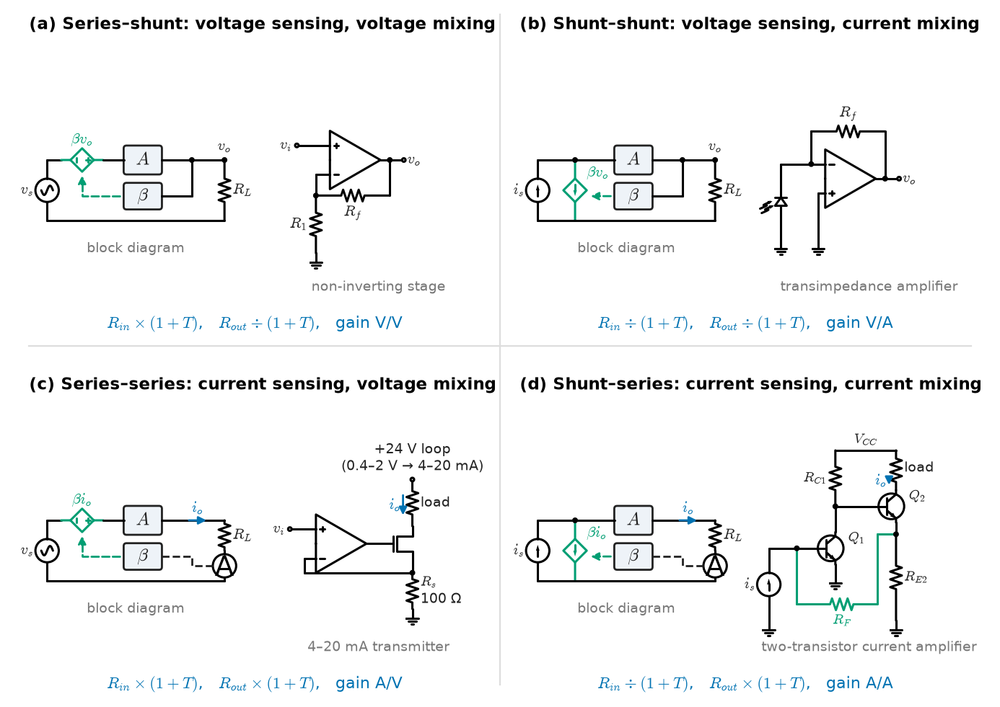
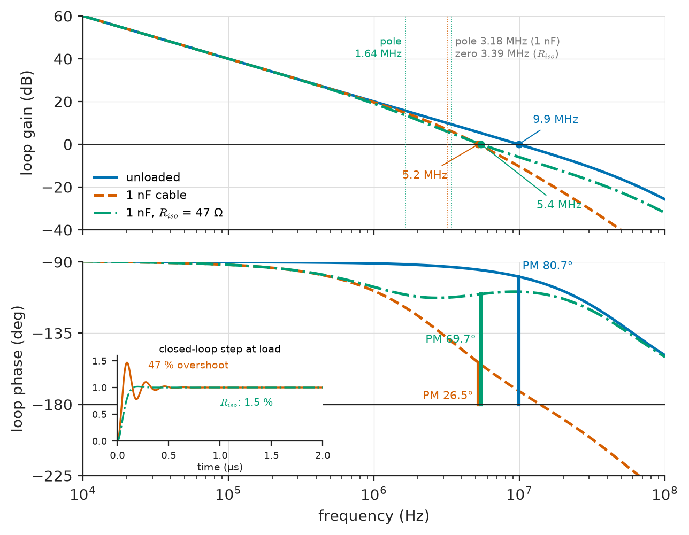
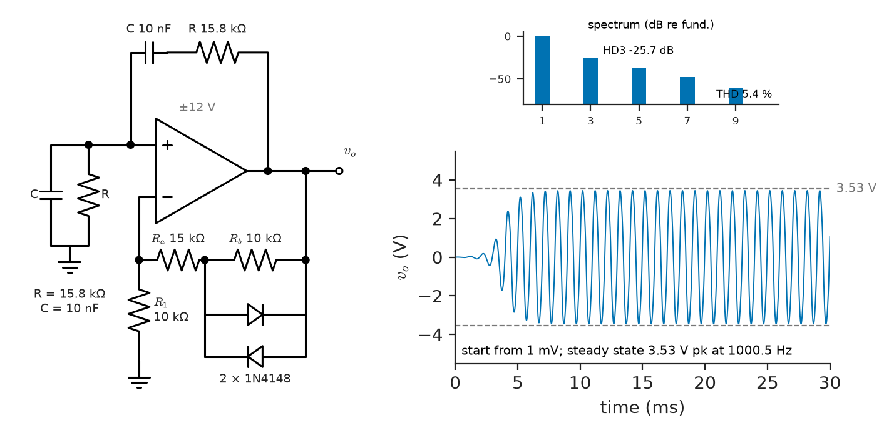
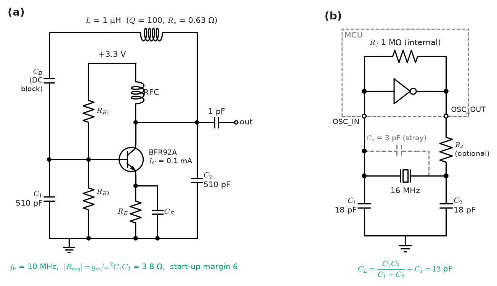
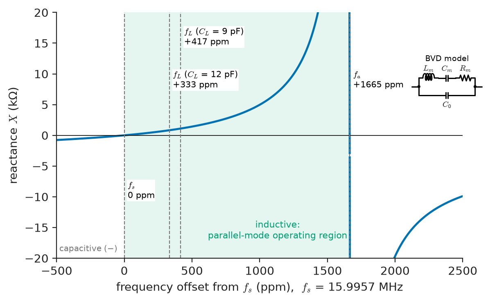
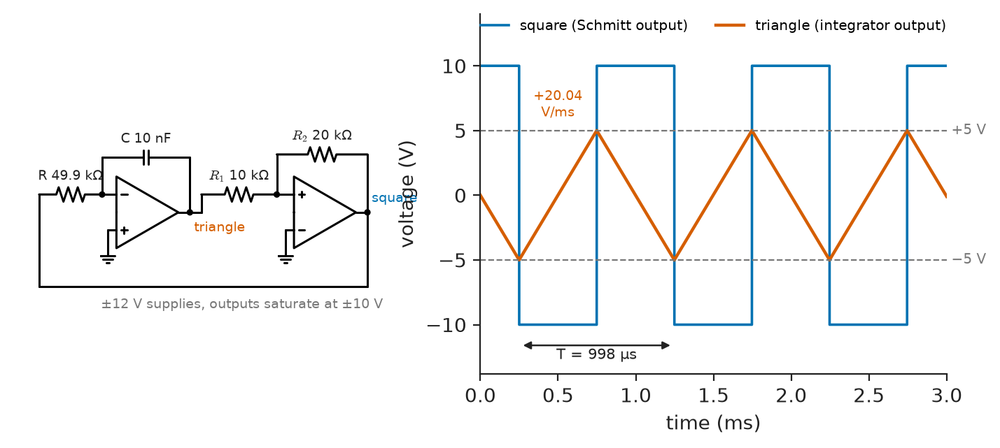

# Chapter 9 — Feedback and Oscillators

*Part II · Analog Electronics*

Two failures land on the same engineer's desk in one week. The first is a sensor buffer in a process-control cabinet: a unity-gain op-amp stage that has worked for years starts to oscillate at 5 MHz when a customer installs it with 10 m of coaxial cable, and the radiated interference upsets a nearby radio modem. The second is a smart electricity meter whose 16 MHz crystal oscillator fails to start in about one unit in five hundred when the meter is installed outdoors in a Scandinavian winter. The first circuit was meant to be stable and became an oscillator; the second was meant to be an oscillator and refused. Both failures have the same cause. A feedback loop either returns a signal smaller than it sent, with a phase that cannot reinforce it, or it does not; the cable added phase lag and turned a stable loop into an oscillator, and the cold raised the crystal's loss resistance until the oscillator's loop gain fell below one. This chapter treats feedback as a single idea used in both directions: negative feedback to make amplifiers precise, wide-band and stable, and positive feedback, arranged to satisfy one condition at one frequency, to make oscillators.

> **How does negative feedback change an amplifier's gain, bandwidth and impedances, and what decides whether a feedback amplifier is stable with a real load?**
> **What conditions make a circuit oscillate at a well-defined frequency and amplitude, and how are RC, LC and crystal oscillators and waveform generators designed?**

| Concept | Engineering destination |
|---|---|
| Positive and negative feedback | Precision amplifiers, Schmitt triggers, latches, oscillators |
| Feedback topologies | Voltage buffers, transimpedance photodiode receivers, 4–20 mA transmitters, current amplifiers |
| Gain and bandwidth | Choosing op-amps and stage counts for a gain-bandwidth target; distortion versus frequency |
| Stability | Op-amps driving cables and ADC inputs, photodiode amplifiers, regulators |
| Barkhausen criterion | The design condition of every oscillator; amplitude control |
| RC oscillators | Audio test sources, sensor excitation, low-frequency timing |
| LC oscillators | RF local oscillators, VCOs in PLL synthesisers, inductive proximity sensors |
| Crystal oscillators | MCU and processor clocks, Ethernet, USB and radio references, real-time clocks |
| Waveform generators | Function generators, 555 timers, PWM sawtooths, DDS synthesisers |

**Roadmap.** Feedback in both signs (9.1) → the four topologies and what each does to impedances (9.2) → the gain–bandwidth trade and what feedback does and does not fix (9.3) → stability of real op-amp loops: capacitive loads and photodiode amplifiers (9.4) → the oscillation condition (9.5) → RC oscillators (9.6) → LC oscillators (9.7) → crystal oscillators (9.8) → waveform generators (9.9).

---

## 9.1 Positive and negative feedback

> **Boundary.** The closed-loop formula $T=A/(1+A\beta)$, loop gain, sensitivity $S=1/(1+L)$, disturbance rejection and the costs of feedback are developed in *Circuits, Signals and Communications*, [Ch. 34 §34.2](https://github.com/The-Studio-of-Sadiq/Circuits-Signals-and-Communications/blob/main/part-7-control-system-fundamentals/34-feedback-and-stability.md); the Nyquist criterion and gain and phase margins in [§34.8–34.9](https://github.com/The-Studio-of-Sadiq/Circuits-Signals-and-Communications/blob/main/part-7-control-system-fundamentals/34-feedback-and-stability.md); frequency-domain signs of marginal stability, the margin–damping table and the phase-shift oscillator's factor of 29 in [Ch. 13 §13.9](https://github.com/The-Studio-of-Sadiq/Circuits-Signals-and-Communications/blob/main/part-3-advanced-network-theory/13-network-frequency-response.md); the two-port interconnection rules behind the feedback topologies in [Ch. 12 §12.8](https://github.com/The-Studio-of-Sadiq/Circuits-Signals-and-Communications/blob/main/part-3-advanced-network-theory/12-two-port-networks.md); resonators and $Q$ in [Ch. 13 §13.4–13.5](https://github.com/The-Studio-of-Sadiq/Circuits-Signals-and-Communications/blob/main/part-3-advanced-network-theory/13-network-frequency-response.md). Feedback across physical domains is the theme of *Engineering Physics*, [Ch. 21](https://github.com/The-Studio-of-Sadiq/Engineering-Physics/blob/main/CHAPTERS/CHAPTER%2021.md). This chapter applies those results to electronic circuits and does not re-derive them. The op-amp circuits themselves are in [Chapter 8](08-operational-amplifiers.md); internal op-amp compensation is in [Chapter 10](10-analog-integrated-circuits.md).

### Negative feedback: what it buys

An amplifier of forward gain $A$ with a feedback network of transmission $\beta$, subtracting the fed-back signal at the input, has closed-loop gain $A/(1+A\beta)$, which tends to $1/\beta$ when the loop gain $T=A\beta$ is large (Book 3 §34.2). For electronic circuits the consequences are worth listing with their sizes, because each is a design tool:

1. **Desensitivity.** A fractional change in $A$ appears in the closed-loop gain divided by $1+T$. An op-amp whose open-loop gain varies by a factor of three between parts and temperatures yields closed-loop gain set by two resistors to 0.01 %.
2. **Bandwidth extension.** Where $A$ has a dominant pole, the closed-loop pole moves out by $1+T_0$ (Section 9.3).
3. **Distortion reduction.** Distortion generated inside the loop is divided by $1+T$ at the frequency of the distortion product: the degenerated transistor stage of [Chapter 7](07-transistor-amplifiers.md) showed a factor of 5.5, and an audio power amplifier with 60 dB of loop gain at 1 kHz reduces its output stage's crossover distortion a thousandfold.
4. **Impedance control.** Feedback multiplies or divides the input and output impedances by $1+T$, in a direction set by the topology (Section 9.2).

What feedback does not do is equally important. It does not reduce the noise or offset of the input stage, which sits at the point where the error is measured and is indistinguishable from the signal; it reduces only disturbances entering *after* the comparison point. And it is subject to stability (Section 9.4): a loop with lag can return the correction too late.

### Positive feedback: what it is used for

With the sign reversed, the closed-loop gain becomes $A/(1-A\beta)$, larger than $A$, and infinite when $A\beta=1$. In electronics positive feedback is used deliberately in four ways:

- **Hysteresis** (the Schmitt trigger of [Chapter 8](08-operational-amplifiers.md)): a loop gain above one at DC makes the circuit bistable, with two thresholds.
- **Regeneration and latching:** the cross-coupled inverters of an SRAM cell or a comparator's latch ([Chapter 10](10-analog-integrated-circuits.md), [Chapter 14](../part-3-digital-electronics/14-sequential-digital-systems.md)) use a loop gain greater than one to resolve a small difference into a full logic level within a short time.
- **Negative resistance:** a positive-feedback circuit can present a negative input resistance, used to cancel the loss of a resonator (Section 9.7) or the leakage of a sample-and-hold.
- **Oscillation:** a loop gain of exactly one, with zero net phase, at one frequency (Section 9.5).

Many practical circuits contain both: a Wien-bridge oscillator has a negative-feedback gain network and a positive-feedback frequency-selective network, and a Howland current source balances the two to obtain a high output impedance.

> **Status of the principle: Effects of negative feedback scale with $1+T$**
> *Derived.* Gain sensitivity, distortion, dominant-pole bandwidth and the impedances at the sensing and mixing ports change by the factor $1+T(j\omega)$ at each frequency; the benefit vanishes wherever the loop gain has fallen near one, which for every real amplifier happens at high frequency.

---

## 9.2 Feedback topologies

### Sensing and mixing

A feedback amplifier is classified by how the feedback network **samples** the output (in shunt with it, sensing voltage; or in series with it, sensing current) and how it **mixes** the fed-back signal with the input (in series, adding voltages; or in shunt, adding currents). The four combinations stabilise four kinds of amplifier. Book 3 [§12.8](https://github.com/The-Studio-of-Sadiq/Circuits-Signals-and-Communications/blob/main/part-3-advanced-network-theory/12-two-port-networks.md) shows that each corresponds to adding one set of two-port parameters (h, y, z or g) of the amplifier and the feedback network; here the interest is in what each does in a circuit (Figure 9.1).

<!-- FIGURE 9.1 | figures/ch09/fig-9-1-feedback-topologies.png | block-diagram | The four feedback topologies, each shown as a block diagram and as its common op-amp or transistor realisation. | Content: 2 by 2 grid. (a) Series-shunt (voltage sensing, voltage mixing): amplifier A with feedback network beta connected across the output and in series with the input; realisation: non-inverting op-amp with Rf and R1; labels Rin x (1+T), Rout / (1+T), gain v/v. (b) Shunt-shunt (voltage sensing, current mixing): realisation transimpedance amplifier, photodiode into the inverting input, Rf from output to input; labels Rin / (1+T), Rout / (1+T), gain V/A. (c) Series-series (current sensing, voltage mixing): realisation op-amp driving a MOSFET with sense resistor Rs = 100 ohm in the source, feedback from source to inverting input, load in the drain loop (4-20 mA transmitter); labels Rin x (1+T), Rout x (1+T), gain A/V. (d) Shunt-series (current sensing, current mixing): realisation two-transistor current amplifier with feedback resistor from the emitter of Q2 to the base of Q1; labels Rin / (1+T), Rout x (1+T), gain A/A. -->



*Figure 9.1 — The four feedback topologies, each shown as a block diagram and as its common op-amp or transistor realisation.*

**Table 9.1 — The four feedback topologies.**

| Topology (sensing–mixing) | Two-port sum | Stabilised gain | Input impedance | Output impedance | Typical circuit |
|---|---|---|---|---|---|
| Series–shunt (voltage–voltage) | h | Voltage gain $v_o/v_i$ | × $(1+T)$ | ÷ $(1+T)$ | Non-inverting op-amp stage, follower |
| Shunt–shunt (voltage–current) | y | Transimpedance $v_o/i_i$ | ÷ $(1+T)$ | ÷ $(1+T)$ | Photodiode TIA, inverting stage |
| Series–series (current–voltage) | z | Transconductance $i_o/v_i$ | × $(1+T)$ | × $(1+T)$ | V-to-I converter, 4–20 mA transmitter, degenerated CE stage |
| Shunt–series (current–current) | g | Current gain $i_o/i_i$ | ÷ $(1+T)$ | × $(1+T)$ | Current amplifier, feedback current mirror |

The rule behind the impedance columns is simple: **series connection at a port multiplies the impedance there by $1+T$; shunt connection divides it.** Sensing the output voltage in shunt makes the output a better voltage source (lower impedance); sensing the output current in series makes it a better current source (higher impedance). Mixing in series makes the input draw less current (higher impedance); mixing in shunt makes the input a virtual ground (lower impedance).

### Blackman's impedance formula

The two-port method requires the feedback network to be separable and the loading of each network on the other to be accounted for, which becomes awkward in transistor circuits where the "feedback network" shares elements with the amplifier. A more general result, **Blackman's formula**, gives the impedance at any port of a circuit containing a controlled source:

$$
Z=Z_0\,\frac{1+T_{sc}}{1+T_{oc}}
$$

where $Z_0$ is the impedance with the controlled source set to zero, and $T_{sc}$ and $T_{oc}$ are the loop gains (return ratios) with the port short-circuited and open-circuited. For a shunt-connected port, shorting it kills the feedback ($T_{sc}=0$) and $Z=Z_0/(1+T_{oc})$; for a series port, opening it kills the feedback ($T_{oc}=0$) and $Z=Z_0(1+T_{sc})$. Table 9.1 is the special case, and the formula handles every intermediate case without identifying a topology.

> **Status of the principle: Blackman's impedance formula**
> *Derived.* Follows from superposition applied to a linear circuit with one controlled source, by computing the port impedance as the source's gain varies; exact for linear circuits, and it reduces to the $(1+T)$ rules of Table 9.1 when the feedback is fully killed by shorting or opening the port.

### Three circuits

**The follower's output impedance is inductive.** For a voltage follower ($\beta=1$, series–shunt) with an open-loop output resistance $R_o=50\ \Omega$ and $A(f)\approx\mathrm{GBW}/(jf)$ with $\mathrm{GBW}=10$ MHz, the closed-loop output impedance is $R_o/(1+A)$: 5 mΩ at 1 kHz where $A=10^4$, but 4.98 Ω at 1 MHz where $\lvert A\rvert=10$. Because $1/A$ rises in proportion to frequency, $Z_{out}\approx j\omega R_o/(2\pi\,\mathrm{GBW})$ is an inductance $L_{eq}=R_o/(2\pi\,\mathrm{GBW})=0.80\ \mu$H. Connect a 1 nF cable and the inductance resonates with it at $1/(2\pi\sqrt{L_{eq}C})=5.6$ MHz: this is the 5 MHz oscillation of the opening paragraph, seen from the output port (Section 9.4 sees the same thing from the loop gain).

**A 4–20 mA transmitter is series–series feedback.** An op-amp drives a MOSFET whose source current flows through a sense resistor $R_s=100\ \Omega$, and the sense voltage is fed back to the inverting input. The loop forces $i_o=v_i/R_s$, so 0.4–2.0 V gives 4–20 mA, the industrial current-loop standard (IEC 60381-1). The output impedance at the drain is raised from the MOSFET's $r_o$ (say 50 kΩ) by roughly the loop gain; with $T=10^4$ at low frequency it exceeds 500 MΩ, so a change of loop supply from 10 V to 30 V changes the current by 0.04 µA. That high impedance is the reason current loops ignore wire resistance and ground offsets across a plant.

**The transimpedance amplifier is shunt–shunt feedback.** A photodiode's current enters the inverting input of an op-amp with feedback resistor $R_f$; $v_o=-i_iR_f$ and the input impedance is $R_f/(1+A)$, nearly zero, so the photodiode's capacitance is held at constant voltage and does not slow the response. The stability of this circuit, which looks harmless, is the subject of Worked example 9.3.

---

## 9.3 Gain and bandwidth

### The single-pole trade

When the open-loop gain has one dominant pole, $A(s)=A_0/(1+s/\omega_p)$, closing the loop with feedback $\beta$ gives a closed-loop gain $A_0/(1+A_0\beta)$ and a closed-loop pole at $\omega_p(1+A_0\beta)$. The product of the two is $A_0\omega_p$, the **gain-bandwidth product**, independent of $\beta$: the gain given up is returned as bandwidth (*Engineering Physics* [§18.4.3](https://github.com/The-Studio-of-Sadiq/Engineering-Physics/blob/main/CHAPTERS/CHAPTER%2018.md)). With an op-amp, the gain that counts is the **noise gain** $1/\beta$, not the signal gain ([Chapter 8](08-operational-amplifiers.md)), so

$$
f_{-3\,\mathrm{dB}}\approx\beta\,\mathrm{GBW},\qquad t_r\approx\frac{0.35}{f_{-3\,\mathrm{dB}}}
$$

An inverting stage of gain $-1$ has a noise gain of 2 and therefore half the bandwidth of a follower.

> **Status of the principle: Constant gain-bandwidth product under feedback**
> *Approximate.* Exact for a single-pole forward path; for real op-amps it holds for noise gains above about 2–3, where the closed-loop crossover lies well below the second pole; near unity gain the second pole produces peaking and the bandwidth can exceed $\mathrm{GBW}\beta$.

### Cascading stages for gain and bandwidth

When one stage cannot provide the gain at the required bandwidth, the gain is split. $n$ identical stages each of gain $G^{1/n}$ have individual bandwidths $\mathrm{GBW}/G^{1/n}$, and $n$ coincident poles shrink the overall bandwidth by $\sqrt{2^{1/n}-1}$.

**Worked example 9.1 — 60 dB of gain from 10 MHz op-amps.** An ultrasound receiver needs a gain of 1000 with the widest possible bandwidth, using op-amps with $\mathrm{GBW}=10$ MHz.

| Stages | Gain per stage | Bandwidth per stage | Overall bandwidth |
|---|---|---|---|
| 1 | 1000 | 10 kHz | 10 kHz |
| 2 | 31.6 | 316 kHz | 204 kHz |
| 3 | 10 | 1.0 MHz | 510 kHz |
| 4 | 5.62 | 1.78 MHz | 774 kHz |
| 5 | 3.98 | 2.51 MHz | 969 kHz |

Two stages give twenty times the bandwidth of one; three give fifty. Beyond three or four the returns diminish while noise, offset, power and the risk of peaking in low-gain stages grow. Three stages of 20 dB is the usual answer, with the first stage chosen for noise and the last for output swing and slew rate.

### Distortion and loop gain versus frequency

Because the loop gain falls with frequency, every benefit of Section 9.1 shrinks with frequency. In an audio power amplifier whose loop gain crosses unity at 1 MHz with a single-pole roll-off, the loop gain is 1000 (60 dB) at 1 kHz but only 50 (34 dB) at 20 kHz, so crossover distortion products are suppressed twenty times less at the top of the audio band. That is why amplifier THD is specified at 1 kHz *and* at 20 kHz, why the second figure is always worse, and why designers push loop gain up with two-pole compensation schemes that hold more gain in the audio band while still crossing unity safely.

---

## 9.4 Stability

### Reading op-amp stability from the Bode plot

Book 3 [§34.9](https://github.com/The-Studio-of-Sadiq/Circuits-Signals-and-Communications/blob/main/part-7-control-system-fundamentals/34-feedback-and-stability.md) defines the phase margin at the loop-gain crossover and relates it to overshoot and peaking (the table in [§13.9](https://github.com/The-Studio-of-Sadiq/Circuits-Signals-and-Communications/blob/main/part-3-advanced-network-theory/13-network-frequency-response.md): 45° gives about 23 % overshoot, 60° about 9 %, and $\zeta\approx\mathrm{PM}/100°$). For op-amp circuits there is a convenient graphical form: plot the open-loop gain $\lvert A\rvert$ and the noise gain $1/\lvert\beta\rvert$ on the same axes. Since $\lvert T\rvert=\lvert A\rvert/\lvert1/\beta\rvert$, the loop crosses over where the two curves intersect, and the phase margin depends on the difference of their slopes there, the **rate of closure**:

- 20 dB/decade (a $-20$ dB/decade $A$ meeting a flat $1/\beta$): phase margin 45–90°, stable.
- 40 dB/decade (either $A$ falling at $-40$ dB/decade, or $1/\beta$ rising at $+20$ dB/decade where $A$ falls at $-20$): phase margin near 0–20°, marginal or unstable.

> **Status of the principle: Rate-of-closure stability rule**
> *Approximate.* Follows from Bode's gain–phase relation for minimum-phase loops: each 20 dB/decade of slope difference corresponds to about 90° of phase; reliable when poles and zeros are separated by at least a decade from the crossover, and to be confirmed by computing the margin when they are not.

Internally compensated op-amps are designed so that $\lvert A\rvert$ falls at $-20$ dB/decade down to unity gain, with their second pole just above it; the internal compensation that achieves this is covered in [Chapter 10](10-analog-integrated-circuits.md). The external circuit can still spoil the loop in two common ways: a pole added in the forward path at the output (a capacitive load), or a zero added to $1/\beta$ by capacitance at the inverting input.

### Capacitive loads

The op-amp's open-loop output resistance $R_o$ and a load capacitance $C_L$ add a pole at $1/(2\pi R_oC_L)$ inside the loop, after the amplifier and before the feedback tap.

**Worked example 9.2 — An op-amp follower driving a cable.** Model the op-amp of the opening paragraph by $A_0=10^5$, $\mathrm{GBW}=10$ MHz, a second pole at 60 MHz and $R_o=50\ \Omega$, connected as a follower ($\beta=1$). Computing the loop gain $A(j\omega)/(1+j\omega R_oC_L)$ numerically:

| Load | Added pole | Crossover | Phase margin |
|---|---|---|---|
| None | — | 9.9 MHz | 80.7° |
| 100 pF | 31.8 MHz | 9.5 MHz | 64.5° |
| 1 nF (10 m of 100 pF/m coax) | 3.18 MHz | 5.2 MHz | 26.5° |
| 10 nF | 318 kHz | 1.8 MHz | 8.5° |

With the cable, the phase margin falls to 26.5°, and the closed-loop response peaks by 6.8 dB at 5.3 MHz with a 47 % overshoot on a small step: the circuit is not oscillating on the bench, but a little extra phase lag from temperature, a longer cable or a reactive termination finishes the job. The standard cure is an **isolation resistor** $R_{iso}$ between the op-amp output and the cable, with the feedback taken from the op-amp side. The loop gain becomes $A(1+sR_{iso}C_L)/[1+s(R_o+R_{iso})C_L]$: the pole moves down but a zero follows it, and above the zero the load is isolated.

| $R_{iso}$ | Phase margin | Load-side corner $1/(2\pi R_{iso}C_L)$ |
|---|---|---|
| 10 Ω | 40.8° | 15.9 MHz |
| 22 Ω | 53.7° | 7.2 MHz |
| 47 Ω | 69.7° | 3.4 MHz |
| 100 Ω | 79.3° | 1.6 MHz |

With 47 Ω the margin returns to 70° and the peaking disappears; the cost is a low-pass corner of 3.4 MHz at the load, a small DC error if the load draws current, and, for a cable, the bonus of an approximate back-termination. When DC accuracy at the load is critical, a dual-feedback network (DC feedback from the load, AC feedback from the op-amp output through a small capacitor) gives both. Figure 9.2 shows the loop gains.

<!-- FIGURE 9.2 | figures/ch09/fig-9-2-capacitive-load-loop-gain.png | plot | Loop gain of an op-amp follower (GBW 10 MHz, second pole 60 MHz, Ro = 50 ohm) unloaded, with a 1 nF cable load, and with a 47 ohm isolation resistor. | Content: two stacked panels, log x-axis 10 kHz to 100 MHz. Top: loop-gain magnitude in dB from -40 to +60 dB; unloaded curve crossing 0 dB at 9.9 MHz; 1 nF curve bending to -40 dB/decade above 3.18 MHz and crossing at 5.2 MHz; Riso = 47 ohm curve with pole at 1.64 MHz and zero at 3.39 MHz, crossing at 5.4 MHz. Bottom: phase from -90 to -225 deg with -180 deg line; phase margins annotated 80.7, 26.5 and 69.7 deg at the respective crossovers. Inset: closed-loop small-signal step response for the 1 nF case with 47 percent overshoot and ringing near 5 MHz, and with Riso = 47 ohm with 1.5 percent overshoot. -->



*Figure 9.2 — Loop gain of an op-amp follower (GBW 10 MHz, second pole 60 MHz, Ro = 50 ohm) unloaded, with a 1 nF cable load, and with a 47 ohm isolation resistor.*

### Input capacitance and the transimpedance amplifier

Capacitance from the inverting input to ground, $C_{in}$ (the op-amp's input capacitance plus a photodiode, a cable, or stray), forms a pole with $R_f$ in the feedback network. The noise gain $1/\beta=1+sR_fC_{in}$ then rises at 20 dB/decade from $1/(2\pi R_fC_{in})$, meeting the op-amp's falling gain at 40 dB/decade. The fix is a feedback capacitor $C_f$ across $R_f$, which flattens $1/\beta$ at $1+C_{in}/C_f$ above $1/(2\pi R_fC_f)$. For about 45° of phase margin with a single-pole op-amp, $C_f$ is placed so that the noise gain flattens where it meets $\lvert A\rvert$:

$$
C_f\approx\sqrt{\frac{C_{in}}{2\pi R_f\,\mathrm{GBW}}},\qquad f_{-3\,\mathrm{dB}}\approx\sqrt{\frac{\mathrm{GBW}}{2\pi R_fC_{in}}}
$$

> **Status of the principle: TIA feedback-capacitor rule**
> *Approximate.* Places the noise-gain zero at the intersection with a single-pole open-loop gain, giving about 45° of margin when $C_f\ll C_{in}$; the second op-amp pole, the op-amp's own input capacitance and the parasitic capacitance of $R_f$ (0.05–0.2 pF for an 0603 resistor) shift the optimum, so the value is a starting point for computation or measurement.

**Worked example 9.3 — A photodiode receiver for an optical encoder.** A photodiode with 10 pF of capacitance plus 5 pF of op-amp input capacitance ($C_{in}=15$ pF) feeds a TIA with $R_f=100\ \mathrm{k\Omega}$ (100 mV/µA) built with a 10 MHz op-amp (second pole at 60 MHz). The rule gives $C_f=1.55$ pF and a bandwidth near 1 MHz. Listing 9.1 computes the loop gain and the closed-loop transimpedance.

```python
import numpy as np

# Photodiode TIA: op-amp A(s) = A0 / ((1 + s/wp1)(1 + s/wp2)), feedback Rf || Cf
A0, GBW, fp2 = 1e5, 10e6, 60e6            # DC gain, gain-bandwidth, second pole
Rf, Cin = 100e3, 15e-12                    # feedback resistor, photodiode + input capacitance

def loop_gain(f, Cf):
    s = 2j * np.pi * f
    A = A0 / ((1 + s * A0 / (2 * np.pi * GBW)) * (1 + s / (2 * np.pi * fp2)))
    Zf = Rf / (1 + s * Rf * Cf)
    beta = 1 / (1 + s * Cin * Zf)          # divider Zf against 1/(s*Cin)
    return A * beta

def margins(Cf):
    f = np.logspace(3, 9, 200001)
    L = loop_gain(f, Cf)
    i = np.argmax(np.abs(L) < 1)           # first crossing of 0 dB
    pm = 180 + np.degrees(np.angle(L[i]))
    T = Rf / (1 + 2j*np.pi*f*Rf*Cf) * L / (1 + L)   # transimpedance, V/A
    peak = 20 * np.log10(np.abs(T).max() / Rf)
    f3 = f[np.argmax(np.abs(T) < Rf / np.sqrt(2))]
    return f[i], pm, peak, f3

Cf_45 = np.sqrt(Cin / (2 * np.pi * Rf * GBW))
for Cf in (0.0, Cf_45, 2 * Cf_45):
    fc, pm, peak, f3 = margins(Cf)
    print(f"Cf = {Cf*1e12:4.2f} pF: crossover {fc/1e6:5.2f} MHz, PM = {pm:5.1f} deg, "
          f"peaking {peak:4.1f} dB, -3 dB at {f3/1e6:4.2f} MHz")
```

The output:

```text
Cf = 0.00 pF: crossover  1.03 MHz, PM =   4.9 deg, peaking 21.3 dB, -3 dB at 1.60 MHz
Cf = 1.55 pF: crossover  1.22 MHz, PM =  53.2 deg, peaking  1.0 dB, -3 dB at 1.23 MHz
Cf = 3.09 pF: crossover  1.78 MHz, PM =  75.0 deg, peaking -0.0 dB, -3 dB at 0.65 MHz
```

Without $C_f$ the circuit has 4.9° of margin and a 21 dB resonant peak near 1 MHz: it rings violently on every edge from the encoder disc and oscillates with any extra capacitance. With the computed 1.55 pF the margin is 53° (a little more than the 45° the single-pole rule promises), the peaking is 1 dB and the bandwidth 1.23 MHz. Doubling $C_f$ buys 75° of margin but halves the bandwidth to 0.65 MHz, because above $1/(2\pi R_fC_f)$ the feedback capacitor, not the resistor, sets the transimpedance. The designer's choice is between speed and ringing; for a digital encoder signal, about 60° is the usual target. A faster receiver needs either a smaller photodiode, a higher-GBW op-amp ($f_{-3\,\mathrm{dB}}$ grows only as $\sqrt{\mathrm{GBW}}$), or a bootstrap that removes the photodiode capacitance from the input; LiDAR receivers at hundreds of megahertz use dedicated TIA ICs.

### Other sources of instability

- **Decompensated op-amps** (stable only above a stated noise gain, such as 5 or 10) offer more bandwidth for high-gain stages but oscillate as followers or in inverting stages of low gain.
- **Conditional stability:** a loop with more than 180° of phase lag below crossover is stable at its design gain but oscillates if saturation or a fault reduces its gain (Book 3 §34.9); this occurs in high-order loops such as some regulators and audio amplifiers with nested compensation.
- **Supply paths:** without local decoupling, a shared supply impedance couples an output stage back into an input stage and a multistage amplifier oscillates through its rails.
- **Converter control loops** use the same margins with the converter's LC filter in the loop; their compensation belongs to [Chapter 30](../part-7-power-electronics/30-dc-dc-converters.md) and Book 3 Ch. 35.

---

## 9.5 Barkhausen criterion

### The oscillation condition

An oscillator is a feedback loop designed to fail the stability test at exactly one frequency. In the language of Book 3, its closed-loop poles sit on the $j\omega$ axis at $\pm j\omega_0$; equivalently, a signal at $\omega_0$ travelling round the loop returns with the same amplitude and phase. With the forward gain $A$ and frequency-selective feedback $\beta$ connected for positive feedback, the **Barkhausen criterion** is

$$
A(j\omega_0)\,\beta(j\omega_0)=1
$$

that is, $\lvert A\beta\rvert=1$ and $\angle A\beta=0°$ (or a multiple of 360°). The phase condition sets the frequency; the magnitude condition sets the gain needed.

> **Status of the principle: Barkhausen criterion**
> *Derived.* The condition for a pair of closed-loop poles of a linear loop to lie on the imaginary axis; it is necessary for steady oscillation of a linear loop but not sufficient for a practical oscillator, which must start (requiring $\lvert A\beta\rvert>1$ initially, poles in the right half-plane) and then settle (requiring a nonlinearity that reduces the effective gain to exactly one at the final amplitude).

### Start-up and amplitude control

A loop that satisfies the criterion exactly has poles exactly on the axis; any component drift moves them into the left half-plane, and the oscillation dies, or into the right, and it grows. Practical oscillators are therefore designed with a small-signal loop gain of 1.2 to 3 (or, in crystal oscillators, 5 to 20) so that they start reliably from noise, and with a mechanism that lowers the gain as the amplitude grows until the *average* loop gain at the fundamental is exactly one. The mechanism determines amplitude stability and distortion:

| Amplitude-control mechanism | How it works | Typical distortion | Used in |
|---|---|---|---|
| Hard limiting (supply rails, transistor cut-off) | Gain collapses during part of the cycle | 1–10 % | Simple LC and relaxation oscillators, MCU crystal drivers |
| Soft clipping (diodes in the gain network) | Gain falls smoothly as diodes conduct | 1–5 % | Low-cost Wien and phase-shift oscillators |
| Automatic gain control (JFET or multiplier, with a rectifier and filter) | Slow loop holds amplitude to a reference | 0.01–0.1 % | Audio test oscillators, sensor excitation |
| Thermal (lamp, thermistor) | Resistance rises with RMS power, time constant of seconds | 0.001–0.01 % | Classic laboratory audio oscillators |

The slow mechanisms give low distortion because they adjust gain over many cycles rather than within one; their weakness is amplitude "bounce" after a frequency change.

### Frequency stability

How firmly the loop holds its frequency depends on how fast the phase of $\beta$ changes with frequency near $\omega_0$. If a component change or the amplifier adds a phase error $\Delta\phi$, the loop shifts to the frequency where $\beta$'s phase cancels it: $\Delta\omega/\omega_0=-\Delta\phi/(\omega_0\,d\phi/d\omega)$. For a resonator of quality factor $Q$, $\omega_0\,d\phi/d\omega=2Q$ ([Book 3 §13.5](https://github.com/The-Studio-of-Sadiq/Circuits-Signals-and-Communications/blob/main/part-3-advanced-network-theory/13-network-frequency-response.md)), so

$$
\frac{\Delta f}{f_0}\approx-\frac{\Delta\phi}{2Q}
$$

A 1° (17.5 mrad) phase error shifts an RC oscillator with an effective $Q$ of 1/3 by 2.6 %, an LC oscillator with $Q=100$ by 87 ppm, and a crystal with $Q=50\,000$ by 0.17 ppm. The same $Q$ appears in the oscillator's **phase noise**: in Leeson's model, the noise sidebands close to the carrier fall as $1/(2Q)^2$ times the amplifier's noise, so a high-$Q$ resonator is the first requirement of a clean reference (Book 3 [Ch. 32](https://github.com/The-Studio-of-Sadiq/Circuits-Signals-and-Communications/blob/main/part-6-communication-theory/32-rf-and-microwave-fundamentals.md) treats phase noise at the system level).

> **Status of the principle: Frequency stability $\Delta f/f_0\approx-\Delta\phi/(2Q)$**
> *Approximate.* Linearises the phase of a second-order resonator near its centre frequency; it ranks oscillator families correctly and is quantitative for small phase errors, but ignores amplitude-to-frequency conversion through nonlinear capacitances, which dominates in some VCOs.

---

## 9.6 RC oscillators

### The Wien-bridge oscillator

The Wien network (series $R$–$C$ feeding parallel $R$–$C$, [Chapter 8](08-operational-amplifiers.md)) has transmission

$$
\beta(j\omega)=\frac{1}{3+j\left(\omega RC-\dfrac{1}{\omega RC}\right)}
$$

which is real and equal to 1/3 at $\omega_0=1/RC$. A non-inverting amplifier of gain 3 satisfies the Barkhausen criterion there. Because the network's phase slope at $\omega_0$ is $-2/3$ rad per unit of normalised frequency, its effective $Q$ is 1/3; a Wien oscillator's frequency is therefore only as stable as its resistors and capacitors (C0G capacitors and 0.1 % metal-film resistors give about 50–100 ppm/°C) and the amplifier's phase shift, which at $f_0$ adds an error $\approx3f_0/\mathrm{GBW}$ radians: an argument for $\mathrm{GBW}\ge100f_0$.

The gain of exactly 3 must be held by an amplitude-control element (Figure 9.3). The simplest is a pair of antiparallel diodes across part of the feedback resistance: at small amplitude the gain is $1+(R_a+R_b)/R_1>3$ and the oscillation grows; as the peak voltage across $R_b$ approaches a diode drop, the diodes shunt $R_b$ and the gain falls.

<!-- FIGURE 9.3 | figures/ch09/fig-9-3-wien-bridge-oscillator.png | circuit | Wien-bridge oscillator with diode amplitude stabilisation, and its simulated output. | Content: left: op-amp (+/-12 V) non-inverting; Wien network: R = 15.8 kilohm in series with C = 10 nF from output to non-inverting input, R = 15.8 kilohm parallel C = 10 nF from non-inverting input to ground; gain network: R1 = 10 kilohm from inverting input to ground, feedback Ra = 15 kilohm in series with Rb = 10 kilohm, Rb shunted by antiparallel 1N4148 diodes. Right: output voltage versus time over 0 to 30 ms showing growth from a 1 mV initial condition, reaching full amplitude within about 10 ms and settling at 3.53 V peak at 1000.5 Hz; inset spectrum with third harmonic at -25.7 dB relative to the fundamental (THD 5.4 percent), even harmonics negligible. -->



*Figure 9.3 — Wien-bridge oscillator with diode amplitude stabilisation, and its simulated output.*

**Worked example 9.4 — Amplitude and distortion of a diode-stabilised Wien oscillator.** With $R=15.8\ \mathrm{k\Omega}$ and $C=10$ nF ($f_0=1007.3$ Hz), $R_1=10\ \mathrm{k\Omega}$, $R_a=15\ \mathrm{k\Omega}$ and $R_b=10\ \mathrm{k\Omega}$ (small-signal gain 3.5), the amplitude is where the diodes' average conduction brings the gain to 3, a nonlinear problem. Listing 9.2 integrates the circuit with an ideal op-amp and Shockley-law 1N4148 diodes, then measures frequency and THD in the steady state.

```python
import numpy as np
from scipy.integrate import solve_ivp
from scipy.optimize import brentq

R, C = 15.8e3, 10e-9                         # Wien network: f0 = 1/(2 pi R C)
R1, Ra, Rb = 10e3, 15e3, 10e3                # gain network; Rb shunted by 1N4148 pair
Is, nVT = 2.7e-9, 1.9 * 0.02585              # diode saturation current, n*V_T

def v_out(vp):
    """Ideal op-amp: v- = vp, current vp/R1 flows through Ra and (Rb || diodes)."""
    i = vp / R1
    vb = brentq(lambda v: v / Rb + 2 * Is * np.sinh(v / nVT) - i, -2, 2)
    return vp + i * Ra + vb

def rhs(t, x):
    vcs, vp = x                              # series-C voltage, parallel-C voltage (= v+)
    i = (v_out(vp) - vcs - vp) / R           # current in the series R-C arm
    return [i / C, (i - vp / R) / C]

f0 = 1 / (2 * np.pi * R * C)
T = 1 / f0
sol = solve_ivp(rhs, [0, 150 * T], [0.0, 1e-3], max_step=T / 400, rtol=1e-8, atol=1e-10)
t = np.linspace(100 * T, 150 * T, 40000)                 # steady state
vo = np.array([v_out(v) for v in np.interp(t, sol.t, sol.y[1])])
up = np.flatnonzero((vo[:-1] < 0) & (vo[1:] >= 0))       # rising zero crossings
tz = t[up] - vo[up] * (t[up + 1] - t[up]) / (vo[up + 1] - vo[up])
f_osc = (len(tz) - 1) / (tz[-1] - tz[0])
n = 4096                                                 # resample exactly 40 cycles
ts = tz[0] + np.arange(n) * 40 / f_osc / n
spec = np.abs(np.fft.rfft(np.interp(ts, t, vo))) * 2 / n
thd = np.sqrt(np.sum(spec[80:440:40] ** 2)) / spec[40]
print(f"f0 = {f0:.1f} Hz, oscillates at {f_osc:.1f} Hz, "
      f"{spec[40]:.2f} V peak, THD = {100 * thd:.2f} %")
```

It prints a frequency of 1000.5 Hz (0.7 % below $1/(2\pi RC)$, the harmonics' contribution to the loop phase), an amplitude of 3.53 V peak and a THD of 5.4 %, almost all third harmonic. Changing the gain network to $R_a=16\ \mathrm{k\Omega}$, $R_b=5.6\ \mathrm{k\Omega}$ (small-signal gain 3.16, less excess) gives 1005.5 Hz, 4.12 V and 2.8 %: less excess gain means the diodes need to act less, with less distortion, at the price of a slower and less certain start. The amplitude depends on the diode drop and therefore on temperature, at about −0.3 %/°C. For a test oscillator needing 0.01 % THD, the diodes are replaced by a JFET in the gain network, controlled by a rectifier–filter loop with a time constant of tens of cycles, or by a lamp or thermistor whose thermal time constant averages over many cycles.

### Phase-shift and quadrature oscillators

The **RC phase-shift oscillator** uses three RC sections to produce 180° at $f_0=1/(2\pi\sqrt6RC)$, where the ladder attenuates by 1/29, and an inverting amplifier of gain at least 29 (Book 3 [§13.9](https://github.com/The-Studio-of-Sadiq/Circuits-Signals-and-Communications/blob/main/part-3-advanced-network-theory/13-network-frequency-response.md)). A single inverting stage suffices, but its frequency is hard to tune and its output is distorted.

The **quadrature oscillator**, two integrators and an inverter in a loop (or an integrator, an inverting integrator and a small positive-feedback adjustment), oscillates at $1/(2\pi RC)$ with two outputs 90° apart. Its output after the second integrator is filtered twice and is cleaner than the Wien's; it excites resolvers and LVDTs in aerospace position sensing, where a sine and a cosine reference are needed for demodulation.

RC oscillators cover roughly 1 Hz to 1 MHz. Above that, the amplifier's phase shift and the small resistors and capacitors needed make LC resonators the better choice; below about 1 Hz, digitally synthesised sine waves (Section 9.9) are easier.

---

## 9.7 LC oscillators

### The negative-resistance view

An LC tank with inductor loss resistance $R_s$ oscillates freely at $1/(2\pi\sqrt{LC})$ while its stored energy decays; to sustain the oscillation, an active circuit must supply exactly the energy lost each cycle. Viewed from the tank, the active circuit is a **negative resistance**, and the oscillation condition is that its magnitude equal (and at start-up exceed) the tank's loss resistance. This is the Barkhausen criterion written at one port, and it is how RF designers think about oscillators: the gain element is a one-port with $\mathrm{Re}\,Z<0$ at the frequency of interest.

### Colpitts, Hartley and Clapp

The common LC topologies differ in how the tank is tapped to provide the 180° phase reversal needed around an inverting transistor (Figure 9.4):

- **Colpitts:** a capacitive divider ($C_1$, $C_2$) with the inductor across both. For a transistor of transconductance $g_m$ connected across the divider (ignoring its own capacitances and $r_\pi$), the impedance it presents in series with the inductor has a real part
$$
R_{neg}=-\frac{g_m}{\omega^2C_1C_2}
$$
so oscillation starts when $g_m/(\omega^2C_1C_2)>R_s$. The frequency is set by $L$ and the series combination of $C_1$ and $C_2$.
- **Hartley:** an inductive divider (a tapped coil) with a capacitor across it; easy to tune with one variable capacitor, and common in inductive-proximity sensors.
- **Clapp:** a Colpitts with a small capacitor $C_3$ in series with the inductor. When $C_3\ll C_1,C_2$ it alone sets the frequency, and the transistor's voltage-dependent capacitances, which sit across $C_1$ and $C_2$, barely affect it: better frequency stability.

<!-- FIGURE 9.4 | figures/ch09/fig-9-4-colpitts-and-pierce.png | circuit | (a) Common-emitter Colpitts oscillator of Worked example 9.5 at 10 MHz; (b) Pierce crystal oscillator as used in microcontrollers. | Content: Panel (a): BJT (BFR92A or 2N3904) with emitter degeneration and bias for IC = 0.1 mA from a 3.3 V supply; tank L = 1 uH (Q = 100, Rs = 0.63 ohm) between collector and base through DC-blocking capacitor; C1 = C2 = 510 pF from base and collector to ground (capacitive divider); RF choke in the collector supply; output via 1 pF coupling. Annotate f0 = 10 MHz, magnitude of Rneg = 3.8 ohm, start-up margin 6. Panel (b): CMOS inverter inside a dashed MCU boundary with bias resistor Rf = 1 Mohm across it (internal), pins OSC_IN and OSC_OUT; external 16 MHz crystal between the pins; load capacitors C1 = C2 = 18 pF to ground; optional series resistor Rd from OSC_OUT to the crystal; stray capacitance Cs = 3 pF shown dashed. Annotate CL = C1 C2 / (C1 + C2) + Cs = 12 pF. -->



*Figure 9.4 — (a) Common-emitter Colpitts oscillator of Worked example 9.5 at 10 MHz; (b) Pierce crystal oscillator as used in microcontrollers.*

**Worked example 9.5 — Start-up margin of a 10 MHz Colpitts.** A 10 MHz oscillator uses $L=1\ \mu$H with $Q=100$, so $R_s=\omega L/Q=62.8\ \Omega/100=0.63\ \Omega$. The capacitance for resonance is $1/(\omega^2L)=253$ pF, obtained as $C_1=C_2=507$ pF in series (510 pF parts). Start-up needs

$$
g_m>R_s\,\omega^2C_1C_2=0.63\times(6.28\times10^7)^2\times(507\ \mathrm{pF})^2=0.64\ \mathrm{mS}
$$

which a BJT provides at only 16.5 µA. At $I_C=0.1$ mA, $g_m=3.87$ mS and $\lvert R_{neg}\rvert=3.8\ \Omega$, a start-up margin of 6. At 1 mA the margin would be 61, and the oscillation would grow until the transistor cut off for most of each cycle, with harmonic-rich output and a frequency pulled by the transistor's changing capacitances. A margin of 3 to 10, with amplitude limited gently (by emitter degeneration, or an AGC loop in a precision source), is the usual design. The transistor's own capacitances (a few picofarads) add to $C_1$ and $C_2$ and lower the frequency by a few tenths of a per cent, which is trimmed or, in a Clapp design, swamped.

> **Status of the principle: Colpitts negative resistance $-g_m/(\omega^2C_1C_2)$**
> *Approximate.* Derived for an ideal transconductor across the capacitive divider, neglecting $r_\pi$, $r_o$ and the device capacitances; it gives the start-up condition to within a factor that a 3–10× margin absorbs, and it is the same expression used for the Pierce crystal oscillator.

### VCOs and integrated LC oscillators

Replacing part of the tank capacitance by a varactor diode ([Chapter 2](../part-1-electronic-devices/02-semiconductor-junction-devices.md)) makes a **voltage-controlled oscillator**, whose gain $K_{VCO}$ (MHz per volt) and tuning range are set by the varactor's capacitance ratio and the fixed capacitance around it. In RF integrated circuits the gain element is usually a cross-coupled transistor pair, whose negative resistance is $-2/g_m$ across the tank, with on-chip inductors of $Q$ 10–20. A VCO alone drifts by hundreds of ppm per degree; it becomes a precise frequency source only inside a phase-locked loop that locks it to a crystal reference, a type-2 feedback loop whose phase margin decides spur suppression and settling (Book 3 [§34.9](https://github.com/The-Studio-of-Sadiq/Circuits-Signals-and-Communications/blob/main/part-7-control-system-fundamentals/34-feedback-and-stability.md)). Every phone, Wi-Fi radio and GNSS receiver generates its local oscillators this way.

---

## 9.8 Crystal oscillators

### The quartz resonator

A quartz crystal is a piezoelectric mechanical resonator: an applied voltage strains it, and its mechanical resonance appears electrically as a very high-$Q$ series RLC branch (motional inductance $L_m$, capacitance $C_m$ and resistance $R_m$, often called ESR) in parallel with the electrode capacitance $C_0$. This is the Butterworth–Van Dyke model. The motional elements have values no lumped component could reach: henries to kilohenries of inductance and femtofarads of capacitance.

**Table 9.2 — Representative crystal parameters (typical).**

| Crystal | $f$ | $L_m$ | $C_m$ | $R_m$ (ESR) | $C_0$ | $Q$ |
|---|---|---|---|---|---|---|
| Tuning fork (watch, RTC) | 32.768 kHz | ≈ 7.9 kH | ≈ 3 fF | 30–90 kΩ | 1–1.5 pF | 30 000–100 000 |
| AT-cut fundamental (MCU clock) | 16 MHz | ≈ 10 mH | ≈ 10 fF | 20–60 Ω | 3–5 pF | 25 000–80 000 |
| AT-cut third overtone | 100 MHz | ≈ 5–10 mH | ≈ 0.3 fF | 40–100 Ω | 3–5 pF | 50 000–100 000 |

With $L_m=9.9$ mH, $C_m=10$ fF and $R_m=40\ \Omega$ near 16 MHz ($f_s=15.996$ MHz), $Q=\omega L_m/R_m\approx25\,000$. The branch is series-resonant at $f_s=1/(2\pi\sqrt{L_mC_m})$; above $f_s$ it is inductive and resonates with $C_0$ at the antiresonance $f_a\approx f_s(1+C_m/2C_0)$, here 26.7 kHz (1670 ppm) above $f_s$. Between $f_s$ and $f_a$ the crystal looks like an inductor whose value changes enormously over a tiny range (Figure 9.5); an oscillator that uses it as the inductor of a Colpitts circuit is held to that range.

<!-- FIGURE 9.5 | figures/ch09/fig-9-5-crystal-reactance.png | plot | Reactance of a 16 MHz AT-cut crystal (Lm = 9.9 mH, Cm = 10 fF, Rm = 40 ohm, C0 = 3 pF) near resonance, with the series, load and antiresonant frequencies. | Content: x-axis frequency offset in ppm from fs = 15.9957 MHz, from -500 to +2500 ppm; y-axis reactance from -20 kilohm to +20 kilohm (clipped). Capacitive (negative) below fs, crossing zero at fs (0 ppm), inductive (positive) rising steeply to a pole at fa (+1665 ppm), capacitive above. Mark fs, fL for CL = 12 pF at +333 ppm, fL for CL = 9 pF at +417 ppm, and fa. Shade the inductive region labelled "parallel-mode operating region". Inset: Butterworth-Van Dyke equivalent circuit Lm, Cm, Rm in series, shunted by C0. -->



*Figure 9.5 — Reactance of a 16 MHz AT-cut crystal (Lm = 9.9 mH, Cm = 10 fF, Rm = 40 ohm, C0 = 3 pF) near resonance, with the series, load and antiresonant frequencies.*

### Load capacitance and pulling

A crystal for a Pierce oscillator is specified at a **load capacitance** $C_L$, the capacitance the oscillator circuit presents across it, and it oscillates at

$$
f_L\approx f_s\left(1+\frac{C_m}{2(C_0+C_L)}\right)
$$

The load seen by the crystal in a Pierce circuit (Figure 9.4b) is the series combination of the two load capacitors plus the stray capacitance of pins and traces: $C_L=C_1C_2/(C_1+C_2)+C_s$. Differentiating gives the **pulling sensitivity** $-f_sC_m/[2(C_0+C_L)^2]$ per farad.

> **Status of the principle: Crystal load-capacitance pulling**
> *Approximate.* From the Butterworth–Van Dyke model, linearised for $C_m\ll C_0+C_L$; accurate to a few per cent for fundamental-mode crystals within their pullable range, and the basis of trimming and of voltage-controlled crystal oscillators (VCXOs).

**Worked example 9.6 — Load capacitors for an Ethernet crystal.** A 16 MHz crystal ($C_m=10$ fF, $C_0=3$ pF, $R_m=40\ \Omega$ maximum) is specified at $C_L=12$ pF and ±20 ppm tolerance; the board adds $C_s\approx3$ pF.

*Correct capacitors.* $C_1=C_2=2(C_L-C_s)=18$ pF gives $C_L=9+3=12$ pF.

*A common mistake.* Fitting 12 pF capacitors "because the crystal says 12 pF" gives $C_L=6+3=9$ pF. The frequency rises by $\frac{C_m}{2}\left(\frac{1}{C_0+9\ \mathrm{pF}}-\frac{1}{C_0+12\ \mathrm{pF}}\right)=83$ ppm. The sensitivity at 12 pF is 22 ppm/pF. Added to ±20 ppm initial tolerance, ±20 ppm over temperature and a few ppm of ageing, the clock is out of the ±100 ppm that IEEE 802.3 allows an Ethernet reference; links work on the bench with a good partner and fail with a partner at the other end of its tolerance.

*Start-up margin.* The oscillator's critical transconductance for a Pierce circuit is approximately $g_{m,crit}=4R_m\omega^2(C_0+C_L)^2=4\times40\times(1.005\times10^8)^2\times(15\ \mathrm{pF})^2=0.36$ mA/V. A microcontroller oscillator with $g_m=5$ mA/V has a margin of 13.7, above the factor of 5 that vendors recommend. Every term of $g_{m,crit}$ explains a field failure: a cheaper crystal with 80 Ω ESR halves the margin, larger load capacitors cut it as $(C_0+C_L)^2$, and at −40 °C some crystals show an ESR increase ("drive-level dependence" or a spurious mode) that, in the opening paragraph's meter, pushed one unit in five hundred below a margin of one. The fix was a crystal with a lower maximum ESR and a firmware check of the oscillator-ready flag with a fallback to the internal RC oscillator.

### Pierce oscillators in microcontrollers

Almost every microcontroller, processor and radio chip contains a Pierce oscillator: a CMOS inverter biased into its linear region by a large internal feedback resistor, the crystal from its output to its input, and the two load capacitors to ground. It is a Colpitts circuit with the crystal as the inductor, the inverter as the transconductor and $C_1$, $C_2$ as the capacitive divider. The inverter's gain is often programmable (drive strength), to be matched to the crystal's ESR and maximum **drive level** (the power dissipated in $R_m$, typically limited to 10–300 µW for MHz crystals and below 1 µW for tuning forks, beyond which the crystal ages faster or fractures). Start-up takes thousands of cycles because the high $Q$ makes the amplitude grow slowly: 1–5 ms for a 16 MHz crystal and 0.3–2 s for a 32.768 kHz watch crystal, which is why MCUs boot on an internal RC oscillator and switch to the crystal later ([Chapter 17](../part-4-computer-architecture-and-digital-hardware/17-microprocessors-and-microcontrollers.md), [Chapter 25](../part-6-embedded-and-real-time-systems/25-embedded-system-architecture.md)).

### Temperature, compensation and the oscillator family

The quartz cut sets the temperature behaviour. The AT cut has a cubic frequency–temperature curve with a turning point near 25 °C, holding ±10–20 ppm from −40 °C to +85 °C. The 32.768 kHz tuning fork has a parabolic curve, $\Delta f/f\approx-0.034\ \mathrm{ppm/°C^2}\times(T-25\ °\mathrm C)^2$: at −20 °C it is 68.9 ppm slow, and a real-time clock left outdoors loses 6 s per day. Smart meters, which must keep time to within seconds per month, measure temperature and correct the RTC digitally.

**Table 9.3 — Frequency sources and their stability (typical, over industrial temperature range).**

| Source | Stability | Typical use |
|---|---|---|
| On-chip RC oscillator | ±1–2 % (trimmed), ±0.1 % with calibration | MCU boot clock, UART at low rates |
| Ceramic resonator | ±0.3–0.5 % | Low-cost MCU clocks, appliances |
| MEMS oscillator | ±10–50 ppm | Shock-resistant clocks, consumer devices |
| Crystal oscillator (XO) | ±20–100 ppm total | Processors, Ethernet, USB, CAN |
| TCXO (temperature-compensated) | ±0.5–2.5 ppm | GNSS receivers, cellular radios, smart meters |
| OCXO (oven-controlled) | ±1–50 ppb | Base stations, test equipment, network timing |
| Rubidium atomic standard | ≈ $10^{-11}$, low drift | Telecom timing, GNSS-disciplined references |

Interface standards set the floor: USB full speed tolerates ±2500 ppm (crystal-less designs recover the clock from bus traffic), Ethernet ±100 ppm, and cellular and GNSS receivers need TCXO-class references because their search windows scale with frequency error.

---

## 9.9 Waveform generators

### The triangle–square generator

The relaxation oscillator of [Chapter 8](08-operational-amplifiers.md) produces exponential segments. Replacing its RC by an integrator gives linear ramps: an integrator drives a non-inverting Schmitt trigger, whose output feeds back to the integrator's input (Figure 9.6). The Schmitt output is a square wave of $\pm V_{sat}$; the integrator ramps at $V_{sat}/(RC)$ between the Schmitt thresholds $\pm V_{sat}R_1/R_2$, so the triangle's amplitude is set by a resistor ratio and

$$
f=\frac{R_2}{4R_1RC}
$$

independent of $V_{sat}$, because the ramp rate and the thresholds scale together.

> **Status of the principle: Triangle–square generator frequency $f=R_2/(4R_1RC)$**
> *Derived.* Time for a linear ramp of slope $V_{sat}/RC$ to traverse the hysteresis band $2V_{sat}R_1/R_2$, twice per period; assumes symmetric saturation and an ideal integrator, and fails at high frequency where comparator delay and slew rate add to each half-period.

**Worked example 9.7 — A 1 kHz function generator.** A square wave of ±10 V and a triangle of ±5 V at 1 kHz are required. The triangle amplitude fixes $R_1/R_2=0.5$ (say $R_1=10\ \mathrm{k\Omega}$, $R_2=20\ \mathrm{k\Omega}$); then $f=R_2/(4R_1RC)=1/(2RC)$ gives $RC=0.5$ ms, for example $R=50\ \mathrm{k\Omega}$ (49.9 kΩ E96) and $C=10$ nF. The frequency is tuned over a decade by a potentiometer that scales the voltage applied to the integrator, or over three decades by switching $C$. A sine output follows from a **sine shaper**: a diode-resistor network that progressively reduces the slope of the triangle near its peaks, or a differential pair driven into its tanh region, gives 0.5–2 % THD from a well-adjusted triangle, which is how the classic function-generator ICs (ICL8038, XR-2206) made their sine outputs. Making the integrator's input current proportional to a control voltage gives a VCO with a linear frequency-voltage law, used for frequency modulation and swept measurements.

<!-- FIGURE 9.6 | figures/ch09/fig-9-6-triangle-square-generator.png | waveform | Triangle-square function generator of Worked example 9.7 and its waveforms. | Content: inset circuit: integrator (R = 49.9 kilohm, C = 10 nF) followed by non-inverting Schmitt trigger (R1 = 10 kilohm input, R2 = 20 kilohm feedback, reference ground), Schmitt output back to integrator input; supplies +/-12 V with output saturation +/-10 V. Main plot: time 0 to 3 ms; square wave between +10 V and -10 V with period 1.0 ms (998 us with 49.9 kilohm); triangle between +5 V and -5 V with slopes of +/-20 V/ms (+/-20.04 V/ms with 49.9 kilohm), switching instants of the square wave aligned with the triangle peaks; dashed lines at the Schmitt thresholds +/-5 V. -->



*Figure 9.6 — Triangle-square function generator of Worked example 9.7 and its waveforms.*

### The 555 timer

The 555, introduced in 1972 and still made in bipolar and CMOS versions (NE555, TLC555, LMC555), packages two comparators with thresholds at $\frac13V_{CC}$ and $\frac23V_{CC}$, a flip-flop and a discharge transistor. In the astable connection a capacitor charges through $R_A+R_B$ and discharges through $R_B$ between the two thresholds, so

$$
f=\frac{1}{\ln2\,(R_A+2R_B)C}\approx\frac{1.44}{(R_A+2R_B)C},\qquad D=\frac{R_A+R_B}{R_A+2R_B}
$$

With $R_A=1\ \mathrm{k\Omega}$, $R_B=6.8\ \mathrm{k\Omega}$ and $C=10$ nF, $f=9.88$ kHz with a 53 % duty cycle. Because both thresholds are fractions of $V_{CC}$, the frequency is nearly independent of supply voltage, typically within 0.1 %/V. The 555 drives buzzers, LED flashers and charge pumps; where accuracy matters it has given way to microcontroller timers ([Chapter 17](../part-4-computer-architecture-and-digital-hardware/17-microprocessors-and-microcontrollers.md)).

### Sawtooth, PWM and digital synthesis

A **sawtooth** generator (a capacitor charged by a constant current and reset by a switch at each clock pulse) provides the ramp against which an analog PWM controller compares its error voltage; the comparator output's duty cycle is proportional to the error ([Chapter 30](../part-7-power-electronics/30-dc-dc-converters.md)), and a triangular carrier does the same in inverter modulators ([Chapter 31](../part-7-power-electronics/31-ac-dc-and-dc-ac-conversion.md)).

**Direct digital synthesis** (DDS) has replaced analog function generators in most instruments. An $N$-bit phase accumulator adds a tuning word $M$ every clock cycle; its top bits address a sine table whose output drives a DAC and a reconstruction filter. The output frequency is $f_{out}=Mf_{clk}/2^N$: a 28-bit accumulator on a 25 MHz clock, as in the AD9833, tunes in 0.093 Hz steps, with phase-continuous frequency changes and exact sine, triangle and square shapes. The analog design moves to the DAC and the reconstruction filter, whose requirements follow from sampling theory (Book 3 [Ch. 19](https://github.com/The-Studio-of-Sadiq/Circuits-Signals-and-Communications/blob/main/part-4-signals-and-systems/19-sampling-and-reconstruction.md)), and the DDS clock must itself come from a crystal (Section 9.8): its stability is the output's stability.

---

## What remains open

| Open question | Where it is answered |
|---|---|
| How is an op-amp compensated internally, with Miller capacitance and pole splitting, so that it is stable as a follower? | [Chapter 10](10-analog-integrated-circuits.md) (Analog Integrated Circuits) |
| How are compensators designed systematically to meet margin, bandwidth and overshoot targets? | *Circuits, Signals and Communications*, [Ch. 35](https://github.com/The-Studio-of-Sadiq/Circuits-Signals-and-Communications/blob/main/part-7-control-system-fundamentals/35-control-design-fundamentals.md) |
| How is the feedback loop of a switching converter closed and compensated around its LC filter? | [Chapter 30](../part-7-power-electronics/30-dc-dc-converters.md) (DC–DC Converters) |
| How does a microcontroller select, start and monitor its clock sources, and how are timers used to generate waveforms? | [Chapter 17](../part-4-computer-architecture-and-digital-hardware/17-microprocessors-and-microcontrollers.md) and [Chapter 25](../part-6-embedded-and-real-time-systems/25-embedded-system-architecture.md) |
| How do clock jitter and phase noise limit ADC resolution and communication links? | [Chapter 26](../part-6-embedded-and-real-time-systems/26-embedded-interfaces.md); *Circuits, Signals and Communications*, [Ch. 32](https://github.com/The-Studio-of-Sadiq/Circuits-Signals-and-Communications/blob/main/part-6-communication-theory/32-rf-and-microwave-fundamentals.md) |
| How are clocks distributed and crossed between domains in digital systems? | [Chapter 14](../part-3-digital-electronics/14-sequential-digital-systems.md) (Sequential Digital Systems) |
| Why can the Nyquist plot, and not only the Bode margins, be needed for loops with several crossovers? | *Circuits, Signals and Communications*, [Ch. 34 §34.8–34.9](https://github.com/The-Studio-of-Sadiq/Circuits-Signals-and-Communications/blob/main/part-7-control-system-fundamentals/34-feedback-and-stability.md) |

**Next:** Chapter 10 opens the op-amp and the comparator to show how differential pairs, current mirrors, active loads, compensation capacitors, references and regulators are combined on one chip.
