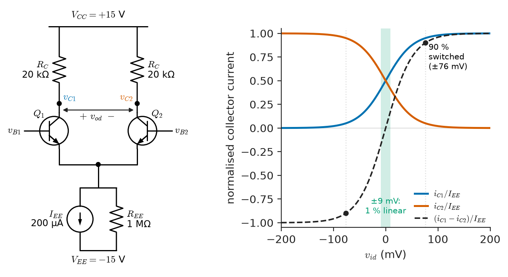
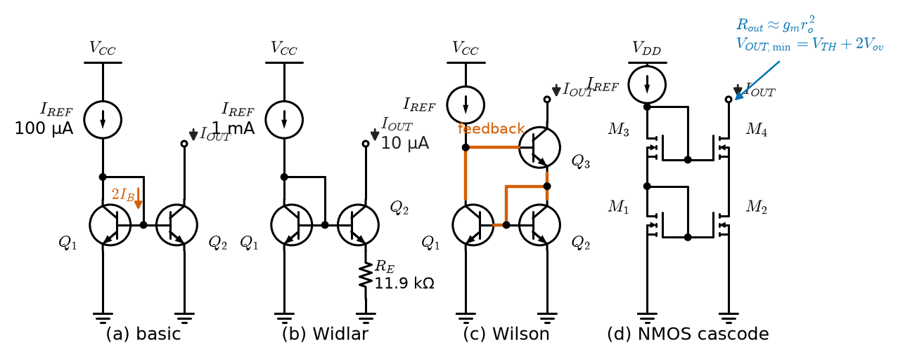
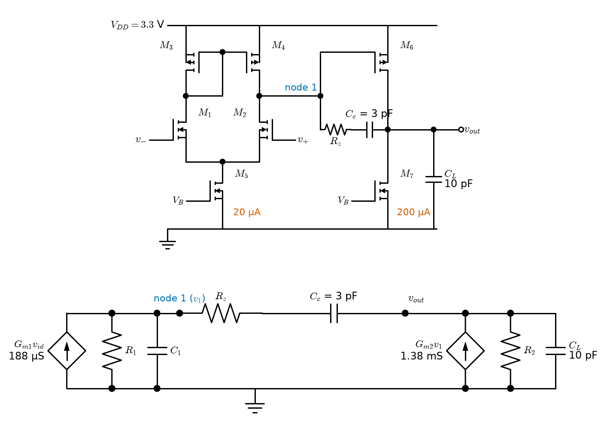
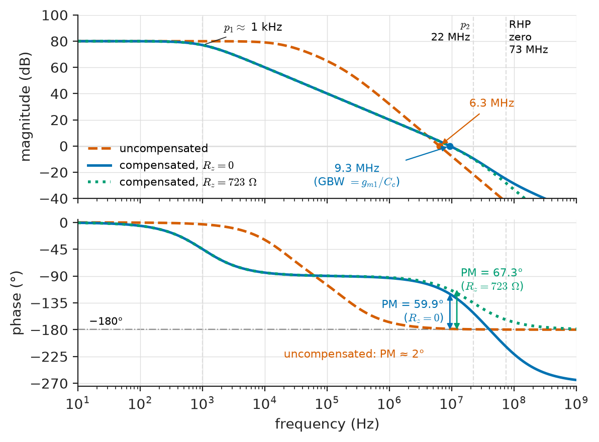
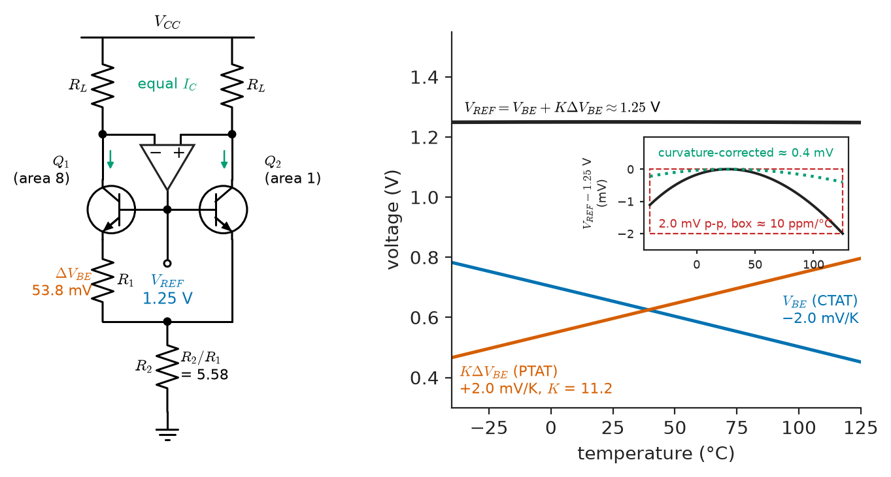
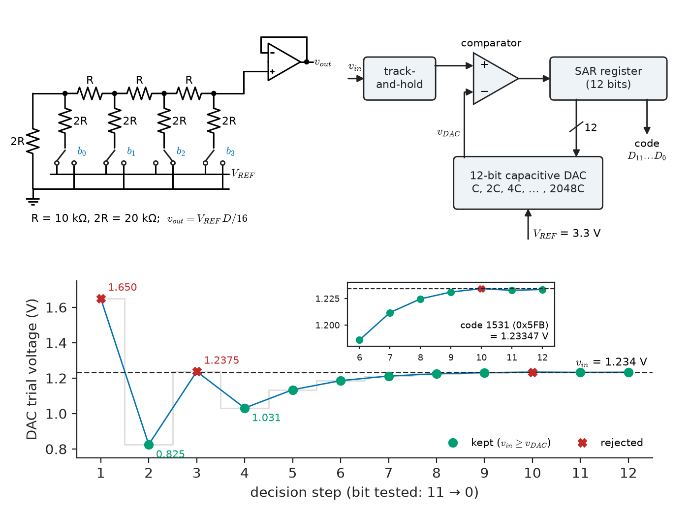

# Chapter 10 — Analog Integrated Circuits

*Part II · Analog Electronics*

An industrial pressure transmitter has passed every bench test for two years when the purchasing department replaces the 4.7 µF tantalum capacitor on the output of its 3.3 V low-dropout regulator with a cheaper and smaller 10 µF ceramic. The next production batch fails final test: the regulator output carries a 30 mV oscillation at a few hundred kilohertz, and the 12-bit ADC that digitises the bridge sensor shows a noise floor ten times worse than before. While the engineers chase that, a field report arrives from a desert installation: the same transmitter reads 0.35 % off every afternoon and correct every morning. Nothing in the sensor is wrong. The 2.5 V shunt reference on the ADC drifts by 50 ppm/°C, and the 70 °C swing between a cold night and a sun-heated enclosure moves every reading by fourteen codes. Neither failure can be understood from the ideal models of the previous chapters; both need the inside of the chip: the pairs, mirrors and compensation capacitors of an op-amp, the bandgap of a reference, the loop of a regulator, the comparators and capacitor arrays of a converter.

> **How are the amplifiers, references and regulators that analog design takes for granted built from matched transistors on one die, and what in that construction sets their offset, gain, bandwidth, drift and stability?**
> **How do comparators, DACs and ADCs turn those same building blocks into the interface between the analog world and the digital logic of Part III?**

| Concept | Engineering destination |
|---|---|
| Differential amplifiers | Input stage of every op-amp, comparator and instrumentation amplifier; offset and CMRR budgets |
| Current mirrors | Biasing whole chips from one reference current; current DACs; LED and laser drivers |
| Active loads | High gain from a single stage at low supply voltage |
| Multistage integrated amplifiers | Reading an op-amp datasheet: gain, swing, output drive and quiescent current |
| Frequency compensation | Why an op-amp is stable at unity gain, why it oscillates with a capacitive load, slew rate |
| Analog IC architecture | Choosing among bipolar, JFET, CMOS and chopper op-amps; rail-to-rail behaviour; trimming |
| Voltage references | ADC and DAC accuracy over temperature; sensor excitation; calibration standards |
| Regulators | Clean local supplies for ADCs, oscillators and sensors; LDO stability and dissipation |
| Comparators | Zero-crossing and over-current detection, ADC decision elements, metastability |
| Mixed-signal interfaces | DAC and ADC architectures inside microcontrollers, data-acquisition and audio chips |

**Roadmap.** The differential pair (10.1) → current mirrors that bias it (10.2) and load it (10.3) → the two-stage op-amp built from them (10.4) → making it stable (10.5) → the architectural choices of real parts (10.6) → bandgap and buried-Zener references (10.7) → linear regulators built around a reference and an amplifier (10.8) → comparators and latches (10.9) → DAC and ADC architectures (10.10).

---

## 10.1 Differential amplifiers

> **Boundary.** The large-signal BJT and MOSFET laws, the hybrid-π model, $g_m=I_C/V_T$, $r_o=V_A/I_C$ and the square-law model with channel-length modulation are developed in [Chapter 3](../part-1-electronic-devices/03-bipolar-junction-transistors.md) and [Chapter 4](../part-1-electronic-devices/04-field-effect-transistors.md); single-stage gain calculations in [Chapter 7](07-transistor-amplifiers.md); the op-amp as a circuit element in [Chapter 8](08-operational-amplifiers.md). *Engineering Physics*, [Ch. 18 §18.4](https://github.com/The-Studio-of-Sadiq/Engineering-Physics/blob/main/CHAPTERS/CHAPTER%2018.md), sketches the ideal op-amp and names its limitations (GBW, slew rate, offset); this chapter explains where each of them comes from inside the chip.

### Why integrated circuits are differential

An integrated circuit cannot make accurate resistors (±20 % absolute is normal), large capacitors or coupling capacitors. What it makes extremely well is **matched** devices: two transistors drawn side by side see the same doping, oxide and temperature, so their parameters track to 0.1 % even when each is uncertain by 20 %. Analog IC design is therefore built on ratios and differences, and the differential pair, which responds to the *difference* of two inputs and rejects what is common to both, is its first building block.

### The long-tailed pair

Two matched transistors $Q_1$ and $Q_2$ with joined emitters (or sources) are fed from a tail current $I_{EE}$ (Figure 10.1). With a differential input $v_{id}=v_{B1}-v_{B2}$, the exponential BJT law divides the tail current as

$$
i_{C1}-i_{C2}=\alpha I_{EE}\tanh\!\left(\frac{v_{id}}{2V_T}\right)
$$

The pair is linear only for small inputs: the tanh deviates by 1 % from a straight line at $v_{id}=9.0$ mV, and 90 % of the current has switched at $v_{id}=76$ mV (at 300 K, $V_T=25.85$ mV). That is why an op-amp needs negative feedback, which keeps $v_{id}$ in the microvolt range, and why the same circuit makes a fast comparator or current switch (Section 10.9). A MOS pair is linear over roughly $\pm\sqrt2\,V_{ov}$, typically $\pm0.1$ to $\pm0.3$ V, with less transconductance per ampere.

<!-- FIGURE 10.1 | figures/ch10/fig-10-1-differential-pair.png | circuit | BJT long-tailed pair with resistive loads and its large-signal transfer characteristic. | Content: left, schematic: VCC = +15 V, two 20 kilohm collector resistors RC, matched NPN transistors Q1 and Q2 with bases at vB1 and vB2, emitters joined to a 200 microamp tail current source with parallel output resistance REE = 1 megohm to VEE = -15 V; outputs vC1 and vC2 marked, differential output vod between the collectors. Right, plot: horizontal axis vid from -200 mV to +200 mV, vertical axis normalised collector currents iC1/IEE and iC2/IEE from 0 to 1 (two crossing tanh curves) and their difference from -1 to +1; shaded band plus/minus 9 mV labelled 1 percent linear, markers at plus/minus 76 mV labelled 90 percent switched. -->



*Figure 10.1 — BJT long-tailed pair with resistive loads and its large-signal transfer characteristic.*

### Differential and common-mode gain

For small signals each transistor has $g_m=I_C/V_T$ with $I_C=I_{EE}/2$. A differential input splits equally, $\pm v_{id}/2$, across the two base-emitter junctions, and the emitter node does not move: it is a **virtual ground** for differential signals. The differential gain to the differential output is

$$
A_d=\frac{v_{od}}{v_{id}}=g_mR_C
$$

and half of that to either single-ended output. A common-mode input $v_{ic}$ moves both bases together; the emitters follow, and the only thing that changes the collector currents is the current that flows into the finite output resistance $R_{EE}$ of the tail source. Each half then sees an emitter resistance of $2R_{EE}$, and the single-ended common-mode gain is approximately

$$
A_{cm}\approx-\frac{R_C}{2R_{EE}}
$$

The **common-mode rejection ratio** compares the single-ended differential gain with this:

$$
\mathrm{CMRR}=\frac{A_d/2}{\lvert A_{cm}\rvert}\approx g_mR_{EE}
$$

> **Status of the principle: Differential-pair small-signal gains**
> *Approximate.* Linearised hybrid-π analysis of perfectly matched devices for $\lvert v_{id}\rvert\ll2V_T$; real CMRR is lower, because mismatch in $R_C$ or $g_m$ converts common-mode input directly into differential output, and it falls with frequency as the capacitance across the tail source shunts $R_{EE}$.

**Worked example — Gains and CMRR of a 200 µA pair.** With $I_{EE}=200$ µA, $R_C=20$ kΩ and a tail source of $R_{EE}=1$ MΩ (Figure 10.1): $I_C=100$ µA and $g_m=100\ \mu\mathrm{A}/25.85\ \mathrm{mV}=3.87$ mS. The differential gain is $A_d=3.87\ \mathrm{mS}\times20\ \mathrm{k\Omega}=77.4$ (37.8 dB), and $38.7$ to one collector. The common-mode gain is $20\ \mathrm{k\Omega}/2\ \mathrm{M\Omega}=0.010$, so the ideal CMRR is $38.7/0.010=3870$, or 71.8 dB, and $g_mR_{EE}=3870$ agrees. If the collector resistors mismatch by 1 %, a 1 V common-mode step gives 10 mV at each collector differing by 0.1 mV, equivalent through $A_d=77.4$ to 1.3 µV of differential input (118 dB). Here the tail impedance limits CMRR; in a real op-amp with a cascoded tail (Section 10.2) and a mirror load (Section 10.3) matching does, and sets datasheet CMRR of 80 to 120 dB.

### Offset voltage

If the two transistors are not identical, a non-zero input is needed to balance the output. For BJTs the main cause is a mismatch $\Delta I_S/I_S$ in saturation current (emitter area and base doping), which gives

$$
V_{OS}\approx V_T\ln\!\left(1+\frac{\Delta I_S}{I_S}\right)
$$

a 1 % mismatch causes 0.26 mV. Load-resistor mismatch adds $V_T\,\Delta R_C/R_C$. For MOS pairs, threshold mismatch dominates, and it scales with device area according to **Pelgrom's rule**:

$$
\sigma(\Delta V_{TH})=\frac{A_{VT}}{\sqrt{WL}}
$$

with $A_{VT}$ of roughly 3 to 5 mV·µm for 0.18 to 0.35 µm processes and about 1 to 2 mV·µm for the thinner oxides of advanced nodes. A pair with $WL=1\ \mu\mathrm{m}^2$ and $A_{VT}=3.5$ mV·µm has $\sigma=3.5$ mV; a hundred times the area brings it down to 0.35 mV. Untrimmed CMOS op-amps therefore have offsets of 1 to 10 mV and bipolar ones 0.5 to 3 mV. A BJT pair's offset drifts as $V_{OS}/T$, about 3.3 µV/°C per millivolt, so trimming the offset also nulls most of the drift.

> **Status of the principle: Pelgrom mismatch scaling**
> *Empirical.* Fitted to measured mismatch across many processes: random local variations average over the gate area, so the standard deviation falls as $1/\sqrt{WL}$; the rule fails for very large devices separated by long distances, where wafer-scale gradients (handled by common-centroid layout) dominate.

---

## 10.2 Current mirrors

### The basic mirror

A diode-connected transistor $Q_1$ carrying $I_{REF}$ sets a $V_{BE}$ (or $V_{GS}$); a matched $Q_2$ with the same $V_{BE}$ carries the same current. This **current mirror** (Figure 10.2a) replaces the resistor in analog ICs: one reference current is mirrored to every stage, with ratios set by emitter area or $W/L$.

Two errors limit a bipolar mirror. The base currents of both transistors are taken from $I_{REF}$, so

$$
\frac{I_{OUT}}{I_{REF}}=\frac{1}{1+2/\beta}
$$

about 2 % low for $\beta=100$. And $Q_2$'s collector voltage differs from $Q_1$'s, so the Early effect changes its current by $(V_{CE2}-V_{BE})/V_A$; the output resistance is just $r_o=V_A/I_{OUT}$. MOS mirrors have no gate current, but the same $r_o=1/(\lambda I_D)$ limitation, and in addition a $V_{TH}$ mismatch that produces a current error $2\,\Delta V_{TH}/V_{ov}$: a 2 mV threshold mismatch at $V_{ov}=0.2$ V is a 2 % error. Precision current mirrors therefore run their transistors at large overdrive, which costs voltage headroom.

### Better mirrors

Each improvement trades headroom or complexity for accuracy or output resistance (Figure 10.2, Table 10.1).

- **Emitter-follower-augmented (β-helper) mirror**: a third transistor supplies the base currents; the error falls to about $2/\beta^2$.
- **Widlar source**: an emitter resistor $R_E$ in the output device produces small currents from a sensible reference without megohm resistors. The output current satisfies $I_{OUT}R_E=V_T\ln(I_{REF}/I_{OUT})$.
- **Wilson mirror**: feedback through a third transistor cancels the base-current error to about $2/\beta^2$ and raises the output resistance to about $\beta r_o/2$.
- **Cascode mirror**: a second, stacked mirror holds the output transistor's collector (or drain) voltage constant. Output resistance rises to about $\beta r_o$ for BJTs and to $g_mr_o^2$ for MOSFETs, at the cost of one extra $V_{BE}$ or $V_{GS}$ of headroom; the **wide-swing cascode** recovers most of that headroom with an extra bias branch and is the default in low-voltage CMOS.

**Table 10.1 — Current-mirror options (typical values, BJT $\beta=100$, $V_A=100$ V; MOS $g_m=1$ mS, $r_o=100$ kΩ at the stated current).**

| Mirror | Ratio error | Output resistance | Minimum output voltage |
|---|---|---|---|
| Basic BJT | $2/\beta\approx2\%$ | $r_o=1$ MΩ at 100 µA | $V_{CE(sat)}\approx0.2$ V |
| β-helper BJT | $2/\beta^2\approx0.02\%$ | $r_o$ | $\approx0.2$ V |
| Wilson BJT | $2/\beta^2$ | $\approx\beta r_o/2=50$ MΩ | $V_{BE}+V_{CE(sat)}\approx0.9$ V |
| Basic MOS | $2\Delta V_{TH}/V_{ov}$, e.g. 2 % | $r_o=100$ kΩ | $V_{ov}\approx0.2$ V |
| Cascode MOS | as basic | $g_mr_o^2=10$ MΩ | $V_{TH}+2V_{ov}\approx0.9$ V |
| Wide-swing cascode MOS | as basic | $\approx g_mr_o^2$ | $2V_{ov}\approx0.4$ V |

<!-- FIGURE 10.2 | figures/ch10/fig-10-2-current-mirrors.png | circuit | Four integrated current mirrors: basic, Widlar, Wilson and MOS cascode. | Content: four schematics in a row, each fed from VCC or VDD with a reference current source IREF on the left and output current IOUT drawn into the right-hand device. (a) Basic NPN mirror Q1 diode-connected, Q2 output, IREF = 100 microamp, base currents marked. (b) Widlar source, IREF = 1 mA, emitter resistor RE = 11.9 kilohm under Q2, IOUT = 10 microamp. (c) Wilson mirror Q1 Q2 Q3 with feedback path highlighted. (d) NMOS cascode mirror M1 to M4, output node with arrow labelled Rout about gm ro squared and minimum output voltage VTH + 2 Vov marked. -->



*Figure 10.2 — Four integrated current mirrors: basic, Widlar, Wilson and MOS cascode.*

**Worked example — A 10 µA bias current from a 1 mA reference.** A chip has a 1 mA reference and needs 10 µA for a low-power input stage. A basic mirror would need a 1:100 emitter-area ratio, or a 100 times larger reference resistor; a Widlar source does it with one resistor. Solving $I_{OUT}R_E=V_T\ln(I_{REF}/I_{OUT})$ for $R_E$ gives $R_E=25.85\ \mathrm{mV}\times\ln(100)/10\ \mu\mathrm{A}=11.9$ kΩ, small enough to integrate. The emitter degeneration also raises the output resistance from $r_o=100\ \mathrm{V}/10\ \mu\mathrm{A}=10$ MΩ to $r_o(1+g_mR_E')$, where $g_m=0.387$ mS and $R_E'=R_E\parallel r_\pi=11.9\ \mathrm{k\Omega}\parallel258\ \mathrm{k\Omega}=11.4$ kΩ: $R_{out}=10\ \mathrm{M\Omega}\times(1+4.40)=54$ MΩ. The output current is nearly PTAT, which keeps the $g_m=I_C/V_T$ of the pair it biases constant with temperature.

> **Status of the principle: Current mirror**
> *Approximate.* Relies on matched devices at equal $V_{BE}$ or $V_{GS}$ and equal temperature; accuracy is limited by base current, Early effect, threshold mismatch and thermal gradients (a power output stage a millimetre away can shift a mirror by several percent), all of which the improved topologies reduce but none remove.

---

## 10.3 Active loads

### Why resistive loads run out of gain

With a resistor load, $g_mR_L=I_CR_L/V_T$: the gain is the DC drop across the load divided by 25.85 mV, only 77 for a 2 V drop, which low-voltage ICs cannot afford. An **active load** (a current source) carries the bias current with little DC drop but presents its high $r_o$ to the signal. The stage gain becomes the transistor's **intrinsic gain**:

$$
A_v=-g_m\,(r_{o,n}\parallel r_{o,p})
$$

For a BJT, $g_mr_o=V_A/V_T$, about 3900 for $V_A=100$ V and independent of current. For a MOSFET in saturation, $g_mr_o=2/(\lambda V_{ov})$: about 100 for $\lambda=0.1\ \mathrm{V^{-1}}$ and $V_{ov}=0.2$ V. Short-channel devices in advanced nodes have intrinsic gains of only 5 to 20, which is why those processes need cascodes or more stages to build an op-amp.

**Table 10.2 — Intrinsic gain of integrated transistors (typical).**

| Device | Typical $V_A$ or $\lambda$ | Intrinsic gain $g_mr_o$ |
|---|---|---|
| Vertical NPN, analog bipolar process | $V_A=$ 50–150 V | 2000–6000 |
| Lateral PNP, analog bipolar process | $V_A=$ 30–80 V | 1000–3000 |
| NMOS, $L=0.18$ µm, 0.18 µm process | $\lambda\approx0.2$ V⁻¹ | 30–70 |
| NMOS, minimum $L$, 28 nm process | — | 5–15 |

### The differential pair with a current-mirror load

The most widely used analog building block is the differential pair loaded by a current mirror (the input stage of Figure 10.3). The mirror copies $Q_1$'s signal current to the output node, where it adds to $Q_2$'s opposite signal current. Both halves of the differential signal reach the single-ended output, so the stage converts differential to single-ended without wasting half the gain, and its transconductance is the full $g_m$ of one transistor:

$$
A_d=g_m\,(r_{o2}\parallel r_{o4})
$$

With $I_C=100$ µA, $V_{A,npn}=100$ V and $V_{A,pnp}=50$ V, $r_{o2}=1$ MΩ, $r_{o4}=500$ kΩ, and $A_d=3.87\ \mathrm{mS}\times333\ \mathrm{k\Omega}=1290$ (62 dB) from a single stage, against 39 for the resistively loaded single-ended output of Section 10.1. The mirror also makes the common-mode response much smaller, because a common-mode input moves both collector currents equally and the mirror subtracts them.

The high-impedance output node is fragile: any DC imbalance pushes it towards a rail and any load below a megohm destroys the gain, so it is always followed by a high-impedance stage, and the whole amplifier needs global feedback to set its operating point.

---

## 10.4 Multistage integrated amplifiers

### The two-stage architecture

Almost every general-purpose op-amp, bipolar or CMOS, has the structure of Figure 10.3:

1. **Input stage**: differential pair with active load; provides the transconductance $G_{m1}$, CMRR, low offset and low noise. Its output resistance $R_1$ is high.
2. **Gain stage**: a common-emitter (often a Darlington) or common-source transistor with an active load; gain $-G_{m2}R_2$, with $R_2$ also high. The compensation capacitor $C_c$ is connected across it (Section 10.5).
3. **Output stage**: a class-AB complementary emitter follower (bipolar) or common-source pair (CMOS rail-to-rail), biased by a $V_{BE}$ multiplier or translinear loop so that both devices conduct a small quiescent current and crossover distortion is suppressed; it gives low output resistance and the load current, with short-circuit current limiting.
4. **Bias network**: a reference current and mirrors that set every stage's current, so that $g_m$, slew rate and quiescent current all scale together.

The open-loop DC gain is the product of the first two stages, $A_0=G_{m1}R_1\,G_{m2}R_2$, typically $10^4$ to $10^6$ (80 to 120 dB); the output stage has a gain near one.

<!-- FIGURE 10.3 | figures/ch10/fig-10-3-two-stage-op-amp.png | circuit | Two-stage CMOS op-amp with Miller compensation and its small-signal model. | Content: top, schematic on VDD = 3.3 V: NMOS input pair M1 M2, PMOS mirror load M3 M4, tail source M5 at 20 microamp; PMOS common-source second stage M6 with current-source load M7 at 200 microamp; Cc = 3 pF in series with Rz from output to node 1 (M6 gate); CL = 10 pF. Bottom, small-signal model: Gm1 = 188 microsiemens into R1 parallel C1 at node 1, Gm2 = 1.38 millisiemens into R2 parallel CL at the output, Cc plus Rz bridging them. -->



*Figure 10.3 — Two-stage CMOS op-amp with Miller compensation and its small-signal model.*

### A classic bipolar example: the 741

The 741 (1968) follows this pattern with bipolar devices. NPN emitter followers driving lateral PNP common-base transistors form an input stage that tolerates ±30 V differential inputs and has $G_{m1}\approx0.19$ mS at 19 µA; a Darlington second stage carries a 30 pF on-chip Miller capacitor; a protected class-AB follower drives the output. Its datasheet figures (gain 200 000, GBW 1 MHz, slew rate 0.5 V/µs) follow from those few numbers (Section 10.5). Modern parts keep the architecture and change the devices: JFET inputs for picoampere bias currents (TL072), CMOS for rail-to-rail operation at 1.8 to 5.5 V (AD8605), bias-cancelled bipolar inputs for low offset and noise (OP07, OPA1612). Every headline datasheet parameter maps to one block: offset and CMRR to input-pair matching, bias current to the input device, $A_0$ to the two stages' intrinsic gains, GBW and slew rate to $C_c$, noise to the input pair's $g_m$, swing to the output topology.

---

## 10.5 Frequency compensation

> **Boundary.** Loop gain, phase margin and the Nyquist and Bode stability criteria are the subject of *Circuits, Signals and Communications*, [Ch. 34 §34.8–34.9](https://github.com/The-Studio-of-Sadiq/Circuits-Signals-and-Communications/blob/main/part-7-control-system-fundamentals/34-feedback-and-stability.md), and of [Chapter 9](09-feedback-and-oscillators.md) of this book; Bode-plot construction is in Book 3 [Ch. 13 §13.3](https://github.com/The-Studio-of-Sadiq/Circuits-Signals-and-Communications/blob/main/part-3-advanced-network-theory/13-network-frequency-response.md). Here they are used to choose the compensation network inside the amplifier.

### Why an op-amp needs compensation

Each high-impedance node of Figure 10.3 forms a pole with its capacitance: node 1 with $R_1C_1$, the output with $R_2C_L$. Uncompensated, the phase reaches $-180^\circ$ while the gain is still far above one (dashed curve of Figure 10.4), and as a unity-gain follower, where the loop gain equals $A(j\omega)$, the amplifier oscillates. A general-purpose op-amp must be stable down to unity gain, so its response is shaped to fall below one before the second pole adds significant phase.

### Miller (pole-splitting) compensation

A capacitor $C_c$ across the second stage appears at node 1 multiplied by the stage gain (the Miller effect, [Chapter 7](07-transistor-amplifiers.md)), giving a very low-frequency dominant pole, and at the same time the feedback through $C_c$ makes the second stage behave like a low output impedance at high frequency, pushing the output pole up. Analysis of the two-node model in Figure 10.3 gives, when the poles are widely separated,

$$
p_1\approx\frac{1}{G_{m2}R_1R_2C_c},\qquad p_2\approx\frac{G_{m2}C_c}{C_1C_2+C_c(C_1+C_2)}\approx\frac{G_{m2}}{C_L},\qquad z=+\frac{G_{m2}}{C_c}
$$

(in rad/s; $C_2$ is the total output capacitance, dominated by $C_L$). The unity-gain frequency, which equals the gain-bandwidth product, is

$$
\omega_u=A_0p_1=\frac{G_{m1}}{C_c}
$$

independent of the high-impedance resistances and of $G_{m2}$. That is the reason GBW is one of the most reproducible op-amp parameters. The zero $z$ lies in the right half-plane: at high frequency the signal fed forward through $C_c$ opposes the inverted signal from the second stage, so the zero adds phase *lag*. It is removed by a series **nulling resistor** $R_z$: with $R_z=1/G_{m2}$ the zero moves to infinity, and with larger $R_z$ it moves into the left half-plane, where it can be placed on top of $p_2$.

> **Status of the principle: Two-pole Miller-compensated op-amp model**
> *Approximate.* Assumes two dominant nodes, $p_2\gg p_1$ and $G_{m2}R_2\gg1$; it ignores the output stage and mirror poles (a third pole near the mirror's $g_m/C$), which in practice set the upper limit to the achievable GBW and phase margin.

### Slew rate

A large step at the input switches the whole tail current $I_{tail}$ into one side of the pair. The input stage then acts as a current source charging $C_c$, and the output, held by the second stage as an integrator, ramps at

$$
SR=\frac{I_{tail}}{C_c}
$$

Combining with $\omega_u=G_{m1}/C_c$ gives $SR=\omega_u\,I_{tail}/G_{m1}$. For a BJT pair $G_{m1}=I_{tail}/(2V_T)$, so $SR=2V_T\omega_u$: a bipolar op-amp with 1 MHz GBW slews at only $2\times0.02585\times2\pi\times10^6=0.32$ V/µs unless its input pair is degenerated with emitter resistors or replaced by JFET or MOS devices, whose $G_{m1}/I_{tail}$ is three to ten times smaller. That is why the TL072 (JFET) slews at 13 V/µs with 3 MHz GBW while the bipolar LM358 manages 0.3 V/µs with 1 MHz.

For the 741: $G_{m1}=0.19$ mS and $C_c=30$ pF give $\omega_u/2\pi=0.19\ \mathrm{mS}/(2\pi\times30\ \mathrm{pF})=1.0$ MHz, and $SR=19\ \mu\mathrm{A}/30\ \mathrm{pF}=0.63$ V/µs, close to the datasheet's typical 0.5 V/µs; its emitter-follower–common-base input cascade halves $G_{m1}$ to $I_{tail}/(4V_T)$, which is why it slews twice as fast as the simple estimate above. Above the **full-power bandwidth** $f_{FP}=SR/(2\pi V_{pk})$ (*Engineering Physics* §18.4.3) large sinusoids distort.

**Worked example — Compensating a two-stage CMOS op-amp.** Design target: GBW 10 MHz, phase margin at least 60° into $C_L=10$ pF, for an ADC driver on a 3.3 V supply (Figure 10.3).

1. *Second-stage transconductance.* Place $p_2$ at 2.2 times the GBW so that it contributes $\arctan(1/2.2)=24.4^\circ$ of lag at crossover: $G_{m2}=2.2\times2\pi\times10\ \mathrm{MHz}\times10\ \mathrm{pF}=1.38$ mS, reached with about 200 µA in M6.
2. *Compensation capacitor.* A common rule takes $C_c\ge0.22C_L$; choose $C_c=3$ pF.
3. *Input transconductance.* $G_{m1}=2\pi\times10\ \mathrm{MHz}\times3\ \mathrm{pF}=188$ µS.
4. *The right-half-plane zero.* Without $R_z$, $z/2\pi=G_{m2}/(2\pi C_c)=73$ MHz, only 7.3 times the GBW. A numerical evaluation of the two-pole-one-zero model with $A_0=80$ dB gives crossover at 9.3 MHz and a phase margin of 59.9°; without the zero it would be 67.3°. The zero has cost 7.4°.
5. *Nulling resistor.* $R_z=1/G_{m2}=723$ Ω removes the zero and restores 67°. Choosing $R_z=(C_L+C_c)/(G_{m2}C_c)=3.1$ kΩ instead places a left-half-plane zero on $p_2$ and cancels it, in principle giving close to 90°, in practice limited by the mirror pole and by $C_L$ uncertainty.
6. *Slew rate.* With $I_{tail}=20$ µA, $SR=20\ \mu\mathrm{A}/3\ \mathrm{pF}=6.7$ V/µs, a full-power bandwidth of 530 kHz at 2 V peak.

The same numbers explain a classic field failure, an op-amp driving a long cable: $p_2\propto1/C_L$, so at $C_L=50$ pF this design's phase margin falls below 30° and the step response rings. The fix is an isolation resistor of 20 to 100 Ω in series with the output, outside the loop.

<!-- FIGURE 10.4 | figures/ch10/fig-10-4-miller-compensation-bode.png | plot | Open-loop gain and phase of the two-stage op-amp before and after Miller compensation. | Content: log frequency 10 Hz to 1 GHz. Top, magnitude -40 to +100 dB: dashed uncompensated curve, 80 dB with poles near 20 kHz and 200 kHz, crossing 0 dB near 6 MHz; solid compensated curve with dominant pole at 1 kHz crossing 0 dB at 9.3 MHz (GBW = gm1/Cc), p2 at 22 MHz and RHP zero at 73 MHz marked. Bottom, phase 0 to -270 degrees: phase margin 59.9 degrees with Rz = 0 and 67.3 degrees (dotted) with Rz = 723 ohm. -->



*Figure 10.4 — Open-loop gain and phase of the two-stage op-amp before and after Miller compensation.*

### Other compensation styles

**Decompensated** op-amps (OPA637) use a smaller $C_c$ and are stable only above a minimum gain such as 5, for five times the GBW. **Nested Miller** compensation serves three-stage low-voltage CMOS amplifiers. **Current-feedback** amplifiers set bandwidth with the feedback resistor and slew at thousands of volts per microsecond. An **LDO regulator** (Section 10.8) is the same problem with a load capacitor chosen by the user.

---

## 10.6 Analog IC architecture

### Processes

The process decides which devices exist. **Bipolar** gives high $g_m$ per ampere, low 1/f noise and good $V_{BE}$ matching: precision and low-noise op-amps and references. **BiFET** adds JFETs for picoampere inputs (TL072). **CMOS** gives low-voltage, rail-to-rail, micropower parts integrated with logic, at the cost of offset and 1/f noise that chopping cures. **BCD** (bipolar-CMOS-DMOS) puts precision, logic and 40 to 100 V power devices on one die for power management and automotive ICs, and **SOI** serves high voltage, 175 to 225 °C operation and radiation tolerance.

### Matching by layout and correction by trimming

Matched devices are drawn as **common-centroid** arrays (ABBA, cross-coupled quads) so that linear gradients cancel, with **dummy** devices at array ends and power devices on the thermal symmetry line of the input pair. What layout cannot fix is trimmed: **laser trimming** of thin-film resistors, **Zener zapping**, or **digital trim** in fuses or EEPROM, bringing bipolar offsets to 10 to 100 µV and references to ±0.02 to ±0.1 %. **Chopper** amplifiers modulate the input to tens of kilohertz, amplify it there and demodulate it, moving offset and 1/f noise up to the chopping frequency where a filter removes them; **auto-zero** amplifiers sample and subtract their own offset. Parts such as the OPA333 reach a few microvolts and 0.02 µV/°C, with residual ripple at the chopping frequency.

### Input and output stages for low supplies

An NMOS input pair stops working within about 1.1 V of the negative rail and a PMOS pair near the positive rail. **Rail-to-rail input** stages put both in parallel; in the crossover region, typically 1 to 1.5 V below the positive rail, $g_m$ changes by up to 2:1 and offset by hundreds of microvolts, distorting a buffer whose input sweeps through it. Zero-crossover designs (OPA365) run one pair from an internal charge pump. **Rail-to-rail outputs** use common-source devices that swing to within $I\cdot R_{DS(on)}$ of the rails: tens of millivolts at 1 mA, hundreds at 20 mA.

Two traps catch users: **phase reversal** in some older JFET and bipolar parts (output jumps to the wrong rail when the input exceeds its common-mode range, turning negative feedback positive), and **input clamp diodes** that conduct heavily when an op-amp is misused as a comparator (Section 10.9).

**Table 10.3 — Representative op-amp families (typical values at 25 °C).**

| Part (input technology) | Supply | $V_{OS}$ | Drift | GBW | Slew rate | Noise at 1 kHz | $I_Q$ per amplifier |
|---|---|---|---|---|---|---|---|
| LM358 (bipolar) | 3–32 V | 2 mV | 7 µV/°C | 0.7–1 MHz | 0.3 V/µs | 40 nV/√Hz | 0.35 mA |
| TL072 (JFET) | ±5 to ±18 V | 3 mV | 18 µV/°C | 3 MHz | 13 V/µs | 18 nV/√Hz | 1.4 mA |
| AD8605 (CMOS, RRIO) | 2.7–5.5 V | 20 µV | 1 µV/°C | 10 MHz | 5 V/µs | 8 nV/√Hz | 1.2 mA |
| OPA333 (CMOS chopper) | 1.8–5.5 V | 2 µV | 0.02 µV/°C | 0.35 MHz | 0.16 V/µs | 55 nV/√Hz | 17 µA |
| OPA1612 (bipolar, audio) | ±2.25 to ±18 V | 0.1 mV | 1 µV/°C | 40 MHz | 27 V/µs | 1.1 nV/√Hz | 3.6 mA |
| LT1028 (bipolar, ultra-low noise) | ±5 to ±18 V | 10 µV | 0.2 µV/°C | 75 MHz | 15 V/µs | 0.85 nV/√Hz | 7.4 mA |

Noise falls with input-stage current (LT1028 against OPA333: 400:1 in current for 65:1 in noise density), speed costs current, and precision is bought with trimming or with chopping, which costs bandwidth.

---

## 10.7 Voltage references

### What a reference must do

Every ADC compares its input with a reference; every DAC scales its output by one; every regulator and many sensor excitations are built on one. A reference is judged by **initial accuracy** (±0.02 % to ±2 %), **temperature coefficient** (0.05 to 100 ppm/°C), **long-term drift** (ppm per 1000 hours), **thermal hysteresis** (the shift after a temperature cycle), **noise** (µV peak-to-peak in 0.1–10 Hz) and line and load regulation. The temperature coefficient is normally specified by the **box method**:

$$
TC=\frac{V_{max}-V_{min}}{V_{nom}\,(T_{max}-T_{min})}\times10^6\ \mathrm{ppm/^\circ C}
$$

which bounds the total excursion over the range without implying that the drift is linear.

### The bandgap principle

> **Boundary.** The band gap of silicon (1.12 eV at room temperature) and its origin are in *Engineering Physics*, [Ch. 6 §6.5–6.6](https://github.com/The-Studio-of-Sadiq/Engineering-Physics/blob/main/CHAPTERS/CHAPTER%206.md); the temperature dependence of $V_{BE}$ at constant current (about $-2$ mV/K) is in [Chapter 3](../part-1-electronic-devices/03-bipolar-junction-transistors.md). This section uses both.

A forward-biased $V_{BE}$ falls with temperature, about $-2$ mV/K: it is **complementary to absolute temperature** (CTAT). The difference between the $V_{BE}$ of two transistors run at a current-density ratio $n$ is

$$
\Delta V_{BE}=V_T\ln n=\frac{kT}{q}\ln n
$$

which is exactly **proportional to absolute temperature** (PTAT), with a slope of $(k/q)\ln n=86.2\ \mu\mathrm{V/K}\times\ln n$, independent of process parameters. A **bandgap reference** adds the two with a weight $K$ chosen so that the slopes cancel:

$$
V_{REF}=V_{BE}+K\,\Delta V_{BE}
$$

When the cancellation is right, $V_{REF}$ comes out close to the silicon band gap extrapolated to absolute zero, $E_{g0}/q\approx1.205$ V (plus a small correction), which is where the circuit gets its name. The **Brokaw cell** (Figure 10.5) implements this with two transistors of emitter-area ratio 8:1, a resistor $R_1$ across which $\Delta V_{BE}$ appears, a resistor $R_2$ that scales it, and an amplifier that forces equal collector currents; $V_{REF}=V_{BE2}+2(R_2/R_1)\Delta V_{BE}$, and only the resistor *ratio* matters, which is well controlled on chip. An amplifier and divider after the core give the standard outputs of 1.25, 2.048, 2.5, 3.0, 4.096 and 5.0 V.

<!-- FIGURE 10.5 | figures/ch10/fig-10-5-bandgap-reference.png | plot | Brokaw bandgap cell and the cancellation of CTAT and PTAT temperature slopes. | Content: left, Brokaw cell schematic: two NPN transistors Q1 (area 8) and Q2 (area 1) with equal collector currents set by an op-amp comparing their collector loads; resistor R1 in the Q1 emitter carrying deltaVBE = 53.8 mV at 300 K; common resistor R2 to ground with R2/R1 = 5.58; output VREF = 1.25 V at the bases. Right, plot: horizontal axis temperature -40 to 125 degrees C; vertical axis voltage. Curves: VBE falling from about 0.78 V to 0.45 V (slope -2.0 mV/K, CTAT), K times deltaVBE rising from about 0.47 V to 0.80 V (slope +2.0 mV/K, PTAT, K = 11.2), and their sum VREF nearly flat at 1.25 V; inset magnified VREF curve showing the parabolic residual of about 2 mV peak-to-peak (about 10 ppm per degree C box) with a dotted curvature-corrected curve of about 0.4 mV. -->



*Figure 10.5 — Brokaw bandgap cell and the cancellation of CTAT and PTAT temperature slopes.*

**Worked example — Designing a bandgap and budgeting its error in an ADC.** At 300 K a transistor at the chosen current has $V_{BE}=0.650$ V with a slope of $-2.0$ mV/K. With a current-density ratio $n=8$, $\Delta V_{BE}=25.85\ \mathrm{mV}\times\ln8=53.8$ mV, with a slope of $86.2\ \mu\mathrm{V/K}\times\ln8=0.179$ mV/K. Cancellation requires $K=2.0/0.179=11.16$, and then $V_{REF}=0.650+11.16\times0.0538=1.250$ V. In the Brokaw cell, $K=2R_2/R_1$, so $R_2/R_1=5.58$.

Now put a reference in front of the transmitter's 12-bit ADC from the opening. One LSB is $1/4096=244$ ppm of full scale. A 2.5 V shunt reference with a 50 ppm/°C box specification can move by $50\times70=3500$ ppm, 8.75 mV, over a 0 to 70 °C range: 14.3 LSB, which is the afternoon error the field engineers saw. A precision series reference with 3 ppm/°C moves 210 ppm, 0.86 LSB, over the same range. For a 16-bit system (15 ppm per LSB) only 1 to 2 ppm/°C references will do, or a ratiometric measurement in which sensor excitation and ADC share the reference so that its drift cancels.

> **Status of the principle: Bandgap voltage reference**
> *Approximate.* First-order cancellation of the linear CTAT slope of $V_{BE}$ by a PTAT term; the residual is a parabolic curvature from the nonlinear temperature dependence of $V_{BE}$, typically 10 to 20 ppm/°C uncorrected and 1 to 5 ppm/°C with curvature correction, and the result is further limited by resistor-ratio drift, package stress and amplifier offset.

### Zener and buried-Zener references, and shunt versus series

A **buried Zener** (a base-emitter breakdown near 6 to 7 V formed below the surface, its small positive tempco cancelled by a forward $V_{BE}$) gives the lowest noise and long-term drift of any semiconductor reference: the heated LTZ1000 reaches 0.05 ppm/°C in 8.5-digit multimeters and calibrators, at the cost of a supply above 10 V. A **shunt** reference (TL431, LM4040) sinks whatever current a series resistor supplies, like a precision Zener; the TL431 is the error amplifier of most isolated mains supplies. A **series** reference (REF5025, ADR4525) is a small regulator with better accuracy, drift and noise.

**Table 10.4 — Representative voltage references (typical or grade-limit values).**

| Part | Type | Output | Initial accuracy | Temperature coefficient | Noise 0.1–10 Hz | Supply current |
|---|---|---|---|---|---|---|
| TL431 | Shunt bandgap, adjustable | 2.495–36 V | ±0.5 to ±2 % | 20–50 ppm/°C | — | 1 mA min |
| LM4040 | Shunt bandgap | 2.048–10 V | ±0.1 to ±1 % | up to 100 ppm/°C | 35 µV rms (10 Hz–10 kHz) | 60 µA min |
| REF3030 | Series bandgap | 3.0 V | ±0.2 % | 50 ppm/°C max | 33 µV p-p | 50 µA |
| REF5025 | Series bandgap, precision | 2.5 V | ±0.05 % | 3 ppm/°C max | 7.5 µV p-p | 0.8 mA |
| ADR4525 | Series bandgap, precision | 2.5 V | ±0.02 % | 2 ppm/°C max | 1.25 µV p-p | 0.7 mA |
| LTZ1000 | Buried Zener, heated | 7.2 V | — (calibrated) | 0.05 ppm/°C | 1.2 µV p-p | 5 mA + heater |

---

## 10.8 Regulators

> **Boundary.** Switching regulators (buck, boost, buck-boost) are the subject of [Chapter 30](../part-7-power-electronics/30-dc-dc-converters.md); the rectifier and reservoir capacitor in front of a linear regulator are in [Chapter 6](06-diode-circuits.md); thermal-resistance networks from junction to ambient are in *Engineering Physics*, [Ch. 14 §14.7](https://github.com/The-Studio-of-Sadiq/Engineering-Physics/blob/main/CHAPTERS/CHAPTER%2014.md). This section covers the linear regulator as an analog integrated circuit.

### The linear regulator loop

A linear regulator is an op-amp circuit: a reference $V_{REF}$, an error amplifier, a **pass element** in series between input and output, and a feedback divider $R_1$, $R_2$. The loop forces

$$
V_{OUT}=V_{REF}\left(1+\frac{R_1}{R_2}\right)
$$

and the pass element drops the difference $V_{IN}-V_{OUT}$ at the full load current. That fact governs everything about linear regulators: their efficiency is at most

$$
\eta=\frac{V_{OUT}\,I_{OUT}}{V_{IN}\,(I_{OUT}+I_Q)}\le\frac{V_{OUT}}{V_{IN}}
$$

and their dissipation is $P_D=(V_{IN}-V_{OUT})I_{OUT}+V_{IN}I_Q$. In return they are quiet, fast and reject input ripple, so precision ADCs, PLLs and RF front ends have one close by, often after a switching converter.

### Pass elements and dropout

The **dropout voltage** is the smallest $V_{IN}-V_{OUT}$ at which the loop still regulates; it is set by the pass element.

- **Standard (NPN Darlington)** regulators (LM7805, LM317) need $V_{BE}+V_{BE}+V_{CE(sat)}$ of the driver, about 1.5 to 2.5 V. The output is an emitter follower, so the output impedance is low without a capacitor, and they are stable with almost any load.
- **Quasi-LDO** (one NPN with a PNP driver, as in the LM1117) drops 1.0 to 1.3 V.
- **LDO** regulators use a PNP or, now almost always, a PMOS pass device as a common-emitter or common-source stage that can be driven fully on. Dropout is $I_{OUT}R_{DS(on)}$ for PMOS: 250 mV at 600 mA in a typical SOT-23 LDO means $R_{DS(on)}\approx0.42$ Ω.

The price of a low dropout is a high-impedance output. A common-source pass device driving the load capacitor forms a pole $p_o=1/[2\pi(R_L\parallel r_o)C_{OUT}]$ that moves with load current and with the user's choice of capacitor, inside the same loop as the error amplifier's own pole. Older PNP LDOs relied on the **ESR zero** $f_z=1/(2\pi R_{ESR}C_{OUT})$ of a tantalum output capacitor to restore phase near crossover, and their datasheets specify a stable ESR window, typically from about 0.1 Ω to a few ohms. That is the transmitter failure of the opening: a 4.7 µF tantalum with 1 Ω ESR puts the zero at 34 kHz, inside the loop bandwidth; a 10 µF ceramic with 5 mΩ ESR puts it at 3.2 MHz, far above crossover, and the loop loses its phase margin. Modern LDOs use internal compensation (pole-zero tracking, an internal zero, or a buffer driving the large pass-device gate) and are specified as stable with any ceramic capacitor above a minimum value, typically 1 µF; when an old design is cost-reduced, the regulator must be changed with the capacitor.

### Thermal design

The dissipation must leave through the package. With junction-to-ambient thermal resistance $\theta_{JA}$, $T_J=T_A+P_D\theta_{JA}$, and the absolute limit is the junction rating (125 or 150 °C), with thermal shutdown typically near 165 °C.

**Worked example — An LDO on a 5 V and on a 12 V rail.** A sensor board needs 3.3 V at 300 mA. An LDO in a SOT-223 package with $\theta_{JA}=60$ K/W on a modest copper area, $I_Q=0.5$ mA, operates at up to $T_A=85$ °C.

- From 5 V: $P_D=(5-3.3)\times0.3+5\times0.0005=0.51$ W; $\Delta T=0.51\times60=31$ K; $T_J=116$ °C, below 125 °C. Efficiency $3.3\times0.3/(5\times0.3005)=66\%$. Acceptable.
- From 12 V: $P_D=(12-3.3)\times0.3+12\times0.0005=2.62$ W; $\Delta T=157$ K; $T_J$ would be 242 °C. The regulator enters thermal shutdown and cycles; efficiency would have been 27 %.

The maximum allowed dissipation at 85 °C is $(125-85)/60=0.67$ W, which caps the input at $3.3+0.67/0.3=5.5$ V. From 12 V the right architecture is a buck converter ([Chapter 30](../part-7-power-electronics/30-dc-dc-converters.md)) to about 3.8 V followed by the LDO, which then dissipates 0.15 W and still filters the converter's ripple.

### Power-supply rejection, noise and protection

**PSRR** is the loop gain at work: 60 to 80 dB at 1 kHz, falling to 20 to 40 dB near 1 MHz, where switching ripple lies, and collapsing near dropout. **Output noise** is the reference noise times $1+R_1/R_2$; low-noise LDOs (TPS7A47, LT3045) filter the reference to reach 1 to 5 µV rms, which matters for PLL supplies. Protection includes **foldback current limiting**, **thermal shutdown** and, in automotive parts, reverse-battery and load-dump tolerance (ISO 16750-2).

**Table 10.5 — Representative linear regulators (typical values).**

| Part | Pass element | Output | $I_{OUT}$ max | Dropout | $I_Q$ | Notes |
|---|---|---|---|---|---|---|
| LM7805 | NPN Darlington | 5 V | 1.5 A | 2 V | 5 mA | Stable without output capacitor |
| LM1117 | Quasi-LDO | 1.8–5 V, adj. | 0.8 A | 1.2 V at 0.8 A | 5 mA | Needs tantalum ESR window (older versions) |
| AP2112 | PMOS | 1.2–3.3 V | 0.6 A | 0.25 V at 0.6 A | 55 µA | Ceramic-stable |
| TPS7A02 | PMOS | 0.8–5 V | 0.2 A | 0.27 V at 0.2 A | 25 nA | Wearables, energy harvesting |
| TPS7A47 | NPN, low noise | 1.4–34 V | 1 A | 0.3 V at 1 A | 0.6 mA | 4 µV rms, PSRR 80 dB at 1 kHz |

---

## 10.9 Comparators

> **Boundary.** Comparator *circuits* — threshold detectors, Schmitt triggers with external hysteresis, window comparators, relaxation oscillators — are in [Chapter 8](08-operational-amplifiers.md) and [Chapter 9](09-feedback-and-oscillators.md). This section is about what is inside a comparator IC and inside the comparators of an ADC.

### Why a comparator is not an op-amp

A comparator runs open loop and must switch as fast as possible. It has **no compensation capacitor**, its stages **recover quickly from saturation** (an op-amp used as a comparator may take tens of microseconds), and its output is **logic-compatible**: open-drain (LM393) for wired-OR fault lines and level translation, push-pull CMOS for speed, LVDS for nanosecond timing. Many include a few millivolts of **internal hysteresis**. Delay depends on the **overdrive** beyond the threshold, so datasheets quote it at, say, 5 mV and 100 mV; the change of delay with overdrive (*dispersion*) is a timing error in zero-crossing detectors.

**Table 10.6 — Representative comparators (typical values).**

| Part | Output | Supply | Propagation delay | Supply current | Typical use |
|---|---|---|---|---|---|
| LM393 | Open collector | 2–36 V | 1.3 µs (5 mV overdrive), 0.3 µs (large) | 0.4 mA per comparator | Supervisors, level detectors, legacy industrial |
| TLV3201 | Push-pull | 2.7–5.5 V | 40 ns | 40 µA | Over-current trip, zero crossing |
| LMV7219 | Push-pull | 2.7–5 V | 7 ns | 1.1 mA | Optical receivers, time-of-flight |
| ADCMP600 | Push-pull, rail-to-rail | 2.5–5.5 V | 3.5 ns | 4 mA | Clock recovery, fast PWM current limits |

In the cycle-by-cycle current limit of an inverter or SMPS, the total trip delay (comparator, logic, gate driver) must beat the short-circuit withstand time: 1 to 3 µs for IGBTs, a few hundred nanoseconds for SiC and GaN ([Chapter 29](../part-7-power-electronics/29-power-electronic-fundamentals.md)).

### Latched comparators and metastability

Inside an ADC, a comparator must produce a full logic decision from a sub-millivolt input in a fraction of a clock period. The **latched (regenerative) comparator** does this with a small preamplifier followed by a cross-coupled pair of inverters, reset during one clock phase and released during the next. Once released, positive feedback makes any initial imbalance $v_0$ grow exponentially,

$$
v(t)=v_0\,e^{t/\tau},\qquad \tau\approx\frac{C}{g_m}
$$

where $C$ is the capacitance of each latch node and $g_m$ the transconductance of the latch transistors. The time to reach a logic level $V_L$ is $t=\tau\ln(V_L/v_0)$: with $\tau=20$ ps, resolving a 1 mV input to 1 V takes $20\ \mathrm{ps}\times\ln1000=138$ ps. An input closer to the threshold takes longer, and an input exactly at it never resolves within a finite time. This is **metastability**: the probability that a latch is still undecided after time $t$ falls as $e^{-t/\tau}$ but never reaches zero. In a flash ADC it causes occasional large errors called sparkle codes; in digital logic it is the reason why a signal from another clock domain must pass through a synchroniser ([Chapter 14](../part-3-digital-electronics/14-sequential-digital-systems.md)). The comparator and the flip-flop are the same circuit seen from two sides of the analog-digital boundary.

> **Status of the principle: Exponential regeneration of a latch**
> *Approximate.* Linearised small-signal model of the cross-coupled pair around its balance point, valid while both transistors are in their high-gain region; it fails once the output approaches a rail, where the response saturates, and it ignores input-referred noise, which in practice randomises decisions within a band of tens to hundreds of microvolts around the threshold.

---

## 10.10 Mixed-signal interfaces

> **Boundary.** Sampling, aliasing, aperture jitter and the sample-and-hold are in *Circuits, Signals and Communications*, [Ch. 19 §19.5 and §19.7](https://github.com/The-Studio-of-Sadiq/Circuits-Signals-and-Communications/blob/main/part-4-signals-and-systems/19-sampling-and-reconstruction.md); quantization noise, $\mathrm{SQNR}=6.02N+1.76$ dB, ENOB, oversampling and noise shaping in Book 3 [Ch. 19 §19.8](https://github.com/The-Studio-of-Sadiq/Circuits-Signals-and-Communications/blob/main/part-4-signals-and-systems/19-sampling-and-reconstruction.md) and [Ch. 21 §21.2](https://github.com/The-Studio-of-Sadiq/Circuits-Signals-and-Communications/blob/main/part-5-digital-signal-processing/21-dsp-fundamentals.md). Those results are used here as the specification that the converter circuits must meet. How a microcontroller configures, triggers and reads its converters is in [Chapter 17](../part-4-computer-architecture-and-digital-hardware/17-microprocessors-and-microcontrollers.md) and [Chapter 26](../part-6-embedded-and-real-time-systems/26-embedded-interfaces.md).

### Static accuracy: offset, gain, DNL and INL

Beyond ideal quantization, a converter with LSB $V_{REF}/2^N$ has **offset** and **gain** errors (removed by two-point calibration), **differential nonlinearity** (DNL, each code width's deviation from 1 LSB) and **integral nonlinearity** (INL, the accumulated deviation from a straight line). DNL above $-1$ LSB makes a DAC **monotonic** and an ADC free of **missing codes**; in a control loop a non-monotonic DAC causes limit cycles and a missing code a dead band.

### DAC architectures

- **Resistor string**: $2^N$ equal resistors and a switch tree; inherently monotonic, practical to 8 to 12 bits. Microcontroller DACs, digital potentiometers.
- **R-2R ladder** (Figure 10.6, left): two resistor values, each leg's current halved at each node. In **current mode** (AD5450) the legs switch between an op-amp's summing node and ground; in **voltage mode** (DAC8830) between $V_{REF}$ and ground. Laser-trimmed thin film reaches 14 to 16 bits.
- **Current steering**: unit current sources switched by differential pairs into a load; GS/s DACs for radar and 5G transmitters.
- **Sigma-delta DAC**: a digital noise-shaping modulator drives a 1-bit DAC and an analog filter; audio.

The critical transition of a binary-weighted DAC is the **major carry** at mid-scale, $011\ldots1\to100\ldots0$, where the MSB element must equal all the others plus one LSB. An MSB error $\varepsilon$ makes that step wrong by about $2^{N-1}\varepsilon$ LSB, and unequal switching instants produce a **glitch impulse**. **Segmentation** (thermometer coding of the top 3 to 6 bits with equal elements) cures both.

### ADC architectures

- **Flash**: $2^N-1$ latched comparators compare the input with taps of a resistor ladder at once, and an encoder converts the thermometer code to binary. Fastest (1 to 10 GSa/s at 6 to 8 bits), but comparators, input capacitance and power double per bit: 255 for 8 bits. Metastable comparators cause the sparkle codes of Section 10.9; bubble-correcting encoders limit them.
- **Pipeline**: low-resolution stages each digitise a few bits, subtract them with a DAC and amplify the residue for the next; 10 to 16 bits at 10 MSa/s to GSa/s, with several clocks of latency.
- **Successive approximation (SAR)**: one comparator and an $N$-bit **charge-redistribution** capacitor DAC, which doubles as the sample-and-hold, perform a binary search, one bit per clock (Figure 10.6, right). Power scales with speed, so SAR dominates 8 to 18 bits: every microcontroller ADC, battery monitors, motor-control current sensing.
- **Sigma-delta** (ΣΔ): a loop filter, a 1-bit comparator and a 1-bit DAC in feedback, heavily oversampled and followed by a decimation filter that removes the shaped noise (Book 3 §21.2). A two-level DAC is perfectly linear, so 16 to 24 bits need no matching; the decimation filter adds tens of samples of delay, which matters in control loops. Audio, metering, weigh scales, bridge sensors.
- **Dual-slope integrating**: integrate the input for a fixed time, de-integrate with the reference while counting. Component values cancel and a 20 ms multiple rejects 50 Hz; 1 to 100 Sa/s at 4.5 to 6.5 digits, in multimeters.

<!-- FIGURE 10.6 | figures/ch10/fig-10-6-r2r-dac-sar-adc.png | schematic | R-2R ladder DAC and the successive-approximation ADC with its binary search. | Content: left, 4-bit voltage-mode R-2R ladder, R = 10 kilohm, 2R = 20 kilohm, switches b3 to b0 between VREF and ground, output buffer. Centre, SAR block diagram: track-and-hold, comparator, SAR register, 12-bit capacitive DAC (C, 2C, up to 2048C), VREF = 3.3 V. Right, DAC trial voltage versus decision step 1 to 12 for vin = 1.234 V (dashed line): 1.650 rejected, 0.825 kept, 1.2375 rejected, then 1.031, 1.134, 1.186, 1.212, 1.225, 1.231 kept, 1.2343 rejected, 1.2327 and 1.2335 kept, ending at code 1531. -->



*Figure 10.6 — R-2R ladder DAC and the successive-approximation ADC with its binary search.*

**Table 10.7 — ADC architectures compared (typical ranges, 2026 commercial parts).**

| Architecture | Resolution | Sample rate | Latency | Typical application |
|---|---|---|---|---|
| Flash | 6–8 bits | 1–10 GSa/s | 1 clock | Oscilloscopes, sub-ADCs, optical links |
| Pipeline | 10–16 bits | 10 MSa/s–3 GSa/s | 5–20 clocks | Software radio, ultrasound, radar |
| SAR | 8–18 bits | 10 kSa/s–50 MSa/s | 1 sample | MCU ADCs, motor control, BMS, multiplexed DAQ |
| Sigma-delta | 16–24 bits | 10 Sa/s–5 MSa/s output | 10–100 output samples | Audio, metering, weigh scales, ECG |
| Dual-slope integrating | 12–22 bits | 1–100 Sa/s | 1 conversion | Multimeters, panel meters |

### The SAR conversion as an algorithm

The binary search of a SAR converter is a few lines of code. The listing models an ideal 12-bit SAR with a 3.3 V reference: at each step the next bit is set tentatively, the DAC output is compared with the held input, and the bit is kept if the input is at least as large.

```python
VREF, N = 3.3, 12

def sar_convert(vin, vref=VREF, nbits=N, verbose=False):
    code = 0
    for bit in reversed(range(nbits)):
        trial = code | (1 << bit)              # set the bit under test
        vdac = trial * vref / 2**nbits          # capacitive-DAC output
        if vin >= vdac:                         # comparator decision
            code = trial                        # keep the bit
        if verbose:
            print(f"bit {bit:2d}: DAC {vdac:.5f} V -> {'keep' if code & (1 << bit) else 'clear'}")
    return code

c = sar_convert(1.234, verbose=True)
print(f"code {c} (0x{c:03X}), reconstructed {c * VREF / 2**N:.5f} V")
```

Running it for $v_{in}=1.234$ V prints twelve decisions — the first trial at mid-scale, 1.650 V, is rejected; the second, 0.825 V, kept; and so on — and ends with code 1531 (0x5FB), whose lower code edge is 1.23347 V, within one LSB (0.806 mV) below the input. Each of the $N$ decisions must settle the DAC to half an LSB, $\ln(2^{13})=9.0$ time constants at 12 bits, which limits SAR speed.

**Worked example — How good must the SAR's capacitors and the R-2R resistors be?** Two circuit limits follow from the numbers above.

*Thermal noise of the sampling capacitor.* The sampled input carries $kT/C$ noise with RMS value $\sqrt{kT/C}$ (Book 3 treats the sampling, this is the circuit's contribution). For a 16-bit SAR with a 5 V range, one LSB is 76.3 µV and the ideal quantization noise $\Delta/\sqrt{12}=22.0$ µV rms. Requiring $kT/C$ noise to be no larger than that gives $C\ge kT/(22.0\ \mu\mathrm{V})^2=8.5$ pF at 300 K; with 30 pF the noise is 11.8 µV rms. The driving op-amp (Section 10.5) must charge these tens of picofarads within the acquisition time.

*Ladder matching.* In a 10-bit R-2R DAC whose MSB leg is 0.1 % off, the mid-scale step error is about $2^9\times0.001=0.51$ LSB, so DNL stays above $-1$ LSB and the DAC is monotonic. A 12-bit DAC with 0.05 % resistors has a mid-scale error of about $2^{11}\times0.0005=1.02$ LSB, enough for a non-monotonic step in the worst case: 12 bits and beyond need laser-trimmed resistors, segmentation or self-calibration.

> **Status of the principle: Converter accuracy is a matching problem**
> *Derived.* In every Nyquist-rate architecture the bit weights are ratios of matched elements (resistors, capacitors or current sources), so linearity at $N$ bits requires matching to about $2^{-N}$ of the major element; sigma-delta converters escape this by using a two-level DAC, at the cost of oversampling and digital filtering.

---

## What remains open

| Open question | Where it is answered |
|---|---|
| How do comparator outputs and converter codes become logic signals, numbers and arithmetic? | [Chapter 11](../part-3-digital-electronics/11-digital-number-systems.md) (codes, two's-complement and offset-binary formats) and [Chapter 12](../part-3-digital-electronics/12-boolean-algebra-and-logic-gates.md) |
| How is metastability of a latch handled in synchronous digital design? | [Chapter 14](../part-3-digital-electronics/14-sequential-digital-systems.md), [Chapter 15](../part-3-digital-electronics/15-digital-system-design.md) |
| How does a microcontroller configure, trigger and read its SAR ADC and DAC, and how are external converters interfaced over SPI and I²C? | [Chapter 17](../part-4-computer-architecture-and-digital-hardware/17-microprocessors-and-microcontrollers.md), [Chapter 26](../part-6-embedded-and-real-time-systems/26-embedded-interfaces.md) |
| What does the digital side do with the samples, and how does finite word length limit it? | *Circuits, Signals and Communications*, [Ch. 21](https://github.com/The-Studio-of-Sadiq/Circuits-Signals-and-Communications/blob/main/part-5-digital-signal-processing/21-dsp-fundamentals.md) |
| How are switching regulators designed when a linear regulator dissipates too much? | [Chapter 30](../part-7-power-electronics/30-dc-dc-converters.md) |
| How are matched devices, capacitor arrays and references drawn and verified on silicon, and how do CMOS transistors behave as switches? | [Chapter 33](../part-8-integrated-circuits-and-vlsi/33-cmos-fundamentals.md), [Chapter 34](../part-8-integrated-circuits-and-vlsi/34-vlsi-design.md) |
| How are mixed-signal blocks partitioned against processors and FPGAs at system level? | [Chapter 35](../part-8-integrated-circuits-and-vlsi/35-hardware-software-co-design.md) |

**Next:** Chapter 11 opens Part III by asking what the codes leaving an ADC actually mean — how numbers, signs, fractions and floating-point values are represented in binary hardware, and how they overflow.
