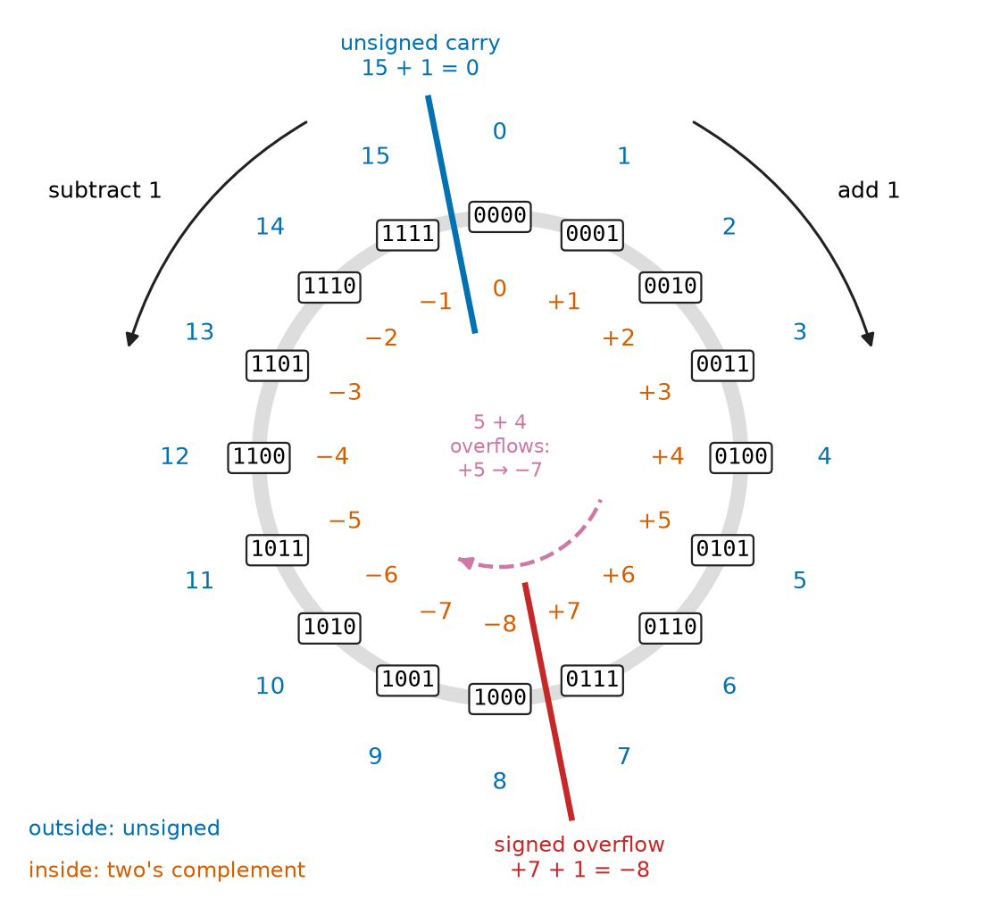
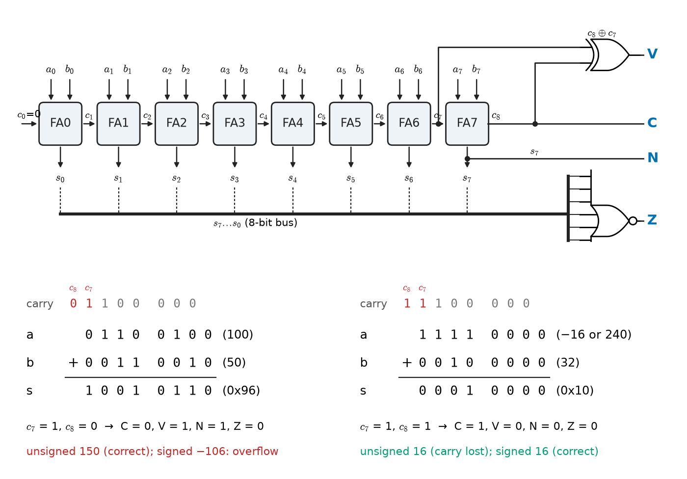
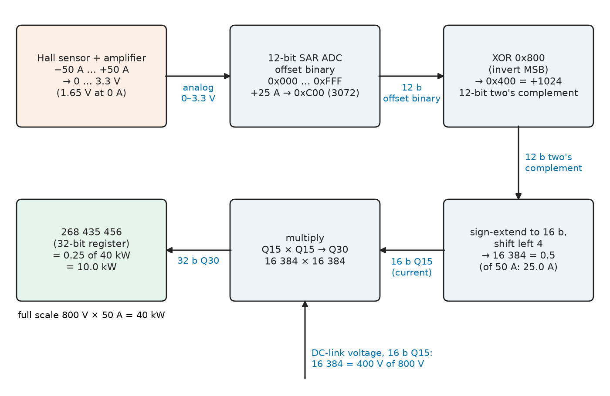
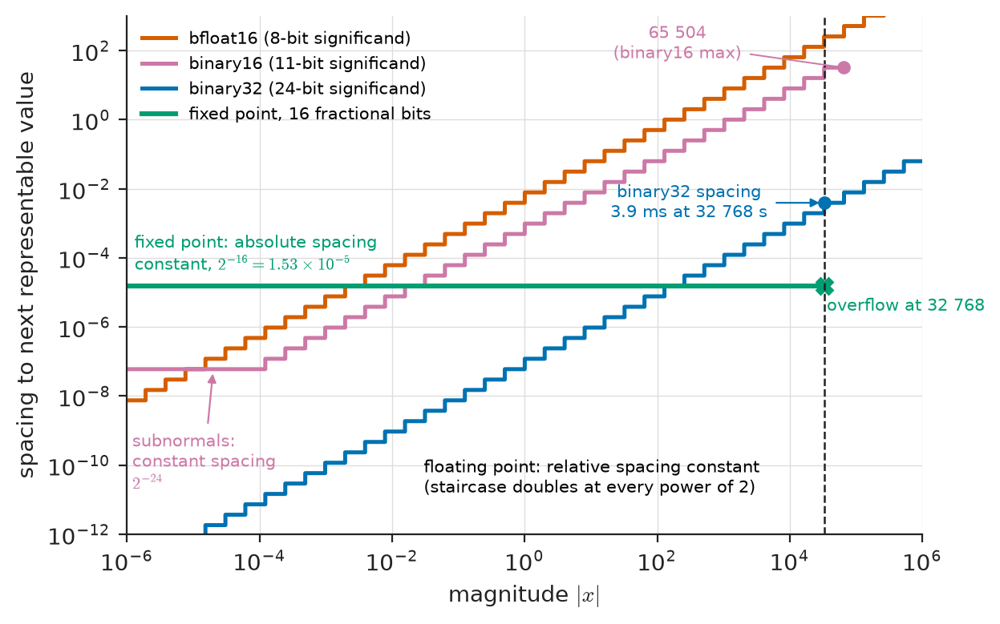
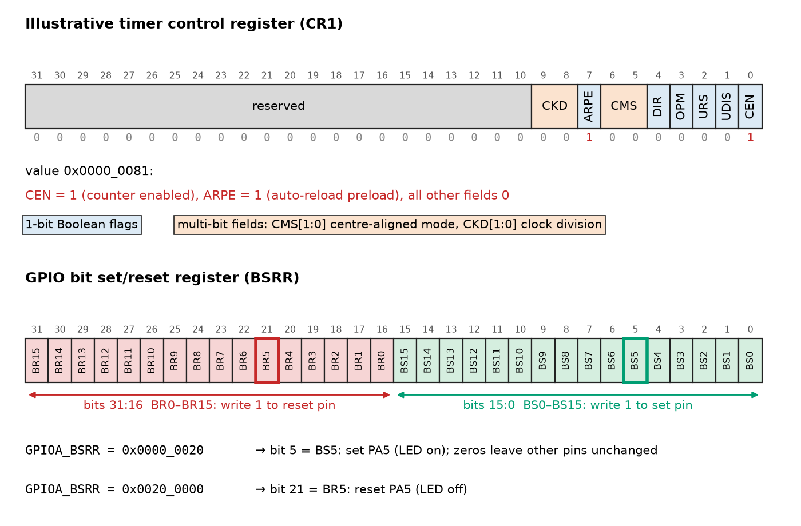

# Chapter 11 — Digital Number Systems

*Part III · Digital Electronics*

On 25 February 1991 a Patriot air-defence battery in Dhahran failed to intercept an incoming Scud missile. The battery had been running for about 100 hours. Its software counted time in tenths of a second and converted the count to seconds by multiplying by 0.1 held in a 24-bit fixed-point register, but 0.1 has no finite binary expansion, and the stored constant was short by about $9.5\times10^{-8}$. After 3.6 million ticks the computed time was 0.34 s behind, enough for the radar's range gate to look more than half a kilometre away from the target. Five years later the first Ariane 5 launcher destroyed itself 37 seconds after lift-off when its inertial reference software converted a 64-bit floating-point horizontal-velocity value into a 16-bit signed integer; the value exceeded 32 767, the conversion raised an unhandled operand error, and both redundant units shut down. Neither failure was a logic error in the usual sense. Each was a number that did not fit the bits chosen to hold it. Every value in a digital system — an ADC code, a motor current, a timestamp, a coefficient, a flag — lives in a fixed number of bits, and the representation decides what range it covers, how finely it resolves, what happens when it overflows and how much hardware and time arithmetic on it costs.

> **How are integers, signed values, fractions and real numbers represented in a fixed number of bits, and what does each representation cost in range, resolution and hardware?**
> **What happens at the edges — overflow, wrap-around, rounding and conversion between formats — and how does an engineer detect and contain it?**

| Concept | Engineering destination |
|---|---|
| Binary, octal, decimal and hexadecimal | Register maps, memory dumps, bus analysers, configuration words |
| Signed number representation | ADC output codes (offset binary, two's complement), sensor and protocol fields |
| Two's complement | Every integer ALU, signed sensor data, wrap-safe timer arithmetic |
| Binary arithmetic | Adder, multiplier and divider cost; cycle counts on microcontrollers |
| Overflow | Status flags, saturating arithmetic, timer wrap, launch and safety failures |
| Fixed-point arithmetic | Motor control, power metering and filters on MCUs and FPGAs without floating point |
| Floating-point representation | IEEE 754 FPUs in processors, GPUs and AI accelerators; format choice and conversion |
| Boolean variables | Flags, bit fields, control and status registers, active-low signals |

**Roadmap.** Positional number systems and the hexadecimal view of hardware (11.1) → the ways of encoding a sign (11.2) → two's complement, the one that won (11.3) → what addition, multiplication and division cost in hardware (11.4) → overflow and how to contain it (11.5) → fixed-point fractions (11.6) → IEEE 754 floating point (11.7) → single bits as Boolean variables (11.8).

---

## 11.1 Binary, octal, decimal and hexadecimal

> **Boundary.** The real and complex number systems as mathematics are in *The Mathematics Universe*, [Ch. 1 §1.1](https://github.com/The-Studio-of-Sadiq/engineering-mathematics/blob/main/part-1-foundations/01-mathematical-language-and-algebra.md); floating-point error analysis in [Ch. 22 §22.1](https://github.com/The-Studio-of-Sadiq/engineering-mathematics/blob/main/part-7-numerical-computational/22-numerical-methods.md); fixed- and floating-point arithmetic as a source of error in signal processing in *Circuits, Signals and Communications*, [Ch. 21 §21.4–21.6](https://github.com/The-Studio-of-Sadiq/Circuits-Signals-and-Communications/blob/main/part-5-digital-signal-processing/21-dsp-fundamentals.md). This chapter takes the hardware view: bit patterns, their encodings and what circuits and processors do with them.

### Why two states

A digital circuit represents information by voltages that are deliberately driven far towards one of two levels. Two levels make the widest possible noise margin for a given supply (Chapter 12 puts numbers on it), make the switching transistor either fully on or fully off where it dissipates least, and let any regenerating gate restore a degraded signal. Multi-level signalling exists where bandwidth is scarce — four-level PAM4 in 400G Ethernet and PCIe 6.0, and three or four bits per cell in NAND Flash — but the price is a smaller margin per level and error-correcting codes to recover from it. Inside logic, the unit is the **bit**.

### Positional notation

A string of digits $d_{n-1}\dots d_1d_0.d_{-1}d_{-2}\dots$ in base $b$ has the value

$$
x=\sum_{i}d_i\,b^i
$$

Base 2 uses digits 0 and 1; each binary digit position doubles in weight. Groups of bits have names: 4 bits a **nibble**, 8 bits a **byte**, and a **word** whatever the processor's natural width is (16 bits for the MSP430, 32 for a Cortex-M, 64 for a server CPU). The leftmost bit is the **most significant bit** (MSB), the rightmost the **least significant bit** (LSB).

Engineers read binary through two shorthand bases. **Hexadecimal** (base 16, digits 0–9 and A–F) packs exactly four bits into one digit, so a 32-bit register is eight hex digits and every digit boundary is a nibble boundary: `0x4002_0014` is the address of the GPIOA output data register in an STM32F4, and `0xA5` reads at once as `1010 0101`. **Octal** (base 8) packs three bits per digit; it survives in Unix file permissions (`chmod 754`), in some aviation transponder (Mode A "squawk") codes, and in older minicomputer documentation. **Decimal** remains the interface to people, and conversion to and from it is the expensive part of every display, log file and user interface.

**Table 11.1 — Common unsigned word widths and their ranges.**

| Width | Hex digits | Unsigned range | Typical use |
|---|---|---|---|
| 1 bit | — | 0–1 | Flag, GPIO pin, Boolean variable |
| 8 bits | 2 | 0–255 | Byte; UART character; 8-bit MCU register; pixel channel |
| 10–12 bits | 3 | 0–1023, 0–4095 | MCU ADC result |
| 16 bits | 4 | 0–65 535 | Timer counter, Modbus register, 16-bit audio sample |
| 24 bits | 6 | 0–16 777 215 | Sigma-delta ADC result, RGB colour |
| 32 bits | 8 | 0–4 294 967 295 | Cortex-M register, IPv4 address, millisecond tick counter |
| 64 bits | 16 | 0–$1.8\times10^{19}$ | Server register, nanosecond timestamp, file size |

### Converting between bases

Integer conversion from decimal to base $b$ is **repeated division**: the remainders, read in reverse order, are the digits. Fractions convert by **repeated multiplication**: multiply by $b$, the integer part is the next digit, keep the fraction. The listing implements both and decodes a two-byte field as a protocol analyser would.

```python
def to_base(n, base, digits="0123456789ABCDEF"):
    """Unsigned integer to a string in any base, by repeated division."""
    out = ""
    while True:
        n, r = divmod(n, base)
        out = digits[r] + out
        if n == 0:
            return out

def frac_to_bin(x, nbits):
    """Fraction 0 <= x < 1 to binary digits, by repeated multiplication."""
    bits = ""
    for _ in range(nbits):
        x *= 2
        bits += "1" if x >= 1 else "0"
        x -= int(x)
    return bits

def to_signed(u, n):
    """Interpret an n-bit pattern u as two's complement."""
    return u - (1 << n) if u & (1 << (n - 1)) else u

print(to_base(2026, 2), to_base(2026, 8), to_base(2026, 16))
print("0.1 =", "0." + frac_to_bin(0.1, 24), "...")

payload = bytes([0x2E, 0xFF])             # CAN data bytes 0 and 1
raw = payload[0] | (payload[1] << 8)      # little-endian 16-bit word
print(f"raw 0x{raw:04X} unsigned {raw} signed {to_signed(raw, 16)}"
      f" -> {to_signed(raw, 16) * 0.1:.1f} degC")
```

It prints `11111101010 3752 7EA` for 2026, the repeating pattern `0.000110011001100110011001...` for 0.1, and `raw 0xFF2E unsigned 65326 signed -210 -> -21.0 degC`. The second line is the root of the Patriot failure (Section 11.6): a fraction whose denominator in lowest terms contains a factor 5 never terminates in binary, so 0.1, 0.01 and 0.2 are always approximations in binary hardware. The third line anticipates Section 11.3.

### Byte order

A multi-byte value stored in byte-addressed memory or sent over a byte-oriented link must put its bytes in some order. **Little-endian** stores the least significant byte at the lowest address; x86, Arm Cortex-M and RISC-V (by default) are little-endian, and so is CAN data in most automotive DBC definitions ("Intel" byte order). **Big-endian** stores the most significant byte first; it is **network byte order** for IP, TCP and UDP headers, Modbus registers and many sensor ICs on SPI and I²C ("Motorola" order in DBC files). A 32-bit value 0x12345678 is stored as `78 56 34 12` in little-endian memory and sent as `12 34 56 78` in network order. Endianness errors produce wrong values, sometimes obviously wrong (a temperature of +1203.1 °C instead of −21.0 °C when the bytes below are read big-endian) and sometimes plausible; firmware should convert explicitly at the boundary of each interface.

**Worked example — Reading a CAN temperature field.** A battery-management CAN message carries a cell temperature in bytes 0–1, little-endian, signed, with a scale of 0.1 °C per bit, and a bus analyser shows the bytes `2E FF`. Assembled little-endian, the word is $\mathrm{0xFF2E}=65\,326$ as an unsigned number. Its MSB is 1, so as a 16-bit two's-complement number it is $65\,326-65\,536=-210$, and the temperature is $-21.0$ °C, a plausible winter value. Read big-endian (`0x2EFF` $=12\,031$) it would be $+1203.1$ °C; read little-endian but unsigned, 6532.6 °C. One field definition, three interpretations: the bits carry no meaning without the format, which is why automotive and industrial protocols publish their field definitions (DBC, EDS and Modbus register maps) as precisely as their electrical layers.

### Units of data

Memory sizes are powers of two and line rates are powers of ten. The IEC prefixes of IEC 80000-13 keep them apart: 1 KiB $=1024$ bytes, 1 MiB $=2^{20}$ bytes, while 1 kB $=1000$ bytes and 1 Mbit/s $=10^6$ bit/s. A "64 GB" memory card holds $64\times10^9$ bytes, which an operating system reporting in binary units shows as 59.6 GiB. Small discrepancies of this kind are harmless; a buffer sized as 1000 bytes when the DMA engine transfers 1024 is not.

---

## 11.2 Signed number representation

An $n$-bit pattern has $2^n$ values. Representing signed numbers means deciding which patterns mean negative values. Four encodings are in use, each for a reason (Table 11.2).

**Sign-magnitude** uses the MSB as the sign and the remaining $n-1$ bits as the magnitude. It is the natural human notation and survives where magnitude and sign are processed separately: the sign bit of IEEE 754 floating point (Section 11.7), some sensor formats, and the sign-plus-magnitude command of an H-bridge motor driver (direction pin plus PWM duty). It has two zeros ($+0$ and $-0$), and an adder must compare magnitudes before deciding whether to add or subtract them.

**Ones' complement** negates a number by inverting every bit. It also has two zeros. It is extinct in processors but survives in one important place: the 16-bit Internet checksum of IPv4, UDP and TCP headers is a ones'-complement sum, chosen because it is independent of byte order and easy to update incrementally in routers.

**Offset binary** (excess-$K$) stores $x+K$ as an unsigned number, usually with $K=2^{n-1}$. The most negative value is all zeros, zero is $100\ldots0$, and the most positive value is all ones. It is the native output of a bipolar ADC: a converter measuring $\pm V_{REF}$ produces code 0 at $-V_{REF}$, mid-scale at 0 V and full scale near $+V_{REF}$, which is just a unipolar converter with its input shifted. The exponent field of IEEE 754 is also offset binary (with $K=127$ in binary32), which makes floating-point numbers sort correctly when compared as integers.

**Two's complement** gives the MSB a negative weight, $-2^{n-1}$. It has one zero, an asymmetric range from $-2^{n-1}$ to $2^{n-1}-1$, and the overwhelming advantage that the same adder circuit handles signed and unsigned numbers. Every modern integer ALU uses it, and since C23 and C++20 it is the only signed integer representation the C and C++ standards allow.

**Table 11.2 — Four 4-bit signed encodings.**

| Pattern | Unsigned | Sign-magnitude | Ones' complement | Offset binary ($K=8$) | Two's complement |
|---|---|---|---|---|---|
| 0111 | 7 | +7 | +7 | −1 | +7 |
| 0001 | 1 | +1 | +1 | −7 | +1 |
| 0000 | 0 | +0 | +0 | −8 | 0 |
| 1111 | 15 | −7 | −0 | +7 | −1 |
| 1001 | 9 | −1 | −6 | +1 | −7 |
| 1000 | 8 | −0 | −7 | 0 | −8 |
| Range | 0 to 15 | −7 to +7 | −7 to +7 | −8 to +7 | −8 to +7 |

Offset binary and two's complement differ only in the MSB: inverting the MSB converts one into the other. A firmware driver for a bipolar ADC that delivers offset binary therefore converts its result to a signed integer with a single XOR, and many converters (the ADS1115, most audio codecs) offer a configuration bit that selects two's-complement output directly.

---

## 11.3 Two's complement

### Arithmetic modulo $2^n$

An $n$-bit register is a counter modulo $2^n$: adding 1 to $11\ldots1$ gives $00\ldots0$ with a carry out that the register discards. Two's complement assigns to each pattern the representative of its residue class that lies in $[-2^{n-1},2^{n-1}-1]$. For an $n$-bit pattern $b_{n-1}\dots b_0$ the value is

$$
x=-b_{n-1}2^{n-1}+\sum_{i=0}^{n-2}b_i2^i
$$

Because the pattern for $-x$ is the one that, added to $x$, gives $2^n\equiv0$, negation is

$$
-x=\overline{x}+1
$$

(invert every bit, add one), since $x+\overline{x}=2^n-1$. Figure 11.1 shows the 4-bit patterns arranged on a wheel: moving clockwise adds, moving counter-clockwise subtracts, and the same wheel serves unsigned numbers (0 to 15) and signed numbers (−8 to +7). The only difference between the two interpretations is where the wheel is cut: between 15 and 0 for unsigned, between +7 and −8 for signed. Crossing the cut is overflow (Section 11.5).

> **Status of the principle: Two's-complement arithmetic**
> *Derived.* Follows from arithmetic modulo $2^n$: addition, subtraction and the low $n$ bits of multiplication give the correct result whenever the true result lies in $[-2^{n-1},2^{n-1}-1]$, using exactly the same circuit as unsigned arithmetic; outside that range the result is wrong by a multiple of $2^n$.

<!-- FIGURE 11.1 | figures/ch11/fig-11-1-twos-complement-wheel.png | schematic | The 4-bit number wheel: one set of patterns read as unsigned and as two's-complement values. | Content: circle with 16 equally spaced positions labelled with the binary patterns 0000 to 1111 clockwise from the top. Outside ring: unsigned values 0 to 15. Inside ring: two's-complement values 0, 1, ..., 7, -8, -7, ..., -1. Clockwise arrow labelled add 1, counter-clockwise arrow labelled subtract 1. A red cut between 0111 and 1000 labelled signed overflow (+7 + 1 = -8), a blue cut between 1111 and 0000 labelled unsigned carry (15 + 1 = 0). Example arc from 0101 (+5) moving 4 steps clockwise to 1001 (-7) shown dashed, labelled 5 + 4 overflows. -->



*Figure 11.1 — The 4-bit number wheel: one set of patterns read as unsigned and as two's-complement values.*

### Sign extension and shifts

Widening a two's-complement number to more bits copies its sign bit into the new upper bits: $-3$ is `1101` in 4 bits and `1111 1101` in 8 bits. Zero extension, appropriate for unsigned numbers, would turn it into $+13$. Processors have both forms: Arm's `SXTB`/`SXTH` and `UXTB`/`UXTH`, and the load instructions `LDRSB`/`LDRSH` (sign-extending) and `LDRB`/`LDRH` (zero-extending). A 12-bit two's-complement ADC result placed in a 16-bit register must be sign-extended before use; forgetting it is a classic bug that turns small negative readings into values near +4000.

Shifting left by $k$ multiplies by $2^k$ for both interpretations. Shifting right divides by $2^k$, but there are two right shifts: **logical** (fill with zeros, correct for unsigned) and **arithmetic** (fill with copies of the sign bit, correct for signed). An arithmetic right shift rounds towards $-\infty$: $-7\gg1=-4$, while C integer division truncates towards zero, $-7/2=-3$. In C, right-shifting a negative signed integer is implementation-defined (arithmetic on every mainstream compiler); left-shifting a negative value or shifting into the sign bit is undefined behaviour, so portable code uses unsigned types for bit manipulation.

### Wrap-around as a tool

Modular arithmetic is often exactly what is wanted. A free-running 32-bit millisecond tick counter wraps every $2^{32}$ ms $=49.7$ days; a Windows 95 timer bug famously hung machines after that interval, and the same bug recurs in embedded firmware written as `if (now >= start + timeout)`. The wrap-safe form computes the elapsed time as an unsigned difference, which is correct across the wrap because subtraction modulo $2^{32}$ gives the true difference whenever it is less than $2^{32}$:

```c
#include <stdbool.h>
#include <stdint.h>

/* True once at least timeout_ms have elapsed since start_ms.
   Correct across the 2^32 wrap of the tick counter, provided the
   interval being measured is shorter than 49.7 days. */
static inline bool timed_out(uint32_t now_ms, uint32_t start_ms,
                             uint32_t timeout_ms)
{
    return (uint32_t)(now_ms - start_ms) >= timeout_ms;
}
```

The same property makes phase accumulators in direct digital synthesis and encoder position counters work: a 16-bit encoder count can wrap freely as long as the controller only uses differences between successive readings that are smaller than half the range.

---

## 11.4 Binary arithmetic

### Addition and subtraction

Binary addition proceeds column by column exactly as decimal addition does, with a carry of weight 2 into the next column. One column takes two operand bits and a carry in and produces a sum bit and a carry out; this is the full adder, whose logic Chapter 12 minimises and whose fast carry-lookahead forms Chapter 13 develops. Subtraction is addition of the negation, $A-B=A+\overline{B}+1$: an adder with an inverter on one input and the carry-in set to 1. In unsigned subtraction the final carry out is the inverse of a borrow: carry 1 means $A\ge B$. Arm processors keep that convention (the C flag after `SUBS` or `CMP` is "not borrow"), while x86 sets its carry flag on borrow; compilers hide the difference, assembly programmers and simulator writers must not.

### Multiplication

The product of an $n$-bit and an $m$-bit number needs $n+m$ bits. A multiplier forms $n$ partial products (each operand shifted and ANDed with one bit of the other) and sums them; hardware multipliers compress the partial products with trees of full adders (Wallace or Dadda trees) and use Booth recoding to halve their number, so a 32 × 32-bit multiply completes in one clock cycle on a Cortex-M3/M4 and in three to four pipeline stages on a server CPU. Signed multiplication differs from unsigned only in the upper half of the product: the low $n$ bits of the product are the same for both interpretations, which is why C's `int` multiplication and `unsigned` multiplication compile to the same instruction while the "long multiply" instructions (`SMULL`, `UMULL`) are distinct.

### Division

Division is the expensive operation. Hardware dividers produce one to a few quotient bits per cycle (restoring, non-restoring or SRT algorithms), so a 32-bit divide takes 2 to 12 cycles on a Cortex-M3/M4 (data-dependent), 20 to 40 cycles on larger cores for 64-bit operands, and on cores without a divider (Cortex-M0, 8-bit AVR) a software routine of 100 or more cycles. Division by a constant is replaced by multiplication by a scaled reciprocal and a shift: for any 16-bit unsigned $x$, $\lfloor x/10\rfloor=(x\times\mathrm{0xCCCD})\gg19$ exactly, which compilers generate automatically. Division by a power of two is a shift — but for signed numbers only after adding $2^k-1$ to negative operands, so that the result truncates towards zero as C requires.

**Table 11.3 — Integer arithmetic cost on representative processors (typical cycle counts).**

| Operation | 8-bit AVR (ATmega328P) | Cortex-M0+ | Cortex-M4 | Notes |
|---|---|---|---|---|
| 8-bit add | 1 | 1 | 1 | — |
| 32-bit add | 4 | 1 | 1 | AVR: add plus three add-with-carry |
| 8 × 8 multiply | 2 | 1 | 1 | — |
| 32 × 32 → 32 multiply | about 40 (library) | 1 or 32 (implementation option) | 1 | — |
| 32 × 32 → 64 multiply | about 80 | about 40 (library) | 1 | `UMULL`/`SMULL` on M4 |
| 32 / 32 divide | about 600 (library) | about 50–150 (library) | 2–12 | M4 `UDIV`/`SDIV` early-terminate |

The table explains much of embedded firmware style: on an 8-bit core, 32-bit arithmetic is a library call, and on any core without a hardware divider a control loop that divides every cycle wastes much of its budget. The engineering responses are wider multiply instead of divide, precomputed reciprocals, and power-of-two scale factors.

---

## 11.5 Overflow

### Carry versus overflow

An $n$-bit adder produces an $n$-bit result and a carry out. For unsigned operands the result is wrong exactly when the carry out is 1: the true sum exceeds $2^n-1$. For two's-complement operands the carry out means nothing on its own; the result is wrong when the true sum lies outside $[-2^{n-1},2^{n-1}-1]$. That can only happen when both operands have the same sign (the sum of a positive and a negative number always lies between them), and it shows itself as a result of the opposite sign. Processors therefore keep two flags, C (carry) and V (overflow), and the program's choice of conditional branch decides which interpretation applies: unsigned comparisons test C, signed comparisons test V together with N (negative).

### The overflow rule

Let $c_{n-1}$ be the carry into the sign position and $c_n$ the carry out of it. Consider the sign bits $a$ and $b$ of the operands and $s$ of the result, $s=a\oplus b\oplus c_{n-1}$, $c_n=ab+c_{n-1}(a\oplus b)$.

- If $a=b=0$ (both non-negative): $c_n=0$, and $s=c_{n-1}$. Overflow (a negative-looking result) occurs exactly when $c_{n-1}=1$, i.e. when $c_{n-1}\ne c_n$.
- If $a=b=1$ (both negative): $c_n=1$, and $s=c_{n-1}$. Overflow (a non-negative result) occurs exactly when $c_{n-1}=0$, again when $c_{n-1}\ne c_n$.
- If $a\ne b$: $c_n=c_{n-1}$, and overflow is impossible.

Hence

$$
V=c_n\oplus c_{n-1}
$$

one XOR gate on the carry chain, which is how every ALU computes the flag (Figure 11.2, and the ALU of [Chapter 13](13-combinational-digital-systems.md)). An equivalent form that software can evaluate without access to the carries is $V=(a\cdot b\cdot\overline{s})+(\overline{a}\cdot\overline{b}\cdot s)$: same operand signs, different result sign.

> **Status of the principle: Signed overflow rule $V=c_n\oplus c_{n-1}$**
> *Derived.* A case analysis of the sign-bit full adder in two's-complement arithmetic; it holds for addition and for subtraction performed as addition of the complement, and says nothing about unsigned overflow, which is the carry $c_n$ (or its inverse, the borrow, in subtraction).

<!-- FIGURE 11.2 | figures/ch11/fig-11-2-adder-flags.png | schematic | An 8-bit ripple-carry adder with carry, overflow, negative and zero flag logic, and two example additions. | Content: eight full-adder boxes FA0 to FA7 in a row, operand bits a7..a0 and b7..b0 entering from the top, sum bits s7..s0 leaving the bottom, carries c1..c7 between boxes, c8 out of FA7. Flag logic on the right: C = c8; V = XOR of c8 and c7 (one XOR gate); N = s7; Z = NOR of all sum bits. Below, two worked additions in binary: 0110 0100 (100) + 0011 0010 (50) = 1001 0110 with c7 = 1, c8 = 0, flags C = 0, V = 1, result reads -106 signed; and 1111 0000 (-16 or 240) + 0010 0000 (32) = 0001 0000 with c7 = 1, c8 = 1, flags C = 1, V = 0, result 16. -->



*Figure 11.2 — An 8-bit ripple-carry adder with carry, overflow, negative and zero flag logic, and two example additions.*

**Worked example — Four 8-bit additions and their flags.** Using the adder of Figure 11.2:

| Operands (hex) | Result | C | V | Unsigned reading | Signed reading |
|---|---|---|---|---|---|
| 0x64 + 0x32 | 0x96 | 0 | 1 | 100 + 50 = 150, correct | 100 + 50 = −106, overflow |
| 0xF0 + 0x20 | 0x10 | 1 | 0 | 240 + 32 = 16, carry lost | −16 + 32 = 16, correct |
| 0x80 + 0x80 | 0x00 | 1 | 1 | 128 + 128 = 0, carry lost | −128 + (−128) = 0, overflow |
| 0x7F + 0x01 | 0x80 | 0 | 1 | 127 + 1 = 128, correct | 127 + 1 = −128, overflow |

The same eight bits are right in one interpretation and wrong in the other; only the program knows which interpretation it meant. The last line is the most common overflow in practice: a signed counter or integrator one step past its maximum jumps to its most negative value.

### Containing overflow

There are four engineering responses, and choosing among them is part of the design of every arithmetic path.

1. **Make it impossible** by sizing the word: a sum of $M$ values of $n$ bits needs $n+\lceil\log_2M\rceil$ bits, a product of $n$- and $m$-bit values $n+m$ bits. This is the guard-bit argument that Book 3 §21.5 applies to DSP accumulators; in control firmware it means computing a 16-bit × 16-bit PI-controller product in 32 bits and accumulating the integral in 32 or 64 bits.
2. **Saturate**: clamp the result to the largest or smallest representable value. Saturation keeps the sign right and limits the error, the correct behaviour for physical quantities such as a PWM duty, a controller output or an audio sample. Cortex-M4 and M7 provide `QADD`, `QSUB` and `SSAT`/`USAT` instructions; in portable C:

```c
#include <stdint.h>

/* Signed 16-bit addition that saturates instead of wrapping. */
static inline int16_t sat_add16(int16_t a, int16_t b)
{
    int32_t s = (int32_t)a + (int32_t)b;   /* exact: cannot overflow in 32 bits */
    if (s > INT16_MAX) return INT16_MAX;
    if (s < INT16_MIN) return INT16_MIN;
    return (int16_t)s;
}
```

3. **Wrap deliberately**, where modular arithmetic is the intended behaviour: timers, sequence numbers, phase accumulators (Section 11.3).
4. **Detect and handle**: test the V or C flag (or use the compiler built-ins `__builtin_add_overflow` in GCC and Clang) and take a defined action. In C, signed integer overflow is undefined behaviour; the compiler may assume it never happens and optimise accordingly, so a check written after the fact (`if (a + b < a)`) can be deleted. Unsigned overflow is defined to wrap.

**Worked example — Overflow failures in the field.** The Ariane 5 failure of 1996 was case 4 done wrongly: a conversion from a 64-bit float to a 16-bit signed integer overflowed because the new launcher's trajectory produced horizontal velocities that the Ariane 4 software had never seen, and the protection that would have caught the value had been omitted for that variable to keep processor load low. Other overflows are wrap-arounds with long fuses. The GPS week number is a 10-bit field counting weeks since January 1980; it wraps every $1024\times7$ days $=19.6$ years, and receivers that did not handle the rollovers of August 1999 and April 2019 reported dates two decades in the past. A signed 32-bit count of seconds since 1970 (`time_t` on older Unix systems) reaches $2^{31}-1$ on 19 January 2038, about 68 years after its epoch; embedded systems with 30-year service lives, such as utility meters and industrial controllers installed today, must use 64-bit time. Each of these is a sizing decision made under the belief that the range would never be reached.

---

## 11.6 Fixed-point arithmetic

### Integers with an implied scale

A fixed-point number is an integer $k$ with an agreed scale factor: the value is $k\times2^{-f}$, where $f$ is the number of fractional bits. The binary point exists only in the programmer's head and in the documentation; the hardware sees integers and uses the ordinary integer adder and multiplier. In the **Q$m$.$n$** notation (sign excluded from $m$ in the convention of Book 3), a 16-bit Q15 number covers $[-1,1-2^{-15}]$ in steps of $2^{-15}$, and a 32-bit number with 16 fractional bits (Q15.16 in this convention, widely called Q16.16) covers $[-32\,768,\ 32\,768-2^{-16}]$ in steps of $1.53\times10^{-5}$. Fixed point gives **constant absolute resolution** over its whole range, the property that matches ADC samples, which are themselves fixed-point numbers.

> **Boundary.** Q15 and Q31 as DSP formats, guard bits, rounding modes and the noise produced by fixed-point roundoff in filters are developed in *Circuits, Signals and Communications*, [Ch. 21 §21.5–21.6](https://github.com/The-Studio-of-Sadiq/Circuits-Signals-and-Communications/blob/main/part-5-digital-signal-processing/21-dsp-fundamentals.md). This section covers fixed point as a hardware representation: scaling physical quantities into words, the word growth of each operation and the cost of getting the scaling wrong.

### The rules of word growth

Each operation has a fixed effect on the format:

- **Addition and subtraction** require the same scale on both operands (align the binary points by shifting) and grow the result by one integer bit.
- **Multiplication** of Q$m_1$.$n_1$ by Q$m_2$.$n_2$ gives Q$(m_1+m_2+1)$.$(n_1+n_2)$ in a double-width word (with this book's sign convention, the product of two signed numbers has one redundant sign bit except for $(-1)\times(-1)$). The product of two Q15 numbers is a Q30 number in 32 bits; it is returned to Q15 by an arithmetic right shift of 15, preferably with rounding (add $2^{14}$ first).
- **Division** shrinks fractional bits and is avoided, as in Section 11.4.
- **Conversion** between formats is a shift; between a physical quantity and its fixed-point code, a multiplication by a scale factor fixed at design time.

Getting the scale right is a design task, done once per signal and written down: which physical value corresponds to full scale, how many integer bits are needed for the worst-case transient, and what resolution the application needs.

<!-- FIGURE 11.3 | figures/ch11/fig-11-3-fixed-point-current-path.png | block-diagram | Fixed-point data path from a bipolar current sensor through a 12-bit ADC to Q15 current and power values. | Content: left to right blocks. Hall current sensor plus amplifier mapping -50 A to +50 A onto 0 to 3.3 V (1.65 V at 0 A). 12-bit SAR ADC, offset-binary output 0x000 to 0xFFF, example code 0xC00 for +25 A. Block XOR 0x800 giving 12-bit two's complement 0x400 (+1024). Block sign-extend and shift left 4 giving Q15 value 16384 (0.5 of 50 A full scale). Multiplier block: Q15 current times Q15 voltage (16384, i.e. 400 V of 800 V full scale) giving Q30 product 268 435 456 in a 32-bit register, labelled 0.25 of 40 kW = 10 kW. Under each arrow the word width and format: 12 b offset binary, 12 b two's complement, 16 b Q15, 32 b Q30. -->



*Figure 11.3 — Fixed-point data path from a bipolar current sensor through a 12-bit ADC to Q15 current and power values.*

**Worked example — Motor current and power in fixed point.** An EV auxiliary inverter measures phase current with a Hall sensor whose amplifier maps $-50$ A to $+50$ A onto 0 to 3.3 V, read by a 12-bit SAR ADC (Figure 11.3). The ADC output is offset binary: code 2048 at 0 A, one LSB $=100\ \mathrm{A}/4096=24.4$ mA.

1. *ADC code to signed integer.* A reading of 0xC00 $=3072$ becomes, after XOR with 0x800, 0x400 $=+1024$ as a 12-bit two's-complement number, $1024\times24.4\ \mathrm{mA}=+25.0$ A.
2. *Signed integer to Q15.* Sign-extending to 16 bits and shifting left by 4 gives $16\,384$, which in Q15 is $0.5$ of full scale, $0.5\times50=25.0$ A. The low four bits are zero: the ADC's resolution, not the word, limits the precision. The Q15 LSB is $50\ \mathrm{A}/32\,768=1.53$ mA.
3. *Power.* The DC-link voltage is held in Q15 with 800 V full scale; 400 V is $16\,384$. The product $16\,384\times16\,384=268\,435\,456$ is Q30 in a 32-bit register: $268\,435\,456/2^{30}=0.25$ of the product's full scale, $800\ \mathrm{V}\times50\ \mathrm{A}=40$ kW, so $P=10.0$ kW, which agrees with $400\times25$.

No floating point was needed, every step is one or two single-cycle instructions on any 32-bit MCU, and the scales are fixed in a design document rather than recomputed at run time. The price is discipline: a later change of sensor range from ±50 A to ±100 A silently halves every computed current unless every scale is updated together.

### The Patriot clock revisited

The Patriot weapon-control computer held 1/10 as a 24-bit fixed-point fraction with 23 bits after the binary point, by chopping (truncating) the expansion of Section 11.1:

$$
0.1\approx\mathrm{0.00011001100110011001100}_2,\qquad \varepsilon=0.1-\frac{\lfloor0.1\times2^{23}\rfloor}{2^{23}}=9.54\times10^{-8}
$$

Every tick of the tenth-of-a-second counter was converted with that constant, so the error in the computed time grew linearly with the count: after 100 hours, $3.6\times10^6$ ticks, it reached $3.6\times10^6\times9.54\times10^{-8}=0.343$ s. A Scud travels at about 1676 m/s, so the predicted position was off by about 575 m, outside the range gate. Part of the software had been updated to use a more precise conversion and part had not, so two time values that should have cancelled no longer did. The lessons are representation lessons: decimal constants are inexact in binary; truncation is biased and its error accumulates linearly; and a long-running system must either keep time as an exact integer count of ticks or bound its running time.

> **Status of the principle: Fixed-point resolution and range**
> *Derived.* A $B$-bit word with $f$ fractional bits has a constant absolute resolution $2^{-f}$ and a range of $2^{B-f}$; every operation's effect on the integer and fractional bit counts follows from integer arithmetic, so overflow and resolution can be guaranteed at design time from the signal ranges alone.

---

## 11.7 Floating-point representation

### The format

> **Boundary.** The IEEE 754 encoding (sign, biased exponent, hidden bit, subnormals, infinities and NaNs), machine epsilon and the standard model of rounding error are set out in *The Mathematics Universe*, [Ch. 22 §22.1](https://github.com/The-Studio-of-Sadiq/engineering-mathematics/blob/main/part-7-numerical-computational/22-numerical-methods.md); floating point as a DSP arithmetic, its relative-error behaviour and catastrophic cancellation in *Circuits, Signals and Communications*, [Ch. 21 §21.5–21.6](https://github.com/The-Studio-of-Sadiq/Circuits-Signals-and-Communications/blob/main/part-5-digital-signal-processing/21-dsp-fundamentals.md). This section is about the formats as hardware: what fields an FPU decodes, which formats processors and accelerators implement, and what conversion and exceptions do in a real system.

A floating-point number is a sign, an exponent and a significand: $x=(-1)^s\times1.f\times2^{E-\mathrm{bias}}$, with the exponent field $E$ stored in offset binary and the leading 1 of the significand implied. IEEE 754 (first edition 1985, current edition IEEE 754-2019) fixes the field widths, the encodings of zero, subnormals, infinities and NaNs, and — the property that makes results portable — requires the basic operations to be **correctly rounded**: the result is the exact result rounded according to the current rounding mode (round to nearest, ties to even, by default; also towards zero, $+\infty$ and $-\infty$). The listing decodes the fields of a few values the way an FPU's unpacking stage does.

```python
import struct

FORMATS = {"binary16": (">e", ">H", 5, 10), "binary32": (">f", ">I", 8, 23)}

def fields(x, fmt="binary32"):
    """Return (hex word, sign, biased exponent, fraction, class) of x."""
    ffmt, ifmt, ebits, fbits = FORMATS[fmt]
    w = struct.unpack(ifmt, struct.pack(ffmt, x))[0]
    s = w >> (ebits + fbits)
    e = (w >> fbits) & ((1 << ebits) - 1)
    f = w & ((1 << fbits) - 1)
    if e == (1 << ebits) - 1:
        cls = "NaN" if f else "infinity"
    elif e == 0:
        cls = "subnormal" if f else "zero"
    else:
        cls = "normal"
    return hex(w), s, e, hex(f), cls

for x in (3.3, -118.625, 0.1, 1e-40, float("inf")):
    print(f"{x!r:>10} binary32 {fields(x)}")
print(f"{3.3!r:>10} binary16 {fields(3.3, 'binary16')}")
print("stored binary32 value of 3.3:", struct.unpack(">f", struct.pack(">f", 3.3))[0])
```

The output shows 3.3 as `0x40533333` (biased exponent 128, i.e. $2^1$), $-118.625$ as `0xC2ED4000` (exact, because $118.625=1110110.101_2$ terminates), 0.1 as `0x3DCCCCCD` (rounded up in its last bit), $10^{-40}$ as a subnormal with exponent field 0, infinity as `0x7F800000`, and 3.3 in binary16 as `0x429A`, which is really 3.30078. The binary32 value actually stored for 3.3 V is 3.2999999523 V: harmless in a voltage display, but enough to make an equality test `if (v == 3.3f)` in firmware fail when `v` was computed rather than assigned.

### Formats in hardware

**Table 11.4 — Floating-point formats implemented in hardware (IEEE 754-2019 binary formats plus industry formats for machine learning).**

| Format | Sign/exponent/fraction bits | Bias | Largest finite value | Relative step $2^{-p+1}$ | Where implemented |
|---|---|---|---|---|---|
| binary64 (double) | 1/11/52 | 1023 | $1.8\times10^{308}$ | $2.2\times10^{-16}$ | Server and desktop CPUs, Cortex-M7 (optional), Cortex-A, scientific GPUs |
| binary32 (single) | 1/8/23 | 127 | $3.4\times10^{38}$ | $1.2\times10^{-7}$ | Cortex-M4F/M33/M7 FPUs, DSPs (SHARC, C67x), all GPUs |
| binary16 (half) | 1/5/10 | 15 | 65 504 | $9.8\times10^{-4}$ | GPUs, Arm v8.2-A, image and audio pipelines, AI inference |
| bfloat16 | 1/8/7 | 127 | $3.4\times10^{38}$ | $7.8\times10^{-3}$ | AI training accelerators, recent CPUs and GPUs |
| FP8 E4M3 | 1/4/3 | 7 | 448 | 0.125 | AI accelerators (OCP 8-bit floating-point specification) |
| FP8 E5M2 | 1/5/2 | 15 | 57 344 | 0.25 | AI accelerators (gradients) |

The table shows the trade between **range** (exponent bits) and **precision** (fraction bits) at each width. bfloat16 is binary32 with the bottom 16 fraction bits dropped: it keeps binary32's range, so a neural network trained in binary32 can be converted by truncating words, and its 8-bit significand is enough for weights and activations; binary16 has three more bits of precision but overflows at 65 504, which large activations and gradients exceed. FP8 formats push the same idea to inference and training on accelerators that process tens of thousands of multiply-accumulates per cycle, where halving the word halves memory traffic and roughly quarters multiplier area. Figure 11.4 shows how the spacing of representable values grows with magnitude in four of these formats.

<!-- FIGURE 11.4 | figures/ch11/fig-11-4-float-spacing.png | plot | Spacing of representable values (ulp) versus magnitude for binary16, bfloat16, binary32 and a 32-bit fixed-point format with 16 fractional bits. | Content: log-log plot, horizontal axis magnitude from 1e-6 to 1e6, vertical axis spacing between adjacent representable values from 1e-12 to 1e3. Staircase lines (doubling at each power of two) for binary32 (spacing = magnitude times 2^-23), binary16 (magnitude times 2^-10, ending at 65504 with a marker, flat subnormal region below 6.1e-5), bfloat16 (magnitude times 2^-7). Horizontal straight line for the 16-fractional-bit fixed-point format at 1.53e-5, ending at 32768 (overflow marker). Annotations: relative spacing constant for floating point, absolute spacing constant for fixed point; dashed vertical line at 32768 s where the binary32 spacing reaches 3.9 ms. -->



*Figure 11.4 — Spacing of representable values (ulp) versus magnitude for binary16, bfloat16, binary32 and a 32-bit fixed-point format with 16 fractional bits.*

### What an FPU does and costs

An FPU unpacks the fields, aligns significands by shifting the smaller operand right by the exponent difference, adds or multiplies the significands, normalises the result, rounds it and repacks it, setting exception flags (invalid operation, division by zero, overflow, underflow, inexact) in a status register — FPSCR on Arm. On a Cortex-M4F a binary32 add or multiply takes one cycle, a fused multiply-accumulate three, and a divide or square root 14 cycles; binary64 operations on the same core run in a software library at tens of cycles each, a fact that a single unsuffixed constant in C (`x * 0.5` instead of `x * 0.5f`) silently triggers by promoting the expression to double. Subnormal arithmetic is slow on many cores (handled by microcode or traps); embedded and audio code commonly enables **flush-to-zero** mode, which replaces subnormal results by zero at the cost of IEEE conformance near underflow.

The most dangerous operation is **conversion to integer**. When a floating-point value is out of range for the target integer, IEEE 754 signals invalid operation; Arm's `VCVT` instruction then saturates to the largest or smallest integer, x86's `CVTTSS2SI` returns the "integer indefinite" value $-2^{31}$, Ada (the language of the Ariane 5 software) raised an exception, and C declares the behaviour undefined. Firmware that converts a computed float into a PWM compare register, an array index or a 16-bit DAC code must clamp it first.

**Worked example — A binary32 timestamp in a data logger.** A vibration logger on a wind turbine keeps elapsed time in a binary32 variable, adding 1 ms (`0.001f`) at every sample. Near $t$ the spacing of binary32 values is $\mathrm{ulp}(t)=2^{\lfloor\log_2t\rfloor-23}$, and each addition rounds $t+0.001$ to the nearest representable value. The listing shows what one tick actually adds at several elapsed times.

```python
import numpy as np

dt = np.float32(0.001)                      # 1 ms tick
for t in (1.0, 100.0, 3600.0, 16384.0, 32768.0):
    t32 = np.float32(t)
    ulp = np.spacing(t32)                   # gap to the next binary32 value
    step = float((t32 + dt) - t32)          # what one tick actually adds
    print(f"t = {t:8.0f} s  ulp = {ulp * 1e3:9.5f} ms  tick adds {step * 1e3:7.4f} ms")
```

At 1 s the tick adds 1.0000 ms; at 3600 s, where the spacing is 0.244 ms, it adds 0.9766 ms, 2.3 % short; between 16 384 s and 32 768 s, where the spacing is 1.953 ms, every tick rounds up to a full spacing and the clock runs at almost twice real time; at 32 768 s the spacing is 3.906 ms, a 1 ms tick is less than half of it, and time stops. Simulating the full accumulation from zero, the variable reads 3530.2 s after one real hour (3.6 million ticks), and it freezes at 32 768 s after 25 151 s (just under 7 hours) of real time. The fix is a representation choice, not more precision: count ticks in a 64-bit integer, which is exact for 584 million years at 1 ms, and convert to floating point only for display or for computing differences. Figure 11.4 marks the point where the binary32 spacing reaches 3.9 ms.

> **Status of the principle: Floating-point spacing**
> *Derived.* With $p$ significand bits, the representable values between $2^e$ and $2^{e+1}$ are equally spaced by $2^{e-p+1}$, so the absolute spacing doubles at each power of two while the relative spacing stays between $2^{-p}$ and $2^{-p+1}$; this holds for normal numbers of every IEEE 754 binary format and fails in the subnormal range, where the spacing is constant.

### Choosing a representation

The choice between integer, fixed point and floating point is made per signal and per processor:

- **Integer** for counts, indices, time in ticks, addresses and anything that must be exact.
- **Fixed point** where the range is known, resolution must be uniform, and the hardware has no FPU or the datapath is in an FPGA or ASIC where every bit costs area: motor control on Cortex-M0+, power meters, hearing aids, FPGA filters.
- **binary32** where dynamic range is large or unknown and an FPU exists: control loops on Cortex-M4F and M7, sensor fusion, audio effects.
- **binary64** for accumulations over long times or many terms, for geometry and navigation (a binary32 latitude in degrees near 90° is quantised in steps of $7.6\times10^{-6}$°, about 0.85 m) and for scientific computation.
- **binary16, bfloat16, FP8** for storage and throughput where error is tolerated statistically, as in neural-network inference ([Chapter 35](../part-8-integrated-circuits-and-vlsi/35-hardware-software-co-design.md)).

Decimal floating-point formats (decimal64 and decimal128 in IEEE 754-2019), which represent 0.1 exactly, exist for financial calculation and are implemented in hardware on some mainframe processors; engineering hardware almost never needs them.

---

## 11.8 Boolean variables

### One bit, two meanings

The smallest number system has two values. A **Boolean variable** takes the values 0 and 1, interpreted as false and true; Chapter 12 develops the algebra of such variables and the gates that compute with them, and *The Mathematics Universe*, [Ch. 29 §29.3](https://github.com/The-Studio-of-Sadiq/engineering-mathematics/blob/main/tracks/a-algorithms/29-discrete-mathematics-and-logic.md), the logic behind it. In hardware a Boolean variable is one wire or one flip-flop. Its electrical meaning is a convention: in **active-high** (positive) logic a high voltage means true; in **active-low** logic a low voltage means true, and the signal name carries a marker — $\overline{\mathrm{RESET}}$, `nCS`, `CS_N`, `/IRQ`. Active-low signals are common because open-drain outputs can only pull low (so several devices can share one interrupt or reset line, any of them asserting it), because a reset line held low by a pull-down or a discharged capacitor during power-up is safe by default, and for historical reasons in TTL, whose inputs float high. Confusing the two conventions inverts a function, so a schematic or HDL module must state the polarity of every control signal.

### Flags, bit fields and registers

A processor's natural unit is a word, so Boolean variables are packed. A **status register** collects flags such as N, Z, C and V (Section 11.5); a peripheral's **control register** packs enable bits, mode fields of several bits and interrupt enables into one 32-bit word (Figure 11.5). Firmware manipulates individual bits with masks:

- set bit $k$: `reg |= (1u << k)`;
- clear bit $k$: `reg &= ~(1u << k)`;
- toggle bit $k$: `reg ^= (1u << k)`;
- test bit $k$: `(reg >> k) & 1u`;
- write a field of width $w$ at position $p$: `reg = (reg & ~(mask << p)) | ((value & mask) << p)` with `mask = (1u << w) - 1`.

The read-modify-write sequence behind `|=` is three instructions and is not atomic: an interrupt that changes another bit of the same register between the read and the write loses its change. Microcontrollers provide two remedies in hardware: **set/reset registers**, such as the STM32's GPIO bit set/reset register (BSRR), in which writing a 1 to bit $k$ sets output $k$ and writing a 1 to bit $k+16$ clears it while zeros leave other pins alone; and **bit-banding** on Cortex-M3/M4, which maps every bit of a region onto its own word address.

```c
#include <stdint.h>

/* STM32F4 GPIOA registers (addresses from the reference manual; illustrative). */
#define GPIOA_IDR   (*(volatile uint32_t *)0x40020010u)  /* input data      */
#define GPIOA_BSRR  (*(volatile uint32_t *)0x40020018u)  /* bit set/reset   */

#define LED_PIN     5u
#define BUTTON_PIN  13u

static inline void led_on(void)  { GPIOA_BSRR = 1u << LED_PIN; }          /* atomic set   */
static inline void led_off(void) { GPIOA_BSRR = 1u << (LED_PIN + 16u); }  /* atomic reset */

static inline int button_pressed(void)
{
    return ((GPIOA_IDR >> BUTTON_PIN) & 1u) == 0u;   /* active-low input */
}
```

The `volatile` qualifier tells the compiler that every access must actually happen, because the register can change, or must be written, independently of the program. The button function shows active-low logic in software: a pressed button pulls the pin to ground, so "pressed" is the Boolean value true when the bit is 0.

<!-- FIGURE 11.5 | figures/ch11/fig-11-5-register-bit-fields.png | table-graphic | A 32-bit peripheral control register as a set of Boolean flags and multi-bit fields, and the BSRR set/reset layout. | Content: top, a 32-cell bar numbered 31 to 0 for an illustrative timer control register: bit 0 CEN (counter enable), bit 1 UDIS, bit 2 URS, bit 3 OPM (one-pulse mode), bit 4 DIR, bits 6:5 CMS (2-bit centre-aligned mode field), bit 7 ARPE, bits 9:8 CKD (2-bit clock division field), bits 31:10 reserved shaded grey. Example value 0x0000_0081 decoded below as CEN = 1, ARPE = 1, others 0. Bottom, BSRR bar: bits 15:0 labelled BS0 to BS15 (write 1 to set pin), bits 31:16 labelled BR0 to BR15 (write 1 to reset pin), example writes 0x0000_0020 (set PA5) and 0x0020_0000 (reset PA5). -->



*Figure 11.5 — A 32-bit peripheral control register as a set of Boolean flags and multi-bit fields, and the BSRR set/reset layout.*

### Boolean variables in languages and memory

C has had `_Bool` since C99 (spelled `bool` with `<stdbool.h>`, and a keyword in C23); C++ has `bool`. Each occupies at least one byte, because a byte is the smallest addressable unit, so an array of 1000 flags costs 1000 bytes unless packed into a bit array of 125 bytes, a trade between memory and the masking instructions needed for every access. Any non-zero integer converts to `true`. In hardware description languages a single-bit signal (`logic` in SystemVerilog, `std_logic` in VHDL) has more than two values in simulation — unknown (X) and high-impedance (Z) at least, nine values in VHDL — so that a simulator can show an uninitialised flip-flop or a floating bus, states that two-valued Boolean algebra cannot represent ([Chapter 19](../part-4-computer-architecture-and-digital-hardware/19-hardware-description-languages.md)).

> **Status of the principle: Two-valued Boolean variable**
> *Fundamental.* By definition a Boolean variable takes exactly two values, and every digital representation in this chapter is a vector of them; the physical signal that carries it is two-valued only outside the transition times and inside the noise margins of the logic family, which is where the digital abstraction ends (Chapters 12 and 14).

---

## What remains open

| Open question | Where it is answered |
|---|---|
| How are Boolean variables combined, simplified and built into gates? | [Chapter 12](12-boolean-algebra-and-logic-gates.md) |
| How are adders, subtractors, comparators, ALUs and code converters (Gray, BCD) built and how fast are they? | [Chapter 13](13-combinational-digital-systems.md) |
| How are numbers stored in registers and counted by counters? | [Chapter 14](14-sequential-digital-systems.md) |
| How do instruction sets, ALUs and status flags appear to a programmer? | [Chapter 16](../part-4-computer-architecture-and-digital-hardware/16-computer-architecture.md), [Chapter 17](../part-4-computer-architecture-and-digital-hardware/17-microprocessors-and-microcontrollers.md) |
| How are fixed-point and floating-point arithmetic written in HDL and mapped to FPGA DSP blocks? | [Chapter 18](../part-4-computer-architecture-and-digital-hardware/18-memory-and-programmable-logic.md), [Chapter 19](../part-4-computer-architecture-and-digital-hardware/19-hardware-description-languages.md) |
| How do C data types, integer promotion and bitwise operators map onto these representations? | [Chapter 21](../part-5-programming-and-computational-systems/21-c-cpp-for-engineering.md) |
| How does rounding error accumulate in long numerical computations? | [Chapter 24](../part-5-programming-and-computational-systems/24-scientific-computing.md); *The Mathematics Universe*, [Ch. 22](https://github.com/The-Studio-of-Sadiq/engineering-mathematics/blob/main/part-7-numerical-computational/22-numerical-methods.md) |
| How does finite word length limit digital filters and FFTs? | *Circuits, Signals and Communications*, [Ch. 21](https://github.com/The-Studio-of-Sadiq/Circuits-Signals-and-Communications/blob/main/part-5-digital-signal-processing/21-dsp-fundamentals.md) |
| How are low-precision formats exploited in AI accelerators? | [Chapter 35](../part-8-integrated-circuits-and-vlsi/35-hardware-software-co-design.md) |

**Next:** Chapter 12 takes the single bit of Section 11.8 and builds the algebra and the gates that compute with it.
