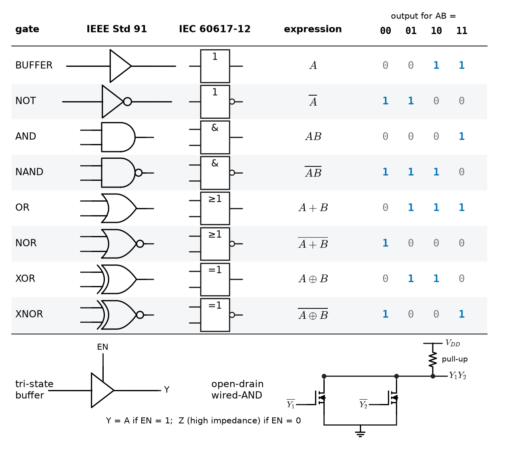
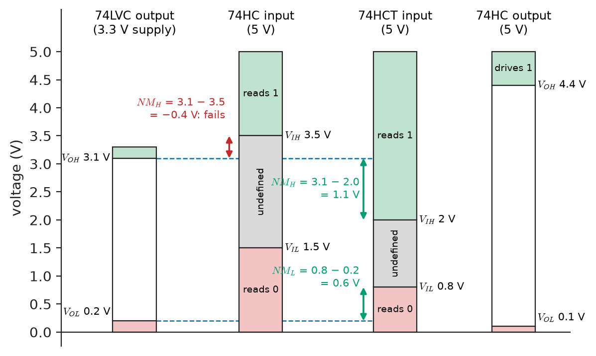
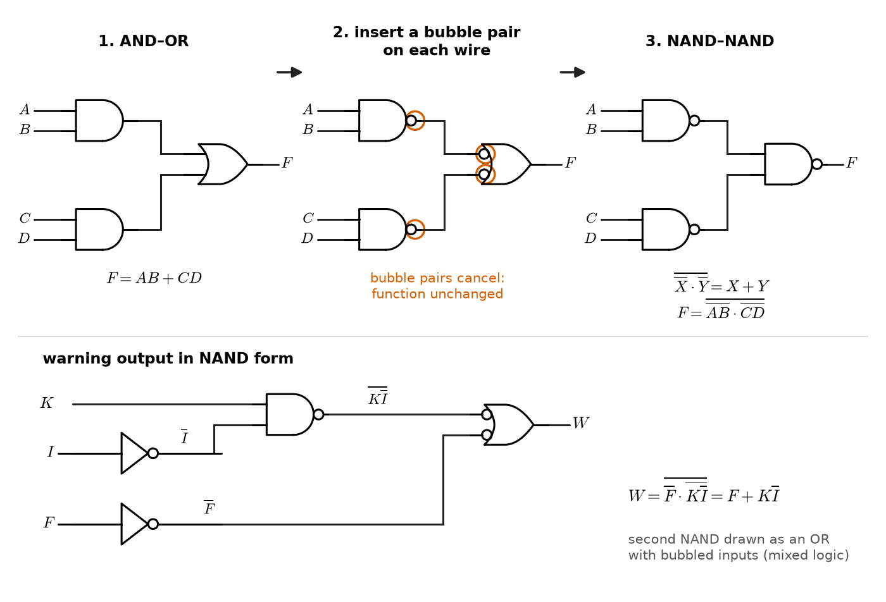
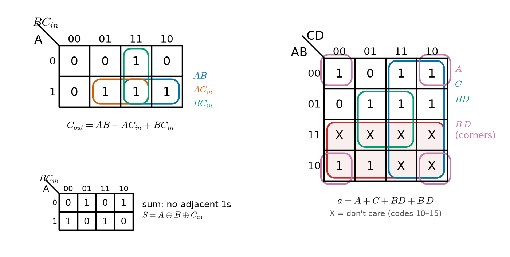
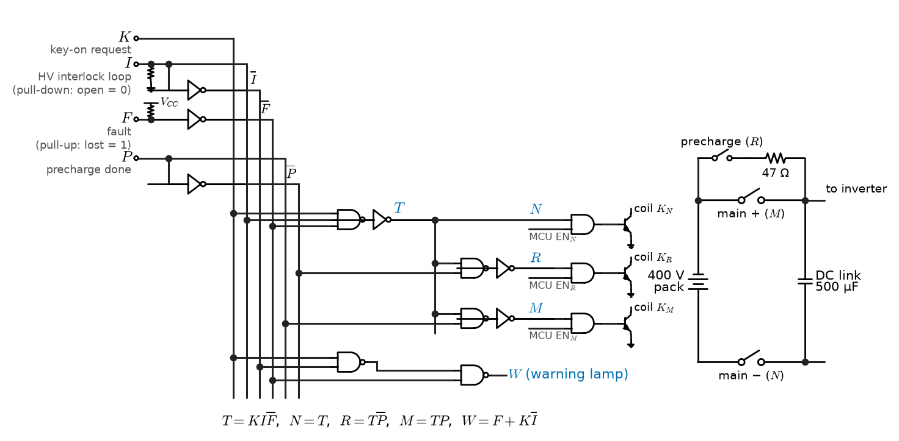

# Chapter 12 — Boolean Algebra and Logic Gates

*Part III · Digital Electronics*

An electric-vehicle battery pack connects to its 400 V DC link through three switching elements: a main negative contactor, a precharge relay with a series resistor that charges the inverter's capacitors gently, and a main positive contactor that closes only when the capacitors are within a few percent of pack voltage. Close the main positive contactor too early and an inrush current of thousands of amperes welds its contacts; leave the precharge relay closed and its resistor burns. The rules are simple to say — close nothing unless the driver requests it, the high-voltage interlock loop is intact and no fault is present; precharge first; then switch over — and the battery-management controller enforces them in software. But a certification engineer reviewing the design asks for an independent hardware path that blocks the contactors whatever the software does, built from a handful of gates whose behaviour can be proved correct for every combination of inputs. To build it, the rules must become equations, the equations must be simplified, and the simplified equations must become gates with known voltage levels and delays. That is the subject of this chapter: Boolean algebra used as an engineering tool for designing logic.

> **How are requirements turned into Boolean equations and truth tables, and how are those equations simplified into the smallest or fastest gate network?**
> **What does a real logic gate guarantee — which functions, which voltage levels and noise margins, which delays — and where does the two-valued abstraction stop?**

| Concept | Engineering destination |
|---|---|
| Boolean algebra | Writing and transforming interlock, decoding and control equations |
| Logic gates | Glue logic, safety interlocks, level translation, standard cells and FPGA LUTs |
| Truth tables | Specifications, exhaustive verification, test vectors, LUT contents |
| Boolean simplification | Fewer gates, fewer transistors, shorter critical paths |
| Karnaugh maps | Hand minimisation of small functions with don't-cares; hazard checks |
| De Morgan's laws | NAND/NOR implementations, active-low signals, bubble pushing in schematics |
| Combinational logic | Decoders, voters, interlocks, arithmetic blocks (Chapter 13) |
| Logic minimization | The algorithms inside synthesis tools for FPGAs and ASICs |

**Roadmap.** The algebra as a set of rules for rewriting equations (12.1) → the gates that implement it and the electrical levels that make them reliable (12.2) → the truth table as specification (12.3) → De Morgan's laws and active-low design (12.4) → algebraic simplification and cost (12.5) → Karnaugh maps (12.6) → the combinational design procedure, worked on the contactor interlock (12.7) → algorithmic minimization as performed by synthesis tools (12.8).

---

## 12.1 Boolean algebra

> **Boundary.** Propositional logic, the laws of Boolean algebra as identities, the count of $2^{2^n}$ functions of $n$ variables and the proof that every Boolean function has a sum-of-products formula (so that NAND alone is functionally complete) are in *The Mathematics Universe*, [Ch. 29 §29.3](https://github.com/The-Studio-of-Sadiq/engineering-mathematics/blob/main/tracks/a-algorithms/29-discrete-mathematics-and-logic.md). This chapter uses those results as design tools. The transistor-level construction of gates is in [Chapter 33](../part-8-integrated-circuits-and-vlsi/33-cmos-fundamentals.md); binary numbers and the Boolean variable as a bit in [Chapter 11](11-digital-number-systems.md).

### Variables, operators and notation

A Boolean variable takes the values 0 and 1 (Section 11.8). Three operators generate the algebra: complement (NOT, $\overline{A}$), product (AND, $A\cdot B$ or $AB$) and sum (OR, $A+B$). By convention AND binds tighter than OR, so $AB+C$ means $(A\cdot B)+C$. Exclusive OR, $A\oplus B=A\overline{B}+\overline{A}B$, is 1 when its inputs differ and is the addition of bits modulo 2; its complement, XNOR, is the equality test. An expression written as an OR of AND terms is a **sum of products** (SOP); as an AND of OR terms, a **product of sums** (POS). Each AND term of an SOP is an **implicant** of the function, and each variable appearance, complemented or not, is a **literal**.

### The laws as rewriting rules

Engineers use the laws of Table 12.1 as rewriting rules, in both directions: to shorten an equation (fewer gates), to factor it (fewer levels or less fan-in), or to put it into a form that matches the available gates.

**Table 12.1 — Laws of Boolean algebra and their duals.**

| Law | Form | Dual form |
|---|---|---|
| Identity | $A+0=A$ | $A\cdot1=A$ |
| Null (dominance) | $A+1=1$ | $A\cdot0=0$ |
| Idempotence | $A+A=A$ | $A\cdot A=A$ |
| Complement | $A+\overline{A}=1$ | $A\cdot\overline{A}=0$ |
| Involution | $\overline{\overline{A}}=A$ | — |
| Commutative | $A+B=B+A$ | $AB=BA$ |
| Associative | $(A+B)+C=A+(B+C)$ | $(AB)C=A(BC)$ |
| Distributive | $A(B+C)=AB+AC$ | $A+BC=(A+B)(A+C)$ |
| Absorption | $A+AB=A$ | $A(A+B)=A$ |
| Simplification | $A+\overline{A}B=A+B$ | $A(\overline{A}+B)=AB$ |
| Adjacency (combining) | $AB+A\overline{B}=A$ | $(A+B)(A+\overline{B})=A$ |
| Consensus | $AB+\overline{A}C+BC=AB+\overline{A}C$ | $(A+B)(\overline{A}+C)(B+C)=(A+B)(\overline{A}+C)$ |
| De Morgan | $\overline{A+B}=\overline{A}\,\overline{B}$ | $\overline{AB}=\overline{A}+\overline{B}$ |

Two features distinguish this algebra from ordinary arithmetic. OR distributes over AND ($A+BC=(A+B)(A+C)$), which has no counterpart for numbers. And every law has a **dual**, obtained by swapping AND with OR and 0 with 1; proving one form proves the other. The **adjacency** law is the engine of all minimisation: two product terms that differ in exactly one variable, complemented in one and not in the other, merge into one term without that variable. Karnaugh maps (Section 12.6) and the Quine–McCluskey algorithm (Section 12.8) are two systematic ways of finding every such merge.

The **consensus** term $BC$ in $AB+\overline{A}C+BC$ is logically redundant, but not always useless: Section 12.6 shows that it suppresses a glitch when $A$ changes, which is why a designer may deliberately keep a term the algebra says can be removed.

> **Status of the principle: Boolean algebra**
> *Fundamental.* The algebra of two-valued logic, fixed by its postulates (Huntington's set: closure, identities, commutativity, distributivity, complements); every law of Table 12.1 follows from them, and any two expressions are equal exactly when they agree on all $2^n$ input combinations.

### Positive and negative logic

Boolean algebra knows nothing about voltages. A gate whose output is high only when both inputs are high is an AND gate in **positive logic** (high = 1). Read in **negative logic** (low = 1), the same circuit outputs 1 when either input is 1: it is an OR gate. The duality of Table 12.1 is the algebraic statement of this fact. Real designs mix the two conventions, with active-low signals such as $\overline{\mathrm{CS}}$, $\overline{\mathrm{RESET}}$ and $\overline{\mathrm{IRQ}}$ (Section 11.8) alongside active-high data, and Section 12.4 shows how to keep the algebra straight.

---

## 12.2 Logic gates

### The gate set

A **logic gate** is a circuit whose output, after a short delay, is a fixed Boolean function of its present inputs. Figure 12.1 shows the standard gates in the two symbol sets of IEEE Std 91-1984 and IEC 60617-12: the **distinctive-shape** symbols used in most schematics, and the **rectangular** symbols with a qualifying character (& for AND, ≥1 for OR, =1 for XOR, 1 for a buffer) found in European and industrial documentation and on PLC function-block diagrams. A small circle (bubble) on an input or output denotes inversion.

<!-- FIGURE 12.1 | figures/ch12/fig-12-1-gate-symbols.png | table-graphic | Standard logic gates in distinctive-shape and IEC rectangular symbols with their two-input truth tables. | Content: table with eight rows (BUFFER, NOT, AND, NAND, OR, NOR, XOR, XNOR) and four columns: distinctive-shape symbol (IEEE Std 91), rectangular symbol (IEC 60617-12 with qualifiers 1, 1 with output bubble, &, & with bubble, >=1, >=1 with bubble, =1, =1 with bubble), Boolean expression (A, NOT A, AB, NOT(AB), A + B, NOT(A + B), A XOR B, NOT(A XOR B)), and output column for inputs AB = 00, 01, 10, 11. Extra row below: tri-state buffer with enable EN and output Z when EN = 0, and open-drain output with external pull-up resistor forming a wired-AND line. -->



*Figure 12.1 — Standard logic gates in distinctive-shape and IEC rectangular symbols with their two-input truth tables.*

Some gates matter for reasons beyond their function:

- **NAND and NOR** are each functionally complete: any Boolean function can be built from NAND gates alone, or NOR gates alone. In CMOS they are also the cheapest gates, four transistors for a two-input version against six for AND or OR, which are a NAND or NOR followed by an inverter ([Chapter 33](../part-8-integrated-circuits-and-vlsi/33-cmos-fundamentals.md)). CMOS designs are therefore NAND/NOR-centric, and De Morgan's laws (Section 12.4) translate AND-OR equations into them.
- **XOR and XNOR** compute parity, comparison and the sum bit of addition. They are costly in CMOS (8 to 12 transistors) and do not simplify on Karnaugh maps, so arithmetic and error-detection logic is designed with them explicitly.
- **Buffers** restore signal levels and drive large loads: clock trees, long PCB traces, LED arrays.
- **Tri-state buffers** add a third output condition, high impedance (Z), so that several drivers can share a bus line with only one enabled at a time; two enabled drivers fighting each other short the supply through their output transistors.
- **Open-drain (open-collector) outputs** can only pull low; a pull-up resistor supplies the high level. Several such outputs on one line form a **wired-AND** (the line is high only if no output pulls it low), which is how I²C, interrupt and fault lines are shared, and the pull-up can go to a different supply, giving free level translation.
- **Schmitt-trigger inputs** have two thresholds separated by a hysteresis of a few hundred millivolts, so that slow or noisy edges from RC networks, switches and long cables produce one clean transition instead of a burst ([Chapter 8](../part-2-analog-electronics/08-operational-amplifiers.md) treats the circuit).

Gates are bought as **discrete logic** (the 74-series families: the 74HC00 quad two-input NAND, or single-gate parts such as the 74LVC1G08 in a 1.5 mm package), used inside **programmable logic** (CPLD macrocells, FPGA look-up tables, [Chapter 18](../part-4-computer-architecture-and-digital-hardware/18-memory-and-programmable-logic.md)), or placed as **standard cells** in an ASIC ([Chapter 34](../part-8-integrated-circuits-and-vlsi/34-vlsi-design.md)). Discrete gates remain the right choice for a few functions that must work before or without software: power sequencing, reset generation, watchdog and safety interlocks, and glue between chips from different voltage domains.

### Logic levels and noise margins

A gate turns a range of input voltages into a Boolean value. Its datasheet guarantees four numbers (Figure 12.2): any input above $V_{IH}$ is read as 1 and any input below $V_{IL}$ as 0; the output is above $V_{OH}$ when it drives 1 and below $V_{OL}$ when it drives 0, at a stated load current. The **noise margins** are the voltage a noise source may add to a valid output before the next input misreads it:

$$
NM_H=V_{OH}-V_{IH},\qquad NM_L=V_{IL}-V_{OL}
$$

Inputs between $V_{IL}$ and $V_{IH}$ are undefined: the gate may read either value, may oscillate, and in CMOS draws a large through-current when held there, which is why unused CMOS inputs must never float.

<!-- FIGURE 12.2 | figures/ch12/fig-12-2-logic-levels-noise-margins.png | schematic | Input and output voltage levels and noise margins of 5 V HC, 5 V HCT and 3.3 V LVC logic, and the failed 3.3 V to 5 V HC interface. | Content: four vertical voltage bars side by side, 0 to 5 V scale. Bar 1: 74LVC output at 3.3 V supply with VOH min 3.1 V and VOL max 0.2 V (green and red bands). Bar 2: 74HC input at 5 V with VIH 3.5 V and VIL 1.5 V, undefined band 1.5 to 3.5 V shaded grey. Bar 3: 74HCT input at 5 V with VIH 2.0 V and VIL 0.8 V. Bar 4: 74HC output at 5 V with VOH 4.4 V and VOL 0.1 V. Arrows between bar 1 and bar 2 showing NMH = 3.1 - 3.5 = -0.4 V (red, fails) and between bar 1 and bar 3 showing NMH = 3.1 - 2.0 = 1.1 V and NML = 0.8 - 0.2 = 0.6 V (green). -->



*Figure 12.2 — Input and output voltage levels and noise margins of 5 V HC, 5 V HCT and 3.3 V LVC logic, and the failed 3.3 V to 5 V HC interface.*

**Table 12.2 — Representative logic families (typical datasheet limits at the stated supply; output levels at small load current).**

| Family | $V_{CC}$ | $V_{IH}$ min | $V_{IL}$ max | $V_{OH}$ min | $V_{OL}$ max | $NM_H$ | $NM_L$ | $t_{pd}$ typical | Output drive |
|---|---|---|---|---|---|---|---|---|---|
| 74LS (bipolar TTL) | 5 V | 2.0 V | 0.8 V | 2.7 V | 0.5 V | 0.7 V | 0.3 V | 9 ns | 0.4 / 8 mA |
| 74HC (CMOS) | 5 V | 3.5 V | 1.5 V | 4.4 V | 0.1 V | 0.9 V | 1.4 V | 8 ns | ±5.2 mA |
| 74HCT (CMOS, TTL inputs) | 5 V | 2.0 V | 0.8 V | 4.4 V | 0.1 V | 2.4 V | 0.7 V | 10 ns | ±5.2 mA |
| 74LVC (CMOS, 5 V tolerant) | 3.3 V | 2.0 V | 0.8 V | 3.1 V | 0.2 V | 1.1 V | 0.6 V | 3 ns | ±24 mA |
| 74AUP (low power) | 1.8 V | 1.17 V | 0.63 V | 1.7 V | 0.1 V | 0.53 V | 0.53 V | 4 ns | ±1.9 mA |

The 3.3 V levels follow the LVTTL/LVCMOS interface standard JEDEC JESD8C; the 1.8 V levels ($V_{IH}=0.65V_{CC}$, $V_{IL}=0.35V_{CC}$) follow JESD8-7. Margins of several hundred millivolts look generous until they are compared with what a fast edge does on a board: ground bounce when many outputs switch together, crosstalk from a neighbouring trace, and ringing on an unterminated line (*Circuits, Signals and Communications*, [Ch. 14](https://github.com/The-Studio-of-Sadiq/Circuits-Signals-and-Communications/blob/main/part-3-advanced-network-theory/14-transmission-lines.md)) can each consume hundreds of millivolts.

**Worked example — Can a 3.3 V microcontroller drive 5 V logic?** A 3.3 V MCU (output stage comparable to 74LVC, $V_{OH}\ge3.1$ V at light load) must drive the enable input of a 5 V relay-driver board built with 74HC logic. Against the 74HC input, $NM_H=3.1-3.5=-0.4$ V: negative. A high output lies inside the undefined band; the board may work on the bench and fail on a warm day or with a lower supply. Replacing the input gate with a 74HCT part (TTL-compatible thresholds) gives $NM_H=3.1-2.0=1.1$ V and $NM_L=0.8-0.2=0.6$ V, both comfortable, and the 74HCT output still swings to 4.4 V for the rest of the 5 V board. In the other direction, a 5 V HC output into a 3.3 V MCU input exceeds the input's absolute maximum rating (typically $V_{DD}+0.3$ V or $+0.5$ V) unless the pin is specified 5 V tolerant; the input protection diode then conducts into the 3.3 V rail. The remedies are a 5 V tolerant buffer (74LVC inputs accept 5.5 V at a 3.3 V supply), a dual-supply translator (74LVC1T45), or an open-drain output with a pull-up to 3.3 V.

> **Status of the principle: The digital abstraction (logic levels and noise margins)**
> *Approximate.* A signal is treated as a Boolean value only while it lies outside the undefined band and after transitions have settled; the abstraction fails during transitions, with negative noise margins, with inputs left floating, and when a bistable element samples a value inside the band (metastability, [Chapter 14](14-sequential-digital-systems.md)).

### Delay, fan-out and power in one paragraph

A gate's output follows its inputs after a **propagation delay** $t_{pd}$, a few nanoseconds for discrete CMOS and tens of picoseconds for a standard cell in an advanced node; the delay grows with load capacitance and falls with supply voltage. **Fan-out**, the number of inputs one output can drive, is limited for CMOS not by DC current (inputs draw microamps) but by the delay that the added input capacitance causes. A CMOS gate draws almost no static current and dissipates $P\approx(C_{pd}+C_L)V_{CC}^2f$ when switching; for a 74HC gate with power-dissipation capacitance $C_{pd}=22$ pF and a 15 pF load switching at 1 MHz from 5 V, about 0.93 mW. Delay definitions and their timing consequences are in [Chapter 13](13-combinational-digital-systems.md) (Section 13.9); their physical origin, together with noise margins derived from the inverter transfer curve, in [Chapter 33](../part-8-integrated-circuits-and-vlsi/33-cmos-fundamentals.md).

---

## 12.3 Truth tables

### From requirement to table

A **truth table** lists the output of a function for every combination of its inputs: $2^n$ rows for $n$ inputs. It is the complete and unambiguous specification of a combinational function, which makes it the natural bridge between a requirement written in words and an implementation in gates, and the natural set of test vectors for verifying that implementation.

Writing the table forces decisions that prose leaves open. For the contactor interlock of the opening, the inputs are $K$ (driver requests high voltage, key on), $I$ (high-voltage interlock loop closed: every HV connector mated and every service cover in place), $F$ (fault reported by the battery-management system or the insulation monitor) and $P$ (precharge complete: DC-link voltage above 95 % of pack voltage, from a comparator). The outputs are $N$ (main negative contactor), $R$ (precharge relay), $M$ (main positive contactor) and $W$ (warning lamp). The requirements, rewritten as Boolean statements, are:

- High voltage may be connected only if $K$, $I$ and not $F$: call this condition $T=KI\overline{F}$.
- $N=T$: the negative contactor closes whenever connection is allowed.
- $R=T\overline{P}$: precharge while the link is not yet charged.
- $M=TP$: the main positive contactor only after precharge, which also opens the precharge relay.
- $W=F+K\overline{I}$: warn on a fault, or when the driver requests high voltage with the interlock open.

The listing writes the specification directly from these statements, builds an implementation from NAND gates only (derived in Section 12.4), and checks the two against each other on all 16 input combinations, printing the truth table.

```python
from itertools import product

def spec(K, I, F, P):
    """Contactor sequencing written directly from the requirements."""
    ok = K and I and not F                  # request, interlock closed, no fault
    return {"N": ok,                        # main negative contactor
            "R": ok and not P,              # precharge relay
            "M": ok and P,                  # main positive contactor
            "W": F or (K and not I)}        # warning lamp

def nand(*x):
    return int(not all(x))

def gates(K, I, F, P):
    """NAND-only implementation obtained with De Morgan's laws."""
    nF, nP, nI = nand(F), nand(P), nand(I)  # NAND used as an inverter
    T = nand(nand(K, I, nF))                # shared term K.I.F'
    return {"N": T, "R": nand(nand(T, nP)), "M": nand(nand(T, P)),
            "W": nand(nF, nand(K, nI))}     # F + K.I' = NAND(F', NAND(K, I'))

print(" K I F P | N R M W")
for K, I, F, P in product((0, 1), repeat=4):
    s, g = spec(K, I, F, P), gates(K, I, F, P)
    assert all(int(s[k]) == g[k] for k in s), (K, I, F, P)
    print(f" {K} {I} {F} {P} | {g['N']} {g['R']} {g['M']} {g['W']}")
print("NAND implementation matches the specification in all 16 rows")
```

Only two of the sixteen rows close anything: $KIFP=1100$ gives $N=R=1$ (precharging) and $1101$ gives $N=M=1$ (running). $W$ is 1 in the eight rows with $F=1$ and in the two further rows with $K=1$, $I=0$, $F=0$. The assertion passes in all rows. For four inputs an exhaustive check is trivial; for the 64-bit operands of an adder it is impossible ($2^{128}$ rows), which is why larger blocks are verified by formal equivalence checking instead ([Chapter 19](../part-4-computer-architecture-and-digital-hardware/19-hardware-description-languages.md), [Chapter 34](../part-8-integrated-circuits-and-vlsi/34-vlsi-design.md)).

### Minterms, maxterms and canonical forms

Each row of a truth table corresponds to one **minterm**, the AND of all $n$ variables, each complemented if it is 0 in that row; minterm $m_i$ is 1 only in row $i$ (row index = the input pattern read as a binary number). Any function is the OR of the minterms of the rows where it is 1, its **canonical sum of products**, written compactly as $F=\sum m(\dots)$. Dually, each row has a **maxterm** $M_i$, the OR of all variables complemented if they are 1 in that row, which is 0 only in row $i$; the AND of the maxterms where $F=0$ is the **canonical product of sums**, $F=\prod M(\dots)$. In the contactor example, $M=KI\overline{F}P=m_{13}$, a single minterm, and $W=\sum m(2,3,6,7,8,9,10,11,14,15)$.

Canonical forms exist for every function and are unique, so they make a reliable starting point — and are usually far from minimal: a canonical SOP of a function that is 1 in half its rows has $2^{n-1}$ terms of $n$ literals each.

### Don't-care conditions

Some input combinations can never occur, or their output does not matter. A BCD digit uses only codes 0 to 9 of its 16 four-bit patterns; a one-hot state register never has two bits set; an output that is ignored while an enable is off may take any value. These rows are **don't-cares**, written X or $d$, and listed as $\sum d(\dots)$. A minimiser may set each to 0 or 1, whichever gives the simpler result, and they are often the largest single source of simplification (Section 12.6). The engineering condition is that the "impossible" input really is impossible, or harmless: a don't-care assigned to 1 in an interlock is a safety decision, not just an optimisation.

---

## 12.4 De Morgan's laws

### The laws and their use

De Morgan's laws state that the complement of a sum is the product of the complements, and vice versa:

$$
\overline{A+B+C+\cdots}=\overline{A}\cdot\overline{B}\cdot\overline{C}\cdots,\qquad \overline{A\cdot B\cdot C\cdots}=\overline{A}+\overline{B}+\overline{C}+\cdots
$$

In gate terms: a NAND gate is an OR gate with inverted inputs, and a NOR gate is an AND gate with inverted inputs. Both pictures describe the same transistors; which one a designer draws is a matter of making the schematic say what the circuit means.

> **Status of the principle: De Morgan's laws**
> *Derived.* Follow from the complement and distributive postulates of Boolean algebra (or by checking the four rows of a two-input truth table) and extend to any number of variables by induction; they hold for every logic family, because they concern the Boolean function, not the circuit.

### Two-level NAND and NOR logic

Any SOP expression becomes a two-level NAND–NAND circuit. By involution and De Morgan,

$$
F=AB+CD=\overline{\overline{AB+CD}}=\overline{\overline{AB}\cdot\overline{CD}}
$$

so the AND gates become NAND gates and the OR gate becomes a NAND gate whose inputs are the NAND outputs. Dually, any POS expression becomes NOR–NOR. Since NAND is the cheapest CMOS gate, SOP-then-NAND–NAND is the classic route from a minimised equation to silicon, and it preserves the two-level delay of the SOP. The warning-lamp output is an example: $W=F+K\overline{I}=\overline{\overline{F}\cdot\overline{K\overline{I}}}$, a NAND of $\overline{F}$ and $\mathrm{NAND}(K,\overline{I})$, as the listing of Section 12.3 implements.

### Bubble pushing and active-low signals

**Bubble pushing** is De Morgan's law applied graphically (Figure 12.3): moving a bubble through a gate swaps AND with OR and inverts every input and output. Pairs of bubbles on the two ends of a wire cancel. The method lets a designer convert AND–OR logic into NAND–NAND by inserting bubble pairs, and, more importantly, read mixed-polarity schematics. In **mixed-logic** convention, a gate symbol is chosen to match the active level of its signals: a NAND gate whose inputs are active-low request lines and whose output is active-high is drawn as an OR with bubbled inputs, because "either request asserted" is what it means.

Active-low signals arise naturally in memory and peripheral decoding. A chip-select that must be asserted (low) when address lines $A_{15}=1$ and $A_{14}=1$ and $A_{13}=0$ is

$$
\overline{\mathrm{CS}}=\overline{A_{15}A_{14}\overline{A_{13}}}
$$

a single three-input NAND with one inverted input. Its output is low exactly in the 8 KiB block 0xC000–0xDFFF of a 64 KiB address space, the classic decoding job of a 74HC138 decoder or a PLD in an 8-bit system ([Chapter 13](13-combinational-digital-systems.md), Section 13.5).

<!-- FIGURE 12.3 | figures/ch12/fig-12-3-bubble-pushing.png | schematic | Converting AND-OR logic to NAND-NAND by bubble pushing, and the warning-lamp output W = F + K NOT I in NAND form. | Content: three stages left to right. Stage 1: two AND gates (inputs A, B and C, D) feeding an OR gate, output F = AB + CD. Stage 2: same circuit with a bubble pair inserted on each AND-to-OR wire (bubble at AND output, bubble at OR input). Stage 3: AND-with-output-bubble redrawn as NAND, OR-with-input-bubbles redrawn as NAND, giving NAND-NAND; De Morgan identity NOT(NOT X AND NOT Y) = X + Y written below. Bottom row: the warning output: NAND gate with inputs K and I-bar (I through an inverter), its output and F-bar (F through an inverter) entering a second NAND drawn as an OR with bubbled inputs, output W, annotated W = F + K I-bar. -->



*Figure 12.3 — Converting AND-OR logic to NAND-NAND by bubble pushing, and the warning-lamp output W = F + K NOT I in NAND form.*

---

## 12.5 Boolean simplification

### What "simpler" means

A Boolean function has infinitely many equivalent expressions; the designer wants the one that is cheapest by the measure that matters:

- **Literal count** and **term count** of a two-level SOP or POS, which set the number and fan-in of gates in a two-level implementation and the size of a PLA.
- **Transistor count** or **cell area** in CMOS: a two-input NAND is 4 transistors, an AND 6, an XOR 8 to 12, an AND-OR-INVERT (AOI21) cell 6.
- **Logic depth**, the number of gate levels on the longest path, which with the gates' delays sets the propagation delay ([Chapter 13](13-combinational-digital-systems.md)).
- In an FPGA, the number of **look-up tables** and their depth: a 6-input LUT implements any function of six inputs at the same cost, so literal counts barely matter (Section 12.8).

These measures conflict. Factoring an SOP into a multi-level expression usually saves literals and area but adds levels and delay; flattening a multi-level expression to two levels does the reverse. Synthesis tools trade one against the other under a timing constraint ([Chapter 34](../part-8-integrated-circuits-and-vlsi/34-vlsi-design.md)).

### Algebraic simplification

The laws of Table 12.1 simplify small expressions by inspection. Take the function that is 1 for minterms 1, 3, 5, 6 and 7 of $A,B,C$:

$$
F=\overline{A}\,\overline{B}C+\overline{A}BC+A\overline{B}C+ABC+AB\overline{C}
$$

The first four terms merge pairwise by adjacency: $\overline{A}\,\overline{B}C+\overline{A}BC=\overline{A}C$ and $A\overline{B}C+ABC=AC$, and then $\overline{A}C+AC=C$. The last term combines with $ABC$ (reused, by idempotence): $ABC+AB\overline{C}=AB$. So $F=C+AB$: from 15 literals in five three-input AND gates and a five-input OR to 3 literals in one AND and one OR. The weakness of algebra is that nothing tells the designer which merges to try or when the result is minimal; reusing $ABC$ was the step that made the difference. Karnaugh maps make the merges visible, and the Quine–McCluskey algorithm makes them systematic.

**Worked example — Factoring for gate count versus delay.** The expression $F=AC+AD+BC+BD$ (8 literals, two levels: four AND2 and one OR4) factors to $F=(A+B)(C+D)$ (4 literals: two OR2 and one AND2, still two levels). In CMOS the factored form is three NOR2 gates, $F=\overline{\overline{A+B}+\overline{C+D}}$, 12 transistors, against 24 for the SOP built as NAND–NAND (four NAND2 gates and a NAND4). Here factoring wins on every measure because the function happens to be a product of sums; in general the factored form trades area for depth, and the choice depends on whether the path is timing-critical.

---

## 12.6 Karnaugh maps

### The map

A **Karnaugh map** arranges the $2^n$ cells of a truth table in a grid whose rows and columns are labelled in Gray-code order (00, 01, 11, 10), so that cells that are geometrically adjacent — including across the edges, which wrap around — differ in exactly one variable. The adjacency law then becomes visual: two adjacent 1s merge into one term with one variable eliminated, a block of four into a term with two variables eliminated, a block of $2^k$ into a term with $k$ eliminated. The Gray code of the labels is the same one that Chapter 13 uses for encoders ([Chapter 13](13-combinational-digital-systems.md), Section 13.8).

The procedure for a minimal SOP:

1. Fill the map with 1s, 0s and Xs (don't-cares) from the truth table.
2. Find every **prime implicant**: a rectangular block of $2^k$ cells containing only 1s and Xs that cannot be enlarged.
3. Select the **essential** prime implicants, those that alone cover some 1.
4. Cover the remaining 1s with as few and as large prime implicants as possible. Xs may be covered or not, as convenient; they never need covering.
5. Read each block as a product term: the variables that are constant over the block, complemented where they are 0.

Grouping the 0s instead gives a minimal POS. Maps are practical for up to four variables, workable for five or six (as two or four 4-variable maps stacked), and useless beyond — at which point the algorithm of Section 12.8 takes over.

> **Status of the principle: Karnaugh-map minimisation**
> *Derived.* Gray-code adjacency makes every block of $2^k$ cells a valid application of the adjacency law; a cover by prime implicants that includes all essential primes and the fewest others gives a minimal two-level SOP, minimal in literal and term count but not necessarily in multi-level area or in delay, and silent on hazards unless they are checked separately.

### Example 1: the full adder, a majority voter and a parity function

The carry out of a one-bit full adder (inputs $A$, $B$ and carry in $C_{in}$) is 1 when at least two inputs are 1: $C_{out}=\sum m(3,5,6,7)$. On the three-variable map (Figure 12.4, left), the 1 in cell 111 is adjacent to each of the other three, giving three overlapping pairs:

$$
C_{out}=AB+AC_{in}+BC_{in}
$$

This is also the **majority function** of three inputs, the voter of **triple modular redundancy** (TMR): three identical channels — sensors, processors, or flip-flops in a radiation-tolerant FPGA — feed a voter whose output follows the majority, masking any single faulty channel. If each channel fails independently with probability $p$ over a mission, the voted output fails only when two or more channels fail, with probability $3p^2-2p^3$; for $p=10^{-4}$ that is $3.0\times10^{-8}$, more than three orders of magnitude better than one channel, provided the voter itself is reliable (it is the single point of failure, so aerospace designs triplicate voters too).

The sum bit $S=\sum m(1,2,4,7)$ is the opposite case: its 1s form a checkerboard, no two adjacent, so no merge is possible and the minimal SOP is the canonical one with four three-literal terms. The function is $S=A\oplus B\oplus C_{in}$, the three-input parity, built far more cheaply from two XOR gates. Parity functions are the worst case for two-level logic (an $n$-input parity needs $2^{n-1}$ terms) and the reason XOR gates are a primitive. Chapter 13 builds adders from these two results ([Chapter 13](13-combinational-digital-systems.md), Section 13.1).

### Example 2: a seven-segment decoder with don't-cares

A BCD-to-seven-segment decoder drives segment $a$ (the top bar) for the digits 0, 2, 3, 5, 6, 7, 8 and 9, and not for 1 and 4; inputs 10 to 15 never occur in BCD. With inputs $A$ (MSB), $B$, $C$, $D$:

$$
a=\sum m(0,2,3,5,6,7,8,9)+\sum d(10,11,12,13,14,15)
$$

**Worked example — Minimising segment $a$.** On the four-variable map (Figure 12.4, right) the don't-cares fill the bottom two rows ($A=1$) except for cells 8 and 9, which are 1s.

- The whole $A=1$ half (cells 8–15, eight cells of 1s and Xs) is one prime implicant: $A$.
- The column $C=1$ (cells 2, 3, 6, 7, 10, 11, 14, 15) is another: $C$.
- Cells 5, 7, 13, 15 form the block $BD$, covering the 1 in cell 5, which nothing else covers.
- The four corners, cells 0, 2, 8, 10, are adjacent by wrap-around and form $\overline{B}\,\overline{D}$, covering the 1 in cell 0.

Each of the four is essential (cell 9 needs $A$, cell 3 needs $C$, cell 5 needs $BD$, cell 0 needs $\overline{B}\,\overline{D}$), so

$$
a=A+C+BD+\overline{B}\,\overline{D}
$$

Six literals, against 32 in the canonical SOP of the eight minterms. Setting the don't-cares to 0 instead would force the terms $\overline{A}C$, $\overline{A}BD$, $\overline{A}\,\overline{B}\,\overline{D}$ and $A\overline{B}\,\overline{C}$: 11 literals. The don't-cares halved the logic. In practice a 74HC4511 or a few FPGA LUTs do this job, but the same minimisation runs inside the synthesis tool that maps them.

<!-- FIGURE 12.4 | figures/ch12/fig-12-4-karnaugh-maps.png | table-graphic | Karnaugh maps for the full-adder carry (majority) and for segment a of a BCD-to-seven-segment decoder with don't-cares. | Content: left, 3-variable map, rows A = 0, 1, columns BCin in Gray order 00, 01, 11, 10; 1s in cells 011, 101, 110, 111; three overlapping loops labelled AB, ACin, BCin; caption Cout = AB + ACin + BCin. Small inset: sum map with checkerboard 1s at 001, 010, 100, 111 and note no adjacent 1s, S = A XOR B XOR Cin. Right, 4-variable map, rows AB in Gray order 00, 01, 11, 10, columns CD in Gray order 00, 01, 11, 10; cell values: row 00: 1 0 1 1; row 01: 0 1 1 1; row 11: X X X X; row 10: 1 1 X X. Loops: A (rows 11 and 10), C (columns 11 and 10), BD (cells 0101, 0111, 1101, 1111), B-bar D-bar (four corner cells, drawn as wrap-around quarter loops). Result a = A + C + BD + B-bar D-bar. -->



*Figure 12.4 — Karnaugh maps for the full-adder carry (majority) and for segment a of a BCD-to-seven-segment decoder with don't-cares.*

### Hazards: when the minimal cover glitches

A minimal cover can **glitch**. Take $F=AB+\overline{A}C$ with $B=C=1$: the output should stay 1 while $A$ changes, because one term or the other is always 1. But if the inverter that produces $\overline{A}$ is slower than the direct path, there is a moment after $A$ falls when $AB$ has already turned off and $\overline{A}C$ has not yet turned on, and the output dips to 0 for about one gate delay: a **static-1 hazard**. On the map, the hazard appears wherever two adjacent 1s are covered by different, non-overlapping loops. Adding the consensus term $BC$, a loop bridging the two (redundant by the consensus law of Table 12.1), holds the output at 1 during the transition. In synchronous designs such glitches are normally harmless, because a register samples the output only after it has settled; they matter where a combinational output drives a clock, an asynchronous reset, a latch enable or an external device directly. [Chapter 15](15-digital-system-design.md) treats glitches and hazard-free design (Section 15.5).

---

## 12.7 Combinational logic

### Definition and design procedure

A **combinational** circuit is one whose outputs, once settled, depend only on its present inputs: it has no memory and no feedback loops. Every combinational circuit is a set of Boolean functions, and every set of Boolean functions can be built as a combinational circuit. (A circuit with feedback, whose output depends also on its history, is **sequential**; [Chapter 14](14-sequential-digital-systems.md).) The design procedure is the one this chapter has been assembling:

1. **Specify**: name the inputs and outputs, their polarity (active-high or active-low) and their meaning; write the requirements as Boolean statements.
2. **Tabulate**: build the truth table, marking don't-cares — and confirming that each one is truly impossible or harmless.
3. **Minimise**: map, algebra or tool; for multiple outputs, look for shared terms.
4. **Map to gates**: convert to the available primitives (NAND–NAND, NOR–NOR, a standard-cell library, LUTs), choosing the polarity of intermediate signals by bubble pushing.
5. **Verify**: compare the implementation with the specification on every input (as in Section 12.3) or by formal equivalence, then check timing (Chapter 13) and hazards where outputs drive asynchronous inputs.

### Multiple outputs and shared terms

A circuit with several outputs is minimised as a whole. Minimising each output separately may miss a term that serves two of them. In the contactor interlock the term $T=KI\overline{F}$ appears in $N$, $R$ and $M$, so it is built once and fanned out: $N=T$, $R=T\overline{P}$, $M=TP$. Separately, $R$ and $M$ would each need a four-input AND; shared, they need one three-input AND and two two-input ANDs. Multi-output minimisation is part of every synthesis tool (Section 12.8).

**Worked example — The contactor interlock in hardware.** Mapped to NAND gates (Figure 12.5), the interlock uses one three-input NAND with an inverter to form $T$; two two-input NANDs with inverters for $R$ and $M$ (or, since relay drivers are often active-low, the NAND outputs directly as $\overline{R}$ and $\overline{M}$); two two-input NANDs for $W$; and three inverters for $\overline{F}$, $\overline{I}$ and $\overline{P}$. That is eleven gates, which fit in three quad or hex 74HC packages, or a single small CPLD. The exhaustive check of Section 12.3 is the verification. Three engineering details complete the design, and none of them is Boolean algebra:

- **Fail-safe polarity.** Each input is wired so that a broken wire, a missing connector or a lost supply reads as the unsafe value: $I$ is a current loop that reads 0 when open, $F$ is active-high from a fault output that reads 1 when its source loses power (via a pull-up), and the contactor coils are energised to close, so loss of logic power opens them.
- **Break-before-make.** At the instant $P$ rises, $R$ falls and $M$ rises; with unequal gate delays both could briefly be on (harmless here, the precharge resistor is bypassed for nanoseconds) or both briefly off (a contactor drops out). Contactor mechanics take milliseconds, so nanosecond glitches cannot move them, but a microcontroller input reading these signals could see them; Chapter 15 treats this as a glitch and synchronisation problem.
- **Independence.** The hardware path sits in series with the microcontroller's own enable outputs, so either can open the contactors and both must agree to close them. That diverse redundancy, not the gates themselves, is what a functional-safety assessment under ISO 26262 credits.

<!-- FIGURE 12.5 | figures/ch12/fig-12-5-contactor-interlock.png | circuit | Hardware interlock for an EV battery pack's contactors, implemented in NAND gates. | Content: inputs on the left: K (key-on request), I (HV interlock loop, with pull-down so open loop reads 0), F (fault, with pull-up so loss of source reads 1), P (precharge-complete comparator output). Inverters forming F-bar, I-bar, P-bar. NAND3 of K, I, F-bar followed by an inverter forming T. NAND2 of T and P-bar followed by inverter giving R (precharge relay driver); NAND2 of T and P followed by inverter giving M (main positive contactor driver); T directly drives N (main negative contactor driver). NAND2 of K and I-bar, and NAND2 of that output with F-bar, giving W (warning lamp). Each contactor driver drawn as an AND with the corresponding MCU enable signal before a low-side relay driver transistor. Right side: battery pack 400 V, main negative contactor, precharge relay with 47 ohm resistor, main positive contactor, DC-link capacitor 500 microfarad. -->



*Figure 12.5 — Hardware interlock for an EV battery pack's contactors, implemented in NAND gates.*

### Where combinational logic lives

Small combinational functions appear as discrete gates in interlocks, power sequencing and level translation; as PLDs and CPLDs where a few dozen functions must change without a board respin; as LUTs in FPGAs, where any function of six inputs costs one LUT; and as standard cells in ASICs, where synthesis builds millions of them from HDL ([Chapter 19](../part-4-computer-architecture-and-digital-hardware/19-hardware-description-languages.md)). The large, structured combinational blocks — adders, multiplexers, decoders, comparators and ALUs — are the subject of [Chapter 13](13-combinational-digital-systems.md); they are designed from the same principles, but by structure (a carry chain, a mux tree) rather than by minimising one large truth table.

---

## 12.8 Logic minimization

### The Quine–McCluskey algorithm

Karnaugh maps rely on the eye and stop at about six variables. The **Quine–McCluskey** (QM) method does the same job by tabulation: list the minterms and don't-cares as binary strings; repeatedly merge pairs that differ in one bit (writing a dash for the eliminated variable), as the adjacency law allows; the terms that never merge are the prime implicants. A **covering** step then selects primes: essential ones first, and then a minimum set for the remaining minterms, exactly (Petrick's method) or greedily. The listing is a compact implementation, run on segment $a$ of Section 12.6.

```python
from itertools import combinations

def combine(a, b):
    """Merge two implicants (strings of 0/1/-) that differ in one fixed bit."""
    diff = [i for i in range(len(a)) if a[i] != b[i]]
    if len(diff) == 1 and "-" not in (a[diff[0]], b[diff[0]]):
        i = diff[0]
        return a[:i] + "-" + a[i + 1:]
    return None

def covers(imp, m, n):
    return all(c in "-" + b for c, b in zip(imp, format(m, f"0{n}b")))

def minimise(ones, dcs, n):
    terms = {format(m, f"0{n}b") for m in ones + dcs}
    primes = set()
    while terms:                                   # Quine-McCluskey merging
        merged, used = set(), set()
        for a, b in combinations(sorted(terms), 2):
            c = combine(a, b)
            if c:
                merged.add(c); used.update((a, b))
        primes |= terms - used
        terms = merged
    cover, todo = [], set(ones)                    # essential primes first,
    while todo:                                    # then greedy on the rest
        ess = [p for p in sorted(primes) for m in sorted(todo)
               if [q for q in primes if covers(q, m, n)] == [p]]
        best = ess[0] if ess else max(sorted(primes), key=lambda p: sum(covers(p, m, n) for m in todo))
        cover.append(best)
        todo = {m for m in todo if not covers(best, m, n)}
    return sorted(primes), cover

def to_sop(imp, names="ABCD"):
    return "".join(v if c == "1" else v + "'" for v, c in zip(names, imp) if c != "-") or "1"

# Segment a of a BCD-to-7-segment decoder: on for 0,2,3,5,6,7,8,9; 10-15 never occur
primes, cover = minimise([0, 2, 3, 5, 6, 7, 8, 9], list(range(10, 16)), 4)
print("prime implicants:", [to_sop(p) for p in primes])
print("a =", " + ".join(to_sop(p) for p in cover))
```

It prints the four prime implicants, `prime implicants: ['C', "B'D'", 'BD', 'A']`, and the cover `a = C + B'D' + BD + A`, the result found by hand (the covering loop scans `sorted(primes)`, so the order does not depend on Python's set hashing). Called as `minimise([3, 5, 6, 7], [], 3)` it returns the three carry terms of the full adder. The merging step is exact; the greedy covering step is a heuristic that can miss the true minimum on functions with cyclic prime-implicant tables, which is where Petrick's method or integer programming is needed.

> **Status of the principle: Exact two-level minimisation**
> *Derived.* Every minimal SOP consists of prime implicants (Quine's theorem), so generating all primes and solving the covering problem exactly gives a guaranteed minimum; the covering problem is NP-hard, and the number of primes can grow as fast as about $3^n/n$, so exact minimisation is limited to functions of roughly 15 to 20 inputs.

### Heuristics and multi-level synthesis

Real designs have hundreds of inputs and outputs, far beyond exact methods. **Espresso**, developed at Berkeley in the 1980s, minimises two-level logic heuristically by repeatedly expanding implicants to primes, removing redundant ones and reshaping the cover; it reaches results within a few percent of minimal on most functions in a fraction of the time, and it remains the two-level engine inside PLD fitters. Modern synthesis is mostly **multi-level**: tools such as the open-source ABC represent logic as and-inverter graphs, restructure them by algebraic factoring, rewriting and resubstitution, and then perform **technology mapping**: covering the graph with the cells of a standard-cell library (each with its area, delay and power) or with $K$-input LUTs. For an FPGA with 6-input LUTs, the cost is the number of LUTs and the depth of the LUT network, not the literal count, so a function that would need dozens of gates may cost one LUT, and a 7-input function costs at least two. **Binary decision diagrams** (BDDs), canonical graph representations of Boolean functions, underpin equivalence checking: two netlists are equivalent if their reduced ordered BDDs, or their SAT-solver miters, agree ([Chapter 34](../part-8-integrated-circuits-and-vlsi/34-vlsi-design.md)).

**Table 12.3 — Minimization methods and where they are used.**

| Method | Exact or heuristic | Practical size | Where used |
|---|---|---|---|
| Algebraic manipulation | Neither (by inspection) | A few variables | Hand design, reading equations |
| Karnaugh map | Exact for small cases | 4–6 variables | Hand design with don't-cares, hazard checks |
| Quine–McCluskey with Petrick's method | Exact | About 15–20 inputs | Teaching, small PLD functions, verification of heuristics |
| Espresso | Heuristic | Hundreds of inputs and outputs | PLA and CPLD fitting |
| Multi-level synthesis and technology mapping (ABC, commercial tools) | Heuristic | Millions of gates | FPGA and ASIC synthesis |

### What the designer still decides

Automatic minimisation removes the drudgery, not the decisions. The designer still chooses which inputs are don't-cares and whether that is safe, which outputs share logic, where the timing-critical paths are, whether a hazard matters, and which polarity each signal has. In the contactor interlock the eleven gates are not the hard part; the fail-safe wiring, the independence from software and the treatment of transitions are. That division of labour — algebra and tools for the function, engineering judgement for its electrical and temporal behaviour — continues through the rest of Part III.

---

## What remains open

| Open question | Where it is answered |
|---|---|
| How are adders, multiplexers, decoders, comparators and ALUs built from gates, and how long do they take to settle? | [Chapter 13](13-combinational-digital-systems.md) |
| How is memory added to combinational logic: latches, flip-flops, counters and state machines? | [Chapter 14](14-sequential-digital-systems.md) |
| How are glitches, hazards and asynchronous inputs handled in a complete design? | [Chapter 15](15-digital-system-design.md) |
| How are logic functions mapped onto FPGA LUTs and CPLD macrocells? | [Chapter 18](../part-4-computer-architecture-and-digital-hardware/18-memory-and-programmable-logic.md) |
| How is combinational logic described in Verilog and VHDL and synthesised? | [Chapter 19](../part-4-computer-architecture-and-digital-hardware/19-hardware-description-languages.md) |
| How are gates built from CMOS transistors, and where do noise margins, delay and power come from? | [Chapter 33](../part-8-integrated-circuits-and-vlsi/33-cmos-fundamentals.md) |
| How do synthesis, technology mapping and equivalence checking work at chip scale? | [Chapter 34](../part-8-integrated-circuits-and-vlsi/34-vlsi-design.md) |
| How are long transmission-line traces between gates terminated to protect noise margins? | *Circuits, Signals and Communications*, [Ch. 14](https://github.com/The-Studio-of-Sadiq/Circuits-Signals-and-Communications/blob/main/part-3-advanced-network-theory/14-transmission-lines.md); [Chapter 15](15-digital-system-design.md) |

**Next:** Chapter 13 assembles gates into the standard combinational building blocks — adders, multiplexers, decoders, comparators and ALUs — and introduces the propagation delays that limit how fast they compute.
