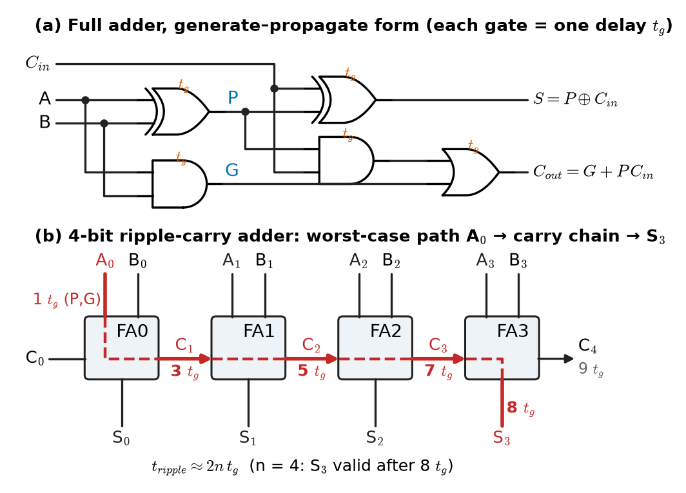
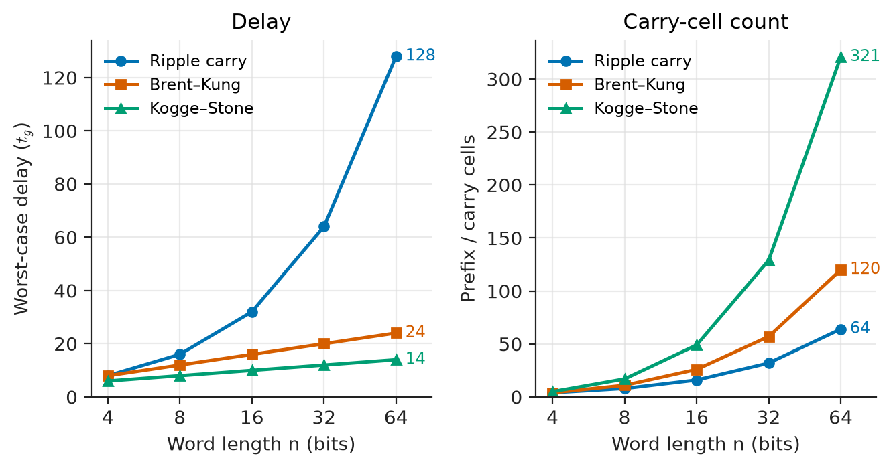
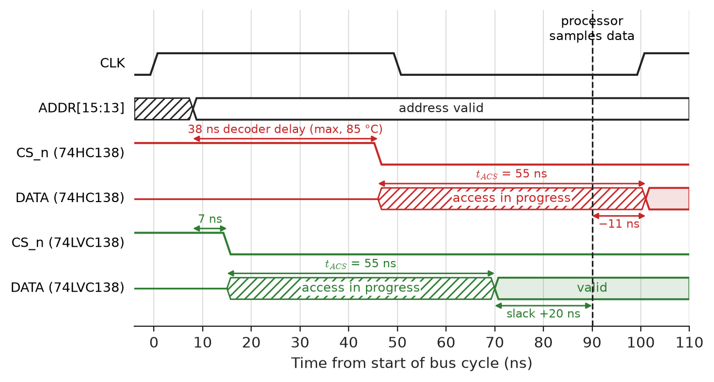
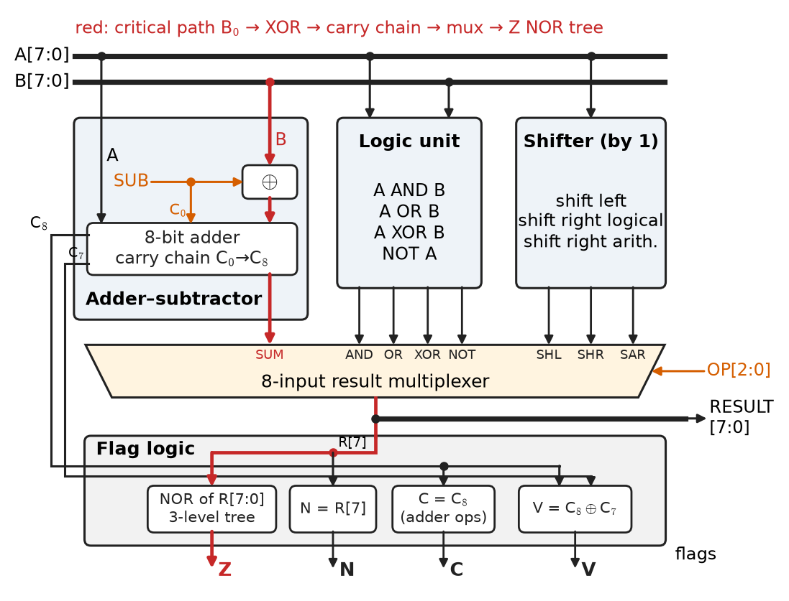
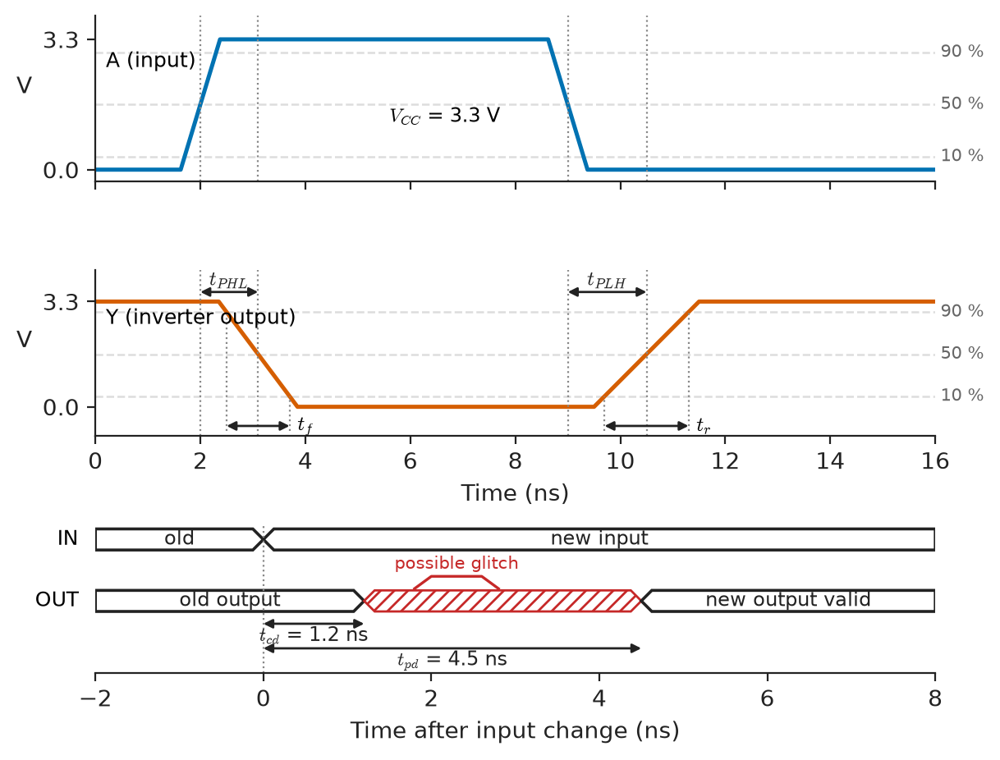

# Chapter 13 — Combinational Digital Systems

*Part III · Digital Electronics*

An engine-bay body controller passes every bench test at 25 °C. Its 16-bit microcontroller reads a memory-mapped analog front end through an external bus, and a 74HC138 three-to-eight decoder turns the upper address lines into chip selects. In the climatic chamber at 105 °C, one board in twenty starts returning corrupted sensor readings. Nothing is broken: the decoder is slower when hot, the chip select now arrives a few nanoseconds later, and the memory it enables no longer has its data on the bus before the processor samples it. The logic is right; the timing is not. A combinational circuit is a Boolean function only after its outputs have settled, and an engineer who designs adders, multiplexers, decoders and ALUs must know both the function and how long it takes.

> **How are the standard combinational building blocks (adders, multiplexers, decoders, encoders, comparators, ALUs, code converters) organised, and how do their structures trade logic for speed?**
> **How long does a combinational block take to produce a valid output, what changes that time, and how is it read from a datasheet or an FPGA timing report?**

| Concept | Engineering destination |
|---|---|
| Adders and subtractors | ALUs, address arithmetic, DSP accumulators, PWM timers, FPGA carry chains |
| Multiplexers | Data selection, bus sharing, barrel shifters, FPGA look-up tables |
| Demultiplexers | Strobe and enable distribution, time-division outputs, LED scanning |
| Encoders | Interrupt priority, keypad scanning, flash-ADC thermometer decoding |
| Decoders | Memory and peripheral address decoding, 7-segment and row drivers |
| Comparators | Address matching, limit and window checks in protection logic, sorting |
| Arithmetic logic units | Processor datapaths, DSP blocks, flags for branch decisions |
| Code converters | Gray-code encoders and FIFO pointers, BCD displays, line codes |
| Timing and propagation delay | Bus timing budgets, FPGA timing closure, worst-case corners |

**Roadmap.** Arithmetic first, because it sets the critical path of most systems: adders and subtractors (13.1) → the selection blocks: multiplexers (13.2), demultiplexers (13.3), encoders (13.4) and decoders (13.5) → comparison and arithmetic combined: comparators (13.6) and ALUs (13.7) → code converters (13.8) → what all of them have in common, propagation delay and how it is budgeted (13.9).

---

## 13.1 Adders and subtractors

> **Boundary.** Binary and two's-complement representation, overflow and the arithmetic rules are in [Chapter 11](11-digital-number-systems.md); Boolean algebra, gates, Karnaugh maps and minimisation in [Chapter 12](12-boolean-algebra-and-logic-gates.md). This chapter uses those results to build blocks; transistor-level gate design and the RC origin of gate delay belong to [Chapter 33](../part-8-integrated-circuits-and-vlsi/33-cmos-fundamentals.md).

### Half and full adders

Adding two one-bit numbers $A$ and $B$ gives a sum bit and a carry bit. The **half adder** computes

$$
S=A\oplus B,\qquad C=A\cdot B
$$

Adding a carry-in $C_{in}$ as well needs a **full adder**:

$$
S=A\oplus B\oplus C_{in},\qquad C_{out}=AB+C_{in}(A\oplus B)
$$

Both follow directly from the truth table of binary addition (Chapter 12 minimises it on a Karnaugh map). The carry expression is the key to everything that follows, so it is worth naming its two parts. The **generate** signal $G=AB$ says that this bit position produces a carry regardless of the carry-in. The **propagate** signal $P=A\oplus B$ says that it passes an incoming carry through. Then

$$
C_{out}=G+P\,C_{in}
$$

> **Status of the principle: Full-adder equations and the generate–propagate form**
> *Derived.* They follow from the truth table of one-bit binary addition and Boolean algebra; they are exact for any logic family.

### The ripple-carry adder and its delay

Chaining $n$ full adders, carry-out to carry-in, gives an $n$-bit **ripple-carry adder** (Figure 13.1). It is the smallest adder (one full adder per bit) and the slowest. In the worst case a carry generated in bit 0 must travel through every stage; adding 1 to $0\text{x}\text{FFFF}$ is the classic example. If $P$ and $G$ take one gate delay $t_g$ and each carry stage is an AND–OR of two gate delays, the last sum bit settles after about

$$
t_{ripple}\approx 2n\,t_g
$$

so the delay grows linearly with the word length. A 64-bit ripple adder is roughly eight times slower than an 8-bit one.

<!-- FIGURE 13.1 | figures/ch13/fig-13-1-full-adder-ripple-carry.png | schematic | Full adder in generate-propagate form and a 4-bit ripple-carry adder with its critical path. | Content: left: full adder drawn as gates: XOR producing P = A xor B, AND producing G = AB, second XOR producing S = P xor Cin, AND-OR producing Cout = G + P Cin; label each gate with one gate delay tg. Right: four full-adder boxes FA0 to FA3 left to right with inputs A0..A3, B0..B3, carry chain C0 -> C1 -> C2 -> C3 -> C4 and outputs S0..S3; highlight the worst-case path from A0 through the carry chain to S3 in red, annotated with cumulative delays 1 tg (P,G), 3, 5, 7 tg (carries C1 to C3) and 8 tg (S3). -->



*Figure 13.1 — Full adder in generate-propagate form and a 4-bit ripple-carry adder with its critical path.*

### Faster carries: lookahead and parallel prefix

The generate–propagate form can be expanded so that a carry depends directly on the inputs rather than on the previous carry. For a 4-bit group,

$$
C_4=G_3+P_3G_2+P_3P_2G_1+P_3P_2P_1G_0+P_3P_2P_1P_0C_0
$$

which is a two-level AND–OR expression: every carry in the group is available after the same few gate delays. This is the **carry-lookahead adder** (CLA). Its cost is the growing fan-in of the AND and OR terms, so practical designs stop at groups of four and compute group generate and propagate signals $G_{3:0}$ and $P_{3:0}$ that feed a second level of lookahead.

Taken to its conclusion, lookahead becomes a **parallel-prefix adder**. The operator $(G,P)\circ(G',P')=(G+PG',\,PP')$ is associative, so the carries for all $n$ bits can be computed with a tree of depth $\log_2 n$. Different trees trade depth, wiring and fan-out: **Kogge–Stone** has the minimum depth and fan-out of 2 but many cells and long wires; **Brent–Kung** uses about $2\log_2 n-1$ levels and far fewer cells; **Sklansky**, **Han–Carlson** and **Ladner–Fischer** sit between them. Two other common structures avoid a full tree: the **carry-select adder** computes each upper block twice, once for carry-in 0 and once for carry-in 1, and picks the right answer with a multiplexer when the real carry arrives; the **carry-skip adder** lets a carry bypass a block whose bits all propagate.

The listing compares the depth and cell count of these structures in the same unit-gate model.

```python
import math

def adder_cost(n):
    """(worst-case gate delays, carry cells) in the unit-gate model."""
    L = int(math.log2(n))
    return {
        "ripple": (2 * n, n),
        "brent-kung": (2 * (2 * L - 1) + 2, 2 * n - 2 - L),
        "kogge-stone": (2 * L + 2, n * L - n + 1),
    }

print(f"{'n':>3}" + "".join(f"{k:>14}" for k in adder_cost(8)))
for n in (8, 16, 32, 64):
    cells = (str(d) + "tg/" + str(c) for d, c in adder_cost(n).values())
    print(f"{n:>3}" + "".join(f"{s:>14}" for s in cells))
```

```text
  n        ripple    brent-kung   kogge-stone
  8        16tg/8       12tg/11        8tg/17
 16       32tg/16       16tg/26       10tg/49
 32       64tg/32       20tg/57      12tg/129
 64      128tg/64      24tg/120      14tg/321
```

Each prefix level is counted as an AND–OR pair (two gate delays) plus one level for $P,G$ and one for the final XOR. At 32 bits Kogge–Stone is about five times faster than ripple carry and costs four times as many carry cells; Brent–Kung recovers most of the speed for less than twice the cells. Figure 13.2 plots the trend. Real silicon is less tidy, because long wires and high fan-out slow the tree adders, but the ranking holds, and it is why every high-speed processor ALU uses a prefix adder while small microcontrollers and FPGAs often use ripple carry.

<!-- FIGURE 13.2 | figures/ch13/fig-13-2-adder-delay-vs-width.png | plot | Worst-case delay and carry-cell count of ripple, Brent-Kung and Kogge-Stone adders versus word length in the unit-gate model. | Content: two side-by-side panels with word length n = 4, 8, 16, 32, 64 on a log2 horizontal axis. Left: delay in gate delays tg, ripple (2n, rising to 128), Brent-Kung (2(2 log2 n - 1) + 2, rising to 24), Kogge-Stone (2 log2 n + 2, rising to 14). Right: number of prefix or carry cells, ripple n, Brent-Kung 2n - 2 - log2 n, Kogge-Stone n log2 n - n + 1 (321 at n = 64). Markers on each point, legend top left. -->



*Figure 13.2 — Worst-case delay and carry-cell count of ripple, Brent-Kung and Kogge-Stone adders versus word length in the unit-gate model.*

> **Status of the principle: Unit-gate delay model of adders**
> *Approximate.* Counts every gate as one equal delay and ignores fan-out and wire load; it ranks architectures correctly but underestimates the delay of wide, wire-heavy trees such as Kogge–Stone by tens of percent in real layouts.

### Adders in FPGAs

An FPGA does not build adders from general logic. Each logic slice contains a dedicated **carry chain**: a multiplexer per bit that selects either the local generate or the incoming carry, wired directly to its neighbour without passing through the programmable interconnect. In a Xilinx 7-series device a CARRY4 primitive covers 4 bits; Intel ALMs and Lattice slices have equivalents. Although this is structurally a ripple adder, the per-bit delay is only tens of picoseconds, so a 32-bit add easily runs above 300 MHz. FPGA architecture and the LUT itself are the subject of [Chapter 18](../part-4-computer-architecture-and-digital-hardware/18-memory-and-programmable-logic.md).

**Worked example — a 16-bit adder from 74HC283 parts and a 32-bit adder in an FPGA.** A legacy test fixture adds two 16-bit counts with four cascaded 74HC283 4-bit adders. At 4.5 V and 50 pF, representative typical delays are 20 ns from an $A$ or $B$ input to $C_4$, 20 ns from $C_0$ to $C_4$ and 22 ns from $C_0$ to a sum output. The worst path enters the first package at $A_0$, ripples through the carries of the next two and ends at a sum bit of the fourth:

$$
t_{16}=20+20+20+22=82\ \mathrm{ns}\quad(\text{typical})
$$

The guaranteed maximum at 25 °C is about twice the typical figure and rises another 25 % at 85 °C, so the design must allow roughly 200 ns. Inside each 74HC283 the four bits use internal lookahead, which is why one package takes 20 ns instead of four times a single full adder.

The same function in an Artix-7 FPGA (speed grade −1), as a 32-bit adder across eight CARRY4 primitives, has representative delays of 0.5 ns from the LUT through the first carry block, about 0.11 ns for each of the six middle blocks and 0.35 ns from the last block to its output:

$$
t_{32}\approx0.5+6\times0.11+0.35=1.51\ \mathrm{ns}
$$

Adding about 0.6 ns of routing at each end gives roughly 2.7 ns, comfortably inside a 4 ns (250 MHz) clock period. The FPGA adder is twice as wide and about 30 times faster than the discrete one at its typical rating.

### Subtraction

Subtraction is addition of the two's complement: $A-B=A+\overline B+1$ (Chapter 11). An **adder–subtractor** therefore needs only an XOR on each $B$ input, controlled by a mode bit $M$ that also drives the carry-in:

$$
B_i'=B_i\oplus M,\qquad C_0=M
$$

With $M=0$ the circuit adds; with $M=1$ it inverts $B$ and adds 1, so it subtracts. The carry-out then means "no borrow" for unsigned operands, and signed overflow is detected as $V=C_n\oplus C_{n-1}$, the rule derived in Chapter 11. A separate **full subtractor** with a borrow chain exists in textbooks and in a few serial arithmetic units, but nearly every real design uses the adder–subtractor because it shares the adder's carry structure.

---

## 13.2 Multiplexers

### The selection function

A **multiplexer** (mux) routes one of $2^k$ data inputs to its output under the control of $k$ select lines. A 2:1 mux is

$$
Y=\overline S\,D_0+S\,D_1
$$

and a 4:1 mux is $Y=\overline{S_1}\,\overline{S_0}D_0+\overline{S_1}S_0D_1+S_1\overline{S_0}D_2+S_1S_0D_3$. Larger multiplexers are built as trees of smaller ones: an 8:1 mux is two 4:1 muxes and a 2:1 mux, with the most significant select line driving the last stage. The delay from the data inputs is a few gate delays; the delay from the select lines is usually longer, because a select change must decode and then gate.

Representative parts are the 74HC157 (quad 2:1), 74HC153 (dual 4:1) and 74HC151 (8:1 with complementary outputs). The 74HC4051 and 74HC4053 look similar but are *analog* multiplexers, CMOS transmission gates with an on-resistance of 50 to 100 Ω that pass voltages in both directions; they select sensor channels ahead of an ADC rather than logic levels.

### A multiplexer is a universal function

Any Boolean function of $k$ variables can be written by **Shannon expansion** about one variable,

$$
f(x_1,\dots,x_k)=\overline{x_1}\,f(0,x_2,\dots,x_k)+x_1\,f(1,x_2,\dots,x_k)
$$

which is exactly a 2:1 mux selected by $x_1$. Repeating the expansion shows that a $2^k$:1 mux whose data inputs are tied to the constants of the truth table implements *any* $k$-input function. This is literally how an FPGA look-up table works: a 6-input LUT is 64 bits of configuration memory feeding a 64:1 multiplexer tree whose select lines are the six logic inputs. It is also why mux-based logic design (pass-transistor and transmission-gate muxes in CMOS) appears in Chapter 33.

> **Status of the principle: Shannon expansion**
> *Derived.* An identity of Boolean algebra, true for every function; it underlies multiplexer-based logic, LUTs and binary decision diagrams used in synthesis tools.

### Muxes versus tri-state buses

Several sources can share one destination either through a mux or through **tri-state drivers** on a common wire, with exactly one driver enabled at a time. Board-level buses (the data bus of an external SRAM, a 74LVC245 transceiver) still use tri-states, because the wire runs between packages. Inside ASICs and FPGAs internal tri-state buses have essentially disappeared: two drivers briefly enabled together during a select change cause contention current, and a bus with no driver floats. Synthesis tools convert internal tri-state descriptions to multiplexers.

### Barrel shifters

A **barrel shifter** shifts or rotates an $n$-bit word by any amount from 0 to $n-1$ in one combinational pass. It is built from $\log_2 n$ layers of 2:1 multiplexers; layer $j$ either passes its input or shifts it by $2^j$ positions. A 32-bit shifter therefore needs 5 layers and $5\times32=160$ two-input multiplexers, and its delay is five mux delays regardless of the shift amount. Barrel shifters serve floating-point normalisation (Chapter 11), the shift operands of Arm instructions, and bit-field extraction in network packet processors.

---

## 13.3 Demultiplexers

A **demultiplexer** does the reverse of a multiplexer: it sends one input to one of $2^k$ outputs selected by $k$ address lines, holding the others inactive. Output $i$ is

$$
Y_i=D\cdot m_i(S_{k-1},\dots,S_0)
$$

where $m_i$ is the $i$-th minterm of the select lines. That is a decoder with its enable used as the data input, and in practice the two are the same part: the 74HC138 three-to-eight decoder becomes a 1:8 demultiplexer when the data signal drives one of its enable pins. Its outputs are active low, so the data appears inverted on the selected line unless it drives an active-low enable.

Typical uses are distribution rather than computation:

- **Strobe distribution.** One write strobe from a processor is routed to the latch enable of one of eight output registers, selected by the address.
- **Multiplexed displays and keypads.** A demultiplexer drives one row of an LED matrix or keypad at a time, cycling fast enough (typically 100 Hz to 1 kHz per row) for persistence of vision or for scanning.
- **Analog demultiplexing.** The same analog switches as Section 13.2 route one DAC output to several sample-and-hold capacitors in a multichannel bias generator.

The engineering hazard of a demultiplexer is not the function but its outputs during a select change. If the select lines do not change at exactly the same instant, the outputs can briefly pass through an unintended code: switching the address from 011 to 100 may momentarily produce 111 or 000. A short pulse on the wrong output is harmless if it drives a data line that is sampled later, and destructive if it drives a latch enable or a clock. Section 15.5 develops these glitches and how synchronous design removes them.

---

## 13.4 Encoders

### Binary and priority encoders

An **encoder** converts a one-hot input (exactly one of $2^k$ lines active) into a $k$-bit code. For an 8-to-3 encoder each output bit is the OR of the inputs whose index has a 1 in that position:

$$
Y_0=I_1+I_3+I_5+I_7,\quad Y_1=I_2+I_3+I_6+I_7,\quad Y_2=I_4+I_5+I_6+I_7
$$

If two inputs are active at once, a plain encoder outputs the OR of their codes, which is meaningless. Real systems rarely guarantee one-hot inputs, so the useful block is the **priority encoder**, which outputs the index of the highest-priority active input and a "valid" flag that distinguishes "input 0 active" from "nothing active". The 74HC148 is the standard 8-to-3 part, with active-low inputs and enable-in and enable-out pins for cascading to 16 or more lines.

### Where encoders appear

- **Interrupt controllers.** The Arm NVIC and every programmable interrupt controller contain priority-encoding logic that picks the highest-priority pending request; Chapters 16 and 17 describe the architecture.
- **Flash ADCs.** A flash converter compares the input with $2^N-1$ reference levels at once, giving a **thermometer code** (all comparators below the input read 1). A logic stage finds the 1-to-0 boundary and encodes its position into $N$ bits. A comparator that fires out of order (a "bubble") would corrupt a plain encoder; practical designs use three-input bubble-correction gates or convert through Gray code first. Mixed-signal converter interfaces are in [Chapter 10](../part-2-analog-electronics/10-analog-integrated-circuits.md).
- **Leading-zero counting.** Floating-point normalisation and integer square-root routines need the position of the most significant 1, which is a priority encoder; processors provide it as a CLZ instruction.
- **Keypads.** A 16-key pad is scanned with a demultiplexer on the rows and a priority encoder on the columns.

---

## 13.5 Decoders

### The n-to-2^n decoder

A **decoder** turns a $k$-bit code into $2^k$ outputs, exactly one of which is active: output $i$ is the minterm $m_i$ of the inputs, ANDed with an enable. Because every minterm is available, a decoder followed by an OR gate implements any function of its inputs, a sum of minterms (Chapter 12). Decoders are cascaded through their enables: two 74HC138s with complementary enables driven by a fourth address bit make a four-to-sixteen decoder.

### Address decoding

The decoder's main job on a circuit board is **address decoding**: turning the high-order address lines of a processor bus into chip-select signals, so that each memory or peripheral occupies its own range of the memory map (Chapter 17). Inside every memory chip, row and column decoders do the same thing on a much larger scale; a 1 Mbit SRAM array with 1024 rows needs a 10-to-1024 row decoder, usually built from 2-to-4 or 3-to-8 **predecoders** whose outputs are ANDed at each row, which keeps the fan-in of each gate small.

**Worked example — will a 74HC138 meet the bus timing at 105 °C?** The opening problem, with representative numbers. A processor's external bus runs a 100 ns read cycle. The address is valid 8 ns after the cycle starts, and the processor samples data 10 ns before the cycle ends, at 90 ns. A 74HC138 at 4.5 V decodes the address into the chip select of a 55 ns SRAM (access time from chip select $t_{ACS}=55$ ns, which is longer than its address access time, so chip select is the limiting path).

The decoder's typical delay is about 13 ns, and with it the data would be valid at $8+13+55=76$ ns, inside the window. But the design must use the guaranteed maximum, which for this class of part is about 30 ns at 25 °C and 38 ns at 85 °C (the automotive-grade part's figure at 105–125 °C is higher still):

$$
t_{data}=8+38+55=101\ \mathrm{ns}>90\ \mathrm{ns}
$$

The design fails by 11 ns at 85 °C even before considering the higher temperature and board delays. It passed on the bench because typical parts at room temperature are three times faster than their guaranteed limit. Replacing the decoder with a 74LVC138 at 3.3 V, whose maximum delay is about 7 ns, gives

$$
t_{data}=8+7+55=70\ \mathrm{ns},\qquad \text{slack}=90-70=20\ \mathrm{ns}
$$

which leaves room for trace delay and temperature. The alternative is to add one wait state to the bus cycle. Either way, the decision is made from maximum delays, never typical ones.

### Display and driver decoders

A **BCD-to-7-segment decoder** maps a 4-bit decimal digit to the seven segments a–g of a display; the 74HC4511 includes a latch and segment drivers. It is a code converter as much as a decoder (Section 13.8). Larger-scale relatives drive the row lines of LCD and OLED panels (gate drivers) and the word lines of memories.

<!-- FIGURE 13.3 | figures/ch13/fig-13-3-address-decoder-timing.png | timing-diagram | Read cycle of an external bus with a 74HC138 address decoder, comparing the maximum decoder delay with that of a 74LVC138. | Content: horizontal time axis 0 to 110 ns with gridlines every 10 ns. Waveforms top to bottom: CLK edge at 0 and 100 ns; ADDR[15:13] valid from 8 ns (hatched before); CS_n from 74HC138 falling at 46 ns (8 + 38 ns max); DATA valid at 101 ns (46 + 55 ns tACS) shown red; CS_n from 74LVC138 falling at 15 ns; DATA valid at 70 ns shown green; vertical dashed line at 90 ns labelled processor samples data; arrows labelling 38 ns decoder delay, 55 ns tACS, 20 ns slack (green case) and -11 ns (red case). -->



*Figure 13.3 — Read cycle of an external bus with a 74HC138 address decoder, comparing the maximum decoder delay with that of a 74LVC138.*

---

## 13.6 Comparators

### Equality

Two $n$-bit words are equal when every bit pair matches. Each bit uses an XNOR, $E_i=\overline{A_i\oplus B_i}$, and the results are ANDed:

$$
(A=B)=\prod_{i=0}^{n-1}\overline{A_i\oplus B_i}
$$

The AND of $n$ terms is built as a tree of depth $\lceil\log_2 n\rceil$ two-input gates (or $\lceil\log_4 n\rceil$ four-input ones), so a 32-bit equality check takes one XNOR delay plus five AND levels. Equality comparators are everywhere: cache tag matching (Chapter 16), address match in an I²C or CAN controller's acceptance filter, breakpoint comparators in a debugger, and the compare-match unit of every microcontroller timer, where a counter equal to a compare register toggles a PWM output.

### Magnitude

Deciding $A>B$ requires finding the most significant bit where the words differ. Scanning from the MSB,

$$
(A>B)=A_{n-1}\overline{B_{n-1}}+E_{n-1}A_{n-2}\overline{B_{n-2}}+E_{n-1}E_{n-2}A_{n-3}\overline{B_{n-3}}+\cdots
$$

which has the same chain-of-products structure as the carry lookahead of Section 13.1, and is accelerated the same way. The 74HC85 is a 4-bit magnitude comparator with $A>B$, $A=B$ and $A<B$ cascade inputs, so that several packages compare longer words (in a slow ripple fashion).

In a processor or FPGA the cheapest magnitude comparator is a subtractor. Compute $A-B$ and read the flags: for unsigned operands $A\ge B$ exactly when the carry-out is 1 (no borrow); for signed two's-complement operands $A<B$ exactly when $N\oplus V=1$, the sign of the result corrected for overflow. This is why compare instructions (`CMP` in Arm, `SLT` in RISC-V) are subtractions that discard the result and keep the flags. Mixing the two interpretations is a classic bug: the 8-bit pattern $1000\,0000_2$ is greater than $0111\,1111_2$ as unsigned (128 > 127) and less as signed (−128 < 127).

### Window comparators in protection logic

Digital protection logic often checks that a measured value lies inside a window, $L\le X\le H$, using two magnitude comparators and an AND gate. In a motor inverter's FPGA, the phase current from a 12-bit ADC is compared every sample with overcurrent limits; a value outside the window latches a fault and disables the gate drivers within a few clock cycles, faster than any software path. The comparators themselves are combinational, but the fault latch is sequential (Chapter 14), and the analog front end that produces $X$ sets the real response time.

---

## 13.7 Arithmetic logic units

### Structure

An **arithmetic logic unit** (ALU) combines an adder–subtractor, bitwise logic and often a shifter behind an output multiplexer selected by an operation code (Figure 13.4). For an 8-bit ALU, a typical operation set is ADD, SUB, AND, OR, XOR, NOT, pass-through and shifts, selected by a 3- or 4-bit opcode. All functional units compute in parallel on every operation; the multiplexer chooses which result to keep. This wastes energy on the unused units, which is why low-power designs gate the operand inputs of idle units, but it keeps the delay equal to the slowest unit plus one mux.

The historical reference point is the 74181 (1970), a 4-bit TTL ALU with 16 logic and 16 arithmetic functions and lookahead outputs for cascading with a 74182 carry-lookahead unit. Minicomputers of the 1970s built their datapaths from these; today the same function is a few hundred cells inside a processor core or a handful of LUTs in an FPGA.

<!-- FIGURE 13.4 | figures/ch13/fig-13-4-alu-block-diagram.png | block-diagram | An 8-bit ALU built from an adder-subtractor, a logic unit and a shifter behind a result multiplexer, with flag generation. | Content: operand buses A[7:0] and B[7:0] entering from the top. Three parallel blocks: adder-subtractor (XOR on B controlled by SUB, carry-in = SUB, carry out C8 and C7 exported), logic unit (AND, OR, XOR, NOT outputs), shifter (shift left, shift right logical, shift right arithmetic by 1). An 8-input result multiplexer selects one block output under a 3-bit opcode OP[2:0]. Flag logic below the mux: Z = NOR of all 8 result bits, N = result bit 7, C = C8 (adder only), V = C8 xor C7. Outputs: RESULT[7:0] and flags N Z C V. Annotate the critical path from B0 through the XOR, carry chain, mux and Z NOR tree. -->



*Figure 13.4 — An 8-bit ALU built from an adder-subtractor, a logic unit and a shifter behind a result multiplexer, with flag generation.*

### Status flags

Most ALUs produce four flags from each result:

| Flag | Meaning | Logic |
|---|---|---|
| Z (zero) | Result is all zeros | NOR of all result bits |
| N (negative) | Result is negative as two's complement | Result MSB |
| C (carry) | Unsigned carry-out, or no-borrow on subtract | Adder carry-out $C_n$ |
| V (overflow) | Signed result out of range | $C_n\oplus C_{n-1}$ |

The flags feed conditional branches, multi-word arithmetic (the carry flag chains 32-bit additions into 64-bit ones) and saturation logic. The zero flag is often the critical path of an ALU, because it waits for the slowest sum bit and then passes through a $\log_2 n$-deep NOR tree.

> **Status of the principle: Overflow rule $V=C_n\oplus C_{n-1}$**
> *Derived.* A consequence of two's-complement arithmetic (Chapter 11): signed overflow occurs exactly when the carry into the sign bit differs from the carry out of it. It holds for addition and for subtraction performed as addition of the complement.

### Where ALUs live

The ALU at the heart of a processor datapath, and how the control unit drives its opcode, is the subject of [Chapter 16](../part-4-computer-architecture-and-digital-hardware/16-computer-architecture.md). Outside processors, small special-purpose ALUs appear in DSP blocks (an FPGA DSP48 slice combines a 25×18 multiplier with a 48-bit ALU), in network switches (header field arithmetic), in motor-control timers (dead-time insertion as an add and compare), and in safety controllers, which run two ALUs in lockstep and compare their results every cycle to detect hardware faults.

---

## 13.8 Code converters

### Gray code

In the **reflected binary Gray code**, consecutive values differ in exactly one bit. Conversion from binary $B$ to Gray $G$ is a single layer of XOR gates,

$$
G_i=B_i\oplus B_{i+1},\qquad G_{n-1}=B_{n-1}
$$

and the reverse is a chain, each binary bit being the XOR of all Gray bits at and above it:

$$
B_i=G_{n-1}\oplus G_{n-2}\oplus\cdots\oplus G_i
$$

so Gray-to-binary has a delay that grows with $n$, like a ripple carry, unless built as an XOR prefix tree.

The single-bit-change property matters wherever a value is read while it is changing:

- **Absolute position encoders.** An optical encoder disc read by $n$ photodetectors cannot make all tracks change at exactly the same angle.
- **Asynchronous FIFO pointers.** A counter in one clock domain read by logic in another (Chapter 14) can be sampled mid-transition; with Gray code the sampled value is either the old or the new count, never a wild value.
- **Karnaugh maps.** The ordering of rows and columns in a K-map (Chapter 12) is a Gray code, for the same reason: adjacent cells differ in one variable.

**Worked example — why a robot joint encoder uses Gray code.** A 10-bit absolute encoder on a robot wrist reports 1024 positions per revolution, 0.352° each. Between position 511 ($01\,1111\,1111_2$) and 512 ($10\,0000\,0000_2$) all ten bits change. The tracks are read by separate photodiodes whose edges are offset by mechanical tolerance; suppose they are spread over 0.05° of rotation. At 60 rpm the shaft turns 360° per second, so the transition is spread over

$$
\frac{0.05^\circ}{360^\circ/\mathrm{s}}=139\ \mu\mathrm{s}
$$

and a controller sampling every 125 µs (an 8 kHz servo loop) is certain to take at least one sample inside the window. That sample could read any of the $2^{10}=1024$ codes, from 0 to 1023, a position error of up to half a revolution that the servo loop would treat as real and react to violently. In Gray code, consecutive positions differ in exactly one bit by construction; the listing checks the 511-to-512 transition and the round trip for all 1024 codes.

```python
def bin2gray(b):
    return b ^ (b >> 1)

def gray2bin(g):
    b = 0
    while g:
        b ^= g
        g >>= 1
    return b

for v in (511, 512):
    print(v, format(v, "010b"), format(bin2gray(v), "010b"))
print("bits differing:", bin(bin2gray(511) ^ bin2gray(512)).count("1"))
assert all(gray2bin(bin2gray(v)) == v for v in range(1024))
```

```text
511 0111111111 0100000000
512 1000000000 1100000000
bits differing: 1
```

Only the MSB of the Gray code changes. The worst error from a mid-transition sample falls from half a revolution to one count, 0.352°, which the servo loop's filtering absorbs. The controller converts Gray to binary with the XOR chain before using the position.

### BCD and display codes

**Binary-coded decimal** stores each decimal digit in four bits. It survives in displays, real-time clock chips (whose time registers are BCD), utility meters and some financial arithmetic. Converting binary to BCD is not a simple wiring: the **double-dabble** algorithm shifts the binary number left one bit at a time into the BCD digits, adding 3 to any digit that is 5 or more before each shift, so that it carries correctly into the next decade. A 16-bit binary value needs 16 shift steps and five BCD digits. In combinational form it unrolls into a triangular array of add-3 cells; in a microcontroller it is a short loop. BCD to 7-segment is a pure look-up (the 74HC4511 of Section 13.5).

### Thermometer, one-hot and line codes

Other converters in common use:

- **Thermometer to binary**, the flash-ADC encoder of Section 13.4, and the reverse, **binary to thermometer**, used by segmented DACs whose most significant bits drive $2^k-1$ equal unit elements so that every code step switches one more element (good differential linearity).
- **One-hot to binary** (an encoder) and **binary to one-hot** (a decoder), used at the boundary between state machines encoded one way and logic that expects another (Chapter 14).
- **Line codes** such as 8b/10b and 64b/66b, which map data words to code words with guaranteed transitions and DC balance for serial links (PCIe, USB 3, Ethernet). They are look-up-table converters with a running-disparity state; their purpose belongs to communications, covered in *Circuits, Signals and Communications*, [Ch. 27](https://github.com/The-Studio-of-Sadiq/Circuits-Signals-and-Communications/blob/main/part-6-communication-theory/27-digital-communication.md).

---

## 13.9 Timing and propagation delay

### Defining the delays

Every combinational block takes time to respond. A datasheet or timing model defines it by four quantities measured between the 50 % points of input and output edges (Figure 13.5):

- $t_{PLH}$, the delay for an output rising from low to high, and $t_{PHL}$ for an output falling. They differ because the pull-up and pull-down transistors differ.
- **Propagation delay** $t_{pd}$: the maximum time from an input change to a *stable, valid* output. Static timing uses the larger of $t_{PLH}$ and $t_{PHL}$, at the slowest conditions.
- **Contamination delay** $t_{cd}$: the minimum time from an input change until the output *starts* to change. Datasheets for standard logic rarely give it; FPGA and ASIC timing models always do, because hold-time checks (Chapter 14) depend on it.
- **Transition time** $t_t$ (rise and fall, usually 10–90 %), which depends on load capacitance and affects the delay of the next stage.

Between $t_{cd}$ and $t_{pd}$ the output is undefined: it may hold its old value, move to the new one, or pass through intermediate values (glitches). A combinational block behaves as a Boolean function only *after* $t_{pd}$.

<!-- FIGURE 13.5 | figures/ch13/fig-13-5-propagation-delay-definitions.png | timing-diagram | Definitions of propagation delays, contamination delay and transition times for an inverting gate and for a multi-input block. | Content: upper panel: input A rising then falling edge with 10, 50 and 90 percent levels marked; output Y of an inverter falling then rising; arrows for tPHL and tPLH between 50 percent crossings, tf and tr between 10 and 90 percent points, VCC = 3.3 V scale. Lower panel: input bus IN changing at t = 0; output bus OUT shown valid (old value) until tcd = 1.2 ns, hatched undefined region with a possible glitch from tcd to tpd = 4.5 ns, then valid new value; arrows labelling tcd and tpd. -->



*Figure 13.5 — Definitions of propagation delays, contamination delay and transition times for an inverting gate and for a multi-input block.*

> **Status of the principle: The propagation-delay abstraction**
> *Approximate.* Replacing continuous analog edges by two delays, $t_{cd}$ and $t_{pd}$, measured at 50 % thresholds is valid while edges are fast compared with the delays and the interconnect is short; it breaks down with slow input edges, crosstalk, ringing on long traces and supply droop, where the delay depends on waveform detail.

### What sets the delay

A gate's delay is, to a first approximation, the time its output resistance takes to charge the load capacitance, an RC time constant (*Circuits, Signals and Communications*, [Ch. 6 §6.5](https://github.com/The-Studio-of-Sadiq/Circuits-Signals-and-Communications/blob/main/part-2-transient-and-ac-analysis/06-first-order-circuits.md)); the transistor-level origin is developed in Chapter 33. From the user's side, four factors move it:

1. **Supply voltage.** Lower $V_{CC}$ means less drive current and slower switching. A 74HC00 has a typical $t_{pd}$ of about 45 ns at 2 V, 9 ns at 4.5 V and 8 ns at 6 V.
2. **Temperature.** Carrier mobility falls as temperature rises, so CMOS slows when hot: the 74HC00's guaranteed maximum is about 18 ns at 25 °C, 23 ns up to 85 °C and 27 ns up to 125 °C (at 4.5 V).
3. **Load capacitance.** Each picofarad of load adds delay through the output resistance. Datasheets specify delay at 15 pF or 50 pF loads; delays at other loads scale roughly linearly.
4. **Process.** Parts from different wafers differ. "Typical" means a nominal process at 25 °C and nominal supply; "maximum" covers the slow process corner, lowest supply and highest temperature in the stated range.

These are the **PVT corners** (process, voltage, temperature) that FPGA and ASIC timing analysis checks automatically and that a board designer must check by hand from the datasheet's maximum column.

**Table 13.1 — Representative propagation delays (typical values; check the specific datasheet).**

| Element | Conditions | $t_{pd}$ typical | $t_{pd}$ maximum |
|---|---|---|---|
| 74HC00 NAND | 4.5 V, 50 pF, 25 °C | 9 ns | 18 ns (23 ns to 85 °C) |
| 74HC00 NAND | 2.0 V, 50 pF, 25 °C | 45 ns | 90 ns |
| 74AHC00 NAND | 5 V, 50 pF | 5 ns | 8–9 ns |
| 74LVC1G00 NAND | 3.3 V, 50 pF | 2.5 ns | 4.5 ns |
| 74AUP1G00 NAND | 1.8 V, 15 pF | 3–4 ns | 8 ns |
| 74HC157 2:1 mux, data to Y | 4.5 V, 50 pF | 11–14 ns | 30 ns |
| 74HC138 decoder, A to Y | 4.5 V, 50 pF | 13 ns | 30 ns (38 ns to 85 °C) |
| 74HC283 4-bit adder, A to Σ | 4.5 V, 50 pF | 18–22 ns | 40–45 ns |
| FPGA LUT6 (28 nm, mid speed grade) | internal | 0.10–0.12 ns | — |
| FPGA local route (28 nm) | internal | 0.2–1 ns | — |
| FPGA carry per 4 bits (28 nm) | internal | about 0.1 ns | — |
| iCE40 LUT4 (40 nm, low power) | internal | 0.4–0.5 ns | — |
| CMOS FO4 inverter delay | 28 nm / 7 nm | 12–18 ps / 5–8 ps | — |

The table shows three regimes. Discrete logic (5 to 50 ns per block) is dominated by package and board capacitance; a signal crossing two packages and a trace costs more than any logic it performs. FPGA logic (about 0.1 ns per LUT) is dominated by programmable routing, which typically accounts for 50 to 70 % of a path's delay. ASIC logic (picoseconds per gate) is increasingly dominated by wire resistance and capacitance. The FPGA numbers are representative of Xilinx 7-series and Intel Cyclone-class devices as reported by their timing tools; they vary by speed grade and device.

### Critical path and timing budget

The **critical path** of a combinational network is the input-to-output path with the largest sum of delays. Static timing analysis finds it without simulation by adding delays along every path, the method used by FPGA tools and ASIC sign-off (Chapters 19 and 34). Two complications matter in practice:

- **False paths.** A structural path that can never be sensitised (for example, through both the "add" and "shift" units of an ALU when the output mux selects only one) is excluded by the designer, or the tool overestimates the delay.
- **Data-dependent delay.** The ripple adder of Section 13.1 takes $2n$ gate delays only for inputs that propagate a carry across every bit; most additions settle much sooner. Synchronous design must budget for the worst case anyway, which is why asynchronous and self-timed circuits, which signal completion, remain an active research topic.

**Worked example — derating delay for supply, temperature and load.** A 74HC00 in an industrial input module drives four gate inputs and 15 cm of PCB trace, a total load of about 85 pF, at $V_{CC}=4.5$ V, specified to 85 °C. The datasheet maximum is 23 ns at 50 pF over −40 to 85 °C. Comparing typical delays at 15 pF and 50 pF loads across the family suggests that the output resistance in the delay sense is about 85 Ω, so each added picofarad costs roughly $0.69\times85\ \Omega\approx0.06$ ns. The extra 35 pF adds

$$
\Delta t\approx0.69\times85\ \Omega\times35\ \mathrm{pF}=2.1\ \mathrm{ns}
$$

giving a worst-case delay of about 25 ns, nearly three times the 9 ns typical figure printed on the first page of the datasheet. If the module were redesigned for a 3.3 V supply, a 74HC part would slow by roughly half again (its delay rises steeply below 4.5 V), whereas a 74LVC1G00 would deliver 4.5 ns maximum at 50 pF; at 85 pF the same derating approach, with the LVC part's lower output resistance of roughly 25 Ω, adds about 0.6 ns. The lesson is that the datasheet's headline delay is a typical value at light load and room temperature; the design value is the maximum, derated for the actual load.

### Delay is a chain, timing is a budget

Combinational delay is one term in a larger equation. Once the outputs of a block feed a register, the clock period must cover the register's own clock-to-output delay, the combinational delay and the next register's setup time, with margin for clock skew and jitter. That inequality, and its counterpart for hold time that uses $t_{cd}$, are developed in Section 14.8; glitches in the window between $t_{cd}$ and $t_{pd}$ are the subject of Section 15.5; and the board-level version, where traces add delay and reflections (*Circuits, Signals and Communications*, [Ch. 14 §14.5](https://github.com/The-Studio-of-Sadiq/Circuits-Signals-and-Communications/blob/main/part-3-advanced-network-theory/14-transmission-lines.md)) add ringing, is worked in Section 15.4.

---

## What remains open

| Open question | Where it is answered |
|---|---|
| How are results held between operations, and how fast can a register-to-register path be clocked? | Chapter 14 (registers, setup and hold, timing constraints) |
| What happens when combinational outputs glitch, and how does a design tolerate it? | Chapter 15, Section 15.5 |
| How does an ALU fit into a processor datapath under control of an instruction decoder? | [Chapter 16](../part-4-computer-architecture-and-digital-hardware/16-computer-architecture.md) |
| How are LUTs, carry chains and routing organised inside an FPGA? | [Chapter 18](../part-4-computer-architecture-and-digital-hardware/18-memory-and-programmable-logic.md) |
| How are combinational blocks described in Verilog and VHDL and synthesised? | [Chapter 19](../part-4-computer-architecture-and-digital-hardware/19-hardware-description-languages.md) |
| Where does gate delay come from at transistor level, and how is it sized? | [Chapter 33](../part-8-integrated-circuits-and-vlsi/33-cmos-fundamentals.md) |
| How are chip-level critical paths found and closed across PVT corners? | [Chapter 34](../part-8-integrated-circuits-and-vlsi/34-vlsi-design.md) |
| How do long traces turn edges into reflections and ringing? | *Circuits, Signals and Communications*, [Ch. 14](https://github.com/The-Studio-of-Sadiq/Circuits-Signals-and-Communications/blob/main/part-3-advanced-network-theory/14-transmission-lines.md) |

**Next:** Chapter 14 adds memory to logic, building latches, flip-flops, registers, counters and state machines, and turns the propagation delays of this chapter into the setup, hold and clock-period constraints that every synchronous system must meet.
