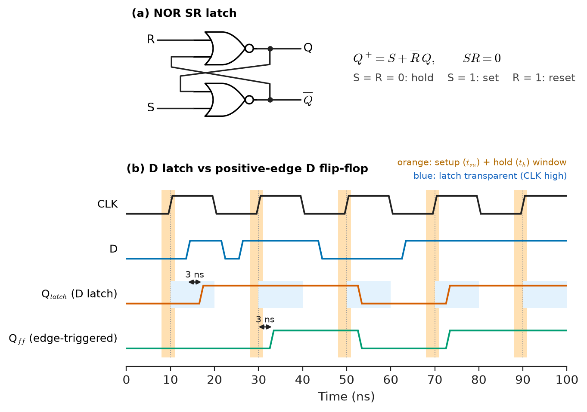
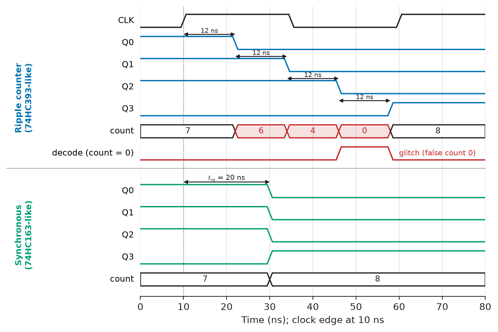
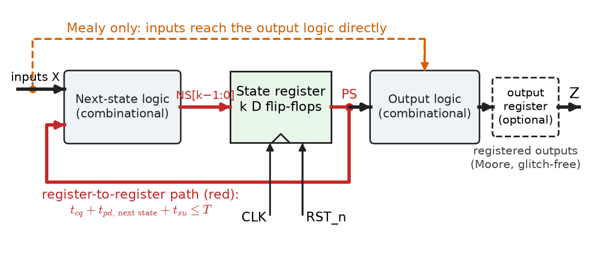
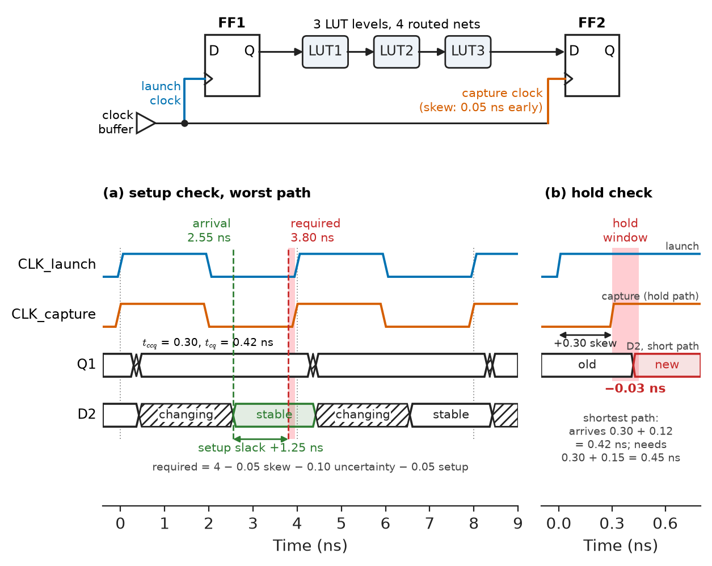
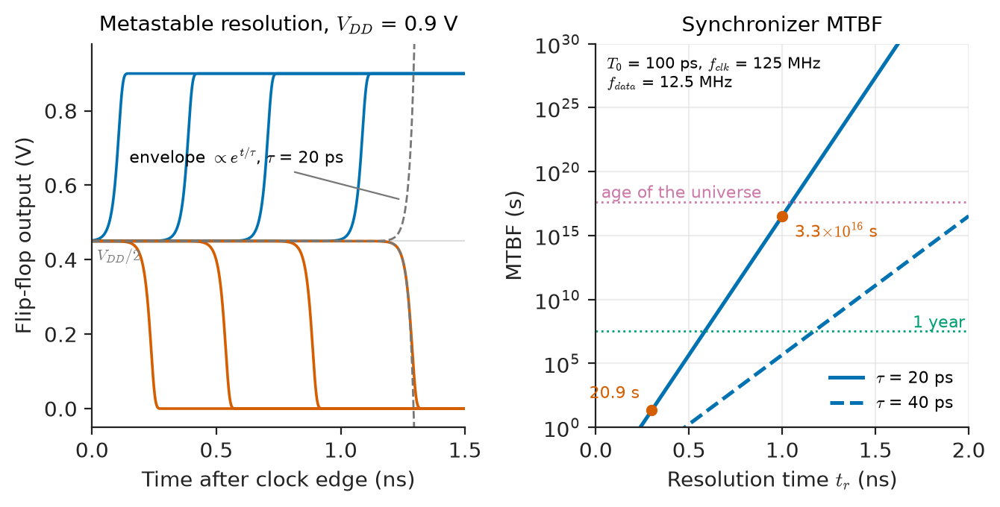
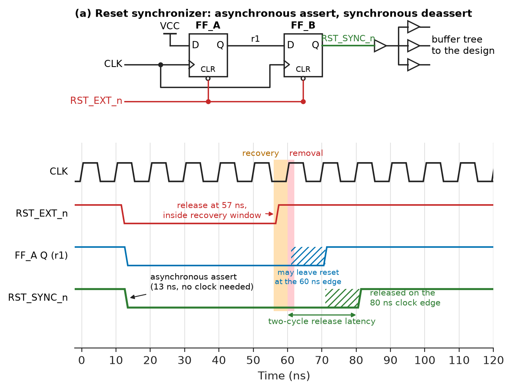

# Chapter 14 — Sequential Digital Systems

*Part III · Digital Electronics*

An e-bike motor controller passes ten thousand bench power cycles and then, in the field, refuses to start about once in every few thousand switch-ons. The rider cycles the power and it works. The fault is traced to the commutation state machine in the controller's FPGA: it is one-hot encoded, and on the bad power-ups two of its state bits are found set at once, a state that has no exit. The reset line from the supply supervisor is asynchronous, and when its release happens to land within a few hundred picoseconds of a clock edge, some flip-flops leave reset on that edge and others on the next. Nothing in the logic equations is wrong. The circuit has memory, memory has timing, and timing has rules that combinational logic never needed: setup and hold windows, metastability, clock domains and reset release.

> **How are latches, flip-flops, registers, counters and shift registers built from gates and feedback, and how are they combined into finite-state machines?**
> **What timing rules must a synchronous circuit obey, how fast can it be clocked, and what happens when a signal crosses between unrelated clocks or a reset is released at the wrong moment?**

| Concept | Engineering destination |
|---|---|
| Latches | Address latches on multiplexed buses, latch-based ASIC timing, accidental latches in HDL |
| Flip-flops | Every synchronous register in processors, FPGAs and controllers |
| Registers | Pipeline stages, peripheral registers, register files |
| Counters | Timers, PWM generators, frequency dividers, event counting |
| Shift registers | GPIO expansion, serial links, PRBS test patterns, CRC |
| Finite-state machines | Protocol controllers, motor commutation, sequencing and interlocks |
| State encoding | Speed and area of FSMs, recovery from illegal states |
| Timing constraints | Maximum clock frequency, hold fixing, timing closure |
| Clock-domain considerations | Synchronizers, MTBF, asynchronous FIFOs, multi-clock SoCs |
| Reset strategies | Reliable start-up, brown-out recovery, FPGA and ASIC reset trees |

**Roadmap.** Memory from feedback: latches (14.1) and flip-flops (14.2) → the standard sequential blocks: registers (14.3), counters (14.4), shift registers (14.5) → the general structure, finite-state machines (14.6), and how their states are encoded (14.7) → the rules that keep them correct: timing constraints (14.8), clock-domain crossings and metastability (14.9) and reset strategies (14.10).

---

## 14.1 Latches

> **Boundary.** Gates, Boolean algebra and minimisation are from [Chapter 12](12-boolean-algebra-and-logic-gates.md), and propagation and contamination delay from [Chapter 13](13-combinational-digital-systems.md), Section 13.9. The transistor-level construction of latches and flip-flops (transmission-gate latches, keepers, sense-amplifier flip-flops) belongs to [Chapter 33](../part-8-integrated-circuits-and-vlsi/33-cmos-fundamentals.md); this chapter works at the gate and block level.

### The SR latch

Two cross-coupled NOR gates form the simplest memory, the **SR latch** (Figure 14.1, top). With $S=R=0$ each gate's output holds the other's input, and the pair has two stable states, $Q=1$ or $Q=0$. Raising $S$ forces $Q=1$; raising $R$ forces $Q=0$. Its next-state behaviour is

$$
Q^{+}=S+\overline R\,Q,\qquad SR=0
$$

The constraint $SR=0$ is real: with both inputs high both outputs go low, and if both inputs then fall together, the latch races to an unpredictable state, an early encounter with metastability (Section 14.9). The NAND version has active-low inputs, $\overline S$ and $\overline R$. SR latches survive in switch debouncers (a changeover switch driving $\overline S$ and $\overline R$ directly removes contact bounce) and inside every flip-flop.

### The D latch

Adding an enable $E$ (often called the clock or gate) and a single data input gives the **D latch**:

$$
Q^{+}=E\,D+\overline E\,Q
$$

While $E=1$ the latch is **transparent**: $Q$ follows $D$ after a propagation delay. When $E$ falls, $Q$ holds the last value of $D$. Like any storage element, it needs $D$ stable for a setup time before $E$ falls and a hold time after.

> **Status of the principle: Bistable storage by positive feedback**
> *Fundamental.* Two inverting stages in a loop with loop gain above 1 at the switching point have exactly two stable equilibria and one unstable one; every static memory element, from an SR latch to an SRAM cell, is this circuit. The unstable equilibrium is the origin of metastability.

### Where latches are used, and where they are a mistake

The 74HC573 is an octal transparent latch. Its classic job is demultiplexing an address/data bus: an 8051-class microcontroller drives the low address byte on port 0, pulses ALE (address latch enable), and the 74HC573 holds that byte while the same pins carry data. High-performance ASICs use latch-based (two-phase) timing deliberately, because a transparent latch lets a slow logic stage borrow time from the next one. In FPGA design, by contrast, a latch is almost always an accident: an HDL `if` without an `else` in combinational code infers one (Chapter 19), and FPGA timing tools analyse latches poorly. Synthesis warnings about inferred latches should be treated as errors unless the latch was intended.

---

## 14.2 Flip-flops

### Edge triggering

A **flip-flop** samples its input only at a clock edge. The standard construction is **master–slave**: two D latches in series with opposite enables. While the clock is low the master is transparent and the slave holds; when the clock rises the master closes, capturing $D$, and the slave opens, passing the captured value to $Q$. The result changes only on the rising edge:

$$
Q^{+}=D\quad\text{at each active clock edge}
$$

Figure 14.1 contrasts the two behaviours: the latch output follows every change of $D$ while enabled; the flip-flop output changes once per cycle.

<!-- FIGURE 14.1 | figures/ch14/fig-14-1-latch-vs-flip-flop.png | timing-diagram | NOR SR latch, and the response of a D latch and a positive-edge D flip-flop to the same data and clock waveforms. | Content: top: schematic of two cross-coupled NOR gates with inputs S and R and outputs Q and Q-bar. Bottom: timing diagram over 0 to 100 ns with CLK (period 20 ns, rising edges at 10, 30, 50, 70, 90 ns); D with transitions at 14 ns (rise), 22 ns (fall), 26 ns (rise), 44 ns (fall) and 63 ns (rise); Q_latch (transparent while CLK high) following D during the high phases with a 3 ns delay (the 22–26 ns low pulse falls while CLK is low and is not passed); Q_ff changing only 3 ns after rising edges at 30 ns (to 1), 50 ns (to 0) and 70 ns (to 1). Shade the setup and hold window around each rising edge. -->



*Figure 14.1 — NOR SR latch, and the response of a D latch and a positive-edge D flip-flop to the same data and clock waveforms.*

The other flip-flop types are D flip-flops with logic in front:

| Type | Characteristic equation | Typical use |
|---|---|---|
| D | $Q^{+}=D$ | Everything synchronous |
| D with enable | $Q^{+}=EN\cdot D+\overline{EN}\cdot Q$ | Registers that load only on command |
| T (toggle) | $Q^{+}=T\oplus Q$ | Counters, frequency dividers |
| JK | $Q^{+}=J\overline Q+\overline K Q$ | Legacy designs (74HC109, 74HC112) |

> **Status of the principle: Flip-flop characteristic equations**
> *Derived.* Each follows from the D flip-flop and the combinational logic in front of it; they describe behaviour at clock edges only, and only when setup and hold times are met.

### The timing parameters

A flip-flop is characterised by three times measured from the active clock edge:

- **Setup time** $t_{su}$: $D$ must be stable this long *before* the edge.
- **Hold time** $t_h$: $D$ must remain stable this long *after* the edge.
- **Clock-to-output delay** $t_{cq}$ (maximum, for setup analysis) and its minimum or contamination value $t_{ccq}$ (for hold analysis).

Asynchronous set and clear inputs add **recovery** and **removal** times, the setup and hold equivalents for releasing a reset (Section 14.10).

**Table 14.1 — Representative flip-flop timing (typical values; check the specific datasheet or timing model).**

| Element | Conditions | $t_{cq}$ | $t_{su}$ | $t_h$ | Max toggle rate |
|---|---|---|---|---|---|
| 74HC74 | 4.5 V, 50 pF | 15 ns typ, 44 ns max to 85 °C | 20–25 ns min | 0–5 ns | 25 MHz guaranteed, about 70 MHz typ |
| 74LVC1G79 / 1G80 | 3.3 V, 50 pF | 2–4.5 ns | 1–2 ns | 0.3–1 ns | about 175 MHz |
| FPGA slice flip-flop (28 nm) | internal | 0.3–0.45 ns | 0.03–0.1 ns | 0.1–0.3 ns | above 600 MHz (clock-tree limited) |
| ASIC standard-cell flip-flop (7 nm) | nominal corner | 30–50 ps | 10–30 ps | 5–20 ps | multi-GHz |

The "minimum" setup time on a standard-logic datasheet is a *requirement* on the user: the data must arrive at least that early. The 74HC74's typical maximum toggle rate is nearly three times its guaranteed figure, the same typical-versus-maximum gap seen with combinational parts in Chapter 13.

### Clock enables and clock gating

A register that should load only sometimes is built with an enable multiplexer in front of $D$ (the second row of the table), not by gating its clock with an AND gate. A gated clock adds delay and skew to that branch of the clock tree and glitches if the enable changes while the clock is high. ASICs do gate clocks to save dynamic power, typically 20–40 % of a block's clock power, but only through **integrated clock-gating cells** that latch the enable while the clock is low. FPGAs provide dedicated clock-enable pins on every flip-flop and global clock buffers with glitch-free enables.

---

## 14.3 Registers

A **register** is a group of flip-flops sharing a clock, holding one word. The 74HC574 (octal D flip-flop with tri-state outputs) and 74HC273 (octal D with common clear) are the discrete versions; in an FPGA every logic cell contains one or two flip-flops, so a 32-bit register costs 32 of the tens of thousands available.

Registers appear in three roles:

- **Storage and interface.** Every microcontroller peripheral is controlled through memory-mapped registers: a timer's compare register, a UART's baud-rate divider, a GPIO output register. Their bit-level layout is the subject of Chapters 17 and 21.
- **Pipelining.** Inserting a register in the middle of a long combinational path splits it into two shorter ones, each of which can then run at a higher clock rate, at the cost of one cycle of latency. A 32-bit multiply-accumulate unit in an FPGA DSP slice has optional pipeline registers at its inputs, after the multiplier and at its output; enabling all three raises its maximum clock from roughly 200 MHz to over 450 MHz in a mid-range device.
- **Register files.** A processor's general-purpose registers are an array of registers with two or more read ports (multiplexers selecting a register by number) and one or more write ports (a decoder steering the write enable). A RISC-V core with 32 registers of 32 bits and two read ports needs 992 flip-flops (register x0 is hardwired to zero) and two 32:1 multiplexers per bit (Chapter 16).

A register can also hold a word *serially*, one bit per clock, which is the shift register of Section 14.5.

---

## 14.4 Counters

### Ripple counters

The simplest counter is a chain of toggle flip-flops in which each stage is clocked by the output of the previous one: a **ripple** (asynchronous) counter. Each stage divides its input frequency by 2, so an $n$-stage ripple counter divides by $2^n$ with no logic at all. The 74HC393 contains two 4-bit ripple counters, and the 74HC4060 is a 14-stage ripple counter with a built-in crystal oscillator, the classic way to derive 2 Hz from a 32.768 kHz watch crystal ($2^{14}=16\,384$).

The cost is timing. Bit $k$ changes only after bit $k-1$ has changed, so the outputs settle one after another, and the count passes through false intermediate values. Going from 0111 to 1000 the outputs read 0111 → 0110 → 0100 → 0000 → 1000 as the toggle ripples up, each step one flip-flop delay long. Logic that decodes the count (for example, "count = 0000") sees a glitch. Ripple counters are therefore used as frequency dividers and prescalers whose output is a single clock, never as counters whose value is decoded.

### Synchronous counters

In a **synchronous** counter every flip-flop shares the same clock and each bit toggles when all lower bits are 1:

$$
T_k=Q_0Q_1\cdots Q_{k-1}
$$

All outputs change together, one $t_{cq}$ after the clock edge, so the count is never wrong once settled. The AND chain is a carry chain, and it limits the clock rate exactly as in the adder of Section 13.1; the 74HC163 (4-bit synchronous binary counter with synchronous clear and load) brings out a ripple-carry output and two enables, ENP and ENT, so that wider counters use lookahead between packages. **Modulo-$N$** counting is done by synchronously loading or clearing the counter when it reaches $N-1$: a 74HC163 that clears at count 9 is a decade counter. Up/down counters (74HC191, 74HC193) add a direction input that switches between the AND chain of the true outputs and that of the complements.

<!-- FIGURE 14.2 | figures/ch14/fig-14-2-ripple-vs-synchronous-counter.png | timing-diagram | Transition of a 4-bit counter from 7 to 8: outputs of a ripple counter settling in sequence versus a synchronous counter. | Content: time axis 0 to 80 ns around a rising clock edge at 10 ns. Ripple counter (74HC393-like, 12 ns per stage): Q0 falls at 22 ns, Q1 falls at 34 ns, Q2 falls at 46 ns, Q3 rises at 58 ns; below them the decoded count shown as 7, 6, 4, 0, 8 in boxes with the false values 6, 4, 0 shaded red, and a glitch on a decode output for count = 0 between 46 and 58 ns. Synchronous counter (74HC163-like, tcq 20 ns): Q0 to Q3 all switch at 30 ns, count 7 then 8 cleanly. -->



*Figure 14.2 — Transition of a 4-bit counter from 7 to 8: outputs of a ripple counter settling in sequence versus a synchronous counter.*

**Worked example — when is a ripple counter's value valid?** An 8-bit ripple counter built from two 4-bit sections with about 12 ns per stage at 4.5 V counts pulses from a flow meter. The worst-case transition, 0111 1111 to 1000 0000, ripples through all eight stages:

$$
t_{settle}=8\times12\ \mathrm{ns}=96\ \mathrm{ns}
$$

A processor that reads the counter at an arbitrary moment can catch it mid-ripple. If input pulses arrive no faster than once per 10 µs, reading twice and accepting the value only when two consecutive reads agree is enough, because the counter is stable for over 99 % of the time. A synchronous 74HC163 chain settles within one $t_{cq}$ of about 20 ns typical, but the reading problem returns in another form whenever the counting clock is unrelated to the reader's clock, which is a clock-domain crossing (Section 14.9) and is solved with Gray-coded counters.

### Counters in practice

Every microcontroller timer is a synchronous counter with compare and capture registers (Chapter 17). A PWM output is a counter compared against a duty register; a 16-bit timer clocked at 64 MHz gives a PWM frequency of $64\ \mathrm{MHz}/2^{16}=977$ Hz at full resolution, or 20 kHz with a period of 3200 counts, about 11.6 bits. **Johnson counters** (a shift register with inverted feedback) produce $2n$ states with $n$ flip-flops and glitch-free decoding, used for multiphase clock generation, and **prescalers** in frequency synthesisers are high-speed counters, often dual-modulus ($N$ or $N+1$) to give fine frequency steps.

---

## 14.5 Shift registers

### Serial and parallel conversion

A **shift register** is a chain of D flip-flops, each feeding the next, all sharing a clock. On each edge the stored word moves one position. Two variants carry most of the traffic:

- **Serial-in, parallel-out** (SIPO). The 74HC595 shifts in one bit per clock and has a separate storage register that updates all eight outputs at once on a latch strobe, so the outputs never show the shifting. Three microcontroller pins (data, shift clock, latch) then drive any number of outputs by daisy-chaining packages; at a typical 10 MHz SPI clock, 32 outputs refresh in 3.2 µs. Its typical shift-clock limit is about 100 MHz at 4.5 V, with a guaranteed figure near 25 MHz.
- **Parallel-in, serial-out** (PISO). The 74HC165 loads eight inputs at once and shifts them out, the input-expansion counterpart, used for reading DIP switches and limit switches.

Serial interfaces are built on the same structure: the shift register in an SPI peripheral, a UART's transmit and receive registers, and the serialiser/deserialiser (SerDes) of a multi-gigabit link. Their protocols belong to [Chapter 26](../part-6-embedded-and-real-time-systems/26-embedded-interfaces.md).

### Linear-feedback shift registers

Feeding the XOR of selected stages back into the input gives a **linear-feedback shift register** (LFSR). If the feedback taps correspond to a *primitive* polynomial over GF(2), the register cycles through all $2^n-1$ non-zero states before repeating, a **maximal-length sequence**. LFSRs generate pseudo-random bit sequences for testing serial links (PRBS7, PRBS15, PRBS31 in ITU-T O.150 and in every SerDes test mode), scramble data to guarantee transitions, spread the spectrum of clocks, and compute cyclic redundancy checks, where the message is fed through an LFSR whose final state is the CRC. They are also the cheapest counters in hardware when only the sequence length matters, since they need no carry chain.

```python
def lfsr_period(taps, n, seed=1):
    """Fibonacci LFSR: feedback = XOR of tapped bits (1-based from the left)."""
    state, steps = seed, 0
    while True:
        fb = 0
        for t in taps:
            fb ^= (state >> (n - t)) & 1
        state = ((state >> 1) | (fb << (n - 1))) & ((1 << n) - 1)
        steps += 1
        if state == seed:
            return steps

print("PRBS7  x^7+x^6+1  :", lfsr_period((7, 6), 7))
print("       x^7+x^5+1  :", lfsr_period((7, 5), 7))
print("PRBS15 x^15+x^14+1:", lfsr_period((15, 14), 15))
```

```text
PRBS7  x^7+x^6+1  : 127
       x^7+x^5+1  : 93
PRBS15 x^15+x^14+1: 32767
```

The PRBS7 and PRBS15 polynomials give the full $2^7-1=127$ and $2^{15}-1=32\,767$ states. The polynomial $x^7+x^5+1$ factors over GF(2) as $(x^2+x+1)(x^5+x^4+x^3+x+1)$, so it is not primitive, and from this seed the register cycles through only 93 states. Tap selection is taken from published tables, never guessed.

> **Status of the principle: Maximal-length LFSR sequences**
> *Derived.* A consequence of the algebra of polynomials over GF(2): an $n$-stage LFSR has period $2^n-1$ exactly when its feedback polynomial is primitive. The sequence is deterministic; it is "random" only in its balance and autocorrelation properties.

---

## 14.6 Finite-state machines

### The general sequential circuit

Counters and shift registers are special cases of the **finite-state machine** (FSM): a state register of $k$ flip-flops, combinational **next-state logic** that computes the next state from the present state and the inputs, and combinational **output logic** (Figure 14.3). On each clock edge the register loads the next state. Two variants differ in where the outputs come from:

- In a **Moore machine** the outputs depend only on the present state. They change only after a clock edge and are free of combinational paths from inputs, which makes them glitch-free if registered and easy to time.
- In a **Mealy machine** the outputs depend on the present state and the present inputs. They respond within the same cycle, often with fewer states, but an input glitch can pass straight through to an output, and a Mealy output feeding another Mealy machine can create a long combinational path or even a combinational loop between the two.

<!-- FIGURE 14.3 | figures/ch14/fig-14-3-fsm-structure.png | block-diagram | Structure of a synchronous finite-state machine in Moore and Mealy forms. | Content: inputs X entering next-state logic block (combinational); next-state bus NS[k-1:0] into a state register of k D flip-flops with CLK and RST_n; present-state bus PS fed back to the next-state logic and forward to the output logic block; outputs Z leaving the output logic. A dashed arrow from inputs X directly into the output logic labelled Mealy only. Optional output register after the output logic labelled registered outputs (Moore, glitch-free). Annotate the register-to-register timing path from PS through next-state logic back to the register input. -->



*Figure 14.3 — Structure of a synchronous finite-state machine in Moore and Mealy forms.*

The design procedure, from a specification through a state diagram and state table to logic, is the subject of Chapter 15. What matters here is that every FSM is a register plus combinational logic, so everything in this chapter's timing sections applies to it: its clock period is set by the longest path from the state register through the next-state logic and back.

### Why FSMs are everywhere

An FSM is the hardware form of a sequence: wait for an event, act, wait for the next. Examples include the commutation sequencer of a brushless-DC motor controller (six states selected by Hall sensors), the bus controller of an I²C peripheral (start, address, acknowledge, data, stop), the cache controller of a processor (idle, compare tag, write back, allocate), the interlock logic of a medical X-ray generator (door closed, armed, exposing, cooling) and the training sequence of a DDR memory controller. Software implements the same idea with a `switch` statement over a state variable (Chapter 28); hardware FSMs are used when the reaction must be deterministic to the clock cycle, or when the logic must keep working while the processor is busy or crashed.

---

## 14.7 State encoding

### The choices

A machine with $N$ states needs at least $\lceil\log_2 N\rceil$ flip-flops, but the minimum is not always best. Common encodings:

| Encoding | Flip-flops for $N$ states | Next-state logic | Typical use |
|---|---|---|---|
| Binary | $\lceil\log_2 N\rceil$ | Dense, deep | Small ASIC FSMs, area-critical designs |
| Gray | $\lceil\log_2 N\rceil$ | Similar to binary | Sequential state flows; low switching activity |
| One-hot | $N$ | Shallow, one flip-flop per state | FPGAs (flip-flops are cheap, LUT depth is costly) |
| Johnson | $\lceil N/2\rceil$ | Simple decoding | Counters and sequencers with fixed cyclic order |

In a **one-hot** machine each state has its own flip-flop, and the next-state logic for a state is the OR of the conditions on its incoming transitions; the output decode for a state is a single wire. The logic per flip-flop is small, fits in one LUT, and is fast. Synthesis tools for FPGAs choose one-hot automatically for machines above a handful of states unless told otherwise, and ASIC tools usually choose binary or Gray.

**Worked example — encoding a 10-state FSM.** A packet-header parser in an FPGA network interface has 10 states.

- Binary encoding uses $\lceil\log_2 10\rceil=4$ flip-flops. Each next-state bit is a function of the 4 state bits and several inputs; with, say, 4 input conditions, each bit depends on 8 signals, more than a 6-input LUT holds, so each next-state function needs two LUT levels. There are $2^4-10=6$ unused codes.
- One-hot encoding uses 10 flip-flops. A state with three incoming transitions needs the three predecessor bits and their conditions, typically 6 or fewer signals, one LUT level. The unused codes number $2^{10}-10=1014$.

At about 0.11 ns per LUT and 0.5 ns per route in a 28 nm FPGA, saving one LUT level and its route saves roughly 0.6 ns, which at a 4 ns clock period is 15 % of the cycle. The price is six more flip-flops, which in a device with tens of thousands of them is negligible, and many more illegal codes.

### Illegal states and safe machines

Unused codes are not a theoretical worry. A single-event upset (a particle strike flipping a flip-flop, a real rate in avionics, automotive and data-centre equipment), a supply glitch or a badly released reset (Section 14.10) can put the register into an unused code. What happens next depends on the next-state logic for that code, which synthesis optimised assuming it never occurs. A one-hot machine that finds itself with two bits set, or none, typically stays there: the lock-up in this chapter's opening problem.

A **safe** state machine defines a transition from every unused code to a known recovery state, or at least detects the illegal condition (for one-hot, "not exactly one bit set") and forces a reset. Synthesis tools offer a "safe" FSM attribute that adds this logic, sometimes with Hamming-distance-3 encodings that correct single-bit errors. Functional-safety standards (ISO 26262 for road vehicles, IEC 61508 for industrial control) expect such detection for state machines in safety functions.

---

## 14.8 Timing constraints

### The setup constraint

Consider a path from a launching flip-flop through combinational logic to a capturing flip-flop, both on the same clock of period $T$ (Figure 14.4). Data leaves the launching flip-flop $t_{cq}$ after the clock edge, passes through logic with maximum delay $t_{pd}$, and must arrive $t_{su}$ before the *next* edge at the capturing flip-flop. If the capture clock arrives $t_{skew}$ later than the launch clock (positive skew helps setup) and the clock edges wander by up to $t_{jit}$, the constraint is

$$
t_{cq}+t_{pd}+t_{su}\le T+t_{skew}-t_{jit}
$$

The largest $t_{pd}$ over all register-to-register paths sets the maximum clock frequency, $f_{max}=1/T_{min}$. The difference between the two sides is the **setup slack**; timing tools report it per path, and a negative value is a **setup violation**, which shows up as wrong data at high clock rates and is cured by a slower clock.

### The hold constraint

The second constraint concerns the *same* edge. When the clock rises, the launching flip-flop starts changing its output after its contamination delay $t_{ccq}$, and the change reaches the capturing flip-flop after the logic's contamination delay $t_{cd}$. It must not arrive before the capturing flip-flop's hold time has passed:

$$
t_{ccq}+t_{cd}\ge t_h+t_{skew}
$$

Here positive skew *hurts*. The hold constraint does not contain $T$, so a hold violation cannot be cured by slowing the clock; the chip fails at every frequency. It is fixed by adding delay to the short path (buffers in an ASIC, routing detours in an FPGA, which the tools do automatically) or by reducing skew.

<!-- FIGURE 14.4 | figures/ch14/fig-14-4-setup-hold-timing.png | timing-diagram | Register-to-register path with the setup and hold constraints at a 250 MHz clock. | Content: top: schematic of FF1 -> combinational logic (3 LUTs) -> FF2, both clocked from a clock buffer; launch clock to FF1, capture clock to FF2 with skew arrow. Bottom: timing diagram over 0 to 9 ns: CLK_launch rising at 0, 4 and 8 ns; CLK_capture shifted 0.05 ns early (labelled skew); Q1 changing between tccq = 0.30 ns and tcq = 0.42 ns; D2 data arriving at 2.55 ns (worst path) with hatched uncertain region beginning at 0.42 ns (shortest path, tccq + tcd); required time 3.80 ns (4 ns edge minus 0.05 ns skew, 0.10 ns uncertainty and 0.05 ns setup); setup slack 1.25 ns marked between 2.55 ns and 3.80 ns; hold window 0.15 ns after the 0 ns edge with skew, and the early-arrival margin of -0.03 ns marked in red. -->



*Figure 14.4 — Register-to-register path with the setup and hold constraints at a 250 MHz clock.*

> **Status of the principle: Setup and hold constraints of synchronous logic**
> *Derived.* Direct consequences of the flip-flop's sampling window and the maximum and minimum delays of the logic between flip-flops; they are exact given correct delay bounds. Their accuracy rests on the delay models, which are approximate (Section 13.9), so tools add margins for on-chip variation and clock uncertainty.

**Worked example — the maximum clock of a 74HC data path.** A legacy accumulator clocks a 74HC74 register through a 74HC283 adder back into the register. Worst-case values at 4.5 V over −40 to 85 °C are $t_{cq}=44$ ns, adder $t_{pd}\approx50$ ns, $t_{su}=25$ ns, and 2 ns of adverse clock skew between packages:

$$
T_{min}=44+50+25+2=121\ \mathrm{ns},\qquad f_{max}=8.3\ \mathrm{MHz}
$$

With typical values (15 ns, 20 ns, about 6 ns, no skew) the sum is 41 ns and the circuit runs at 24 MHz on the bench. A design that is clocked at 20 MHz because it "works" fails in production on slow parts or at temperature. The hold check is easy here: the 74HC74's hold time is near zero and its minimum clock-to-output delay is several nanoseconds, so any path is long enough.

**Worked example — setup and hold slack in an FPGA at 250 and 400 MHz.** A path in a 28 nm FPGA has three LUT levels. Representative values from the timing report: $t_{cq}=0.42$ ns, three LUTs at 0.11 ns each, four routed nets averaging 0.45 ns, $t_{su}=0.05$ ns, clock uncertainty (jitter and margin) 0.10 ns, and a capture clock arriving 0.05 ns earlier than the launch clock:

$$
t_{path}=0.42+3(0.11)+4(0.45)+0.05+0.10+0.05=2.75\ \mathrm{ns}
$$

At 250 MHz ($T=4$ ns) the setup slack is $+1.25$ ns. At 400 MHz ($T=2.5$ ns) it is $-0.25$ ns: the path fails. Routing, not logic, is 65 % of the delay, so the usual cures are a pipeline register after the second LUT, packed into the same slice so that no routed net is added (two paths of about 1.7 ns and 1.6 ns), placement constraints that keep the logic close together, or one fewer logic level by restructuring.

For hold, take the shortest path in the same design: a flip-flop driving another directly through one short net. With $t_{ccq}=0.30$ ns and a minimum route of 0.12 ns, data arrives 0.42 ns after the edge. The capturing flip-flop has $t_h=0.15$ ns and, on this path, its clock arrives 0.30 ns *late* because of the clock-tree topology:

$$
\text{hold slack}=(0.30+0.12)-(0.15+0.30)=-0.03\ \mathrm{ns}
$$

The router fixes this automatically by detouring the net by a few tens of picoseconds; in an ASIC, the hold-fixing step inserts delay buffers. In a design with many clocks or hand-built clock gating, large skews can create hold violations that no amount of slowing down can fix.

### Clock distribution

The constraints show why clocks are distributed through special networks. FPGAs have dedicated global clock trees with skew of tens to a few hundred picoseconds across the die; ASICs use balanced H-trees, meshes or clock-tree synthesis. On boards, a clock distributed to several chips through a fan-out buffer (for example a CDCLVC1104) has output-to-output skew of 50–100 ps, but trace length differences add about 6–7 ps per millimetre of FR-4. Clock jitter, from the oscillator and from supply noise in PLLs, subtracts directly from the period; a 100 MHz crystal oscillator has a few picoseconds of RMS jitter, a PLL output tens.

---

## 14.9 Clock-domain considerations

### Metastability

Every flip-flop assumes that its input meets setup and hold. A signal from outside the clock domain, such as a push button, a sensor's data-ready line, or data from a circuit clocked by a different oscillator, will sooner or later change inside the sampling window. The flip-flop's internal bistable loop is then left near its unstable balance point (Section 14.1) and may take an unbounded time to fall to 0 or 1. During that time its output can sit at an intermediate voltage, oscillate, or resolve late. This is **metastability**. It cannot be prevented by any circuit; it can only be made rare.

Near the balance point the loop behaves as a linear amplifier with positive feedback, so the voltage difference between its nodes grows exponentially with a time constant $\tau$ set by the loop's transconductance and capacitance. The probability that the flip-flop is still unresolved a time $t_r$ after the clock edge therefore falls as $e^{-t_r/\tau}$ (Figure 14.5). Combined with the rate at which data transitions land in the window, this gives the **mean time between failures** of a synchronizer:

$$
\mathrm{MTBF}=\frac{e^{t_r/\tau}}{T_0\,f_{clk}\,f_{data}}
$$

where $f_{clk}$ is the sampling clock frequency, $f_{data}$ is the rate of data transitions, $T_0$ is an effective window width, and $t_r$ is the **resolution time** allowed: the time between the clock edge and the moment the output is next sampled, minus that next element's setup time. Failure events are rare and independent, so the time to the first failure is exponentially distributed and reliability over a period $t$ is $e^{-t/\mathrm{MTBF}}$ (*The Mathematics Universe*, [Ch. 19 §19.4](https://github.com/The-Studio-of-Sadiq/engineering-mathematics/blob/main/part-6-probability-statistics/19-probability.md)).

> **Status of the principle: Synchronizer MTBF formula**
> *Approximate.* The exponential resolution follows from linearising the bistable loop about its unstable point; $\tau$ and $T_0$ are fitted to measurements of each flip-flop and vary with supply voltage and temperature. The formula is accurate for resolution times of many $\tau$, but is not valid at very short $t_r$, and $\tau$ can grow sharply at low supply voltage.

<!-- FIGURE 14.5 | figures/ch14/fig-14-5-metastability-resolution.png | plot | Metastable resolution of a flip-flop and synchronizer MTBF versus resolution time. | Content: left panel: flip-flop output voltage versus time 0 to 1.5 ns after the clock edge for a 0.9 V supply; a family of 8 traces starting near 0.45 V that diverge exponentially to 0 V or 0.9 V at different times, the latest resolving near 1.3 ns; envelope labelled exp(t/tau) with tau = 20 ps. Right panel: MTBF on a log axis from 1 s to 1e30 s versus resolution time 0 to 2 ns for tau = 20 ps, T0 = 100 ps, fclk = 125 MHz, fdata = 12.5 MHz (straight line on log axis, 20.9 s at 0.3 ns, 3.3e16 s at 1.0 ns); dashed second line for tau = 40 ps; horizontal reference lines at 1 year (3.2e7 s) and the age of the universe (4.4e17 s). -->



*Figure 14.5 — Metastable resolution of a flip-flop and synchronizer MTBF versus resolution time.*

**Table 14.2 — Order-of-magnitude metastability parameters.**

| Technology | $\tau$ | Comment |
|---|---|---|
| 5 V standard logic of the 1980s–90s | hundreds of ps | Measured per family in vendor application notes |
| 28 nm FPGA flip-flop, nominal supply | 10–30 ps | Some vendors publish MTBF calculators |
| Advanced-node ASIC flip-flop, nominal supply | 5–15 ps | Rises strongly at low supply and low temperature |
| Dedicated synchronizer cell | below typical $\tau$ | High-gain cells offered in standard-cell libraries |

**Worked example — MTBF of a one-flip-flop and a two-flip-flop synchronizer.** An FPGA in an industrial sensor hub samples an asynchronous data-valid line that toggles at up to 12.5 MHz with a 125 MHz clock (8 ns period). Take $\tau=20$ ps and $T_0=100$ ps as representative of a 28 nm flip-flop, $t_{cq}=0.40$ ns and $t_{su}=0.10$ ns.

```python
import math

def mtbf(t_res, tau, t0, f_clk, f_data):
    """Synchronizer MTBF in seconds: exp(t_res/tau) / (T0 * f_clk * f_data)."""
    return math.exp(t_res / tau) / (t0 * f_clk * f_data)

tau, t0 = 20e-12, 100e-12          # representative 28 nm flip-flop
f_clk, f_data = 125e6, 12.5e6      # 8 ns clock, data toggling at 12.5 MHz
T, t_cq, t_su = 1 / f_clk, 0.40e-9, 0.10e-9
year = 3.156e7

cases = {
    "1 FF, 0.3 ns slack": 0.30e-9,
    "1 FF, 1.0 ns slack": 1.00e-9,
    "2 FF, 0.3 ns route": T - t_cq - t_su - 0.30e-9,
}
for name, t_res in cases.items():
    m = mtbf(t_res, tau, t0, f_clk, f_data)
    print(f"{name:20s} t_res={t_res*1e9:5.2f} ns  MTBF={m:9.3g} s = {m/year:9.3g} yr")
print("gain per extra 100 ps:", round(math.exp(100e-12 / tau)))
```

```text
1 FF, 0.3 ns slack   t_res= 0.30 ns  MTBF=     20.9 s =  6.63e-07 yr
1 FF, 1.0 ns slack   t_res= 1.00 ns  MTBF= 3.32e+16 s =  1.05e+09 yr
2 FF, 0.3 ns route   t_res= 7.20 ns  MTBF=1.42e+151 s =  4.5e+143 yr
gain per extra 100 ps: 148
```

If the asynchronous signal feeds a single flip-flop whose output goes straight into logic with only 0.3 ns of slack left in the cycle, the circuit fails about every 21 seconds. With 1 ns of slack the figure jumps to $10^9$ years, because every extra 100 ps of resolution time multiplies the MTBF by $e^{5}=148$. That sensitivity cuts both ways: if a low supply or a hot corner doubles $\tau$ to 40 ps, the 1 ns case falls to $e^{25}/(1.56\times10^5)=4.6\times10^5$ s, about 5.3 days. And a fleet multiplies the failure rate: a million units each containing 20 such synchronizers at $10^9$ years apiece see a failure somewhere every $1.05\times10^9/(2\times10^7)\approx52$ years, but at 5.3 days apiece the fleet sees millions of failures per day.

The two-flip-flop synchronizer gives the first flip-flop an almost full clock period, 7.2 ns, to resolve before the second samples it, and its MTBF is beyond any physical meaning. That is why it is the universal rule: an asynchronous single-bit signal passes through two (at high clock rates or low voltages, three) flip-flops in series, placed close together with no logic between them, before any logic uses it. FPGA tools have attributes (for example `ASYNC_REG` in Xilinx tools) that keep synchronizer flip-flops adjacent and tell the timing and MTBF analysis what they are.

### Crossing more than one bit

A two-flip-flop synchronizer handles one bit. Synchronising each bit of a multi-bit bus separately is a classic error: the bits resolve independently, so on a transition the receiving side can capture some bits from the old value and some from the new, a word that was never sent. The standard techniques are:

- **Gray-coded counters.** If the value changes by at most one count per source clock, Gray-code it (Section 13.8) so that only one bit changes, synchronise each bit, and convert back. A mis-sampled transition yields the old or new value, never a wild one.
- **Handshake (request–acknowledge).** The sender holds the data stable, toggles a request line; the receiver synchronises the request, captures the (stable) data, and returns a synchronised acknowledge. It costs several clock cycles per transfer in each domain and suits slow control words.
- **Pulse synchronisers.** A single-cycle pulse in a fast domain can be missed entirely by a slow domain. It is converted to a level toggle, the toggle synchronised, and an edge detector in the destination domain regenerates a pulse.
- **Asynchronous FIFOs.** For streams of data, a dual-port memory is written in one domain and read in the other. The write and read pointers are kept in Gray code and each is synchronised into the opposite domain to compute "full" and "empty". Because a synchronised pointer is a few cycles old, full and empty are pessimistic (safe), never optimistic.

**Worked example — sizing an asynchronous FIFO.** A camera interface writes bursts of 256 pixels at 100 MHz into a FIFO read by a processing pipeline that consumes one pixel per cycle at 80 MHz. During a burst of $256/100\ \mathrm{MHz}=2.56\ \mu$s the reader removes $2.56\ \mu\mathrm{s}\times80\ \mathrm{MHz}=204.8$ pixels, so the backlog peaks at

$$
256\left(1-\frac{80}{100}\right)=51.2\ \text{words}
$$

The pointer synchronisers add about two to three cycles of latency in each direction, during which the full flag lags reality, so the minimum depth is about 57 words. Gray-coded pointers need a power-of-two depth, so the design uses 64 words. If the reader can stall, the FIFO must instead cover the longest stall, or the writer must obey back-pressure.

### Clock-domain discipline

A multi-clock design (a typical SoC has a dozen clocks: processor, bus, memory controller, each peripheral, a 32.768 kHz real-time clock) must list every crossing and assign each a technique. CDC verification tools check the structure statically, flagging crossings without synchronizers and multi-bit buses synchronised bit by bit, because simulation alone will not reveal metastability. The timing paths through synchronizers are declared asynchronous or constrained with maximum-delay limits rather than analysed as ordinary paths. The HDL form of a synchronizer is shown in Chapter 15, Section 15.6.

---

## 14.10 Reset strategies

### Power-on reset and supervisors

A digital system must start in a known state. At power-up, flip-flops wake in random states and the supply ramps through voltages at which logic is not yet valid. A **supply supervisor** (for example a TPS3839 or MAX809-class part) holds the reset line asserted until $V_{CC}$ has been above its threshold for a timeout, typically 0.2–240 ms depending on the part, and reasserts it if the supply dips below the threshold (brown-out). Microcontrollers integrate power-on and brown-out reset circuits with thresholds around 1.7–2.9 V selectable for a 3.3 V system, and a watchdog timer that resets the device if software stops servicing it (Chapter 27). An RC network on a reset pin is a weaker substitute: it does not reassert on a short dip.

### Synchronous and asynchronous reset

Inside the logic, the reset reaches flip-flops in one of two ways:

- A **synchronous reset** is a data input: the flip-flop clears on the next clock edge while reset is asserted, through logic in front of $D$. It needs a running clock, adds logic to the data path, and is timed like any other signal, so it is immune to short glitches on the reset line.
- An **asynchronous reset** acts directly on the flip-flop's clear input, without a clock. It works when the clock is stopped or not yet stable, which matters at power-up and in safety outputs that must go inactive immediately.

The asynchronous form is safe to *assert* at any time, but dangerous to *release* asynchronously. Releasing reset is like an asynchronous data change: if it occurs within a flip-flop's **recovery** time before a clock edge or its **removal** time after it, that flip-flop may leave reset on this edge, the next edge, or go metastable. Across a large design with a reset network spanning the chip, some flip-flops then start one cycle before others. In a counter that costs one count; in a one-hot FSM it can leave two state bits set, which is exactly the e-bike controller's fault.

### Asynchronous assert, synchronous deassert

The standard solution combines both: a **reset synchronizer** of two flip-flops whose asynchronous clears are driven by the external reset and whose data input is tied to logic 1 (Figure 14.6). When the external reset asserts, both flip-flops clear at once and the internal reset asserts immediately, without a clock. When the external reset releases, the internal reset stays asserted until a 1 has shifted through both flip-flops, so it releases synchronously with the clock, two cycles later, and with the same metastability protection as a data synchronizer. The internal reset's release is then timed by static timing analysis as a recovery/removal check across the whole reset tree.

<!-- FIGURE 14.6 | figures/ch14/fig-14-6-reset-synchronizer.png | timing-diagram | Reset synchronizer with asynchronous assertion and synchronous deassertion, and its waveforms. | Content: top: schematic of two D flip-flops FF_A and FF_B in series, D of FF_A tied to VCC, both CLR_n inputs driven by the external RST_EXT_n, both clocked by CLK; output of FF_B is RST_SYNC_n, driving a buffer tree to the design. Bottom: timing over 0 to 120 ns with CLK period 10 ns: RST_EXT_n falls at 12 ns (asynchronous, between edges) and RST_SYNC_n falls immediately at 13 ns; RST_EXT_n rises at 57 ns, close to the 60 ns clock edge; FF_A output resolves high at 70 ns (or possibly 60 ns, hatched), RST_SYNC_n rises at 80 ns aligned with a clock edge; annotate recovery and removal windows around the 60 ns edge and the two-cycle release latency. -->



*Figure 14.6 — Reset synchronizer with asynchronous assertion and synchronous deassertion, and its waveforms.*

Each clock domain needs its own reset synchronizer, and systems that must release domains in order (for example, memory controller before processor) sequence the synchronizer outputs. In a design with a high-fanout reset, the synchronised reset is distributed through a buffered tree or a dedicated global network, and sometimes pipelined through extra registers so that its timing can be met at full clock rate.

### Which flip-flops need a reset

Not every flip-flop does. Control state (FSM state registers, valid bits, counters that define protocol behaviour) must be reset. Datapath registers whose contents are overwritten before use (pipeline data, FIFO storage, DSP delay lines) usually need not be. Leaving them unreset saves routing and lets FPGA tools pack logic into shift-register LUTs and DSP blocks that have no reset pins. FPGAs also initialise every flip-flop to its configured value at the end of configuration through a global set/reset (GSR); for many FPGA designs that start once after configuration, that initial value plus a synchronised reset for the control logic is the recommended practice, and vendor guides advise against using the GSR network itself as a functional reset because its release is not synchronised to user clocks.

> **Status of the principle: Asynchronous-assert, synchronous-deassert reset**
> *Derived.* Assertion needs no clock and is harmless at any time; deassertion through a synchronizer turns the reset release into a synchronous event obeying recovery and removal constraints, with the MTBF of a two-flip-flop synchronizer. It does not protect against glitches on the external reset line, which need a filter or a supervisor with a clean output.

---

## What remains open

| Open question | Where it is answered |
|---|---|
| How is an FSM designed from a specification through state diagrams and state tables? | Chapter 15, Sections 15.1–15.3 |
| How are synchronizers, reset synchronizers and FSMs written in Verilog and verified? | Chapter 15, Sections 15.6 and 15.9; [Chapter 19](../part-4-computer-architecture-and-digital-hardware/19-hardware-description-languages.md) |
| How are board-level clock and I/O timing budgets drawn up? | Chapter 15, Section 15.4 |
| How are registers, register files and pipelines organised in a processor? | [Chapter 16](../part-4-computer-architecture-and-digital-hardware/16-computer-architecture.md) |
| How do microcontroller timers, counters and watchdogs use these blocks? | [Chapter 17](../part-4-computer-architecture-and-digital-hardware/17-microprocessors-and-microcontrollers.md); [Chapter 27](../part-6-embedded-and-real-time-systems/27-real-time-computing.md) |
| How are latches and flip-flops built from CMOS transistors, and what sets $\tau$? | [Chapter 33](../part-8-integrated-circuits-and-vlsi/33-cmos-fundamentals.md) |
| How are timing constraints closed across corners on a full chip, including clock-tree synthesis? | [Chapter 34](../part-8-integrated-circuits-and-vlsi/34-vlsi-design.md) |

**Next:** Chapter 15 turns these elements into a design method: from specification to state diagram, state table and logic, with board-level timing budgets, glitch control, synchronization in HDL and a self-checking test bench.
