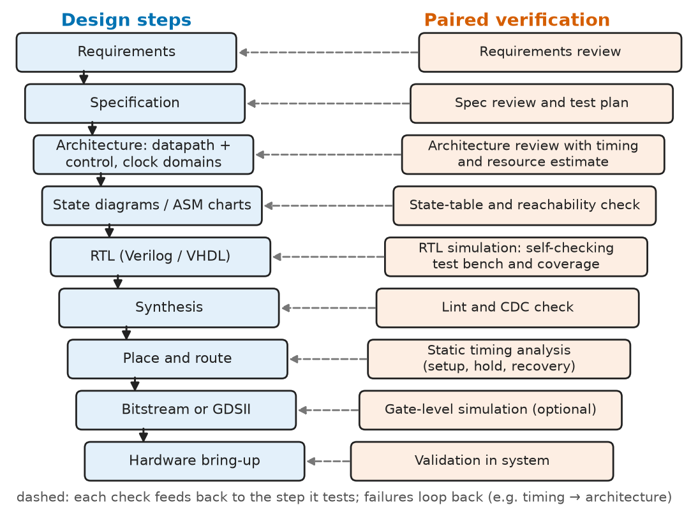
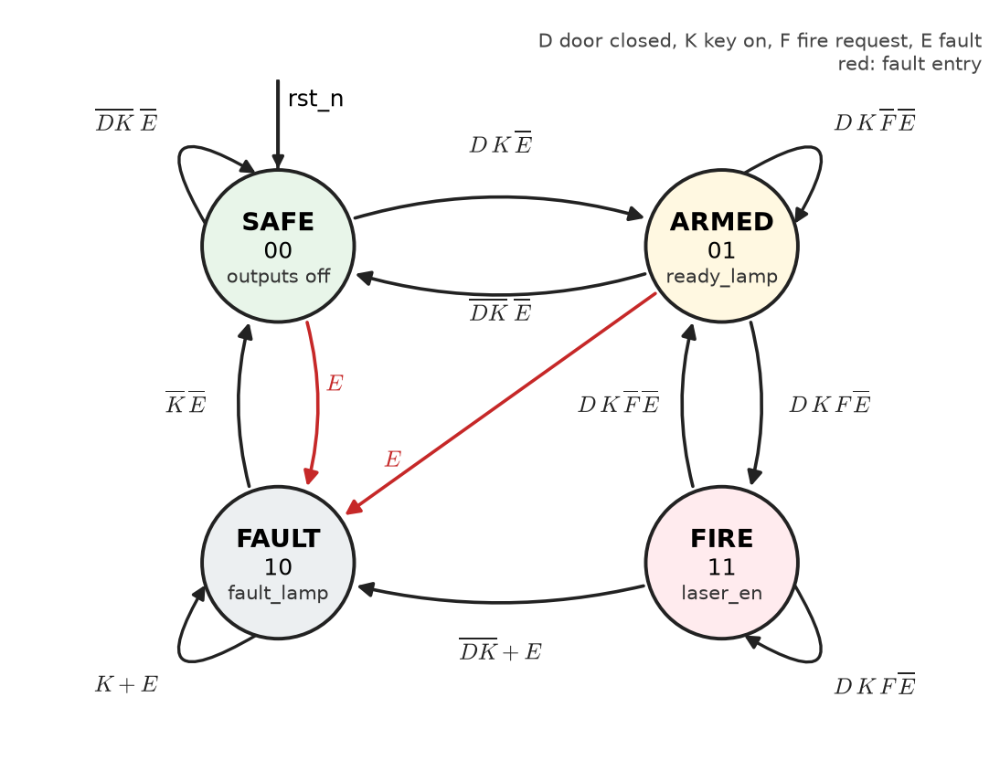
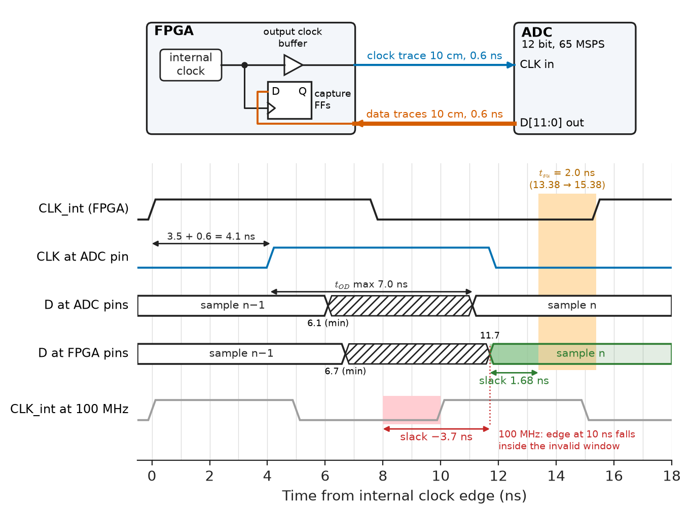
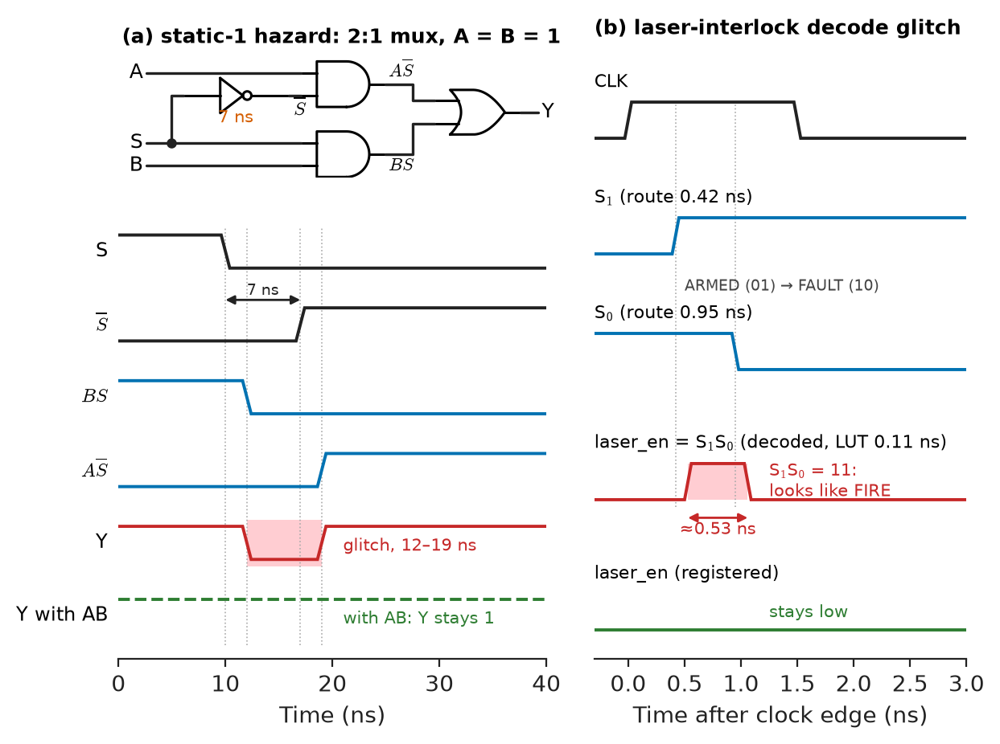
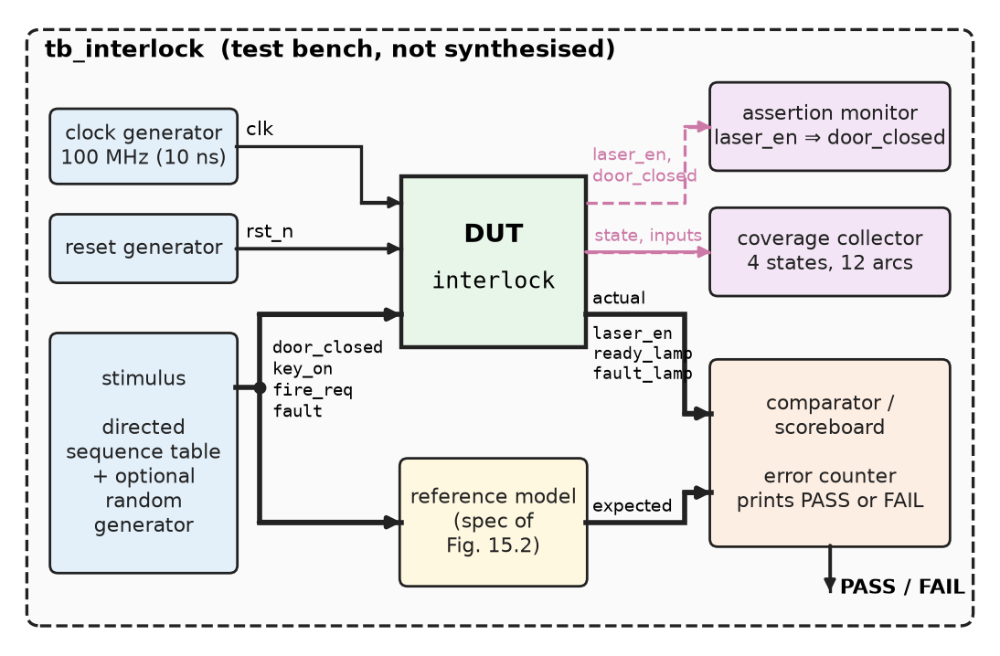

# Chapter 15 — Digital System Design

*Part III · Digital Electronics*

The interlock controller of an industrial laser cutter is a four-state machine in a small FPGA. It passed every functional simulation and a week of factory acceptance tests. Three months after installation, a service engineer reports that the laser occasionally fires a single shot when a chiller fault trips, with the door open. The state machine never enters its FIRE state; the logic equations are correct. The laser-enable output is decoded combinationally from two state bits, and when a fault forces the state from ARMED (01) to FAULT (10), both bits change and for about half a nanosecond the decoder sees 11, which is FIRE. The laser driver's input is edge-triggered and latches that pulse into a 2 ms shot. Every block in the design was right; the *design* was not. This chapter is about the method that prevents such faults: specifying behaviour precisely, turning it into state diagrams and tables, implementing it in hardware that respects timing, and verifying it with test benches before it reaches a machine.

> **How is a digital system taken from a written specification to verified hardware, and which rules make the result robust?**
> **How do glitches, asynchronous inputs and timing budgets break designs whose logic is correct, and how are they designed out and tested for?**

| Concept | Engineering destination |
|---|---|
| Design methodology | Requirements to bitstream for FPGA and ASIC projects, safety-certified hardware |
| State diagrams | Specifying controllers, protocol engines and interlocks unambiguously |
| State tables | Deriving and checking next-state and output logic |
| Hardware timing | Internal timing closure and board-level I/O budgets |
| Glitches | Glitch-free outputs to lasers, gate drivers, clocks and resets; glitch power |
| Synchronization | Push buttons, sensors and data-ready lines entering a clocked design |
| Memory elements | Choosing flip-flops, LUT RAM, block RAM or external memory |
| Logic implementation | Choosing between discrete logic, CPLD, FPGA, ASIC and a microcontroller |
| Verification and test benches | Self-checking simulation, coverage, assertions, sign-off |

**Roadmap.** The overall method (15.1) → specification as state diagrams (15.2) and state tables leading to logic (15.3) → the physical constraints on that logic: hardware timing (15.4), glitches (15.5) and synchronization of the outside world (15.6) → implementation choices: memory elements (15.7) and the technology that carries the logic (15.8) → proving that it works: verification and test benches (15.9).

---

## 15.1 Design methodology

> **Boundary.** Combinational blocks and propagation delay are from [Chapter 13](13-combinational-digital-systems.md); flip-flops, FSM structure, state encoding, setup and hold, metastability and reset synchronizers from [Chapter 14](14-sequential-digital-systems.md). Hardware description languages are covered in depth in [Chapter 19](../part-4-computer-architecture-and-digital-hardware/19-hardware-description-languages.md); the Verilog here is kept to the few constructs needed to show the method, in Verilog-2001.

### From requirement to hardware

A digital design project moves through a sequence of representations, each more concrete than the last, with a check at every step (Figure 15.1):

1. **Requirements.** What the system must do, in the user's terms: "the laser must not emit while the door is open", "the encoder interface must count at 2 MHz edge rate", "the system must recover from any single fault without a power cycle".
2. **Specification.** The requirements made precise and testable: every input and output with its timing, every operating mode, the response to each fault, the reset behaviour, the clock frequencies and interfaces.
3. **Architecture.** The partition into a **datapath** (registers, adders, multiplexers, memories that move and transform data) and a **control unit** (one or more FSMs that sequence the datapath), plus clock domains and their crossings.
4. **Behavioural description.** State diagrams (Section 15.2) or algorithmic state machine (ASM) charts for the controllers; block diagrams with widths for the datapath.
5. **Register-transfer-level (RTL) code** in an HDL, which says what each register loads on each clock edge.
6. **Functional verification** in simulation against the specification (Section 15.9).
7. **Synthesis and implementation.** Logic synthesis maps the RTL to gates or LUTs (Section 15.8), placement and routing put them on the die, and static timing analysis checks every path (Section 15.4).
8. **Hardware bring-up and validation** in the real system, with the measurements that simulation cannot give: signal integrity, power, temperature.

<!-- FIGURE 15.1 | figures/ch15/fig-15-1-design-flow.png | flowchart | Digital design flow from requirements to validated hardware, with the verification activity paired with each step. | Content: left column of boxes top to bottom: Requirements -> Specification -> Architecture (datapath + control, clock domains) -> State diagrams / ASM charts -> RTL (Verilog/VHDL) -> Synthesis -> Place and route -> Bitstream or GDSII -> Hardware bring-up. Right column paired checks connected by dashed lines: requirements review; spec review and test plan; architecture review with timing and resource estimate; state-table and reachability check; RTL simulation with self-checking test bench and coverage; lint and CDC check; static timing analysis (setup, hold, recovery); gate-level simulation (optional); validation in system. Feedback arrows from each check back to the step it tests. V-shape suggested by indentation. -->



*Figure 15.1 — Digital design flow from requirements to validated hardware, with the verification activity paired with each step.*

The flow is iterative, not a waterfall: a timing failure after routing may send the designer back to the architecture to add a pipeline stage. What makes it a *method* is that each representation is checked against the one above it before work continues, and that the checks are planned at the same time as the design. Safety-critical sectors formalise this: DO-254 for airborne electronic hardware, ISO 26262 for road vehicles and IEC 61508 for industrial safety functions all require traceability from each requirement to the design element that implements it and the test that verifies it.

### The synchronous design rules

Most robustness problems in digital hardware come from breaking a short list of rules. They follow from the timing analysis of Chapter 14, which is valid only when they hold:

- **One clock edge per domain.** All flip-flops in a domain are clocked by the same edge of the same clock, distributed through the clock network, never through logic.
- **No gated or derived clocks in logic.** Use clock enables, or dedicated clock-management blocks (PLLs, clock buffers with enables).
- **Every asynchronous input is synchronised once** (Section 15.6), and every clock-domain crossing uses a defined technique (Section 14.9).
- **Reset released synchronously** in each domain (Section 14.10).
- **No combinational loops and no unintended latches.**
- **Outputs that drive edge-sensitive or safety-critical inputs come straight from flip-flops** (Section 15.5).

> **Status of the principle: Synchronous design discipline**
> *Derived.* If every storage element samples on one clock edge and every path meets setup and hold, the circuit's behaviour is fully described by its state table regardless of glitches between edges; the rules above are exactly the conditions under which static timing analysis can guarantee that. Breaking any one of them puts behaviour outside what the tools can check.

---

## 15.2 State diagrams

### Notation

A **state diagram** draws an FSM as a directed graph. Each state is a circle (or rounded box) labelled with its name and, for a Moore machine, the outputs asserted in that state. Each transition is an arrow labelled with the input condition under which it is taken at the next clock edge; for a Mealy machine, arrow labels also carry outputs, written condition/output. A transition back to the same state can be drawn as a loop or left implicit ("otherwise, stay").

For the laser interlock, the specification gives four synchronised inputs, $D$ (door closed), $K$ (key switch on), $F$ (fire request) and $E$ (fault from the chiller or beam monitor), and four states (Figure 15.2):

- **SAFE**: laser off. Go to ARMED when $D\cdot K$.
- **ARMED**: ready lamp on. Go to SAFE if the door opens or the key turns off; go to FIRE on $F$.
- **FIRE**: laser enabled. Return to ARMED when $F$ is released; go to FAULT if the door opens or the key turns off while firing, because that indicates misuse or a failed switch.
- **FAULT**: fault lamp on, laser off. Leave to SAFE only when the fault has cleared and the key has been turned off, which forces a deliberate acknowledgement.
- From every state, $E=1$ forces FAULT.

<!-- FIGURE 15.2 | figures/ch15/fig-15-2-interlock-state-diagram.png | state-diagram | Moore state diagram of the laser interlock controller with Gray-coded state assignment. | Content: four circles: SAFE (00, outputs all off) top left, ARMED (01, ready_lamp) top right, FIRE (11, laser_en) bottom right, FAULT (10, fault_lamp) bottom left. Arcs: SAFE -> ARMED on D K not E; ARMED -> SAFE on not(D K) not E; ARMED -> FIRE on D K F not E; FIRE -> ARMED on D K not F not E; FIRE -> FAULT on not(D K) or E; FAULT -> SAFE on not K not E; SAFE -> FAULT and ARMED -> FAULT on E (drawn in red). Self-loops: SAFE on not(D K) not E; ARMED on D K not F not E; FIRE on D K F not E; FAULT on K or E. Reset arrow into SAFE labelled rst_n. -->



*Figure 15.2 — Moore state diagram of the laser interlock controller with Gray-coded state assignment.*

### Completeness and exclusivity

A state diagram is a specification, and two checks catch most of its errors:

- **Completeness.** For each state, the conditions on all outgoing arcs (including the self-loop) must OR to 1, so that every input combination has a defined next state.
- **Exclusivity.** For each state, the conditions on different arcs must be pairwise disjoint (their AND is 0), so that no input combination selects two next states.

In FIRE, for example, the arcs are $E+\overline{DK}$ (to FAULT), $\overline E\,DK\,\overline F$ (to ARMED) and $\overline E\,DK\,F$ (stay). Their OR is $E+\overline{DK}+\overline E\,DK=1$, and every pair is disjoint. A diagram that fails exclusivity is ambiguous; the HDL will silently resolve it by statement order, perhaps not as intended. These checks are mechanical, which is why the next section turns the diagram into a table.

**ASM charts** (algorithmic state machine charts) express the same information as a flowchart: a state box with its Moore outputs, decision diamonds for inputs, and conditional output boxes for Mealy outputs. They are easier to read than state diagrams when a state tests several inputs in sequence, and they map naturally onto `if`–`else` chains in RTL.

---

## 15.3 State tables

### From diagram to table

A **state table** lists, for every present state and every input combination, the next state and the outputs. It is the state diagram in a form that can be checked and turned into equations. Writing input conditions instead of all $2^4=16$ combinations keeps it compact:

| Present state | Condition | Next state | laser_en | ready_lamp | fault_lamp |
|---|---|---|---|---|---|
| SAFE (00) | $E$ | FAULT | 0 | 0 | 0 |
| SAFE (00) | $\overline E\,DK$ | ARMED | 0 | 0 | 0 |
| SAFE (00) | $\overline E\,\overline{DK}$ | SAFE | 0 | 0 | 0 |
| ARMED (01) | $E$ | FAULT | 0 | 1 | 0 |
| ARMED (01) | $\overline E\,\overline{DK}$ | SAFE | 0 | 1 | 0 |
| ARMED (01) | $\overline E\,DK\,F$ | FIRE | 0 | 1 | 0 |
| ARMED (01) | $\overline E\,DK\,\overline F$ | ARMED | 0 | 1 | 0 |
| FIRE (11) | $E+\overline{DK}$ | FAULT | 1 | 0 | 0 |
| FIRE (11) | $\overline E\,DK\,\overline F$ | ARMED | 1 | 0 | 0 |
| FIRE (11) | $\overline E\,DK\,F$ | FIRE | 1 | 0 | 0 |
| FAULT (10) | $\overline E\,\overline K$ | SAFE | 0 | 0 | 1 |
| FAULT (10) | $E+K$ | FAULT | 0 | 0 | 1 |

The outputs depend only on the present state, as befits a Moore machine; a Mealy machine would have output entries that differ between rows of the same state.

### State assignment and next-state equations

With the Gray-ordered assignment SAFE = 00, ARMED = 01, FIRE = 11, FAULT = 10 (state bits $S_1S_0$), the table becomes two Boolean functions of six variables. Minimising them, by Karnaugh map or by a tool (Chapter 12), gives

$$
S_1^{+}=E+K S_1\overline D+K S_1\overline{S_0}+S_1S_0\overline K+DKFS_0
$$

$$
S_0^{+}=\overline E\,D\,K\,(S_0+\overline{S_1})
$$

and the outputs are `laser_en` $=S_1S_0$, `ready_lamp` $=\overline{S_1}S_0$ and `fault_lamp` $=S_1\overline{S_0}$. Hand minimisation of six-variable functions is error-prone, so the equations are checked exhaustively against the table, which takes 64 cases:

```python
from itertools import product

SAFE, ARMED, FIRE, FAULT = 0b00, 0b01, 0b11, 0b10

def spec(s, d, k, f, e):
    """Next state read from the state diagram (Figure 15.2)."""
    if e:
        return FAULT
    if s == SAFE:
        return ARMED if d and k else SAFE
    if s == ARMED:
        return SAFE if not (d and k) else (FIRE if f else ARMED)
    if s == FIRE:
        return FAULT if not (d and k) else (FIRE if f else ARMED)
    return SAFE if not k else FAULT              # s == FAULT

def equations(s1, s0, d, k, f, e):
    nd, nk, ns0 = 1 - d, 1 - k, 1 - s0
    n1 = e | (k & s1 & nd) | (k & s1 & ns0) | (s1 & s0 & nk) | (d & k & f & s0)
    n0 = (1 - e) & d & k & (s0 | (1 - s1))
    return (n1 << 1) | n0

bad = [v for v in product((0, 1), repeat=6)
       if spec(2 * v[0] + v[1], *v[2:]) != equations(*v)]
print("mismatches:", len(bad), "of", 2 ** 6)
```

```text
mismatches: 0 of 64
```

The same idea, comparing an implementation against an independent reference model over many inputs, is the core of the test bench in Section 15.9.

**Worked example — what the state table says about cost and speed.** $S_1^{+}$ depends on all six variables $S_1,S_0,D,K,F,E$ and $S_0^{+}$ on five. In an FPGA with 6-input LUTs, each next-state function fits in exactly one LUT, so the whole controller costs two LUTs and two flip-flops for the state, plus three flip-flops for registered outputs (Section 15.5) with their decode absorbed into LUTs: about five LUTs and five flip-flops. Its register-to-register path is one LUT level, roughly $0.42+0.11+2\times0.45+0.05\approx1.5$ ns in a 28 nm device, so it could run above 600 MHz; in practice it runs at the system's 100 MHz clock with 8.5 ns of slack. In discrete 74HC logic, $S_1^{+}$ alone needs five product terms (a 4-input AND, three 3-input ANDs and a 5-input OR), roughly four packages for the whole machine, with a register-to-register path of about three gate delays plus the flip-flop: some 70 ns worst case at 4.5 V, still ample for a controller whose inputs change in milliseconds. The state table makes the cost visible before any code is written.

### State minimisation

Two states are **equivalent** if, for every input sequence, they produce the same output sequence; equivalent states can be merged. Formal minimisation (partitioning states into equivalence classes) matters in automatically generated machines and in protocol controllers derived from long specifications, where duplicated states creep in. For hand-designed controllers of a few states, a review of the table usually finds redundancies directly. Minimising states is not always desirable: an extra state that makes outputs registered and glitch-free, or that separates two fault causes for diagnosis, is worth more than a flip-flop.

---

## 15.4 Hardware timing

### Inside the device

Static timing analysis (Section 14.8) checks every register-to-register path inside an FPGA or ASIC automatically, once the designer has told the tool the clock frequencies. The designer's job is to supply correct **constraints**: clock definitions, the relation between clocks (synchronous or asynchronous), and the timing of the I/O pins relative to external devices. Unconstrained paths are not checked at all, and an asynchronous crossing wrongly declared synchronous produces impossible requirements. The constraint languages (SDC and its vendor variants) are covered in Chapter 19.

### At the board level

Paths that leave one chip and enter another are timed by hand or with the I/O constraints. The budget adds the output delay of the sending device, the trace delay (about 6–7 ps per millimetre in FR-4; *Circuits, Signals and Communications*, [Ch. 14 §14.4](https://github.com/The-Studio-of-Sadiq/Circuits-Signals-and-Communications/blob/main/part-3-advanced-network-theory/14-transmission-lines.md)), and the input setup and hold requirements of the receiver, for both the clock path and the data path.

**Worked example — reading a parallel ADC from an FPGA.** An FPGA in an ultrasound front end clocks a 12-bit, 65 MSPS parallel-output ADC and captures its data on the next edge of the same internal clock (system-synchronous capture), as in Figure 15.3. Representative values:

| Element | Max | Min |
|---|---|---|
| FPGA internal clock edge to clock-output pin | 3.5 ns | 2.5 ns |
| Clock trace to ADC, 10 cm at 6.0 ps/mm | 0.6 ns | 0.6 ns |
| ADC clock-to-data-valid $t_{OD}$ | 7.0 ns | 3.0 ns |
| Data trace back to FPGA, 10 cm | 0.6 ns | 0.6 ns |
| FPGA input setup / hold at pin | 2.0 ns / 0.5 ns | — |

At 65 MHz the period is 15.38 ns. Data launched by one edge arrives at the FPGA, at the latest, $3.5+0.6+7.0+0.6=11.7$ ns later, and must be there 2.0 ns before the next edge:

$$
\text{setup slack}=15.38-2.0-11.7=1.68\ \mathrm{ns}
$$

The earliest arrival is $2.5+0.6+3.0+0.6=6.7$ ns, far beyond the 0.5 ns hold requirement, so hold is safe. The interface works at 65 MHz with modest margin. At 100 MHz (10 ns period) the setup slack would be $10-2.0-11.7=-3.7$ ns: the round trip of clock out and data back is longer than the period allows. The fixes are architectural rather than logical: capture with a PLL-generated clock phase-shifted by about 4–6 ns to centre the data window, or use the ADC's own data-clock output to capture the data (source-synchronous capture), which cancels the outbound path and both traces to first order. High-speed ADCs abandon parallel CMOS outputs altogether for LVDS or JESD204 serial links for this reason.

<!-- FIGURE 15.3 | figures/ch15/fig-15-3-adc-interface-timing.png | timing-diagram | System-synchronous capture of a parallel ADC by an FPGA at 65 MHz, with the timing budget. | Content: top: block sketch of FPGA (internal clock, output clock buffer, input capture flip-flops) connected by 10 cm traces to the ADC (CLK in, D[11:0] out). Bottom: timing diagram 0 to 18 ns: CLK_int rising at 0 and 15.38 ns; CLK at ADC pin rising at 4.1 ns (3.5 + 0.6, max); ADC D at ADC pins valid from 11.1 ns (max) with hatched invalid region from 6.1 ns (min path 2.5 + 0.6 + 3.0; 2.5 + 0.6 + 3.0 + 0.6 = 6.7 ns at FPGA); D at FPGA pins valid from 11.7 ns; setup requirement 2.0 ns before the 15.38 ns edge (13.38 ns); slack 1.68 ns shaded green; a second faint trace showing a 100 MHz clock edge at 10 ns falling inside the invalid region, labelled -3.7 ns. -->



*Figure 15.3 — System-synchronous capture of a parallel ADC by an FPGA at 65 MHz, with the timing budget.*

> **Status of the principle: Board-level timing budget**
> *Approximate.* Adds worst-case datasheet delays and a constant per-millimetre trace delay; valid when traces are terminated so that the receiver sees a clean first edge. It ignores reflections, crosstalk and simultaneous-switching noise, which on fast edges shift the effective arrival time and must be checked with signal-integrity simulation.

---

## 15.5 Glitches

### Static and dynamic hazards

A combinational output that should stay constant while an input changes may briefly pulse to the wrong value, because different paths from the changing input to the output have different delays. This is a **static hazard**: static-1 if the output should stay 1 and dips to 0, static-0 if it should stay 0 and pulses to 1. A **dynamic hazard** is an output that should change once but changes three or more times. A pulse produced by a hazard is a **glitch**.

The textbook case is the 2:1 multiplexer $Y=A\overline S+BS$ with $A=B=1$. When $S$ falls from 1 to 0, the term $BS$ turns off at once, but the term $A\overline S$ turns on only after the inverter's delay. For that delay both terms are 0 and $Y$ dips (Figure 15.4). On a Karnaugh map the two product terms are adjacent groups that do not overlap; adding the **consensus term** $AB$, which covers the boundary between them, holds $Y$ at 1 throughout:

$$
Y=A\overline S+BS+AB
$$

A 74HC04 inverter at 4.5 V has a typical delay of about 7 ns, so the unprotected mux can produce a glitch of that order; inside an FPGA the same structure produces glitches of 0.1 to 1 ns, set by routing differences. Adding consensus terms removes static hazards for single-input changes in two-level logic, but synthesis tools remove "redundant" terms and map logic into LUTs whose internal structure the designer does not control, so hazard-free logic cannot be relied on in an FPGA.

<!-- FIGURE 15.4 | figures/ch15/fig-15-4-static-hazard-and-decode-glitch.png | timing-diagram | Static-1 hazard in a 2:1 multiplexer, and the decode glitch that fired the laser when the state changed from 01 to 10. | Content: left panel: schematic Y = A S-bar + B S with inverter on S, A = B = 1; waveforms over 0 to 40 ns: S falling at 10 ns, S-bar rising at 17 ns (7 ns inverter delay), BS falling at 12 ns, A S-bar rising at 19 ns, Y dipping to 0 between 12 and 19 ns (glitch shaded red); dashed trace Y with consensus term AB staying at 1. Right panel: state bits S1 and S0 with S1 rising at 0.42 ns and S0 falling at 0.95 ns after a clock edge (unequal routing); decoded laser_en = S1 S0 pulsing high from 0.42 to 0.95 ns plus LUT delay (about 0.5 ns wide, red); registered laser_en from a flip-flop staying low. Time axis 0 to 3 ns. -->



*Figure 15.4 — Static-1 hazard in a 2:1 multiplexer, and the decode glitch that fired the laser when the state changed from 01 to 10.*

### Glitches in synchronous design

In a synchronous design glitches on data paths are harmless by construction: they are over before the next clock edge, and the timing analysis guarantees that the capturing flip-flop sees only the settled value. Glitches matter in three situations:

1. **The signal is used as a clock, an asynchronous reset or set, or a latch enable.** Any of these acts on a glitch immediately. This is why decoded signals must never drive clocks or resets (Section 15.1), and why the counter decode of Section 14.4 must come from a synchronous counter.
2. **The signal leaves the chip to an edge-sensitive or fast-acting device.** A laser driver, a gate driver for a power MOSFET or IGBT bridge (where a glitch can turn on both switches of a leg and short the DC link; Chapter 29), a stepper-motor driver's step input, a chip select, or a pyrotechnic actuator in an automotive airbag controller.
3. **Power.** Every glitch charges and discharges node capacitance. In arithmetic datapaths, especially array multipliers, glitching commonly accounts for 10 to 40 % of dynamic power; pipelining and balanced paths reduce it (Chapter 33 develops dynamic power).

The cure for the first two is the one the laser controller lacked: **register the output**. A flip-flop output changes once per clock, one $t_{cq}$ after the edge, with no glitch. The interlock's outputs are therefore computed from the *next* state and loaded into output flip-flops on the same edge as the state register, so they change in step with the state with no extra cycle of latency (Listing in Section 15.6). An alternative for Moore outputs is an encoding in which each output is a state bit itself (one-hot, or an output-encoded assignment), which removes the decode entirely.

**Worked example — how wide was the laser glitch?** In the original design, a fault in ARMED (01) sends the machine to FAULT (10). The two state flip-flops are clocked together, but their outputs reach the laser-enable LUT through different routes: $S_1$ arrives 0.42 ns after the clock edge and $S_0$'s falling edge 0.95 ns after. Between those times the LUT sees $S_1S_0=11$ and, after its own 0.11 ns delay and an output path of a few nanoseconds that shifts but does not shorten the pulse, drives the pin high for about $0.95-0.42\approx0.53$ ns. An I/O buffer with a 1–2 ns slew-rate-limited edge may round that into a runt pulse of a volt or two, which may or may not cross the driver's input threshold depending on temperature, board and part, hence a fault seen once every few weeks. A registered output removes it completely. Gray-coding the transition (making ARMED → FAULT a one-bit change) would also remove this particular glitch, but not the general hazard, which is why the rule is to register.

---

## 15.6 Synchronization

### The input boundary

Every input from outside the clock domain is asynchronous: switches, sensor comparators, interrupt lines, signals from another board with its own oscillator. Section 14.9 showed that each such input must pass through a synchronizer, and the reset through a reset synchronizer. The synthesisable Verilog for both is short:

```verilog
// Two-flip-flop synchronizer for independent single-bit signals (not a bus).
module sync2 #(parameter W = 1) (
    input  wire         clk,
    input  wire         rst_n,
    input  wire [W-1:0] d_async,
    output wire [W-1:0] q
);
    (* ASYNC_REG = "TRUE" *) reg [W-1:0] s1, s2;
    always @(posedge clk or negedge rst_n)
        if (!rst_n) {s2, s1} <= {2*W{1'b0}};
        else        {s2, s1} <= {s1, d_async};
    assign q = s2;
endmodule

// Reset synchronizer: asynchronous assertion, synchronous release.
module reset_sync (
    input  wire clk,
    input  wire rst_ext_n,
    output wire rst_n
);
    (* ASYNC_REG = "TRUE" *) reg r1, r2;
    always @(posedge clk or negedge rst_ext_n)
        if (!rst_ext_n) {r2, r1} <= 2'b00;
        else            {r2, r1} <= {r1, 1'b1};
    assign rst_n = r2;
endmodule
```

The parameter `W` lets one instance synchronise several *unrelated* bits (door switch, key switch, fault line); it must never be used for the bits of a counter or data word, for the reasons given in Section 14.9. The `ASYNC_REG` attribute (Xilinx syntax; other vendors have equivalents) keeps the two flip-flops adjacent and marks them for MTBF analysis.

### The interlock FSM in RTL

With its inputs synchronised and its reset released synchronously, the interlock controller of Sections 15.2–15.3 is written as a state register, a combinational next-state block and registered Moore outputs:

```verilog
module interlock (
    input  wire clk, rst_n,                         // rst_n from reset_sync
    input  wire door_closed, key_on, fire_req, fault, // from sync2
    output reg  laser_en, ready_lamp, fault_lamp
);
    localparam [1:0] SAFE = 2'b00, ARMED = 2'b01, FIRE = 2'b11, FAULT = 2'b10;
    reg [1:0] state, next;

    always @* begin
        next = state;                               // default: stay, no latch
        if (fault) next = FAULT;
        else case (state)
            SAFE:  if (door_closed && key_on)        next = ARMED;
            ARMED: if (!(door_closed && key_on))     next = SAFE;
                   else if (fire_req)                next = FIRE;
            FIRE:  if (!(door_closed && key_on))     next = FAULT;
                   else if (!fire_req)               next = ARMED;
            FAULT: if (!key_on)                      next = SAFE;
            default:                                 next = FAULT;
        endcase
    end

    always @(posedge clk or negedge rst_n)
        if (!rst_n) begin
            state <= SAFE;
            {laser_en, ready_lamp, fault_lamp} <= 3'b000;
        end else begin
            state      <= next;
            laser_en   <= (next == FIRE);               // registered: glitch-free
            ready_lamp <= (next == ARMED);
            fault_lamp <= (next == FAULT);
        end
endmodule
```

Three details carry the lessons of this chapter. The default assignment `next = state` at the top of the combinational block guarantees that `next` is assigned on every path, so no latch is inferred (Section 14.1). The outputs are decoded from `next` and stored in flip-flops on the same edge as `state`, so they are glitch-free and aligned with the state. The `default` branch is unreachable with two state bits, but it states the designer's intent that any unexpected code goes to the safe state, the habit that matters once encodings have unused codes (Section 14.7). Chapter 19 covers the coding styles, blocking and non-blocking assignments and synthesis semantics behind these choices.

### Debouncing and edge detection

A synchronised mechanical input is clean in the metastability sense but still bounces: contacts typically chatter for 1 to 5 ms when operated, and worn or large switches for up to 20 ms. A **debouncer** accepts a new level only after the synchronised input has been stable for longer than the bounce time.

**Worked example — debouncing the fire button.** With a 50 MHz system clock and a required stable time of 10 ms, a counter that resets on every change of the synchronised input and updates the debounced output when it reaches its limit must count

$$
10\ \mathrm{ms}\times50\ \mathrm{MHz}=500\,000\ \text{cycles}
$$

which needs a 19-bit counter ($2^{19}=524\,288$). Alternatively, a shared 1 kHz tick from a prescaler lets each debouncer use a 4-bit counter that requires 10 consecutive equal samples; with dozens of inputs this saves hundreds of flip-flops. The 10 ms delay is imperceptible to an operator and long compared with any bounce.

After synchronising and debouncing, an **edge detector** (the signal ANDed with the complement of its value one clock earlier) produces a one-cycle pulse on each press. The interlock specification would benefit from it: as written, holding the fire button while turning the key moves the machine from SAFE to ARMED and, one clock later, to FIRE. Requiring a fresh press (the rising edge of $F$) to enter FIRE is a specification change, and it is exactly the kind of gap that verification against the requirements, rather than against the designer's own state diagram, exposes.

### Synchronise once

An asynchronous input must be synchronised in *one* place, and the synchronised version distributed. Feeding the raw signal to two synchronizers, or to two state machines that each sample it, lets them resolve differently on the same edge, so one part of the design believes the door closed a cycle before the other does. The same applies to a value read by several clock domains: each domain synchronises it once and shares the result internally.

---

## 15.7 Memory elements

A design stores state in several kinds of element, and the choice affects area, speed, power and how the timing is analysed.

**Table 15.1 — Storage options in an FPGA-based design (representative of 28 nm mid-range devices).**

| Element | Capacity per unit | Read behaviour | Typical use |
|---|---|---|---|
| Flip-flop | 1 bit | Immediate ($t_{cq}$) | State, control, pipeline registers, anything needing reset |
| Shift-register LUT | 32 bits per LUT as a delay line | Addressable tap | Delay lines, small FIFOs without reset |
| Distributed (LUT) RAM | 64 bits per LUT6 | Asynchronous read | Small register files, coefficient tables under a few hundred bits per word lane |
| Block RAM | 18 or 36 kbit per block, dual port | Synchronous read, 1–2 cycles latency | FIFOs, frame lines, large tables, packet buffers |
| UltraRAM / large on-chip RAM | 288 kbit per block (UltraScale+) | Synchronous | Megabit-scale buffers |
| External SRAM, DRAM, flash | Mbit to Gbit | Tens of ns to µs, interface-limited | Frame stores, data logging, program storage |

Two rules of thumb follow. First, use flip-flops for anything that defines behaviour after reset, and RAM for bulk data whose contents need not be reset; block RAM has no per-word reset. Second, respect the synchronous read of block RAM: the data appears one clock after the address (two with the optional output register for speed), so a design that expects combinational read must be restructured, typically by issuing the address a cycle earlier. Synthesis tools infer RAMs from HDL arrays written in their recognised templates (Chapter 19).

**Worked example — where to put a sine table.** A direct digital synthesiser in a motor-drive test rig stores one cycle of a sine wave as 1024 samples of 16 bits, 16 384 bits. As distributed RAM it occupies $16\,384/64=256$ LUTs, about 1 % of a 20 000-LUT device, and reads combinationally. As block RAM it fits in a single 18 kbit block, costs no logic, and reads with one cycle of latency, which the phase accumulator absorbs by being one cycle ahead. Using quarter-wave symmetry (storing 0 to 90° and deriving the rest by mirroring and negation) cuts the table to 256 samples and 4096 bits. The block RAM is the default choice; the distributed version wins only when block RAMs are exhausted or combinational read is essential.

The internal organisation of SRAM, DRAM and flash, their interfaces, and the FPGA memory architecture belong to [Chapter 18](../part-4-computer-architecture-and-digital-hardware/18-memory-and-programmable-logic.md); the transistor-level latch and SRAM cell to [Chapter 33](../part-8-integrated-circuits-and-vlsi/33-cmos-fundamentals.md).

---

## 15.8 Logic implementation

### The technology choices

The same state table can be built in very different technologies:

**Table 15.2 — Implementation technologies for digital logic (typical values).**

| Technology | Logic capacity | Typical internal speed | Unit cost | Development cost | Where it fits |
|---|---|---|---|---|---|
| Discrete 74HC/74LVC | A few gates per package | 5–50 ns per gate | Cents per package | Very low | Glue logic, level shifting, a few gates on a board |
| CPLD / small PLD | 32–500 macrocells | 5–10 ns pin to pin | About 1–5 US dollars | Low | Instant-on glue logic, address decoding, simple FSMs |
| FPGA | Thousands to millions of LUTs | 100–500 MHz designs | A few to thousands of US dollars | Moderate | Custom interfaces, parallel processing, prototypes, low-volume products |
| ASIC | Millions to billions of gates | GHz | Lowest at high volume | Very high (masks, verification) | High volume, lowest power, highest speed |
| Microcontroller firmware | Limited by CPU time | µs-scale reaction | Below 1 to a few US dollars | Low | Sequencing where microsecond latency is acceptable |

The choice turns on volume, latency, power, flexibility and certification. The interlock controller could run in firmware on the machine's main microcontroller, with a response time of tens of microseconds; it is put in hardware because a safety function should not depend on software that might hang, and because certification of a small FSM is far simpler than certification of a processor and its code. A CPLD or a small flash-based FPGA, which is live as soon as power is applied, is the usual home for such a function. Comparisons of processors and FPGAs for computation, and the partitioning between hardware and software, are the subject of [Chapter 35](../part-8-integrated-circuits-and-vlsi/35-hardware-software-co-design.md).

### What synthesis does

Logic synthesis converts RTL into a network of library cells: it extracts the FSMs and may re-encode them (Section 14.7), optimises the Boolean logic (the minimisation of Chapter 12, at scale), maps it onto the target's primitives (LUTs, carry chains, DSP blocks and block RAMs in an FPGA; standard cells in an ASIC) and sizes or replicates logic to meet timing. **Technology mapping** for LUTs is a covering problem: any function of up to $k$ inputs costs one $k$-input LUT, regardless of its complexity, so the cost of logic in an FPGA is set by the number of inputs per function rather than by gate count. That is why one-hot encoding and wide-but-shallow logic suit FPGAs, and why the interlock's six-input next-state function costs exactly one LUT.

Synthesis is also where intent can be lost. It removes logic it proves redundant (including deliberately redundant hazard-cover terms and duplicated safety logic, unless told to keep them), it may merge equivalent registers, and it can turn an unintended `if` without `else` into a latch. Reading the synthesis report (inferred latches, FSM encodings chosen, removed registers, resource use) is part of the design method, not an afterthought.

---

## 15.9 Verification and test benches

### What verification must show

Verification shows that the design does what the specification says, under all the conditions the specification allows. In industry it takes more effort than design, often 60 to 70 % of a digital project. Its main tools are:

- **Simulation with a test bench.** A test bench is HDL code (or a Python or SystemVerilog environment) that is not synthesised: it generates clocks, resets and stimuli, drives the design under test (DUT), and checks the outputs.
- **Self-checking.** The test bench compares the DUT's outputs with expected values from a **reference model** (an independent description of the specification) and counts mismatches. A test bench that only produces waveforms for a human to inspect does not scale and does not catch regressions.
- **Coverage.** Code coverage (lines, branches) shows what the tests exercised; **functional coverage** shows which specified behaviours were exercised: here, every state, every one of the 12 arcs of Figure 15.2 (eight transitions and four self-loops), and the fault input asserted in each state.
- **Assertions.** Properties that must hold at all times, checked during simulation and, with formal tools, for all possible inputs: "laser_en implies door_closed was true on the previous cycle"; "the state is never FIRE immediately after FAULT". SystemVerilog Assertions (SVA) and PSL express them; Chapter 19 introduces both.
- **Formal verification.** Model checkers prove assertions exhaustively over all reachable states. For a small safety FSM, this is practical and gives a stronger guarantee than any amount of simulation.

### A self-checking test bench

The listing drives the interlock through a directed sequence that covers the main path and the two fault entries, and compares the registered outputs with expected values after each clock edge.

<!-- FIGURE 15.5 | figures/ch15/fig-15-5-testbench-architecture.png | block-diagram | Structure of a self-checking test bench around the interlock controller. | Content: outer box labelled tb_interlock (not synthesised). Inside: clock generator (100 MHz, period 10 ns) and reset generator feeding the DUT box interlock; stimulus block (directed sequence table and optional random generator) driving door_closed, key_on, fire_req, fault into the DUT and in parallel into a reference model box; DUT outputs laser_en, ready_lamp, fault_lamp and reference model expected outputs both feeding a comparator/scoreboard box that increments an error counter and prints PASS or FAIL; a coverage collector tapping DUT state and inputs (4 states, 12 arcs); assertion monitor box checking laser_en implies door_closed. -->



*Figure 15.5 — Structure of a self-checking test bench around the interlock controller.*

```verilog
`timescale 1ns/1ps
module tb_interlock;
    reg  clk = 1'b0, rst_n = 1'b0;
    reg  door = 1'b0, key = 1'b0, fire = 1'b0, flt = 1'b0;
    wire laser, ready, fault_l;
    integer errors = 0;

    interlock dut (.clk(clk), .rst_n(rst_n), .door_closed(door), .key_on(key),
                   .fire_req(fire), .fault(flt), .laser_en(laser),
                   .ready_lamp(ready), .fault_lamp(fault_l));

    always #5 clk = ~clk;                                    // 100 MHz

    task step(input d, input k, input f, input e, input [2:0] expected);
        begin                                    // expected = {laser, ready, fault}
            {door, key, fire, flt} = {d, k, f, e};
            @(posedge clk); #1;
            if ({laser, ready, fault_l} !== expected) begin
                errors = errors + 1;
                $display("t=%0t in=%b%b%b%b got=%b expected=%b",
                         $time, d, k, f, e, {laser, ready, fault_l}, expected);
            end
        end
    endtask

    initial begin
        repeat (2) @(posedge clk);
        @(negedge clk) rst_n = 1'b1;                         // release away from edge
        step(1, 0, 0, 0, 3'b000);                            // SAFE
        step(1, 1, 0, 0, 3'b010);                            // key on: ARMED
        step(1, 1, 1, 0, 3'b100);                            // fire: FIRE
        step(0, 1, 1, 0, 3'b001);                            // door opens: FAULT
        step(1, 1, 0, 0, 3'b001);                            // held while key on
        step(1, 0, 0, 0, 3'b000);                            // key off: SAFE
        step(1, 1, 1, 1, 3'b001);                            // fault has priority
        if (errors == 0) $display("PASS");
        else             $display("FAIL: %0d errors", errors);
        $finish;
    end
endmodule
```

The task `step` applies one input vector, waits for the clock edge, and checks the outputs 1 ns later, after the registered outputs have settled in zero-delay RTL simulation. The reset is released on a falling edge so that its release cannot race with the rising edge at which the flip-flops sample. The comparison uses `!==`, which treats unknown (`x`) values as mismatches, so an uninitialised register is caught rather than passed. The expected values here are written by hand; a stronger test bench computes them from a reference model, such as a behavioural model of Figure 15.2 in the test bench or the Python `spec` function of Section 15.3 exported as a vector file, and adds constrained-random stimuli with the coverage of the 12 arcs measured rather than assumed.

> **Status of the principle: Simulation-based verification**
> *Approximate.* A passing simulation shows correct behaviour only for the stimuli applied and only within the simulation model, which in RTL ignores delays, glitches and metastability; coverage metrics measure how much of the specified behaviour was exercised, and formal proof, static timing analysis and CDC checks cover what simulation cannot.

### What the test bench does not see

The opening fault would have passed this test bench. RTL simulation has zero delays, so the decoded output in the original design never glitched in simulation; the glitch existed only in the routed hardware. Verification therefore combines several checks, each covering a different gap: functional simulation and formal proof for behaviour, static timing analysis for setup and hold (Section 14.8), CDC analysis for crossings (Section 14.9), lint rules that flag combinational outputs driving pins and unregistered decode of state bits, and, last, validation of the assembled system with an oscilloscope or logic analyser on the outputs that matter. Gate-level simulation with back-annotated delays can reveal glitches, but it is slow and only as good as its stimuli, so design rules (register the output) are a better defence than hoping to observe the fault. The full verification methodology, SystemVerilog test benches, assertions, and FPGA implementation and timing constraints are developed in [Chapter 19](../part-4-computer-architecture-and-digital-hardware/19-hardware-description-languages.md); hardware-in-the-loop testing of embedded systems in Chapter 28.

---

## What remains open

| Open question | Where it is answered |
|---|---|
| How does this method scale to a processor, with a datapath and instruction-driven control unit? | [Chapter 16](../part-4-computer-architecture-and-digital-hardware/16-computer-architecture.md) |
| How are memories and FPGA fabrics organised, and how are RAMs inferred? | [Chapter 18](../part-4-computer-architecture-and-digital-hardware/18-memory-and-programmable-logic.md) |
| How are Verilog, SystemVerilog and VHDL used for synthesis, constraints, assertions and full verification environments? | [Chapter 19](../part-4-computer-architecture-and-digital-hardware/19-hardware-description-languages.md) |
| How are state machines written in firmware, and how are embedded systems tested in the loop? | [Chapter 28](../part-6-embedded-and-real-time-systems/28-embedded-system-design.md) |
| How are glitches, dynamic power and latches analysed at transistor level? | [Chapter 33](../part-8-integrated-circuits-and-vlsi/33-cmos-fundamentals.md) |
| How is an ASIC taken through synthesis, physical design, timing and sign-off? | [Chapter 34](../part-8-integrated-circuits-and-vlsi/34-vlsi-design.md) |
| When should a function be in hardware, and when in software? | [Chapter 35](../part-8-integrated-circuits-and-vlsi/35-hardware-software-co-design.md) |

**Next:** Chapter 16 opens Part IV by assembling registers, ALUs, multiplexers and control state machines into the datapath and control unit of a computer.
