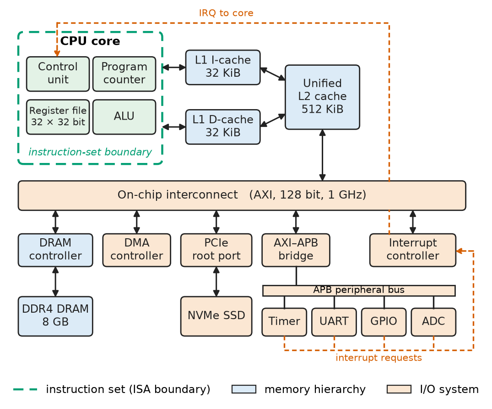
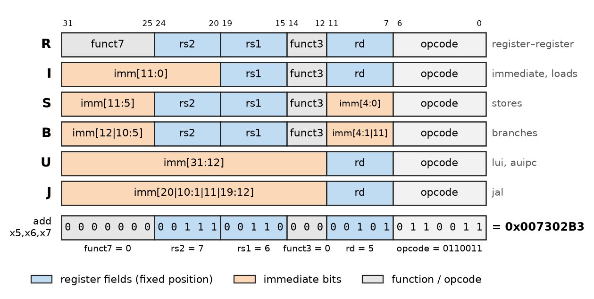
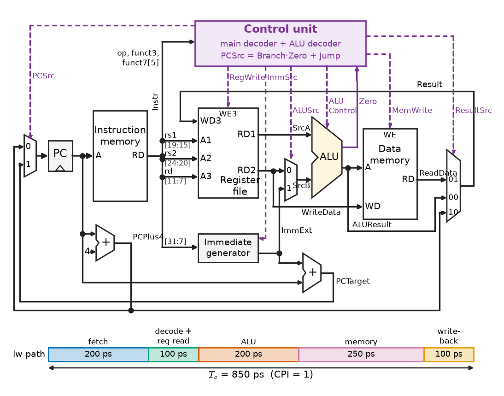
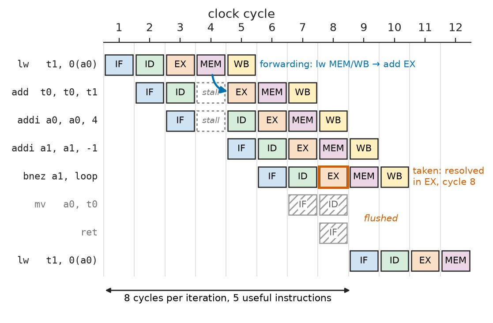
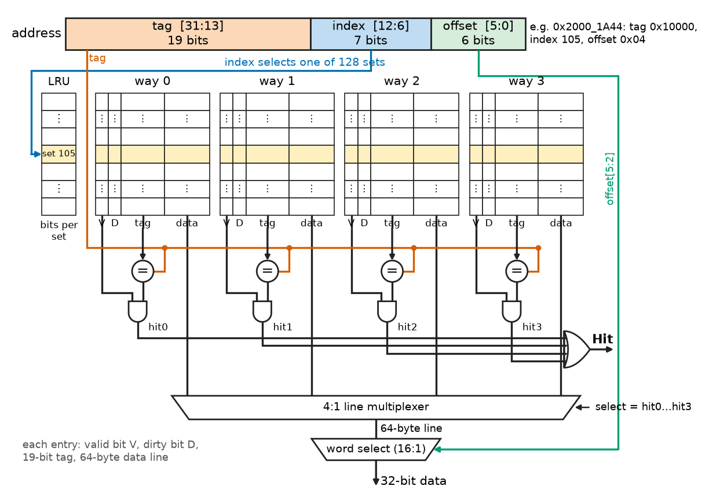
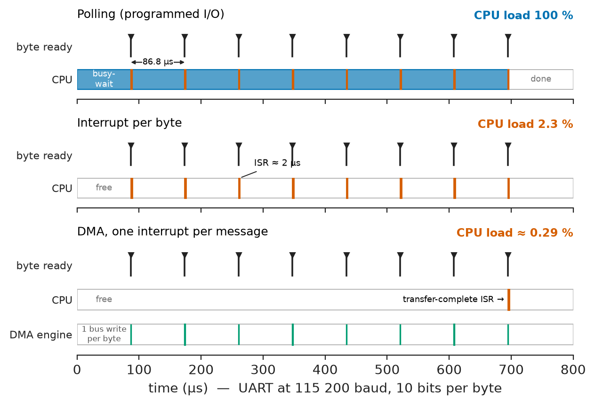

# Chapter 16 — Computer Architecture

*Part IV · Computer Architecture and Digital Hardware*

A team porting a motor-control loop from an old 100 MHz microcontroller to a new 1.2 GHz application processor expects the 20 kHz current loop to run ten times faster. It runs barely twice as fast on average, and once every few hundred cycles it takes four times longer than usual and misses its deadline. Nothing is wrong with the compiler or the code. The new chip spends most of its time waiting: for instructions and data that are not in its caches, for a branch whose direction it guessed wrongly, for a bus shared with a display controller that has just started a burst. The instruction set promised that every `lw` and `add` does exactly what the manual says; it never promised how long either would take. That time is decided by the organisation underneath the instruction set — the datapath, the pipeline, the caches, the buses and the way interrupts and I/O reach the processor — and that organisation is the subject of this chapter.

> **What does an instruction set promise to software, and how does a datapath and control unit keep that promise in hardware?**
> **Why does a processor's speed depend so much on its pipeline and memory hierarchy, and how can it be estimated with numbers before code is run?**
> **How do buses, interrupts and DMA connect a processor to memory and to the outside world?**

| Concept | Engineering destination |
|---|---|
| Computer organisation | Reading a block diagram of any SoC, MCU or server; locating bottlenecks |
| Instruction sets | Compiler targets, assembly debugging, choosing RISC-V, Arm or x86 parts |
| CPU datapaths | Cycle-time and CPI estimates, understanding pipeline stalls in profiles |
| Control units | Instruction decoding in soft cores, microcode updates, custom extensions |
| Registers | Calling conventions, context-switch cost, interrupt stacking |
| ALUs | Arithmetic throughput, flag and comparison semantics, DSP extensions |
| Memory hierarchy | Data layout for real-time loops, sizing on-chip memory, server performance |
| Caches | AMAT estimates, worst-case execution time, conflict misses in buffers |
| Buses | AXI, AHB, APB and PCIe bandwidth budgets, SoC interconnect choice |
| Interrupts | Latency budgets for control loops and communication stacks |
| Input/output architecture | Polling, interrupt and DMA design for sensors, networks and storage |

**Roadmap.** The parts of a computer and the performance equation that ties them together (16.1) → the instruction set as a contract, using RISC-V (16.2) → the registers and ALU that execute it (16.3–16.4) → the single-cycle and pipelined datapaths (16.5) and the control unit that drives them (16.6) → why memory is a hierarchy (16.7) and how caches work (16.8) → buses (16.9) → interrupts and exceptions (16.10) → input/output architecture, polling, interrupts and DMA (16.11).

---

## 16.1 Computer organisation

### The stored-program machine

Every general-purpose computer built since the late 1940s follows the same plan (Figure 16.1). A **processor** (central processing unit, CPU) fetches instructions from **memory**, decodes them, reads operands from a small set of **registers** or from memory, operates on them in an **arithmetic logic unit** (ALU), and writes results back. The instructions themselves sit in the same kind of memory as the data: this is the **stored-program** idea, and it is what lets a compiler write a program, a bootloader load it and an operating system run it. **Input/output** (I/O) devices — timers, converters, network controllers, storage — exchange data with the processor and memory over **buses** and signal events with **interrupts**.

Two arrangements of memory are common. In a **von Neumann** organisation, instructions and data share one memory and one bus, so a load competes with the next instruction fetch. In a **Harvard** organisation they have separate paths. Practically every modern processor is a *modified* Harvard machine: one unified address space and main memory, but separate level-1 instruction and data caches (or, in a microcontroller, separate instruction and data buses into a bus matrix, Chapter 17), so that a fetch and a load can proceed in the same clock cycle.

<!-- FIGURE 16.1 | figures/ch16/fig-16-1-computer-organisation.png | block-diagram | Organisation of a stored-program computer as it appears in a modern system-on-chip. | Content: left block CPU core containing control unit, register file (32 x 32 bit), ALU, program counter; core connects to separate L1 instruction cache (32 KiB) and L1 data cache (32 KiB); both connect to unified L2 cache (512 KiB); L2 connects to an on-chip interconnect (labelled AXI, 128 bit, 1 GHz). Interconnect connects to DRAM controller -> DDR4 DRAM (8 GB), to a DMA controller, to a bridge -> APB peripheral bus with timer, UART, GPIO, ADC blocks, and to a PCIe root port -> NVMe SSD. Interrupt lines (dashed) from peripherals into an interrupt controller feeding the CPU. Label the three abstractions: instruction set (boundary around core), memory hierarchy (caches and DRAM), I/O system (interconnect and peripherals). -->



*Figure 16.1 — Organisation of a stored-program computer as it appears in a modern system-on-chip.*

### Architecture, organisation, implementation

It pays to separate three levels:

- **Instruction-set architecture** (ISA): what the programmer and compiler see — instructions, registers, data types, addressing, memory model, exceptions. RV32I, Armv7-M and x86-64 are ISAs.
- **Microarchitecture** (organisation): how one design implements the ISA — pipeline depth, cache sizes, branch predictor, number of execution units. A Cortex-M0+ and a Cortex-A78 implement related Arm ISAs with very different organisations.
- **Implementation**: the circuits, process node, clock frequency and physical layout (Part VIII).

Software is portable across microarchitectures because the ISA is a contract. Its *timing* is not, because timing belongs to the organisation.

### The performance equation

The time a program takes is the product of three factors:

$$
T_{\text{CPU}}=N_{\text{instr}}\times \text{CPI}\times T_c
$$

where $N_{\text{instr}}$ is the number of instructions executed, CPI the average clock cycles per instruction and $T_c$ the clock period. The ISA and compiler set $N_{\text{instr}}$; the microarchitecture sets CPI; the implementation and microarchitecture together set $T_c$. Most design arguments in this chapter are trade-offs among the three: a deeper pipeline shortens $T_c$ but raises CPI through hazards; a richer instruction set lowers $N_{\text{instr}}$ but may lengthen $T_c$; a bigger cache lowers CPI but may add a cycle to every hit.

> **Status of the principle: Processor performance equation ("iron law")**
> *Derived.* It is an identity from the definitions of CPI and clock period; it is exact for one run, and its usefulness lies in separating the factors that the compiler, the microarchitecture and the circuit designer control.

**IPC** (instructions per cycle) is $1/\text{CPI}$; superscalar cores reach 2–4 on favourable code. MIPS ratings are meaningless across ISAs; for embedded work the useful benchmark is the cycle count of the real loop, measured with the processor's cycle counter.

---

## 16.2 Instruction sets

### The ISA as a contract

An ISA specifies the architectural **state** (PC, registers, control registers, memory); the **instructions**, their encodings and effects; the **data types** (two's-complement integers, Chapter 11, and optionally IEEE 754 floating point); the **addressing** of memory (Chapter 17 compares addressing modes); the **memory model** (endianness, alignment, the order in which other processors and devices see loads and stores); and the **privilege and exception** behaviour (Section 16.10).

### RISC and CISC

Instruction sets fall into two broad families. **CISC** (complex instruction set computer) ISAs such as x86 have variable-length instructions (1 to 15 bytes on x86-64), allow memory operands in arithmetic instructions and offer complex operations in one instruction. **RISC** (reduced instruction set computer) ISAs — RISC-V, Arm, MIPS, Power — are **load-store** architectures: only loads and stores touch memory, arithmetic works on registers, instructions have a few fixed formats, and the register file is large (16 to 32 registers). The distinction has blurred — x86 cores translate instructions into RISC-like micro-operations internally, and Thumb-2 and RISC-V's compressed extension add 16-bit encodings for density — but a load-store ISA remains easier to pipeline, verify and extend, which is why nearly every new embedded design uses one.

### RISC-V as the running example

**RISC-V** is an open ISA, defined by RISC-V International, with a small base and optional standard extensions. RV32I, the 32-bit base integer ISA, has about forty instructions, 32 registers of 32 bits (`x0` always reads zero) and a 32-bit PC. Extensions add integer multiply and divide (M), atomics (A), single- and double-precision floating point (F, D), 16-bit compressed encodings (C) and vector operations (V). A microcontroller core such as an RV32IMC part in a wireless sensor chip implements a few of them; a Linux-capable application core implements RV64GC (G = IMAFD plus a few system extensions).

Every RV32I instruction is 32 bits long and uses one of six formats (Figure 16.2). The register fields `rs1`, `rs2` and `rd` are always in the same bit positions, so the register file can be read before the instruction is fully decoded, and the sign bit of every immediate is always bit 31.

<!-- FIGURE 16.2 | figures/ch16/fig-16-2-rv32i-formats.png | table-graphic | The six RV32I instruction formats with field positions. | Content: six rows labelled R, I, S, B, U, J; columns by bit position 31 to 0. R: funct7 [31:25], rs2 [24:20], rs1 [19:15], funct3 [14:12], rd [11:7], opcode [6:0]. I: imm[11:0] [31:20], rs1, funct3, rd, opcode. S: imm[11:5], rs2, rs1, funct3, imm[4:0], opcode. B: imm[12 then 10:5], rs2, rs1, funct3, imm[4:1 then 11], opcode. U: imm[31:12], rd, opcode. J: imm[20 then 10:1 then 11 then 19:12], rd, opcode. Shade rs1, rs2 and rd fields in the same colour in every row to show they never move. Below, an example row: add x5, x6, x7 encoded as 0000000 00111 00110 000 00101 0110011 = 0x007302B3. -->



*Figure 16.2 — The six RV32I instruction formats with field positions.*

**Worked example — encoding two instructions.** The R-type instruction `add x5, x6, x7` has opcode 0110011, `funct3` = 000, `funct7` = 0000000, `rd` = 5, `rs1` = 6 and `rs2` = 7. Concatenating the fields from bit 31 down gives 0000000 00111 00110 000 00101 0110011 = `0x007302B3`. The I-type load `lw x5, 8(x10)` has opcode 0000011, `funct3` = 010 (word), `rd` = 5, `rs1` = 10 and a 12-bit immediate of 8: 000000001000 01010 010 00101 0000011 = `0x00852283`. A disassembler, a debugger's memory view and a logic analyser on an instruction bus all show these hexadecimal words; reading one by hand is a routine debugging skill when a core has jumped into data.

### Instruction classes

| Class | RV32I examples | Effect |
|---|---|---|
| Arithmetic and logic, register | `add`, `sub`, `and`, `or`, `xor`, `sll`, `srl`, `sra`, `slt`, `sltu` | `rd ← rs1 op rs2` |
| Arithmetic and logic, immediate | `addi`, `andi`, `ori`, `xori`, `slli`, `slti` | `rd ← rs1 op imm12` (sign-extended) |
| Upper immediate | `lui`, `auipc` | Build 32-bit constants and PC-relative addresses |
| Loads | `lb`, `lh`, `lw`, `lbu`, `lhu` | `rd ← mem[rs1 + imm12]` |
| Stores | `sb`, `sh`, `sw` | `mem[rs1 + imm12] ← rs2` |
| Conditional branches | `beq`, `bne`, `blt`, `bge`, `bltu`, `bgeu` | `if (rs1 cmp rs2) PC ← PC + imm13` (±4 KiB) |
| Jumps | `jal`, `jalr` | `rd ← PC+4; PC ← target` (±1 MiB for `jal`) |
| System | `ecall`, `ebreak`, `fence`, CSR access | Traps, ordering, control registers |

RISC-V has no condition-code flags: a branch compares two registers itself, whereas Arm branches on N, Z, C and V flags set by earlier instructions (Chapter 17).

A short function shows the style. It sums an array of 32-bit integers, with the pointer in `a0` (`x10`) and the count in `a1` (`x11`), returning the sum in `a0` under the standard calling convention:

```asm
# int32_t sum(const int32_t *p, uint32_t n)   -- RV32I
sum:    li    t0, 0             # running sum
        beqz  a1, done
loop:   lw    t1, 0(a0)         # load element
        add   t0, t0, t1
        addi  a0, a0, 4         # next element
        addi  a1, a1, -1
        bnez  a1, loop
done:   mv    a0, t0
        ret
```

`li`, `beqz`, `bnez`, `mv` and `ret` are **pseudo-instructions** that the assembler expands into `addi`, `beq`, `bne` and `jalr` with `x0`. The loop body is five instructions, so for $n$ elements $N_{\text{instr}}\approx 5n$. How many cycles each iteration takes depends on the pipeline, and Section 16.5 returns to this loop to count them.

---

## 16.3 Registers

### The register file

Registers are the fastest storage in the machine: a 32-entry, 32-bit register file is about 1 kbit of multi-ported SRAM or flip-flops, read in a fraction of a clock cycle. A single-issue RISC-V core needs two read ports (for `rs1` and `rs2`) and one write port (for `rd`); a four-wide superscalar core needs about eight read and four write ports, which makes its register file one of the largest and hottest blocks on the die. Register `x0` is not storage at all: reads return zero and writes are discarded, which turns `addi rd, x0, imm` into "load immediate" and `add rd, rs, x0` into "move" without extra opcodes.

More architectural registers mean fewer spills to the stack but wider register fields and more state to save on a context switch; RV32E halves the file to 16 registers for the smallest cores.

### Software conventions

The hardware treats `x1` to `x31` alike; the **application binary interface** (ABI) gives them roles so that separately compiled functions interoperate:

| Register | ABI name | Role | Saved by |
|---|---|---|---|
| `x0` | `zero` | Constant 0 | — |
| `x1` | `ra` | Return address | Caller |
| `x2` | `sp` | Stack pointer | Callee |
| `x5`–`x7`, `x28`–`x31` | `t0`–`t6` | Temporaries | Caller |
| `x8`–`x9`, `x18`–`x27` | `s0`–`s11` | Saved registers (`s0` = frame pointer) | Callee |
| `x10`–`x17` | `a0`–`a7` | Arguments and return values | Caller |

The split between caller-saved and callee-saved registers decides how many registers an interrupt handler written in C must save: the hardware or the handler's prologue must preserve every caller-saved register, because the interrupted code did not expect a call. That is 16 registers on RV32I, and it is why interrupt entry costs tens of cycles (Section 16.10; Chapter 17 shows how Cortex-M stacks eight of them in hardware).

### Special registers

Beside the PC, RISC-V has a separate space of **control and status registers** (CSRs), accessed with `csrr` and `csrw`. Those that matter most in embedded work are `mstatus` (global interrupt enable), `mie` and `mip` (interrupt enable and pending bits), `mtvec` (trap vector base), `mepc` (address to return to after a trap), `mcause` (why the trap happened) and the counters `mcycle` and `minstret`, which count cycles and retired instructions and are the honest way to measure CPI on real code.

---

## 16.4 ALUs

### What the ALU computes

The ALU is the combinational block that executes the arithmetic and logic part of every instruction and computes addresses for loads, stores and branches. Its circuit building blocks — adders, carry-lookahead and prefix structures, shifters, comparators and the multiplexer that selects among them — are designed in Chapter 13. At the architecture level the ALU is a black box with two 32-bit operands, a control field and a 32-bit result, plus status outputs such as "result is zero" for branch evaluation.

For RV32I the ALU must support:

| ALU control | Operation | Used by |
|---|---|---|
| ADD | $a+b$ | `add`, `addi`, loads, stores (address), `jalr` |
| SUB | $a-b$ | `sub`, branches (compare) |
| AND, OR, XOR | bitwise | logic instructions |
| SLT, SLTU | $a<b$ signed or unsigned, result 0 or 1 | `slt`, `sltu`, `blt`, `bltu` |
| SLL, SRL, SRA | shift by $b[4{:}0]$ | shift instructions |

Branch comparisons are done by subtraction: `beq` tests whether $a-b$ is zero, `blt` tests the sign of $a-b$ corrected for overflow (signed less-than is $N\oplus V$ in flag terms), and `bltu` tests the borrow. The two's-complement facts behind these tests are in Chapter 11.

### Speed and extensions

The adder's carry chain is usually the ALU's critical path: in a 28 nm process a 32-bit prefix adder settles in about 100–150 ps, and with operand and result multiplexing the execute stage takes 150–250 ps (the examples below use 200 ps). A 32×32-bit multiplier is pipelined over 1–3 cycles, while division is iterative and takes 2 to 35 cycles depending on core and operands — which matters when a control loop divides by a variable. DSP-oriented ISAs add saturating arithmetic, multiply-accumulate and SIMD operations on packed 8- and 16-bit data (Chapter 17 shows the Cortex-M4 versions).

---

## 16.5 CPU datapaths

### The single-cycle datapath

The simplest way to implement RV32I is a **single-cycle** datapath, in which every instruction completes in one long clock cycle (Figure 16.3). The PC addresses the instruction memory; the instruction's register fields address the register file; an immediate generator sign-extends the immediate; the ALU computes; the data memory is read or written; and a multiplexer selects what is written back to `rd` — the ALU result, the loaded data or $\text{PC}+4$. A separate adder computes the branch target $\text{PC}+\text{imm}$, and a multiplexer chooses the next PC.

<!-- FIGURE 16.3 | figures/ch16/fig-16-3-single-cycle-datapath.png | block-diagram | Single-cycle RV32I datapath with control signals. | Content: left to right: PC register -> instruction memory -> instruction fields split to register file read addresses (rs1, rs2), write address (rd) and immediate generator; register file outputs RD1 and RD2; multiplexer ALUSrc selects RD2 or immediate into ALU second input; ALU output to data memory address and to result multiplexer; data memory write data from RD2; result multiplexer ResultSrc selects ALU result, read data or PC+4, back to register file write data. PC+4 adder and PC+imm branch adder feeding PCSrc multiplexer into PC. Control unit at top taking opcode, funct3, funct7[5] and the ALU Zero flag; control lines drawn dashed: RegWrite, ImmSrc, ALUSrc, ALUControl, MemWrite, ResultSrc, PCSrc. Annotate stage delays along the lw path: fetch 200 ps, decode and register read 100 ps, ALU 200 ps, memory 250 ps, write-back 100 ps, total 850 ps. -->



*Figure 16.3 — Single-cycle RV32I datapath with control signals.*

The clock period must accommodate the slowest instruction, the load, whose path runs through every block. With representative delays of 200 ps for instruction fetch, 100 ps for decode and register read, 200 ps for the ALU, 250 ps for the data-memory access and 100 ps for write-back, $T_c=850$ ps ($f_c\approx1.18$ GHz) and CPI = 1. An `add` uses only about 600 ps of that period; the rest is wasted. The single-cycle design is useful as a reference model and appears in small soft cores and teaching designs, but no performance design uses it.

### Pipelining

A **pipelined** datapath splits the same hardware into stages separated by pipeline registers and starts a new instruction every cycle. The classic RISC pipeline has five stages:

1. **IF** — fetch the instruction at PC, compute $\text{PC}+4$.
2. **ID** — decode, read registers, generate the immediate.
3. **EX** — ALU operation, branch comparison and target.
4. **MEM** — data-memory read or write.
5. **WB** — write the result to the register file.

At any moment five instructions are in flight (Figure 16.4). The clock period is now set by the slowest *stage* plus the overhead of the pipeline register (clock-to-Q delay plus setup time, Chapter 14), and the ideal CPI is 1.

> **Status of the principle: Ideal pipeline speedup**
> *Approximate.* A $k$-stage pipeline approaches a $k$-fold throughput gain only if the stages are perfectly balanced, the register overhead is negligible and no hazards occur; in practice the gain is limited by the slowest stage, by register overhead (typically 20–50 ps per stage) and by stall cycles.

### Hazards

Overlapping instructions creates three kinds of **hazard**, situations in which the next instruction cannot proceed in the next cycle.

- **Structural hazards** — two instructions need the same hardware in the same cycle. A single memory port shared by IF and MEM is the classic case; separate instruction and data caches remove it.
- **Data hazards** — an instruction needs a result that an earlier instruction has not yet written. In `add t0, t0, t1` followed by `addi t2, t0, 1`, the second instruction reads `t0` in ID while the first is still in EX. **Forwarding** (bypassing) routes the ALU result from the EX/MEM or MEM/WB pipeline register straight back to the ALU input, removing the stall. Forwarding cannot help a **load-use hazard**: data loaded in MEM is not available until the end of that stage, so an instruction that uses it in the very next cycle must wait one bubble. A **hazard unit** detects the dependence by comparing register numbers and stalls IF and ID for one cycle.
- **Control hazards** — the pipeline fetches the instructions after a branch before knowing whether the branch is taken. If the branch is resolved in EX, two wrongly fetched instructions must be flushed when it is taken: a two-cycle penalty. Cores reduce the cost by resolving branches earlier and by **branch prediction**: a static rule (predict not taken, or predict backward branches taken), or a dynamic predictor that keeps a 2-bit saturating counter per branch, indexed by PC bits, together with a branch-target buffer. Dynamic predictors in application cores are correct on 95–99 % of branches in typical code; the remaining mispredictions cost 10–20 cycles in deep pipelines.

<!-- FIGURE 16.4 | figures/ch16/fig-16-4-pipeline-hazards.png | timing-diagram | Five-stage pipeline diagram of the sum loop showing a load-use bubble and a taken-branch flush. | Content: horizontal axis clock cycles 1 to 12; rows are instructions: lw t1,0(a0); add t0,t0,t1; addi a0,a0,4; addi a1,a1,-1; bnez a1,loop; two wrongly fetched instructions (mv a0,t0 and ret) shown hatched and flushed; next lw t1,0(a0). Each row shows boxes IF ID EX MEM WB in the cycles they occupy. A bubble (empty box labelled stall) between lw and add in cycle 4, with a forwarding arrow from lw MEM/WB to add EX. The bnez resolves in EX in cycle 8 (marked taken) and the next lw starts IF in cycle 9. Annotate: 8 cycles per iteration, 5 useful instructions. -->



*Figure 16.4 — Five-stage pipeline diagram of the sum loop showing a load-use bubble and a taken-branch flush.*

**Worked example — single-cycle versus pipelined.** A benchmark compiled for RV32I executes $10^9$ instructions with the mix: loads 25 %, stores 10 %, ALU operations 45 %, conditional branches 15 % and jumps 5 %. Take the stage delays above, a pipeline-register overhead of 30 ps, and these hazard statistics: 40 % of loads are followed immediately by a dependent instruction (one bubble each); branches are predicted not taken, are resolved in EX and are taken 60 % of the time (two-cycle penalty); jumps are resolved in ID (one-cycle penalty).

The single-cycle machine runs at $T_c=850$ ps with CPI = 1: $T=10^9\times1\times850\ \mathrm{ps}=0.850$ s.

The pipelined machine's clock is set by the 250 ps memory stage plus overhead, $T_c=280$ ps ($f_c=3.57$ GHz in this idealised model). Its CPI is

$$
\text{CPI}=1+0.25\times0.40\times1+0.15\times0.60\times2+0.05\times1=1+0.10+0.18+0.05=1.33
$$

and $T=10^9\times1.33\times280\ \mathrm{ps}=0.372$ s. The speedup is $0.850/0.372=2.28$, against an ideal of $850/280=3.04$ for a hazard-free pipeline and 5 for perfectly balanced stages with no overhead. The three losses are visible separately: the unbalanced stages cost $850/(5\times250)$, the register overhead $250/280$, and the hazards $1/1.33$. This model still assumes every memory access hits in one cycle; Section 16.8 removes that assumption, with large consequences.

The array-sum loop of Section 16.2 shows the same effects in code. In the five-stage pipeline each iteration takes five instruction slots, one load-use bubble (the `add` uses `t1` immediately after `lw`), and a two-cycle flush for the taken `bnez`: eight cycles. Moving one `addi` between the `lw` and the `add` removes the bubble (seven cycles), and a predictor that learns the loop branch removes the flush (five cycles). Compilers perform exactly this **instruction scheduling**; the example shows why two functionally identical binaries can differ by 60 % in speed.

### Beyond the five-stage pipeline

Real cores go further: **deeper pipelines** (10–20 stages) raise the clock but lengthen the branch penalty; **superscalar** cores issue two to eight instructions per cycle; **out-of-order** cores keep a window of 100–600 instructions, execute each when its operands are ready and retire in program order, hiding miss latency behind independent work. A Cortex-M4 uses a three-stage pipeline and executes in order; a Cortex-A78 or a high-end RISC-V application core is out-of-order with a dozen or more stages. The deeper and more speculative the core, the less predictable its timing — which is why hard real-time controllers are still built on short in-order pipelines (Chapter 27).

---

## 16.6 Control units

### Hardwired control

The **control unit** turns each instruction's opcode and function fields into the multiplexer selects, write enables and ALU control lines of the datapath. In a RISC core it is **hardwired**: a combinational **main decoder** driven by the 7-bit opcode, plus an **ALU decoder** driven by `funct3`, bit 5 of `funct7` and a 2-bit `ALUOp` from the main decoder. For the single-cycle datapath of Figure 16.3 and a representative RV32I subset:

| Instruction | Opcode | RegWrite | ImmSrc | ALUSrc | MemWrite | ResultSrc | Branch | ALUOp | Jump |
|---|---|---|---|---|---|---|---|---|---|
| `lw` | 0000011 | 1 | I | imm | 0 | memory | 0 | 00 (add) | 0 |
| `sw` | 0100011 | 0 | S | imm | 1 | — | 0 | 00 (add) | 0 |
| R-type | 0110011 | 1 | — | reg | 0 | ALU | 0 | 10 (funct) | 0 |
| `beq` | 1100011 | 0 | B | reg | 0 | — | 1 | 01 (sub) | 0 |
| I-type ALU | 0010011 | 1 | I | imm | 0 | ALU | 0 | 10 (funct) | 0 |
| `jal` | 1101111 | 1 | J | — | 0 | PC+4 | 0 | — | 1 |

The next-PC select is $\text{PCSrc}=(\text{Branch}\cdot\text{Zero})+\text{Jump}$. In the pipelined datapath the same decoder runs in ID and the control bits travel down the pipeline registers with the instruction, each stage consuming its own bits; the hazard unit and the forwarding multiplexers are added as separate small control blocks.

The decoder is small — a few hundred gates for RV32I — and fast. Because RISC-V reserves opcode space for custom instructions, a soft-core or ASIC designer can add a decoder entry and an execution unit for a domain-specific operation (a CRC step, a fixed-point multiply-accumulate) without breaking compatibility (Chapter 35).

### Microprogrammed control

The alternative, dominant in CISC machines from the 1960s to the 1980s, is **microprogrammed** control: each machine instruction triggers a sequence of **microinstructions** in a control ROM, each setting the datapath controls for one cycle. Microcode makes complex ISAs tractable and patchable; x86 processors still use it for rare complex instructions and ship **microcode updates** to work around errata and security flaws, at the cost of multi-cycle execution.

> **Status of the principle: Hardwired versus microprogrammed control**
> *Empirical.* Neither is universally better: hardwired control wins when the instruction set is simple and regular, microcode when it is large and irregular; the industry's convergence on hardwired control for common instructions and microcode for rare ones reflects decades of measured instruction frequencies, not a theorem.

---

## 16.7 Memory hierarchy

### The memory wall

A processor needs, every cycle, one instruction and often one data word. A 3 GHz core issuing two loads per cycle asks for 24 GB/s of data with a latency it can hide of a few cycles, about 1 ns. Main memory is DRAM (Chapter 18), whose random-access latency is 50–100 ns: 150–300 cycles. This gap between processor and DRAM speed, which grew for decades because logic speed improved faster than DRAM latency, is the **memory wall**. No single memory technology is simultaneously large, fast, cheap and low-power, so computers use a **hierarchy** (Table 16.1): small, fast, expensive memories near the processor and large, slow, cheap ones further away.

**Table 16.1 — Representative memory hierarchy (typical values, mid-2020s).**

| Level | Typical capacity | Latency | Bandwidth per core or device | Technology |
|---|---|---|---|---|
| Registers | 32–200 × 64 bit | 0 cycles | several operands per cycle | Flip-flops, multi-port SRAM |
| L1 cache (I and D) | 32–64 KiB each | 3–5 cycles (about 1 ns) | 64–128 B/cycle | 6T SRAM |
| L2 cache | 256 KiB–2 MiB | 10–16 cycles (3–5 ns) | 32–64 B/cycle | SRAM |
| L3 cache (shared) | 8–128 MiB | 35–70 cycles (10–20 ns) | about 20–30 B/cycle | SRAM |
| Main memory | 8 GB–2 TB | 60–120 ns | 25.6 GB/s per DDR4-3200 channel | DDR4/DDR5 DRAM |
| Solid-state storage | 0.25–30 TB | 20–100 µs (read) | 3–14 GB/s (PCIe NVMe) | NAND flash |
| Hard disk | 1–30 TB | 5–10 ms | 0.2–0.3 GB/s | Magnetic |
| MCU on-chip SRAM | 16 KiB–2 MiB | 0–1 wait states | 1 word/cycle | SRAM |
| MCU on-chip flash | 64 KiB–4 MiB | 0–7 wait states, hidden by prefetch buffers | 1 line per access | NOR flash |


### Locality

A hierarchy works only because programs do not access memory at random. They show:

- **Temporal locality** — a location used now is likely to be used again soon (loop counters, the instructions of a loop body, a filter's coefficients).
- **Spatial locality** — locations near one just used are likely to be used soon (sequential instructions, array elements, structure fields).

Keeping recently used blocks of neighbouring addresses in a small fast memory therefore captures most accesses. On typical code, a 32 KiB L1 data cache satisfies 90–98 % of loads.

> **Status of the principle: Locality of reference**
> *Empirical.* Observed across decades of program traces (often summarised as "90 % of execution time is spent in 10 % of the code"); it is a property of how programs are written, not a law, and it fails for pointer-chasing, hash-table and streaming workloads larger than the cache, where the hierarchy gives little help.

### Average memory access time

The figure of merit of a hierarchy is the **average memory access time**:

$$
\text{AMAT}=t_{\text{hit}}+m\times t_{\text{miss}}
$$

where $t_{\text{hit}}$ is the hit time of the first level, $m$ its miss rate (misses per access) and $t_{\text{miss}}$ the miss penalty. For more levels the formula nests: the miss penalty of L1 is the AMAT of L2, with L2's **local** miss rate (misses of L2 divided by accesses that reach L2).

> **Status of the principle: Average memory access time**
> *Derived.* It is the expectation of access time over hit and miss outcomes; it is exact as an average but hides the distribution, so it says nothing about worst-case latency, which is what a hard real-time deadline depends on.

**Worked example — AMAT and its effect on CPI.** A 2 GHz application core has a 1-cycle L1 hit time (included in the pipeline), L1 miss rates of 2 % for instructions and 5 % for data, an L2 with 10-cycle hit time and 20 % local miss rate, and DRAM at 80 ns = 160 cycles. The L1 miss penalty is $t_{\text{L2}}+m_{\text{L2}}\,t_{\text{DRAM}}=10+0.20\times160=42$ cycles. The data-side AMAT is $1+0.05\times42=3.1$ cycles. With a base CPI of 1.2 and 0.35 data accesses per instruction (one fetch per instruction),

$$
\text{CPI}=1.2+1\times0.02\times42+0.35\times0.05\times42=1.2+0.84+0.735=2.78
$$

The memory system has more than doubled the CPI. Halving the L2 miss rate to 10 % would cut the miss penalty to 26 cycles and the CPI to 2.18, a 28 % speedup with no change to the core. In the motor-control port of the opening, this is the mechanism: the loop ran from DRAM-backed caches shared with other code, and the occasional slow iteration was the one that found its instructions evicted.

---

## 16.8 Caches

### Organisation

A **cache** holds copies of memory in fixed-size **lines** (blocks), typically 32 or 64 bytes. Each line carries a **tag** identifying which memory block it holds, a **valid** bit, and for write-back caches a **dirty** bit. A memory address is split into three fields (Figure 16.5):

- the **offset** selects the byte within the line ($\log_2 B$ bits for line size $B$);
- the **index** selects a **set** ($\log_2 S$ bits for $S$ sets);
- the **tag** is the rest, compared with the stored tags of that set.

With $C$ bytes of capacity and **associativity** $W$ (lines per set), $S=C/(BW)$. A **direct-mapped** cache has $W=1$: each block can live in exactly one line. A **fully associative** cache has one set: a block can live anywhere, at the cost of comparing every tag. **Set-associative** caches (2- to 16-way) are the compromise used almost everywhere.

**Worked example — address fields.** A 32 KiB, 4-way set-associative L1 data cache with 64-byte lines serves a 32-bit address space. Offset: $\log_2 64=6$ bits. Sets: $32768/(64\times4)=128$, so the index is 7 bits. Tag: $32-7-6=19$ bits. The address `0x2000_1A44` has offset `0x04`, index $(\texttt{0x2000\_1A44}\gg6)\ \&\ \texttt{0x7F}=\texttt{0x69}=105$, and tag `0x2000_1A44 >> 13` = `0x10000`. The tag store is $128\times4$ entries of 19 bits plus valid and dirty bits, about 10.5 kbit, or 4 % overhead on the 256 kbit data array.

<!-- FIGURE 16.5 | figures/ch16/fig-16-5-set-associative-cache.png | block-diagram | Lookup in a 32 KiB 4-way set-associative cache with 64-byte lines. | Content: 32-bit address at top split into tag (bits 31-13, 19 bits), index (bits 12-6, 7 bits), offset (bits 5-0, 6 bits). Index selects one of 128 sets (rows) in four parallel ways; each way shows valid bit, dirty bit, 19-bit tag and 64-byte data line. Four comparators compare stored tags with the address tag, ANDed with valid, producing hit signals way 0 to 3; an OR gate produces Hit; a 4-to-1 multiplexer driven by the hit signals selects the data line; the offset drives a word-select multiplexer giving a 32-bit result. Annotate LRU bits per set. -->



*Figure 16.5 — Lookup in a 32 KiB 4-way set-associative cache with 64-byte lines.*

### Placement, replacement and writes

On a miss the cache fetches the whole line from the next level and must choose a victim within the set. **Least-recently-used** (LRU) replacement is exact for 2-way sets and approximated (pseudo-LRU trees) for higher associativity; random replacement is simpler and almost as good for large caches, and has the advantage for real-time analysis of not depending on access history.

Writes need a policy for two questions:

- **Hit policy.** *Write-through* updates the cache and the next level on every store, usually through a small write buffer; *write-back* updates only the cache and writes a dirty line back when it is evicted. Write-back saves bus bandwidth and is the norm for L1 and L2 data caches.
- **Miss policy.** *Write-allocate* fetches the line on a store miss; *no-write-allocate* sends the store straight to the next level. Write-back caches normally allocate.

### Why misses happen

Misses fall into three classes, the **three Cs**:

1. **Compulsory** — the first access to a block; reduced by larger lines and prefetching.
2. **Capacity** — the working set does not fit; reduced only by a larger cache or a smaller working set.
3. **Conflict** — blocks that map to the same set evict each other although the cache has room; reduced by higher associativity or by changing data placement.

Conflict misses are the ones an embedded programmer causes and can fix. The simulator below replays the address trace of a dot product of two 1024-element `float32` arrays through a 4 KiB cache with 32-byte lines:

```python
from collections import OrderedDict

def miss_rate(trace, size=4096, line=32, ways=1):
    """Set-associative cache with LRU replacement; returns miss fraction."""
    n_sets = size // (line * ways)
    sets = [OrderedDict() for _ in range(n_sets)]
    misses = 0
    for addr in trace:
        block = addr // line
        s, tag = sets[block % n_sets], block // n_sets
        if tag in s:
            s.move_to_end(tag)          # hit: mark most recently used
        else:
            misses += 1
            if len(s) == ways:
                s.popitem(last=False)   # evict least recently used
            s[tag] = True
    return misses / len(trace)

# dot product of two 1024-element float32 arrays placed 4 KiB apart
A, B, N = 0x2000_0000, 0x2000_1000, 1024
trace = [x for i in range(N) for x in (A + 4*i, B + 4*i)]
for ways in (1, 2, 4):
    print(f"{ways}-way 4 KiB cache: miss rate = {miss_rate(trace, ways=ways):.3f}")
B = 0x2000_1020                           # pad b[] by one 32-byte line
trace = [x for i in range(N) for x in (A + 4*i, B + 4*i)]
print(f"1-way, b[] padded: miss rate = {miss_rate(trace, ways=1):.3f}")
```

It prints miss rates of 1.000 (direct-mapped), 0.125 (2- and 4-way) and 0.125 (direct-mapped with `b[]` padded by one line). Because the arrays start exactly one cache size apart, `a[i]` and `b[i]` map to the same line and evict each other on every access, although the cache is nowhere near full. With two ways, or a 32-byte offset, only the compulsory misses remain, one per eight elements. Power-of-two buffers — DMA ping-pong buffers, FFT arrays, image rows — are the usual culprits.

> **Status of the principle: Miss rate versus cache size**
> *Empirical.* For many workloads the miss rate falls roughly as $C^{-1/2}$ (the "square-root rule"), and doubling associativity from 1 to 2 gives about the same benefit as doubling size; both are fitted trends that depend strongly on the program, as the example's jump from 100 % to 12.5 % shows.

### Caches in multicore and real-time systems

When several cores have private caches, a store by one must invalidate or update copies held by others. **Coherence protocols** such as MESI (each line Modified, Exclusive, Shared or Invalid), implemented by snooping a shared bus or through a directory, keep the copies consistent in hardware; their cost appears as extra latency when cores share a line, and as **false sharing** when unrelated variables sit in one line. Parallel-programming consequences are treated in Chapter 24.

For hard real-time code the worst case — every access a miss after an interrupt has evicted the loop — must still meet the deadline. Embedded processors therefore offer **tightly coupled memories** (TCMs) or locked cache ways: SRAM at L1 speed whose contents the programmer controls. A Cortex-M7 runs its 20 kHz control ISR from instruction TCM and its communication stack from cached flash, so the loop's timing does not depend on what the stack did last.

---

## 16.9 Buses

### What a bus does

A **bus** (more generally an **interconnect**) carries transactions between **initiators** (masters: CPU cores, DMA controllers, GPUs) and **targets** (slaves: memory controllers, peripherals). Each transaction carries an address, a direction, data and handshake signals. A bus is defined by its **width and clock**, which set peak bandwidth $\text{BW}=\text{width}\times f\times(\text{transfers per clock})$; its **protocol** (whether transactions are pipelined, split, reordered or burst); and its **arbitration** among initiators (fixed priority, round-robin or bandwidth-guaranteeing quality of service).

A shared bus serialises all transfers; a **crossbar** or **bus matrix** lets independent initiator–target pairs transfer at once; large SoCs use **networks-on-chip** that packetise transactions over routed links.

### On-chip buses: AMBA

Arm's AMBA family is the de facto standard for on-chip interconnect, used also in RISC-V and FPGA SoCs:

- **APB** (Advanced Peripheral Bus): unpipelined, two cycles per transfer, low power and small; used for register access to timers, UARTs and GPIO.
- **AHB / AHB-Lite** (Advanced High-performance Bus): pipelined address and data phases, bursts, single-cycle transfers; the main bus of Cortex-M microcontrollers.
- **AXI** (Advanced eXtensible Interface): five independent channels (read address, read data, write address, write data, write response), multiple outstanding transactions, out-of-order completion by transaction ID; used in application processors and FPGA SoCs. AXI-Stream drops addresses entirely for flowing data between accelerators.

Every channel uses a **valid/ready handshake**: the source asserts `VALID` when it has data, the destination asserts `READY` when it can accept, and a transfer occurs on each clock edge where both are high. The handshake makes back-pressure and clock-rate independence simple and is the single most reused protocol idea in digital hardware.

### Off-chip and system buses

| Bus | Width or lanes | Signalling rate | Peak bandwidth (one direction) | Typical use |
|---|---|---|---|---|
| APB at 100 MHz | 32 bit | 2 cycles per transfer | 200 MB/s | Peripheral registers |
| AHB-Lite at 168 MHz | 32 bit | 1 transfer/cycle | 672 MB/s | Cortex-M4 MCU main bus |
| AXI4 at 250 MHz | 128 bit | 1 transfer/cycle | 4.0 GB/s | FPGA SoC, accelerator port |
| DDR4-3200 | 64 bit | 3200 MT/s | 25.6 GB/s | Main memory (JEDEC JESD79-4) |
| PCIe 3.0 ×4 | 4 lanes | 8 GT/s, 128b/130b | 3.94 GB/s | NVMe SSD |
| PCIe 4.0 ×16 | 16 lanes | 16 GT/s, 128b/130b | 31.5 GB/s | GPU, accelerator card |
| USB 2.0 high speed | 1 pair | 480 Mbit/s | about 40 MB/s practical | Peripherals (USB 2.0 spec) |

PCIe and USB are packet-switched serial links rather than buses in the old sense, but they present the same abstraction to software: memory-mapped transactions to a device's address window. The electrical side of high-speed interconnect (reflections, termination, controlled impedance) belongs to transmission-line theory.

> **Boundary.** Signal integrity of fast buses — critical length, characteristic impedance and termination — is developed in *Circuits, Signals and Communications*, [Ch. 14 §14.10](https://github.com/The-Studio-of-Sadiq/Circuits-Signals-and-Communications/blob/main/part-3-advanced-network-theory/14-transmission-lines.md); the DRAM interface timing is in Chapter 18 and the embedded serial links (UART, SPI, I²C, CAN, USB, Ethernet) in Chapter 26.

Address phases, turnarounds, arbitration and DRAM page misses typically cut sustained bandwidth to 50–80 % of peak, so a bus is comfortably sized when its average load stays below about 60 % of peak.

---

## 16.10 Interrupts

### Exceptions, traps and interrupts

The processor's normal flow — fetch the instruction at PC, execute, advance — is broken by three kinds of events, which RISC-V calls **traps**:

- **Exceptions** — synchronous, caused by the instruction itself: illegal instruction, misaligned or faulting access, `ecall` (system call), `ebreak` (breakpoint).
- **Interrupts** — asynchronous, caused by something outside the instruction stream: a timer, a peripheral, another core.
- **Faults and resets** — bus errors, watchdog expiry, power-on.

All are handled the same way. On a trap in machine mode, a RISC-V hart (hardware thread) completes or cancels the current instruction, saves the PC of the interrupted instruction in `mepc`, writes the cause into `mcause` (most significant bit set for interrupts; code 7 = machine timer, 11 = machine external, 3 = software), copies the interrupt-enable bit `MIE` into `MPIE` and clears `MIE` so that the handler is not interrupted, and jumps to the address in `mtvec` (either one common handler or, in vectored mode, a table indexed by cause). The handler saves the registers it uses, services the event, restores them and executes `mret`, which restores `MIE` and returns to `mepc`.

> **Status of the principle: Precise exceptions**
> *Fundamental.* By definition of the ISA contract, a trap must appear to occur between two instructions — all earlier instructions complete, no later one has changed architectural state; pipelined and out-of-order cores must flush and retire in order to honour this, and it is what makes an interrupted program resumable.

### Interrupt controllers and priority

A core has few interrupt inputs; an interrupt controller multiplexes many sources onto them, assigns priorities and records which are pending. In RISC-V systems a **CLINT** (or ACLINT) provides the machine timer (`mtime`, `mtimecmp`) and software interrupts, and a **PLIC** (platform-level interrupt controller) arbitrates up to 1023 external sources with programmable priorities and per-hart thresholds. Arm Cortex-M cores integrate the **NVIC**, which adds hardware register stacking and nested preemption by priority (Chapter 17); application cores use the GIC.

Interrupts may be **level-sensitive** (the request stays asserted until the handler clears its cause in the peripheral) or **edge-triggered** (a pulse sets a pending bit). A level interrupt whose cause is not cleared re-enters the handler forever; an edge interrupt that arrives while its pending bit is already set is lost. Both failure modes appear regularly in field returns.

### Interrupt latency

**Interrupt latency** is the time from the request at the controller to the first instruction of the handler; **response time** extends it to the point where the handler has done its useful work. It is the sum of (1) synchronising the request into the core clock domain (2–3 cycles, Chapter 14); (2) completing or abandoning the current instruction; (3) pipeline flush and vector fetch; (4) state saving, in hardware or in the handler's prologue; and (5) any time interrupts are **disabled** by other code or masked by a higher-priority handler. Items 1–4 total 12 cycles on a Cortex-M3/M4 with zero-wait-state memory and roughly 20–40 cycles on a small RISC-V core whose handler saves 16 registers in software. Item 5 is under the programmer's control and often dominates: a library that disables interrupts for 50 µs while it updates a linked list adds 50 µs to every other interrupt's worst case. The scheduling consequences — priorities, preemption thresholds and response-time analysis — are the subject of Chapter 27.

---

## 16.11 Input/output architecture

### Addressing devices

A processor talks to a device through the device's **registers**: control registers it writes, status registers it reads, data registers it reads or writes. Two ways of addressing them exist:

- **Memory-mapped I/O**: device registers occupy addresses in the normal address space and are accessed with ordinary loads and stores. RISC-V and Arm use this exclusively; Chapter 17 shows the memory map of a microcontroller.
- **Port-mapped I/O**: a separate address space reached with special instructions (`in`, `out` on x86). It survives on PCs for legacy devices.

Device registers are not memory. Reading a status register may clear a flag; writing the same value twice may send two bytes; the compiler must neither cache nor reorder such accesses, which is why C declares them `volatile` and why caches mark device regions as **uncacheable** and **strongly ordered**. RISC-V's `fence` instruction and Arm's `DMB`/`DSB` barriers enforce ordering where the memory model would otherwise allow reordering.

### Polling, interrupts and DMA

Three mechanisms move data between a device and memory:

1. **Programmed I/O with polling**: the CPU repeatedly reads a status register until the device is ready, then transfers a word. Simple, deterministic and wasteful; good for fast devices that are almost always ready, and for short waits at boot.
2. **Interrupt-driven I/O**: the device raises an interrupt when it is ready; the handler transfers the data. The CPU is free between events, but each event costs the interrupt overhead.
3. **Direct memory access** (DMA): a DMA controller, itself a bus initiator, transfers blocks between the device and memory without the CPU, and interrupts only when a block (or half a block, for double buffering) is complete. Scatter-gather DMA engines follow linked **descriptors** in memory, each naming a buffer address and length, so that a network controller can fill a ring of packet buffers indefinitely.

<!-- FIGURE 16.6 | figures/ch16/fig-16-6-io-mechanisms.png | timing-diagram | CPU activity for polling, interrupt-driven and DMA transfer of the same 8-byte message. | Content: three horizontal timelines over the same 0 to 800 us window, each with a top row of device byte-ready events every 87 us (UART at 115200 baud). Polling row: CPU busy continuously reading status (solid bar), with short transfer marks at each byte. Interrupt row: CPU free (white) except for short ISR bars of about 2 us at each byte event. DMA row: CPU free except for one ISR bar after the eighth byte (transfer complete); a separate DMA engine row shows short bus-transfer ticks at each byte. Label CPU load: polling 100 percent, interrupt about 2.3 percent, DMA about 0.3 percent (one ISR per message). -->



*Figure 16.6 — CPU activity for polling, interrupt-driven and DMA transfer of the same 8-byte message.*

**Worked example — choosing polling, interrupts or DMA.** A 100 MHz microcontroller receives a UART stream at 115 200 baud (10 bits per byte including start and stop bits: 11 520 bytes/s) and also a 100 Mbit/s Ethernet stream (12.5 MB/s) at full load. A receive interrupt costs 200 cycles including entry, handler and exit (Figure 16.6).

- UART with one interrupt per byte: $11\,520\times200/10^8=2.3\ \%$ of the CPU. Acceptable, and simpler than DMA; polling would cost 100 % of the CPU while waiting.
- Ethernet with one interrupt per byte: $12.5\times10^6$ interrupts per second would need $2.5\times10^9$ cycles per second — 25 times the CPU's capacity. Even programmed I/O at the bare minimum of one load and one store per byte would take 8 cycles per byte on a 100 MHz core that has 8 cycles per byte available in total.
- Ethernet with DMA and one interrupt per 1500-byte frame: $12.5\times10^6/1500=8333$ frames/s; at 500 cycles per frame interrupt the CPU load is $8333\times500/10^8=4.2\ \%$.

The rule that emerges is general: per-word interrupts suit event rates up to roughly a few tens of kilohertz on a microcontroller; beyond that, transfers must be batched by DMA (or by hardware FIFOs) so that the CPU pays once per block.

### DMA and caches

The DMA engine reads and writes main memory, not the CPU's cache. Before a DMA transmit, dirty lines holding the buffer must be **cleaned** (written back); after a DMA receive, stale lines must be **invalidated** before the CPU reads the buffer. Getting this wrong produces the classic intermittent bug of a Cortex-M7 or Cortex-A system: packets corrupted only when the cache is on and only for some buffer alignments. The remedies are cache maintenance on line-aligned buffers, non-cacheable buffer regions, or hardware **I/O coherence** in which the interconnect snoops the caches; an **IOMMU** additionally confines each device to its own buffers.

A modern system arranges its devices by bandwidth, much as memory is arranged: low-speed peripherals on APB, DMA-capable controllers on AHB or AXI, and high-bandwidth devices on PCIe with their own DMA engines and message-signalled interrupts (MSI-X). In an industrial controller, an EtherCAT controller DMAs process data into SRAM every 250 µs and raises one interrupt, a real-time core runs the control law from TCM, and a Linux core writes logs to an NVMe drive — every layer of this chapter in one data path.

---

## What remains open

| Open question | Where it is answered |
|---|---|
| How do adders, multiplexers and comparators inside the ALU work at gate level? | Chapter 13 |
| What sets the flip-flop overhead and maximum clock frequency of a pipeline stage? | Chapter 14 (timing constraints); Chapter 34 (static timing analysis) |
| How does a real microcontroller core — Cortex-M — execute, stack registers and handle nested interrupts? | Chapter 17 |
| How are SRAM, DRAM and flash cells built, and what are DRAM timing parameters? | Chapter 18 |
| How is a datapath described in an HDL and synthesised to an FPGA soft core? | Chapter 19 |
| How do caches, alignment and data layout appear to a C programmer? | Chapter 21 |
| How do coherence, false sharing and memory bandwidth limit parallel programs? | Chapter 24 |
| How are UART, SPI, I²C, CAN, USB and Ethernet signalled and debugged? | Chapter 26 |
| How are interrupt priorities, response times and worst-case execution times analysed for deadlines? | Chapter 27 |
| What do SRAM and register-file transistors cost in power and area? | Chapter 33 |
| When should a function move from the processor to an accelerator, and how is data movement modelled? | Chapter 35 |

**Next:** Chapter 17 takes these ideas into the processor engineers meet most often in embedded products, the Arm Cortex-M microcontroller, with its memory map, NVIC, timers, GPIO and serial peripherals.
