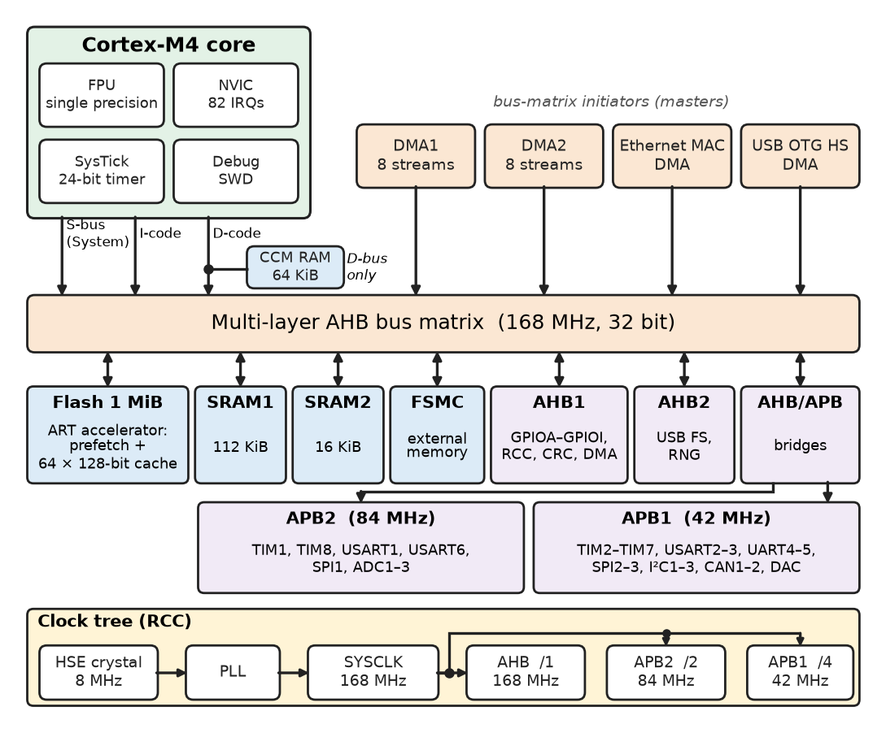
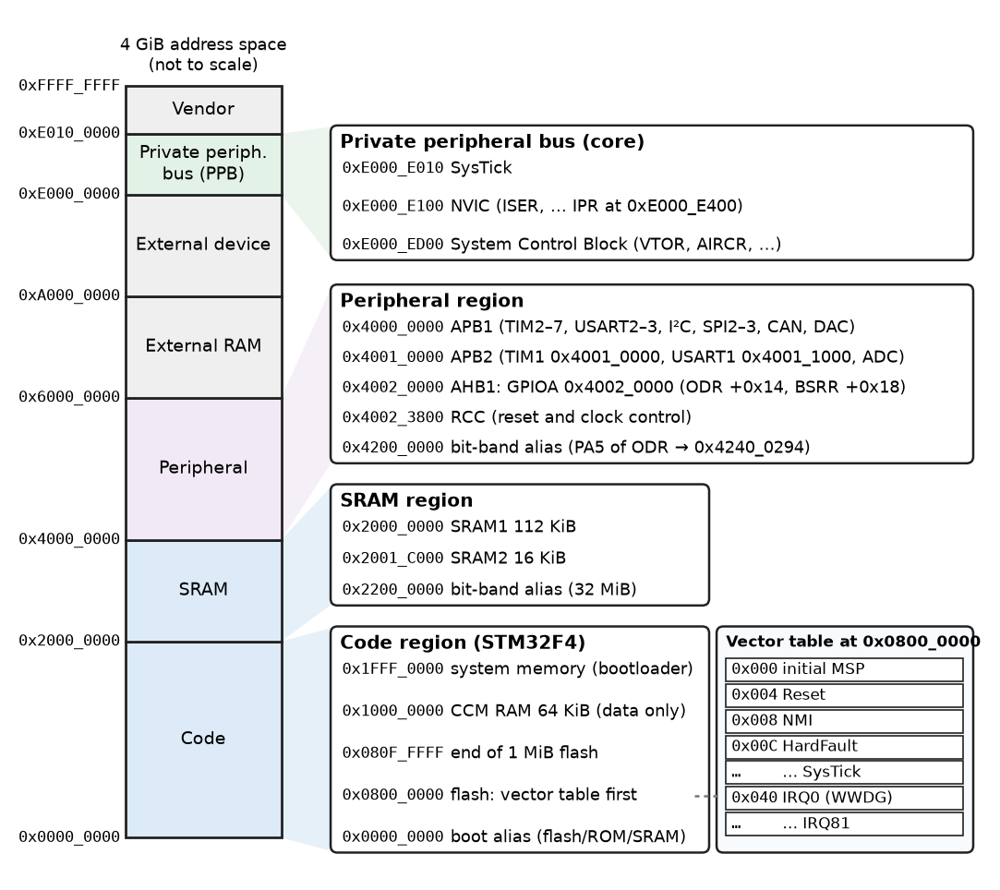
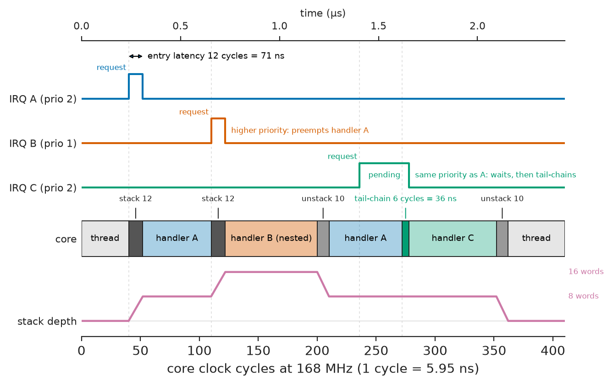
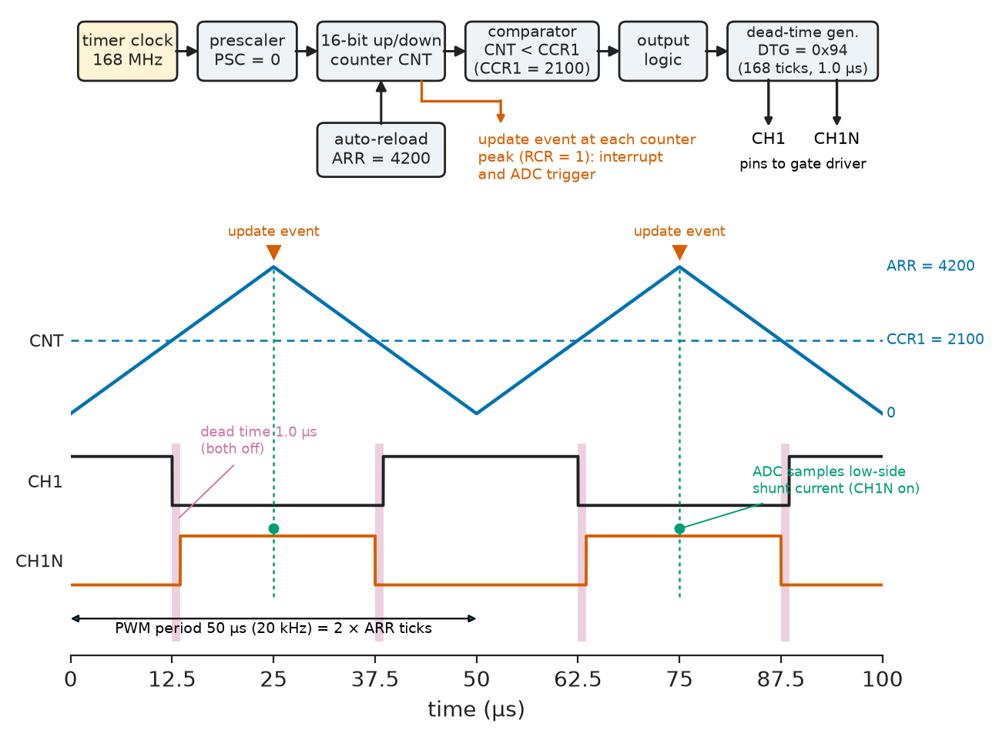
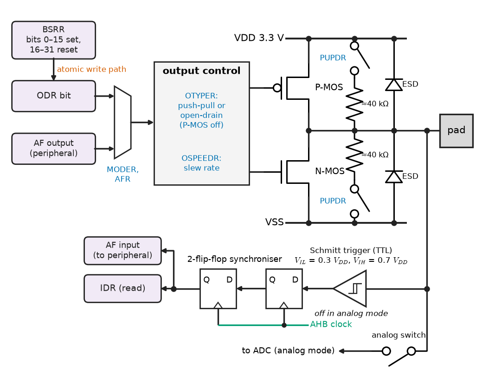
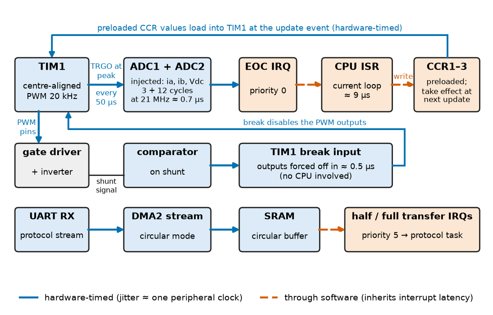

# Chapter 17 — Microprocessors and Microcontrollers

*Part IV · Computer Architecture and Digital Hardware*

A field-oriented motor drive in an e-bike runs its current loop in a timer interrupt at 20 kHz on a 168 MHz Cortex-M4. In the lab it is flawless. In the field, under a particular combination of throttle and Bluetooth traffic, the motor emits a click every few seconds and the phase current shows a single distorted PWM period. The cause turns out to be three facts about the microcontroller rather than about the control law: the Bluetooth stack's UART handler had been given the same interrupt priority as the current loop, so it could delay it by up to 40 µs; the ADC was started by software inside the interrupt instead of by the timer, so its sampling instant moved with the interrupt latency; and a flag in a GPIO register was updated with a read-modify-write that the UART handler occasionally interrupted. Each fix — a priority change, a timer-to-ADC trigger, a write to an atomic set/reset register — is one line of code, but finding it requires knowing how the processor core, its interrupt controller and its peripherals are wired together. This chapter supplies that knowledge for the processor engineers meet most often, the Arm Cortex-M microcontroller.

> **How does a microcontroller core execute instructions, address memory and peripherals, and respond to interrupts — and with what latency?**
> **How are timers, GPIO and serial peripherals organised at register level, and how are they combined so that hardware, not software, sets the timing?**
> **When is a microcontroller the right choice, and when does a design need a microprocessor running an operating system?**

| Concept | Engineering destination |
|---|---|
| Processor architecture | Choosing a core (M0+, M4, M7, M33, RISC-V), estimating cycle budgets |
| Instruction execution | Cycle counts of control loops, wait states, running code from RAM |
| Memory maps | Linker scripts, register access, fault debugging, bootloaders |
| Addressing modes | Reading compiler output, efficient array and structure access |
| Interrupt handling | Latency budgets, priority assignment, nested and tail-chained handlers |
| Timers and counters | PWM for converters and motors, input capture, encoders, time bases |
| GPIO | Pin configuration, atomic bit operations, electrical limits of pins |
| Serial interfaces | UART, SPI and I²C peripheral blocks, baud-rate setting, DMA service |
| Peripheral integration | Clock trees, DMA, timer-triggered ADCs, pin multiplexing, low-power modes |
| Microprocessor versus microcontroller | Part selection for drives, instruments, gateways and HMIs |

**Roadmap.** The Cortex-M core and its registers (17.1) → how it executes instructions and why wait states matter (17.2) → the memory map that places code, data and peripherals (17.3) → addressing modes (17.4) → exception and interrupt handling in the NVIC (17.5) → timers and counters (17.6) → GPIO (17.7) → serial interface blocks (17.8) → integrating peripherals with clocks, DMA and triggers (17.9) → microprocessor versus microcontroller (17.10).

---

## 17.1 Processor architecture

### From core to chip

A **microcontroller** (MCU) puts a processor core, its program memory, data memory and a set of peripherals on one die, so that a single chip with a crystal and a regulator is a complete computer. Most 32-bit MCUs sold today use one of Arm's **Cortex-M** cores, licensed to vendors such as ST, NXP, Microchip, Renesas, Infineon, TI, Nordic and Silicon Labs, who add their own memories and peripherals; RISC-V cores (Chapter 16) are growing in the same space with the same organisation. The vendor's chip, not Arm's core, sets most of what the engineer configures: clock tree, memory sizes, peripheral registers and pin assignments.

**Table 17.1 — Cortex-M family (typical implementations).**

| Core | Architecture | Pipeline | Typical clock | Notable features | Typical use |
|---|---|---|---|---|---|
| Cortex-M0+ | Armv6-M | 2 stage | 32–64 MHz | Smallest, about 12 000 gates; 32-cycle or single-cycle multiply option | Sensors, wearables, battery tools |
| Cortex-M3 | Armv7-M | 3 stage | 50–120 MHz | Thumb-2, hardware divide, bit-banding option | General industrial control |
| Cortex-M4 | Armv7E-M | 3 stage | 80–200 MHz | DSP instructions, single-cycle MAC, optional single-precision FPU | Motor control, audio, power conversion |
| Cortex-M7 | Armv7E-M | 6 stage, dual issue | 200–1000 MHz | Caches, TCMs, optional double-precision FPU | High-end drives, HMI, audio |
| Cortex-M33 | Armv8-M | 3 stage | 64–160 MHz | TrustZone security, DSP option | IoT nodes, secure devices |
| Cortex-M55/M85 | Armv8.1-M | 4–7 stage | 200–1000 MHz | Helium vector extension | Embedded machine learning |

The running example of this chapter is an STM32F4-class device: a Cortex-M4 with FPU at 168 MHz, 1 MiB of on-chip flash, 192 KiB of SRAM, two DMA controllers and the usual timers, ADCs and serial ports (Figure 17.1). Register addresses and bit positions in the listings follow that family and are marked illustrative; another vendor's part has the same structure under different names.

<!-- FIGURE 17.1 | figures/ch17/fig-17-1-cortex-m4-mcu-block.png | block-diagram | Internal organisation of a Cortex-M4 microcontroller of the STM32F4 class. | Content: Cortex-M4 core with FPU, NVIC, SysTick and debug (SWD) at top left; three core bus ports I-code, D-code and System drawn as arrows into a multi-layer AHB bus matrix (labelled 168 MHz, 32 bit). Other bus-matrix initiators: DMA1, DMA2 (8 streams each), Ethernet MAC DMA, USB OTG HS DMA. Bus-matrix targets: flash 1 MiB through ART accelerator (prefetch plus 64 x 128-bit instruction cache), SRAM1 112 KiB, SRAM2 16 KiB, external memory controller (FSMC), AHB1 peripherals (GPIOA to GPIOI, RCC, CRC, DMA), AHB2 (USB FS, RNG), and two bridges to APB2 (84 MHz: TIM1, TIM8, USART1, USART6, SPI1, ADC1-3) and APB1 (42 MHz: TIM2-TIM7, USART2-3, UART4-5, SPI2-3, I2C1-3, CAN1-2, DAC). 64 KiB CCM RAM attached to D-bus only. Clock tree box at bottom: HSE 8 MHz crystal -> PLL -> SYSCLK 168 MHz -> AHB, APB2 /2, APB1 /4. -->



*Figure 17.1 — Internal organisation of a Cortex-M4 microcontroller of the STM32F4 class.*

### The Cortex-M programmer's model

The Cortex-M core is a 32-bit load-store machine executing the **Thumb-2** instruction set, a mix of 16- and 32-bit encodings chosen for code density (typically 25–30 % smaller than fixed 32-bit encodings). Its registers are:

| Register | Role |
|---|---|
| R0–R12 | General purpose; R0–R3 carry arguments and results (AAPCS calling convention), R12 is a scratch register |
| R13 (SP) | Stack pointer, banked: **MSP** (main, used by handlers and after reset) and **PSP** (process, used by RTOS tasks) |
| R14 (LR) | Link register: return address of a call, or an `EXC_RETURN` code inside an exception handler |
| R15 (PC) | Program counter |
| xPSR | Program status: flags N, Z, C, V, Q (saturation), GE (SIMD), the Thumb bit and the active exception number |
| PRIMASK, FAULTMASK, BASEPRI | Interrupt masking: disable all, disable all but NMI, or mask below a priority level |
| CONTROL | Selects MSP or PSP in thread mode, privilege level, FPU context active |
| S0–S31, FPSCR | Single-precision floating-point registers (with FPU) |

Two operating modes exist: **thread mode** for normal code and **handler mode** for exceptions, which always runs privileged on the MSP. An RTOS runs its tasks in thread mode on the PSP, so that each task has its own stack and the handlers share the main one (Chapter 27).

> **Boundary.** The ISA concepts used here — load-store design, register files, pipelines, caches, buses, precise exceptions — are developed in Chapter 16 with RISC-V as the example. This chapter adds what an MCU adds: the memory map, the NVIC and the peripherals. Signalling and protocol details of UART, SPI, I²C and CAN belong to Chapter 26; task scheduling and interrupt-priority analysis to Chapter 27.

---

## 17.2 Instruction execution

### The three-stage pipeline

The Cortex-M3 and M4 use a three-stage pipeline: **fetch**, **decode** and **execute** (address generation, ALU, load/store and write-back all happen in execute). A 32-bit fetch brings in one 32-bit or two 16-bit instructions. There is a simple branch speculation: the decode stage fetches the branch target speculatively, so that a taken branch costs one to three extra cycles to refill the pipeline. Most data-processing instructions take one cycle; a load takes two cycles, but consecutive independent loads pipeline to one cycle each.

**Table 17.2 — Representative Cortex-M4 instruction timings (zero-wait-state memory).**

| Instruction class | Cycles |
|---|---|
| ALU operation, `MOV`, shift, compare | 1 |
| `MUL`, `MLA` (32×32 → 32), `SMLAL` (→ 64), `SMLAD` (dual 16×16 MAC) | 1 |
| `UDIV`, `SDIV` | 2–12 (data dependent) |
| `LDR` single / pipelined sequence | 2 / 1 each |
| `LDM`, `STM`, `PUSH`, `POP` of $n$ registers | $1+n$ |
| Taken branch | 2–4 |
| FPU add, multiply, multiply-accumulate (single precision) | 1–3 |
| FPU divide, square root | 14 |

The DSP extension of Armv7E-M matters in signal-processing loops: `SMLAD` performs two 16×16-bit multiplies and adds both products to a 32-bit accumulator in one cycle, and saturating instructions such as `QADD` clip instead of wrapping, which is what a PI controller's integrator wants. A 64-tap Q15 FIR filter written with `SMLAD` and packed coefficient loads runs at about 1 to 1.3 cycles per tap; written in plain C with 32-bit arithmetic it takes 3 to 4.

### Wait states and the flash bottleneck

On-chip flash is slower than the core. Embedded NOR flash reads in about 25–35 ns, while the 168 MHz clock period is 5.95 ns, so the flash controller must insert **wait states**: on STM32F4 parts, 5 wait states (6 cycles per access) at 168 MHz and 2.7–3.6 V. Straight-line code would then run at a fraction of the core's speed. Vendors hide the latency with a wide flash interface (128 bits, four to eight instructions per access), a **prefetch buffer** that fetches the next line while the current one executes, and a small instruction cache (ST's "ART accelerator": 64 lines of 128 bits) that holds loops. Branch-heavy code, large switch statements and interrupt vectors that are not cached still pay the full penalty.

The engineering consequences are concrete. A cycle budget measured with the cache warm can grow by 20–50 % after a context switch or a burst of unrelated code; time-critical routines are therefore often copied to SRAM and run from there, where every fetch is zero-wait-state. Not every RAM can do this: on STM32F4 the 64 KiB core-coupled memory (CCM) is wired only to the D-bus and cannot hold code, while on a Cortex-M7 the instruction TCM exists precisely for this purpose.

**Worked example — cycle budget of a current-control interrupt.** A field-oriented controller on the 168 MHz Cortex-M4 runs once per 20 kHz PWM period. The period is $168\times10^6/20\times10^3=8400$ cycles. The handler's body — Clarke and Park transforms, two PI regulators with saturation, inverse Park, space-vector modulation, written in single-precision float — measures 1500 cycles with the cycle counter (`DWT->CYCCNT`) in SRAM. Exception entry takes 12 cycles and exit about 10. The CPU load of the loop is

$$
\frac{20\times10^3\times(1500+12+10)}{168\times10^6}=0.181=18.1\ \%
$$

and the interrupt entry latency is $12/168\ \mathrm{MHz}=71.4$ ns. Run from flash with a cold cache, the body could take 1800–2200 cycles, raising the load to 22–26 %; the margin left for the speed loop, communications and diagnostics shrinks accordingly. The calculation also fixes the ADC timing: the current samples must be taken at the PWM centre, so they must be triggered by the timer in hardware (Section 17.9), not by the handler, whose start time varies with whatever else the core was doing.

---

## 17.3 Memory maps

### The Cortex-M address space

A Cortex-M core sees one flat 4 GiB address space, divided by the architecture into fixed regions with fixed default attributes (Figure 17.2):

| Address range | Region | Contents | Default attributes |
|---|---|---|---|
| `0x0000_0000`–`0x1FFF_FFFF` | Code | Flash, boot ROM, alias of boot memory at 0 | Executable, cacheable |
| `0x2000_0000`–`0x3FFF_FFFF` | SRAM | On-chip RAM; bit-band region in the first 1 MiB | Executable, cacheable |
| `0x4000_0000`–`0x5FFF_FFFF` | Peripheral | Vendor peripheral registers; bit-band region in the first 1 MiB | Device, never executed |
| `0x6000_0000`–`0x9FFF_FFFF` | External RAM | External memory controller (SRAM, SDRAM) | Executable, cacheable |
| `0xA000_0000`–`0xDFFF_FFFF` | External device | Memory-mapped external devices | Device |
| `0xE000_0000`–`0xE00F_FFFF` | Private peripheral bus | NVIC (`0xE000_E100`), SysTick (`0xE000_E010`), System Control Block (`0xE000_ED00`), debug | Strongly ordered |
| `0xE010_0000`–`0xFFFF_FFFF` | Vendor system | Vendor-specific | Device |

Within these regions the vendor places its memories and peripherals. On the STM32F4 example, flash starts at `0x0800_0000` (and is aliased at `0x0000_0000` when the chip boots from flash), SRAM at `0x2000_0000`, CCM RAM at `0x1000_0000`, GPIO port A at `0x4002_0000`, the reset and clock controller (RCC) at `0x4002_3800`, TIM1 at `0x4001_0000` and USART1 at `0x4001_1000`. Each peripheral occupies a block of 1 KiB or more, and its registers sit at fixed offsets from the block's base address.

<!-- FIGURE 17.2 | figures/ch17/fig-17-2-cortex-m-memory-map.png | block-diagram | Cortex-M memory map with the STM32F4 example placements. | Content: vertical bar from 0x0000_0000 at bottom to 0xFFFF_FFFF at top, divided into Code (0 to 0x1FFF_FFFF), SRAM (0x2000_0000), Peripheral (0x4000_0000), External RAM (0x6000_0000 to 0x9FFF_FFFF), External device (0xA000_0000 to 0xDFFF_FFFF), Private peripheral bus (0xE000_0000) and Vendor (0xE010_0000 up). Right-hand zoom callouts: Code region showing boot alias at 0, CCM RAM 64 KiB at 0x1000_0000, flash 1 MiB at 0x0800_0000 starting with vector table (initial MSP, Reset, NMI, HardFault, ..., IRQ0 ...), system memory bootloader at 0x1FFF_0000; SRAM region showing SRAM1 112 KiB and SRAM2 16 KiB, bit-band alias at 0x2200_0000; Peripheral region showing APB1 at 0x4000_0000, APB2 at 0x4001_0000, AHB1 at 0x4002_0000 (GPIOA 0x4002_0000, RCC 0x4002_3800), bit-band alias at 0x4200_0000; PPB showing SysTick 0xE000_E010, NVIC 0xE000_E100, SCB 0xE000_ED00. -->



*Figure 17.2 — Cortex-M memory map with the STM32F4 example placements.*

### The vector table and reset

The first words of the boot memory form the **vector table**. Word 0 is the initial value of the main stack pointer; word 1 is the address of the reset handler; the following words are the addresses of the fault handlers, the system exceptions and then one entry per vendor interrupt (82 on the STM32F407). On reset the core loads SP and PC from the first two words and starts executing — no boot code is needed to set up a stack before the first C function. Addresses in the table have bit 0 set to mark Thumb code. The **VTOR** register in the System Control Block relocates the table, which is how a bootloader at the start of flash hands control to an application placed higher up (Chapter 25).

### Linker scripts and the map file

The memory map is made concrete for software by the **linker script**, which declares the memory regions (`FLASH ORIGIN = 0x08000000, LENGTH = 1024K`; `RAM ORIGIN = 0x20000000, LENGTH = 128K`) and places sections in them: code and constants (`.text`, `.rodata`) in flash, initialised data (`.data`) in RAM with its initial values stored in flash and copied by the startup code, zero-initialised data (`.bss`) in RAM, then heap and stack. The map file the linker emits is the first place to look when RAM overflows or a function is unexpectedly slow because it was placed in flash.

### Bit-banding

The Cortex-M3 and M4 optionally map each bit of the first megabyte of the SRAM and peripheral regions to a whole 32-bit word in an **alias region**, so that a single store sets or clears one bit atomically, without a read-modify-write. The alias address is

$$
A_{\text{alias}}=A_{\text{alias base}}+32\,(A_{\text{byte}}-A_{\text{region base}})+4\,b
$$

with alias bases `0x2200_0000` (SRAM) and `0x4200_0000` (peripherals) and $b$ the bit number.

**Worked example — register and bit-band addresses.** The output data register `ODR` of GPIO port A is at offset `0x14` from `0x4002_0000`, i.e. `0x4002_0014`; the bit-set/reset register `BSRR` is at `0x4002_0018`. For bit 5 of `ODR` (pin PA5), the byte offset into the peripheral region is `0x2_0014`, and the alias address is $\texttt{0x4200\_0000}+32\times\texttt{0x2\_0014}+4\times5=\texttt{0x4240\_0294}$. Writing 1 to that word sets PA5; writing 0 clears it. The Cortex-M7 and the Armv8-M cores dropped bit-banding; GPIO blocks provide set/reset registers instead (Section 17.7), which work on every core and are the portable choice.

---

## 17.4 Addressing modes

### Load-store addressing in Thumb-2

As a load-store architecture, Armv7-M computes addresses only in load and store instructions, but it offers more **addressing modes** than RISC-V's single base-plus-offset form. Each saves instructions in a common pattern:

```asm
@ Armv7-M (Thumb-2) addressing modes, GNU assembler syntax
        ldr   r1, =0x40020014      @ PC-relative literal: 32-bit constant from a pool
        movw  r1, #0x0014          @ ...or build it from two 16-bit halves
        movt  r1, #0x4002
        ldr   r2, [r1]             @ register indirect
        ldr   r2, [r1, #4]         @ base + immediate offset
        ldr   r2, [r1, #4]!        @ pre-indexed: r1 = r1 + 4, then load
        ldr   r2, [r1], #4         @ post-indexed: load, then r1 = r1 + 4
        ldr   r2, [r1, r3, lsl #2] @ base + scaled index: a[i] for 32-bit a
        ldrh  r2, [r1, #2]         @ halfword, zero-extended
        ldrsb r2, [r1, #1]         @ byte, sign-extended
        ldmia r1!, {r4-r7}         @ load four words, then r1 = r1 + 16
        push  {r4-r7, lr}          @ store multiple to the descending stack
```

| Mode | Effective address | Typical C source |
|---|---|---|
| Immediate (data processing) | — (operand in instruction) | `x + 10`, constants up to a rotated 8-bit pattern |
| PC-relative literal | $\text{PC}+\text{offset}$ | Large constants, peripheral base addresses |
| Register indirect | $R_n$ | `*p` |
| Base + immediate offset | $R_n+\text{imm}$ | `s->field`, `p[3]` |
| Pre-indexed with write-back | $R_n\leftarrow R_n+\text{imm}$, then access | `*++p` |
| Post-indexed | access $R_n$, then $R_n\leftarrow R_n+\text{imm}$ | `*p++` in loops |
| Base + scaled register | $R_n+(R_m\ll s)$ | `a[i]` with variable `i` |
| Multiple (`LDM`/`STM`/`PUSH`/`POP`) | consecutive words | Structure copy, function prologue and epilogue |

**Immediate** operands in data-processing instructions are limited: Thumb-2 encodes a constant as an 8-bit value rotated or replicated across the word, so `0xFF00` fits but `0x1234` does not; such constants come from `MOVW`/`MOVT` pairs or a literal pool. Post-indexing makes the array sum of Chapter 16 a four-instruction loop (`ldr r2, [r0], #4`; `add`; `subs`; `bne`), one fewer than RV32I, and `subs` sets the Z flag that `bne` tests, so no separate compare is needed.

### Where modes matter to the engineer

Addressing modes are the compiler's business in normal code, but three situations bring them to the engineer's attention. When reading a disassembly to find why a loop is slow, the presence or absence of post-indexed loads and `LDM` sequences shows whether the compiler recognised the access pattern. When structures overlay peripheral registers (Section 17.7), every field access becomes a base-plus-offset load from one base register, which is efficient — whereas computing each register address separately from macros costs a literal-pool load per access. And alignment matters: `LDR` and `STR` of words tolerate unaligned addresses on Armv7-M at extra cost, but `LDM`, `STM` and `LDRD` fault on them, which is a classic HardFault when a packed communication buffer is cast to a structure pointer.

---

## 17.5 Interrupt handling

### Exceptions on Cortex-M

Cortex-M treats every interruption of normal flow as an **exception** with a number and a vector:

| Number | Exception | Priority |
|---|---|---|
| 1 | Reset | −3 (fixed, highest) |
| 2 | NMI (non-maskable interrupt; e.g. clock-failure detection) | −2 (fixed) |
| 3 | HardFault | −1 (fixed) |
| 4–6 | MemManage, BusFault, UsageFault | Configurable |
| 11 | SVCall (supervisor call, `SVC` instruction) | Configurable |
| 14 | PendSV (pendable service call, used for RTOS context switches) | Configurable |
| 15 | SysTick (24-bit system timer) | Configurable |
| 16 and up | IRQ0, IRQ1, ... vendor peripheral interrupts | Configurable |

The **nested vectored interrupt controller** (NVIC), part of the core, handles up to 240 (Armv7-M) external interrupts. For each it has enable, pending and active bits and a priority field of up to 8 bits, of which the vendor implements typically 3 or 4 (8 or 16 levels; 4 bits on STM32F4), left-aligned in the byte. **Lower numbers mean higher priority.** A configurable split divides the field into **preemption priority** (which decides whether one handler can interrupt another) and **subpriority** (which only orders pending interrupts of equal preemption priority).

### Exception entry and return

When an interrupt is accepted, the hardware does what a RISC-V handler's prologue does in software (Chapter 16), and more:

1. **Stacking**: it pushes eight registers — R0–R3, R12, LR, PC and xPSR — onto the current stack. These are exactly the registers the AAPCS calling convention does not require a C function to preserve, so the handler can be an ordinary C function with no special attribute.
2. **Vector fetch** in parallel with stacking, over the separate instruction bus.
3. **Mode change**: handler mode, MSP; LR is loaded with an `EXC_RETURN` value such as `0xFFFF_FFF9` (return to thread mode, main stack) or `0xFFFF_FFFD` (thread mode, process stack).
4. The first handler instruction executes **12 cycles** after the request on a Cortex-M3/M4 with zero-wait-state memory.

Return happens when the handler loads an `EXC_RETURN` value into the PC, typically through `BX LR` or `POP {..., PC}`: the hardware recognises the special value, unstacks the eight registers and resumes. With the FPU active, the frame grows to 26 words (adding S0–S15 and FPSCR); **lazy stacking** reserves the space but saves the floating-point registers only if the handler itself uses the FPU, so integer-only handlers keep the 12-cycle latency.

Three optimisations make back-to-back interrupts cheap (Figure 17.3):

- **Tail-chaining**: if another interrupt is pending when a handler returns, the core skips the unstack-and-restack and enters the next handler in 6 cycles.
- **Late arrival**: if a higher-priority interrupt arrives during the stacking of a lower one, the core uses the same stack frame and vectors to the higher-priority handler instead.
- **Pop preemption**: an interrupt arriving during unstacking abandons the unstack and enters the new handler.

<!-- FIGURE 17.3 | figures/ch17/fig-17-3-nvic-entry-tailchain.png | timing-diagram | Cortex-M4 exception timing: entry, preemption by a higher priority, and tail-chaining. | Content: horizontal time axis in core cycles at 168 MHz (0 to about 400 cycles). Signal rows: IRQ A request (priority 2), IRQ B request (priority 1, higher), IRQ C request (priority 2). Core activity row: thread code; 12-cycle stacking block; handler A; at B's arrival a second 12-cycle stacking block; handler B (nested); 10-cycle unstack back into handler A; handler A completes while C pending; 6-cycle tail-chain block; handler C; 10-cycle unstack; thread code. Stack-depth row showing 8 words, then 16 words during nesting, back to 8, then 0. Label entry latency 12 cycles = 71 ns, tail-chain 6 cycles = 36 ns. -->



*Figure 17.3 — Cortex-M4 exception timing: entry, preemption by a higher priority, and tail-chaining.*

> **Status of the principle: Cortex-M exception latency**
> *Empirical.* The 12-cycle entry and 6-cycle tail-chain figures are Arm's specified values for the Cortex-M3/M4 with zero-wait-state memory and no bus contention; flash wait states on the vector fetch, a stalled bus, an in-progress multi-cycle instruction or floating-point stacking add cycles, so a measured worst case is required for a hard deadline.

### Priorities, masking and critical sections

Priority assignment follows from deadlines, not importance: the shortest-deadline, shortest-handler events get the highest priorities (rate-monotonic reasoning, Chapter 27). In the e-bike drive of the opening, the correct order is PWM/current-loop interrupt highest, encoder and overcurrent next, communication lowest — and the Bluetooth UART, which had been set to the same preemption level as the current loop, could no longer delay it once moved down.

Code that shares data with a handler needs **critical sections**. `CPSID I` (setting PRIMASK) disables all configurable interrupts and is the blunt tool; writing **BASEPRI** masks only interrupts at or below a chosen priority, so that the current-loop interrupt stays live while lower-priority code updates a shared structure. Every critical section adds its length to the worst-case latency of the interrupts it masks (Chapter 16, Section 16.10).

### Configuring an interrupt in C

The listing configures TIM1 for centre-aligned PWM at 20 kHz with dead time and enables its update interrupt at preemption priority 1. Register names and offsets follow the STM32F4 TIM1 block and are illustrative:

```c
#include <stdint.h>                          /* C11; illustrative STM32F4-style layout */
typedef struct {
    volatile uint32_t CR1, CR2, SMCR, DIER, SR, EGR, CCMR1, CCMR2, CCER,
                      CNT, PSC, ARR, RCR, CCR1, CCR2, CCR3, CCR4, BDTR;
} TIM_TypeDef;
#define TIM1          ((TIM_TypeDef *)0x40010000u)
#define RCC_APB2ENR   (*(volatile uint32_t *)0x40023844u)
#define NVIC_ISER0    (*(volatile uint32_t *)0xE000E100u)
#define NVIC_IPR      ((volatile uint8_t *)0xE000E400u)
#define TIM1_UP_IRQn  25u

void pwm_init(void)
{
    RCC_APB2ENR |= 1u << 0;                  /* clock TIM1 (168 MHz timer clock) */
    TIM1->PSC   = 0u;
    TIM1->ARR   = 4200u;                     /* centre-aligned: 168 MHz / (2 x 4200) = 20 kHz */
    TIM1->RCR   = 1u;                        /* one update event per PWM period */
    TIM1->CCMR1 = (6u << 4) | (1u << 3);     /* channel 1: PWM mode 1, preload */
    TIM1->CCR1  = 2100u;                     /* 50 % duty */
    TIM1->CCER  = (1u << 0) | (1u << 2);     /* enable CH1 and complementary CH1N */
    TIM1->BDTR  = (1u << 15) | 0x94u;        /* main output enable, dead time 168 ticks */
    TIM1->DIER  = 1u << 0;                   /* update interrupt */
    TIM1->EGR   = 1u << 0;                   /* load preloaded registers */
    TIM1->CR1   = (1u << 7) | (1u << 5) | (1u << 0); /* ARR preload, centre mode 1, start */
    NVIC_IPR[TIM1_UP_IRQn] = 1u << 4;        /* priority 1 in the upper 4 bits */
    NVIC_ISER0 = 1u << TIM1_UP_IRQn;
}

void TIM1_UP_TIM10_IRQHandler(void)
{
    TIM1->SR = ~1u;                          /* clear UIF (bits are write-0-to-clear) */
    /* read latest ADC results, run current loop, write new CCR1..CCR3 */
}
```

The handler's name must match the symbol in the vendor's vector table; the linker then places its address in entry 16 + 25. Clearing the flag first matters: the interrupt is level-sensitive at the NVIC, so a handler that returns with `UIF` still set re-enters immediately, and because the write to the peripheral travels over the bus, clearing it at the very end can let the handler return before the flag has actually cleared — a classic cause of double-triggered interrupts.

---

## 17.6 Timers and counters

### Timer anatomy

A microcontroller timer is a counter with programmable clock, period and comparison logic (Figure 17.4). Its parts are:

- a **prescaler** dividing the timer clock by $\text{PSC}+1$;
- a **counter** (`CNT`, 16 or 32 bits) counting up, down or up-down (centre-aligned);
- an **auto-reload register** (`ARR`) setting the period: the counter wraps after $\text{ARR}+1$ counts in up-counting mode;
- several **capture/compare channels** (`CCRx`), each usable as an output compare (toggle or set a pin, or generate PWM, when `CNT` matches) or as an input capture (latch `CNT` when a pin edge arrives);
- **update events** and interrupt or DMA requests on overflow, compare match or capture;
- **trigger outputs** to start other timers, ADC conversions or DMA transfers in hardware.

The update frequency of an up-counting timer is

$$
f_{\text{update}}=\frac{f_{\text{timer}}}{(\text{PSC}+1)(\text{ARR}+1)}
$$

and in centre-aligned mode the period is $2\,\text{ARR}$ timer ticks.

> **Status of the principle: Timer period relation**
> *Derived.* It follows from counting clock edges; it is exact in the digital domain, so frequency accuracy is entirely that of the timer clock — a crystal at 20–50 ppm or an internal RC oscillator at 1–3 % — and the resolution is one tick.

<!-- FIGURE 17.4 | figures/ch17/fig-17-4-timer-pwm.png | timing-diagram | Timer structure and centre-aligned PWM generation with complementary outputs and dead time. | Content: upper part block diagram: timer clock 168 MHz -> prescaler (PSC = 0) -> 16-bit up-down counter CNT <- auto-reload ARR = 4200; CNT feeds comparator against CCR1 = 2100 -> output logic -> dead-time generator (DTG = 0x94, 1.0 us) -> CH1 and CH1N pins; update event output -> interrupt and ADC trigger. Lower part waveforms over two PWM periods (2 x 50 us): triangular CNT from 0 to 4200 and back, horizontal dashed line at CCR1 = 2100; CH1 high while CNT < CCR1 (PWM mode 1); CH1N its complement; both shown with 1.0 us dead-time gaps where both are low; update-event markers at each counter peak (one per period with RCR = 1); ADC sampling marker at the counter peak (centre of the low-side on-time, CH1N high), where the low-side shunt current is sampled. -->



*Figure 17.4 — Timer structure and centre-aligned PWM generation with complementary outputs and dead time.*

### Timer modes and their uses

| Mode | How it works | Application |
|---|---|---|
| Time base | Update interrupt every $(\text{PSC}+1)(\text{ARR}+1)$ ticks | 1 kHz scheduler tick, sampling clock |
| Output compare | Pin toggles or pulses on match | Stepper-motor pulses, ultrasonic burst timing |
| PWM (edge-aligned) | Output high while $\text{CNT}<\text{CCR}$ | LED dimming, fan control, DC-DC converters |
| PWM (centre-aligned) | Up-down counting; symmetric pulses | Three-phase inverters (lower harmonics, natural ADC sample point) |
| Complementary outputs with dead time | High-side and low-side signals with programmable gap | Half-bridge and inverter gate drive (Chapter 32) |
| Break input | Hardware forces outputs to a safe state on a fault pin | Overcurrent shutdown in under 1 µs, independent of software |
| Input capture | `CNT` latched on pin edge | Frequency, period and pulse-width measurement; ultrasonic echo |
| Encoder interface | Counter clocked by quadrature A/B signals | Motor position and speed |
| One-pulse | Single pulse of programmed delay and width | Triac firing, sensor triggering |

**Worked example — PWM resolution, dead time and a time base.** The TIM1 configuration of Section 17.5 uses the 168 MHz timer clock with $\text{PSC}=0$. In centre-aligned mode at 20 kHz, $\text{ARR}=168\times10^6/(2\times20\times10^3)=4200$, so duty cycle is set in steps of $1/4200$: a resolution of $\log_2 4200=12.0$ bits. An edge-aligned 20 kHz PWM would have $\text{ARR}+1=8400$ (13.0 bits) but no symmetric sampling point. The gate driver needs 1.0 µs of dead time: 168 ticks of the 5.95 ns clock. STM32-style dead-time registers encode values above 127 ticks with a coarser step: the code `10xxxxxx` means $(64+\text{DTG}[5{:}0])\times2$ ticks, so $\text{DTG}[5{:}0]=20$ gives $(64+20)\times2=168$ ticks and the register value `0x94`. For a 1 kHz scheduler tick on a 32-bit general-purpose timer clocked at 84 MHz, $\text{PSC}=83$ gives a 1 MHz count and $\text{ARR}=999$ gives the 1 kHz update. A 16-bit counter at 1 MHz overflows every 65.5 ms; the 32-bit one would run 4295 s at 1 MHz, or 51.1 s at the full 84 MHz, before wrapping — long enough to timestamp events without overflow handling in most protocols.

### SysTick and watchdogs

Every Cortex-M core contains **SysTick**, a 24-bit down-counter with its own exception, intended as the operating-system tick; because it is part of the core, RTOS ports use it without vendor-specific code. Vendors add a **real-time clock** on a 32.768 kHz crystal, running in the lowest power modes, and **watchdog timers**: an independent watchdog on its own RC oscillator resets the chip if software fails to refresh it in time, and a window watchdog also resets it if software refreshes too early, catching code that is looping in the wrong place. A watchdog is only useful if the refresh is placed where it proves that the whole system, not just one loop, is alive (Chapter 25).

---

## 17.7 GPIO

### The pin as a configurable circuit

A **general-purpose input/output** (GPIO) pin is a small configurable circuit (Figure 17.5): an output driver that can be push-pull or open-drain with selectable slew rate; optional pull-up and pull-down resistors (typically 30–50 kΩ); an input path with a Schmitt trigger and a synchroniser into the bus clock domain; an analog switch to the ADC; and a multiplexer that hands the pin to a peripheral as an **alternate function**. Each pin is controlled by fields in its port's registers:

| Register (STM32F4 offsets) | Function |
|---|---|
| `MODER` (0x00), 2 bits per pin | Input, general-purpose output, alternate function, analog |
| `OTYPER` (0x04), 1 bit | Push-pull or open-drain |
| `OSPEEDR` (0x08), 2 bits | Output slew rate (low to very high) |
| `PUPDR` (0x0C), 2 bits | None, pull-up, pull-down |
| `IDR` (0x10) | Input levels (read only) |
| `ODR` (0x14) | Output latch |
| `BSRR` (0x18) | Write-only: bits 0–15 set, bits 16–31 reset the corresponding `ODR` bits |
| `AFR[0]`, `AFR[1]` (0x20, 0x24), 4 bits | Alternate-function number 0–15 |

<!-- FIGURE 17.5 | figures/ch17/fig-17-5-gpio-pin-structure.png | schematic | Structure of a microcontroller GPIO pin. | Content: pad on the right with ESD protection diodes to VDD (3.3 V) and VSS. Output path from left: ODR bit and alternate-function output multiplexer (selected by MODER and AFR) -> output control -> P-MOS to VDD and N-MOS to VSS (P-MOS disabled in open-drain mode, labelled OTYPER), slew-rate control labelled OSPEEDR. Pull-up and pull-down resistors (about 40 kOhm) with switches labelled PUPDR. Input path: pad -> TTL Schmitt trigger (thresholds VIL 0.3 VDD, VIH 0.7 VDD) -> two-flip-flop synchroniser clocked by AHB clock -> IDR and alternate-function input; separate analog path to ADC switch (Schmitt disabled in analog mode). Write path showing BSRR set and reset bits acting directly on ODR. -->



*Figure 17.5 — Structure of a microcontroller GPIO pin.*

### Atomic access and the read-modify-write hazard

Setting one pin by `GPIOA->ODR |= 1u << 5;` compiles to a load, an OR and a store. If an interrupt handler changes another bit of the same `ODR` between the load and the store, the main code's store writes back the old value of that bit and silently undoes the handler's change — the third fault of the e-bike drive. Writing to `BSRR` is a single store that affects only the bits written as 1, so no other bit can be lost:

```c
#include <stdint.h>                          /* C11; illustrative STM32F4-style layout */
typedef struct {
    volatile uint32_t MODER, OTYPER, OSPEEDR, PUPDR, IDR, ODR, BSRR, LCKR;
    volatile uint32_t AFR[2];
} GPIO_TypeDef;
#define GPIOA        ((GPIO_TypeDef *)0x40020000u)
#define RCC_AHB1ENR  (*(volatile uint32_t *)0x40023830u)

void status_led_init(void)
{
    RCC_AHB1ENR |= 1u << 0;                  /* clock GPIO port A */
    (void)RCC_AHB1ENR;                       /* read back before first access */
    GPIOA->MODER   = (GPIOA->MODER & ~(3u << 10)) | (1u << 10);  /* PA5 output */
    GPIOA->OTYPER &= ~(1u << 5);             /* push-pull */
    GPIOA->OSPEEDR &= ~(3u << 10);           /* lowest slew rate */
}

static inline void led_set(void)   { GPIOA->BSRR = 1u << 5; }
static inline void led_clear(void) { GPIOA->BSRR = 1u << (5u + 16u); }
static inline uint32_t button(void) { return (GPIOA->IDR >> 0) & 1u; }  /* PA0 */
```

The configuration writes are still read-modify-write sequences and belong in initialisation, before interrupts are enabled. The dummy read after enabling the clock makes sure the enable has reached the peripheral before its registers are written, a documented requirement on several families.

### Electrical limits

A GPIO pin is a CMOS output, not a power driver. Representative limits for a 3.3 V MCU are listed below; the interface circuits that respect them (LED and relay drivers, level shifters, input protection) are in Chapter 26.

| Parameter | Typical value (3.3 V supply) |
|---|---|
| Output current per pin, guaranteed levels | ±8 mA with $V_{OH}\ge V_{DD}-0.4$ V, $V_{OL}\le0.4$ V |
| Absolute maximum per pin / total per package | ±25 mA / 120–150 mA |
| Input thresholds (CMOS/TTL compatible) | $V_{IL}\le0.3V_{DD}$, $V_{IH}\ge0.7V_{DD}$, hysteresis about 0.1–0.2 V |
| Pull resistors | 30–50 kΩ |
| Input leakage | ±1 µA |
| Output edge rate at highest speed setting, 30 pF | 2–4 ns, toggle up to 50–100 MHz |
| 5 V tolerance | Only on pins marked FT, and only when not in analog mode |

The slew-rate setting deserves attention: the fastest setting gives nanosecond edges whose harmonics radiate and couple into analog inputs, so it should be used only where the signal needs it (SPI at tens of MHz, external memory) and the lowest setting elsewhere.

---

## 17.8 Serial interfaces

### Serial peripherals as register blocks

Microcontrollers talk to sensors, memories, radios and other processors through serial peripherals. At the architecture level each is a block of registers on the APB bus with a shift register, a baud-rate generator, status flags, interrupt and DMA requests, and pins assigned through the GPIO alternate-function multiplexer.

| Peripheral | Signals | Clocking | Typical MCU rate | Key registers |
|---|---|---|---|---|
| USART/UART | TX, RX (optional RTS, CTS) | Asynchronous, baud generator | 9.6 kbit/s–10 Mbit/s | `BRR` (baud), `CR1`–`CR3`, `SR`, `DR` |
| SPI | SCK, MOSI, MISO, NSS | Synchronous, master provides clock | 1–50 MHz | `CR1` (mode, prescaler), `SR`, `DR` |
| I²C | SDA, SCL (open-drain) | Synchronous, multi-master | 100 kHz, 400 kHz, 1 MHz | `CR1`, `CR2`, `CCR`, `OAR`, `SR1`, `SR2`, `DR` |
| CAN (bxCAN, FDCAN) | TX, RX to transceiver | Asynchronous, bit timing segments | 125 kbit/s–1 Mbit/s (5–8 Mbit/s CAN FD data) | Bit-timing, mailboxes, acceptance filters |
| USB device/host | D+, D− | Packet based, 48 MHz clock | 12 Mbit/s (FS), 480 Mbit/s (HS) | Endpoint buffers, descriptors |

> **Boundary.** Frame formats, timing diagrams, arbitration, electrical levels and troubleshooting of UART, SPI, I²C, CAN, USB and Ethernet are developed in Chapter 26 (with ISO 11898 for CAN and the USB 2.0 specification). This section covers only the peripheral blocks and how the processor services them.

### Baud-rate generation

A UART divides its kernel clock to produce the bit rate. With 16× oversampling (each bit sampled 16 times, the middle samples voted),

$$
\text{USARTDIV}=\frac{f_{\text{ck}}}{16\,\text{baud}}
$$

and STM32-style parts store USARTDIV as a 12-bit mantissa and a 4-bit fraction in `BRR`.

**Worked example — baud-rate error.** USART1 on the APB2 bus has $f_{\text{ck}}=84$ MHz. For 115 200 baud, $\text{USARTDIV}=84\times10^6/(16\times115\,200)=45.573$. The mantissa is 45, the fraction $0.573\times16=9.17$ rounds to 9, and $\text{BRR}=(45\ll4)+9=$ `0x2D9`. The actual rate is $84\times10^6/(16\times45.5625)=115\,226$ baud, an error of +0.023 %. On USART2 (APB1, 42 MHz) the same calculation gives a mantissa of 22, fraction 13 and 115 068 baud, −0.11 %. Both are far inside the roughly ±2 % total mismatch an asynchronous link tolerates between transmitter and receiver (Chapter 26) — but an MCU running from its internal RC oscillator at ±1 % across temperature uses half that budget before the divider error is counted, which is why reliable UART links run from a crystal.

### Servicing serial peripherals

A peripheral raises a request when its receive register is full (`RXNE`) or its transmit register is empty (`TXE`), and the core services it by polling, by interrupt or by DMA (Chapter 16, Section 16.11). At 115 200 baud one byte arrives every 86.8 µs, so an interrupt per byte is cheap. The usual structure is a **ring buffer** between the handler and the main code:

```c
#include <stdint.h>
#define USART1_SR  (*(volatile uint32_t *)0x40011000u)   /* illustrative */
#define USART1_DR  (*(volatile uint32_t *)0x40011004u)
#define SR_RXNE    (1u << 5)
#define SR_ORE     (1u << 3)

static volatile uint8_t rx_buf[256];
static volatile uint8_t rx_head, rx_tail;    /* 8-bit indices wrap at 256 */

void USART1_IRQHandler(void)
{
    uint32_t sr = USART1_SR;
    if (sr & (SR_RXNE | SR_ORE)) {
        uint8_t c = (uint8_t)USART1_DR;      /* SR then DR read clears RXNE and ORE */
        uint8_t next = (uint8_t)(rx_head + 1u);
        if (next != rx_tail) {               /* drop the byte if the buffer is full */
            rx_buf[rx_head] = c;
            rx_head = next;
        }
    }
}

int uart_getc(void)                          /* called from main code; -1 if empty */
{
    if (rx_tail == rx_head) return -1;
    uint8_t c = rx_buf[rx_tail];
    rx_tail = (uint8_t)(rx_tail + 1u);
    return c;
}
```

The handler is the only writer of `rx_head` and the main code the only writer of `rx_tail`; each 8-bit index is read and written with single instructions, so no critical section is needed on a single-core MCU. The overrun flag must be cleared too: on these parts an overrun that is not cleared keeps the interrupt asserted forever. Synchronisation in the general case — multiple writers, multicore parts, RTOS queues — is the subject of Chapter 27. For SPI flash reads, audio streams and anything above a few hundred kilobytes per second, DMA replaces the per-byte handler: an SPI at 21 MHz moves 2.6 MB/s, one byte every 381 ns, far too fast for interrupts.

---

## 17.9 Peripheral integration

### Clock tree and power gating

Every peripheral on an MCU is fed from a **clock tree** in the reset and clock controller: an external crystal (HSE, 8–25 MHz) or internal RC oscillator feeds a PLL that produces the system clock (168 MHz here), which is divided for the AHB bus (168 MHz), the high-speed APB2 (84 MHz) and the low-speed APB1 (42 MHz); timers on an APB bus with a divider other than 1 receive twice the APB clock. Each peripheral has an enable bit; after reset almost everything is off, and a register write to a peripheral whose clock is disabled is silently ignored — the most common "the peripheral does nothing" bug. Disabling unused clocks also saves power: dynamic CMOS power scales with switched capacitance and frequency (Chapter 33).

**Table 17.3 — Representative power modes of 32-bit MCUs (typical, 25 °C).**

| Mode | What runs | High-performance M4 at 168 MHz | Ultra-low-power M4/M33 class | Wake-up time |
|---|---|---|---|---|
| Run | Core and enabled peripherals | 40–90 mA (about 250–500 µA/MHz) | 30–110 µA/MHz | — |
| Sleep | Core clock stopped, peripherals run | 15–60 mA | 10–40 µA/MHz | a few cycles |
| Stop (deep sleep) | All high-speed clocks off, SRAM retained | 0.3–0.5 mA | 1–5 µA | 5–20 µs |
| Standby / shutdown | Only RTC and backup domain | 2–4 µA | 0.03–0.5 µA | 50 µs–1 ms (reset) |

### DMA, triggers and event routing

The integration that matters most for real-time behaviour is the ability of peripherals to start one another without the CPU. On the STM32F4, two DMA controllers with eight streams each move data between peripherals and memory, and timers can trigger ADC conversions directly. A motor drive therefore chains: TIM1 reaches the centre of its PWM period → its trigger output starts an injected ADC conversion of two phase currents and the DC-link voltage → the ADC's end-of-conversion raises the interrupt in which the control law runs (or a DMA transfer stores the results). The sampling instant is fixed to the timer within one ADC clock, independent of interrupt latency — the second fix in the e-bike drive. Newer families generalise this with an event matrix that routes any peripheral's event to any other's trigger input.

<!-- FIGURE 17.6 | figures/ch17/fig-17-6-peripheral-chain.png | flowchart | Hardware-triggered peripheral chain of a motor-control MCU. | Content: blocks left to right: TIM1 (centre-aligned PWM 20 kHz) drives PWM pins to gate driver and inverter; TIM1 TRGO at counter peak (labelled every 50 us) -> ADC1 and ADC2 injected conversion of ia, ib, Vdc (sample time 3 cycles plus 12 conversion cycles at 21 MHz, about 0.7 us) -> end-of-conversion interrupt (priority 0) -> CPU current-loop ISR (about 9 us) -> writes CCR1-CCR3 (preloaded, take effect at next update). Parallel branch: UART RX -> DMA2 stream -> circular buffer in SRAM -> half and full transfer interrupts (priority 5). Comparator on shunt -> TIM1 break input -> outputs forced off within about 0.5 us (no CPU). Annotate which paths are hardware-timed and which pass through software. -->



*Figure 17.6 — Hardware-triggered peripheral chain of a motor-control MCU.*

The same thinking applies across the chip (Figure 17.6). An overcurrent comparator wired to the timer's break input turns the inverter off in under a microsecond whether or not the software has crashed. A UART receiving a protocol stream uses circular DMA, with interrupts at half and full buffer, so the CPU handles data in blocks. **Pin multiplexing** ties it together: a 100-pin package exposes perhaps 140 peripheral signals, each pin offering up to 16 alternate functions, and assigning them is an early, constraining step of board design that vendor configuration tools automate.

> **Status of the principle: Hardware timing over software timing**
> *Empirical.* Experience across embedded designs shows that events tied to hardware triggers (timer-to-ADC, comparator-to-break, DMA) have jitter of one peripheral clock, while the same events started in software inherit interrupt latency and its variation, typically 0.1–50 µs; it holds as long as the trigger chain is configured correctly and the CPU only consumes results.

---

## 17.10 Microprocessor versus microcontroller

### Two kinds of chip

A **microprocessor** (MPU), in the embedded sense, is a processor chip that relies on external memory: an application core (Cortex-A, a RISC-V application core, x86) with a memory-management unit, caches, a DRAM controller and high-speed interfaces, booting an operating system such as Linux from flash or eMMC into external DRAM. A **microcontroller** is a self-contained computer with on-chip flash and SRAM, running bare-metal code or an RTOS directly from flash, with deterministic timing and fast wake-up. The boundary has blurred — Cortex-M7 "crossover" MCUs reach 1 GHz, and some MPUs embed a Cortex-M core for real-time tasks — but the design questions that decide between them are stable.

| Attribute | Microcontroller (Cortex-M4 class) | Microprocessor / application SoC (quad Cortex-A53 class) |
|---|---|---|
| Clock, performance | 48–200 MHz, about 1.25 DMIPS/MHz | 1–2 GHz, 2–3 DMIPS/MHz per core, several cores |
| Memory | 64 KiB–2 MiB flash, 16 KiB–1 MiB SRAM on chip | External DDR3/DDR4/LPDDR4, 256 MB–8 GB; eMMC or NAND storage |
| Memory protection | MPU (8–16 regions), no virtual memory | MMU with virtual memory, caches, IOMMU |
| Software | Bare metal or RTOS (FreeRTOS, Zephyr), single image | Linux or Android, processes, file systems, drivers |
| Boot time | Under 1 ms to `main()` | 2–30 s to application |
| Interrupt latency | 12 cycles (under 0.1 µs), deterministic | 1–10 µs typical, tens of µs worst case under Linux; PREEMPT_RT improves the tail |
| Power | 1–100 mW active, µW asleep | 0.5–5 W active, tens of mW in suspend |
| Board | 2–4 layer PCB, single supply | 6–10 layer PCB, PMIC with several rails, DRAM routing rules |
| Typical uses | Motor drives, converters, sensors, wearables, automotive ECUs | HMIs, gateways, cameras, vision, network appliances |

### Choosing

The decision follows from requirements, not from performance alone:

- **Hard real-time control** (current loops at 10–100 kHz, protection, safety functions) wants a microcontroller or a dedicated real-time core, because its timing can be bounded (Chapter 27).
- **Rich software** — a graphical interface, a TCP/IP stack with TLS and many connections, a file system, a camera pipeline, a Python runtime — wants an MPU with Linux.
- **Power and start-up**: a battery sensor that wakes for 2 ms every second and sleeps at 2 µA can only be an MCU.
- **Cost and board complexity**: an MPU needs external DRAM, a power-management IC and a denser PCB; the bill of materials is typically several times that of an MCU design.

Many products combine both. An EV charger or an industrial servo drive runs its power stage from a Cortex-M or DSP-class controller and its user interface, networking and logging from a Cortex-A running Linux, linked by SPI, UART or shared memory; heterogeneous SoCs (an application cluster plus a Cortex-M core on one die) put the pair on one chip. Where neither is fast or deterministic enough — a 1 MHz control loop, a radar front end, a custom protocol at gigabits per second — the computation moves into programmable logic, the subject of Chapter 18, and the partitioning decision itself is treated in Chapters 25 and 35.

---

## What remains open

| Open question | Where it is answered |
|---|---|
| How are pipelines, caches and buses designed and analysed in general? | Chapter 16 |
| How are flash and SRAM built, and how is external memory interfaced? | Chapter 18 |
| How are C pointers, `volatile`, bit operations and peripheral drivers written well? | Chapter 21 |
| How is a microcontroller chosen, booted, updated and its firmware structured? | Chapter 25 |
| How do UART, SPI, I²C, CAN, USB and Ethernet work on the wire, and how are they debugged? | Chapter 26 |
| How are interrupt priorities and RTOS task priorities assigned so that deadlines are provably met? | Chapter 27 |
| How do timer PWM and dead time translate into gate drive and inverter behaviour? | Chapters 29 and 32 |
| How are field-oriented and other drive control laws designed? | *Electrical Energy and Machines*, [Ch. 12](https://github.com/The-Studio-of-Sadiq/Electrical-Energy-and-Machines/blob/main/part-3-motor-drives/12-ac-motor-drives.md) |
| What sets the dynamic and leakage power of the chip in each mode? | Chapter 33 |
| When should a control loop or filter move from the MCU to an FPGA? | Chapter 35 |

**Next:** Chapter 18 opens the memories that every processor depends on — SRAM, DRAM and flash — and the programmable logic that takes over where a processor is too slow or too unpredictable.
