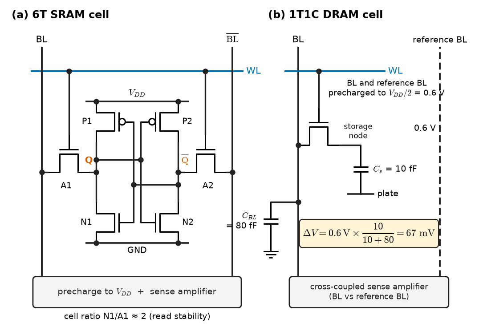
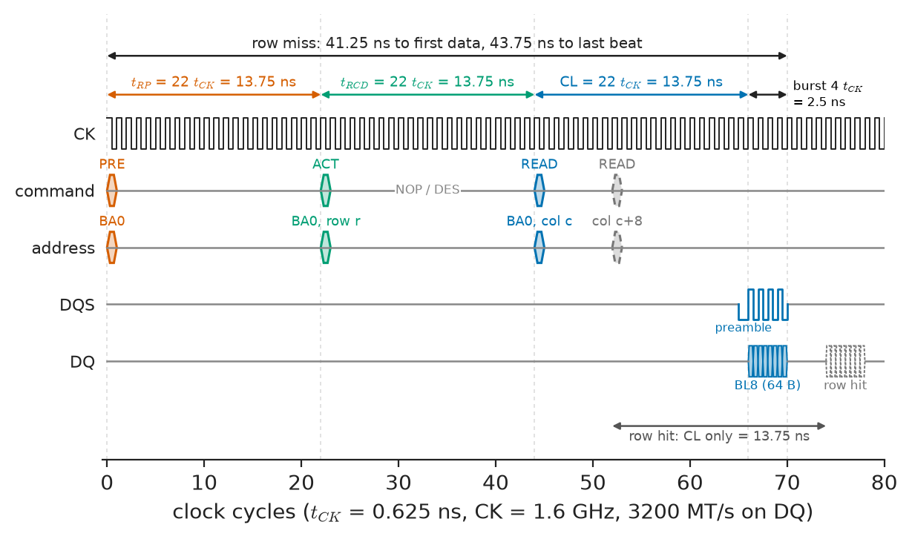
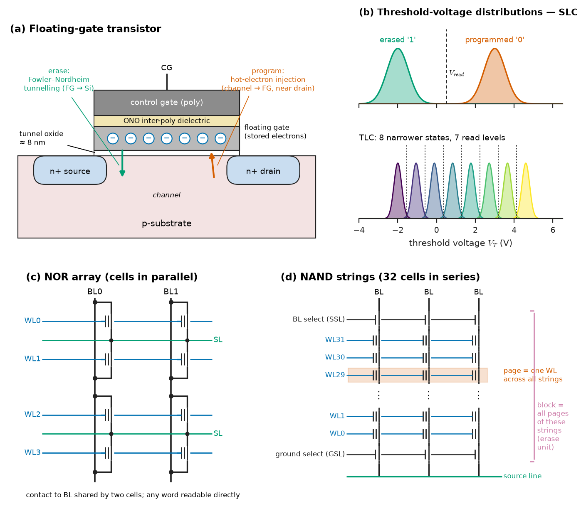
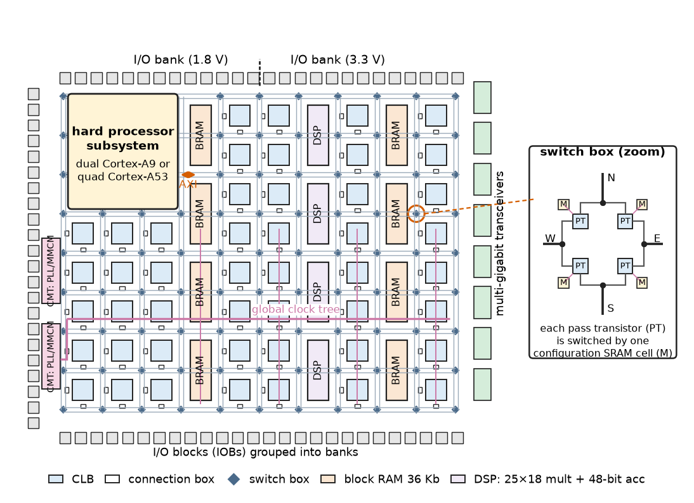
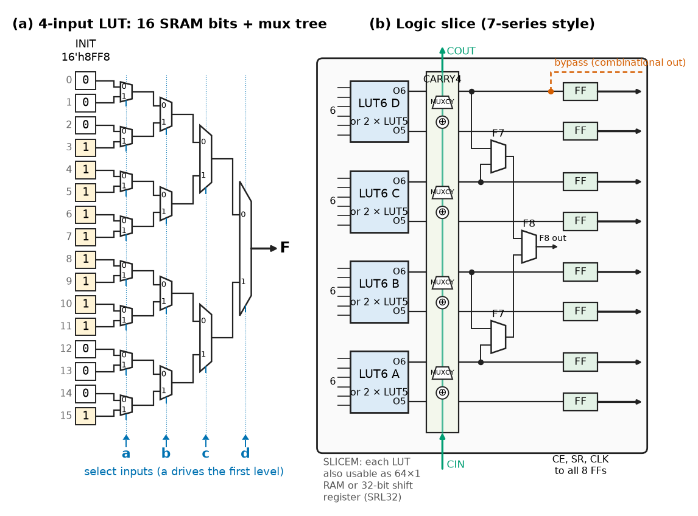
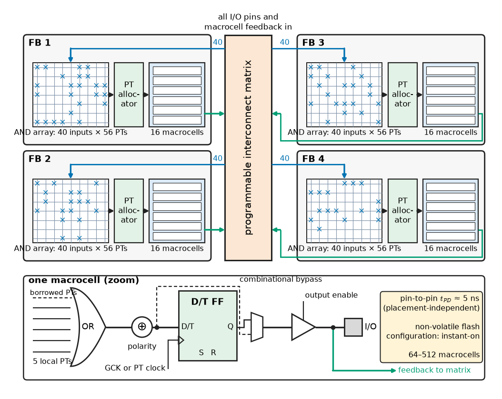

# Chapter 18 — Memory and Programmable Logic

*Part IV · Computer Architecture and Digital Hardware*

A data logger on a wind-turbine pitch controller works perfectly for nineteen months and then begins to lose its configuration at random. The cause is not a software bug: the firmware writes a 64-byte status record to two 16 KiB sectors of the microcontroller's internal flash every ten seconds, and those sectors, rated for 10 000 erase cycles, have simply worn out. In the same turbine, an FPGA that generates the PWM for a 2 MW converter misbehaves now and then — across a fleet of turbines on a high plateau, about one unexplained trip a month — because a cosmic-ray neutron flips a bit of the configuration memory that defines its logic, and the design has no scrubbing. And in the control room's server, a database query runs three times slower on a machine with twice the DRAM, because the extra modules forced the memory channel to a lower speed grade. Memories and programmable logic are often treated as commodities that simply hold bits or implement a netlist. They are circuits with timing, wear, refresh, upset rates and interface rules, and every one of those faults follows from how the cells and arrays are built. This chapter builds them up from the cell to the system.

> **How do SRAM, DRAM and flash store a bit, and what do their cell structures imply for speed, density, refresh, endurance and retention?**
> **How is a memory connected to a processor, and what limits the bandwidth and latency actually achieved?**
> **How does an FPGA implement arbitrary logic with look-up tables and programmable interconnect, and when is it worth using one to accelerate a computation?**

| Concept | Engineering destination |
|---|---|
| SRAM and DRAM | On-chip memory sizing, DRAM timing and refresh, server memory configuration |
| ROM and Flash | Firmware storage, data logging, wear levelling, SSD and eMMC behaviour |
| Memory interfaces | External SRAM and SDRAM on MCUs, DDR layout, QSPI/OSPI flash, HBM |
| FPGA architecture | Selecting an FPGA, reading utilisation reports, power and configuration |
| LUTs | Mapping logic to resources, estimating LUT counts, timing of logic levels |
| Configurable logic blocks | Carry chains, distributed RAM, shift registers, packing efficiency |
| Programmable interconnects | Routing delay, congestion, why FPGA clock rates are lower than ASICs |
| CPLDs | Glue logic, power sequencing, instant-on board management |
| Hardware acceleration | Throughput and latency gains, Amdahl's limit, data-movement costs |
| FPGA applications | Telecom, data centres, motor control, imaging, aerospace, prototyping |

**Roadmap.** Static and dynamic RAM cells and DRAM organisation and timing (18.1) → read-only and flash memory (18.2) → how memories connect to processors (18.3) → the FPGA as an architecture (18.4) built from LUTs (18.5), configurable logic blocks (18.6) and programmable interconnect (18.7) → CPLDs (18.8) → hardware acceleration (18.9) and the applications that use it (18.10).

---

## 18.1 SRAM and DRAM

### The 6T SRAM cell

A **static RAM** cell stores a bit in two cross-coupled CMOS inverters, a bistable latch (Chapter 14), accessed through two NMOS pass transistors gated by a **word line** (Figure 18.1a). The six-transistor (6T) cell holds its state as long as power is applied, with no refresh. To read, both **bit lines** are precharged high and the word line is raised; the side of the cell storing 0 pulls its bit line down slowly through the access and pull-down transistors, and a **sense amplifier** detects a differential of 50–150 mV and resolves it to full logic levels long before the bit line has swung fully. To write, drivers force the bit lines to complementary full levels and overpower the cell's pull-up transistors.

The cell must be stable when read and writable when written, and these demands conflict: the pull-down transistor must be stronger than the access transistor (cell ratio about 1.5–2.5), so that reading does not flip the cell, while the access transistor must be stronger than the pull-up (pull-up ratio below about 1) so that a write succeeds. The margin between them, the **static noise margin**, shrinks with supply voltage and with transistor variability, which is why SRAM sets the minimum operating voltage of most digital chips and why large SRAM arrays use assist circuits and redundant rows.

SRAM is the fastest memory that can be built in a logic process, and the densest that needs no special process steps, so it is used for register files, caches, MCU RAM and FPGA block RAM. Its weaknesses are area and leakage. A 6T cell occupies roughly 120–150 $F^2$ (with $F$ the real minimum feature pitch, about 12–13 nm in a "5 nm-class" process, not the node name): about 0.021 µm² there, so 1 MiB of raw cells takes about 0.18 mm² before sense amplifiers, decoders and redundancy roughly double it. SRAM bit-cell scaling has nearly stopped below 5 nm, which is one reason large caches are moving to separate stacked dies. In a large SoC, SRAM leakage can be a substantial fraction of standby power (Chapter 33).

### The 1T1C DRAM cell

A **dynamic RAM** cell is one access transistor and one storage capacitor (Figure 18.1b): charge on the capacitor represents the bit. The cell is about 6 $F^2$ in modern DRAM processes, roughly twenty times denser than SRAM, which is why main memory is DRAM. The price is that reading is destructive and the charge leaks away.

<!-- FIGURE 18.1 | figures/ch18/fig-18-1-sram-dram-cells.png | circuit | (a) Six-transistor SRAM cell and (b) one-transistor one-capacitor DRAM cell with bit-line sensing. | Content: (a) two cross-coupled CMOS inverters (PMOS pull-ups P1, P2 to VDD, NMOS pull-downs N1, N2 to ground) with storage nodes Q and Q-bar; NMOS access transistors A1 and A2 connecting Q to bit line BL and Q-bar to BL-bar, gates on word line WL; sense amplifier and precharge (to VDD) at bottom of BL pair. Label cell ratio N1/A1 about 2. (b) access NMOS with gate on WL, drain on bit line BL, source to storage capacitor Cs = 10 fF to plate; bit line capacitance CBL = 80 fF drawn as lumped capacitor; bit line precharged to VDD/2 = 0.6 V; cross-coupled sense amplifier comparing BL with a reference bit line at 0.6 V. Annotate read signal Delta V = 0.6 V x 10/(10+80) = 67 mV. -->



*Figure 18.1 — (a) Six-transistor SRAM cell and (b) one-transistor one-capacitor DRAM cell with bit-line sensing.*

To read, the bit line is precharged to $V_{DD}/2$ and the word line opens the access transistor; the cell's charge is shared with the much larger bit-line capacitance. Charge conservation gives the bit-line change

$$
\Delta V=\pm\frac{V_{DD}}{2}\,\frac{C_s}{C_s+C_{BL}}
$$

> **Status of the principle: DRAM charge-sharing signal**
> *Derived.* It follows from charge conservation between two capacitors; it neglects the access transistor's threshold drop (removed by boosting the word line above $V_{DD}$), coupling between adjacent bit lines and the charge already lost to leakage, all of which reduce the real signal.

**Worked example — DRAM read signal and retention.** A DRAM with $V_{DD}=1.2$ V has $C_s=10$ fF and $C_{BL}=80$ fF. A stored 1 (1.2 V) shared with a bit line at 0.6 V gives $\Delta V=0.6\times10/90=66.7$ mV, which a cross-coupled sense amplifier amplifies to full levels — and in doing so rewrites the cell, restoring the charge the read destroyed. If the sensing circuits need the cell to retain at least 0.9 V (0.3 V of droop) after one 64 ms refresh interval, the total leakage from the 10 fF node must stay below $10\ \mathrm{fF}\times0.3\ \mathrm{V}/64\ \mathrm{ms}=47$ fA. Holding a few femtoamperes per cell over billions of cells, at 85 °C, is what makes DRAM processes so specialised: deep-trench or tall stacked capacitors, very-low-leakage access transistors, and a refresh interval that halves at high temperature.

### DRAM organisation

A DRAM chip is organised hierarchically: **banks** (16 in DDR4, in four bank groups; 32 in DDR5), each an array of **rows** (pages) of, typically, 1–2 KiB per chip, with a **row buffer** of sense amplifiers per bank. Access is by command:

1. **ACTIVATE** (ACT) opens a row: its entire contents are sensed into the row buffer. The time until a column can be read is $t_{RCD}$.
2. **READ** or **WRITE** accesses a column of the open row. Data appear after the **CAS latency** $CL$ and stream out as a **burst** (8 transfers in DDR4, 16 in DDR5).
3. **PRECHARGE** (PRE) closes the row and restores the bit lines, taking $t_{RP}$. A row must stay open at least $t_{RAS}$, so the minimum row cycle is $t_{RC}=t_{RAS}+t_{RP}$.
4. **REFRESH** (REF) commands, issued on average every $t_{REFI}=7.8$ µs (64 ms over 8192 commands, halved above 85 °C), each block the device for $t_{RFC}$ (about 350 ns for an 8 Gbit DDR4 die).

A **row hit** (the wanted row is already open) costs only $CL$; a **row miss** costs $t_{RP}+t_{RCD}+CL$. Memory controllers reorder requests to maximise row hits and spread traffic across banks so that one bank's activate overlaps another's data transfer (Figure 18.2).

<!-- FIGURE 18.2 | figures/ch18/fig-18-2-ddr4-read-timing.png | timing-diagram | DDR4-3200 read with a row miss: precharge, activate, read and burst. | Content: clock CK at 1.6 GHz (tCK = 0.625 ns), about 75 cycles shown. Command bus row: PRE (bank 0) at cycle 0, ACT (bank 0, row r) at cycle 22, READ (bank 0, column c) at cycle 44, NOP otherwise. Address row: bank and row at ACT, column at READ. DQS strobe row toggling during the burst. DQ data row: 8 data beats (BL8) starting at cycle 66 and ending at cycle 70. Interval annotations: tRP = 22 tCK = 13.75 ns, tRCD = 22 tCK = 13.75 ns, CL = 22 tCK = 13.75 ns, burst 4 tCK = 2.5 ns; total row-miss latency 43.75 ns. Second, dashed READ to the same open row showing row-hit latency CL only. -->



*Figure 18.2 — DDR4-3200 read with a row miss: precharge, activate, read and burst.*

**Table 18.1 — Representative memory technologies (typical values).**

| Technology | Cell | Density driver | Access time | Volatile | Endurance (write cycles) | Standards and typical parts |
|---|---|---|---|---|---|---|
| On-chip SRAM | 6T | Logic process | 0.3–2 ns | Yes | Unlimited | Caches, MCU RAM, FPGA BRAM |
| Async SRAM chip | 6T | 4–32 Mbit per chip | 8–55 ns | Yes | Unlimited | 10 ns 8 Mbit parts for MCU expansion |
| DDR4 SDRAM | 1T1C | 8–16 Gbit per die | 13–15 ns CL, 40–50 ns row miss | Yes | Unlimited | JEDEC JESD79-4, 1.2 V, up to 3200 MT/s |
| DDR5 SDRAM | 1T1C | 16–32 Gbit per die | 14–17 ns CL | Yes | Unlimited | JEDEC JESD79-5, 1.1 V, 4800–8400 MT/s |
| LPDDR4X/LPDDR5 | 1T1C | Mobile, low power | similar to DDR | Yes | Unlimited | JEDEC JESD209-4/-5 |
| HBM3 | 1T1C, stacked dies | 16–24 GB per stack | similar to DDR | Yes | Unlimited | JEDEC JESD238, 1024-bit interface, about 819 GB/s per stack |
| NOR flash | Floating gate | 1 Mbit–2 Gbit | 10–100 ns read | No | 10⁴–10⁵ | SPI/QSPI/OSPI parts, MCU embedded flash |
| NAND flash | Floating gate or charge trap, 3D | 0.5–2 Tbit per die | 25–100 µs page read | No | 10³–10⁵ (QLC to SLC) | ONFI, eMMC (JESD84), UFS, NVMe SSDs |
| EEPROM | Floating gate, byte erase | 1 kbit–4 Mbit | 100 ns–1 µs read, 3–5 ms write | No | 10⁵–10⁶ | I²C/SPI configuration memories |
| FRAM | Ferroelectric capacitor | 4 kbit–16 Mbit | 50–100 ns | No | 10¹²–10¹⁴ | Data loggers, metering |
| MRAM | Magnetic tunnel junction | 1 Mbit–1 Gbit, embedded | 10–35 ns | No | 10⁸ to effectively unlimited | Embedded NVM at 22–28 nm |

**Worked example — DDR4 latency, bandwidth and refresh overhead.** A DDR4-3200 module with timings 22-22-22 ($CL$-$t_{RCD}$-$t_{RP}$) has a 1.6 GHz clock, $t_{CK}=0.625$ ns, and transfers on both edges. $CL=22\times0.625=13.75$ ns, and so are $t_{RCD}$ and $t_{RP}$. A row hit delivers its first data after 13.75 ns, a row miss after $3\times13.75=41.25$ ns, and the 8-beat burst of a 64-byte cache line adds $4\,t_{CK}=2.5$ ns, for 43.75 ns. The peak bandwidth of a 64-bit channel is $3200\times10^6\times8\ \mathrm{B}=25.6$ GB/s. Refresh steals $t_{RFC}/t_{REFI}=350\ \mathrm{ns}/7.8125\ \mathrm{µs}=4.5\ \%$ of the time, twice that above 85 °C. These figures explain the server of the opening: populating two modules per channel forced the controller from DDR4-3200 to DDR4-2666 for signal-integrity reasons, cutting peak bandwidth by 17 % — and a memory-bound query lost more than that, because row-miss latency in nanoseconds barely improves with speed grade while queueing under load grows.

> **Status of the principle: DRAM retention and the 64 ms refresh interval**
> *Empirical.* Cell retention times follow a wide statistical distribution measured on production DRAM; JEDEC fixes 64 ms (32 ms above 85 °C) so that the weakest cells of a qualified die survive with margin, and phenomena such as variable retention time and row-hammer disturbance (repeated activation of one row leaking charge from its neighbours) are handled by additional mitigation, not by the basic interval.

---

## 18.2 ROM and Flash

### Read-only and one-time-programmable memory

**Mask ROM** stores bits in the presence or absence of a transistor or contact, defined by a lithography mask: the densest and most robust read-only storage, used for boot ROMs and fixed tables, but changeable only by a new mask set. **One-time-programmable** (OTP) memories use antifuses or eFuses blown by a high current or voltage after manufacture; they store calibration trims, device keys and security configuration. Erasable memories descend from the **EPROM**, whose floating-gate cells were erased by ultraviolet light through a quartz window, and the **EEPROM**, erasable electrically byte by byte at the cost of two transistors per cell. Small serial EEPROMs (I²C or SPI, 1 kbit to 4 Mbit, 10⁶ write cycles, 3–5 ms per page write) remain the standard place for configuration and calibration data.

### The floating-gate transistor

**Flash** memory stores charge on a **floating gate** (or, in most modern NAND, in a silicon-nitride **charge-trap** layer) between the MOSFET channel and the control gate, insulated by oxide all round (Figure 18.3). Electrons on the floating gate raise the transistor's threshold voltage: a cell with a high threshold reads as 0 (programmed), one with a low threshold as 1 (erased). Charge is moved through the tunnel oxide by **Fowler–Nordheim tunnelling** under a field of about 10 MV/cm (around 15–20 V across the stack), or injected as hot electrons from the channel in NOR cells. Because the oxide is about 7–10 nm thick, the stored charge stays for years when no field is applied.

> **Boundary.** Quantum tunnelling through a thin barrier, the physics behind flash program and erase and behind gate-oxide leakage, is treated in *Engineering Physics*, [Ch. 4 §4.4](https://github.com/The-Studio-of-Sadiq/Engineering-Physics/blob/main/CHAPTERS/CHAPTER%204.md); the magnetic tunnel junction used in MRAM in [Ch. 14 §14.9](https://github.com/The-Studio-of-Sadiq/Engineering-Physics/blob/main/CHAPTERS/CHAPTER%2014.md). This section uses only the engineering consequences: high programming voltages, block erase, finite endurance and finite retention.

Each program/erase cycle damages the tunnel oxide slightly, creating traps that capture charge and shift the threshold distributions; eventually the programmed and erased states can no longer be distinguished reliably. Retention also falls with temperature and with accumulated cycles. Storing 2, 3 or 4 bits per cell (MLC, TLC, QLC) by placing 4, 8 or 16 threshold levels within the same voltage window multiplies density but narrows the margins, so endurance falls by roughly an order of magnitude per extra bit.

> **Status of the principle: Flash endurance and retention ratings**
> *Empirical.* Ratings such as 10 000 cycles with 20-year retention at 85 °C, or 3000 cycles for TLC NAND, come from accelerated stress tests and Arrhenius extrapolation (JEDEC JESD47 and JESD218); real wear-out is gradual and statistical, and ratings hold only with the specified ECC, temperature and erase-block usage.

### NOR and NAND

The two flash architectures differ in how cells are connected in the array (Figure 18.3):

- **NOR flash** connects each cell between a bit line and ground, like a NOR gate's parallel transistors. Any word can be read randomly in 10–100 ns, so code can **execute in place** (XIP) directly from it. Programming is by word or page (a 256-byte page in serial NOR takes about 0.4–3 ms); erasure is by sector (4 KiB in serial NOR, 16–128 KiB in MCU embedded flash), taking 20 ms to 2 s. Endurance is 10⁴–10⁵ cycles. Microcontroller program memory and serial boot flash are NOR.
- **NAND flash** connects 32 to over 100 cells in series in a string, like a NAND gate's series transistors, removing most contacts and making the cell far smaller; 3D NAND stacks more than 200 layers of cells vertically. Reads are by page (4–16 KiB) in 25–100 µs, programs by page in 200 µs–2 ms, and erasure by block (several MiB in 3D NAND) in 2–10 ms. Raw NAND has bit errors from the start and develops more with wear, so it requires strong **error-correcting codes** (BCH or LDPC), **bad-block management** and a **flash translation layer** (FTL) that maps logical sectors to physical pages, never rewrites a page in place, and garbage-collects partly valid blocks. SSDs, eMMC, UFS and SD cards contain NAND plus a controller that does all this.

<!-- FIGURE 18.3 | figures/ch18/fig-18-3-flash-cell-nor-nand.png | schematic | Floating-gate cell and NOR versus NAND array organisation. | Content: left: cross-section of a floating-gate transistor: p-substrate, n+ source and drain, tunnel oxide about 8 nm, polysilicon floating gate, inter-poly dielectric (ONO), control gate; electrons drawn on the floating gate; arrows for Fowler-Nordheim tunnelling (erase) and hot-electron injection (program). Inset: threshold-voltage distributions of erased (around -2 V) and programmed (around +3 V) cells with read voltage between them; for TLC show eight narrower distributions. Centre: NOR array, cells connected in parallel between bit lines and source line, one contact per two cells, word lines horizontal. Right: NAND string of 32 cells in series between bit-line select transistor and ground select transistor, word lines WL0 to WL31; a page is one word line across many strings, a block is all pages sharing the strings. -->



*Figure 18.3 — Floating-gate cell and NOR versus NAND array organisation.*

### Living with finite endurance

The data logger of the opening shows the arithmetic every firmware engineer must do.

**Worked example — flash wear in a data logger.** The logger writes one 64-byte record every 10 s, 8640 records per day, into two 16 KiB sectors of MCU flash rated for 10 000 erase cycles, filling one sector while the other holds the previous data. Each sector holds $16384/64=256$ records, so the pair is erased $8640/256=33.75$ times per day, 16.9 times per sector. The sectors reach their rating after $10\,000/16.9=593$ days, 1.6 years — matching the nineteen-month failure. Spreading the log over four sectors doubles the life to 3.2 years, still short of a 20-year turbine. Moving the log to an external 16 Mbit SPI NOR flash rated for 100 000 cycles, with 4 KiB sectors and wear levelling across 256 sectors (1 MiB), gives $8640/64=135$ sector erases per day, 0.53 per sector, and a wear-out time of about 520 years: endurance is no longer the limit, and data retention and the controller's power-fail behaviour become the design issues. FRAM, with 10¹² or more cycles and no erase, removes the problem entirely for small logs.

Two further rules follow from the cell physics. An erase or program interrupted by power loss leaves a sector in an undefined state, so logs and configuration stores use two copies, sequence numbers and checksums, and verify after writing. And programming flash on an MCU usually stalls instruction fetch from the same flash bank for milliseconds — long enough to miss many control-loop deadlines unless the code doing the write runs from RAM or the device has a second bank (Chapter 25).

---

## 18.3 Memory interfaces

### Asynchronous parallel memory

The oldest interface is the asynchronous parallel bus: address lines, a bidirectional data bus, and active-low chip enable (`CE#`), output enable (`OE#`) and write enable (`WE#`). Timing is set by the memory's parameters — address access time $t_{AA}$, output-enable time, write-pulse width — and the processor's external memory controller is programmed with matching numbers of clock cycles for address setup, data phase and hold. Microcontrollers use such controllers (ST's FSMC/FMC, NXP's SEMC) for external SRAM, NOR flash, display controllers and FPGAs that present a memory-like interface.

**Worked example — external SRAM timing on a 168 MHz MCU.** A 10 ns asynchronous SRAM (8 Mbit, 16-bit data) is connected to the external memory controller of the Cortex-M4 of Chapter 17, clocked at $f_{HCLK}=168$ MHz ($t_{HCLK}=5.95$ ns). The data phase must cover the SRAM's 10 ns access time plus about 3 ns of input setup at the MCU and 1 ns of board propagation: 14 ns, so it needs $\lceil 14/5.95\rceil=3$ cycles. With one cycle of address setup, a read takes 4 cycles, 23.8 ns, and transfers 2 bytes: a sustained 84 MB/s for back-to-back reads. That is ample for a frame buffer of a 480×272 display at 16 bits per pixel and 60 Hz (15.7 MB/s), but code executed from the external SRAM would run about four times slower than from internal flash with its accelerator — so the external memory holds data, not the control loop.

### Synchronous DRAM and DDR

SDRAM replaced the asynchronous interface with a clocked command interface (Section 18.1). **DDR** SDRAM transfers data on both clock edges and uses a **source-synchronous** strobe, DQS, sent with each byte of data so that the receiver samples with a clock that has travelled the same path. At 3200 MT/s a bit lasts 312 ps, comparable with the propagation delay of 5 cm of PCB trace, so DDR interfaces depend on controlled-impedance routing, on-die termination, length matching within bytes, a fly-by clock and command topology across the chips of a module, and **training** at power-up: the controller sweeps its sampling delays for each byte lane, finds the centre of the data eye, and stores the result. DDR5 adds on-die ECC, two independent 32-bit subchannels per module and decision-feedback equalisation in the receivers. A memory interface at these rates is a transmission-line design problem first and a logic problem second.

> **Boundary.** Reflections, characteristic impedance, termination and the critical length of interconnects are developed in *Circuits, Signals and Communications*, [Ch. 14](https://github.com/The-Studio-of-Sadiq/Circuits-Signals-and-Communications/blob/main/part-3-advanced-network-theory/14-transmission-lines.md) (§14.10 for high-frequency interconnects); this chapter takes them as given.

### Serial memory interfaces

Most non-volatile memory in embedded products is now attached serially, trading pins for latency:

| Interface | Data lines | Typical clock | Throughput | Typical use |
|---|---|---|---|---|
| SPI NOR (single) | 1 in, 1 out | 50–133 MHz | 6–16 MB/s | Boot flash, configuration, logs |
| Quad SPI (QSPI) | 4 bidirectional | 100–133 MHz, SDR or DDR | 50–100 MB/s | XIP code, FPGA configuration |
| Octal SPI / xSPI (JESD251), HyperBus | 8 bidirectional, DDR | 166–200 MHz | 330–400 MB/s | XIP on crossover MCUs, PSRAM |
| eMMC (JESD84) | 8, DDR | 200 MHz (HS400) | up to 400 MB/s | Managed NAND in industrial and automotive SoCs |
| UFS 3.1/4.0 | Serial lanes (M-PHY) | 11.6–23.2 Gb/s per lane | 2–4 GB/s | Phones, automotive infotainment |
| NVMe over PCIe 4.0 ×4 | 4 lanes | 16 GT/s | about 7 GB/s | Servers, PCs, edge AI boxes |

A QSPI controller in **memory-mapped mode** makes external flash appear in the processor's address space, so code can execute from it through a cache; the first access to a line costs a command and address phase of several hundred nanoseconds, so cache behaviour dominates performance. At the high end, **HBM** stacks DRAM dies on a silicon interposer next to the processor with a 1024-bit interface per stack, reaching about 819 GB/s per HBM3 stack (6.4 Gb/s per pin) at much lower energy per bit than DDR — the memory of GPUs, AI accelerators and high-end FPGAs.

---

## 18.4 FPGA architecture

### Logic you can rewrite

A **field-programmable gate array** (FPGA) is a chip whose logic function is defined after manufacture by loading a configuration. Instead of fixed gates and wires, it contains a regular array of programmable logic blocks, a programmable routing network, and programmable I/O, together with hard blocks — memories, multipliers, clock managers, transceivers and sometimes processors — embedded in the fabric (Figure 18.4). The configuration, a **bitstream** of a few megabits to hundreds of megabits, sets every look-up table's contents and every routing switch.

<!-- FIGURE 18.4 | figures/ch18/fig-18-4-fpga-island-architecture.png | block-diagram | Island-style FPGA architecture with hard-block columns. | Content: grid of configurable logic blocks (CLBs, squares) separated by horizontal and vertical routing channels; at each channel intersection a switch box (diamond), and between each CLB and adjacent channel a connection box. Two columns of block RAM (36 Kb, tall rectangles spanning several CLB rows) and one column of DSP slices (25 x 18 multiplier plus 48-bit accumulator). I/O blocks around the perimeter grouped into banks with labels (1.8 V, 3.3 V). Clock management tiles (PLL/MMCM) on one side driving a global clock tree (thin lines). High-speed transceivers on the right edge. Optional hard processor subsystem (dual Cortex-A9 or quad Cortex-A53) in one corner connected to the fabric through AXI ports. Inset zoom of one switch box showing pass transistors controlled by configuration SRAM cells. -->



*Figure 18.4 — Island-style FPGA architecture with hard-block columns.*

### Configuration technologies

How the configuration is stored decides much of an FPGA's behaviour:

| Technology | How a switch is set | Volatile | Strengths | Weaknesses | Examples |
|---|---|---|---|---|---|
| SRAM-based | SRAM cell drives pass transistor or mux | Yes; loaded at power-up | Densest, fastest, latest processes, unlimited reprogramming | External configuration flash, boot time 10–500 ms, configuration upsets from radiation | AMD (Xilinx) 7-series, UltraScale+; Intel Cyclone, Agilex; Lattice ECP5 |
| Flash-based | Floating-gate switch | No | Instant-on, low static power, configuration immune to upsets | Older processes, lower density | Microchip PolarFire, IGLOO2 |
| Antifuse | One-time fused link | No (OTP) | Highest radiation tolerance, security | Not reprogrammable | Microchip RTAX space FPGAs |

SRAM-based FPGAs dominate by volume and capability. They load their bitstream at power-up from a QSPI flash or a processor, which means the system has a configuration time, a dependence on an external part, and a security question (bitstreams can be encrypted with AES-256 and authenticated). They also have a reliability question: the configuration SRAM is a very large memory, and a single-event upset in it changes the circuit itself, not just a data value. At sea level a large SRAM FPGA sees configuration upsets at a rate of the order of one per several years per device; a fleet of hundreds of devices therefore sees them every month or so, and the neutron flux rises several-fold on a mountain and by two orders of magnitude at aircraft altitudes; safety and aerospace designs use **configuration scrubbing** (continuous readback with ECC correction), triple modular redundancy of critical logic, or flash and antifuse parts. The turbine converter of the opening needed exactly this.

### A representative device range

| Device (family) | Logic | Memory | DSP | Other hard blocks | Typical use |
|---|---|---|---|---|---|
| Lattice iCE40 UltraPlus UP5K | 5280 4-input LUTs | 1 Mbit SPRAM, 120 kbit block RAM | 8 multiply-accumulate blocks | I²C, SPI, RGB LED drivers; static power about 100 µW | Sensor hubs, wearables, glue |
| AMD Artix-7 XC7A35T | 20 800 6-input LUTs, 41 600 flip-flops | 50 × 36 kbit block RAM (1.8 Mbit) | 90 DSP48E1 | 6.6 Gb/s transceivers (some packages), MMCM/PLL | Motor control, industrial I/O, video bridges |
| AMD Artix-7 XC7A100T | 63 400 LUTs, 126 800 flip-flops | 135 × 36 kbit (4.9 Mbit) | 240 DSP48E1 | as above | Instrumentation, software-defined radio |
| AMD Zynq UltraScale+ MPSoC (mid-range) | 100 000–500 000 LUTs | 5–35 Mbit block RAM plus UltraRAM | 700–2500 DSP slices | Quad Cortex-A53, dual Cortex-R5F, GPU, DDR4 controller | ADAS, 5G radio, machine vision |
| Microchip PolarFire MPF300 | about 300 000 logic elements (4-LUT plus flip-flop) | about 20 Mbit | about 900 18×18 math blocks | 12.7 Gb/s transceivers, flash configuration | Low-power and radiation-sensitive systems |

---

## 18.5 LUTs

### A memory that computes

The basic logic element of almost every FPGA is the **look-up table** (LUT): a small SRAM of $2^k$ configuration bits addressed by $k$ logic inputs, whose selected bit is the output (Figure 18.5). Any Boolean function of $k$ inputs is a truth table of $2^k$ entries (Chapter 12), so a $k$-input LUT implements every one of the $2^{2^k}$ such functions with identical delay: $2^{16}=65\,536$ functions for a 4-LUT and $2^{64}\approx1.8\times10^{19}$ for a 6-LUT. In hardware the LUT is a tree of 2-to-1 multiplexers with the configuration bits at its leaves and the inputs driving the select lines.

> **Status of the principle: Universality of the look-up table**
> *Fundamental.* A Boolean function of $k$ variables is completely defined by its $2^k$-entry truth table, so a $2^k$-bit memory addressed by the variables realises any such function; the only limits are $k$ and the number of LUTs, never the function's form.

The synthesis tool's technology mapper cuts the logic network into pieces of at most $k$ inputs and computes each LUT's contents, the **INIT** value. The listing reproduces that last step for two functions:

```python
def lut_init(f, k):
    """Truth table of a k-input function packed as a LUT INIT word.
    Bit i of INIT holds f(inputs) where input j is bit j of the index i."""
    init = 0
    for i in range(2**k):
        bits = [(i >> j) & 1 for j in range(k)]
        if f(*bits):
            init |= 1 << i
    return init

def lut_eval(init, *inputs):
    """What the hardware does: the inputs form an address into the INIT bits."""
    addr = sum(b << j for j, b in enumerate(inputs))
    return (init >> addr) & 1

f = lambda a, b, c, d: (a & b) | (c ^ d)          # a 4-input function
init = lut_init(f, 4)
print(f"LUT4 INIT = 16'h{init:04X}")
assert all(lut_eval(init, a, b, c, d) == f(a, b, c, d)
           for a in (0, 1) for b in (0, 1) for c in (0, 1) for d in (0, 1))

# majority of five inputs in one LUT6 (sixth input unused)
maj5 = lambda a, b, c, d, e, _: int(a + b + c + d + e >= 3)
print(f"LUT6 INIT = 64'h{lut_init(maj5, 6):016X}")
print("distinct 6-input functions:", 2**2**6)
```

It prints `LUT4 INIT = 16'h8FF8`, `LUT6 INIT = 64'hFEE8E880FEE8E880` and the 20-digit count $2^{64}$. The 4-input value can be checked by hand: $c\oplus d=1$ for indices 4–11 (bits `0x0FF0`), and $a\cdot b=1$ with $c\oplus d=0$ adds indices 3 and 15 (`0x8008`). A 5-input majority needs a multi-level network of gates; in a 6-LUT it costs one LUT and one logic level, and so does any other function of up to six inputs.

<!-- FIGURE 18.5 | figures/ch18/fig-18-5-lut-and-slice.png | schematic | A 4-input LUT as a multiplexer tree, and a logic slice built from 6-input LUTs. | Content: left: 16 configuration SRAM bits (labelled with the INIT value 8FF8 hex, bit 0 at top) feeding a four-level tree of 2-to-1 multiplexers (8, 4, 2, 1) whose select lines are inputs a (first level) to d (last level); output F. Right: one slice with four 6-input LUTs (each with optional dual 5-LUT outputs O5 and O6), a carry chain (CARRY4: XOR and MUXCY elements linking CIN to COUT vertically), wide-function multiplexers F7 and F8 combining LUT outputs, and eight flip-flops with clock enable and set/reset, bypass paths from LUT outputs directly to slice outputs. Annotate: SLICEM LUTs usable as 64-bit distributed RAM or 32-bit shift register. -->



*Figure 18.5 — A 4-input LUT as a multiplexer tree, and a logic slice built from 6-input LUTs.*

### LUT size and logic depth

LUT size is an architectural trade-off. A larger LUT absorbs more logic per level, so fewer levels and fewer slow routing hops lie on the critical path, but its area grows as $2^k$ and most of its bits go unused for simple functions. Studies and two decades of products settled on 4-input LUTs for low-cost and low-power parts and 6-input LUTs, often **fracturable** into two 5-input LUTs sharing inputs, for high-performance families. A useful rule of thumb for estimating an FPGA design's speed is the number of LUT levels on its critical path: each level costs a LUT delay of roughly 0.1–0.2 ns plus a routing delay of 0.3–1 ns in a 28 nm-class device, so a path of four to six levels closes at 200–300 MHz while a path of twelve does not reach 100 MHz.

---

## 18.6 Configurable logic blocks

### Inside a CLB

LUTs are grouped with flip-flops and arithmetic support into **configurable logic blocks** (CLBs; Intel calls the corresponding unit a logic array block of **adaptive logic modules**, ALMs). In AMD 7-series devices a CLB contains two **slices**, each with:

- four 6-input LUTs, each usable as one 6-input or two 5-input functions;
- eight flip-flops (two per LUT), with clock enable and synchronous or asynchronous set/reset;
- a dedicated **carry chain** running vertically through the slices for fast addition, subtraction, counters and comparators;
- wide multiplexers that combine LUT outputs into 7- and 8-input functions;
- in about a quarter to a half of the slices (SLICEM), LUTs that can also act as **distributed RAM** (64×1 bit per LUT) or **shift registers** (up to 32 stages per LUT).

The carry chain is the reason an FPGA adds quickly: a 32-bit adder uses one LUT per bit to form the propagate signal and the hard carry logic to ripple the carry through dedicated wiring at about 10–30 ps per bit, instead of through general routing at hundreds of picoseconds per hop. Its cost is that the adder must be placed in a vertical column.

The flip-flop-rich structure (two per LUT) makes **deep pipelining** cheap: inserting registers between LUT levels costs almost nothing in area and is the standard way to raise an FPGA design's clock rate, at the cost of latency.

### Hard blocks beside the CLBs

Logic that would be inefficient in LUTs is provided as hardened blocks in dedicated columns:

- **Block RAM** (BRAM): 18–36 kbit true dual-port synchronous SRAMs with configurable width (36 kbit as 32k×1 up to 512×72), optional output registers, ECC and FIFO logic; AMD UltraScale+ adds 288 kbit UltraRAM blocks. A design's memory is inferred from HDL templates — the short Verilog-2001 module below maps to one block RAM because its read is registered:

```verilog
// Simple dual-port RAM, 1024 x 16, registered read (Verilog-2001)
module sdp_ram #(parameter AW = 10, parameter DW = 16) (
    input  wire          clk,
    input  wire          we,
    input  wire [AW-1:0] waddr,
    input  wire [DW-1:0] wdata,
    input  wire [AW-1:0] raddr,
    output reg  [DW-1:0] rdata
);
    reg [DW-1:0] mem [0:(1<<AW)-1];
    always @(posedge clk) begin
        if (we) mem[waddr] <= wdata;
        rdata <= mem[raddr];      // one-cycle read latency -> block RAM
    end
endmodule
```

Making the read combinational (declaring `rdata` as a `wire` driven by `assign rdata = mem[raddr];`) would instead infer distributed LUT RAM, which suits small, fast memories but would consume 256 LUTs for this size. HDL coding styles and inference rules are developed in Chapter 19. The other hard blocks are:

- **DSP slices**: a pre-adder, a 25×18 (7-series) or 27×18 (UltraScale+) multiplier and a 48-bit accumulator with pattern detection, running at 400–700 MHz; filters, FFTs, matrix arithmetic and control laws use these, not LUTs. Intel's variable-precision DSP blocks also support single-precision floating point.
- **Clock management**: PLLs and mixed-mode clock managers synthesise and phase-shift clocks; a dedicated low-skew global clock network distributes them.
- **I/O**: banks of pins supporting LVCMOS, LVDS, SSTL and other standards with programmable drive, termination and delay; SerDes for source-synchronous interfaces; multi-gigabit transceivers (6.6–58 Gb/s) for PCIe, Ethernet and JESD204 converter links.
- **Processor subsystems**: SoC FPGAs (AMD Zynq, Intel Agilex SoC, Microchip PolarFire SoC with RISC-V cores) integrate Arm or RISC-V processors with caches and DDR controllers, linked to the fabric by AXI ports — the platform for co-design (Chapter 35).

---

## 18.7 Programmable interconnects

### Routing architecture

In an island-style FPGA the CLBs sit in a sea of routing (Figure 18.4). **Routing channels** of wire segments run horizontally and vertically between them; **connection boxes** connect CLB pins to channel wires; **switch boxes** at the intersections connect wire segments to one another. Every connection point is a pass transistor or multiplexer controlled by a configuration bit. Segments come in several lengths — single (one CLB), double, quad or hex, and long lines spanning the chip — so that the router can use short wires for local connections and long ones for distant signals with fewer switches in series.

Routing dominates the FPGA. It typically occupies 70–90 % of the fabric area and contributes half or more of a typical path's delay, and it is the main reason an FPGA implementation of a circuit runs 3–5 times slower, uses 10–30 times more area and draws 5–15 times more dynamic power than a standard-cell ASIC of the same process. The router's job is a large combinatorial search: assign every net of the design to a path of segments without conflicts, while meeting timing constraints. **Congestion**, where demand for wires in a region exceeds supply, is a common reason a design fails to route or misses timing even with LUTs to spare; utilisation above about 70–80 % makes it likely.

> **Status of the principle: Rent's rule for interconnect demand**
> *Empirical.* The number of external connections $T$ of a block of $G$ logic cells follows $T\approx tG^{p}$ with Rent exponent $p$ of about 0.5–0.75 for typical logic; FPGA architects size channel widths to this observed scaling, which is why highly connected designs such as large crossbars route poorly and regular, pipelined ones route well.

### Clocks, timing and the design flow

Dedicated clock networks keep skew low across the die, and clock-region structures limit how many distinct clocks can reach one area. Because routing delay is decided only after placement and routing, FPGA timing is known only after the full implementation flow — synthesis, technology mapping to LUTs, packing into CLBs, placement, routing, static timing analysis and bitstream generation. The flow and its timing constraints are the subject of Chapter 19; the same steps for ASICs are in Chapter 34.

---

## 18.8 CPLDs

### Sum-of-products logic with predictable timing

A **complex programmable logic device** (CPLD) descends from the PAL and GAL devices of the 1980s, which implement logic as a programmable AND array feeding fixed OR gates — directly the sum-of-products form of Chapter 12. A CPLD combines several such **function blocks**, each with a programmable AND array, product-term allocators and **macrocells** (an OR gate, an XOR for polarity control, a flip-flop and output enable), connected through a central **programmable interconnect matrix** (Figure 18.6). Configuration is stored in on-chip EEPROM or flash, so the device is **instant-on** at power-up.

<!-- FIGURE 18.6 | figures/ch18/fig-18-6-cpld-architecture.png | block-diagram | CPLD architecture: function blocks of product-term macrocells linked by a global interconnect matrix. | Content: centre: programmable interconnect matrix (vertical bar) receiving all I/O pin inputs and macrocell feedbacks. Four function blocks around it, each containing a programmable AND array (grid of crosses, 40 inputs by 56 product terms) feeding a product-term allocator and 16 macrocells. Zoom of one macrocell: OR of up to 5 local product terms plus borrowed terms -> XOR polarity -> D/T flip-flop with clock (global clock GCK or product-term clock), set, reset -> output enable -> I/O pin, plus feedback to the matrix. Annotate pin-to-pin delay tPD about 5 ns, non-volatile flash configuration, 64 to 512 macrocells. -->



*Figure 18.6 — CPLD architecture: function blocks of product-term macrocells linked by a global interconnect matrix.*

Because every signal passes through the same interconnect matrix and one level of AND-OR logic, the pin-to-pin delay is nearly independent of placement and known from the datasheet before the design is built (typically 4–10 ns). This **predictable timing**, combined with instant-on operation, low static current and 3.3 V or 5 V tolerant I/O, is what CPLDs are for. Their limitation is capacity: classic CPLDs offer 32 to 512 macrocells, and the product-term architecture scales poorly beyond that.

| Feature | CPLD | FPGA |
|---|---|---|
| Logic element | Product terms and macrocells | LUTs and flip-flops |
| Capacity | 32–512 macrocells (up to a few thousand LUTs in flash-based "CPLD-class" parts) | Thousands to millions of LUTs |
| Configuration | Non-volatile, instant-on | Mostly SRAM, loaded at power-up (flash-based exceptions) |
| Timing | Fixed, placement-independent | Depends on placement and routing |
| Registers | One per macrocell | Two per LUT |
| Typical uses | Glue logic, address decoding, power sequencing, reset and board management | Data paths, DSP, interfaces, processors, acceleration |

Many devices now marketed as CPLDs — Intel MAX 10, Lattice MachXO2/MachXO3 — are small LUT-based FPGAs with on-chip flash, keeping the instant-on and single-chip properties with FPGA-style logic. Their dominant job on modern boards is **board management**: sequencing the dozen power rails of a server or FPGA board in the right order within milliseconds of power-up, holding processors in reset until clocks are stable, multiplexing debug and boot-mode pins, and monitoring fault signals — functions that must work before any processor runs.

---

## 18.9 Hardware acceleration

### Spatial versus temporal computing

A processor computes **temporally**: one ALU (or a few) is reused for every operation in sequence, and the cost of flexibility is paid in instruction fetch, decode, register-file access and control on every operation — typically 10–100 times the energy of the arithmetic itself. An FPGA or ASIC computes **spatially**: each operation of the algorithm becomes its own piece of hardware, connected by wires in the shape of the dataflow, and all of them work at once. The advantage comes from three sources, in order of importance: **parallelism** (many operations per clock), **pipelining** (a new input every clock while earlier ones are still in flight) and **specialisation** (exactly the word widths, memory organisation and control needed, no more).

**Worked example — FIR filter on an MCU and an FPGA.** A 64-tap FIR filter on 16-bit samples needs 64 multiply-accumulates (MACs) per output. The 168 MHz Cortex-M4 with its DSP instructions achieves about 1.2 cycles per tap, about 140 million MACs per second, so it can filter at most $168\times10^6/(64\times1.2)=2.19$ million samples per second — and only by spending its entire time on the filter. An Artix-7 implementation with one DSP48 slice per tap, fully pipelined at 200 MHz, accepts one sample per clock: 200 million samples per second, $64\times200\times10^6=12.8\times10^9$ MACs per second, about 90 times the MCU, using 64 of the XC7A100T's 240 DSP slices and leaving the rest of the device free. If the sample rate is only 1 MS/s, the FPGA can instead **time-multiplex** one DSP slice across all 64 taps at 64 MHz; spatial hardware can always be traded back for time.

### Amdahl's law and data movement

Acceleration helps only the part of the work that is accelerated. If a fraction $p$ of the original run time is sped up by a factor $s$, the overall speedup is

$$
S=\frac{1}{(1-p)+p/s}
$$

and it can never exceed $1/(1-p)$, however large $s$ becomes.

> **Status of the principle: Amdahl's law**
> *Derived.* It follows from splitting run time into an accelerated and an unaccelerated part; it assumes the parts do not overlap and that acceleration adds no overhead, so real speedups are lower once data transfer and synchronisation between processor and accelerator are counted.

**Worked example — accelerating an FFT-based spectrum analyser.** Profiling shows that 80 % of a vibration-analysis application's time on an embedded processor is spent in FFTs and 20 % in control, logging and communication. An FPGA FFT core runs the FFTs 20 times faster. The overall speedup is $1/(0.2+0.8/20)=4.17$, and even an infinitely fast FFT would give only $1/0.2=5$. If moving each data block to the FPGA and back over a bus takes time equal to 5 % of the original run time, the speedup falls to $1/(0.2+0.04+0.05)=3.45$. The FPGA has made the FFT almost free; the remaining 20 % and the data movement now decide performance — the central lesson of hardware–software co-design.

Data movement deserves its own emphasis. Moving a 32-bit word from off-chip DRAM costs of the order of 0.5–1 nJ, three to four orders of magnitude more than a 32-bit integer add in the same process; an accelerator that streams data from on-chip block RAM through a pipeline and keeps intermediate results local saves both time and energy, while one that fetches every operand from DRAM gains little. Choosing what to accelerate, how to partition the system between processor and FPGA, and how to model the data flow is the subject of Chapter 35; here it is enough that the architecture of Sections 18.4–18.7 — thousands of LUTs, hundreds of DSP slices and hundreds of independent block RAMs — is what makes spatial computation possible.

---

## 18.10 FPGA applications

FPGAs earn their place where volumes are too low for an ASIC, where standards or algorithms change after shipment, where timing must be deterministic to nanoseconds, or where interfaces are too fast or too unusual for a processor:

| Domain | Typical FPGA function | Why an FPGA |
|---|---|---|
| Telecom | 5G radio-unit digital front ends, beamforming, O-RAN fronthaul, packet processing | Throughput, evolving standards, field updates |
| Data centres | SmartNICs, network and storage offload, search and database acceleration, compression and encryption | Line-rate processing, reconfiguration per workload |
| Industrial control and drives | Multi-axis motor control, PWM with ns resolution, EtherCAT and other real-time Ethernet slaves, protection logic | Deterministic timing, parallel loops at 100 kHz–1 MHz |
| Power electronics | Modulation and protection for multilevel and modular multilevel converters, hardware-in-the-loop simulators | Hundreds of synchronised gate signals, sub-µs protection |
| Test and measurement | Oscilloscope and logic-analyser acquisition, triggering, protocol analysers | Gigasample data rates, custom triggers |
| Medical imaging | Ultrasound beamforming, CT and MRI data acquisition, PET coincidence detection | Many parallel channels, low latency |
| Automotive | ADAS sensor fusion, camera and radar interfacing, prototyping of ECU silicon | Parallel sensor streams, flexibility before ASIC |
| Aerospace and defence | Radiation-tolerant on-board processing, radar and electronic warfare, satellite payloads | Reconfigurability in orbit, flash/antifuse upset immunity |
| ASIC prototyping and emulation | Multi-FPGA systems running a chip's RTL before tape-out | Software development months before silicon (Chapter 34) |
| Finance and broadcast | Low-latency trading, video format conversion and compression | Nanosecond latency, many formats |

**Worked example — choosing a device for a converter controller.** A modular multilevel converter for an HVDC link has 6 arms of 40 submodules each: 240 submodule half-bridges, each needing two gate signals with 100 ns timing resolution and a capacitor-voltage measurement, all updated at 10 kHz, with fault shutdown within 2 µs. The 480 gate signals synchronised to 100 ns, the 240 parallel measurements and the hard shutdown requirement rule out a single processor. A mid-range SRAM FPGA handles the timing and sorting in fabric, with a soft or hard processor for the outer control loops; since the converter station sits at high altitude and must run for decades, the design adds configuration scrubbing and triplicated protection logic, or moves to a flash-based FPGA. The same reasoning — count the parallel channels, the timing resolution and the reliability requirement before counting operations per second — selects FPGAs across the domains in the table.

---

## What remains open

| Open question | Where it is answered |
|---|---|
| How do latches, flip-flops and synchronous design underpin SRAM, registers and FPGA timing? | Chapter 14 |
| How do caches and memory hierarchies use SRAM and DRAM? | Chapter 16 |
| How does a microcontroller use its embedded flash, SRAM and external memory controller? | Chapter 17 |
| How are FPGA designs written, simulated, constrained and implemented in Verilog and VHDL? | Chapter 19 |
| How do firmware updates, bootloaders and non-volatile storage layouts handle power loss? | Chapter 25 |
| How is wear-levelled storage used through file systems and data formats? | Chapter 24 |
| How do the SRAM cell, sense amplifier and CMOS leakage behave at transistor level? | Chapter 33 |
| How are memories compiled and placed in an ASIC, and how is static timing analysed? | Chapter 34 |
| When should a computation move from a processor to an FPGA, and how is performance modelled? | Chapter 35 |
| How does tunnelling physics set flash program voltages and oxide wear? | *Engineering Physics*, [Ch. 4 §4.4](https://github.com/The-Studio-of-Sadiq/Engineering-Physics/blob/main/CHAPTERS/CHAPTER%204.md) |
| How are DDR and transceiver traces designed as transmission lines? | *Circuits, Signals and Communications*, [Ch. 14](https://github.com/The-Studio-of-Sadiq/Circuits-Signals-and-Communications/blob/main/part-3-advanced-network-theory/14-transmission-lines.md) |

**Next:** Chapter 19 turns to the languages in which programmable logic and ASICs are described — Verilog, SystemVerilog and VHDL — and to the simulation, synthesis and timing flow that turns a description into a working FPGA.
