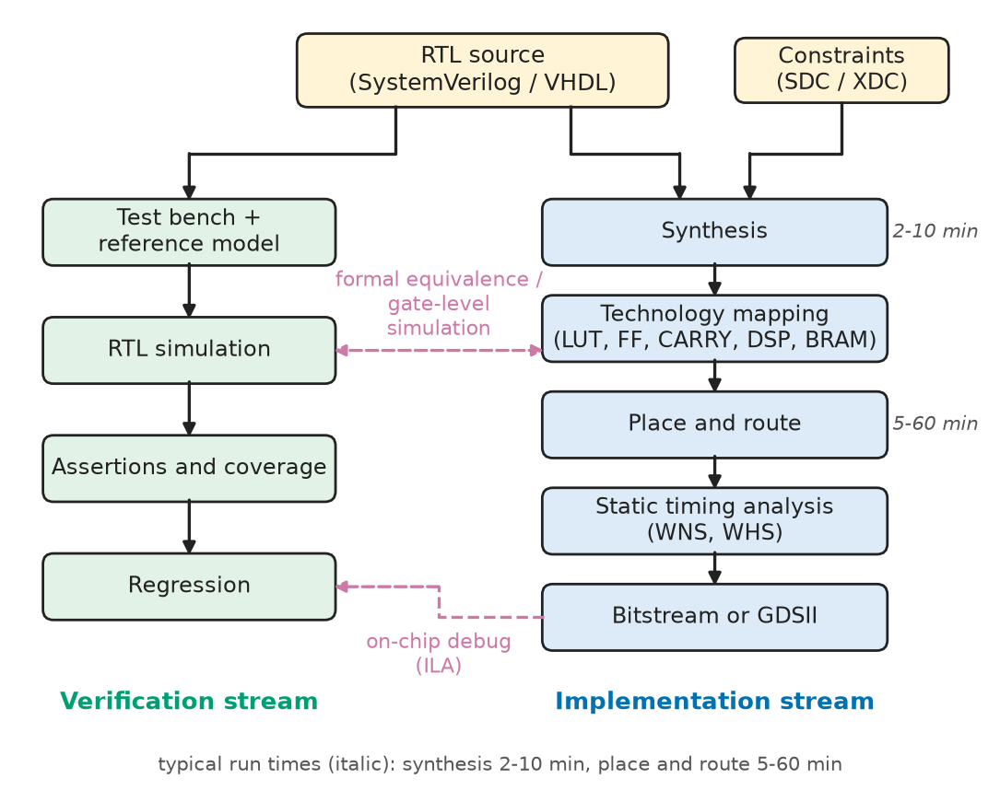
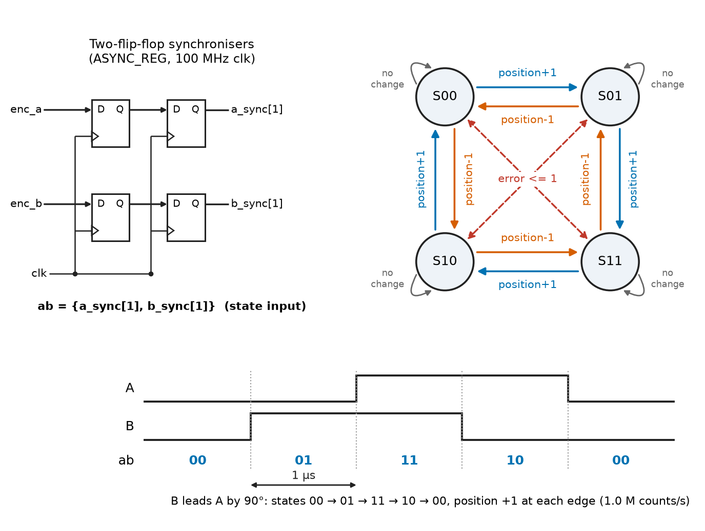
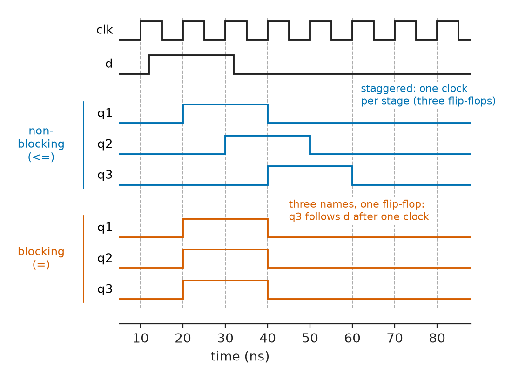
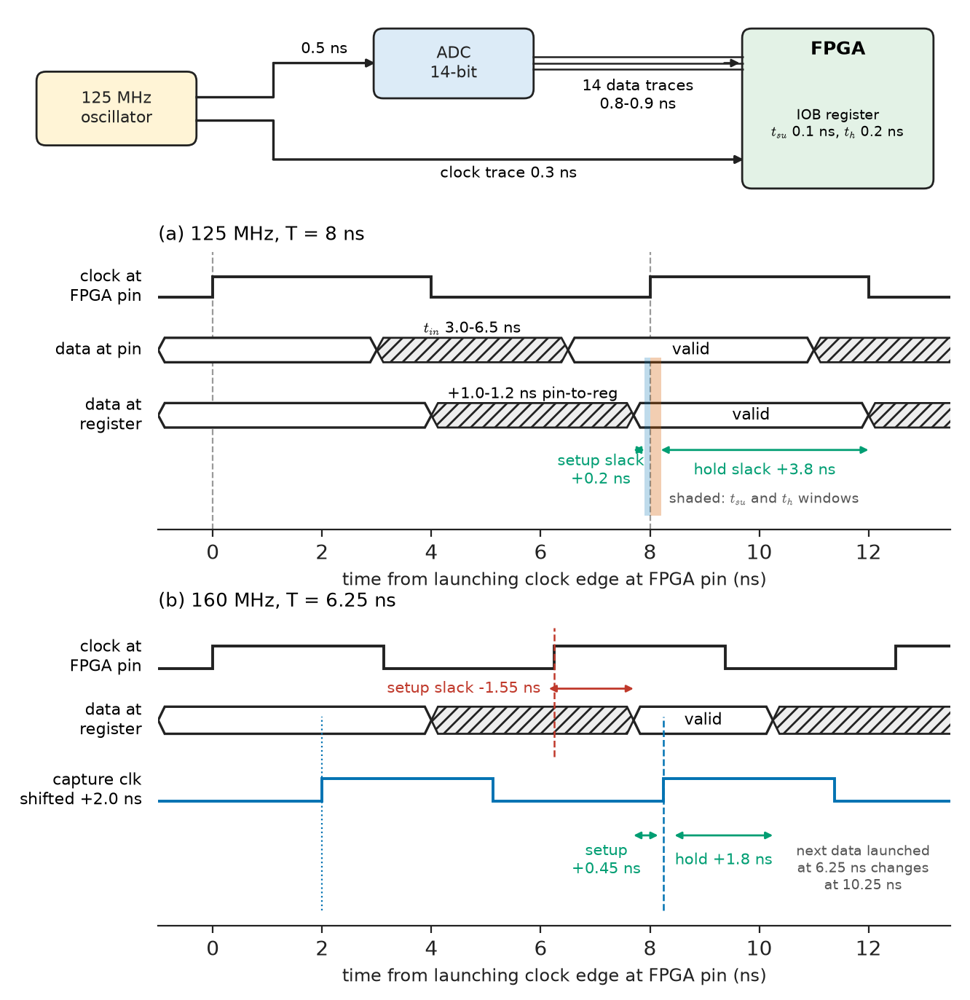
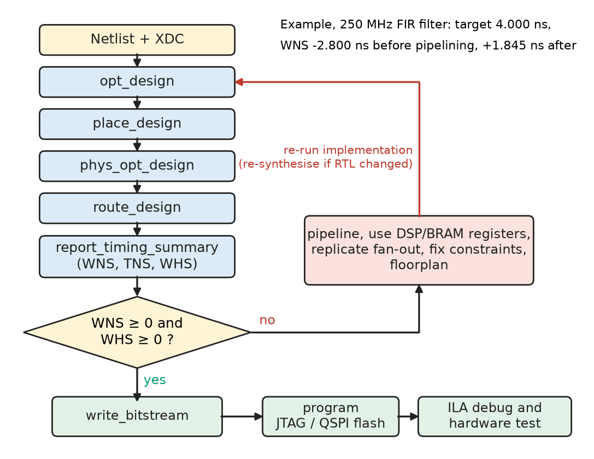
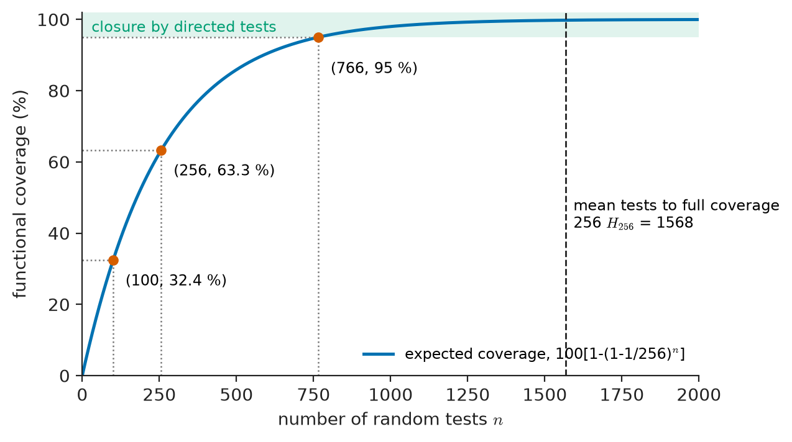

# Chapter 19 — Hardware Description Languages

*Part IV · Computer Architecture and Digital Hardware*

A servo-drive team moves the quadrature-encoder counter and PWM generator of a robot joint from a microcontroller into a small FPGA. Every RTL simulation passes. On the bench the joint creeps by a few encoder counts per minute, and during an EMC burst test it occasionally jumps by thousands of counts. Three lines of code are to blame, and none is a typing error. The encoder inputs reach a counter without a synchroniser, and no timing report flags them because the pins carry no constraint at all. A blocking assignment in a clocked block has merged two pipeline registers into one. And an `if` without an `else` in a block meant to be combinational has made the synthesiser build a latch. The text described hardware the engineers did not intend, and the simulator agreed with the text rather than with the silicon. This chapter is about writing HDL so that text, simulation and hardware mean the same thing, and about proving that they do.

> **How does a textual description become flip-flops, look-up tables and wires, and which language constructs describe which hardware?**
> **How do simulation, synthesis, timing constraints, test benches and assertions together establish that the hardware does what the design intends?**

| Concept | Engineering destination |
|---|---|
| HDL fundamentals (concurrency, RTL abstraction) | Reading and writing any FPGA or ASIC design; IP reuse |
| SystemVerilog | Industry default for FPGA/ASIC design and verification |
| VHDL | Aerospace, defence, rail and European industrial FPGA projects; legacy IP |
| Combinational descriptions | Decoders, arithmetic, saturation logic, DSP datapaths without latches |
| Sequential descriptions | Registers, counters, FSMs, block-RAM buffers, encoder and PWM interfaces |
| Simulation semantics | Avoiding race conditions and simulation–synthesis mismatch |
| Synthesis | Utilisation, inference of DSP and RAM blocks, reading synthesis reports |
| Timing constraints (SDC/XDC) | Closing timing on ADC, DAC and memory interfaces; clock-domain crossings |
| Test benches | Self-checking regression suites, reference models, random stimulus |
| FPGA implementation | Place and route, pin planning, timing closure, on-chip debug, bitstreams |
| Hardware verification | Assertions, coverage, formal checks; DO-254 and ISO 26262 evidence |

**Roadmap.** HDLs and the design flow (19.1) → SystemVerilog (19.2) and VHDL (19.3) → combinational (19.4) and sequential (19.5) descriptions → simulation (19.6) and synthesis (19.7) → timing constraints (19.8) → test benches (19.9) → FPGA implementation (19.10) → assertions, coverage and formal verification (19.11).

---

## 19.1 HDL fundamentals

### Describing structure and behaviour, not a sequence of steps

A hardware description language describes a circuit: blocks that all exist at once, wires between them and registers that change on clock edges. A C program is a sequence of operations; an HDL description is a set of concurrent processes, each reacting whenever one of its inputs changes. Two `always` blocks written one after the other are two pieces of hardware working in parallel.

HDLs serve two purposes. For **design**, a description must be **synthesisable**: a tool must be able to map it onto gates, flip-flops, look-up tables (LUTs), block RAMs and DSP slices. For **verification**, the language must also express delays, file I/O, random numbers and assertions about time, none of which is hardware; much of SystemVerilog exists only for test benches.

Descriptions are written at several levels of abstraction:

- **Behavioural**: algorithmic code with delays, for models and test benches.
- **Register-transfer level (RTL)**: registers updated on clock edges with combinational logic between them, the synchronous methodology of [Chapter 15](../part-3-digital-electronics/15-digital-system-design.md); almost all design is done here.
- **Structural/gate level**: instances of library cells, produced by synthesis.

> **Status of the principle: The RTL abstraction**
> *Approximate.* Treating a design as registers that update simultaneously on a clock edge, with ideal combinational logic in between, is exact only when every register-to-register path meets setup and hold time, every input is synchronous to the capturing clock and there are no combinational loops; it fails at unsynchronised inputs (metastability), at unconstrained or failing paths, and across clock domains, which is why timing constraints (Section 19.8) and synchronisers (Section 19.5) are part of the design, not afterthoughts.

### The design flow

The same RTL feeds two streams (Figure 19.1). The **verification stream** simulates it against a test bench, checks assertions and measures coverage. The **implementation stream** synthesises it, maps it onto the device or cell library, places, routes and checks timing against constraints. Formal equivalence checking shows that the netlist still implements the RTL, and static timing analysis shows that it runs at the intended clock.

<!-- FIGURE 19.1 | figures/ch19/fig-19-1-hdl-design-flow.png | block-diagram | The HDL design flow: one RTL source feeding a verification stream and an implementation stream that meet at equivalence and timing checkpoints. | Content: top box 'RTL source (SystemVerilog / VHDL)' with side input 'Constraints (SDC/XDC)'. Left column downward: 'Test bench + reference model' -> 'RTL simulation' -> 'Assertions and coverage' -> 'Regression'. Right column downward: 'Synthesis' -> 'Technology mapping (LUT, FF, CARRY, DSP, BRAM)' -> 'Place and route' -> 'Static timing analysis (WNS, WHS)' -> 'Bitstream or GDSII'. Dashed cross-links: 'formal equivalence / gate-level simulation' and 'on-chip debug (ILA)'. Typical run times: synthesis 2-10 min, place and route 5-60 min. -->



*Figure 19.1 — The HDL design flow: one RTL source feeding a verification stream and an implementation stream that meet at equivalence and timing checkpoints.*

### The languages in use

Verilog and VHDL date from the 1980s; SystemVerilog absorbed Verilog in 2009, adding a type system, interfaces and a verification language. Higher-level options (Table 19.1) generate RTL, but the RTL and timing reports they produce must still be read.

**Table 19.1 — Hardware description languages and their typical use.**

| Language | Standard | Typical use |
|---|---|---|
| Verilog | IEEE 1364-2005 (merged into 1800) | Legacy IP, simple FPGA designs, netlists |
| SystemVerilog | IEEE 1800-2017 (revised 2023) | FPGA and ASIC design; UVM verification; assertions (SVA) |
| VHDL | IEEE 1076-2008 (revised 2019) | Aerospace, defence, rail, medical FPGAs; many European companies |
| SystemC / C++ for HLS | IEEE 1666; vendor HLS tools | Algorithmic accelerators, transaction-level models |
| Chisel, Amaranth, SpinalHDL | Open-source, generate Verilog | Processor generators, research, open hardware |

This chapter uses SystemVerilog as the main language and gives the VHDL equivalent of the essential constructs. The design rules (what infers a register, what infers a latch, what a constraint means) are the same in both.

---

## 19.2 SystemVerilog

### Modules, ports and the 4-state logic type

The unit of design is the **module**, a block with named ports. The workhorse data type is `logic`, a **4-state** type whose bits take the values 0, 1, X (unknown) and Z (high impedance). X appears in simulation for uninitialised registers and conflicting drivers; it does not exist in hardware. Two-state types (`bit`, `int`) simulate faster and serve test benches and loop counters.

Vectors are declared with a range, `logic [11:0] duty;`, and literals carry a width and base: `12'd2048`, `8'hA5`. Unsized literals are 32-bit signed integers, and `'0` or `'1` fill every bit of the target. **Width and sign rules** cause many bugs: an expression is evaluated at the width of its widest operand (and of the target), and it is signed only if *every* operand is signed, so adding the unsigned constant `1'b1` to a signed value makes the whole expression unsigned and breaks comparisons of negative numbers.

### Procedural blocks with intent

SystemVerilog replaced Verilog's single `always` with three blocks that state the designer's intent, so that tools can check it:

- `always_comb` for combinational logic. It is sensitive to everything it reads, executes once at time zero, and tools warn or error if it would infer storage.
- `always_ff @(posedge clk)` for flip-flops. Only one event control is allowed, and variables it assigns may not be assigned anywhere else.
- `always_latch` for the rare intentional latch.

Continuous assignments, `assign y = a & b;`, describe combinational logic in a single expression.

### Packages, user types and parameters

Listing 19.1 shows a **package** of shared types, an **enumerated type** and a **packed struct** that bundles a command into one vector. The module is a PWM carrier for a motor-drive inverter leg: a 12-bit counter clocked at 100 MHz wraps every 4096 cycles, giving a PWM frequency of $100\ \mathrm{MHz}/4096=24.4\ \mathrm{kHz}$, above the audible range.

```systemverilog
package motor_pkg;
  localparam int PWM_W = 12;                       // duty resolution, bits
  typedef enum logic [1:0] {IDLE, RUN, BRAKE, FAULT} mode_t;
  typedef struct packed {
    logic             enable;
    mode_t            mode;
    logic [PWM_W-1:0] duty;                        // 0..4095 -> 0..100 %
  } pwm_cmd_t;
endpackage

module pwm_gen
  import motor_pkg::*;
(
  input  logic     clk,
  input  logic     rst_n,                          // asynchronous, active low
  input  pwm_cmd_t cmd,
  output logic     pwm_out
);
  logic [PWM_W-1:0] cnt;

  always_ff @(posedge clk or negedge rst_n)
    if (!rst_n) cnt <= '0;
    else        cnt <= cnt + 1'b1;                 // wraps modulo 2**PWM_W

  assign pwm_out = cmd.enable && (cmd.mode == RUN) && (cnt < cmd.duty);
endmodule
```

*Listing 19.1 — A PWM carrier using a package, an enumerated type and a packed struct (SystemVerilog-2017).*

The enum makes `cmd.mode == RUN` self-documenting; the packed struct is still a 15-bit vector to the synthesiser. Parameters (`#(parameter int W = 16)`) make a module generic; they are fixed at **elaboration**, when the hierarchy is built, and cost no hardware.

Modules are instantiated with named port connections (`.clk(clk)`, or `.clk` when names match); `generate` loops replicate instances, such as the three legs of an inverter, and **interfaces** bundle the signals of a bus into one port.

---

## 19.3 VHDL overview

VHDL descends from Ada and is **strongly typed**: a `std_logic_vector` cannot be added to an `integer` without explicit conversion, and widths must match exactly. VHDL is therefore more verbose and catches at compile time many errors that Verilog accepts silently. Its logic type `std_logic` (IEEE 1164) has nine values; 'U' marks a signal never assigned, which helps find missing resets.

A VHDL design unit has two parts: an **entity**, declaring the interface, and an **architecture**, describing the implementation. Concurrent statements in the architecture are the equivalent of `assign`; a `process` with a sensitivity list is the equivalent of an `always` block. Listing 19.2 is the PWM carrier of Listing 19.1 in VHDL-2008, reduced to an enable and a duty input.

```vhdl
library ieee;
use ieee.std_logic_1164.all;
use ieee.numeric_std.all;

entity pwm_gen is
  generic (WIDTH : positive := 12);
  port (
    clk     : in  std_logic;
    rst_n   : in  std_logic;
    enable  : in  std_logic;
    duty    : in  unsigned(WIDTH-1 downto 0);
    pwm_out : out std_logic
  );
end entity pwm_gen;

architecture rtl of pwm_gen is
  signal cnt : unsigned(WIDTH-1 downto 0);
begin
  carrier : process (clk, rst_n)
  begin
    if rst_n = '0' then
      cnt <= (others => '0');
    elsif rising_edge(clk) then
      cnt <= cnt + 1;                 -- numeric_std "+" wraps modulo 2**WIDTH
    end if;
  end process carrier;

  pwm_out <= '1' when enable = '1' and cnt < duty else '0';
end architecture rtl;
```

*Listing 19.2 — The PWM carrier in VHDL-2008.*

VHDL distinguishes **signals**, which update after the process suspends (like non-blocking `<=`), from **variables**, which update immediately (like blocking `=`, written `:=`), so it has fewer of the races of Section 19.6. Arithmetic uses `signed` and `unsigned` from `numeric_std`; the non-standard `std_logic_arith` package of older code should not be used.

**Table 19.2 — Equivalent constructs in SystemVerilog and VHDL.**

| Purpose | SystemVerilog | VHDL-2008 |
|---|---|---|
| Design unit | `module ... endmodule` | `entity` + `architecture` |
| Generic constant | `parameter int W = 16` | `generic (W : positive := 16)` |
| Basic logic type | `logic` (4-state) | `std_logic` (9-state) |
| Arithmetic vectors | `logic signed [15:0]` | `signed(15 downto 0)` |
| Combinational process | `always_comb` | `process (all)` |
| Clocked process | `always_ff @(posedge clk)` | `if rising_edge(clk) then` in a process |
| Deferred update | `q <= d;` (non-blocking) | signal assignment `q <= d;` |
| Immediate update | `x = a + b;` (blocking) | variable assignment `x := a + b;` |

Mixed-language designs are routine: FPGA tools and commercial simulators compile both languages together.

---

## 19.4 Combinational logic descriptions

### Expressions, always_comb and the no-latch rule

Combinational logic is written as continuous assignments or `always_comb` blocks using `if`, `case` and arithmetic. The synthesiser turns it into LUTs (any function of up to six inputs per LUT6, Section 18.5) or library gates, after the Boolean minimisation of [Chapter 12](../part-3-digital-electronics/12-boolean-algebra-and-logic-gates.md).

The one rule that matters most: **in a combinational block, every output must be assigned on every path through the block.** If a path leaves an output unassigned, the language says the variable keeps its old value, and keeping a value requires storage, so the synthesiser infers a latch:

```systemverilog
always_comb begin            // BAD: y keeps its value when sel == 2 or 3
  if      (sel == 2'd0) y = a;
  else if (sel == 2'd1) y = b;
end
```

An `always_comb` block like this produces a lint warning or error in every modern tool; the same code in Verilog-2001 `always @*` produced a silent latch. The fixes are to assign a **default** at the top of the block (`y = '0;`), to complete every `if` with an `else`, or to give every `case` a `default` branch.

> **Status of the principle: Latch inference from incomplete assignment**
> *Derived.* It follows from the semantics of procedural assignment: a variable that is not assigned on some path through a block retains its previous value, and the only hardware that retains a value without a clock edge is a level-sensitive latch; a latch in an FPGA fabric is timed poorly, glitches with its enable and usually indicates a coding error.

### Saturating arithmetic: a complete example

Listing 19.3 is a signed saturating adder, the basic element of fixed-point DSP datapaths (filters, PI controllers, mixers) where wrap-around on overflow would turn a large positive value into a large negative one. The representation and overflow rules are those of two's-complement arithmetic from [Chapter 11](../part-3-digital-electronics/11-digital-number-systems.md) (Sections 11.3 and 11.5); the HDL point is how they are written.

```systemverilog
module sat_add #(parameter int W = 16) (
  input  logic signed [W-1:0] a, b,
  output logic signed [W-1:0] y,
  output logic                sat          // result was clipped
);
  localparam logic signed [W-1:0] MAXV = {1'b0, {(W-1){1'b1}}};
  localparam logic signed [W-1:0] MINV = {1'b1, {(W-1){1'b0}}};
  logic signed [W:0] sum;                  // one guard bit

  always_comb begin
    sum = a + b;                           // both operands sign-extended to W+1
    sat = (sum[W] != sum[W-1]);            // guard bit differs from sign bit
    if (!sat)        y = sum[W-1:0];
    else if (sum[W]) y = MINV;             // negative overflow
    else             y = MAXV;             // positive overflow
  end
endmodule
```

*Listing 19.3 — A parameterised signed saturating adder (SystemVerilog-2017).*

Because `sum` is $W+1$ bits wide and every operand is signed, the addition is done at $W+1$ bits with sign extension and cannot overflow; overflow of the $W$-bit result shows up as disagreement between guard bit and sign bit. Every path assigns `y` and `sat`, so no latch is inferred. In a Xilinx 7-series device a 16-bit instance needs about 17 LUTs on a carry chain plus about 16 LUTs of output multiplexing.

### case, priority and parallel logic

An `if`–`else if` chain describes **priority** logic (a chain of multiplexers); a `case` statement describes selection among exclusive values (a balanced multiplexer). SystemVerilog's `unique case` asserts that exactly one item matches and `priority case` that at least one does; simulation checks the claim, so the qualifiers are safe replacements for the old `full_case` and `parallel_case` pragmas, which changed the hardware without telling the simulator.

### Arithmetic, multipliers and constants

Adders map onto dedicated carry chains, multipliers onto **DSP slices** (a 25×18-bit multiplier in 7-series DSP48E1, 27×18-bit in UltraScale DSP48E2, each with a 48-bit post-adder), and constant multiplications reduce to shifts and adds. Division by a non-power of two synthesises into a large, slow array and is normally replaced by multiplication by a reciprocal or an iterative divider. A sine table for a numerically controlled oscillator is written as a constant array and becomes LUT logic or a block-RAM ROM.

---

## 19.5 Sequential logic descriptions

### Registers, enables and resets

A flip-flop is an `always_ff` block with **non-blocking** assignments (`<=`); an `if (en)` around an assignment becomes a clock enable. Reset style is a design decision whose consequences belong to [Chapter 14](../part-3-digital-electronics/14-sequential-digital-systems.md) (Section 14.10); in code:

- **Asynchronous reset**: `always_ff @(posedge clk or negedge rst_n) if (!rst_n) q <= '0; else q <= d;` The reset acts immediately; its de-assertion must be synchronised to the clock.
- **Synchronous reset**: `always_ff @(posedge clk) if (rst) q <= '0; else q <= d;` The reset is just another data input and is timed like one.

Xilinx recommends synchronous, active-high resets applied only to registers that need them (control state, not wide datapaths), because large reset nets consume routing and prevent use of the DSP and RAM internal registers.

### Synchronisers and a finite-state machine

The quadrature encoder of the opening problem is a good example. An incremental encoder produces two square waves, A and B, 90° apart; the order of their edges gives the direction, and counting every edge gives four counts per line. A 2500-line encoder at 6000 rpm (100 rev/s) produces $2500\times4\times100=1.0\times10^6$ counts per second, an edge every 100 cycles of a 100 MHz clock: easy, provided the inputs are sampled properly.

Each asynchronous input passes through a **two-flip-flop synchroniser** before any logic uses it (metastability and its mean time between failures belong to Section 14.9). The decoder is a four-state machine (Figure 19.2) whose state is the last sampled {A, B}; when B leads A the state steps 00, 01, 11, 10 and the position counts up. Section 15.6 coded an FSM with a separate state register and next-state block; Listing 19.4 uses the compact one-block form, which suits a machine whose next state is the current input and whose outputs are actions on transitions.

```systemverilog
module quad_decoder #(parameter int CW = 32) (
  input  logic          clk,
  input  logic          rst,               // synchronous, active high
  input  logic          enc_a, enc_b,      // asynchronous encoder inputs
  output logic [CW-1:0] position,
  output logic          error              // sticky: both inputs changed at once
);
  (* ASYNC_REG = "TRUE" *) logic [1:0] a_sync, b_sync;
  always_ff @(posedge clk) begin           // two-flip-flop synchronisers
    a_sync <= {a_sync[0], enc_a};
    b_sync <= {b_sync[0], enc_b};
  end

  logic [1:0] ab;
  assign ab = {a_sync[1], b_sync[1]};

  typedef enum logic [1:0] {S00 = 2'b00, S01 = 2'b01, S11 = 2'b11, S10 = 2'b10} qstate_t;
  qstate_t state;                          // last sampled {A,B}

  always_ff @(posedge clk) begin
    if (rst) begin
      state <= qstate_t'(ab);  position <= '0;  error <= 1'b0;
    end else begin
      unique case ({state, ab})            // {old, new}
        {S00,2'b01}, {S01,2'b11}, {S11,2'b10}, {S10,2'b00}: position <= position + 1'b1;
        {S00,2'b10}, {S10,2'b11}, {S11,2'b01}, {S01,2'b00}: position <= position - 1'b1;
        {S00,2'b11}, {S11,2'b00}, {S01,2'b10}, {S10,2'b01}: error    <= 1'b1;
        default: ;                         // no change
      endcase
      state <= qstate_t'(ab);
    end
  end
endmodule
```

*Listing 19.4 — Quadrature decoder with input synchronisers (SystemVerilog-2017).*

The `ASYNC_REG` attribute makes Xilinx tools place the synchroniser flip-flops together and leave them unoptimised. The `unique case` with `default` covers all 16 combinations: four with no change, four forward, four reverse and four illegal double transitions, which occur only if edges arrive faster than the clock samples or noise corrupts an input, and which set the sticky `error` flag for the drive's fault logic.

<!-- FIGURE 19.2 | figures/ch19/fig-19-2-quadrature-decoder-fsm.png | state-diagram | Quadrature decoder: input synchronisers and the four-state machine whose transitions count up, count down or flag an error. | Content: left: A and B each through two flip-flops (ASYNC_REG) clocked at 100 MHz, forming 'ab'. Right: states S00 (top-left), S01 (top-right), S11 (bottom-right), S10 (bottom-left). Clockwise arrows labelled 'position+1', counter-clockwise arrows labelled 'position-1', dashed red diagonals S00-S11 and S01-S10 labelled 'error <= 1', self-loops 'no change'. Below: B leading A by 90 degrees (the direction Listing 19.4 counts up), edge spacing 1 us, sampled states 00 01 11 10 00. -->



*Figure 19.2 — Quadrature decoder: input synchronisers and the four-state machine whose transitions count up, count down or flag an error.*

### Counters, shift registers and memories

Counters and shift registers (`sr <= {sr[N-2:0], din};`) follow the same pattern; a long unreset shift register maps onto SRL primitives (32 bits in one Xilinx LUT).

Memories are **inferred** from an array and a template the synthesiser recognises. Listing 19.5 is a simple dual-port RAM for an ADC sample buffer.

```systemverilog
module sample_ram #(parameter int AW = 10, parameter int DW = 16) (
  input  logic          clk,
  input  logic          we,
  input  logic [AW-1:0] waddr, raddr,
  input  logic [DW-1:0] wdata,
  output logic [DW-1:0] rdata
);
  logic [DW-1:0] mem [2**AW];             // 1024 x 16 bits = 16 kb

  always_ff @(posedge clk) begin
    if (we) mem[waddr] <= wdata;
    rdata <= mem[raddr];                  // synchronous read -> block RAM
  end
endmodule
```

*Listing 19.5 — Block-RAM inference template (SystemVerilog-2017).*

A synchronous read is essential: block RAMs register their address, so an asynchronous read (`assign rdata = mem[raddr];`) forces the tool to build the 16 kb array from distributed LUT RAM, several hundred LUTs, instead of half of one 36 kb block RAM.

---

## 19.6 Simulation

### Event-driven execution

An HDL simulator keeps a **time wheel** of scheduled events. At each simulation time it runs every process whose inputs changed and schedules the updates they produce, repeating until nothing changes; only then does time advance. Each round at the same time is a **delta cycle**.

SystemVerilog divides each time step into ordered **regions** (IEEE 1800-2017 clause 4). The ones that matter for RTL are:

1. **Active**: processes run, blocking assignments (`=`) update immediately, continuous assignments are evaluated, and the right-hand sides of non-blocking assignments are evaluated.
2. **NBA (non-blocking assignment) update**: the left-hand sides of all non-blocking assignments (`<=`) are updated together, which may trigger more Active events.
3. **Observed and Reactive**: concurrent assertions are evaluated and test-bench programs run.
4. **Postponed**: the values are final; the \$strobe and \$monitor system tasks print here.

The order in which the simulator runs processes inside the Active region is **not defined** by the standard. Any code whose result depends on that order is a **race**.

### Blocking versus non-blocking

This is why clocked logic uses non-blocking assignments. Consider a three-stage shift register:

```systemverilog
always_ff @(posedge clk) begin   // correct: q3 gets d after three clocks
  q1 <= d;
  q2 <= q1;
  q3 <= q2;
end

always @(posedge clk) begin      // wrong: blocking assignments in this order
  q1 = d;
  q2 = q1;                       // reads the value just written
  q3 = q2;                       // q3 = d after one clock
end
```

With non-blocking assignments every right-hand side is sampled in the Active region and all registers update together in the NBA region, so each stage receives the old value of the stage before it, exactly as flip-flops sharing a clock edge do. With blocking assignments each line sees the new value of the previous line and the three "stages" collapse into one: simulation shows $q_3$ following $d$ after one clock, and synthesis, reading the same semantics, builds one register (Figure 19.3). Reversing the statement order happens to work, but correctness that depends on statement order is fragile.

Worse, two blocks that exchange values through blocking assignments (`a = b;` in one, `b = a;` in the other, both on `posedge clk`) give results that depend on which block the simulator runs first, while synthesis builds two flip-flops that swap correctly; with `<=` the swap is deterministic.

**Worked example — a pipeline register that disappeared.** In the opening's encoder interface, the position passed through a two-stage pipeline to align it with a timestamp from a block RAM of 2-cycle latency. Written with blocking assignments, the two stages became one register, and the position arrived one 10 ns cycle before its timestamp. At 1.0 M counts/s the position changes once every 100 cycles, so about 1 sample in 100 paired a position with the previous count's timestamp, and the velocity estimator saw spurious one-count steps: the observed drift. Rewriting the block with `<=` restored the register, confirmed by 32 more flip-flops in the utilisation report.

> **Status of the principle: Non-blocking assignment for clocked logic**
> *Derived.* From the scheduling semantics of IEEE 1800: non-blocking assignments sample all right-hand sides before any left-hand side changes, which reproduces the behaviour of edge-triggered registers sharing a clock and makes the result independent of process order; the companion rules are blocking assignments in combinational blocks, never both kinds to one variable, and no variable assigned from two blocks.

<!-- FIGURE 19.3 | figures/ch19/fig-19-3-blocking-vs-nonblocking.png | timing-diagram | A three-stage shift register written with non-blocking and with blocking assignments: simulated waveforms. | Content: clk, 10 ns period, rising edges 10 to 80 ns. d high from 12 ns to 32 ns. Non-blocking group: q1 high 20-40 ns, q2 high 30-50 ns, q3 high 40-60 ns (staggered). Blocking group: q1, q2, q3 all high 20-40 ns, annotated 'three names, one flip-flop'. Dashed vertical lines on rising edges. -->



*Figure 19.3 — A three-stage shift register written with non-blocking and with blocking assignments: simulated waveforms.*

### X propagation and other simulator effects

Four-state simulation can mislead in both directions. **X-optimism**: `if (sel) y = a; else y = b;` with `sel = X` takes the `else` branch and hides an uninitialised select line. **X-pessimism**: some gate-level constructs propagate X where hardware would be fine. Reset control registers, avoid X as a don't-care in simulated RTL, and assert that control signals are never X (the SVA function \$isunknown).

Delays written as `#5` are simulation-only and ignored by synthesis; RTL should contain none. Initial values (`logic [7:0] cnt = 8'd0;`) are honoured by FPGA synthesis, because FPGA flip-flops power up from the bitstream to a defined value, but not by ASIC synthesis.

Commercial simulators (Siemens Questa, Synopsys VCS, Cadence Xcelium) support the full language, UVM, assertions and coverage; FPGA vendors bundle adequate simulators (Vivado XSim); open-source Icarus Verilog and GHDL serve teaching and CI, and Verilator compiles synthesisable SystemVerilog to cycle-based, two-state C++ that runs 10 to 100 times faster on large designs.

---

## 19.7 Synthesis

### What the synthesiser does

Synthesis translates RTL into a netlist of target primitives in four broad steps:

1. **Elaboration**: parameters are resolved, generate loops unrolled and the hierarchy built.
2. **Inference**: language patterns are recognised as hardware: `always_ff` blocks become flip-flops with enables and resets, arrays with the right access pattern become RAMs, `*` becomes a DSP slice, `case` on an enum becomes an FSM that the tool may re-encode (one-hot, Gray or binary, Chapter 14).
3. **Optimisation**: constant propagation, removal of logic with no observable output, sharing of common subexpressions, and optionally **retiming**, which moves registers across combinational logic to balance path delays.
4. **Technology mapping**: logic is packed into LUTs, carry chains, multiplexers and dedicated blocks (FPGA) or into standard cells chosen for speed and area (ASIC, Chapter 34).

The output is a netlist and, as important, the **reports**: utilisation, inferred primitives and warnings about latches, multiple drivers and removed logic. A warning that a register "has no load and was removed" usually means a bug.

**Worked example — reading a utilisation report.** The servo FPGA is an Artix-7 XC7A35T (20 800 LUT6, 41 600 flip-flops, 90 DSP48E1, 50 block RAMs of 36 kb; the device range is tabulated in Section 18.4), holding three PWM generators, two 32-bit quadrature decoders, a 1024-sample buffer and a PI current controller with two 16×16 multiplications per axis. Expected primitives:

- PWM: three 12-bit counters and comparators: about 36 flip-flops and fewer than 72 LUTs.
- Decoders: per axis 4 synchroniser, 2 state, 32 position and 1 error flip-flops (39) and about 40 LUTs: 78 flip-flops and 80 LUTs for two axes.
- Buffer: one RAMB18 (half a RAMB36) holds 1024 × 16 = 16 384 bits exactly.
- Controller: four DSP48E1 slices.

The report matched within a few LUTs per block, plus the 32 flip-flops restored in Section 19.6. The design used under 2 % of the LUTs, which is typical: control FPGAs are chosen for I/O, determinism and latency, not logic capacity.

### Simulation–synthesis mismatch

A synthesiser reads the same language as a simulator, but it interprets only the synthesisable subset and makes assumptions the simulator does not. The classic mismatches are:

**Table 19.3 — Common causes of simulation–synthesis mismatch.**

| Cause | Simulation sees | Hardware does | Prevention |
|---|---|---|---|
| Incomplete sensitivity list (`always @(a)` reading `b`) | Output ignores changes of `b` | Combinational function of `a` and `b` | `always_comb` or `@*` |
| Blocking assignments in clocked blocks | Order-dependent registers | Registers per synthesis semantics | `<=` in `always_ff` |
| `full_case`/`parallel_case` pragmas | X or priority behaviour | Parallel logic with don't-cares | `unique`/`priority` case |
| Assigning X as don't-care | X propagates or is optimistic | Arbitrary 0/1 chosen by optimiser | Defined defaults; assertions |
| `#` delays and `initial` blocks in RTL | Timed behaviour | Delays ignored; initial values FPGA-only | No delays in RTL |
| Asynchronous feedback loops | Oscillation or settling | Unpredictable, untimed | Synchronous design only |

> **Status of the principle: Simulation–synthesis equivalence**
> *Approximate.* RTL simulation predicts the synthesised netlist's behaviour only for code within the synthesisable subset written without races, incomplete sensitivity or X-dependent decisions, and only at clock-cycle resolution; it says nothing about whether the netlist meets timing, which static timing analysis decides, and formal equivalence checking or gate-level simulation is used where the guarantee must be explicit.

---

## 19.8 Timing constraints

### What the tools need to know

Synthesis and place-and-route optimise for timing, and static timing analysis (STA) signs it off, but only against **constraints**: clock periods, how external devices launch and capture data at the pins, and which paths need special treatment. A path with no constraint is not timed at all; the opening problem's encoder pins were such paths. The register-to-register condition $T_{clk}\ge t_{cq}+t_{logic}+t_{su}-t_{skew}$ and its hold counterpart are developed in [Chapter 14](../part-3-digital-electronics/14-sequential-digital-systems.md) (Section 14.8), the ASIC sign-off view in [Chapter 34](../part-8-integrated-circuits-and-vlsi/34-vlsi-design.md); here the subject is how to state constraints.

The language is **SDC** (Synopsys Design Constraints), a set of Tcl commands used by ASIC tools and by Intel Quartus; AMD Vivado uses **XDC**, which is SDC plus Xilinx physical properties (pins, I/O standards, placement). Table 19.4 lists the commands that cover most designs.

**Table 19.4 — Core SDC/XDC timing commands.**

| Command | Meaning |
|---|---|
| `create_clock -period T [get_ports clk]` | A primary clock entering a pin (or a GT/PLL output) |
| `create_generated_clock` | A divided or forwarded clock derived from another (automatic for PLL/MMCM outputs in Vivado) |
| `set_input_delay -clock c -max/-min d` | External launch: data arrive at the pin $d$ after the clock edge at the pin |
| `set_output_delay -clock c -max/-min d` | External capture: the external device needs data $d$ before (max) the clock, and holds after (min, often negative) |
| `set_false_path` | Path not timed (static configuration, synchronised asynchronous input) |
| `set_multicycle_path N` | Path allowed $N$ clock periods (with a matching hold adjustment) |
| `set_clock_groups -asynchronous` | Clocks with no phase relationship; paths between them not timed |
| `set_max_delay -datapath_only` | Bound on a CDC path (e.g. Gray-coded FIFO pointers) without clock skew |

### Input and output delays

Section 15.4 budgeted a board-level ADC interface by hand; constraints hand the same budget to the tool, which then checks it on every bit, at every corner, with routed delays. An **input delay** is the time after the clock edge at the FPGA's clock pin at which data arrive at the data pin, as seen from outside. For a system-synchronous interface, where one oscillator clocks both an external device and the FPGA, it is built from the device's clock-to-output time and the board delays (Figure 19.4):

$$
t_{in,\max}=t_{co,\max}+t_{d,\max}+t_{clk,dev}-t_{clk,fpga},\qquad
t_{in,\min}=t_{co,\min}+t_{d,\min}+t_{clk,dev}-t_{clk,fpga}
$$

where $t_d$ is the data trace delay and $t_{clk,dev}$, $t_{clk,fpga}$ the clock trace delays (FR-4 stripline: about 6.5–7 ps/mm). The FPGA needs the rest of the period to bring the data to the capturing register and meet setup.

<!-- FIGURE 19.4 | figures/ch19/fig-19-4-input-delay-timing.png | timing-diagram | System-synchronous ADC-to-FPGA interface: input delay built from clock-to-output and board delays, and the setup and hold slack at the capturing register. | Content: inset: 125 MHz oscillator to ADC (0.5 ns) and FPGA clock pin (0.3 ns), 14-bit data traces 0.8-0.9 ns. Waveforms: clock at FPGA pin, period 8 ns. Data at pin: changing (hatched) from 3.0 ns to 6.5 ns, valid after 6.5 ns. Data at register after 1.0-1.2 ns pin-to-register delay; setup slack +0.2 ns before the 8 ns edge, hold slack +3.8 ns. Second panel at 6.25 ns period: setup slack -1.55 ns in red; with capture clock shifted +2.0 ns, setup +0.45 ns and hold +1.8 ns. -->



*Figure 19.4 — System-synchronous ADC-to-FPGA interface: input delay built from clock-to-output and board delays, and the setup and hold slack at the capturing register.*

**Worked example — constraining a 14-bit ADC interface.** A software-defined-radio receiver digitises at 125 MS/s with a 14-bit parallel-CMOS ADC whose clock-to-output time is 2.0–5.4 ns; unlike the forwarded-clock interface of Section 15.4, one oscillator drives the ADC (0.5 ns trace) and the FPGA clock pin (0.3 ns trace), and the data traces are 0.8–0.9 ns.

- Input delays: $t_{in,\max}=5.4+0.9+0.5-0.3=6.5$ ns and $t_{in,\min}=2.0+0.8+0.5-0.3=3.0$ ns.
- Inside the FPGA, with the capture clock compensated by an MMCM so that it arrives at the input register in phase with the clock pin, the pin-to-register delay through the input buffer is 1.0–1.2 ns, setup time 0.1 ns, hold time 0.2 ns.
- Setup slack at 125 MHz: $8.0-6.5-1.2-0.1=+0.2$ ns. Hold slack: $3.0+1.0-0.2=+3.8$ ns. The interface works, with little setup margin.
- At 160 MS/s ($T=6.25$ ns) the setup slack becomes $6.25-6.5-1.2-0.1=-1.55$ ns: the data are not yet valid when the edge arrives.
- Shifting the capture clock 2.0 ns later with the MMCM's fine phase shift moves the setup check later and the hold check with it: setup slack $6.25+2.0-6.5-1.2-0.1=+0.45$ ns, hold slack $3.0+1.0-0.2-2.0=+1.8$ ns. Both are positive and the interface closes.

Listing 19.6 states these numbers as constraints; placing the first register in the I/O block (`IOB TRUE`) makes the pin-to-register delay identical for all 14 bits.

```text
# 125 MHz system-synchronous ADC interface (illustrative port names)
create_clock -name sys_clk -period 8.000 [get_ports clk_125]
set_input_delay  -clock sys_clk -max 6.5 [get_ports {adc_d[*] adc_ovr}]
set_input_delay  -clock sys_clk -min 3.0 [get_ports {adc_d[*] adc_ovr}]
set_property IOB TRUE [get_cells {adc_d_q_reg[*]}]

# DAC capturing on the same clock: tsu = 2.0 ns, th = 0.5 ns
set_output_delay -clock sys_clk -max  2.0 [get_ports {dac_d[*]}]
set_output_delay -clock sys_clk -min -0.5 [get_ports {dac_d[*]}]

# Asynchronous push-button through a synchroniser: do not time
set_false_path -from [get_ports btn_rst_n]

# Gray-coded FIFO pointers between unrelated 125 MHz clocks
create_clock -name eth_rxc -period 8.000 [get_ports rgmii_rxc]
set_max_delay -datapath_only 8.0 -from [get_clocks eth_rxc] -to [get_clocks sys_clk]
```

*Listing 19.6 — XDC constraints for the receiver (Vivado; the same timing commands are valid SDC).*

### Exceptions are claims

Every exception is a claim by the designer that a path does not need normal timing, and the tool believes it without proof: a false path on a crossing without a synchroniser hides a real failure. Exceptions should be few, written narrowly (`-from` and `-to` specific registers), commented and reviewed like code; clock-domain-crossing checks (`report_cdc` in Vivado) verify structurally that each crossing has a synchroniser.

> **Status of the principle: Static timing analysis as timing sign-off**
> *Approximate.* STA checks every constrained path exhaustively against worst-case (and best-case) delay models at the characterised process, voltage and temperature corners, so it needs no test vectors; its verdict is only as good as the constraints, and it cannot detect an unconstrained path, an incorrect exception, metastability at an unsynchronised input or a functional error.

---

## 19.9 Test benches

### Structure of a self-checking test bench

A **test bench** is HDL (or Python, C++) code that instantiates the design under test (DUT), drives its inputs, observes its outputs and decides automatically whether they are correct. Section 15.9 introduced the idea with a directed test of a small FSM; a professional test bench adds four elements:

- **Stimulus generation**: directed tests for the cases the specification names, plus constrained-random tests for those it does not.
- **A reference model**: an independent implementation of the intended behaviour, written at a higher level (integer arithmetic in SystemVerilog, a Python or C model, a MATLAB golden output file).
- **A checker or scoreboard**: compares DUT outputs with the reference, cycle by cycle or transaction by transaction, and counts errors.
- **A verdict**: a single PASS or FAIL line and a non-zero exit status, so that a regression script or continuous-integration job can run hundreds of tests unattended.

A test bench whose waveforms must be inspected by eye is not self-checking and does not scale.

Listing 19.7 tests the saturating adder of Listing 19.3: six directed corner cases at the saturation boundaries, then 100 000 random pairs, every result checked against an integer reference model.

```systemverilog
module tb_sat_add;
  localparam int W = 16;
  localparam int MAXV = 2**(W-1) - 1, MINV = -(2**(W-1));
  logic signed [W-1:0] a, b, y;
  logic                sat;
  int                  errors = 0, checks = 0;

  sat_add #(.W(W)) dut (.a, .b, .y, .sat);

  function automatic int ref_sat(int s);            // reference model
    return (s > MAXV) ? MAXV : (s < MINV) ? MINV : s;
  endfunction

  task automatic check(int x, int z);
    a = x;  b = z;
    #1;                                             // combinational settle
    checks++;
    if (y !== ref_sat(x + z) || sat !== (x + z != ref_sat(x + z))) begin
      errors++;
      $error("a=%0d b=%0d: got y=%0d sat=%b, expected %0d",
             x, z, y, sat, ref_sat(x + z));
    end
  endtask

  initial begin
    check(MAXV, 1);    check(MINV, -1);   check(MAXV, MAXV);
    check(MINV, MINV); check(0, 0);       check(-1, 1);
    repeat (100_000)
      check(int'($urandom_range(0, 2**W - 1)) + MINV,
            int'($urandom_range(0, 2**W - 1)) + MINV);
    if (errors == 0) $display("PASS: sat_add, %0d checks", checks);
    else             $fatal(1, "FAIL: %0d of %0d checks", errors, checks);
    $finish;
  end
endmodule
```

*Listing 19.7 — Self-checking test bench with directed and random stimulus (SystemVerilog-2017).*

The reference model works in 32-bit integers, where the sum cannot overflow, so it is independent of the DUT's guard-bit trick; the 4-state `!==` comparison also fails on an X or Z output, which `!=` would let pass. The DUT is combinational, so the task waits 1 time unit for it to settle; a clocked DUT is driven and sampled through a **clocking block** that applies inputs just after the edge and samples outputs just before it, avoiding test-bench races.

### How much stimulus is enough

**Worked example — exhaustive or random?** The 16-bit saturating adder has two 16-bit inputs, $2^{32}=4.29\times10^9$ input pairs. At $10^6$ checks per second they take $4295$ s, about 72 minutes: exhaustive testing is feasible once. A 32-bit version has $2^{64}=1.8\times10^{19}$ pairs, $5.8\times10^5$ years at the same rate. For realistic datapaths confidence must come from corner cases, random stimulus measured by coverage (Section 19.11) and formal proofs.

### Random stimulus, files and Python

SystemVerilog **classes** with `rand` variables and `constraint` blocks let a solver generate legal but varied transactions (packet lengths of 64 to 1518 bytes, weighted toward the extremes), reproducibly from a seed. For DSP blocks the expected output is often computed in Python or MATLAB and read from files with the \$readmemh or \$fscanf system tasks. **cocotb** writes the whole test bench in Python, driving Icarus, Verilator or a commercial simulator, so the reference model can use NumPy directly (Chapter 22).

Large verification environments use the **Universal Verification Methodology** (UVM, IEEE 1800.2), a class library that standardises drivers, monitors, sequencers and scoreboards; it is the norm in ASIC teams and overkill for a small FPGA design.

---

## 19.10 FPGA implementation

### From netlist to bitstream

The FPGA architecture (LUTs, CLBs, routing, block RAM, DSP slices, clock networks) is the subject of [Chapter 18](18-memory-and-programmable-logic.md). The implementation flow maps the synthesised netlist onto it in stages, each with a report worth reading (Figure 19.5):

1. **Optimisation** of the mapped netlist.
2. **Placement** of every primitive on a physical site, guided by timing.
3. **Physical optimisation**: replicating high-fan-out drivers, retiming.
4. **Routing** through the programmable interconnect, which typically contributes 50–70 % of a path's delay.
5. **Timing analysis** on routed delays, reporting **WNS** (worst negative slack, setup), **TNS** (total negative slack), and **WHS**/**THS** for hold. Timing is met when WNS and WHS are both non-negative at all corners.
6. **Bitstream generation**, loaded by JTAG in development and from SPI/QSPI flash in the product, usually encrypted and authenticated, with a fallback image for safe field updates.

Before implementation, the **I/O plan** assigns every port to a package pin with an I/O standard (`LVCMOS33`, `LVDS_25`, `SSTL15` for DDR3), consistent with bank voltages, clock-capable pins and differential pairs; it is done together with the PCB designer.

<!-- FIGURE 19.5 | figures/ch19/fig-19-5-fpga-implementation-flow.png | flowchart | FPGA implementation flow from synthesised netlist to programmed device, with the timing-closure loop. | Content: 'Netlist + XDC' -> 'opt_design' -> 'place_design' -> 'phys_opt_design' -> 'route_design' -> 'report_timing_summary (WNS, TNS, WHS)' -> diamond 'WNS >= 0 and WHS >= 0 ?' -> yes -> 'write_bitstream' -> 'program JTAG / QSPI flash' -> 'ILA debug and hardware test'. No branch loops back via box 'pipeline, use DSP/BRAM registers, replicate fan-out, fix constraints, floorplan'. Example annotation: target 4.000 ns, WNS -2.800 ns before pipelining, +1.845 ns after. -->



*Figure 19.5 — FPGA implementation flow from synthesised netlist to programmed device, with the timing-closure loop.*

### Closing timing

When WNS is negative, first correct the constraints, then restructure the logic (pipeline, use DSP and RAM internal registers), reduce fan-out, and only then use tool directives and floorplanning.

**Worked example — pipelining a filter multiply–accumulate.** A 250 MHz FIR filter for a radar front end (the filter design is from *Circuits, Signals and Communications*, [Ch. 23](https://github.com/The-Studio-of-Sadiq/Circuits-Signals-and-Communications/blob/main/part-5-digital-signal-processing/23-digital-filters.md)) had one register before and one after each multiply–add. Critical path: clock-to-output 0.35 ns, unregistered DSP48E1 multiplier 3.9 ns, post-adder 1.5 ns, routing 1.0 ns, setup 0.05 ns; total 6.8 ns, $f_{max}=147$ MHz, WNS $=4.000-6.8=-2.8$ ns. Adding one register stage between multiplier and post-adder lets synthesis absorb the three register levels into the slice's A/B, `MREG` and `PREG` registers, so the path is limited by the slice's fully pipelined maximum frequency, about 464 MHz (2.155 ns) in the slowest Artix-7 speed grade: WNS $=4.000-2.155=+1.845$ ns. The cost is latency, two stages (8 ns) instead of one (6.8 ns): irrelevant in a streaming filter, but each sample of delay inside a feedback loop costs phase margin (*Circuits, Signals and Communications*, [Ch. 35](https://github.com/The-Studio-of-Sadiq/Circuits-Signals-and-Communications/blob/main/part-7-control-system-fundamentals/35-control-design-fundamentals.md) §35.8).

### On-chip debug and power

**Integrated logic analysers** (Xilinx ILA, Intel SignalTap) insert capture memory and trigger logic into the design and read waveforms over JTAG at the real clock rate, at the cost of block RAM and some timing margin. The **power report** estimates static power (leakage, strongly temperature dependent) and dynamic power from toggle rates; dynamic power follows the $\alpha CV^2f$ law of [Chapter 33](../part-8-integrated-circuits-and-vlsi/33-cmos-fundamentals.md).

---

## 19.11 Hardware verification

### Why verification dominates

A bug found in simulation costs minutes; in the lab, hours; in a shipped product, a field update or a recall; in an ASIC, a respin costing millions. Industry surveys report that verification takes more than half the effort of a digital project. It is planned: a **verification plan** lists each feature, how it will be checked and the coverage goal that defines "done". DO-254 (airborne hardware) and ISO 26262 (automotive) make this evidence mandatory.

### Assertions

An **assertion** is an executable statement of a property. **Immediate assertions** (`assert (fifo_count <= DEPTH);`) check a condition in procedural code. **Concurrent assertions** (SVA) describe behaviour over clock cycles, checked in simulation and provable by formal tools, using implications `|->` (same cycle) and `|=>` (next cycle), delays `##n` and sampled-value functions such as \$past, \$rose and \$isunknown. VHDL designs express the same properties in PSL (IEEE 1850), which VHDL-2008 accepts embedded in the source. Listing 19.8 binds properties to the quadrature decoder without editing its source.

```systemverilog
module quad_decoder_props (
  input logic        clk, rst,
  input logic [1:0]  ab,
  input logic [31:0] position,
  input logic        error
);
  default clocking cb @(posedge clk); endclocking
  default disable iff (rst);

  // position moves by at most one count per clock
  a_step: assert property (
    position == $past(position) || position == $past(position) + 32'd1 ||
    position == $past(position) - 32'd1)
    else $error("position jumped to %0d", position);

  a_sticky:  assert property (error |=> error);          // error never clears
  a_known:   assert property (!$isunknown(ab));           // synchronised inputs defined
  a_double:  assert property ((ab == ~$past(ab)) |=> error); // double step flags

  c_up:      cover property (position == $past(position) + 32'd1);
  c_down:    cover property (position == $past(position) - 32'd1);
  c_wrap:    cover property ($past(position) == '1 && position == '0);
endmodule

bind quad_decoder quad_decoder_props u_props (.clk, .rst, .ab, .position, .error);
```

*Listing 19.8 — Concurrent assertions and cover properties bound to the quadrature decoder (SystemVerilog-2017).*

`a_step` encodes the requirement behind the synchronisers: the position changes by at most one count per clock. `a_sticky` checks that a fault flag clears only on reset; `a_double` that a jump of {A, B} to its complement sets the flag on the next clock. The `cover` properties check nothing; they record that counting up, counting down and wrapping actually happened, guarding against tests that pass because they never exercised the design. `bind` attaches the checker to every `quad_decoder` instance, connecting to the internal `ab` by name, so verification code stays out of the RTL.

### Coverage

**Code coverage** (statement, branch, toggle, FSM state and transition) is collected automatically; it shows what was *not* exercised, not that the design is correct. **Functional coverage** is written from the verification plan as covergroups with coverpoints and crosses.

```systemverilog
covergroup cg_sat_add with function sample(int x, int z, bit s);
  cp_a:   coverpoint x { bins lo = {MINV}; bins neg = {[MINV+1:-1]}; bins zero = {0};
                         bins pos = {[1:MAXV-1]}; bins hi = {MAXV}; }
  cp_b:   coverpoint z { bins lo = {MINV}; bins neg = {[MINV+1:-1]}; bins zero = {0};
                         bins pos = {[1:MAXV-1]}; bins hi = {MAXV}; }
  cp_sat: coverpoint s;
  x_ab:   cross cp_a, cp_b;                // 25 operand-class combinations
endgroup
```

*Listing 19.9 — Functional coverage for the saturating adder, sampled from the `check` task of Listing 19.7 (SystemVerilog-2017).*

Uniform random stimulus hits the `lo` and `hi` bins with probability $2^{-16}$ per sample, so their cross bins need the directed corner cases or weighted constraints.

**Worked example — how many random tests close coverage?** If a covergroup has $B$ bins that random stimulus hits with equal probability, the expected number of bins covered after $n$ tests is

$$
E[\text{covered}]=B\left[1-\left(1-\frac1B\right)^{n}\right]
$$

and the expected number of tests to cover every bin is $B\,H_B\approx B(\ln B+0.577)$, with $H_B$ the $B$-th harmonic number (the coupon-collector result). For $B=256$ (every value of an 8-bit opcode field), 100 tests cover 82.9 bins on average (32 %), 256 tests cover 162 (63 %), and 95 % coverage needs $n=\ln0.05/\n(255/256)=765.4$, so 766 tests. Full coverage needs on average $256\,H_{256}=1568$ tests, twice as many: the last few bins cost as much as all the others (Figure 19.6). Real bins are not equally likely, so the tail is longer still, and the last holes are closed with directed tests or adjusted constraints.

<!-- FIGURE 19.6 | figures/ch19/fig-19-6-coverage-closure.png | plot | Functional coverage versus number of random tests for 256 equally likely bins. | Content: x-axis tests 0 to 2000, y-axis coverage 0 to 100 percent. Curve 100*(1-(1-1/256)^n). Marked points (100, 32.4 percent), (256, 63.3 percent), (766, 95 percent) with guide lines; vertical dashed line at 1568 labelled 'mean tests to full coverage, 256 H_256'. Shaded band above 95 percent labelled 'closure by directed tests'. -->



*Figure 19.6 — Functional coverage versus number of random tests for 256 equally likely bins.*

> **Status of the principle: Random-test coverage growth**
> *Approximate.* The coupon-collector model assumes independent tests and equally likely bins; real stimulus distributions are skewed and correlated, so it gives a lower bound on effort, and its practical lesson (coverage growth slows sharply near 100 %, and the remaining holes need targeted stimulus) is borne out empirically in every verification project.

### Formal verification

**Formal property checking** uses SAT and model-checking engines to prove that an assertion holds for *every* input sequence from reset, or to produce a counterexample trace. For control logic (arbiters, FIFO pointers, protocol FSMs, the decoder above) it finds corner cases no random test would reach. Proofs may be **bounded** ($k$ cycles from reset) or complete; large datapaths make proofs expensive, so formal methods are applied to blocks. **Equivalence checking** proves that RTL and netlist, or two netlists, implement the same function. SymbiYosys brings formal checking to FPGA projects; Cadence Jasper, Synopsys VC Formal and Siemens Questa Formal dominate ASIC work.

**Table 19.5 — Verification methods and what they find.**

| Method | Finds | Misses | Typical cost |
|---|---|---|---|
| Directed tests | Specified behaviour, known corner cases | Unforeseen interactions | Low per test, high to write many |
| Constrained random + coverage | Unforeseen combinations within constraints | Cases the constraints exclude | Moderate; needs reference model |
| Assertions in simulation | Protocol and invariant violations, close to the cause | Unexercised behaviour | Low; reusable in formal |
| Formal property checking | All violations of a property, with a trace | Properties nobody wrote; large datapaths | High expertise; small blocks |
| Equivalence checking | Synthesis and ECO errors | Errors present in the RTL | Low, automated |
| Lab test with ILA | Board-level, timing and interface issues | Rare states, poor observability | High per bug |

The methods are complementary: a typical drive FPGA runs random regression with coverage on every commit, proves its handshake and FIFO properties formally, checks clock-domain crossings structurally and finishes with hardware-in-the-loop tests (Chapter 28).

---

## What remains open

| Open question | Where it is answered |
|---|---|
| What are the setup, hold and metastability limits that the constraints and synchronisers protect? | Chapter 14 (Sequential Digital Systems) |
| How are FSMs designed from state diagrams and checked with simple test benches? | Chapter 15 (Digital System Design) |
| What are LUTs, CLBs, routing, block RAM and DSP slices inside the FPGA? | Chapter 18 (Memory and Programmable Logic) |
| How are the FIR and IIR filters implemented here designed, and how does word length affect them? | *Circuits, Signals and Communications*, [Ch. 23](https://github.com/The-Studio-of-Sadiq/Circuits-Signals-and-Communications/blob/main/part-5-digital-signal-processing/23-digital-filters.md) |
| How do UART, SPI, I²C and CAN interfaces, often written in HDL, work at the protocol level? | Chapter 26 (Embedded Interfaces) |
| How is hardware-in-the-loop testing of a complete FPGA- or MCU-based controller organised? | Chapter 28 (Embedded System Design) |
| How do RTL synthesis, placement, routing, STA and verification work for ASICs? | Chapter 34 (VLSI Design) |
| When should a function go into FPGA logic rather than software, and how is the system verified as a whole? | Chapter 35 (Hardware–Software Co-Design) |

**Next:** Chapter 20 opens Part V by turning from hardware described in concurrent processes to software executed one instruction at a time, starting from the programming fundamentals every engineer uses in C and Python.
