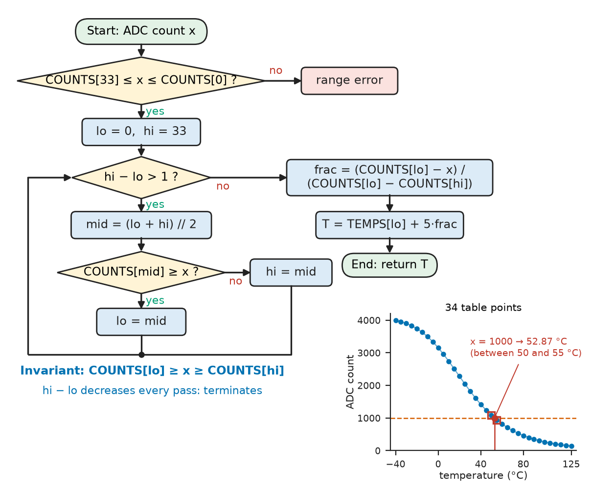
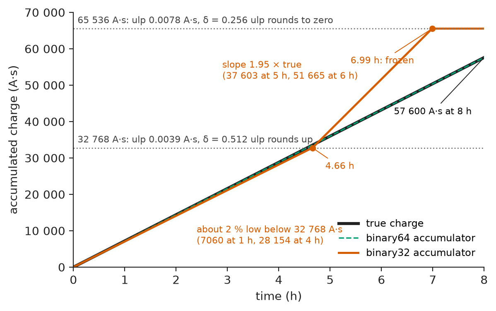
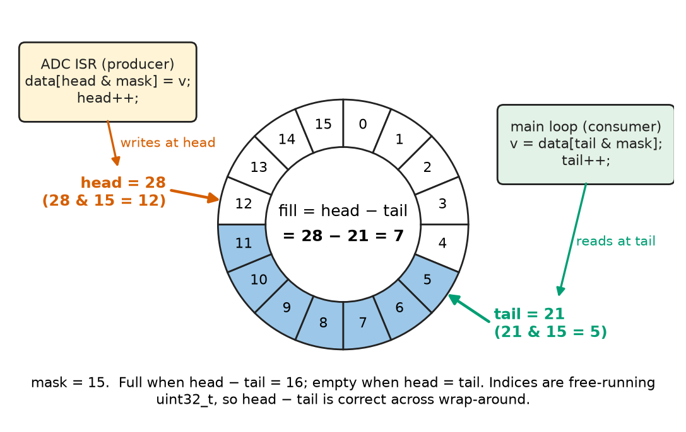
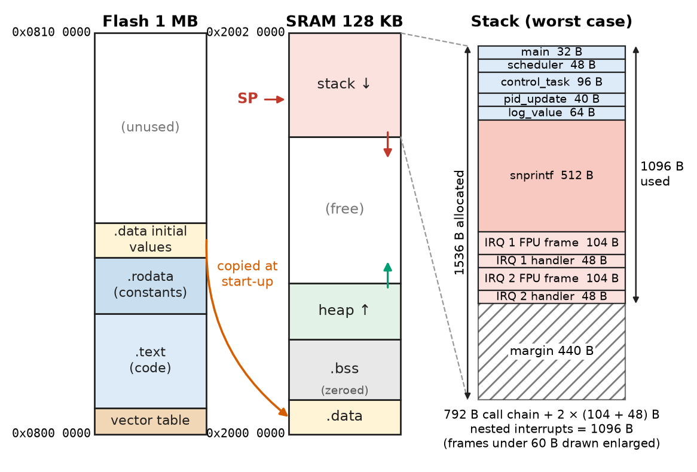
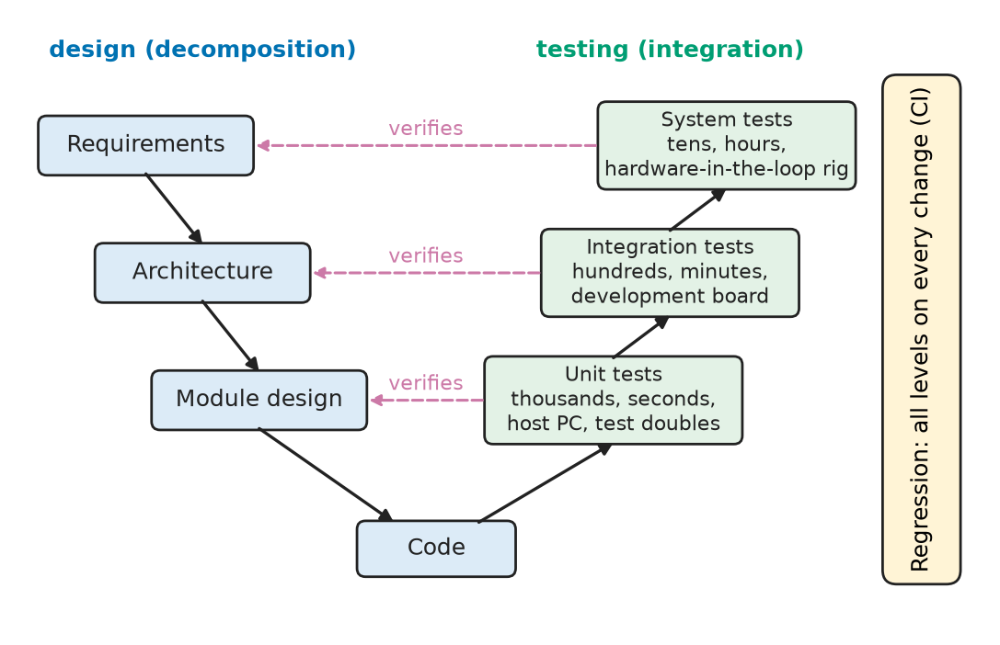

# Chapter 20 — Programming Fundamentals

*Part V · Programming and Computational Systems*

The battery-management controller of an electric scooter estimates state of charge by **coulomb counting**: every millisecond it adds $I\,\Delta t$ to a running total of charge. On a 30-minute lab test the estimate agrees with a reference meter to 2 %. In the field, riders on long trips report that the gauge falls too fast after about four and a half hours and then freezes, while the pack keeps discharging until the undervoltage cut-out stops the scooter without warning. The algorithm is right and the sensor calibrated. The fault is one word, `float`: a 32-bit floating-point accumulator that, above 32 768 A·s, can no longer add 0.002 A·s correctly, and above 65 536 A·s cannot add it at all. Programming for engineering is the craft of writing code that is right not only in the test that was run but for every input, duration and failure the product will meet. This chapter sets out the fundamentals, language-neutrally, with examples in C (the language of firmware) and Python (the language of analysis, test and automation).

> **How does an engineer turn a calculation or a control rule into a correct, efficient program, and what does the machine actually do with variables, functions and data?**
> **How are programs organised, made robust against bad inputs and failures, debugged and tested so that they stay correct as they grow?**

| Concept | Engineering destination |
|---|---|
| Algorithms | Lookup-and-interpolate calibration, filters, control laws, search and sort |
| Variables and data types | Choosing integer widths, fixed or floating point, avoiding overflow and lost precision |
| Control flow | Hysteresis controllers, superloops, state-driven firmware |
| Functions | Reusable, testable units; interfaces between firmware layers |
| Arrays and data structures | Sample buffers, ring buffers for ADC and UART data, records for telemetry |
| Memory | Stack and heap budgets on microcontrollers; leaks and dangling pointers |
| Debugging | Finding faults systematically with debuggers, logging, sanitisers and bisection |
| Modular programming | Drivers, libraries and packages that teams can share and replace |
| Error handling | Sensor faults, timeouts, safe states in industrial and medical equipment |
| Testing | Unit and regression tests, coverage, evidence for IEC 61508, ISO 26262, DO-178C |

**Roadmap.** Algorithms and their correctness (20.1) → variables and types (20.2) → control flow (20.3) → functions (20.4) → arrays and data structures (20.5) → memory (20.6) → modules (20.7) → error handling (20.8) → debugging (20.9) → testing (20.10).

---

## 20.1 Algorithms

### From a calculation to a procedure

An **algorithm** is a finite sequence of well-defined steps that transforms inputs into outputs and terminates. Engineers meet algorithms everywhere: the difference equation of a digital filter, the update of a PI controller, the conversion of an ADC count to a temperature, the search for a free slot in a schedule. Writing one down precisely, before coding, separates the questions "what should be computed?" and "how does this language express it?".

Take a thermistor input on a battery pack. A 10 kΩ NTC thermistor ($B=3950$ K) sits under a 10 kΩ pull-up resistor feeding a 12-bit ADC. The resistance–temperature law is strongly nonlinear, and evaluating a logarithm on a small microcontroller costs hundreds of cycles, so the firmware stores a **calibration table**: ADC counts at every 5 °C from −40 to +125 °C, 34 points, decreasing from 3996 counts at −40 °C to 142 counts at +125 °C. To convert a reading, the algorithm must (1) reject readings outside the table, (2) find the two table entries that bracket the reading, and (3) interpolate linearly between them.

Step (2) can be done by scanning the table from one end, up to 33 comparisons, or by **binary search**: compare the reading with the middle entry, discard the half that cannot contain it, and repeat. Each comparison halves the interval, so a table of $n$ entries needs at most $\lceil\log_2(n-1)\rceil$ comparisons, here 6. The cost of algorithms as functions of problem size and the choice among them are the subject of [Chapter 23](23-algorithms-and-data-structures.md); the mathematics of algorithmic cost is in *The Mathematics Universe*, [Ch. 24](https://github.com/The-Studio-of-Sadiq/engineering-mathematics/blob/main/part-7-numerical-computational/24-computational-mathematics.md) §24.1. Figure 20.1 shows the procedure as a flowchart and Listing 20.1 as Python.

<!-- FIGURE 20.1 | figures/ch20/fig-20-1-binary-search-flowchart.png | flowchart | Binary search with linear interpolation for converting a thermistor ADC count to temperature, with the loop invariant marked. | Content: Start (ADC count x) -> diamond 'COUNTS[33] <= x <= COUNTS[0] ?' (no -> 'range error') -> 'lo = 0, hi = 33' -> diamond 'hi - lo > 1 ?' -> yes -> 'mid = (lo + hi) // 2' -> diamond 'COUNTS[mid] >= x ?' -> 'lo = mid' or 'hi = mid' -> back to loop test; no -> 'frac = (COUNTS[lo] - x) / (COUNTS[lo] - COUNTS[hi])' -> 'T = TEMPS[lo] + 5 frac' -> End. Note on loop edge: 'Invariant: COUNTS[lo] >= x >= COUNTS[hi]'. Inset: table points, ADC count versus -40 to 125 degC, with x = 1000 bracketed by 50 and 55 degC, result 52.87 degC. -->



*Figure 20.1 — Binary search with linear interpolation for converting a thermistor ADC count to temperature, with the loop invariant marked.*

```python
import math

# Calibration table: 10 kOhm NTC (B = 3950 K) under a 10 kOhm pull-up, 12-bit ADC.
TEMPS = list(range(-40, 126, 5))                     # deg C, 34 points
def adc_of(t_c, r25=10e3, beta=3950.0, r_pu=10e3):
    r = r25 * math.exp(beta * (1 / (t_c + 273.15) - 1 / 298.15))
    return round(4095 * r / (r + r_pu))
COUNTS = [adc_of(t) for t in TEMPS]                  # strictly decreasing

def adc_to_temp(x):
    """Return temperature in deg C for ADC count x by binary search + interpolation."""
    if not COUNTS[-1] <= x <= COUNTS[0]:
        raise ValueError(f"ADC count {x} outside calibrated range")
    lo, hi = 0, len(COUNTS) - 1
    # invariant: COUNTS[lo] >= x >= COUNTS[hi]
    while hi - lo > 1:
        mid = (lo + hi) // 2
        if COUNTS[mid] >= x:
            lo = mid
        else:
            hi = mid
    frac = (COUNTS[lo] - x) / (COUNTS[lo] - COUNTS[hi])
    return TEMPS[lo] + frac * (TEMPS[hi] - TEMPS[lo])

if __name__ == "__main__":
    for x in (3000, 2048, 1000, 300):
        print(x, round(adc_to_temp(x), 2))
```

*Listing 20.1 — Table lookup by binary search with linear interpolation (Python 3; saved as `ntc.py` for the tests of Section 20.10).*

Running it prints 3.88, 25.0, 52.87 and 95.66 °C for counts of 3000, 2048, 1000 and 300. The closed-form thermistor law gives 3.92, 24.99, 52.80 and 95.64 °C, so the table with 5 °C spacing is accurate to better than 0.1 °C at these points; over the whole range the worst error, found by the test of Section 20.10, is 0.16 °C, well inside the ±1 °C tolerance of the thermistor itself.

### Correctness: invariants and termination

How do we know the loop is right? Not by trying values, but by an argument. The comment states a **loop invariant**: a condition true before the loop, preserved by every iteration, and giving the result when combined with the exit condition. The range check makes it true initially; each iteration moves `lo` or `hi` to `mid` only on the side that keeps it true; at exit `hi - lo == 1`, so the two entries bracket $x$, which is what interpolation needs. **Termination** follows because `hi - lo` is a positive integer that strictly decreases.

> **Status of the principle: Loop invariants and termination**
> *Derived.* Proof by induction on the iterations: if an invariant holds initially and each iteration preserves it, it holds at exit, and a strictly decreasing non-negative integer measure guarantees exit; the argument is about the algorithm, so it does not cover the language's arithmetic limits (overflow, rounding), which must be checked separately (Section 20.2).

---

## 20.2 Variables and data types

### A variable is named storage with a type

A **variable** is a name bound to storage; its **type** says how many bits it occupies, what they represent and which operations are allowed. In C, types are **static**: declared, checked by the compiler and mapped directly onto machine words. In Python, types are **dynamic**: a name refers to an object that carries its type at run time. C gives control and predictable cost; Python gives convenience and safety, at a cost of one to two orders of magnitude in speed and memory for scalar code.

**Table 20.1 — Common data types in C (on 32-bit Arm Cortex-M and 64-bit x86/Arm hosts) and Python.**

| Type | Size | Range or precision | Typical use |
|---|---|---|---|
| `uint8_t` / `int8_t` | 1 byte | 0 to 255 / −128 to 127 | Bytes on a bus, small counters, status flags |
| `uint16_t` / `int16_t` | 2 bytes | 0 to 65 535 / −32 768 to 32 767 | ADC samples, Q15 fixed-point values |
| `uint32_t` / `int32_t` | 4 bytes | 0 to $4.29\times10^9$ / $\pm2.15\times10^9$ | Tick counters, addresses on 32-bit MCUs, Q31 values |
| `uint64_t` / `int64_t` | 8 bytes | 0 to $1.8\times10^{19}$ / $\pm9.2\times10^{18}$ | Energy and charge accumulators, timestamps in ns |
| `float` (IEEE 754 binary32) | 4 bytes | about 7 significant digits | DSP and control on MCUs with single-precision FPU |
| `double` (binary64) | 8 bytes | about 16 significant digits | Host analysis; accumulators; Python's `float` |
| `bool` | 1 byte (C) | `true`/`false` | Flags, conditions |
| `char` arrays / `str` | 1 byte per character (C, ASCII/UTF-8) | — | Messages, commands, file names |
| Python `int` | variable | unbounded (arbitrary precision) | Counters, bit manipulation on the host |

In C the plain types `int` and `long` have implementation-defined widths (`int` is 16 bits on an AVR and 32 bits on Cortex-M and x86-64), so embedded code uses the fixed-width types of `<stdint.h>`. Python's integers never overflow, which is convenient on the host but means that Python code modelling firmware must apply word-length limits explicitly, for example with NumPy's fixed-width types (Chapter 22).

The binary representations behind these types (two's complement, fixed point, the IEEE 754 formats) are the subject of [Chapter 11](../part-3-digital-electronics/11-digital-number-systems.md) (Sections 11.3, 11.6 and 11.7); the error model of floating-point arithmetic, with machine epsilon $\varepsilon_M=2^{-23}$ for binary32 and $2^{-52}$ for binary64, is in *The Mathematics Universe*, [Ch. 22](https://github.com/The-Studio-of-Sadiq/engineering-mathematics/blob/main/part-7-numerical-computational/22-numerical-methods.md) §22.1. Here the question is the programmer's: which type to choose, and what happens at its limits.

### Floating point: when adding stops working

A floating-point number has a fixed number of significant bits, so the spacing between representable values (the **ulp**, unit in the last place) grows with magnitude. For binary32 with value in $[2^e,2^{e+1})$ the spacing is $2^{e-23}$. Adding a small increment $\delta$ to a large total $S$ gives a result rounded to the nearest multiple of the ulp of $S$:

- if $\delta$ is much larger than the ulp, the error per addition is a small fraction of $\delta$;
- if $\delta$ is about one ulp, each addition rounds to one or two ulps, an error of tens of percent;
- if $\delta$ is less than half an ulp, $S+\delta$ rounds back to $S$, and the total stops changing.

> **Status of the principle: Rounding in floating-point accumulation**
> *Derived.* From round-to-nearest in IEEE 754: each addition $S+\delta$ is exact to within half an ulp of the result, so the relative error per step is about $\mathrm{ulp}(S)/(2\delta)$, which grows without bound as $S$ grows while $\delta$ stays fixed; it holds for any binary floating-point format, with the threshold moving to larger $S$ as precision increases.

**Worked example — the coulomb counter.** The scooter's controller adds $\delta=2\ \mathrm{A}\times1\ \mathrm{ms}=0.002$ A·s every millisecond to a binary32 total. The ulp in $[2^{15},2^{16})=[32\,768,\ 65\,536)$ A·s is $2^{15-23}=2^{-8}=0.003\,906$ A·s, so $\delta$ is 0.512 ulp and each addition rounds up to one full ulp: the count runs at $0.003\,906/0.002=1.95$ times the true rate. In $[2^{16},2^{17})$ the ulp is 0.007 81 A·s, $\delta$ is 0.256 ulp, rounds to zero, and the count freezes. Between $2^{11}$ and $2^{15}$ A·s the increment rounds to a whole number of ulps (8, 4, 2 or 1) that is 2.3 % below its true value. Listing 20.2 simulates eight hours at 2 A.

```python
import numpy as np

dt, current = 1e-3, 2.0                  # 1 ms tick, 2 A constant discharge
n = 8 * 3600 * 1000                      # 8 hours of ticks
step32 = np.full(n, current * dt, dtype=np.float32)
q32 = np.cumsum(step32, dtype=np.float32)    # sequential float32 accumulation
q64 = np.cumsum(np.full(n, current * dt), dtype=np.float64)

for hours in (1, 4, 5, 6, 7, 8):
    k = hours * 3600 * 1000 - 1
    true = current * (k + 1) * dt
    print(f"{hours} h: true {true:8.0f} A*s  float32 {q32[k]:8.0f}  "
          f"float64 {q64[k]:10.3f}")
```

*Listing 20.2 — Simulating a coulomb counter with single and double precision (Python 3, NumPy).*

The output (true charge, binary32, binary64): after 1 h, 7200, 7060 and 7200.000 A·s (binary32 already 1.9 % low); after 4 h, 28 800, 28 154; after 5 h, 36 000, 37 603; after 6 h, 43 200, 51 665; after 7 and 8 h the binary32 count is stuck at 65 536 A·s against a true 50 400 and 57 600 A·s. It crosses 32 768 A·s at 4.66 h (true 33 525 A·s) and reaches 65 536 A·s at 6.99 h (true 50 302 A·s): a 30 % overestimate, then a frozen gauge, exactly the field complaint (Figure 20.2). The binary64 total is still correct to $10^{-5}$ A·s after 10 h.

Two fixes are standard. On an MCU with only a single-precision FPU, accumulate in an **integer** of fixed resolution: charge in units of 1 mA·ms in an `int64_t` is exact, never loses an increment and, at 2 A, would take $9.2\times10^{18}/2000$ ms, about 146 000 years, to overflow. On a host or a processor with a double-precision FPU, use `double`. Either way the general rule is to choose the type for the *largest* value and the *smallest* increment the variable will ever see, not for the values in the first test.

<!-- FIGURE 20.2 | figures/ch20/fig-20-2-float32-coulomb-counter.png | plot | Coulomb counter adding 0.002 A s per millisecond: true charge, binary32 and binary64 accumulators over eight hours. | Content: x-axis 0 to 8 h, y-axis 0 to 70 000 A s. True charge and float64: straight line to 57 600 A s. float32: about 2 percent low to 4.66 h (7060 at 1 h, 28 154 at 4 h), then slope 1.95 times true (37 603 at 5 h, 51 665 at 6 h), flat at 65 536 from 6.99 h. Dotted lines at 32 768 and 65 536 labelled ulp 0.0039 and 0.0078 A s. -->



*Figure 20.2 — Coulomb counter adding 0.002 A s per millisecond: true charge, binary32 and binary64 accumulators over eight hours.*

### Integers: overflow and wrap-around

Fixed-width integers have the opposite failure: they are exact until they overflow. Unsigned arithmetic in C is defined to wrap modulo $2^N$; signed overflow is **undefined behaviour**, meaning the compiler may assume it never happens and optimise accordingly (Chapter 21). The classic case is the millisecond tick counter of an embedded system, a `uint32_t` incremented by a timer interrupt. It wraps after $2^{32}$ ms $=49.7$ days, which is why some devices fail on day 50 of uptime. The cure is to compare **elapsed times**, computed by unsigned subtraction, which remains correct across one wrap:

```c
#include <stdbool.h>
#include <stdint.h>

extern volatile uint32_t g_ms_ticks;            /* incremented by a 1 kHz timer ISR */

bool timeout_expired(uint32_t start_ms, uint32_t timeout_ms)
{
    return (uint32_t)(g_ms_ticks - start_ms) >= timeout_ms;   /* correct across wrap */
}
/* WRONG: (g_ms_ticks >= start_ms + timeout_ms) fails when the sum wraps past 2^32 */
```

If `start_ms` is 4 294 967 000 and the counter has wrapped to 704, the difference is $704-4\,294\,967\,000+2^{32}=1000$ ms, the correct elapsed time, whereas the sum `start_ms + timeout_ms` wraps to a small number and the "wrong" comparison would declare the timeout expired immediately.

### Conversions

Mixing types triggers **conversions**: integer division truncates (`7 / 2` is 3 in C; Python's `/` gives a float), float-to-integer conversion truncates toward zero (and is undefined in C when out of range), and narrowing keeps the low bits. Every conversion should be deliberate and reviewed for range.

---

## 20.3 Control flow

### Sequence, selection and iteration

Every computable procedure can be written with three control structures: **sequence** (do this, then that), **selection** (`if`/`else`, `switch`/`match`) and **iteration** (`while`, `for`). Programs built only from these, each with one entry and one exit, are **structured**, and they can be read and reasoned about block by block, which is why structured programming replaced free use of `goto` in the 1970s.

> **Status of the principle: Structured program theorem**
> *Derived.* Böhm and Jacopini (1966) showed that any flowchart program can be rewritten with sequence, selection and iteration alone, using extra Boolean variables if needed; it guarantees expressiveness, not readability, and practical rules (MISRA C, for example) still permit early `return`, `break` and a forward `goto` to a single error exit where they make code clearer.

Loops are **counted** (`for`), **conditional** (`while`, possibly zero times) or run at least once (`do ... while` in C); `break` leaves early and `continue` skips to the next iteration. `&&`/`and` and `||`/`or` evaluate **left to right with short-circuit**: in `if (p != NULL && p->ready)` the pointer is dereferenced only if valid.

### State as control flow: a thermostat with hysteresis

A heater controlled by "on below the set point, off above it" chatters on and off at every small noise excursion. Adding **hysteresis**, a band within which the output keeps its previous state, makes the behaviour depend on history, and history is stored in a state variable. Listing 20.3 is the C function called once per control period.

```c
typedef enum { HEATER_OFF, HEATER_ON } heater_state_t;

heater_state_t thermostat_step(heater_state_t s, float temp_c,
                               float setpoint_c, float band_c)
{
    switch (s) {
    case HEATER_OFF:
        if (temp_c < setpoint_c - 0.5f * band_c) {
            s = HEATER_ON;
        }
        break;
    case HEATER_ON:
        if (temp_c > setpoint_c + 0.5f * band_c) {
            s = HEATER_OFF;
        }
        break;
    default:
        s = HEATER_OFF;                  /* corrupted state value: fail safe */
        break;
    }
    return s;
}
```

*Listing 20.3 — A two-state hysteresis controller (C11).*

With a set point of 37.0 °C and a 0.4 °C band (an incubator), the heater switches on below 36.8 °C and off above 37.2 °C. The `default` branch handles a state value that should be impossible, for instance after a memory upset, by choosing the safe output. This is a two-state **finite-state machine**, the abstraction of [Chapter 15](../part-3-digital-electronics/15-digital-system-design.md) expressed as control flow; larger firmware state machines belong to Chapter 28.

### The superloop

The simplest embedded program is a **superloop**: initialise, then repeat forever: read inputs, compute, write outputs, possibly wait for the next tick. Its timing is the sum of the execution times of everything in the loop, so one slow branch (a flash write, a blocking serial read) delays everything else. Interrupts, schedulers and real-time operating systems, which relax this constraint, belong to [Chapter 27](../part-6-embedded-and-real-time-systems/27-real-time-computing.md).

---

## 20.4 Functions

### Abstraction with a contract

A **function** packages a computation behind a name, parameters and a result. A good function has a **contract**: preconditions on inputs, postconditions on the result, and stated side effects. Functions are the unit of reuse, of testing and of reasoning: once `adc_to_temp` is trusted, its callers can be read without reading its body.

A **pure function** depends only on its arguments and has no side effects; it always gives the same output for the same input, which makes it trivially testable and safe to call from anywhere. Functions that read hardware, change global state or perform I/O are **impure**, and the art of structuring a program is to keep the impure parts thin and push the computation into pure functions.

### How arguments are passed

In C every argument is passed **by value**: the function receives a copy. To let a function modify the caller's data, or to avoid copying a large structure, the caller passes a **pointer**, and `const` on the pointed-to type promises that the function will not modify it:

```c
#include <stddef.h>

float mean(const float *x, size_t n)        /* const: x[] is read only */
{
    float sum = 0.0f;
    for (size_t i = 0; i < n; i++) {
        sum += x[i];
    }
    return (n > 0u) ? sum / (float)n : 0.0f;
}

void scale(float *x, size_t n, float gain)  /* modifies the caller's array */
{
    for (size_t i = 0; i < n; i++) {
        x[i] *= gain;
    }
}
```

Python passes **object references** by value: the function receives a reference to the same object. Rebinding the parameter name inside the function does not affect the caller, but mutating a mutable object (a list, a dict, a NumPy array) does. A related trap is that default argument values are evaluated once, when the function is defined:

```python
def scale_in_place(samples, gain):
    for i in range(len(samples)):        # mutates the caller's list
        samples[i] *= gain

def log_event(msg, log=[]):              # BUG: one default list shared by all calls
    log.append(msg)
    return log

def log_event_fixed(msg, log=None):
    if log is None:
        log = []                         # a fresh list on every call
    log.append(msg)
    return log

x = [1.0, 2.0, 3.0]
scale_in_place(x, 0.5)
print(x)
print(log_event("overtemp"), log_event("undervolt"))
print(log_event_fixed("overtemp"), log_event_fixed("undervolt"))
```

*Listing 20.4 — Argument passing and the mutable-default trap (Python 3).*

It prints `[0.5, 1.0, 1.5]` (the caller's list was modified), then `['overtemp', 'undervolt']` twice, because both calls appended to the same hidden list, and finally `['overtemp']` and `['undervolt']` from the corrected version.

### Scope, recursion and the cost of a call

Variables declared inside a function are **local**: they exist only while the function runs and are invisible outside it. **Global** variables are visible everywhere, which makes them convenient and dangerous: any function may change them, so reasoning about one function requires reading all of them. Firmware limits globals to hardware state and data shared with interrupts, and gives them file scope (`static` in C) wherever possible.

Each call creates a **stack frame** (Section 20.6) for the return address, saved registers and locals. **Recursion** adds a frame per level, so its stack depth depends on the input, which is why safety-critical rules forbid it (Chapter 23 uses it for trees and divide-and-conquer). A call costs a few cycles on a Cortex-M and tens of nanoseconds in CPython, and compilers **inline** small functions, so in C a function boundary is almost never a reason to write longer functions.

---

## 20.5 Arrays and data structures

### Arrays

An **array** stores elements of one type contiguously, so element $i$ is at $\text{base}+i\times\text{size}$ and is reached in constant time. In C the index starts at 0 and **nothing checks the bounds**: `x[n]` for an $n$-element array touches whatever lies next in memory, the most common serious C bug (Section 20.9). Python lists check bounds and hold references to arbitrary objects, at a cost in memory and speed; NumPy arrays (Chapter 22) store raw numbers contiguously like C. Two-dimensional data are row-major in C and NumPy and column-major in Fortran and MATLAB; traversing in storage order is several times faster because consecutive accesses share cache lines (Chapter 16).

### Records

A **record** groups values of different types under one name: a `struct` in C, a `dataclass` in Python, such as a solar-inverter telemetry sample with timestamp, DC voltage, AC power and status. Records make interfaces explicit; Chapter 21 shows how field order changes a struct's size.

### The ring buffer

The single most useful data structure in embedded and real-time code is the **ring buffer** (circular FIFO). A producer, typically an interrupt service routine storing ADC samples or received UART bytes, writes at the **head**; a consumer, the main loop or a task, reads at the **tail**; both indices wrap around a fixed array (Figure 20.3). No data are moved and no memory is allocated, so every operation takes constant time. Section 17.8 used one with 8-bit indices for UART reception; Listing 20.5 generalises it with free-running 32-bit indices and a power-of-two size, so the fill level is simply `head - tail` and the array index is a bit mask.

```c
#include <stdbool.h>
#include <stdint.h>

#define RB_SIZE 256u                          /* must be a power of two */

typedef struct {
    int16_t           data[RB_SIZE];
    volatile uint32_t head;                   /* written only by the producer */
    volatile uint32_t tail;                   /* written only by the consumer */
} ring_t;

bool rb_put(ring_t *rb, int16_t v)            /* producer, e.g. ADC interrupt */
{
    if (rb->head - rb->tail == RB_SIZE) {
        return false;                         /* full: sample dropped, count it */
    }
    rb->data[rb->head & (RB_SIZE - 1u)] = v;
    rb->head++;
    return true;
}

bool rb_get(ring_t *rb, int16_t *v)           /* consumer, e.g. main loop */
{
    if (rb->head == rb->tail) {
        return false;                         /* empty */
    }
    *v = rb->data[rb->tail & (RB_SIZE - 1u)];
    rb->tail++;
    return true;
}
```

*Listing 20.5 — A single-producer, single-consumer ring buffer (C11).*

Because each index is written by only one side, and a 32-bit aligned store is a single, indivisible operation on a 32-bit processor, this buffer is safe between one interrupt and one main loop on a single-core microcontroller without disabling interrupts. On multi-core processors, or with compilers that reorder memory accesses, memory barriers or C11 atomics are also needed; concurrency and race conditions are treated in [Chapter 27](../part-6-embedded-and-real-time-systems/27-real-time-computing.md), and `volatile` in Chapter 21.

<!-- FIGURE 20.3 | figures/ch20/fig-20-3-ring-buffer.png | block-diagram | A 16-slot ring buffer between an ADC interrupt (producer) and the main loop (consumer), with free-running indices. | Content: circle of slots 0 to 15, slots 5 to 11 filled. Arrow 'tail = 21 (21 and 15 = 5)' at slot 5, arrow 'head = 28 (28 and 15 = 12)' at slot 12; centre text 'fill = head - tail = 7'. Left block 'ADC ISR writes data[head and mask], head++'; right block 'main loop reads data[tail and mask], tail++'. Note: full when head - tail = 16, empty when equal. -->



*Figure 20.3 — A 16-slot ring buffer between an ADC interrupt (producer) and the main loop (consumer), with free-running indices.*

**Worked example — sizing a sample buffer.** A vibration monitor on an industrial pump samples three accelerometer axes at 1 kHz with 16-bit samples, and must ride through the main loop being blocked for up to 2 s while it writes a log block to flash. The buffer needs $1000\times3\times2\ \mathrm{bytes}\times2\ \mathrm{s}=12\,000$ bytes; the next power of two in samples is $8192$ samples (16 384 bytes), 8 % of the 192 KB of SRAM on an STM32F407-class MCU. If 16 KB were too much, the remedy would be to make the flash write non-blocking, not to shrink the buffer and lose data.

### Other structures

Linked lists, stacks, queues, trees, graphs and hash tables, and the algorithms that use them, are the subject of [Chapter 23](23-algorithms-and-data-structures.md). Python provides the most important of them built in: `list` (dynamic array), `dict` (hash table), `set`, `collections.deque` (double-ended queue) and `heapq` (priority queue).

---

## 20.6 Memory

### The memory model of a running program

Every variable lives somewhere, and where it lives decides how long it lives and how much of it there can be. A compiled C program, on a microcontroller or under an operating system, divides its memory into regions (Figure 20.4):

- **Text (code)**: the machine instructions, and **read-only data** (`.rodata`) such as constant tables and string literals. On a microcontroller these stay in flash and execute in place.
- **Static data**: variables that exist for the whole run. Initialised ones (`.data`) are copied from flash to RAM at start-up; zero-initialised ones (`.bss`) are cleared at start-up. Globals and `static` locals live here.
- **Stack**: a region that grows and shrinks with function calls. Each call pushes a frame with return address, saved registers and local variables; each return pops it. Allocation is a single subtraction from the stack pointer, so it is fast and deterministic, but the size is fixed when the program is built.
- **Heap**: a region from which blocks are allocated and released explicitly at run time (`malloc`/`free` in C, `new`/`delete` in C++), or implicitly for every object in Python.

```c
#include <stdint.h>
#include <stdlib.h>

const int16_t sine_lut[256] = { 0, 804, 1608 /* ... */ };  /* .rodata: flash */
uint32_t error_count = 0;            /* .bss: zeroed at start-up */
static float gain = 1.25f;           /* .data: initial value copied from flash */

float *make_buffer(size_t n)
{
    float *p = malloc(n * sizeof *p);    /* heap: lives until free(p) */
    return p;                            /* may be NULL: the caller must check */
}

int16_t *broken(void)
{
    int16_t local[16];                   /* stack: dies when the function returns */
    return local;                        /* BUG: dangling pointer (compilers warn) */
}
```

*Listing 20.6 — Where C variables live (C11).*

> **Status of the principle: Stack discipline**
> *Fundamental.* By definition of the call mechanism, frames are created and destroyed in last-in, first-out order, so a local variable's lifetime ends when its function returns; any pointer to it held beyond that point refers to memory that will be reused by the next call, which is the root of every dangling-stack-pointer bug.

<!-- FIGURE 20.4 | figures/ch20/fig-20-4-memory-layout.png | block-diagram | Memory layout of a program on a Cortex-M4 microcontroller and the stack frames of its deepest call chain. | Content: Flash 1 MB at 0x0800 0000: vector table, .text, .rodata, .data initial values (arrow 'copied at start-up'). SRAM 128 KB at 0x2000 0000 upward: .data, .bss, heap (grows up), gap, stack (grows down from 0x2002 0000), SP marked. Stack zoom: main 32 B, scheduler 48, control_task 96, pid_update 40, log_value 64, snprintf 512, two nested interrupts of 104 + 48 B each; total 1096 B, allocated 1536 B. -->



*Figure 20.4 — Memory layout of a program on a Cortex-M4 microcontroller and the stack frames of its deepest call chain.*

### Stack and heap on a microcontroller

On a PC the operating system gives each thread a stack of a megabyte or more and grows the heap on demand. On a microcontroller the whole SRAM may be 20 KB to 1 MB, the stack is a fixed region set in the linker script, and nothing stops it from growing into the static data below it. A **stack overflow** then silently corrupts variables, and the symptom appears far from the cause.

**Worked example — a stack budget.** A motor controller's deepest call chain is `main` (32 bytes of frame) → `scheduler` (48) → `control_task` (96) → `pid_update` (40) → `log_value` (64) → `snprintf` (512, a formatted-print routine is often the largest single user of stack). That is 792 bytes. Interrupts use the same stack on a bare-metal Cortex-M: each one pushes a hardware frame of 104 bytes when the floating-point unit is in use (26 words) and its handler needs 48 bytes of locals, and two priority levels can nest, adding $2\times(104+48)=304$ bytes. The worst case is $792+304=1096$ bytes; with a 25 % margin, 1370 bytes, so the stack is set to 1.5 KB. The figures for each function come from the compiler (GCC's `-fstack-usage` writes them to `.su` files) and the result is checked on the running system by filling the stack with a known pattern at start-up and inspecting how much was overwritten after a long test ("stack painting").

The heap brings two further risks. A **leak** grows until allocation fails, typically after days. **Fragmentation** leaves free memory in pieces too small for a request although the total is ample. Allocation time also varies. Most safety-critical firmware therefore allocates statically or only at initialisation (memory pools, Chapter 21).

### Managed memory in Python

Python allocates every object on its heap and frees it automatically, by reference counting plus a cycle collector, so dangling pointers cannot occur. The costs are memory (a Python `int` occupies 28 bytes, a `float` 24, against 4 or 8 in C) and occasional collection pauses, one reason Python runs on the test bench while firmware is C and C++; MicroPython brings a subset of Python to microcontrollers with tens of kilobytes of RAM or more.

---

## 20.7 Modular programming

### Interfaces and implementations

A program of a few hundred lines can live in one file. A product's firmware, often 50 000 to 500 000 lines, cannot: it is divided into **modules**, each with a single responsibility, a published **interface** and a hidden **implementation**. Other modules depend only on the interface, so the implementation can be fixed, optimised or replaced (a different sensor, a new MCU) without touching them.

In C a module is a pair of files. The **header** (`.h`) declares the types and functions that form the interface; the **source** (`.c`) defines them, and marks internal helpers and data `static` so that they are invisible outside the file. A PID controller module might publish:

```c
/* pid.h - interface of the PID controller module */
#ifndef PID_H
#define PID_H

typedef struct {
    float kp, ki, kd;             /* gains */
    float integ, prev_err;        /* internal state */
    float out_min, out_max;       /* actuator limits, used for anti-windup */
} pid_ctrl_t;

void  pid_init(pid_ctrl_t *c, float kp, float ki, float kd,
               float out_min, float out_max);
float pid_update(pid_ctrl_t *c, float setpoint, float measured, float dt_s);

#endif /* PID_H */
```

*Listing 20.7 — A C module interface (C11).*

The include guard prevents double definition. The discrete PID law itself comes from *Circuits, Signals and Communications*, [Ch. 35](https://github.com/The-Studio-of-Sadiq/Circuits-Signals-and-Communications/blob/main/part-7-control-system-fundamentals/35-control-design-fundamentals.md) §35.2 and §35.8; the module only packages it. Because state lives in a `pid_ctrl_t` passed by pointer, not in globals, one module serves the current, speed and position loops of a drive and can be tested on a PC. Declaring only `typedef struct pid_ctrl pid_ctrl_t;` in the header (an **opaque type**) hides the fields completely.

In Python a module is a `.py` file and a **package** is a directory of modules; names beginning with an underscore are internal by convention. A test-automation package for a power-supply production line might be laid out as:

```text
psu_test/
    __init__.py          # package marker, public API re-exports
    instruments.py       # SCPI drivers: DMM, electronic load, oscilloscope
    limits.py            # pass/fail limits loaded from a versioned file
    sequences.py         # test steps: no-load voltage, line and load regulation
    report.py            # CSV and PDF reports
tests/
    test_limits.py       # unit tests run without instruments
```

### Coupling, cohesion and layers

Good modules have **high cohesion** and **low coupling**. Firmware is usually layered, drivers at the bottom, then a hardware abstraction layer, middleware and application logic, with dependencies pointing downward ([Chapter 25](../part-6-embedded-and-real-time-systems/25-embedded-system-architecture.md), Chapter 28); separate compilation and linking are covered in Chapter 21 and version control in Chapter 24.

> **Status of the principle: Information hiding**
> *Empirical.* Parnas (1972) argued, and decades of software-engineering experience confirm, that decomposing a system so that each module hides one design decision likely to change makes change cheaper and errors more local; it is a design heuristic, not a law, and its benefit depends on predicting correctly which decisions will change.

---

## 20.8 Error handling

### Errors are part of the specification

A sensor disconnects, a serial reply never arrives, a file is missing, a user types a negative flow rate. These are not bugs; they are inputs the program must handle. The design question is, for each failure, **who detects it, who decides what to do, and what the safe behaviour is**. A dosing pump in a water-treatment plant that loses its flow sensor should stop dosing; a ventilator that loses a pressure reading should alarm and fall back to a conservative mode; a logging script that loses one sample may simply record a gap.

### Status codes in C

C has no exceptions. Functions report failure through their return value, conventionally `0` for success and a negative or enumerated code for each failure, with results returned through pointer arguments:

```c
#include <stdint.h>
#include "fault.h"                /* fault_report(), FAULT_SUPPLY_ADC */
#include "supply.h"               /* supply_filter_update() */

typedef enum { ADC_OK = 0, ADC_TIMEOUT, ADC_RANGE } adc_status_t;

adc_status_t adc_read_mv(uint8_t channel, int32_t *out_mv);

void sample_supply(void)
{
    int32_t mv;
    adc_status_t st = adc_read_mv(3u, &mv);
    if (st != ADC_OK) {
        fault_report(FAULT_SUPPLY_ADC, (uint32_t)st);   /* log, count, maybe trip */
        return;
    }
    supply_filter_update(mv);
}
```

The weakness of status codes is that nothing forces the caller to check them; compiler attributes (`__attribute__((warn_unused_result))` in GCC and Clang, `[[nodiscard]]` in C23 and C++17) and static analysers catch ignored returns.

### Exceptions in Python

Python signals errors by **raising exceptions**, objects that propagate up the call stack until a `try`/`except` block handles them; if none does, the program stops with a traceback. Exceptions separate the code that detects an error from the code that knows how to respond, and they cannot be silently ignored. Listing 20.8 reads a 4–20 mA pressure transmitter through a flaky serial link, retrying timeouts and treating an out-of-range loop current as a hard fault.

```python
import random

class SensorError(Exception):
    """Base class for failures of the pressure transmitter."""
class SensorTimeout(SensorError):
    pass
class SensorRangeError(SensorError):
    pass

def read_raw(rng):                       # stand-in for a serial query to a real device
    r = rng.random()
    if r < 0.5:
        raise TimeoutError("no reply within 50 ms")
    return 4.0 + 16.0 * rng.random() if r < 0.95 else 2.1   # 4-20 mA loop; 2.1 mA = broken wire

def read_pressure_bar(rng, retries=3):
    """Return pressure in bar from a 4-20 mA, 0-10 bar transmitter, or raise SensorError."""
    for _ in range(retries):
        try:
            ma = read_raw(rng)
        except TimeoutError as exc:
            last = exc                    # transient: try again
            continue
        if not 3.8 <= ma <= 20.5:         # NAMUR NE 43 signal limits
            raise SensorRangeError(f"loop current {ma:.1f} mA out of range")
        return (ma - 4.0) / 16.0 * 10.0
    raise SensorTimeout(f"{retries} attempts failed") from last

rng = random.Random(7)
for k in range(8):
    try:
        print(f"sample {k}: {read_pressure_bar(rng):5.2f} bar")
    except SensorRangeError as exc:
        print(f"sample {k}: FAULT ({exc}); valve to safe position")
    except SensorError as exc:
        print(f"sample {k}: no data ({exc}); hold last value")
```

*Listing 20.8 — Exceptions, retries and fault classes (Python 3).*

With this seed, samples 0–2 and 4–6 return 0.72, 3.66, 0.37, 1.24, 9.48 and 3.97 bar; sample 3 fails three attempts and is reported as missing; sample 7 reads 2.1 mA, below the 3.8 mA limit that NAMUR NE 43 sets for a valid signal, and is reported as a sensor fault. The hierarchy lets the caller hold the last value on a transient loss but drive the valve safe on a broken wire, and `raise ... from` keeps the original timeout for the log. Context managers (`with open(...) as f:`) close files and instrument sessions even when an exception occurs; C++ uses destructors (RAII, Chapter 21).

### Assertions are not error handling

An **assertion** (`assert(n > 0)`) checks a condition that can be false only if the program itself is wrong. It must not be used for conditions that can legitimately occur, such as bad input, because assertions are often compiled out (`NDEBUG`, `python -O`). In deployed firmware a failed internal check typically logs the fault and lets the watchdog reset the system (Chapter 27).

**Table 20.2 — Error-handling mechanisms.**

| Mechanism | Languages | Strength | Weakness |
|---|---|---|---|
| Status/return codes | C, C++, Rust (`Result`), Go | Explicit, zero overhead, deterministic | Easily ignored; clutters code |
| `errno`-style global | C standard library | Compact interface | Must be read immediately; not reentrant without care |
| Exceptions | Python, C++, Java | Cannot be ignored; separates detection from handling | Hidden control paths; often banned in hard real-time C++ |
| Assertions | All | Catches programming errors early | Not for expected failures; often disabled in release |
| Sentinel values (NaN, −1) | All | Propagate through computations | Silently spread if never checked |

---

## 20.9 Debugging

### A method, not a mood

A **bug** is a difference between what the program does and what it should do. Debugging is the scientific method applied to code: observe the failure, form a hypothesis about its cause, design an experiment that could refute it, run the experiment, and repeat until the cause is found and the fix is verified. The first step is always to make the failure **reproducible**, ideally as an automated test (Section 20.10), because a failure that cannot be reproduced cannot be shown to be fixed.

### Tools

- **Logging and print statements**: the simplest observation tool. Structured logs with timestamps and levels (Python's `logging` module; a ring-buffered event log in firmware) let a failure in the field be reconstructed afterwards. In real-time code, printing changes timing and can hide or create the bug, so firmware logs to RAM and transmits later.
- **Debuggers**: `gdb`, `pdb`, and the debuggers in IDEs let the engineer stop at a **breakpoint**, step through statements, inspect variables and the call stack, and stop when a variable changes (**watchpoint**). On a microcontroller the debugger connects through the processor's debug port (SWD or JTAG, with a probe such as a J-Link or ST-LINK), and the Cortex-M debug unit provides hardware breakpoints and data watchpoints without changing the code.
- **Sanitisers and checkers**: compilers instrument code to detect errors at run time: AddressSanitizer (out-of-bounds access, use after free), UndefinedBehaviorSanitizer (signed overflow, bad shifts), Valgrind on Linux. They run on the host, which is one strong reason to make firmware modules compile and run on a PC.
- **Static analysis**: tools that find bugs without running the code (compiler warnings at their highest level, `clang-tidy`, `cppcheck`, commercial analysers), and type checkers such as `mypy` for Python.
- **Bisection**: when a bug appeared between a working and a broken version, testing the version halfway between and repeating finds the change that introduced it. `git bisect` automates this.

A typical bug that sanitisers catch instantly and humans find slowly is the off-by-one write:

```c
float history[8];
for (int i = 0; i <= 8; i++) {      /* BUG: <= writes history[8], one past the end */
    history[i] = 0.0f;
}
```

On a microcontroller the ninth write silently overwrites whatever variable the linker placed after `history`; compiled with `-fsanitize=address` on a PC, the program stops at that line with a report naming the array and the offset.

**Worked example — bisecting a regression.** A drive's firmware passed its acceptance test at release 4.1 and fails at 4.2, 500 commits later, and each build-flash-test cycle takes 6 minutes. Testing commits one by one could take 500 cycles, 50 hours; bisection needs at most $\lceil\log_2 500\rceil=9$ cycles, 54 minutes, to find the commit that introduced the failure, provided every commit builds and can be tested.

**Table 20.3 — Common bug classes and how they are usually found.**

| Bug class | Typical symptom | Usually found by |
|---|---|---|
| Off-by-one, out-of-bounds index | Corrupted neighbour variable, crash later | Sanitisers, bounds-checked tests, code review |
| Uninitialised variable | Behaviour changes between builds or power cycles | Compiler warnings, static analysis, Valgrind |
| Integer overflow, wrong type | Fails only for large values or long uptime (day 49.7) | Boundary-value tests, UBSan, review of types |
| Floating-point precision loss | Slow drift, frozen accumulator | Long-duration and large-value tests |
| Race condition | Rare, timing-dependent corruption | Code review, stress tests, thread sanitiser (Chapter 27) |
| Stack overflow, memory leak | Random crash after hours or days | Stack painting, heap statistics, endurance tests |
| Misunderstood requirement | Code does what was written, not what was needed | Reviews, acceptance tests with the customer |

---

## 20.10 Testing

### What testing can and cannot show

**Testing** runs the program on chosen inputs and compares the results with expected outputs. As the saturating-adder example of [Chapter 19](../part-4-computer-architecture-and-digital-hardware/19-hardware-description-languages.md) showed for hardware, the input space of any useful function is far too large to test exhaustively, so tests sample it, and sampling can show the presence of bugs but not their absence. The art is to choose tests that are likely to reveal bugs, and to automate them so that they run on every change.

> **Status of the principle: Testing reveals the presence, not the absence, of faults**
> *Derived.* A finite set of test inputs drawn from an input space of $2^{32}$ or more values leaves almost all inputs untested, so a passing test suite bounds nothing in general; confidence comes from combining tests with structure (small pure functions whose input classes can be argued), coverage measurement, reviews and, for critical code, formal methods.

### Levels of testing

Tests are organised in levels that mirror the design (Figure 20.5):

- **Unit tests** check one function or module in isolation, on a PC, in milliseconds. Hardware dependencies are replaced by **test doubles**: a fake ADC driver that returns scripted values, a mock that records the commands sent to it.
- **Integration tests** check that modules work together: the control loop with the real filter and PID modules, or the firmware with the real sensor driver on a development board.
- **System tests** check the complete product against its requirements, often on a **hardware-in-the-loop** rig that simulates the plant (Chapter 28).
- **Regression tests** are the accumulated tests of all levels, rerun automatically on every change so that a fixed bug stays fixed.

<!-- FIGURE 20.5 | figures/ch20/fig-20-5-test-levels-v-model.png | block-diagram | The V-model: design levels matched by test levels. | Content: left arm descending 'Requirements' -> 'Architecture' -> 'Module design' -> 'Code'; right arm ascending 'Unit tests (thousands, seconds, host PC, test doubles)' -> 'Integration tests (hundreds, minutes, development board)' -> 'System tests (tens, hours, hardware-in-the-loop rig)'. Dashed 'verifies' arrows across. Side bar 'Regression: all levels on every change (CI)'. -->



*Figure 20.5 — The V-model: design levels matched by test levels.*

### Choosing test cases

Two classical techniques choose inputs systematically. **Equivalence partitioning** divides the input domain into classes that the program should treat alike (readings inside the table, readings above it, readings below it) and tests at least one value from each. **Boundary-value analysis** adds tests at and just beyond each boundary, because off-by-one and comparison errors cluster there: the first and last table entries, and one count outside each. Listing 20.9 applies both to `adc_to_temp` with the `pytest` framework, using the closed-form thermistor law as an independent reference.

```python
import math
import pytest
from ntc import adc_to_temp, COUNTS, TEMPS

def reference(x):                        # closed-form beta model, independent of the table
    r = 10e3 * x / (4095 - x)
    return 1 / (1 / 298.15 + math.log(r / 10e3) / 3950) - 273.15

@pytest.mark.parametrize("i", range(len(TEMPS)))
def test_table_points_exact(i):          # every calibration point maps back to its temperature
    assert adc_to_temp(COUNTS[i]) == pytest.approx(TEMPS[i])

@pytest.mark.parametrize("x", range(COUNTS[-1], COUNTS[0] + 1, 7))
def test_interpolation_error(x):         # whole range: within 0.5 deg C of the model
    assert abs(adc_to_temp(x) - reference(x)) < 0.5

@pytest.mark.parametrize("x", [COUNTS[0] + 1, COUNTS[-1] - 1, 0, 4095])
def test_out_of_range_rejected(x):       # boundary values just outside the table
    with pytest.raises(ValueError):
        adc_to_temp(x)

def test_monotonic():                    # hotter sensor -> lower count -> higher temperature
    temps = [adc_to_temp(x) for x in range(COUNTS[-1], COUNTS[0] + 1)]
    assert all(a >= b for a, b in zip(temps, temps[1:]))
```

*Listing 20.9 — Unit tests with equivalence classes, boundary values and a reference model (Python 3, pytest; run with `python -m pytest`).*

`pytest` generates 590 test cases from these functions (34 table points, 551 interpolation points, 4 out-of-range values, one monotonicity check) and runs them in under a second; all pass, and the worst interpolation error over the range is 0.16 °C. For C firmware the same tests are written with Unity, CppUTest or GoogleTest and compiled for the host, so they run in continuous integration without hardware.

### Coverage and the safety standards

**Code coverage** measures which parts of the code the tests executed: **statement coverage** (every statement ran), **branch coverage** (every branch of every decision was taken both ways) and **modified condition/decision coverage** (MC/DC: every condition in a decision has been shown to affect the outcome independently). Coverage does not show that the code is right; it shows which code has never been tested at all, which is where to look next.

Safety standards set coverage requirements by criticality. DO-178C, for airborne software, requires statement coverage at Level C, adds decision coverage at Level B and MC/DC at Level A (software whose failure could be catastrophic). ISO 26262-6, for road vehicles, recommends statement, branch and MC/DC coverage increasingly strongly from ASIL A to ASIL D, and IEC 61508-3 does the same across safety integrity levels for industrial systems.

**Worked example — MC/DC for an interlock.** A motor-drive interlock trips when `overtemp || (overcurrent && !inhibit) || estop`. It has $N=4$ conditions, so exhaustive testing of the decision needs $2^4=16$ combinations. MC/DC needs, for each condition, a pair of tests differing only in that condition and giving different outcomes; such pairs can share tests, and the minimum is $N+1=5$ tests. One set is: all false (no trip); `overtemp` alone (trip); `estop` alone (trip); `overcurrent` alone (trip); `overcurrent` and `inhibit` (no trip). The first test pairs with each of the next three to show the independent effect of `overtemp`, `estop` and `overcurrent`, and the last pairs with the fourth to show the effect of `inhibit`. For a decision with 10 conditions the saving is $1024$ tests against 11, which is why MC/DC, not exhaustive testing, is the aviation standard's criterion.

### Testing as a habit

Tests are most valuable written early and run constantly: a test written before a bug fix proves it detects the bug, and running the suite on every commit lets a team change code confidently. Testing numerical software is treated in [Chapter 24](24-scientific-computing.md), firmware validation on target hardware in Chapter 28.

---

## What remains open

| Open question | Where it is answered |
|---|---|
| How are two's-complement, fixed-point and IEEE 754 numbers represented in bits? | Chapter 11 (Digital Number Systems) |
| What exactly do pointers, structs, `volatile`, the compiler and the linker do in C and C++? | Chapter 21 (C/C++ for Engineering) |
| How are arrays, data files, plots and instruments handled efficiently in Python? | Chapter 22 (Python for Engineering) |
| How is an algorithm's cost analysed, and when should a tree, hash table or graph be used? | Chapter 23 (Algorithms and Data Structures) |
| How are numerical results kept accurate, reproducible and under version control? | Chapter 24 (Scientific Computing); *The Mathematics Universe*, [Ch. 22](https://github.com/The-Studio-of-Sadiq/engineering-mathematics/blob/main/part-7-numerical-computational/22-numerical-methods.md) |
| How is firmware structured into drivers, abstraction layers and boot stages? | Chapter 25 (Embedded-System Architecture) |
| How do interrupts and tasks share data safely, and what do RTOS schedulers guarantee? | Chapter 27 (Real-Time Computing) |
| How is firmware debugged on target and validated with hardware-in-the-loop rigs? | Chapter 28 (Embedded System Design) |

**Next:** Chapter 21 takes the language of firmware, C, and its successor C++, down to the level of pointers, memory layout, registers, objects, compilation and linking.
