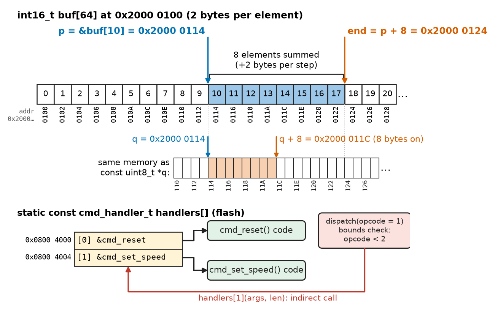
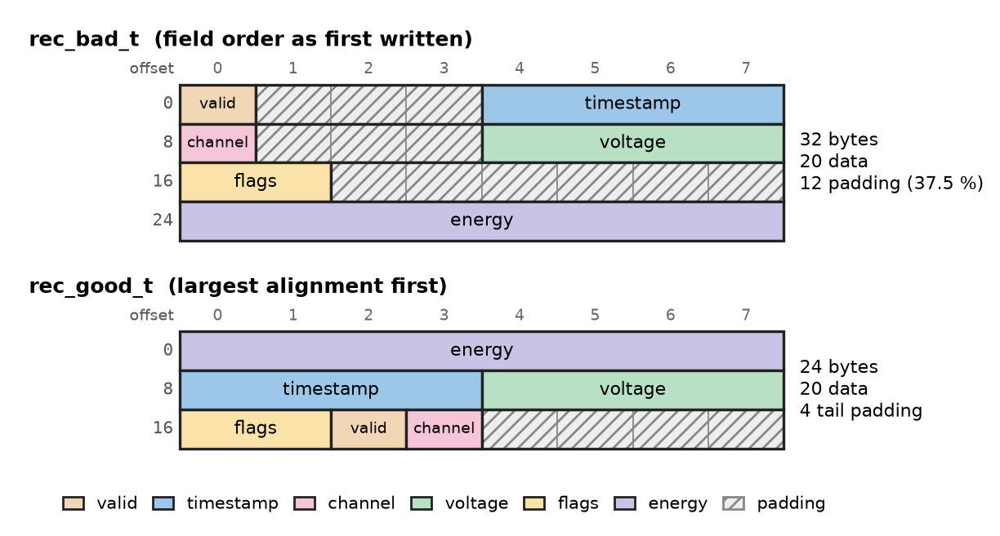
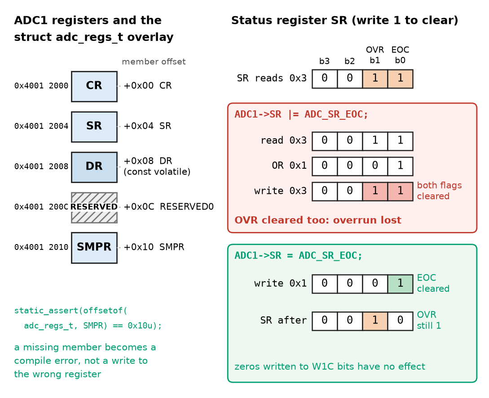
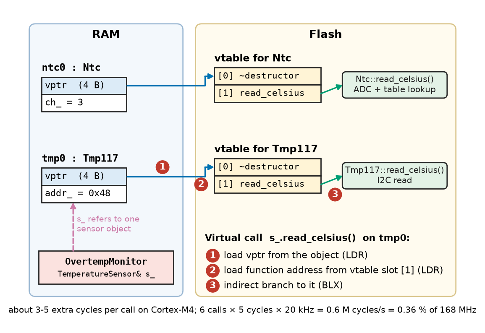
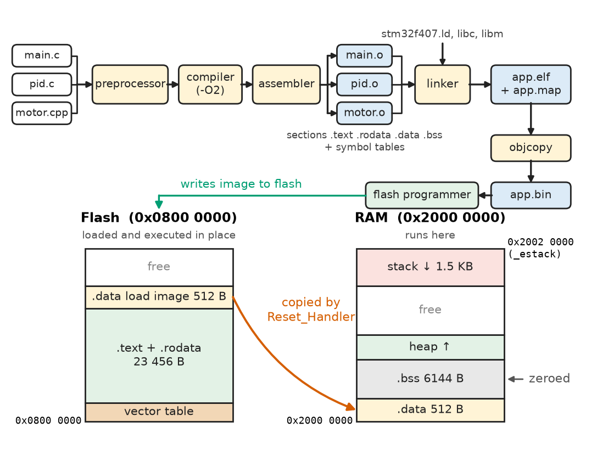

# Chapter 21 — C/C++ for Engineering

*Part V · Programming and Computational Systems*

A motor-controller board for an electric forklift passes every bench test with its debug build. The production build, compiled with optimisation turned on, hangs within a second of power-up. The debugger shows the processor spinning forever in a loop that waits for a flag, `while (!adc_done) { }`, although the ADC's end-of-conversion interrupt fires and sets the flag on time. Nothing is wrong with the ADC, the interrupt or the loop's logic. The optimiser, seeing that nothing inside the loop changes `adc_done`, read it once into a register and never looked at memory again. One keyword, `volatile`, tells the compiler that the variable can change behind its back. The episode is typical of C and C++ in engineering: the languages give direct control of memory, bits and hardware, and in exchange they hold the programmer to a precise contract with the compiler, the processor and the linker. This chapter sets out that contract.

> **How do pointers, structures, memory allocation and bit operations map onto the memory and registers of a real machine?**
> **How do C++ classes and object-oriented design help build safe firmware, and what do compilation, linking and the embedded coding standards demand?**

| Concept | Engineering destination |
|---|---|
| C fundamentals (types, promotions, undefined behaviour) | Portable, optimiser-safe arithmetic in firmware and drivers |
| Pointers | Buffers, DMA descriptors, callback tables, interrupt vectors |
| Structures | Telemetry records, protocol frames, register maps, configuration blocks |
| Memory management | Static allocation and pools in firmware; leak-free host tools |
| Bitwise operations | Register fields, flags, packed sensor data, CRCs, fixed-point maths |
| Peripheral-oriented programming | Memory-mapped registers, `volatile`, atomic set/reset, ISR-shared data |
| C++ classes and RAII | Drivers that cannot be misused; locks and interrupt guards that always release |
| Object-oriented design | Sensor and actuator interfaces, host testing with test doubles |
| Compilation and linking | Linker scripts, start-up code, flash and RAM budgets, mixed C/C++ builds |
| Embedded-oriented C/C++ | MISRA C/C++, AUTOSAR C++14, CERT C; evidence for IEC 61508, ISO 26262 |

**Roadmap.** The C model of types and arithmetic (21.1) → pointers (21.2) and structures (21.3) → memory management (21.4) → bitwise operations (21.5) → talking to peripherals (21.6) → C++ classes and RAII (21.7) → object-oriented design (21.8) → how source becomes a flash image (21.9) → the restricted subsets used in embedded and safety-critical work (21.10).

> **Boundary.** Language-neutral fundamentals (types, control flow, functions, the stack and heap, testing) are in [Chapter 20](20-programming-fundamentals.md); the processor, memory map and peripherals at architecture level in [Chapter 17](../part-4-computer-architecture-and-digital-hardware/17-microprocessors-and-microcontrollers.md) (Sections 17.3, 17.5 and 17.7). Firmware architecture, drivers, interfaces and real-time behaviour belong to Chapters 25–28, so peripheral examples here are kept short.

---

## 21.1 C fundamentals

### The C model

C, standardised as ISO/IEC 9899 (C99, C11, C17, C23), is a compiled language whose types map almost one-to-one onto machine words and whose operations map onto a handful of instructions. Each `.c` file is a **translation unit**, preprocessed (macros, `#include`, conditional compilation), compiled to an object file and linked with others (Section 21.9). There is no run-time system checking array bounds, null pointers or arithmetic overflow; that is what makes C fast and predictable on an 8 KB microcontroller, and what makes its errors silent.

Engineering code uses the fixed-width types of `<stdint.h>` (`uint8_t`, `int32_t`), `<stdbool.h>` for `bool`, `const` for data that must not change (and that the linker can place in flash), `enum` for named constants, and `static inline` functions in preference to function-like macros, which evaluate their arguments as text and so can evaluate them twice.

### Integer promotions and the usual arithmetic conversions

C never does arithmetic on types narrower than `int`. Operands of type `char`, `short`, `uint8_t` or `uint16_t` are first **promoted** to `int` (on a 32-bit target), and when two operands still differ, the **usual arithmetic conversions** bring them to a common type, which is unsigned if the unsigned operand's rank is at least that of the signed one. Listing 21.1 shows three consequences that regularly reach production firmware.

```c
#include <stdint.h>
#include <stdio.h>

int main(void)
{
    uint8_t  a = 200, b = 100;
    uint8_t  sum8 = a + b;               /* int 300, converted back to uint8_t: 44 */
    int      wide = a + b;               /* promoted to int: 300 */

    uint16_t x = 50000, y = 50000;
    uint32_t bad  = x * y;               /* int * int = 2.5e9 > INT_MAX: undefined */
    uint32_t good = (uint32_t)x * y;     /* unsigned arithmetic: 2 500 000 000 */

    int32_t  neg = -1;
    uint32_t one = 1u;
    if (neg < one) { puts("expected"); } else { puts("surprise: -1 > 1u"); }

    printf("%u %d %lu\n", (unsigned)sum8, wide, (unsigned long)good);
    (void)bad;
    return 0;
}
```

*Listing 21.1 — Integer promotion pitfalls (C11, 32-bit `int`).*

The first case wraps silently: $200+100=300$ is computed in `int`, and storing it in a `uint8_t` keeps $300 \bmod 256=44$. The second is worse: two `uint16_t` values promote to *signed* `int`, and $50\,000^2=2.5\times10^9$ exceeds $2^{31}-1=2\,147\,483\,647$, which is signed overflow and therefore undefined; on a 16-bit AVR, where `int` is 16 bits, the same line is well-defined unsigned arithmetic that wraps. The third prints "surprise": comparing `int32_t` with `uint32_t` converts $-1$ to $4\,294\,967\,295$. Compiling with `-Wall -Wextra -Wconversion -Wsign-compare` flags all three.

> **Status of the principle: Integer promotions and usual arithmetic conversions**
> *Derived.* They follow from the conversion rules of ISO C (§6.3.1), so the result type of every expression is decidable at compile time; the outcome depends on the target's width of `int`, which is why fixed-width types and explicit casts are needed for code that must behave identically on 16-bit and 32-bit processors.

### Undefined, unspecified and implementation-defined behaviour

The C standard deliberately leaves some behaviour open. **Implementation-defined** behaviour must be documented by the compiler (the width of `int`, right-shifting a negative number). **Unspecified** behaviour may differ between evaluations (the order in which function arguments are evaluated). **Undefined behaviour** (UB) places no requirement at all: the compiler may assume it never happens and optimise on that assumption, so a signed-overflow check written as `if (x + 1 < x)` can be deleted entirely.

**Table 21.1 — Common undefined and implementation-defined behaviour in C.**

| Construct | Category | Typical consequence |
|---|---|---|
| Signed integer overflow | Undefined | Overflow checks removed by the optimiser |
| Shift by ≥ width, or left-shift of a negative value | Undefined | Different results at different optimisation levels |
| Out-of-bounds array access, null dereference | Undefined | Silent corruption, hard fault on Cortex-M |
| Reading an uninitialised automatic variable | Undefined (in practice indeterminate) | Behaviour changes between builds |
| Accessing an object through an incompatible pointer type | Undefined (strict aliasing) | Stale values after optimisation |
| Right shift of a negative signed value | Implementation-defined | Arithmetic shift on GCC/Clang/Arm compilers |
| Width of `int`, signedness of `char` | Implementation-defined | 16-bit `int` on AVR and MSP430; `char` unsigned on Arm |

> **Status of the principle: Undefined behaviour**
> *Fundamental.* By definition of the language: the standard imposes no requirement on a program that executes undefined behaviour, so no test can prove such a program correct, because a different compiler version or optimisation level may change its behaviour; the defence is to make UB impossible by construction, with sanitisers (Chapter 20) and static analysis as the check.

---

## 21.2 Pointers

### Addresses, dereference and arithmetic

A **pointer** holds the address of an object and has the type of what it points to. `&x` takes an address, `*p` reaches the object, and `p + k` points $k$ *elements* further on, advancing by $k$ times the element size. An array name used in an expression **decays** to a pointer to its first element, so `buf[i]` is defined as `*(buf + i)`. Forming a pointer one past the end of an array is legal (it marks the end of a loop); dereferencing it, or forming any pointer beyond it, is undefined.

```c
#include <stddef.h>
#include <stdint.h>

int32_t sum_window(const int16_t *p, size_t n)
{
    int32_t acc = 0;
    const int16_t *end = p + n;          /* one past the last element: legal */
    while (p < end) {
        acc += *p++;                     /* read, then advance by sizeof(int16_t) */
    }
    return acc;
}

typedef void (*cmd_handler_t)(const uint8_t *args, size_t len);
void cmd_reset(const uint8_t *args, size_t len);
void cmd_set_speed(const uint8_t *args, size_t len);

static const cmd_handler_t handlers[] = { cmd_reset, cmd_set_speed };

void dispatch(uint8_t opcode, const uint8_t *args, size_t len)
{
    if (opcode < sizeof handlers / sizeof handlers[0]) {
        handlers[opcode](args, len);     /* indirect call through a table in flash */
    }
}
```

*Listing 21.2 — Pointer arithmetic and a table of function pointers (C11).*

**Worked example — pointer arithmetic on a sample buffer.** A buffer `int16_t buf[64]` is placed by the linker at address 0x2000 0100. The call `sum_window(&buf[10], 8)` passes $p=\mathtt{0x20000100}+10\times2=\mathtt{0x20000114}$ and computes `end` $=p+8\times2=\mathtt{0x20000124}$; the loop reads the eight 16-bit samples at 0x2000 0114 to 0x2000 0122. Had the same buffer been passed as `const uint8_t *`, `p + 8` would advance only 8 bytes. The compiler scales arithmetic by the pointed-to type, which is why pointer types must match the data, and why casting a `uint8_t *` from a byte stream to `uint32_t *` is dangerous: the address may be misaligned (a fault on Cortex-M0 and on some Cortex-M3/M4 instructions) and it breaks the strict-aliasing rule. Copying with `memcpy` into a properly typed variable is the portable way, and compilers turn it into a single load when alignment allows.

Figure 21.1 shows these relationships. `const` placement matters: `const int16_t *p` is a pointer to read-only data (the function promises not to write the samples), while `int16_t *const p` is a pointer that cannot itself be moved. The `restrict` qualifier promises that a pointer is the only way the function reaches its object, letting the compiler vectorise loops such as filters without fear of overlap.

<!-- FIGURE 21.1 | figures/ch21/fig-21-1-pointer-arithmetic.png | block-diagram | Pointers into a sample buffer: addresses, element scaling and a function-pointer table. | Content: memory strip of int16_t buf[64] starting at 0x2000 0100, cells 2 bytes wide, indices 0 to 20 shown with addresses. Arrow 'p = &buf[10] = 0x2000 0114', arrow 'end = p + 8 = 0x2000 0124', bracket over the eight elements summed. Below, same region viewed as uint8_t with 'q + 8 = 0x2000 011C' to show byte scaling. Right: handlers[] table in flash at 0x0800 4000 with two entries pointing to cmd_reset and cmd_set_speed code blocks; dispatch(opcode = 1) arrow. -->



*Figure 21.1 — Pointers into a sample buffer: addresses, element scaling and a function-pointer table.*

### Function pointers

A **function pointer** stores the address of code. Tables of them implement command dispatchers (Listing 21.2), state machines and driver operations; the Cortex-M interrupt vector table is itself an array of function pointers at the start of flash (Section 17.5). Declaring the table `static const` places it in flash, where a stray write cannot redirect it, and the bounds check before the indirect call is essential: an unchecked opcode from a serial port would otherwise jump to an arbitrary address.

> **Status of the principle: Pointer arithmetic is scaled by the element type**
> *Derived.* From the definition of array subscripting in ISO C (`E1[E2]` is `*((E1)+(E2))`) and of pointer addition, which advances by multiples of the pointed-to object's size; the guarantee holds only within one array object (plus one past its end), which is why arithmetic that crosses between separate objects is undefined even when the addresses happen to be adjacent.

---

## 21.3 Structures

### Layout, alignment and padding

A `struct` lays its members out in declaration order, but each member must sit at an address that is a multiple of its **alignment** (normally its size for scalar types: 4 for `uint32_t` and `float`, 8 for `double` under both the Arm AAPCS and the x86-64 System V ABI). The compiler inserts **padding** to satisfy this, and pads the end so that arrays of the struct keep every element aligned. Field order therefore changes the size.

```c
#include <assert.h>                      /* static_assert (C11) */
#include <stdint.h>

typedef struct {                         /* fields in the order they were thought of */
    uint8_t  valid;
    uint32_t timestamp;
    uint8_t  channel;
    float    voltage;
    uint16_t flags;
    double   energy;
} rec_bad_t;                             /* 32 bytes on Cortex-M (AAPCS) and x86-64 */

typedef struct {                         /* largest alignment first */
    double   energy;
    uint32_t timestamp;
    float    voltage;
    uint16_t flags;
    uint8_t  valid;
    uint8_t  channel;
} rec_good_t;                            /* 24 bytes: 20 of data + 4 of tail padding */

static_assert(sizeof(rec_good_t) == 24, "unexpected padding in rec_good_t");
```

*Listing 21.3 — The same telemetry record in two field orders (C11).*

Python's `ctypes` module lays out structures by the platform's C rules, so it can check such layouts on a host without a cross-compiler:

```python
import ctypes as C

class Bad(C.Structure):          # field order as first written
    _fields_ = [("valid", C.c_uint8), ("timestamp", C.c_uint32),
                ("channel", C.c_uint8), ("voltage", C.c_float),
                ("flags", C.c_uint16), ("energy", C.c_double)]

class Good(C.Structure):         # largest alignment first
    _fields_ = [("energy", C.c_double), ("timestamp", C.c_uint32),
                ("voltage", C.c_float), ("flags", C.c_uint16),
                ("valid", C.c_uint8), ("channel", C.c_uint8)]

for s in (Bad, Good):
    offs = {name: getattr(s, name).offset for name, _ in s._fields_}
    print(s.__name__, C.sizeof(s), C.alignment(s), offs)
print("1000 records:", 1000 * C.sizeof(Bad), "vs", 1000 * C.sizeof(Good), "bytes")
```

*Listing 21.4 — Checking struct layout with `ctypes` (Python 3).*

**Worked example — the cost of field order.** The script prints for `Bad` a size of 32 bytes with offsets valid 0, timestamp 4, channel 8, voltage 12, flags 16, energy 24, and for `Good` 24 bytes with energy 0, timestamp 8, voltage 12, flags 16, valid 18, channel 19. The record holds $1+4+1+4+2+8=20$ bytes of data, so the first order wastes 12 bytes (37.5 % of the struct) and the second 4. A data logger on a battery-storage system that keeps 1000 records in RAM uses 32 000 bytes in the first layout and 24 000 in the second, a saving of 8 KB that on a 64 KB microcontroller decides whether the logger fits (Figure 21.2). The `static_assert` in Listing 21.3 turns an accidental layout change into a compile error.

<!-- FIGURE 21.2 | figures/ch21/fig-21-2-struct-padding.png | layout | Byte layout of the same telemetry record in two field orders, showing alignment padding. | Content: two horizontal byte maps, 8 bytes per row. rec_bad_t (32 bytes, 4 rows): byte 0 valid, 1-3 padding (hatched), 4-7 timestamp, 8 channel, 9-11 padding, 12-15 voltage, 16-17 flags, 18-23 padding, 24-31 energy. rec_good_t (24 bytes, 3 rows): 0-7 energy, 8-11 timestamp, 12-15 voltage, 16-17 flags, 18 valid, 19 channel, 20-23 tail padding. Legend: data versus padding; totals 20 data bytes in both, 12 versus 4 bytes of padding. -->



*Figure 21.2 — Byte layout of the same telemetry record in two field orders, showing alignment padding.*

### Packed structs, unions, bit-fields and byte order

Compilers offer `__attribute__((packed))` (GCC, Clang) or `#pragma pack` to remove padding, typically to match a wire format. Packed members may be misaligned, so every access becomes several byte loads on cores without unaligned access, and taking a member's address yields a pointer the compiler cannot use safely. **Unions** overlay members on the same storage; reading a member other than the one last written is allowed in C (it reinterprets the bytes) but not in C++. **Bit-fields** (`unsigned mode : 2;`) look ideal for register and protocol fields, but their order within a word, their padding and whether a plain `int` bit-field is signed are implementation-defined, so portable code uses masks and shifts (Section 21.5).

Multi-byte values also depend on **byte order**. Arm Cortex-M and x86 are little-endian (least significant byte at the lowest address); network protocols, CAN signals in Motorola format and many sensors are big-endian. Reading a 16-bit big-endian value from a received byte array is written explicitly, `(uint16_t)((rx[0] << 8) | rx[1])`, which is correct on any host. Overlaying a struct directly on a received frame is fast but non-portable: it depends on padding, packing, alignment and byte order at once.

---

## 21.4 Memory management

### Storage duration

Every C object has a **storage duration**. **Static** objects (globals and `static` locals) exist for the whole run and are zero- or value-initialised before `main`. **Automatic** objects (locals) live on the stack until their block ends. **Allocated** objects come from `malloc`, `calloc` or `realloc` and live until `free`. C++ adds `new` and `delete`, which call constructors and destructors. Chapter 20 described where each lives in memory; the C programmer's task is to make the lifetime of every pointer no longer than the lifetime of the object it points to.

### The allocation bugs

Manual allocation brings a family of bugs that no compiler catches:

- **Leak**: an allocated block whose last pointer is lost. A host tool that leaks 100 bytes per measurement cycle runs for days; firmware that does the same fails after a predictable number of cycles.
- **Use after free** and **double free**: the block has been returned and perhaps reused, so writes corrupt another object or the allocator's own data.
- **Buffer overflow and over-read**: writing or reading past the end of a block. The Heartbleed vulnerability in OpenSSL (CVE-2014-0160) was an over-read: a length field taken from the network was trusted, and up to 64 KB of server memory, including private keys, was returned to the requester.
- **Unchecked failure**: `malloc` returns `NULL` when memory is exhausted, and code that does not check dereferences it.

On a host, AddressSanitizer and Valgrind find most of these. On a microcontroller the additional problems are fragmentation and non-deterministic allocation time (Chapter 20), so the usual rule, codified in MISRA C (Section 21.10), is no dynamic allocation after initialisation.

> **Status of the principle: Static allocation for embedded systems**
> *Empirical.* Field experience in safety-critical and long-running systems shows that heap fragmentation and leak-induced failures appear after hours to months and are rarely reproduced in testing, while statically sized memory makes the worst case visible at link time; the rule trades flexibility for analysability and is relaxed in systems with an MMU, an operating system and fault isolation.

### Fixed-block memory pools

When a design does need run-time allocation, for example message buffers that are produced by one task and freed by another, a **fixed-block pool** gives constant-time allocation with no fragmentation. All blocks have the same size, and free blocks are chained through their own storage.

```c
#include <stddef.h>
#include <stdint.h>

#define POOL_BLOCKS 32u
#define BLOCK_SIZE  64u                       /* bytes: one CAN FD payload */

typedef union block {
    union block *next;                        /* used while the block is free */
    uint8_t      data[BLOCK_SIZE];            /* used while it is allocated */
} block_t;

static block_t  pool[POOL_BLOCKS];
static block_t *free_list;

void pool_init(void)
{
    for (size_t i = 0; i < POOL_BLOCKS - 1u; i++) {
        pool[i].next = &pool[i + 1u];
    }
    pool[POOL_BLOCKS - 1u].next = NULL;
    free_list = &pool[0];
}

void *pool_alloc(void)                        /* O(1); NULL when exhausted */
{
    block_t *b = free_list;
    if (b != NULL) {
        free_list = b->next;
    }
    return b;
}

void pool_free(void *p)                       /* O(1); p must come from pool_alloc */
{
    block_t *b = p;
    b->next = free_list;
    free_list = b;
}
```

*Listing 21.5 — A fixed-block memory pool (C11).*

The pool's 2048 bytes are reserved at link time, so its memory cost appears in the build's RAM budget (Section 21.9). If the pool is shared between an interrupt and a task, `pool_alloc` and `pool_free` must run inside a critical section (Section 21.7, Chapter 27). RTOS kernels provide the same structure as memory partitions or block pools.

---

## 21.5 Bitwise operations

### Operators and idioms

C's bitwise operators `&` (AND), `|` (OR), `^` (XOR), `~` (NOT), `<<` and `>>` act on each bit of an integer and are the everyday tools of register programming, flags, packed data and checksums. Four idioms cover most uses, with `mask` a constant having ones in the bits concerned:

**Table 21.2 — Bit-manipulation idioms.**

| Operation | Expression | Example (bit 5) |
|---|---|---|
| Set bits | `reg = reg \| mask;` | `flags \|= 1u << 5;` |
| Clear bits | `reg = reg & ~mask;` | `flags &= ~(1u << 5);` |
| Toggle bits | `reg = reg ^ mask;` | `flags ^= 1u << 5;` |
| Test a bit | `(reg & mask) != 0u` | `if (flags & (1u << 5))` |

Shifts need care: shifting by the type's width or more is undefined, left-shifting a negative value is undefined, and `1 << 31` overflows a signed `int`. Writing the constant as unsigned (`1u << 31`, `1UL << n`) avoids the last two.

### Fields within a word

Peripheral registers and protocol words pack several fields into one integer. Listing 21.6 defines field helpers and two functions used with real hardware: extracting a 12-bit ADC result from the two bytes an SPI converter sends, and multiplying two Q15 fixed-point numbers (the Q format itself is defined in [Chapter 11](../part-3-digital-electronics/11-digital-number-systems.md), Section 11.6).

```c
#include <stdint.h>

#define FIELD_MASK(w, pos)          (((1UL << (w)) - 1UL) << (pos))
#define FIELD_GET(reg, w, pos)      (((reg) >> (pos)) & ((1UL << (w)) - 1UL))
#define FIELD_SET(reg, w, pos, val) \
    (((reg) & ~FIELD_MASK(w, pos)) | (((uint32_t)(val) << (pos)) & FIELD_MASK(w, pos)))
/* valid for field widths 1..31 */

static inline uint16_t adc_from_spi(uint8_t b0, uint8_t b1)
{
    return (uint16_t)(((uint16_t)(b0 & 0x0Fu) << 8) | b1);   /* 4 junk bits, 12 data */
}

static inline int16_t q15_mul(int16_t a, int16_t b)
{
    int32_t p = (int32_t)a * b;          /* Q30 product, exact in 32 bits */
    return (int16_t)(p >> 15);           /* back to Q15; arithmetic shift assumed */
}
```

*Listing 21.6 — Field helpers, ADC byte unpacking and Q15 multiplication (C11).*

**Worked example — unpacking and scaling.** A 12-bit SPI ADC on a 3.3 V reference returns the bytes 0x0A and 0xBC, the first carrying four leading don't-care bits. `adc_from_spi` masks the high byte to 0x0A & 0x0F = 0x0A, shifts it to 0x0A00 and ORs in 0xBC: 0x0ABC = 2748 counts, or $2748/4096\times3.3=2.214$ V. In a motor controller's Q15 datapath, a gain of 0.75 (0x6000 = 24 576) times a current of −0.5 (0xC000 = −16 384) gives the exact Q30 product $-402\,653\,184$; shifting right by 15 gives $-12\,288$, which is $-12\,288/32\,768=-0.375$ in Q15, as expected. The one input pair that fails is $(-1)\times(-1)$: $+1$ is not representable in Q15, and the result wraps to $-1$ unless saturated, which is why DSP instruction sets (the Cortex-M4 `QADD` and `SSAT` instructions) provide saturating arithmetic. Setting the 2-bit mode field of GPIO pin 12 to "output" (01) is `FIELD_SET(moder, 2, 24, 1u)`, which clears bits 25:24 and sets bit 24.

Other common bit tasks are counting set bits (`__builtin_popcount`, a single instruction on many cores), finding the highest set bit (`__builtin_clz`, the Cortex-M `CLZ` instruction, used for priority schedulers), byte reversal for endianness (`__builtin_bswap32`, `REV`) and cyclic redundancy checks for frames, computed bitwise, by table lookup or by a hardware CRC unit.

---

## 21.6 Peripheral-oriented programming

### Memory-mapped registers in C

On a microcontroller, peripherals are controlled through **registers** at fixed addresses in the memory map (Section 17.3). Writing to such an address configures a timer or starts a conversion; reading may return a status that changes by itself, or clear a flag as a side effect. Section 17.7 showed the standard C idiom on a GPIO port: a struct whose members mirror the register block, overlaid on the block's base address. This section looks at the language mechanics behind that idiom, using an illustrative ADC block (Figure 21.3).

```c
#include <assert.h>
#include <stddef.h>
#include <stdint.h>

typedef struct {                          /* illustrative ADC register block */
    volatile uint32_t       CR;           /* 0x00 control: START bit 1, CH bits 12:8 */
    volatile uint32_t       SR;           /* 0x04 status: EOC bit 0, OVR bit 1; write 1 to clear */
    const volatile uint32_t DR;           /* 0x08 result, read only */
    uint32_t                RESERVED0;    /* 0x0C gap in the map */
    volatile uint32_t       SMPR;         /* 0x10 sample time */
} adc_regs_t;
static_assert(offsetof(adc_regs_t, SMPR) == 0x10u, "ADC register map mismatch");

#define ADC1            ((adc_regs_t *)0x40012000UL)   /* base address: illustrative */
#define ADC_SR_EOC      (1UL << 0)
#define ADC_SR_OVR      (1UL << 1)
#define ADC_CR_START    (1UL << 1)
#define ADC_CR_CH_MASK  (0x1FUL << 8)

uint16_t adc_convert(uint32_t ch)
{
    ADC1->CR = (ADC1->CR & ~ADC_CR_CH_MASK) | ((ch << 8) & ADC_CR_CH_MASK);
    ADC1->CR |= ADC_CR_START;
    while ((ADC1->SR & ADC_SR_EOC) == 0u) { }      /* re-read on every pass */
    uint16_t v = (uint16_t)(ADC1->DR & 0x0FFFu);
    ADC1->SR = ADC_SR_EOC;                         /* clear EOC only */
    return v;
}
```

*Listing 21.7 — A register-map struct with layout check, read-only and write-1-to-clear registers (C11; register names, layout and address illustrative).*

Four details carry the weight. Every member is `volatile`, so each access in the source becomes exactly one bus access. The result register is `const volatile`: it changes on its own, but the program may not write it, and the compiler rejects an accidental `ADC1->DR = 0;`. The reserved word keeps later members at the right offsets, and the `static_assert` on `offsetof` turns a missing or mistyped member into a compile error instead of a write to the wrong register; vendor headers avoid the problem by being generated from the silicon description (CMSIS-SVD files). Finally, the status register uses **write-1-to-clear** (W1C) semantics, common for interrupt and error flags.

**Worked example — a write-1-to-clear trap and the cost of polling.** Suppose a conversion finishes while an earlier overrun is still flagged, so `SR` reads 0x3 (EOC and OVR set). The tempting `ADC1->SR |= ADC_SR_EOC;` reads 0x3, ORs in 0x1 and writes 0x3 back, which clears *both* flags: the overrun, which the fault handler should have seen, is silently lost. Writing the mask alone, `ADC1->SR = ADC_SR_EOC;` (0x1), clears only EOC, because zeros written to a W1C register have no effect. The polling loop itself costs time: a conversion of 15 sampling cycles plus 12 conversion cycles at a 36 MHz ADC clock takes $27/36\ \mathrm{MHz}=0.75$ µs, which a 168 MHz core spends as $0.75\ \mu\mathrm{s}\times168\ \mathrm{MHz}=126$ cycles of busy-waiting. For one reading that is acceptable; for a 20 kHz control loop the conversion is triggered by a timer and collected by interrupt or DMA instead (Chapters 25–27), and a production driver also bounds the wait with a timeout (Section 20.2).

<!-- FIGURE 21.3 | figures/ch21/fig-21-3-register-block-w1c.png | block-diagram | A memory-mapped register block overlaid by a C struct, and the write-1-to-clear trap. | Content: left: address column 0x4001 2000 to 0x4001 2010 with boxes CR, SR, DR (const volatile), RESERVED (hatched), SMPR, each linked to the struct member and its offset; static_assert(offsetof SMPR == 0x10) note. Right top: SR bits, bit 0 EOC = 1 and bit 1 OVR = 1 (value 0x3). Middle: 'SR |= EOC' as read 0x3, OR 0x1, write 0x3, result both flags cleared (red, overrun lost). Bottom: 'SR = EOC' writes 0x1, only EOC cleared (green), OVR still 1. -->



*Figure 21.3 — A memory-mapped register block overlaid by a C struct, and the write-1-to-clear trap.*

### volatile

The qualifier tells the compiler that each access is an observable event: it must perform every read and write, in program order relative to other volatile accesses, and may not keep the value in a register or merge two writes. Without it, the optimiser deletes the second of two writes to the same register and hoists a status read out of a polling loop. Variables shared with interrupt handlers need it for the same reason, which is the failure of the opening problem:

```c
#include <stdbool.h>
#include <stdint.h>
#include "adc_regs.h"                   /* adc_regs_t, ADC1, ADC_SR_EOC: Listing 21.7 */

static volatile uint16_t adc_result;
static volatile bool adc_done;           /* written by the ISR, read by main */

void ADC_IRQHandler(void)
{
    adc_result = (uint16_t)(ADC1->DR & 0x0FFFu);
    ADC1->SR = ADC_SR_EOC;
    adc_done = true;
}

uint16_t adc_wait(void)
{
    while (!adc_done) { }                /* re-reads memory on every iteration */
    adc_done = false;
    return adc_result;
}
```

> **Status of the principle: What volatile guarantees**
> *Approximate.* `volatile` guarantees that the compiler performs each access, in order with respect to other volatile accesses; it does not make a read-modify-write atomic, does not order non-volatile accesses around it, and does not stop the processor or a bus from reordering or buffering accesses, so it is sufficient for registers and simple flags on a single-core microcontroller but not for synchronisation between cores, for which C11 atomics and memory barriers are required.

### Read-modify-write and tearing

Any `|=` or `&=` on a register or shared variable is a load, an operation and a store, and an interrupt between load and store can lose an update. Section 17.7 showed the hardware cures for GPIO pins (set/reset registers, bit-banding); W1C registers are another, and where none exists the sequence runs with interrupts briefly disabled (Section 21.7). Variables wider than the bus **tear**: a 64-bit timestamp read in two 32-bit halves on a Cortex-M can combine the low half of one value with the high half of the next. Interrupt-safe design and RTOS synchronisation belong to [Chapter 27](../part-6-embedded-and-real-time-systems/27-real-time-computing.md); complete drivers built on these registers to [Chapter 25](../part-6-embedded-and-real-time-systems/25-embedded-system-architecture.md) and Chapter 28; the bus protocols to Chapter 26.

---

## 21.7 C++ classes

### Why C++ in engineering

C++ (ISO/IEC 14882; C++17 and C++20 are the common targets in embedded work) is close to a superset of C that adds **classes**, **templates**, **references**, **namespaces**, `constexpr` evaluation at compile time and a large standard library. Its design rule is the **zero-overhead principle**: a feature you do not use costs nothing, and a feature you use costs no more than hand-written C doing the same job. Used with discipline, C++ lets firmware make errors impossible to write instead of merely documenting them: a driver class whose constructor configures the peripheral cannot be used unconfigured, and a strongly typed `Millivolts` value cannot be passed where `Milliamps` is expected.

A **class** groups data (members) with the functions that operate on them (member functions) and controls access: `private` members are reachable only from the class's own functions, so its **invariants** (a ring buffer's fill level never exceeds its capacity) can be guaranteed by a few functions instead of the whole program. **Constructors** establish the invariant when an object is created, and the **destructor** runs automatically when it goes out of scope. `const` member functions promise not to modify the object, and **references** (`T&`) give pass-by-reference without the null and arithmetic hazards of pointers.

### Templates

A **template** is code parameterised by types or constants, instantiated by the compiler for each combination used. Listing 21.8 turns the C ring buffer of Chapter 20 into a type-safe class template whose capacity is checked at compile time.

```cpp
#include <array>
#include <cstddef>
#include <optional>

template <typename T, std::size_t N>
class RingBuffer {
    static_assert(N > 0 && (N & (N - 1)) == 0, "N must be a power of two");
public:
    bool push(const T& v) noexcept {
        if (head_ - tail_ == N) return false;          // full
        buf_[head_ & (N - 1)] = v;
        ++head_;
        return true;
    }
    std::optional<T> pop() noexcept {
        if (head_ == tail_) return std::nullopt;       // empty
        T v = buf_[tail_ & (N - 1)];
        ++tail_;
        return v;
    }
    std::size_t size() const noexcept { return head_ - tail_; }
private:
    std::array<T, N> buf_{};
    std::size_t head_ = 0;
    std::size_t tail_ = 0;
};

RingBuffer<float, 256> vibration_samples;              // storage is static: no heap
```

*Listing 21.8 — A fixed-capacity ring buffer as a class template (C++17).*

`RingBuffer<float, 256>` and `RingBuffer<CanFrame, 32>` are separate classes generated from one source, each as efficient as a hand-written C version; `std::optional` makes "no value" explicit instead of relying on a separate status return. Used between an interrupt and the main loop, the indices would be `std::atomic<std::size_t>`.

### RAII

**Resource acquisition is initialisation** (RAII) ties a resource to an object's lifetime: the constructor acquires it, the destructor releases it, and because C++ runs destructors on every exit from a scope (normal return, early `return`, `break`, exception), release cannot be forgotten. Files (`std::fstream`), memory (`std::unique_ptr`) and locks (`std::lock_guard`) all work this way. In firmware the classic use is the interrupt-disabling critical section:

```cpp
#include <cstdint>

extern "C" std::uint32_t irq_save();          // saves PRIMASK, then disables IRQs
extern "C" void irq_restore(std::uint32_t);   // restores the saved PRIMASK

class CriticalSection {
public:
    CriticalSection() noexcept : saved_(irq_save()) {}
    ~CriticalSection() { irq_restore(saved_); }
    CriticalSection(const CriticalSection&) = delete;            // not copyable
    CriticalSection& operator=(const CriticalSection&) = delete;
private:
    std::uint32_t saved_;
};

struct MotorCmd { float torque_nm; float speed_limit_rpm; };
MotorCmd g_cmd;                               // read by the 20 kHz control ISR

void set_command(const MotorCmd& c)
{
    CriticalSection cs;                       // interrupts off from here ...
    g_cmd = c;                                // both fields updated together
}                                             // ... restored here, on every path
```

*Listing 21.9 — An RAII critical-section guard (C++17).*

Because the guard restores the *saved* interrupt state rather than unconditionally enabling interrupts, guards nest correctly. The equivalent C code needs a matching `irq_restore` before every `return`, and a maintenance change that adds an early return can leave interrupts disabled for good.

> **Status of the principle: The zero-overhead principle**
> *Approximate.* With optimisation enabled, classes, inline member functions, references, templates, `constexpr` and RAII compile to code as small and fast as equivalent C, which can be checked in the generated assembly; the principle does not extend to exceptions and RTTI (tables and non-deterministic timing), to virtual calls (an indirection, Section 21.8), to heap-allocating library containers, or to template instantiation across many types, which costs flash.

---

## 21.8 Object-oriented design

### Encapsulation, inheritance and polymorphism

**Object-oriented design** organises a program around objects that combine state and behaviour behind interfaces. Its three mechanisms are **encapsulation** (hiding state behind member functions, Section 21.7), **inheritance** (a derived class extends a base class) and **polymorphism** (code written against a base-class interface works with any derived class). In engineering the most valuable use is the **interface**: an abstract class that names what a component does, with each hardware variant and each test double implementing it.

```cpp
#include <cstdint>
#include <optional>

class TemperatureSensor {                          // interface: what, not how
public:
    virtual ~TemperatureSensor() = default;
    virtual std::optional<float> read_celsius() = 0;
};

class Ntc final : public TemperatureSensor {       // thermistor on an ADC channel
public:
    explicit Ntc(std::uint8_t adc_channel) : ch_(adc_channel) {}
    std::optional<float> read_celsius() override;  // ADC + table lookup (Ch. 20)
private:
    std::uint8_t ch_;
};

class Tmp117 final : public TemperatureSensor {    // digital sensor on I2C
public:
    explicit Tmp117(std::uint8_t i2c_addr) : addr_(i2c_addr) {}
    std::optional<float> read_celsius() override;  // 7.8125 mdegC per LSB
private:
    std::uint8_t addr_;
};

class FakeSensor final : public TemperatureSensor { // test double for host tests
public:
    std::optional<float> next;
    std::optional<float> read_celsius() override { return next; }
};

class OvertempMonitor {                            // depends only on the interface
public:
    OvertempMonitor(TemperatureSensor& s, float limit_c) : s_(s), limit_(limit_c) {}
    bool trip() {                                  // fail safe: no reading -> trip
        const auto t = s_.read_celsius();
        return !t || *t > limit_;
    }
private:
    TemperatureSensor& s_;
    float limit_;
};
```

*Listing 21.10 — An abstract sensor interface, two implementations and a test double (C++17).*

`OvertempMonitor` neither knows nor cares which sensor it has. On the product it receives an `Ntc` or a `Tmp117`, chosen by board variant; in a host unit test it receives a `FakeSensor` whose `next` value the test sets to 84.9, 85.1 or "no reading" to check every branch of `trip()` without hardware. This **dependency injection** (passing the dependency in, instead of letting the class create it) is what makes object-oriented firmware testable. **Composition** (a monitor *has* a sensor) is preferred to deep inheritance hierarchies, which couple classes tightly; the SOLID design principles give names to these habits.

### What a virtual call costs

A class with virtual functions gets a **vtable**, a table of function pointers in flash, one per class; each object carries a hidden **vptr** to its class's vtable. A virtual call loads the vptr, loads the function address from the table and branches indirectly (Figure 21.4).

**Worked example — virtual calls in a control loop.** On a Cortex-M4 each polymorphic object grows by one 4-byte vptr, and each class's vtable occupies 4 bytes per virtual function plus a two-word header (offset-to-top and an RTTI pointer, placed before the slot the vptr points to); under the Itanium C++ ABI that GCC and Clang follow on Arm, a virtual destructor takes two slots (complete-object and deleting). A virtual call costs roughly 3 to 5 cycles more than a direct call (two loads and an indirect branch that refills the pipeline) and, more importantly, prevents inlining. A drive's 20 kHz current loop making six virtual calls per period spends about $6\times5\times20\,000=600\,000$ extra cycles per second, $0.36\,\%$ of a 168 MHz processor: negligible. The same calls inside a per-sample loop over a 256-tap filter would not be. Where the variant is fixed at build time, **static polymorphism** with templates (`OvertempMonitor<Ntc>`) gives the same decoupling with direct, inlinable calls.

<!-- FIGURE 21.4 | figures/ch21/fig-21-4-vtable-dispatch.png | block-diagram | Virtual dispatch: objects with vptrs, per-class vtables in flash, and the steps of a virtual call. | Content (schematic: the offset-to-top and RTTI header words and the second destructor slot of the Itanium C++ ABI vtable are omitted): RAM: object 'ntc0' (vptr, ch_ = 3) and object 'tmp0' (vptr, addr_ = 0x48), each vptr 4 bytes. Flash: 'vtable Ntc' (destructor, read_celsius -> Ntc::read_celsius) and 'vtable Tmp117' (destructor, read_celsius -> Tmp117::read_celsius), arrows to code blocks. OvertempMonitor holds a reference s_ to one object. Call sequence numbered: 1 load vptr from object, 2 load function address from vtable slot, 3 indirect branch (BLX). Annotation: about 3-5 extra cycles on Cortex-M4; 6 calls at 20 kHz = 0.36 percent of 168 MHz. -->



*Figure 21.4 — Virtual dispatch: objects with vptrs, per-class vtables in flash, and the steps of a virtual call.*

---

## 21.9 Compilation and linking

### From source to image

A C or C++ build has four stages (Figure 21.5). The **preprocessor** expands `#include` and macros. The **compiler** translates each translation unit into assembly, optimising it (`-O0` for debugging, `-O2` or `-Os` for release). The **assembler** produces an **object file** containing machine code in named **sections** and a **symbol table** listing what the file defines and what it needs. The **linker** combines object files and libraries, resolves every undefined symbol to a definition, assigns final addresses according to a **linker script**, and writes an executable (ELF), from which a raw binary or Intel HEX file is extracted for flashing.

```text
arm-none-eabi-gcc -mcpu=cortex-m4 -mthumb -mfpu=fpv4-sp-d16 -mfloat-abi=hard \
    -std=c11 -O2 -Wall -Wextra -Wconversion -ffunction-sections -fdata-sections \
    -c pid.c -o pid.o
arm-none-eabi-gcc -mcpu=cortex-m4 -mthumb -mfpu=fpv4-sp-d16 -mfloat-abi=hard \
    -T stm32f407.ld -Wl,--gc-sections -Wl,-Map=app.map \
    startup.o main.o pid.o -o app.elf
arm-none-eabi-size app.elf
   text    data     bss     dec     hex filename
  23456     512    6144   30112    75a0 app.elf
```

The standard sections are `.text` (code), `.rodata` (constants, counted in `text` by the size tool), `.data` (initialised variables) and `.bss` (zero-initialised variables). `-ffunction-sections` with `--gc-sections` lets the linker discard unused functions. Undefined-symbol errors at link time mean a declaration had no definition; multiple-definition errors mean a variable was defined, not just declared, in a header included by several files.

### The linker script and start-up code

On a microcontroller the linker script says where memory is and where each section goes:

```text
MEMORY
{
  FLASH (rx)  : ORIGIN = 0x08000000, LENGTH = 1024K
  RAM   (rwx) : ORIGIN = 0x20000000, LENGTH = 128K
}
_estack = ORIGIN(RAM) + LENGTH(RAM);            /* initial stack pointer */

SECTIONS
{
  .isr_vector : { KEEP(*(.isr_vector)) } > FLASH
  .text       : { *(.text*) *(.rodata*) } > FLASH
  _sidata = LOADADDR(.data);                    /* initial values, in flash */
  .data       : { _sdata = .; *(.data*) _edata = .; } > RAM AT > FLASH
  .bss        : { _sbss = .; *(.bss*) *(COMMON) _ebss = .; } > RAM
}
```

`.data` has two addresses: it **runs** in RAM but its initial values are **loaded** in flash. Before `main`, the reset handler must copy them across and clear `.bss`, which is what makes C's guarantee about initialised globals true on bare metal:

```c
#include <stdint.h>

extern uint32_t _sidata, _sdata, _edata, _sbss, _ebss;   /* from the linker script */
extern int main(void);
void SystemInit(void);                     /* clocks, FPU enable: vendor code */

void Reset_Handler(void)
{
    const uint32_t *src = &_sidata;
    for (uint32_t *dst = &_sdata; dst < &_edata; ) {
        *dst++ = *src++;                   /* copy .data initial values to RAM */
    }
    for (uint32_t *dst = &_sbss; dst < &_ebss; ) {
        *dst++ = 0u;                       /* zero .bss */
    }
    SystemInit();
    (void)main();
    for (;;) { }                           /* main must not return */
}
```

*Listing 21.11 — Linker-script excerpt and reset handler for a Cortex-M4 (GNU ld; C11).*

**Worked example — reading the size report.** The size output above gives text 23 456, data 512 and bss 6144 bytes. Flash holds code, constants and the initial values of `.data`: $23\,456+512=23\,968$ bytes, 2.3 % of 1 MB. RAM holds `.data` and `.bss`: $512+6144=6656$ bytes, to which the linker script adds the stack (1.5 KB from the budget of Chapter 20) and any heap. The 2048-byte pool of Listing 21.5 and the 1032-byte ring buffer of Listing 21.8 are inside the 6144 bytes of `.bss`, visible by name in `app.map`. Watching these four numbers in continuous integration catches a change that silently adds 40 KB of `printf` floating-point support.

<!-- FIGURE 21.5 | figures/ch21/fig-21-5-build-and-load.png | flowchart | The C/C++ build pipeline and where each output section is loaded and runs on a microcontroller. | Content: top row: main.c, pid.c, motor.cpp -> preprocessor -> compiler (-O2) -> assembler -> main.o, pid.o, motor.o (sections .text .rodata .data .bss, symbol tables) -> linker (with stm32f407.ld, libc, libm) -> app.elf + app.map -> objcopy -> app.bin -> flash programmer. Bottom: flash 0x0800 0000 (vector table, .text + .rodata 23 456 B, .data load image 512 B) and RAM 0x2000 0000 (.data 512 B, .bss 6144 B, heap, stack 1.5 KB from top), with arrows 'copied by Reset_Handler' from the flash .data image to RAM .data and 'zeroed' on .bss. -->



*Figure 21.5 — The C/C++ build pipeline and where each output section is loaded and runs on a microcontroller.*

### Mixing C and C++, and libraries

C++ compilers **mangle** names to encode parameter types (so overloaded functions can coexist), so a C++ file calling a C function, or providing an interrupt handler that the C start-up code names, must declare it `extern "C"`, as in Listing 21.9. **Static libraries** (`.a`) are archives of object files from which the linker takes only what is referenced; **shared libraries** (`.so`, `.dll`) are linked at load time and are used on embedded Linux but not on bare-metal MCUs. **Link-time optimisation** (`-flto`) lets the compiler inline and discard across translation units, often shrinking firmware by 10–20 %. C++ adds the **one-definition rule**: an inline function or template must be defined identically in every translation unit that uses it.

---

## 21.10 Embedded-oriented C/C++

### Why restrict the language

C and C++ are large languages with undefined behaviour, implicit conversions and features whose cost or timing is hard to predict. For firmware whose failure can injure people or damage equipment, industry uses **coding standards** that restrict the languages to a subset that is easier to analyse, review and test, and the functional-safety standards (IEC 61508 for industrial systems, ISO 26262 for road vehicles, IEC 62304 for medical device software, DO-178C for airborne software) expect such a standard to be applied and its deviations justified.

- **MISRA C** (MISRA C:2012 with amendments, consolidated as MISRA C:2023) is the most widely used, in automotive, industrial, medical and aerospace firmware.
- **MISRA C++:2023** covers C++17, superseding MISRA C++:2008 and absorbing the **AUTOSAR C++14** guidelines used for adaptive automotive platforms.
- **CERT C** and **CERT C++** focus on security (memory safety, input validation); **JSF AV C++** was written for the F-35 programme.

**Table 21.3 — Typical embedded coding rules (MISRA C:2012 numbering, paraphrased) and their rationale.**

| Rule | Requirement | Rationale |
|---|---|---|
| Dir 4.6 | Use typedefs of explicit size and signedness instead of `int`, `short` | Behaviour identical across 16- and 32-bit targets |
| Rules 10.1–10.8 | No implicit conversions between essential type categories or to narrower types | Prevents the promotion surprises of Listing 21.1 |
| Rule 14.4 | Conditions of `if` and loops must be essentially Boolean | No `if (x = 5)` or accidental integer tests |
| Rule 15.5 (advisory) | A single point of exit at the end of a function | Easier review; often deviated in favour of guard clauses |
| Rule 16.4 | Every `switch` has a `default` | Corrupted or new values handled deliberately |
| Rule 17.2 | No recursion | Stack depth bounded and computable |
| Rule 21.3 | No `malloc`/`free` from `<stdlib.h>` | No fragmentation or allocation failure at run time |
| Rule 8.13 (advisory) | Pointers point to `const` whenever possible | Read-only intent checked by the compiler |

The rules are enforced by **static analysers** (PC-lint Plus, Polyspace, Helix QAC, Parasoft, and the open-source cppcheck and clang-tidy with MISRA-oriented checks), by compiler warnings treated as errors (`-Wall -Wextra -Wconversion -Werror`), and by review. A project records each deviation with a justification; compliance means no *undocumented* violations, not zero violations.

> **Status of the principle: Restricted language subsets for safety-critical code**
> *Empirical.* The rules distil failure experience: each targets a construct that has repeatedly caused field defects or defeated analysis (implicit conversions, unbounded recursion, dynamic memory, undefined behaviour); evidence that following them reduces defect density is strong for the core memory- and type-safety rules and weaker for stylistic ones, which is why the standards classify rules as mandatory, required or advisory.

### The embedded C++ subset

Embedded C++ projects keep the features that cost nothing at run time and disable or avoid those that do.

**Table 21.4 — Cost of C++ features on a microcontroller and common embedded practice.**

| Feature | Run-time cost | Typical practice |
|---|---|---|
| Classes, inline member functions, references, namespaces | None beyond equivalent C | Use freely |
| `constexpr`, `static_assert`, `enum class` | None (compile time) | Use freely |
| Templates | Flash per instantiation | Use; watch code size |
| Virtual functions | vptr per object, vtable per class, indirect call | Use where run-time variation is needed |
| Exceptions | Unwind tables (often tens of KB), non-deterministic timing | Disabled (`-fno-exceptions`) |
| RTTI (`dynamic_cast`, `typeid`) | Type information per class | Disabled (`-fno-rtti`) |
| Heap containers (`std::vector`, `std::string`, `std::map`) | Dynamic allocation | Avoid after start-up; `std::array`, fixed-capacity libraries such as ETL |
| `iostream` | 100 KB or more of flash | Avoid; use a small formatted-print routine |

With exceptions disabled, errors are reported by return values, `std::optional` or an `expected`-style result type (`std::expected` in C++23), and the compiler options must be consistent across all libraries. The resulting subset, classes, templates, RAII, `constexpr` and carefully used virtual functions over statically allocated objects, gives firmware stronger type checking and fewer resource leaks than C at the same code size and speed, which is why it now appears in motor drives, automotive ECUs and medical devices alongside C.

### Habits that matter more than rules

Coding standards catch constructs; engineering judgement still decides the design. Four habits carry most of the value: enable every warning and keep the build warning-free; give every variable the smallest scope and the most restrictive type and qualifier (`const`, `static`, fixed width) that works; make illegal states unrepresentable (enums instead of integers, classes with invariants); and compile the hardware-independent modules for a PC, where unit tests, sanitisers and static analysers run on every commit before the code ever reaches a target (Chapter 20, Chapter 28).

---

## What remains open

| Open question | Where it is answered |
|---|---|
| How are two's-complement and Q-format numbers represented and scaled? | Chapter 11 (Digital Number Systems) |
| How do the processor's memory map, interrupt controller and peripherals work at architecture level? | Chapter 17 (Microprocessors and Microcontrollers) |
| How are the same algorithms written for analysis and automation on a host? | Chapter 22 (Python for Engineering) |
| How is firmware structured into layers, drivers, boot loaders and update mechanisms? | Chapter 25 (Embedded-System Architecture) |
| How do UART, SPI, I²C and CAN drivers use these register techniques? | Chapter 26 (Embedded Interfaces) |
| How are data shared safely between interrupts and tasks, and how do RTOS primitives work? | Chapter 27 (Real-Time Computing) |
| How are device drivers, state machines and hardware-in-the-loop validation organised in a product? | Chapter 28 (Embedded System Design) |
| When does a computation move from C on a processor into FPGA logic? | Chapter 35 (Hardware–Software Co-Design) |

**Next:** Chapter 22 turns to Python, the language engineers use to acquire, process, plot and automate around the hardware and firmware of this chapter.
