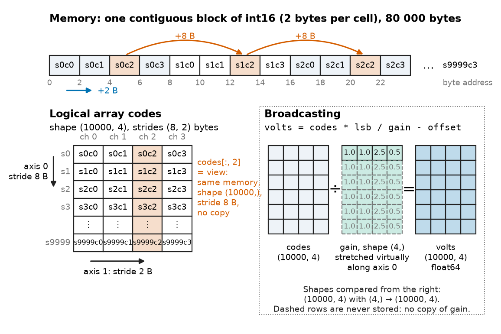
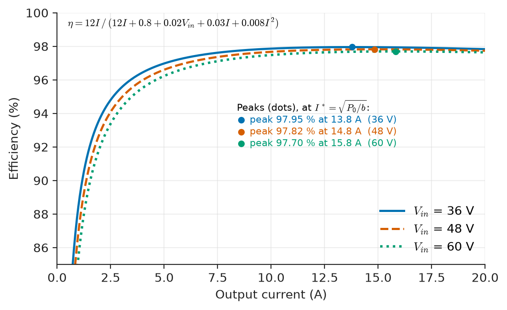
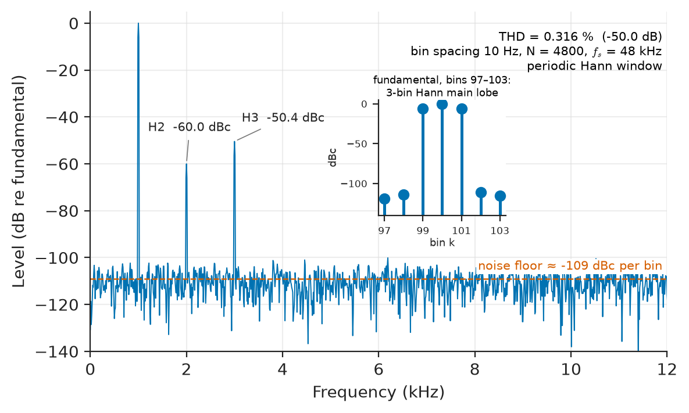
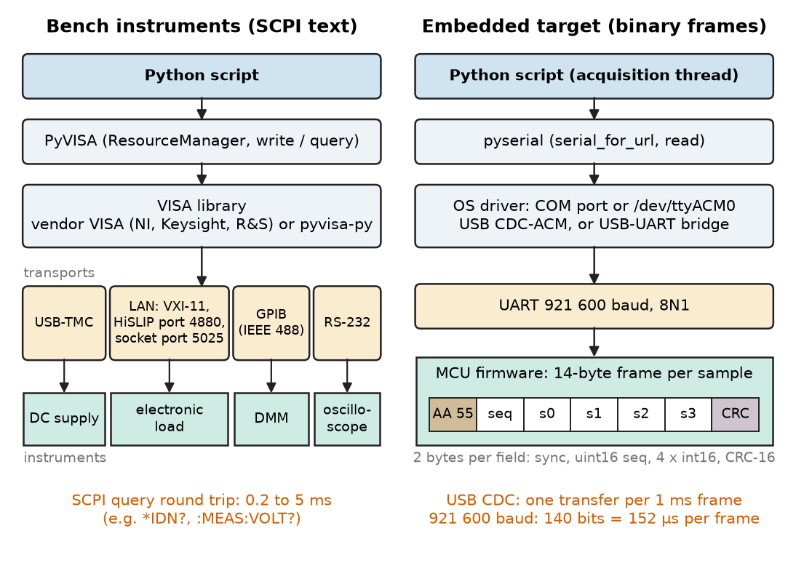
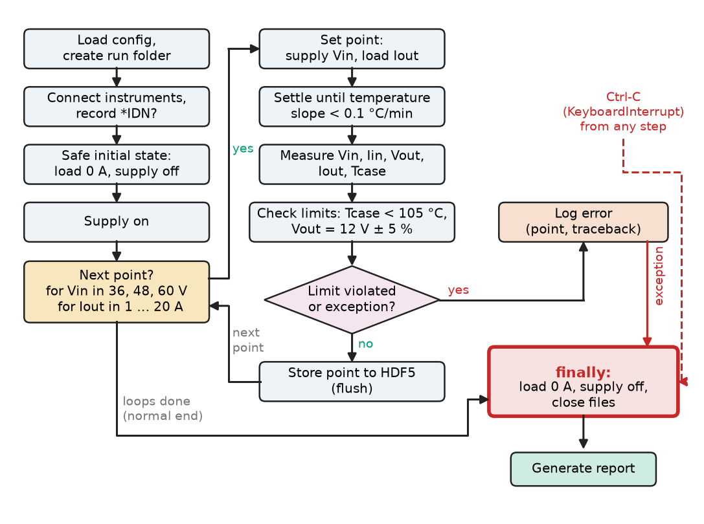

# Chapter 22 — Python for Engineering

*Part V · Programming and Computational Systems*

A power-supply validation lab has to qualify a new 48 V to 12 V, 240 W bus converter for a telecom rack. The test plan asks for efficiency, output ripple and load-step response at 20 load points, three input voltages (36, 48 and 60 V) and five ambient temperatures: 300 operating points, each needing two minutes of thermal settling and an oscilloscope capture. Done by hand, the job takes two weeks, and the first review finds a column of input currents pasted one row out of step. A script of about 200 lines runs the whole matrix overnight: it programs the load and the supply, reads the power analyser, pulls each waveform from the scope as binary data, stores everything with its metadata and plots the results before the engineers arrive. When a thermocouple fails at 3 a.m., the script turns the supply off, logs the fault and stops; it does not record two hours of nonsense. The language almost every lab uses for that script is Python. Python wins not by speed but because a short program can drive instruments, crunch arrays, plot and leave a record someone else can rerun.

> **How does an engineer use Python and its numerical stack to turn raw measurements into trustworthy numbers and plots?**
> **How are instruments and microcontrollers driven from Python, and how are the resulting data stored so that the experiment can be repeated?**

| Concept | Engineering destination |
|---|---|
| Python fundamentals | Test scripts, calculators for component selection, glue between tools |
| Numerical arrays (NumPy) | ADC records, oscilloscope captures, sensor logs, matrix models |
| Data processing (pandas) | Characterisation sweeps, production-test logs, fleet telemetry |
| Plotting and visualisation | Datasheet curves, test reports, design reviews |
| Scientific libraries (SciPy) | Sensor calibration fits, root finding for trip points, ODE models of circuits |
| Signal analysis (scipy.signal) | THD and noise measurement, digital filtering of logged data, vibration spectra |
| Data acquisition | Bench automation over USB-TMC, LAN and GPIB; MCU data streams over UART |
| Automation scripts | Overnight sweeps, burn-in racks, production test stations |
| File formats | CSV for interchange, JSON for configuration, HDF5 for large waveform sets |
| Reproducible experiments | Audit trails in qualification, regulated (medical, automotive) test records |

**Roadmap.** The language itself, seen from an engineer's desk (22.1) → NumPy arrays and why they are fast (22.2) → tabular data with pandas (22.3) → plots that survive a design review (22.4) → the SciPy toolbox (22.5) → signal analysis with scipy.signal (22.6) → talking to instruments and microcontrollers (22.7) → scripts that run unattended and fail safe (22.8) → file formats (22.9) → experiments that can be repeated (22.10).

---

## 22.1 Python fundamentals

> **Boundary.** Programming concepts in general are developed in Chapter 20 and C/C++ in Chapter 21. The mathematics behind the numerical routines used here belongs to *The Mathematics Universe*, [Ch. 22](https://github.com/The-Studio-of-Sadiq/engineering-mathematics/blob/main/part-7-numerical-computational/22-numerical-methods.md); the DFT and digital filters to *Circuits, Signals and Communications*, Ch. 22–23 (see §22.6).

### What kind of language Python is

Python is an interpreted, dynamically typed language. CPython compiles source to bytecode for a virtual machine; every value is a heap object with a type pointer and a reference count, and every operation is dispatched at run time. That makes Python pleasant to write (no declarations, no compile step, an interactive prompt for querying an instrument line by line) and makes a pure-Python loop slow, about 50–100 ns per simple operation against roughly 0.3 ns for a compiled add on a 3 GHz core. The working rule follows directly: *Python is the conductor, not the orchestra.* The heavy arithmetic runs inside compiled libraries (NumPy, SciPy, LAPACK, FFTW-class FFTs), and Python code decides what to compute, in what order, and what to do with the result.

The built-in types an engineer meets first behave as follows:

| Type | Engineering use | Behaviour to remember |
|---|---|---|
| `int` | Register values, counts, codes | Arbitrary precision: never overflows (unlike `numpy.int16`, §22.2) |
| `float` | Physical quantities | IEEE 754 binary64, about 16 significant digits; `0.1 + 0.2 != 0.3` |
| `complex` | Phasors, impedances | Engineering `j`: `z = 3 + 4j`, `abs(z) == 5.0` |
| `str`, `bytes` | SCPI commands; raw serial data | Distinct types; serial ports and sockets deliver `bytes` |
| `dict`, `set` | Configuration, look-up by name | Hash tables with average $O(1)$ access (Chapter 23) |

The floating-point behaviour is the IEEE 754 binary64 format, whose layout, unit roundoff $u=2^{-53}\approx1.1\times10^{-16}$ and rounding model are set out in *The Mathematics Universe*, [Ch. 22 §22.1](https://github.com/The-Studio-of-Sadiq/engineering-mathematics/blob/main/part-7-numerical-computational/22-numerical-methods.md); the bit-level formats themselves are covered in Chapter 11 of this book. In test scripts this means: never compare floats with `==` (use `math.isclose` with a tolerance), and never step a sweep by repeated float addition; compute `v = v0 + k*dv` from an integer counter so the 300th point is where the plan says.

### Functions, data classes and readable engineering code

Engineering scripts outlive their authors. Functions with docstrings and type hints, `dataclass` records and f-strings that print numbers with units keep them readable. Listing 22.1 uses all three in a small component-selection tool.

```python
from dataclasses import dataclass
from itertools import product

E24 = [1.0, 1.1, 1.2, 1.3, 1.5, 1.6, 1.8, 2.0, 2.2, 2.4, 2.7, 3.0,
       3.3, 3.6, 3.9, 4.3, 4.7, 5.1, 5.6, 6.2, 6.8, 7.5, 8.2, 9.1]

@dataclass(frozen=True)
class Divider:
    r_top: float      # ohm
    r_bot: float      # ohm
    def ratio(self) -> float:
        return self.r_bot / (self.r_top + self.r_bot)

def decade(values, lo, hi):
    """All series values between lo and hi ohms."""
    return [round(v * 10**k) for k in range(8) for v in values if lo <= v * 10**k <= hi]

def best_divider(v_in, v_out, lo=10e3, hi=1e6):
    target = v_out / v_in
    pairs = (Divider(a, b) for a, b in product(decade(E24, lo, hi), repeat=2))
    return min(pairs, key=lambda d: abs(d.ratio() - target))

d = best_divider(v_in=30.0, v_out=3.3)
print(d, f"ratio={d.ratio():.5f}  error={(d.ratio()*30/3.3 - 1)*100:+.2f} %")
print(f"Vout at 30 V: {30*d.ratio():.4f} V, load on sensor: {30/(d.r_top+d.r_bot)*1e6:.1f} uA")
```

```text
Divider(r_top=130000, r_bot=16000) ratio=0.10959  error=-0.37 %
Vout at 30 V: 3.2877 V, load on sensor: 205.5 uA
```

*Listing 22.1 — Choosing an E24 resistor pair for a sensor divider by exhaustive search.*

**Worked example — a 30 V sensor input for a 3.3 V ADC.** An industrial controller reads a 0–24 V transmitter signal, with headroom to 30 V, on a microcontroller ADC whose reference is 3.3 V. The divider must map 30 V to 3.3 V, a ratio of $0.1100$, with total resistance between 10 kΩ and 1 MΩ so that the source is lightly loaded and the ADC's sampling capacitor can still be charged through a buffer. Listing 22.1 searches all $49^2=2401$ ordered pairs of E24 values in that range and picks $R_{top}=130\ \mathrm{k\Omega}$, $R_{bot}=16\ \mathrm{k\Omega}$. The ratio is $16/146=0.10959$, so 30 V gives 3.288 V, 0.37 % below full scale. That is a safe direction: the ADC never saturates on a 30 V input. The divider draws $30/146\ \mathrm{k\Omega}=205.5\ \mu\mathrm{A}$, well within the few milliamperes a voltage-output transmitter can drive. With 1 % resistors the worst-case ratio error is about $\pm2\times1\,\%\times(1-0.1096)=\pm1.8\,\%$, five times the selection error, so the gain is calibrated at production test anyway. The brute-force search is $O(n^2)$, but with 2401 candidates it takes milliseconds; a cleverer algorithm would be wasted effort (Chapter 23).

### Packages and environments

Engineering work relies on a small core of packages: **NumPy**, **SciPy**, **pandas**, **Matplotlib**, **h5py**, **pyserial** and **PyVISA**. Each project gets its own virtual environment (`python -m venv .venv`, or conda) with pinned versions, so that a library upgrade cannot silently change last month's results (§22.10, Chapter 24).

> **Status of the principle: Interpreter cost and vectorisation**
> *Empirical.* The 50–100 ns per interpreted operation and the 100–1000× gain of compiled array code are measured properties of CPython on current processors; the ratio varies with operation, array size and version, but never reverses for large arrays.

---

## 22.2 Numerical arrays

### The ndarray: one block of typed memory

NumPy's `ndarray` is what makes Python usable for engineering: one contiguous block of raw numbers of a single **dtype** (`int16`, `float32`, `float64`, `complex128`, ...), plus a header giving its **shape** and **strides**, the bytes to step to move one index along each axis. A record of 10 000 samples from four ADC channels stored as `int16` with shape `(10000, 4)` occupies exactly 80 000 bytes, and its strides are `(8, 2)`: 8 bytes to the next sample, 2 bytes to the next channel (Figure 22.1). Slicing (`a[:, 2]`, `a[::10]`) creates a **view** with different strides over the same memory, not a copy. That is fast, but writing into a view modifies the original.

<!-- FIGURE 22.1 | figures/ch22/fig-22-1-ndarray-strides-broadcasting.png | block-diagram | An int16 ADC record as one block of memory: shape, strides, a column view, and broadcasting of per-channel gain. | Content: top, a strip of 2-byte memory cells labelled s0c0 s0c1 s0c2 s0c3 s1c0 ... (sample s, channel c) with byte addresses 0, 2, 4, ...; below, the logical array of shape (10000, 4), rows = samples, columns = channels, arrows marking stride 8 bytes down a column and 2 bytes along a row; column 2 highlighted as a view on the same memory. Right: array (10000, 4) times gain vector (4,) = [1.0, 1.0, 2.5, 0.5] stretched virtually along the sample axis, result (10000, 4), note no copy. -->



*Figure 22.1 — An int16 ADC record as one block of memory: shape, strides, a column view, and broadcasting of per-channel gain.*

Whole-array operations (`+`, `*`, `np.sin`, `np.sum`, `@`) run as compiled loops over that memory. On the machine used for this chapter, the sum of squares of $10^6$ doubles takes 104 ms as a Python loop and 0.2 ms as the dot product `x @ x`, a factor of about 500. Why the gain is so large, and why it still cannot turn an $O(N^2)$ algorithm into an $O(N\log N)$ one, is analysed in *The Mathematics Universe*, [Ch. 24 §24.1](https://github.com/The-Studio-of-Sadiq/engineering-mathematics/blob/main/part-7-numerical-computational/24-computational-mathematics.md) (vectorisation, BLAS levels and arithmetic intensity). Chapter 24 of this book takes the hardware side.

### Broadcasting

When two arrays of different shapes meet in an operation, NumPy **broadcasts** them. Axes are compared from the right; an axis of length 1 (or a missing axis) is stretched to match, without copying. Converting a multi-channel record from ADC codes to volts with a different gain and offset per channel is then one line, as Listing 22.2 shows: an array of shape `(10000, 4)` combined with vectors of shape `(4,)`.

```python
import numpy as np

fs, n_ch = 100_000, 4                      # 100 kS/s per channel, 4 channels
rng = np.random.default_rng(1)
t = np.arange(10_000) / fs                 # 0.1 s record
# Simulated 16-bit ADC: +/-10 V full scale, codes -32768..32767
v_true = np.stack([9.5 * np.sin(2*np.pi*50*t + k) for k in range(n_ch)], axis=1)
codes = np.clip(np.round(v_true / 10 * 32768 + rng.normal(0, 2, v_true.shape)),
                -32768, 32767).astype(np.int16)          # shape (10000, 4)

lsb = 10 / 32768                                         # V per code
gain = np.array([1.0, 1.0, 2.5, 0.5])                    # V/V of each front end
offset = np.array([0.0, 0.012, -0.004, 0.0])             # V, from calibration
volts = codes * lsb / gain - offset                      # broadcasting: (N,4) op (4,)

print(codes.dtype, codes.shape, codes.strides, codes.nbytes, "bytes")
print("peak ch0:", volts[:, 0].max().round(4), "V")
print("sum of squares, int16 :", (codes[:, 0] * codes[:, 0]).sum())   # wraps!
print("sum of squares, int64 :", (codes[:, 0].astype(np.int64)**2).sum())
print("RMS ch0:", np.sqrt(np.mean(volts[:, 0]**2)).round(4), "V")
```

```text
int16 (10000, 4) (8, 2) 80000 bytes
peak ch0: 9.501 V
sum of squares, int16 : 787652
sum of squares, int64 : 4845254214852
RMS ch0: 6.7175 V
```

*Listing 22.2 — Converting a four-channel 16-bit ADC record to volts by broadcasting, and the integer-overflow trap.*

### Dtypes and the overflow trap

Python's own `int` never overflows; NumPy's fixed-width integers do, silently, by two's-complement wraparound, exactly as the C types of Chapter 21 do. In Listing 22.2 the product `codes * codes` is computed in `int16`, so every square above 32 767 wraps, and the "sum of squares" is garbage: 787 652 instead of $4.85\times10^{12}$.

**Worked example — sizing the accumulator for an RMS computation.** A 16-bit code has magnitude at most $2^{15}$, so its square is at most $2^{30}\approx1.07\times10^9$. An `int32` accumulator (maximum $2^{31}-1\approx2.15\times10^9$) therefore overflows after only *two* full-scale samples. Summing $N=10^4$ squares needs up to $10^4\times2^{30}=1.07\times10^{13}$, about 44 bits, so `int64` is required, as in the last line of the listing. Converted to volts, the RMS of channel 0 is 6.7175 V, which matches $9.5/\sqrt2=6.7175$ V. The same arithmetic sizes the 40-bit accumulators of fixed-point DSPs and the 64-bit accumulators in FPGA power meters (Chapters 11 and 18). Dtype choice also sets memory: four channels at 1 MS/s stored as `int16` produce 8 MB/s, or 28.8 GB per hour; converted carelessly to `float64` the same hour occupies 115.2 GB. Keep raw codes as integers on disk and convert to physical units only for the slice being analysed.

---

## 22.3 Data processing

### Tables, not arrays

Measurement campaigns produce *tables*: each row an operating point, each column a quantity with its own unit and type. **pandas** provides the `DataFrame`, named NumPy columns sharing a row index, with reading and writing of CSV, Excel and Parquet, selection, derived columns, grouping, pivoting, joins and time-series resampling.

Listing 22.3 processes a sweep of the opening's bus converter. A stand-in for the logged file is built from a loss model, $P_{loss}=0.8+0.02V_{in}+0.03I_o+0.008I_o^2$ W, plus measurement noise; the script then reads the CSV, derives power, efficiency and loss, pivots, and finds the best point at each input voltage.

```python
import io
import numpy as np
import pandas as pd

# --- stand-in for a logged CSV: 48 V -> 12 V converter, 3 input voltages x 20 loads
rng = np.random.default_rng(3)
rows = []
for vin in (36.0, 48.0, 60.0):
    for iout in np.linspace(1, 20, 20):
        p_loss = 0.8 + 0.02 * vin + 0.03 * iout + 0.008 * iout**2      # W, loss model
        vout = 12.0 - 0.004 * iout
        iin = (vout * iout + p_loss) / vin
        rows.append((vin, iin * (1 + rng.normal(0, 2e-4)), vout, iout))
csv_text = pd.DataFrame(rows, columns=["vin", "iin", "vout", "iout"]).to_csv(index=False)

df = pd.read_csv(io.StringIO(csv_text))                       # normally: pd.read_csv("sweep.csv")
df["pin"] = df.vin * df.iin
df["pout"] = df.vout * df.iout
df["eff"] = df.pout / df.pin
df["ploss"] = df.pin - df.pout

table = df.pivot_table(index="iout", columns="vin", values="eff")
print(table.loc[[2.0, 5.0, 10.0, 20.0]].round(4))
best = df.loc[df.groupby("vin")["eff"].idxmax(), ["vin", "iout", "eff", "ploss"]]
print(best.round(3).to_string(index=False))
```

```text
vin     36.0    48.0    60.0
iout                        
2.0   0.9375  0.9280  0.9196
5.0   0.9698  0.9660  0.9622
10.0  0.9779  0.9764  0.9745
20.0  0.9782  0.9775  0.9762
 vin  iout   eff  ploss
36.0  15.0 0.980  3.731
48.0  17.0 0.978  4.465
60.0  18.0 0.977  5.022
```

*Listing 22.3 — Reducing a converter efficiency sweep with pandas: derived columns, a pivot table and a group-wise maximum.*

**Worked example — where is the efficiency peak, really?** With a loss of the form $P_0+aI+bI^2$ and an output power of nearly $V_oI$, the efficiency is greatest where the loss per watt delivered, $P_0/I+a+bI$, is smallest. That is at $I^*=\sqrt{P_0/b}$, where the fixed loss equals the conduction loss. At $V_{in}=36$ V, $P_0=0.8+0.72=1.52$ W and $I^*=\sqrt{1.52/0.008}=13.8$ A. At 48 V, $P_0=1.76$ W and $I^*=14.8$ A; at 60 V, $P_0=2.00$ W and $I^*=15.8$ A. The table, however, reports 15, 17 and 18 A. Near its maximum the efficiency curve is flat: at 60 V, taking $P_{out}=12I$ as Listing 22.4 and Figure 22.2 do, the model gives 97.696 % (the 97.70 % peak) at 15.8 A and 97.679 % at 18 A, a difference of 0.017 percentage points (the 4 mV/A output droop in Listing 22.3 lowers both by about 0.012 points). That is comparable to the 0.02 % measurement noise placed on the input current. The `idxmax` of a noisy, flat curve is dominated by the noise. The right report fits the loss model (a three-parameter linear least-squares problem, §22.5) and quotes $I^*$ from the fitted coefficients with an uncertainty. Real power analysers have 0.02–0.05 % basic accuracy, so this is the regime of real efficiency testing.

A few habits keep tabular work honest. Put units in column names (`iout_A`, `temp_C`), because pandas stores numbers, not units. Store one row per observation and pivot only for display. Decide explicitly what a missing value (`NaN`) means; a disconnected thermocouple must not quietly become part of an average. Beyond a few gigabytes, read in chunks or store in Parquet or HDF5 (§22.9).

---

## 22.4 Plotting and visualization

### The figure as an engineering document

A plot in a test report is evidence. It should show the quantity against the variable that matters, with units on both axes, ranges that do not hide the region of interest, and a legend that survives black-and-white printing. **Matplotlib** is the standard library. Its object-oriented interface separates the **figure** (the page) from one or more **axes** (plotting areas), each configured explicitly. Listing 22.4 produces the efficiency curves of the opening example (Figure 22.2).

```python
import numpy as np
import matplotlib
matplotlib.use("Agg")                         # no window: render straight to files
import matplotlib.pyplot as plt

iout = np.linspace(0.5, 20, 200)
fig, ax = plt.subplots(figsize=(6, 3.5), layout="constrained")
for vin, style in [(36, "-"), (48, "--"), (60, ":")]:
    eff = 12 * iout / (12 * iout + 0.8 + 0.02 * vin + 0.03 * iout + 0.008 * iout**2)
    ax.plot(iout, 100 * eff, style, label=f"Vin = {vin} V")
ax.set(xlabel="Output current (A)", ylabel="Efficiency (%)", ylim=(85, 100), xlim=(0, 20))
ax.grid(True, alpha=0.3); ax.legend(loc="lower right")
fig.savefig("efficiency.svg")                 # vector for reports; PNG at dpi=200 for slides
print(len(ax.lines), "curves saved")
```

```text
3 curves saved
```

*Listing 22.4 — A report-quality efficiency plot rendered headless and saved as a vector file.*

<!-- FIGURE 22.2 | figures/ch22/fig-22-2-converter-efficiency-curves.png | plot | Efficiency of the 48 V to 12 V bus converter versus output current at three input voltages, from the loss model of Section 22.3. | Content: x-axis output current 0 to 20 A, y-axis efficiency 85 to 100 percent. Three curves from eff = 12 I / (12 I + 0.8 + 0.02 Vin + 0.03 I + 0.008 I^2): Vin = 36 V solid, 48 V dashed, 60 V dotted. Curves rise steeply below 3 A and flatten above 10 A; peaks of 97.95 percent at 13.8 A (36 V), 97.82 percent at 14.8 A (48 V) and 97.70 percent at 15.8 A (60 V) marked with small dots and labelled. Light grid, legend lower right. -->



*Figure 22.2 — Efficiency of the 48 V to 12 V bus converter versus output current at three input voltages, from the loss model of Section 22.3.*

The `Agg` back end renders without a display, which is what an overnight script on a headless test PC needs. Interactive work in a Jupyter notebook uses the default back end instead.

### Choices that matter

| Situation | Recommended practice |
|---|---|
| Frequency response, spectra, noise density | Log frequency axis (`ax.semilogx`), magnitude in dB; never a linear axis spanning decades |
| Efficiency or loss curves | Linear axes, efficiency axis not starting at 0 if differences of 0.1 % matter, but say so |
| Many traces of a sweep | One colour map ordered by the swept variable (`viridis`), or small multiples (`plt.subplots(2, 3)`) |
| Waveforms with $10^6$ points | Decimate or plot min/max envelopes per pixel column; plotting every point is slow and adds nothing |
| Report and paper output | Vector format (SVG, PDF) for line art; PNG at 200–300 dpi for raster; embed fonts |
| Colour | Colour-blind-safe palettes; distinguish series by line style as well as colour |
| Reproducibility | Generate every figure from a script reading stored data, never by hand-editing |

Two failures recur in design reviews: the autoscaled axis that makes a 0.05 % efficiency change look like a cliff, and the plot whose data lived only in a notebook session. Both are cured by treating plotting code as ordinary code, kept with the data it reads.

---

## 22.5 Scientific libraries

### The SciPy toolbox

SciPy wraps long-established Fortran and C libraries (LAPACK, QUADPACK, MINPACK, ODEPACK, ARPACK, SuperLU). The engineer picks the routine, poses the problem well and checks the answer. The theory of each method, with its error and convergence behaviour, is in *The Mathematics Universe*, [Ch. 22](https://github.com/The-Studio-of-Sadiq/engineering-mathematics/blob/main/part-7-numerical-computational/22-numerical-methods.md) (root finding §22.3–22.4, interpolation §22.5, least squares §22.6, quadrature §22.8, ODEs §22.9) and [Ch. 24](https://github.com/The-Studio-of-Sadiq/engineering-mathematics/blob/main/part-7-numerical-computational/24-computational-mathematics.md) (linear algebra §24.3, iterative solvers §24.4, sparse matrices §24.5, parameter estimation §24.7).

| Subpackage | Key routines | Typical engineering task |
|---|---|---|
| `scipy.linalg` | `solve`, `lu_factor`, `cholesky`, `eig`, `svd`, `expm` | Nodal analysis, state-space models, fitting |
| `scipy.sparse`, `.sparse.linalg` | CSR/CSC matrices, `spsolve`, `cg`, `eigsh` | Power-grid IR drop, FEM thermal models (Chapter 24) |
| `scipy.optimize` | `brentq`, `root`, `least_squares`, `curve_fit`, `minimize`, `linprog` | Trip points, operating points, model fitting, design optimisation |
| `scipy.integrate` | `solve_ivp`, `quad`, `cumulative_trapezoid` | Circuit and thermal transients, energy from power logs |
| `scipy.interpolate` | `CubicSpline`, `make_interp_spline`, `RegularGridInterpolator` | Look-up tables, resampling irregular logs |
| `scipy.stats` | Distributions, tests, `linregress` | Production-test statistics, $C_{pk}$, outlier screening |

### Calibration and a trip point

Listing 22.5 fits a sensor model to calibration data and then solves the model for a design value. An NTC thermistor follows the Steinhart–Hart equation $1/T=A+B\ln R+C(\ln R)^3$ ($T$ in kelvin), which is *linear* in $A$, $B$, $C$, so four calibration points give a linear least-squares problem for `numpy.linalg.lstsq`. Two nested root-finding problems are then solved by Brent's method (`brentq`), a safeguarded bracketing method that cannot diverge once a sign change is bracketed.

```python
import numpy as np
from scipy.optimize import brentq

# Calibration of a 10 kOhm NTC in a stirred oil bath
T_C = np.array([0.0, 25.0, 50.0, 85.0])               # deg C
R = np.array([32_650.0, 10_000.0, 3_602.0, 1_070.0])  # ohm

# Steinhart-Hart: 1/T = A + B ln R + C (ln R)^3, linear in A, B, C -> least squares
L = np.log(R)
M = np.column_stack([np.ones_like(L), L, L**3])
(A, B, C), res, *_ = np.linalg.lstsq(M, 1 / (T_C + 273.15), rcond=None)
print(f"A={A:.6e}  B={B:.6e}  C={C:.6e}")

def temp_C(r):
    l = np.log(r)
    return 1 / (A + B * l + C * l**3) - 273.15

print("fit residuals (mK):", np.round((temp_C(R) - T_C) * 1e3, 1))

# Over-temperature trip: NTC to ground, 10 kOhm pull-up to 3.3 V, comparator at 0.60 V
v_node = lambda T: 3.3 * r_of_T(T) / (10e3 + r_of_T(T))
r_of_T = lambda T: brentq(lambda r: temp_C(r) - T, 50.0, 1e6)   # invert the fit
T_trip = brentq(lambda T: v_node(T) - 0.60, 0.0, 150.0)
print(f"trip temperature = {T_trip:.2f} C, R_ntc = {r_of_T(T_trip):.0f} ohm")
```

```text
A=1.130968e-03  B=2.338158e-04  C=8.892946e-08
fit residuals (mK): [-0.9  3.9 -4.7  1.8]
trip temperature = 63.15 C, R_ntc = 2222 ohm
```

*Listing 22.5 — Steinhart–Hart calibration by linear least squares and an over-temperature trip point by nested root finding.*

**Worked example — the trip point of a battery-pack thermal cut-out.** A 10 kΩ NTC on an e-bike pack sits under a 10 kΩ pull-up from 3.3 V, and a comparator at 0.60 V disconnects the pack. The trip occurs when $3.3R/(10\ \mathrm{k\Omega}+R)=0.60$, that is at $R=0.60\times10/2.70=2.222\ \mathrm{k\Omega}$. The fitted Steinhart–Hart model puts that resistance at $63.15\ ^\circ\mathrm{C}$. The fit residuals of a few millikelvin show that the model reproduces the calibration to far better than the ±1 % tolerance of the pull-up resistor. That tolerance alone moves the trip by roughly $\pm0.3\ ^\circ\mathrm{C}$; the comparator offset and the thermistor's own ±1 % $R_{25}$ tolerance are of the same order, so the design is specified as $63\pm1\ ^\circ\mathrm{C}$. The firmware alternative, reading the node with an ADC and evaluating the model, is a look-up-table problem treated in Chapter 23.

### How library routines fail

SciPy routines rarely crash on a bad problem; they return something. `curve_fit` started far from the answer converges to a local minimum. `solve_ivp` with its default explicit Runge–Kutta method on a stiff circuit (time constants of nanoseconds and seconds together) takes millions of tiny steps. `quad` on a switching waveform reports convergence while stepping over its edges. The defences: check status flags (`sol.success`), test on a case with a known answer, use an implicit method (`"Radau"`, `"LSODA"`) for stiff problems ([Ch. 22 §22.9](https://github.com/The-Studio-of-Sadiq/engineering-mathematics/blob/main/part-7-numerical-computational/22-numerical-methods.md)), and pass known breakpoints to integrators.

---

## 22.6 Signal analysis

> **Boundary.** The DFT and its interpretation (bins, amplitude scaling, leakage, windows, zero padding and Welch averaging) are developed in *Circuits, Signals and Communications*, [Ch. 22](https://github.com/The-Studio-of-Sadiq/Circuits-Signals-and-Communications/blob/main/part-5-digital-signal-processing/22-discrete-fourier-transform.md) §22.3–22.8; digital filter structures and design in [Ch. 23](https://github.com/The-Studio-of-Sadiq/Circuits-Signals-and-Communications/blob/main/part-5-digital-signal-processing/23-digital-filters.md); sampling and aliasing in [Ch. 19](https://github.com/The-Studio-of-Sadiq/Circuits-Signals-and-Communications/blob/main/part-4-signals-and-systems/19-sampling-and-reconstruction.md). This section uses those results and concentrates on doing the computation correctly with NumPy and `scipy.signal`.

### From theory to library calls

From Book 3: a tone with an integer number of cycles in the record falls in one bin, bin $k$ lies at $f_k=kf_s/N$, a window spreads each tone over its main lobe, and Welch averaging trades resolution for variance. The library calls map onto those ideas as follows; most practical measurement errors occur at exactly these points:

| Task | Call | What to get right |
|---|---|---|
| Spectrum of a real record | `np.fft.rfft(x * w)` | Single-sided; scale by $2/\sum w$ for peak amplitude (Book 3 §22.3, coherent gain) |
| Window | `signal.windows.hann(N, sym=False)` | `sym=False` (periodic) for spectral analysis, symmetric for FIR design |
| Power spectral density | `signal.welch(x, fs, nperseg=...)` | `scaling="density"` gives V²/Hz, `"spectrum"` gives V² per bin; always pass `fs` |
| IIR filter design | `signal.butter(..., output="sos")` | Use second-order sections, not `(b, a)`, above order 2 |
| Zero-phase filtering of stored data | `signal.sosfiltfilt` | Non-causal: fine offline, impossible in real time |
| Rate change | `signal.resample_poly`, `signal.decimate` | Built-in anti-alias filtering; never just take every $M$th sample |
| Peaks and events | `signal.find_peaks(x, prominence=...)` | Use prominence, not just height, on noisy data |

### Measuring harmonic distortion

Listing 22.6 measures the total harmonic distortion of an audio amplifier output captured at 48 kHz (spectrum in Figure 22.3). The record is chosen **coherently**: $N=4800$ samples at 48 kHz give 10 Hz bins, so the 1 kHz test tone sits exactly in bin 100 and every harmonic in an exact bin. A periodic Hann window then confines each tone to three bins ($k-1$, $k$, $k+1$), and summing the power over those three bins captures each tone completely. The ratio of harmonic power to fundamental power does not depend on window scaling, because both are windowed alike.

```python
import numpy as np
from scipy import signal

fs, N, f0 = 48_000, 4_800, 1_000.0          # coherent: 1 kHz falls exactly in bin 100
n = np.arange(N)
rng = np.random.default_rng(7)
x = (1.0 * np.sin(2*np.pi*f0*n/fs)          # 1 V peak fundamental
     + 1e-3 * np.sin(2*np.pi*2*f0*n/fs)     # 2nd harmonic, -60 dBc
     + 3e-3 * np.sin(2*np.pi*3*f0*n/fs)     # 3rd harmonic, -50.5 dBc
     + rng.normal(0, 1e-4, N))              # noise, 100 uV RMS

w = signal.windows.hann(N, sym=False)       # periodic Hann for spectral analysis
X = np.fft.rfft(x * w)
P = np.abs(X)**2                             # power per bin (window-weighted)
k0 = round(f0 * N / fs)

def tone_power(k):                           # Hann main lobe spans k-1..k+1
    return P[k-1:k+2].sum()

harm = [tone_power(h * k0) for h in range(2, 11)]
thd = np.sqrt(sum(harm) / tone_power(k0))
print(f"bin spacing {fs/N:.1f} Hz, fundamental in bin {k0}")
print(f"THD = {100*thd:.4f} %  ({20*np.log10(thd):.2f} dB)")
print("H2, H3 (dBc):", [round(float(10*np.log10(h / tone_power(k0))), 2) for h in harm[:2]])
```

```text
bin spacing 10.0 Hz, fundamental in bin 100
THD = 0.3164 %  (-49.99 dB)
H2, H3 (dBc): [-60.03, -50.45]
```

*Listing 22.6 — THD from a coherently sampled, Hann-windowed record.*

**Worked example — THD and noise floor of an audio power stage.** The synthetic capture contains a 1 V peak fundamental, a second harmonic of 1 mV (−60 dBc) and a third of 3 mV (−50.5 dBc). The expected THD is $\sqrt{(10^{-3})^2+(3\times10^{-3})^2}/1=\sqrt{10^{-5}}=0.3162\,\%$, or −50.0 dB. The script reports 0.3164 %; the extra 0.0002 % is noise power falling in the harmonic bins. The individual harmonics read −60.03 and −50.45 dBc. For the noise floor, `signal.welch(x, fs=fs, nperseg=1024)` returns a PSD whose level corresponds to $10^{-4}/\sqrt{24\,000}=0.65\ \mu\mathrm{V}/\sqrt{\mathrm{Hz}}$. Two easy mistakes would have spoiled the measurement. A 1 kHz tone recorded with $N=4096$ samples lies at bin 85.33, not on a bin. With a rectangular window its leakage skirt (Book 3 §22.5) is still about −49 dB at the second-harmonic frequency, 85 bins away, and would bury the −60 dBc second harmonic. And reading the per-bin noise floor of a 4800-point FFT as if it were the SNR overstates the dynamic range by the FFT processing gain of Book 3 §22.8, here $10\log_{10}(2400/1.5)=32$ dB. AES17 fixes the measurement bandwidth for this reason.

<!-- FIGURE 22.3 | figures/ch22/fig-22-3-thd-spectrum.png | plot | Hann-windowed spectrum of the coherently sampled 1 kHz amplifier test signal: fundamental, second and third harmonics, and the noise floor. | Content: x-axis frequency 0 to 12 kHz linear, y-axis level in dB relative to the fundamental from -140 to 0. Stems or a line spectrum from the N = 4800, fs = 48 kHz record of Listing 22.6: fundamental at 1 kHz at 0 dBc, 2nd harmonic at 2 kHz at -60.0 dBc, 3rd at 3 kHz at -50.5 dBc, no higher harmonics, noise floor near -109 dBc per bin. Annotate THD = 0.316 percent (-50.0 dB) and bin spacing 10 Hz. Inset: zoom of bins 97 to 103 showing the three-bin Hann main lobe of the fundamental. -->



*Figure 22.3 — Hann-windowed spectrum of the coherently sampled 1 kHz amplifier test signal: fundamental, second and third harmonics, and the noise floor.*

### Filters: second-order sections or nothing

Listing 22.7 designs an eighth-order Butterworth low-pass at 20 Hz for data sampled at 10 kHz, the kind of filter used to extract a slowly varying temperature or strain signal from a fast ADC stream. It then implements it in two ways.

```python
import numpy as np
from scipy import signal

fs = 10_000
b, a = signal.butter(8, 20, fs=fs)                  # 8th-order low-pass, fc = 20 Hz
sos = signal.butter(8, 20, fs=fs, output="sos")
print("max |pole|, (b,a) form :", np.abs(np.roots(a)).max())
print("max |pole|, SOS form   :", np.abs(signal.sos2zpk(sos)[1]).max())

t = np.arange(20_000) / fs
x = np.sin(2*np.pi*5*t) + 0.5*np.sin(2*np.pi*400*t)  # 5 Hz wanted, 400 Hz interference
y_ba = signal.lfilter(b, a, x)
y_sos = signal.sosfiltfilt(sos, x)                   # zero-phase, forward-backward
print("peak |y| from (b,a)     :", f"{np.abs(y_ba).max():.3g}")
print("peak |y| from sosfiltfilt:", f"{np.abs(y_sos[5000:15000]).max():.4f}")
```

```text
max |pole|, (b,a) form : 1.0061473105002674
max |pole|, SOS form   : 0.9975514848369335
peak |y| from (b,a)     : 2.79e+23
peak |y| from sosfiltfilt: 1.0000
```

*Listing 22.7 — The same eighth-order Butterworth filter as one polynomial and as second-order sections.*

The polynomial form fails outright. Its poles cluster within 0.0025 of $z=1$, and rounding the coefficients to binary64 pushes one pole outside the unit circle: the output grows to $10^{23}$. SciPy prints a `BadCoefficients` warning, which an unattended script ignores. The SOS form keeps every pole at radius 0.9976 and passes the 5 Hz signal at unity gain while removing the 400 Hz interference. This is the coefficient-sensitivity result of Book 3 [Ch. 23 §23.3 and §23.9](https://github.com/The-Studio-of-Sadiq/Circuits-Signals-and-Communications/blob/main/part-5-digital-signal-processing/23-digital-filters.md), seen in double precision on a PC. In the `float32` or Q15 arithmetic of a microcontroller (Chapter 28) it bites at much lower orders.

> **Status of the principle: Cascade (SOS) implementation of IIR filters**
> *Derived.* The roots of a high-order polynomial are far more sensitive to coefficient perturbations than the roots of its quadratic factors, so a cascade of second-order sections preserves the designed pole positions under rounding where the direct form cannot; it holds for any finite precision, including binary64.

`sosfiltfilt` runs the filter forward and backward, cancelling the phase response: ideal for stored records that must stay time-aligned, but not what a real-time controller sees. To predict firmware behaviour, including group delay, use `sosfilt` with state carried between blocks.

---

## 22.7 Data acquisition

### Two worlds: instruments and embedded targets

A test station talks to **bench instruments** (supplies, loads, DMMs, scopes, power analysers), which accept SCPI (Standard Commands for Programmable Instruments) text commands over a standard transport, and to **embedded targets** (an MCU board, a battery-management unit), which stream data over a serial link in a firmware-defined format. Figure 22.4 shows the two software stacks side by side.

<!-- FIGURE 22.4 | figures/ch22/fig-22-4-daq-software-stack.png | block-diagram | Software stacks for data acquisition from Python: PyVISA to SCPI instruments, and pyserial to a microcontroller. | Content: two vertical stacks. Left: Python script; PyVISA; VISA library (vendor VISA or pyvisa-py); transports USB-TMC, LAN (VXI-11, HiSLIP port 4880, socket port 5025), GPIB, RS-232; instruments: supply, electronic load, DMM, oscilloscope. Right: Python script; pyserial; OS driver (COM port or /dev/ttyACM0, USB CDC-ACM or USB-UART bridge); UART 921600 baud 8N1; MCU firmware sending 14-byte frames (sync AA 55, sequence, 4 samples, CRC-16). Annotate latency: SCPI query 0.2 to 5 ms, USB CDC frame 1 ms. -->



*Figure 22.4 — Software stacks for data acquisition from Python: PyVISA to SCPI instruments, and pyserial to a microcontroller.*

### Instruments: VISA and SCPI

**VISA** (Virtual Instrument Software Architecture, IVI Foundation) gives one API over every transport. An instrument is named by a **resource string** such as `USB0::0x2A8D::0x1102::MY61001234::INSTR` (USB-TMC), `TCPIP0::192.168.1.20::hislip0::INSTR` (HiSLIP over LAN) or `GPIB0::12::INSTR`. **PyVISA** wraps a vendor VISA library or its own pure-Python back end (`pyvisa-py`). Commands follow **IEEE 488.2** (common commands such as `*IDN?`, `*RST`, `*OPC?`, `*ESR?`) and SCPI's hierarchical syntax (`:SOURce:VOLTage:LEVel 3.3`, shortened to `:VOLT 3.3`). Queries end in `?` and return text.

Listing 22.8 runs against PyVISA's simulated back end (package `pyvisa-sim`), which models a SCPI power supply, so it executes without hardware. Changing `"@sim"` to `""` and the resource string to a real address is all that is needed on the bench.

```python
import pyvisa

rm = pyvisa.ResourceManager("@sim")       # "@sim" = simulated back end; use "" for NI/Keysight/R&S VISA
psu = rm.open_resource("USB::0x1111::0x2222::0x2468::INSTR",
                       read_termination="\n", write_termination="\n", timeout=2000)
print(psu.query("*IDN?"))                  # IEEE 488.2 identification
psu.write("*RST")
psu.write(":VOLT:IMM:AMPL 3.300")          # SCPI: set output to 3.3 V
psu.write("OUTP 1")
v = float(psu.query(":VOLT:IMM:AMPL?"))
print(f"set point read back: {v:.3f} V, output = {psu.query('OUTP?')}")
psu.write("OUTP 0")
psu.close()
```

```text
SCPI,MOCK,VERSION_1.0
set point read back: 3.300 V, output = 1
```

*Listing 22.8 — Programming a SCPI power supply through PyVISA (simulated back end).*

Waveforms should not travel as text. An oscilloscope returns a 10-million-point record as an **IEEE 488.2 definite-length block**: `#`, one digit giving the number of length digits, the length, then raw bytes (`#8` followed by `20000000` and 20 MB of `int16` data). PyVISA's `query_binary_values(..., datatype="h", container=numpy.array)` parses the header and returns an array; the scope's preamble query supplies the volts-per-code, offset and sample interval. ASCII transfer of the same record is about six times larger. Typical throughputs are 0.2–1 MB/s for GPIB, 5–30 MB/s for USB-TMC and 20–100 MB/s for HiSLIP or raw sockets on gigabit LAN, with 0.2–5 ms latency per query.

Robust instrument code follows a few rules. Query `*IDN?` first and record the reply. Set a timeout longer than the slowest operation. Synchronise with `*OPC?` after configuration rather than with `time.sleep`. Read the error queue (`:SYST:ERR?`) after every block of commands, because a mistyped SCPI command is rejected silently and the script carries on with the old setting.

### Embedded targets: pyserial and framed binary data

A microcontroller streaming ADC data over a UART or a USB CDC virtual COM port appears to Python as a serial port, opened with **pyserial**. The stream is just bytes. The firmware and the script must agree on a **frame**: a synchronisation pattern, a sequence counter to detect lost frames, the payload in a fixed binary layout (little-endian on Arm Cortex-M and most MCUs), and a checksum to reject corrupted frames. The UART electrical layer and framing are the subject of Chapter 26. Listing 22.9 is the receiving side. It uses pyserial's `loop://` URL, which echoes writes back as reads, so the parser can be tested without a board, including a deliberately corrupted frame.

```python
import struct, binascii
import serial                                   # pyserial

SYNC = b"\xAA\x55"
BODY = struct.Struct("<H4h")                     # seq (uint16) + 4 x int16 samples
FRAME_LEN = 2 + BODY.size + 2                    # sync + body + CRC-16 = 14 bytes

def make_frame(seq, samples):                    # what the MCU firmware sends
    body = BODY.pack(seq, *samples)
    return SYNC + body + struct.pack("<H", binascii.crc_hqx(body, 0xFFFF))

def read_frames(port, n):
    buf, out, bad = bytearray(), [], 0
    while len(out) < n:
        buf += port.read(64)
        while (i := buf.find(SYNC)) >= 0 and len(buf) - i >= FRAME_LEN:
            frame = bytes(buf[i:i + FRAME_LEN])
            body, (crc,) = frame[2:-2], struct.unpack("<H", frame[-2:])
            if binascii.crc_hqx(body, 0xFFFF) == crc:
                out.append(BODY.unpack(body)); del buf[:i + FRAME_LEN]
            else:
                bad += 1; del buf[:i + 1]        # resynchronise on the next sync word
    return out, bad

# loop:// echoes writes back, so this runs without hardware; use "COM5" or "/dev/ttyACM0" for a board
with serial.serial_for_url("loop://", baudrate=921_600, timeout=0.1) as port:
    port.write(make_frame(1, (100, -200, 300, -400)))
    corrupted = bytearray(make_frame(2, (1, 2, 3, 4))); corrupted[6] ^= 0x10
    port.write(bytes(corrupted) + make_frame(3, (5, 6, 7, 8)))
    frames, bad = read_frames(port, 2)
print(frames, "CRC failures:", bad)
```

```text
[(1, 100, -200, 300, -400), (3, 5, 6, 7, 8)] CRC failures: 1
```

*Listing 22.9 — Receiving CRC-checked binary frames from a microcontroller with pyserial (tested on the loopback port).*

The format string `"<H4h"` is the contract with the firmware: little-endian, an unsigned 16-bit sequence number and four signed 16-bit samples, the layout of a packed C `struct` on the target (Chapter 21). The checksum is CRC-16/CCITT (initial value 0xFFFF). After a bad frame the parser drops one byte and searches again, so a bit error costs one frame; the sequence jump from 1 to 3 records the loss.

**Worked example — will the UART keep up?** A battery-test board must stream four channels at 2 kS/s each, one frame of Listing 22.9 per sample instant. A frame is 14 bytes, and with 8N1 framing each byte costs 10 bit times, so a frame is 140 bits. At 2000 frames/s the link must carry 280 kbit/s. A 115 200-baud link carries at most $115\,200/140=823$ frames/s and fails by a factor of 2.4; at 921 600 baud the capacity is 6583 frames/s and the utilisation $280\,000/921\,600=30\,\%$. On the PC, the serial driver buffers typically 4–16 kB; at 28 kB/s a script that stalls for half a second while plotting loses data. Acquisition therefore runs in its own thread or process, feeding a queue, and plotting runs elsewhere. Native USB CDC (around 1 MB/s in practice) removes the baud-rate limit; the firmware-side buffering is a ring-buffer problem (Chapter 23).

Dedicated DAQ cards and PXI systems come with vendor Python APIs (such as `nidaqmx`) that configure hardware-timed sampling: the sample clock lives on the card and Python only collects buffers. Above a few hundred samples per second this is the rule, because software-timed Python loops jitter by milliseconds.

---

## 22.8 Automation scripts

### Anatomy of an unattended test

An automation script almost always has the structure of Figure 22.5: load the configuration, identify instruments, reach a safe initial state, loop over operating points (set, settle, measure, check, store), and always end in a safe state, whatever happened.

<!-- FIGURE 22.5 | figures/ch22/fig-22-5-automated-sweep-flowchart.png | flowchart | Structure of an unattended characterisation sweep with a guaranteed safe-state exit path. | Content: boxes top to bottom: load config and create run folder; connect instruments, record *IDN?; safe initial state (load 0 A, supply off); supply on; nested loops over Vin in 36, 48, 60 V and Iout in 1 to 20 A; inside: set point, settle until temperature slope below 0.1 C/min, measure, check limits (Tcase below 105 C, Vout 12 V plus or minus 5 percent), store to HDF5. Decision diamond limit violated or exception, Yes to log error. All exits (normal end, exception, Ctrl-C) converge on a highlighted box finally: load 0 A, supply off, close files; then generate report. -->



*Figure 22.5 — Structure of an unattended characterisation sweep with a guaranteed safe-state exit path.*

Listing 22.10 shows the skeleton with stand-in instruments; the load faults at 20 A, as a real electronic load does when its heatsink overheats. The `finally` block runs on success, exception or keyboard interrupt, so the supply is always turned off.

```python
import logging, time
logging.basicConfig(level=logging.INFO, format="%(levelname)s %(message)s")
log = logging.getLogger("sweep")

class FakeSupply:                                   # stands in for a PyVISA instrument class
    def __init__(self): self.v, self.on = 0.0, False
    def set_voltage(self, v): self.v = v
    def output(self, on): self.on = on; log.info("supply output %s", "ON" if on else "OFF")

class FakeLoad:
    def __init__(self): self.i = 0.0
    def set_current(self, i):
        if i > 15: raise RuntimeError("load reports over-temperature")   # injected fault
        self.i = i

def run_sweep(supply, load, vins, iouts, settle_s=0.0):
    results = []
    try:
        supply.output(True)
        for vin in vins:
            supply.set_voltage(vin)
            for i in iouts:
                load.set_current(i)
                time.sleep(settle_s)                 # thermal settling in a real rig
                results.append((vin, i))             # ...measure and store here
    except Exception as exc:
        log.error("sweep aborted at Vin=%.0f V, I=%.1f A: %s", supply.v, i, exc)
    finally:                                         # runs on success, error or Ctrl-C
        load.set_current(0.0)
        supply.output(False)
    return results

res = run_sweep(FakeSupply(), FakeLoad(), vins=[36, 48], iouts=[5, 10, 20])
print(len(res), "points recorded:", res)
```

```text
INFO supply output ON
ERROR sweep aborted at Vin=36 V, I=20.0 A: load reports over-temperature
INFO supply output OFF
2 points recorded: [(36, 5), (36, 10)]
```

*Listing 22.10 — Skeleton of an automated sweep: the `finally` block guarantees the safe state.*

### Design rules for automation

- **Software is not a safety interlock.** The `finally` block protects the experiment, not people. Hazardous energy (a 400 V EV pack, a laser) needs hardware interlocks and over-voltage and over-current limits set in the instruments themselves, so that a crashed PC cannot leave the DUT powered. IEC 61010-1 governs the test equipment; the script is only a second layer.
- **Configuration apart from code.** Operating points, limits and addresses live in a versioned JSON or YAML file (§22.9), so the plan changes without editing Python.
- **Instrument classes.** Wrap each instrument model in a class with methods named for what they do (`set_current`). Swapping a load vendor then changes one class, and a simulated class tests the script itself, as here.
- **Settling by criterion.** Wait until the case temperature changes by less than, say, 0.1 °C/min, with a timeout, not a fixed two minutes.
- **Log, do not print; offer a dry run.** `logging` timestamps every event into the test record, and an `argparse` flag such as `--dry-run` walks the plan with simulated instruments before an overnight run.
- **Other tools as subprocesses.** `subprocess.run(["ngspice", "-b", "buck.cir"], check=True)` runs a simulator in batch mode; Chapter 24 builds simulation workflows on this.

> **Status of the principle: Fail-safe exit of automated tests**
> *Fundamental.* By the definition of the language, a `finally` clause executes whenever control leaves its `try` block, whether normally or by an exception; this guarantees the software return to a safe state for every failure the interpreter survives, but not for a power cut, an operating-system crash or a hung driver, which only hardware protection covers.

---

## 22.9 File formats

### Choosing a format

Engineering data come in three shapes: small structured **configuration and metadata**, moderate **tables** of results, and large **arrays** of waveforms or images. No single format is best for all three.

| Format | Shape | Strengths | Weaknesses | Python |
|---|---|---|---|---|
| CSV | Tables | Universal, human-readable, opens in any tool | No types or units; ~3–4× larger than binary; slow; float precision lost if written with too few digits | `pandas.read_csv`, `csv` |
| JSON | Configuration, metadata | Nested structure, human-readable, standard (RFC 8259) | No comments; inefficient for arrays; no NaN in strict JSON | `json` |
| NPY / NPZ | Arrays | Exact binary copy of an ndarray; fast | Python/NumPy-specific; minimal metadata | `np.save`, `np.load` |
| HDF5 | Arrays, hierarchies, metadata | Self-describing, chunked, compressed, partial reads, multi-gigabyte files, language-neutral | Single-writer by default; a corrupted file can be lost if not closed | `h5py`, `pandas.HDFStore` |
| Parquet | Large tables | Columnar, compressed, typed, fast filtering | Not human-readable | `pandas.read_parquet` |
| Touchstone (.sNp) | S-parameters | Industry standard for RF and signal-integrity data | Frequency-domain only | `scikit-rf` |

Domain formats such as Touchstone, COMTRADE, VCD and NetCDF are surveyed in Chapter 24.

### The same data, four ways

Listing 22.11 writes one second of a two-channel 1 MS/s oscilloscope capture (voltage and current of a converter switch node) as CSV, NPY and compressed HDF5, with its metadata in JSON and inside the HDF5 file, and compares the sizes.

```python
import json, os
import numpy as np
import pandas as pd
import h5py

fs, n = 1_000_000, 1_000_000                       # 1 s of 2-channel scope data at 1 MS/s
rng = np.random.default_rng(0)
t = np.arange(n) / fs
v = (0.5 * np.sin(2 * np.pi * 10e3 * t) + 0.01 * rng.standard_normal(n)).astype(np.float32)
i = (2.0 * np.sin(2 * np.pi * 10e3 * t - 0.3)).astype(np.float32)
meta = {"fs_Hz": fs, "probe": "10:1", "dut": "SN 2311-044", "scope": "MSO 4-series"}

pd.DataFrame({"t": t, "v": v, "i": i}).to_csv("cap.csv", index=False)
np.save("cap.npy", np.stack([v, i]))
with open("cap.json", "w") as fh:
    json.dump(meta, fh, indent=2)
with h5py.File("cap.h5", "w") as f:
    d = f.create_dataset("scope/ch", data=np.stack([v, i]), chunks=(2, 65_536),
                         compression="gzip", compression_opts=4, shuffle=True)
    d.attrs.update(meta)                           # metadata travels with the data
    d.attrs["units"] = "V, A"

for name in ["cap.csv", "cap.npy", "cap.h5", "cap.json"]:
    print(f"{name:9s} {os.path.getsize(name)/1e3:9.1f} kB")
with h5py.File("cap.h5") as f:                     # read back only 1000 samples of ch 1
    print(f["scope/ch"][1, 5000:6000].max(), dict(f["scope/ch"].attrs)["probe"])
```

```text
cap.csv     32004.0 kB
cap.npy      8000.1 kB
cap.h5       3150.4 kB
cap.json        0.1 kB
1.9997995 10:1
```

*Listing 22.11 — One capture stored as CSV, NPY and gzip-compressed HDF5 with attached metadata.*

**Worked example — storage for a week of vibration monitoring.** The NPY file is exactly the raw data, $2\times10^6\times4$ bytes = 8.0 MB. The CSV is four times larger and carries no units or sample rate. The HDF5 file, shuffled and gzip-compressed, is 3.15 MB, mostly because the noise-free current channel compresses well. Now scale to a condition-monitoring system on a wind-turbine gearbox with eight accelerometers at 25.6 kS/s in `float32`. That is $8\times25\,600\times4=819$ kB/s, or 70.8 GB per day and about 495 GB per week as raw binary. As CSV the week would approach 2 TB and take hours to parse. As chunked HDF5 with one dataset per channel and day, the ten minutes around an alarm are read from a 70 GB file in well under a second, because only the chunks holding those samples are touched. The format decides whether the data are usable at all.

### Precision and portability details

- **CSV round trip.** A `float64` needs 17 significant digits to survive text exactly; loggers that write six digits truncate silently.
- **Layout.** A raw `.bin` dump from an MCU records neither byte order nor type, so its `numpy.dtype` (`np.dtype("<i2")`) must be stored beside it. HDF5 and NPY record both.
- **Time stamps.** Store absolute times in UTC (ISO 8601, or `int64` nanoseconds since the epoch) and $t_0$ and $f_s$ as metadata, not ten million `float64` time values.
- **Closing files.** An HDF5 file left open by a crash can be corrupted; the `with` block closes it on exceptions, the file counterpart of the `finally` rule of §22.8.

---

## 22.10 Reproducible computational experiments

> **Boundary.** The numerical side of reproducibility (levels of reproducibility, seeded and independent random streams, floating-point non-associativity, tolerance-based testing of numerical results) is treated in *The Mathematics Universe*, [Ch. 24 §24.9](https://github.com/The-Studio-of-Sadiq/engineering-mathematics/blob/main/part-7-numerical-computational/24-computational-mathematics.md). This section adds what a measurement-driven experiment needs on top; Chapter 24 extends both to large simulation campaigns, testing and version control.

### What must be recorded

A measured efficiency of 97.8 % means something only with the conditions that produced it. A reproducible experiment records, automatically: **the plan** (configuration file and its hash); **the equipment** (every `*IDN?` string, calibration dates, probes, fixture); **the DUT and environment** (serial number, hardware and firmware revision, ambient temperature, operator); **the software** (Git commit, Chapter 24; package versions); and **the raw data**, immutable, with a cryptographic hash that exposes any alteration or mix-up.

Listing 22.12 is a minimal pattern for the first, fourth and fifth items. Each run gets its own folder, named by UTC time and a hash of the configuration, holding a manifest and a `raw` subfolder.

```python
import hashlib, json, platform, sys
from datetime import datetime, timezone
from importlib.metadata import version
from pathlib import Path
import numpy as np

def sha256(path):
    with open(path, "rb") as f:
        return hashlib.file_digest(f, "sha256").hexdigest()

def start_run(config: dict, root="runs") -> Path:
    tag = hashlib.sha256(json.dumps(config, sort_keys=True).encode()).hexdigest()[:8]
    run = Path(root) / f"{datetime.now(timezone.utc):%Y%m%dT%H%M%SZ}_{tag}"
    (run / "raw").mkdir(parents=True)
    manifest = {"config": config, "config_hash": tag, "python": sys.version.split()[0],
                "platform": platform.platform(),
                "packages": {p: version(p) for p in ("numpy", "scipy", "pandas", "h5py")}}
    (run / "manifest.json").write_text(json.dumps(manifest, indent=2))
    return run

cfg = {"dut": "SN 2311-044", "vin_V": [36, 48, 60], "iout_A": [1, 20, 20], "seed": 42}
run = start_run(cfg)
data = np.random.default_rng(cfg["seed"]).normal(size=1000)
np.save(run / "raw" / "noise.npy", data)
print(run.name[-8:], sha256(run / "raw" / "noise.npy")[:16])
```

```text
a1fea18f 50b0d735b2bae064
```

*Listing 22.12 — A run folder with a configuration hash, an environment manifest and a hash of the raw data.*

The output is identical on every run: the tag `a1fea18f` depends only on the plan (serialised with sorted keys) and the data hash only on the seeded generator. A changed plan gets a different tag, so results from two versions of a test plan cannot be confused. In a laboratory accredited to ISO/IEC 17025, or in automotive (ISO 26262) and medical (IEC 62304) development, this kind of traceability is not optional: test software must be validated and its outputs traceable to equipment, procedure and data.

### Notebooks, scripts and the single command

Jupyter notebooks are excellent for exploration and the most common source of irreproducible results: cells run out of order, variables survive from deleted cells, and the notebook that "produced Figure 3" no longer does when run from the top. The discipline is simple. Move anything that produces a reported number into a version-controlled module; restart and run all before recording a result; treat raw data as read-only, with every table, figure and report regenerable by one command (`python make_report.py runs/20251014T221500Z_a1fea18f`); and pin the environment (`pip freeze > requirements.txt`).

> **Status of the principle: Reproducibility of a measurement pipeline**
> *Approximate.* With recorded configuration, equipment, software versions and immutable raw data, a re-analysis reproduces derived results exactly and a re-measurement reproduces them within the measurement uncertainty; the guarantee fails for anything not recorded (an unlogged probe change, a fixture swap, an instrument's internal firmware update).

The opening's 200-line script is reproducible in this sense: a colleague who doubts the 97.8 % peak can see what measured it, rerun the analysis on untouched raw data, and rerun the measurement itself.

---

## What remains open

| Open question | Where it is answered |
|---|---|
| How are the algorithms behind sorting, searching, look-up tables and graph problems chosen and analysed? | Chapter 23 |
| How do matrix libraries, parallel execution, profiling, numerical precision, testing and version control scale Python work up to large simulations? | Chapter 24 |
| How are UART, SPI, I²C, CAN and USB links that deliver data to the PC designed and debugged at the electrical and protocol level? | Chapter 26 |
| How does firmware buffer, timestamp and log data before it reaches the host? | Chapter 28 |
| What are the error and convergence properties of the root finders, fitters and integrators that SciPy wraps? | *The Mathematics Universe*, [Ch. 22](https://github.com/The-Studio-of-Sadiq/engineering-mathematics/blob/main/part-7-numerical-computational/22-numerical-methods.md) and [Ch. 24](https://github.com/The-Studio-of-Sadiq/engineering-mathematics/blob/main/part-7-numerical-computational/24-computational-mathematics.md) |
| How are FIR and IIR filters designed to a specification, and how do windows trade leakage against resolution? | *Circuits, Signals and Communications*, [Ch. 22](https://github.com/The-Studio-of-Sadiq/Circuits-Signals-and-Communications/blob/main/part-5-digital-signal-processing/22-discrete-fourier-transform.md) and [Ch. 23](https://github.com/The-Studio-of-Sadiq/Circuits-Signals-and-Communications/blob/main/part-5-digital-signal-processing/23-digital-filters.md) |

**Next:** Chapter 23 looks underneath the library calls used here, at the algorithms and data structures (lists, queues, trees, hash tables, sorting, searching and graph algorithms) whose cost decides whether an engineering program finishes in milliseconds or in hours.
