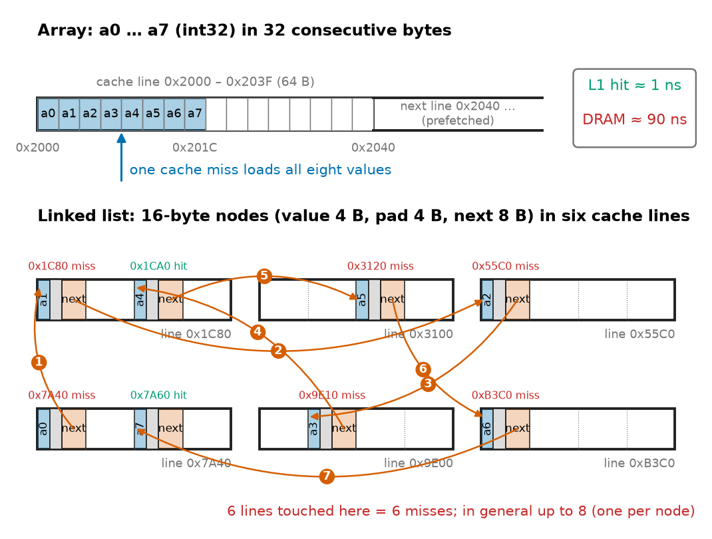
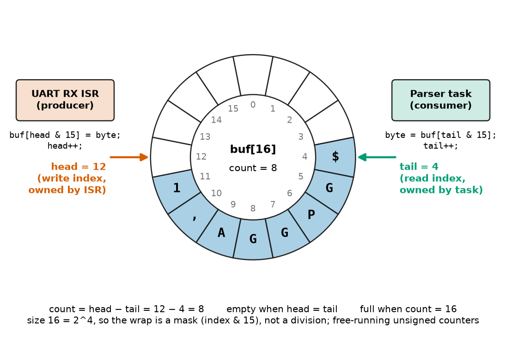
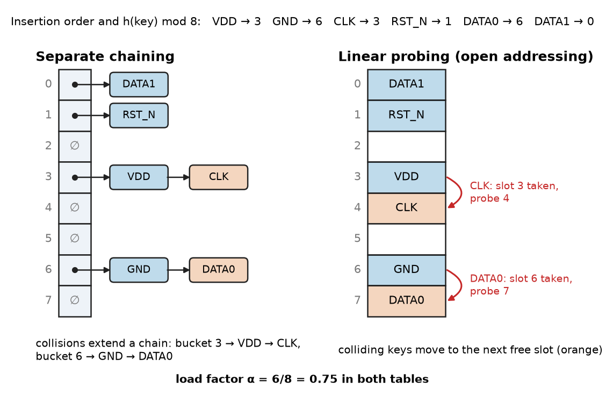
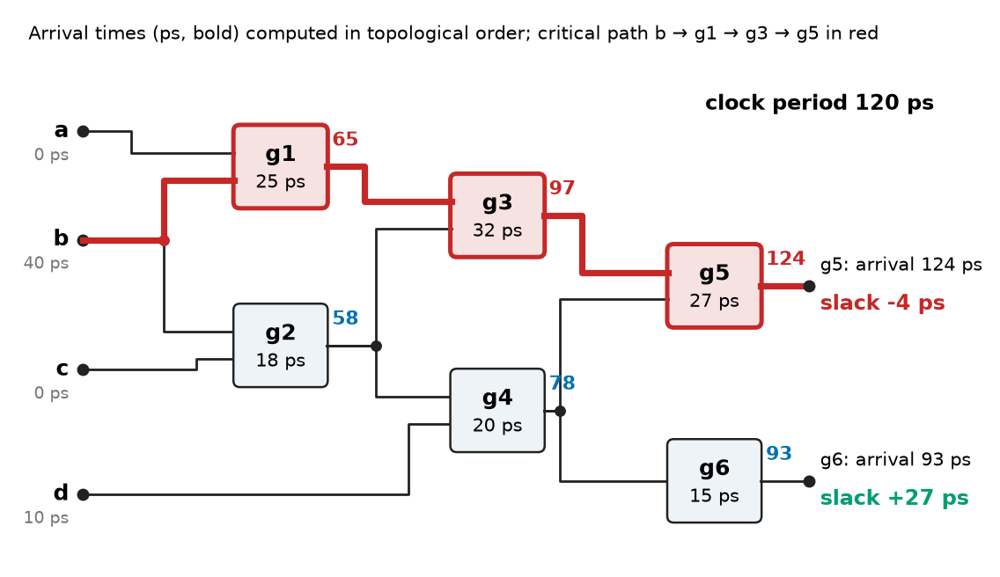
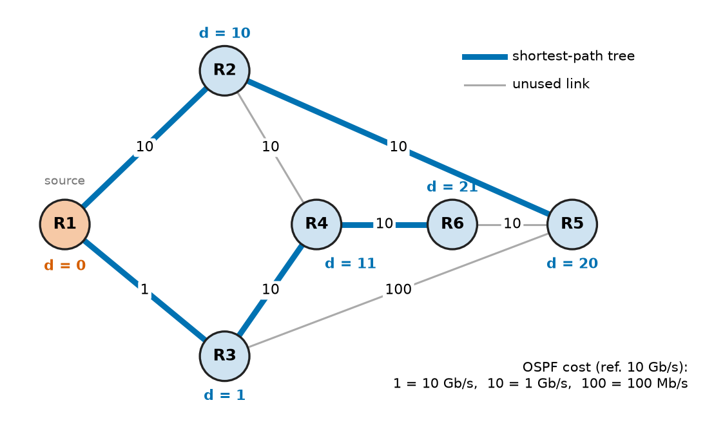

# Chapter 23 — Algorithms and Data Structures

*Part V · Programming and Computational Systems*

A layout team's sign-off script checks a 2-million-pin post-layout netlist for pins that appear on no net. It is twenty lines of clear Python and it works on the test board. On the real chip it runs all night. The script keeps the connected pins in a list, and `pin in connected` searches that list from the start every time: about $3n^2/8\approx1.5\times10^{12}$ string comparisons, seven hours at 17 ns each. Changing one line, so that the pins are held in a set, makes each look-up a hash-table probe, and the whole check runs in about a tenth of a second. Nothing about the processor, the language or the netlist changed. What changed was the **data structure**, and with it the **algorithm** the program actually executed. The same lesson appears across the field: a UART driver that drops bytes because its buffer is a list that is shifted on every read; a median filter that fits a 1 kHz control loop but not a 20 kHz one; a router that must recompute shortest paths across a thousand links in milliseconds; a timing analyser that must find the slowest of $10^{9}$ paths without enumerating them.

> **How is the cost of an algorithm predicted before it is run, and how does the choice of data structure set that cost?**
> **Which classic structures and algorithms (lists, queues, trees, hash tables, sorting, searching, graph traversal, shortest paths) solve which engineering problems, and where do they fail?**

| Concept | Engineering destination |
|---|---|
| Complexity analysis | Will the netlist check, the log parser or the control-loop filter finish in time? |
| Arrays and linked lists | Sample buffers, RTOS ready lists, memory pools |
| Stacks and queues | UART ring buffers, call stacks, event-driven simulators, timer wheels |
| Trees and graphs | Routing tables, file systems, spatial queries in PCB layout, netlists |
| Hash tables | Symbol tables, net-name look-up, CAN-ID dispatch, deduplication |
| Searching and sorting | Calibration look-up tables, median filters, production-test ranking |
| Numerical algorithms | CORDIC in FPGAs, running statistics, fixed-iteration solvers in firmware |
| Graph algorithms | OSPF routing, net extraction, static timing analysis, floating-node checks |
| Algorithm selection | Matching worst case, memory and determinism to the platform |

**Roadmap.** How cost is counted and what it means on real hardware (23.1) → contiguous and linked sequences (23.2) → stacks, queues, ring buffers and priority queues (23.3) → trees and graphs as data (23.4) → hash tables (23.5) → searching and sorting (23.6) → numerical algorithms as implemented (23.7) → graph algorithms (23.8) → choosing among them (23.9) → engineering applications (23.10).

---

## 23.1 Complexity analysis

> **Boundary.** Asymptotic notation ($O$, $\Omega$, $\Theta$), the master theorem for divide-and-conquer recurrences, flop counting and the empirical scaling exponent $p=\ln(T_2/T_1)/\ln(n_2/n_1)$ are developed in *The Mathematics Universe*, [Ch. 24 §24.1](https://github.com/The-Studio-of-Sadiq/engineering-mathematics/blob/main/part-7-numerical-computational/24-computational-mathematics.md), together with Horner's rule and the cost of the DFT against the FFT. This section uses them and adds what matters when the algorithm runs on a particular machine under a deadline.

### What is being counted

Complexity analysis counts the **basic operations** an algorithm performs (comparisons, memory accesses, arithmetic operations) as a function of the input size $n$, and the **memory** it needs beyond its input. Three counts answer different engineering questions:

- **Worst case**: the maximum over all inputs of size $n$; the only acceptable measure for hard real-time code (Chapter 27) and for safety arguments under ISO 26262 or DO-178C.
- **Average case**: the mean over a stated input distribution; it governs throughput.
- **Amortised cost**: the worst-case total of a *sequence* of $m$ operations divided by $m$. An occasional expensive step averages out, but can still blow a deadline (§23.2).

The cost of one basic operation is not a constant either. On a desktop processor an L1-cache hit costs about 1 ns, a main-memory access about 80–100 ns, and an interpreted Python operation 50–100 ns; on a Cortex-M4 at 168 MHz a single-cycle SRAM access costs 6 ns, but flash with wait states costs several cycles unless the accelerator cache hits. An algorithm with fewer operations but scattered memory accesses can lose to one with more operations on contiguous data. Big-O hides constants by design; engineering decisions keep them.

### Budgets: from complexity to time

Table 23.1 converts complexity classes into times for a compiled language at roughly $10^8$ simple operations per second with a realistic memory mix (an interpreted language is 10–100 times slower).

| $n$ | $\log_2n$ | $n$ | $n\log_2n$ | $n^2$ | $n^3$ | $2^n$ |
|---|---|---|---|---|---|---|
| $10^2$ | 70 ns | 1 µs | 7 µs | 100 µs | 10 ms | $4\times10^{14}$ years |
| $10^4$ | 130 ns | 100 µs | 1.3 ms | 1 s | 2.8 h | — |
| $10^6$ | 200 ns | 10 ms | 0.2 s | 2.8 h | 317 years | — |
| $10^9$ | 300 ns | 10 s | 5 min | 317 years | — | — |

*Table 23.1 — Time at $10^8$ operations per second. Netlists, log files and sample records routinely reach $10^6$–$10^9$ elements.*

The table explains most of the "it worked on the test case" failures in engineering software. An $O(n^2)$ step that takes 100 µs on a 100-net test circuit takes three hours on a million-net chip. The cure is rarely a faster computer: it is a structure or algorithm that drops the exponent.

> **Status of the principle: Asymptotic dominance**
> *Derived.* For any constants, $c_1n^a$ eventually exceeds $c_2n^b$ when $a>b$, and any exponential exceeds any polynomial; the crossover size depends on the constants, which is why small inputs can favour the asymptotically worse algorithm.

**Worked example — a median filter inside a control loop.** A motor-drive current loop on a Cortex-M4 at 168 MHz rejects ADC glitches with a running median over the last $w$ samples. At a 1 kHz loop rate the budget is $168\times10^6/10^3=168\,000$ cycles per period, of which the filter may take 10 %, about 16 800 cycles. Sorting a fresh copy of the window by insertion sort costs at worst $w(w-1)/2$ compare-and-swap steps. For $w=9$ that is 36 steps, roughly 200 cycles at about 5 cycles each: trivial. For $w=64$ it is 2016 steps, about 10 000 cycles: still inside the 1 kHz budget but 60 % of the filter's share. Move the same filter into the 20 kHz inner current loop and the whole period is 8400 cycles, so the 64-sample sort alone exceeds it. Two changes rescue it. A **sliding** median keeps the window sorted and, per new sample, deletes the oldest value and inserts the newest by shifting: $O(w)$, at most about 64 moves, a few hundred cycles. Or a much smaller window ($w=5$, which a fixed 9-comparator sorting network handles in constant time) suffices to reject single-sample glitches. The choice is set by worst-case cycles, not by average speed, because the loop deadline is hard.

---

## 23.2 Arrays and linked lists

### Contiguous arrays

An **array** stores $n$ elements of equal size in consecutive memory. Element $i$ is at address $\text{base}+i\cdot s$, so indexing is $O(1)$, and a sequential scan moves through memory in order. That order is what caches and prefetchers are built for: a 64-byte cache line brings in 16 `float32` samples at once, and the hardware prefetcher fetches the next lines before they are needed. Inserting or deleting in the middle costs $O(n)$, because the elements after the gap must move. NumPy arrays (Chapter 22), C arrays and `std::vector` (Chapter 21) are arrays in this sense.

A **dynamic array** (Python `list`, C++ `std::vector`) adds capacity management. When an append finds the array full, it allocates a block larger by a factor $r$ and copies everything. Since the capacities form a geometric series, the total copying over $n$ appends is about $n/(r-1)$ element moves, so each append costs $O(1)$ amortised. A Python list stores *pointers* to objects and grows by about 12.5 % plus a small constant: watching `sys.getsizeof` during appends shows capacities of 4, 8, 16, 24, 32, 40, ... pointers.

**Worked example — the price of a growth factor.** With $r=2$ (common in C++ libraries) the copies total about $n$, one per element; with CPython's $r\approx1.125$ they total about $n/0.125=8n$. Measured over 200 000 appends, CPython performed 72 reallocations and 8.1 copies per element, as predicted. The amortised cost is still $O(1)$, but the *largest* single append copied 180 440 pointers at once, about 1.4 MB of memory traffic. In a soft real-time data logger that is a visible hiccup; in a hard real-time loop, dynamic growth is simply not allowed. Embedded firmware therefore preallocates fixed-size arrays at start-up (Chapter 25), and the MISRA C guidelines restrict dynamic memory allocation after initialisation.

### Linked lists

A **linked list** stores each element in a node that points to the next (and, in a doubly linked list, the previous) node. Inserting or removing a node whose address is known is $O(1)$: two or four pointer updates, no shifting. Finding the $i$-th element is $O(n)$, and a traversal jumps around memory, one likely cache miss per node. On a desktop that makes a linked-list scan 10–50 times slower than an array scan of the same length (Figure 23.1).

<!-- FIGURE 23.1 | figures/ch23/fig-23-1-array-vs-linked-list-memory.png | block-diagram | An array and a linked list holding the same eight 32-bit values, drawn against 64-byte cache lines. | Content: top, a horizontal memory strip divided into 64-byte cache lines; the array occupies 32 consecutive bytes inside one line, elements a0 to a7 at addresses 0x2000 to 0x201C, a single arrow labelled one cache miss. Bottom, the linked list: eight nodes of 16 bytes (value 4 B, padding 4 B, next pointer 8 B) scattered across six different cache lines at addresses such as 0x7A40, 0x1C80, 0x55C0, with next arrows hopping between them, labelled up to eight cache misses. Side annotation: L1 hit about 1 ns, DRAM access about 90 ns. -->



*Figure 23.1 — An array and a linked list holding the same eight 32-bit values, drawn against 64-byte cache lines.*

Linked lists earn their place where elements move between collections more often than they are scanned. An RTOS keeps tasks on **intrusive** doubly linked lists, with the links embedded in each task control block, so moving a task to the ready list is a constant-time splice with no allocation (FreeRTOS, Zephyr and Linux all do this). Memory pools thread a **free list** through their free blocks, giving $O(1)$, fragmentation-free allocation of packet or CAN-frame buffers.

| Operation | Array | Dynamic array | Singly linked list | Doubly linked list |
|---|---|---|---|---|
| Index $i$ | $O(1)$ | $O(1)$ | $O(n)$ | $O(n)$ |
| Append at end | — (fixed) | $O(1)$ amortised | $O(1)$ with tail pointer | $O(1)$ |
| Insert/delete at front | $O(n)$ | $O(n)$ | $O(1)$ | $O(1)$ |
| Delete a known node | $O(n)$ | $O(n)$ | $O(n)$ (needs predecessor) | $O(1)$ |
| Scan, cache behaviour | Excellent | Excellent | Poor | Poor |
| Memory overhead per element | 0 | 0–12 % slack | 1 pointer | 2 pointers |

---

## 23.3 Stacks and queues

### Stacks

A **stack** is a last-in, first-out (LIFO) collection with $O(1)$ `push` and `pop`. The processor's call stack holds return addresses, saved registers and locals, with a hardware stack pointer (Chapter 16); stacks also parse expressions, implement undo in a schematic editor and drive depth-first search (§23.8). The embedded hazard is **stack overflow**: a 1 kB task stack, three nested interrupts and a 600-byte `printf` silently overwrite adjacent memory. Worst-case depth is computed by static analysis of the call graph, a longest-path problem on a DAG (§23.8), and checked at run time with a guard pattern or the MPU (Chapter 27).

### Queues and ring buffers

A **queue** is first-in, first-out (FIFO): `enqueue` at the tail, `dequeue` at the head. On a fixed memory budget the standard implementation is the **ring buffer** (circular buffer): an array of $N$ slots with a head index where the producer writes and a tail index where the consumer reads, both wrapping at $N$ (Figure 23.2). With $N$ a power of two, the wrap is a bit mask (`index & (N-1)`) instead of a division or a branch, and free-running unsigned counters make "full" ($\text{head}-\text{tail}=N$) and "empty" ($\text{head}=\text{tail}$) unambiguous without wasting a slot. With one writer of `head` (a UART interrupt) and one of `tail` (a task), it needs no lock, provided each index update is one atomic store that the compiler cannot reorder (Chapter 27).

<!-- FIGURE 23.2 | figures/ch23/fig-23-2-uart-ring-buffer.png | block-diagram | A 16-slot ring buffer between a UART receive interrupt (producer) and a parsing task (consumer). | Content: circle of 16 slots numbered 0 to 15. Slots 4 to 11 shaded as occupied, containing the bytes of an NMEA sentence fragment. Arrow labelled tail (read index, owned by task) pointing at slot 4; arrow labelled head (write index, owned by ISR) pointing at slot 12. Left: UART RX ISR box with arrow writes buf[head and 15], then head++. Right: parser task box reads buf[tail and 15], then tail++. Annotations: count = head - tail = 8; full when count = 16; empty when head = tail; power-of-two size makes the wrap a mask. -->



*Figure 23.2 — A 16-slot ring buffer between a UART receive interrupt (producer) and a parsing task (consumer).*

Listing 23.1 implements it with the same logic as the C firmware version (Chapter 26).

```python
class RingBuffer:
    """Single-producer/single-consumer byte FIFO, size a power of two (as in UART firmware)."""
    def __init__(self, size_log2):
        self.buf = bytearray(1 << size_log2)
        self.mask = (1 << size_log2) - 1
        self.head = self.tail = 0              # free-running counters, never reset
        self.dropped = 0
    def put(self, byte):                       # called from the RX interrupt
        if self.head - self.tail == len(self.buf):
            self.dropped += 1                  # full: count the overrun, keep old data
            return
        self.buf[self.head & self.mask] = byte
        self.head += 1
    def get(self):                             # called from the main loop or a task
        if self.head == self.tail:
            return None                        # empty
        byte = self.buf[self.tail & self.mask]
        self.tail += 1
        return byte
    def __len__(self):
        return self.head - self.tail

rb = RingBuffer(4)                             # 16 bytes
for b in b"GPS,$GPGGA,123519,4807.038,N":      # 28-byte burst arrives before the task runs
    rb.put(b)
print(len(rb), "bytes buffered,", rb.dropped, "dropped")
print(bytes(rb.get() for _ in range(len(rb))))
```

```text
16 bytes buffered, 12 dropped
b'GPS,$GPGGA,12351'
```

*Listing 23.1 — A power-of-two ring buffer; a 28-byte burst overruns a 16-byte buffer.*

**Worked example — sizing a UART receive buffer.** A GNSS receiver streams NMEA sentences at 921 600 baud (8N1), 92 160 bytes/s at most. The parsing task runs every 10 ms but, under worst-case load from higher-priority tasks, may be delayed by up to 15 ms. The buffer must therefore absorb $92\,160\times(10+15)\times10^{-3}=2304$ bytes without overrun. The next power of two is 4096 bytes. At 115 200 baud the same timing needs 288 bytes, so 512. The `dropped` counter of Listing 23.1 turns a silent overrun into a diagnosable fault. DMA reception removes the per-byte interrupt but not the sizing rule.

> **Status of the principle: Ring-buffer sizing**
> *Derived.* A FIFO between a producer of peak rate $R$ and a consumer whose worst-case service interval is $T$ never overflows if its capacity is at least $RT$; the bound is exact for constant-rate bursts and conservative otherwise, and it fails if $T$ is not a true worst case.

### Priority queues and event-driven simulation

A **priority queue** returns the smallest key first. The usual implementation is a **binary heap**, an array in which element $i$ is no larger than its children $2i+1$ and $2i+2$; insert and remove-min are $O(\log n)$. Priority queues schedule software timers, merge sorted logs and drive every **event-driven simulator**, including Verilog and VHDL simulators (Chapter 19). Listing 23.2 is the core of a gate-level one: pop the earliest event, update the net, schedule each fan-out gate's new output after its delay.

```python
import heapq

# Event-driven logic simulation: (time_ps, sequence, net, new_value)
delay = {"inv": 15, "nand": 22}                 # ps, illustrative gate delays
fanout = {"a": [("n1", "nand")], "b": [("n1", "nand"), ("nb", "inv")],
          "n1": [("y", "inv")], "nb": [], "y": []}
value = {"a": 1, "b": 0, "n1": 1, "nb": 1, "y": 0}

def evaluate(net):
    if net == "n1": return 1 - (value["a"] & value["b"])
    if net == "nb": return 1 - value["b"]
    if net == "y":  return 1 - value["n1"]

events, seq = [], 0
heapq.heappush(events, (100, seq, "b", 1))     # input b rises at t = 100 ps
while events:
    t, _, net, v = heapq.heappop(events)        # always the earliest pending event
    if value[net] == v:
        continue                                # no change, no propagation
    value[net] = v
    print(f"t={t:4d} ps  {net:>2} -> {v}")
    for out, gate in fanout[net]:
        seq += 1
        heapq.heappush(events, (t + delay[gate], seq, out, evaluate(out)))
```

```text
t= 100 ps   b -> 1
t= 115 ps  nb -> 0
t= 122 ps  n1 -> 0
t= 137 ps   y -> 1
```

*Listing 23.2 — An event-driven gate-level simulator built on a binary-heap priority queue.*

The sequence number breaks ties so that equal-time events run in scheduling order and the run is deterministic. The work is proportional to the number of *changes*, not gates times time steps, which is why simulating a mostly idle million-gate design is fast. Real simulators also model inertial delay, cancelling pulses shorter than a gate delay by removing superseded events.

---

## 23.4 Trees and graphs

### Trees

A **tree** is a hierarchy of nodes, each with one parent except the root: file systems, Linux device trees, an SoC's design hierarchy (Chapter 34), parse trees of HDL source. As *data structures*, trees keep a collection ordered with $O(\log n)$ search, insertion and deletion:

- A **binary search tree** keeps smaller keys left and larger right. Unbalanced, it degrades to a linked list when keys arrive sorted, as time stamps do; **balanced** variants (red–black, AVL) guarantee $O(\log n)$ height. C++ `std::map` is a red–black tree.
- A **B-tree** stores hundreds of keys per node, so $10^9$ keys need only 3–4 levels, one flash or disk page read each: file systems and databases such as SQLite.
- A **trie** branches on successive bits of the key. Routers use compressed tries (or TCAM hardware) for **longest-prefix match** of each packet against about a million IPv4 prefixes in tens of nanoseconds.
- **Spatial trees** (k-d trees, quadtrees, R-trees) let a design-rule checker find all shapes near a given one in $O(\log n+k)$ instead of comparing all $O(n^2)$ pairs of millions of polygons.

### Graphs and their representations

A **graph** $G=(V,E)$ is a set of vertices joined by edges, directed or not, possibly weighted. Graphs are the natural model of a circuit (nodes and branches), a netlist (cells joined by nets), a communication network (routers and links), a power grid (buses and lines), a state machine (states and transitions, Chapter 14) and a task dependency set (a build system or a firmware boot sequence). A netlist is really a **hypergraph**, because a net joins many pins, and is usually stored as a bipartite graph of cells and nets.

There are two standard representations. An **adjacency matrix** is an $n\times n$ array with entry $(i,j)$ nonzero when an edge joins $i$ to $j$: $O(1)$ edge queries, $O(n^2)$ memory. **Adjacency lists** store, for each vertex, the list of its neighbours: $O(n+m)$ memory for $m$ edges, and iteration over a vertex's neighbours in time proportional to its degree. Packed into two arrays, one of offsets and one of neighbour indices, adjacency lists are exactly the compressed sparse row (CSR) format of sparse matrices described in *The Mathematics Universe*, [Ch. 24 §24.5](https://github.com/The-Studio-of-Sadiq/engineering-mathematics/blob/main/part-7-numerical-computational/24-computational-mathematics.md), where the graph of a circuit matrix also governs fill-in during factorisation.

**Worked example — storing a netlist graph.** A mixed-signal block has $n=10^5$ nodes and $m=2\times10^5$ branches, an average of four connections per node, typical of circuits. An adjacency matrix needs $n^2=10^{10}$ entries: 1.25 GB even at one bit per entry, 10 GB at one byte, almost all zeros. In CSR form each undirected edge appears twice, so the neighbour array holds $4\times10^5$ 32-bit indices (1.6 MB) and the offset array $10^5+1$ entries (0.4 MB): about 2 MB in total, 5000 times smaller than the bit matrix. Traversing every edge costs $O(n+m)=3\times10^5$ steps against $O(n^2)=10^{10}$ for scanning the matrix. For engineering graphs, which are sparse with bounded average degree, adjacency lists are the default.

---

## 23.5 Hash tables

### Constant-time look-up by key

A **hash table** stores key–value pairs in an array of $M$ buckets and places each key at index $h(k)\bmod M$, where the **hash function** $h$ scrambles the key into an integer. Look-up computes $h(k)$, goes to the bucket and compares the few keys found there. If the hash spreads keys evenly, the expected number of comparisons depends only on the **load factor** $\alpha=n/M$, not on $n$, so insertion, deletion and look-up are $O(1)$ on average. Python's `dict` and `set`, C++ `std::unordered_map`, compiler symbol tables, netlist name look-up, and the CAN message dispatch table in a vehicle gateway all rely on this.

Two keys that land in the same bucket **collide**, and there are two remedies (Figure 23.3). **Separate chaining** keeps a small list per bucket. **Open addressing** stores everything in the array and, on a collision, probes other slots in a fixed sequence (linear probing tries $h, h+1, h+2,\ldots$); it is more cache-friendly but degrades sharply as $\alpha\to1$. CPython's `dict` uses open addressing with a perturbed probe sequence and resizes when it is two-thirds full.

<!-- FIGURE 23.3 | figures/ch23/fig-23-3-hash-table-collisions.png | block-diagram | Two ways to resolve hash collisions for net names: separate chaining and linear probing. | Content: left panel, separate chaining: array of 8 buckets indexed 0 to 7; keys VDD, GND, CLK, RST_N, DATA0, DATA1 hashed (example indices VDD 3, GND 6, CLK 3, RST_N 1, DATA0 6, DATA1 0); bucket 3 holds a chain VDD -> CLK, bucket 6 a chain GND -> DATA0. Right panel, linear probing with the same keys in a 8-slot array: CLK placed in slot 4 after collision at 3, DATA0 in slot 7 after collision at 6; probe arrows drawn. Caption note: load factor alpha = 6/8 = 0.75. -->



*Figure 23.3 — Two ways to resolve hash collisions for net names: separate chaining and linear probing.*

| Load factor $\alpha$ | Linear probing, successful search | Linear probing, unsuccessful search | Chaining, successful search |
|---|---|---|---|
| 0.50 | 1.5 | 2.5 | 1.25 |
| 0.75 | 2.5 | 8.5 | 1.38 |
| 0.90 | 5.5 | 50.5 | 1.45 |

*Table 23.2 — Expected probes per operation under uniform hashing (Knuth's formulas: $\tfrac12(1+\tfrac1{1-\alpha})$ and $\tfrac12(1+\tfrac1{(1-\alpha)^2})$ for linear probing, $1+\alpha/2$ for chaining).*

Table 23.2 shows why every practical table resizes before it is full. At 90 % load a miss under linear probing costs 50 probes, and every insertion is a miss. Resizing doubles $M$ and reinserts everything, an $O(n)$ step that, as with dynamic arrays, is $O(1)$ amortised but long in the worst case.

> **Status of the principle: Expected O(1) hash-table operations**
> *Derived.* Under the assumption of uniform hashing, the expected cost of each operation is a function of the load factor alone; it fails when keys are adversarial or the hash function is poor (all keys in one bucket give $O(n)$), which is why hash tables are avoided where a worst-case bound is required.

**Worked example — the overnight netlist check.** Listing 23.3 repeats the opening problem at a smaller scale: 20 000 pin names, half of them connected, checked against a list and against a set.

```python
import random, time

random.seed(1)
pins = [f"U{random.randrange(5000)}.{random.randrange(1, 257)}" for _ in range(20_000)]
connected_list = pins[::2]                 # pins that appear on some net
connected_set = set(connected_list)

def unconnected(container):
    t0 = time.perf_counter()
    missing = [p for p in pins if p not in container]
    return len(missing), time.perf_counter() - t0

n_l, t_l = unconnected(connected_list)
n_s, t_s = unconnected(connected_set)
print(f"list: {n_l} unconnected in {t_l:.2f} s")
print(f"set : {n_s} unconnected in {t_s*1e3:.2f} ms  (speed-up ~{t_l/t_s:,.0f}x)")
```

```text
list: 9934 unconnected in 2.58 s
set : 9934 unconnected in 1.18 ms  (speed-up ~2,185x)
```

*Listing 23.3 — Membership tests against a list ($O(n)$ each) and a set ($O(1)$ expected each); times from the machine used for this chapter.*

With $n=20\,000$ pins and $n/2$ in the list, the misses scan the whole list and the hits half of it on average: about $\tfrac n2\cdot\tfrac n2+\tfrac n2\cdot\tfrac n4=3n^2/8=1.5\times10^8$ comparisons, which at the measured 2.6 s is about 17 ns per comparison including loop overhead. The set does 20 000 hash probes in 1.2 ms, 60 ns each. Scaling to the opening's $2\times10^6$ pins multiplies the list version by $100^2=10^4$, to about seven hours, and the set version by 100, to about 0.12 s. The algorithmic speed-up grows linearly with $n$; at 20 000 pins it is about 2000, at two million about 200 000.

Table hashes (SipHash for Python strings, multiplicative hashes for integers) are chosen for speed and spread; a CRC (Chapter 26) detects transmission errors; a cryptographic hash such as SHA-256 (Chapter 22's run manifests, Git in Chapter 24) resists deliberate collisions.

---

## 23.6 Searching and sorting

### Searching

**Linear search** examines elements in turn: $O(n)$, no preconditions, and fastest of all for $n$ below a few dozen, because it streams through cache with no branches mispredicted. **Binary search** on a sorted array halves the interval at each comparison: at most $\lceil\log_2(n+1)\rceil$ comparisons, 12 for 4096 entries and 20 for a million. Hash tables answer "is $k$ present?"; binary search also answers "where would $k$ go?", which is exactly what an interpolating look-up table needs.

Listing 23.4 is the firmware pattern for converting an NTC thermistor's ADC reading to temperature, run here in Python. It tabulates the ADC code every 5 °C from −40 to 120 °C (33 entries, generated from the Steinhart–Hart fit of Chapter 22 with a 10 kΩ pull-up and a 12-bit ADC), finds the bracketing entries by binary search and interpolates linearly.

```python
import bisect, math

A, B, C = 1.130968e-3, 2.338158e-4, 8.892946e-8       # Steinhart-Hart fit from Chapter 22
def r_ntc(T):                                          # invert S-H by bisection on ln R
    lo, hi = math.log(10.0), math.log(1e7)
    for _ in range(60):
        mid = 0.5 * (lo + hi)
        if A + B*mid + C*mid**3 > 1/(T + 273.15): hi = mid
        else: lo = mid
    return math.exp(mid)
code_of = lambda T: 4095 * r_ntc(T) / (10e3 + r_ntc(T))     # 12-bit ADC, 10 k pull-up

temps = list(range(120, -45, -5))                      # 33 entries, code ascending
codes = [code_of(T) for T in temps]

def lookup(code):                                      # O(log n) search + linear interpolation
    k = bisect.bisect_right(codes, code)
    k = min(max(k, 1), len(codes) - 1)
    c0, c1, t0, t1 = codes[k-1], codes[k], temps[k-1], temps[k]
    return t0 + (t1 - t0) * (code - c0) / (c1 - c0)

print(f"code 1234 -> {lookup(1234):.2f} C")
fine = [T / 10 for T in range(-400, 1201)]
err = max(abs(lookup(code_of(T)) - T) for T in fine)
print(f"max interpolation error, -40..120 C: {err:.3f} C over {len(codes)} entries")
```

```text
code 1234 -> 45.34 C
max interpolation error, -40..120 C: 0.168 C over 33 entries
```

*Listing 23.4 — Binary search with linear interpolation in a 33-entry thermistor table.*

**Worked example — three ways to linearise a thermistor in firmware.** (a) A direct table indexed by the 12-bit code holds 4096 entries; as `int16` in units of 0.01 °C it occupies 8 KB of flash and needs one memory read, $O(1)$. (b) The 33-entry table of Listing 23.4 occupies 132 bytes (two 16-bit values per entry) and needs at most $\lceil\log_2 34\rceil=6$ comparisons plus one multiply and one divide; its worst interpolation error is 0.17 °C, well inside a ±1 % thermistor's ±0.5 °C at 25 °C. (c) Evaluating Steinhart–Hart needs a natural logarithm and a reciprocal in floating point, a few hundred cycles on a Cortex-M4F with FPU and a few thousand with software floating point on a Cortex-M0+. On a 32 KB-flash Cortex-M0+, option (b) wins; on an FPGA with spare block RAM, (a); on an application processor, (c) costs nothing worth measuring.

The interpolation step is the piecewise-linear interpolant whose error bound, $\tfrac18h^2\max\lvert f''\rvert$ for spacing $h$, is derived in *The Mathematics Universe*, [Ch. 22 §22.5](https://github.com/The-Studio-of-Sadiq/engineering-mathematics/blob/main/part-7-numerical-computational/22-numerical-methods.md). Halving the spacing to 2.5 °C would cut the error about fourfold, to roughly 0.04 °C.

### Sorting

Sorting underlies binary search, median filters, merging logs by time stamp and finding duplicate net names. Comparison sorts cannot beat $\Omega(n\log n)$ comparisons in the worst case (there are $n!$ orderings and each comparison halves the possibilities at best, $\log_2n!\approx n\log_2n$).

| Algorithm | Average | Worst | Extra memory | Stable | Where it is used |
|---|---|---|---|---|---|
| Insertion sort | $O(n^2)$ | $O(n^2)$ | $O(1)$ | Yes | $n\lesssim20$; nearly sorted data; inner step of hybrids |
| Merge sort | $O(n\log n)$ | $O(n\log n)$ | $O(n)$ | Yes | External sorting of files larger than RAM |
| Heapsort | $O(n\log n)$ | $O(n\log n)$ | $O(1)$ | No | Guaranteed bound in place; embedded, safety code |
| Quicksort | $O(n\log n)$ | $O(n^2)$ | $O(\log n)$ | No | C `qsort`; introsort in C++ `std::sort` falls back to heapsort |
| Timsort | $O(n\log n)$ | $O(n\log n)$ | $O(n)$ | Yes | Python `sorted`, Java objects; exploits existing runs |
| Counting / radix sort | $O(n+k)$ | $O(n+k)$ | $O(n+k)$ | Yes | Small integer keys: 12-bit ADC codes, 11-bit CAN IDs |
| Sorting network | $O(\log^2n)$ depth | Same | — | No | Fixed small $n$ in FPGA or SIMD, data-independent timing |

*Table 23.3 — Sorting algorithms and their engineering niches.*

Three properties beyond speed decide the choice. **Stability** keeps equal keys in their original order, so a log sorted by serial number and then stably by temperature stays in serial order within each temperature. **Worst case** rules out plain quicksort in hard real-time code. **Data-independent timing** (sorting networks) matters in FPGAs and cryptographic code. When keys are small integers, counting sort breaks the $n\log n$ barrier: a histogram of $10^6$ 12-bit ADC codes, then a cumulative sum, gives the median and any percentile in $O(n+4096)$ with no comparisons at all.

---

## 23.7 Numerical algorithms

> **Boundary.** The mathematics of numerical algorithms (floating-point error, root finding by bisection and Newton–Raphson, interpolation, quadrature, ODE solvers, stability and convergence) is in *The Mathematics Universe*, [Ch. 22](https://github.com/The-Studio-of-Sadiq/engineering-mathematics/blob/main/part-7-numerical-computational/22-numerical-methods.md); dense, iterative and sparse linear algebra and running statistics (Welford's algorithm) in [Ch. 24](https://github.com/The-Studio-of-Sadiq/engineering-mathematics/blob/main/part-7-numerical-computational/24-computational-mathematics.md) §24.1–24.5. The FFT and Goertzel algorithms are in *Circuits, Signals and Communications*, [Ch. 22 §22.4](https://github.com/The-Studio-of-Sadiq/Circuits-Signals-and-Communications/blob/main/part-5-digital-signal-processing/22-discrete-fourier-transform.md). This section is about turning those methods into code that runs inside fixed budgets of cycles, memory and word length.

### From method to implementation

A numerical method on paper becomes a different object in firmware or an FPGA. Five implementation rules recur:

1. **Bound every loop.** A Newton iteration needs a hard iteration cap and a bisection fallback, because a bad initial guess or a NaN can stop convergence; a real-time task iterates at most $k$ times and reports failure.
2. **Prefer recurrences to recomputation.** A moving average kept as a running sum costs two additions per sample, exact in integers; an exponential filter $y\leftarrow y+(x-y)/2^k$ costs a subtract, a shift and an add.
3. **Match the algorithm to the arithmetic.** Without a divider or FPU, shift-and-add algorithms such as CORDIC (below) beat ones with fewer but costlier operations.
4. **Scale for fixed point.** Every intermediate needs a word length that neither overflows nor loses resolution (Chapter 11; *Circuits, Signals and Communications*, [Ch. 21 §21.5](https://github.com/The-Studio-of-Sadiq/Circuits-Signals-and-Communications/blob/main/part-5-digital-signal-processing/21-dsp-fundamentals.md)).
5. **Use a library when one exists.** CMSIS-DSP, vendor FPGA IP, LAPACK and FFTW encode decades of tuning and testing.

### CORDIC: rotation by shifts and adds

The **CORDIC** algorithm (COordinate Rotation DIgital Computer, Volder 1959) computes sine, cosine, arctangent, vector magnitude and, in variants, hyperbolic functions, logarithms and square roots, using only additions, subtractions, bit shifts and a small table of constants. It rotates a vector by a sequence of fixed angles $\theta_i=\arctan2^{-i}$, choosing the direction of each micro-rotation to drive the residual angle $z$ toward zero:

$$
x_{i+1}=x_i-d_i\,2^{-i}y_i,\qquad y_{i+1}=y_i+d_i\,2^{-i}x_i,\qquad z_{i+1}=z_i-d_i\arctan2^{-i},\qquad d_i=\operatorname{sign}(z_i).
$$

Each micro-rotation also lengthens the vector by $\sqrt{1+2^{-2i}}$, so after $N$ steps the vector is scaled by $\prod_i\sqrt{1+2^{-2i}}\approx1.6468$. Starting from $x_0=K=1/1.6468=0.607253$ cancels it. Listing 23.5 implements the rotation mode in integer arithmetic, as an FPGA or a DSP without FPU would.

```python
import math

N, FRAC = 16, 18                                   # 16 iterations, 18 fraction bits (32-bit int)
ATAN = [round(math.atan(2.0**-i) * (1 << FRAC)) for i in range(N)]   # ROM table
K = 1.0
for i in range(N):
    K /= math.sqrt(1 + 2.0**(-2 * i))              # CORDIC gain correction, 0.607253

def cordic_sincos(theta):                          # theta in radians, |theta| <= pi/2
    x, y = round(K * (1 << FRAC)), 0               # start on the x axis, pre-scaled by K
    z = round(theta * (1 << FRAC))
    for i in range(N):                             # only shifts, adds and a table look-up
        if z >= 0:
            x, y, z = x - (y >> i), y + (x >> i), z - ATAN[i]
        else:
            x, y, z = x + (y >> i), y - (x >> i), z + ATAN[i]
    return y / (1 << FRAC), x / (1 << FRAC)

print(f"K = {K:.6f}")
worst = max(max(abs(s - math.sin(t)), abs(c - math.cos(t)))
            for t in [k * 0.001 for k in range(-1570, 1571)]
            for s, c in [cordic_sincos(t)])
s, c = cordic_sincos(math.radians(30))
print(f"sin 30 = {s:.5f}, cos 30 = {c:.5f}, worst error = {worst:.2e} = 2^{math.log2(worst):.1f}")
```

```text
K = 0.607253
sin 30 = 0.50001, cos 30 = 0.86603, worst error = 5.92e-05 = 2^-14.0
```

*Listing 23.5 — CORDIC sine and cosine with 16 iterations in 32-bit integer arithmetic.*

**Worked example — CORDIC in a motor-control FPGA.** A field-oriented controller (Chapter 32; control theory in *Electrical Energy and Machines*) needs $\sin\theta$ and $\cos\theta$ of the rotor angle for the Park transform every 50 µs. With 16 iterations and 18 fraction bits, Listing 23.5 gives a worst error of $5.9\times10^{-5}\approx2^{-14}$ over $\pm\pi/2$, about 14 correct bits. That fits the rule of thumb of one bit per iteration, since the last table angle is $\arctan2^{-15}=3.05\times10^{-5}$ rad, and is finer than a 12-bit position sensor's $2\pi/4096=1.5\times10^{-3}$ rad by a factor of 25. Unrolled and pipelined in an FPGA, the 16 stages need 48 adders of about 20 bits and produce one sine–cosine pair per clock with 16 cycles of latency: at 100 MHz, 160 ns, a negligible part of the 50 µs period. On a Cortex-M4F, CMSIS-DSP's table-based `arm_sin_cos_f32` is the software alternative; on a Cortex-M0+ without FPU, a CORDIC loop is often fastest. Other quadrants are folded into $\pm\pi/2$ by symmetry first.

> **Status of the principle: CORDIC convergence**
> *Derived.* Because $\arctan2^{-i}\le\sum_{j>i}\arctan2^{-j}+\arctan2^{-(N-1)}$, any angle within the convergence range ($\pm1.743$ rad) can be reduced to a residual below $\arctan2^{-(N-1)}$, so the angular error falls by about one bit per iteration until the word length's rounding error dominates.

---

## 23.8 Graph algorithms

### Traversal: BFS and DFS

**Breadth-first search** (BFS) visits vertices in order of their distance in edges from a source, using a FIFO queue; **depth-first search** (DFS) follows each branch as deep as possible, using a stack or recursion. Both are $O(n+m)$ with adjacency lists, and between them they answer the structural questions engineers ask of netlists and networks:

- **Connectivity.** SPICE rejects a **floating node** (no DC path to ground, such as a node joined only through capacitors) because its nodal matrix is singular; a BFS from ground over DC-conducting branches finds such nodes in linear time.
- **Shortest paths in hops.** The **Lee algorithm** for maze routing in PCB and IC layout is a BFS over the routing grid, expanding a wavefront from the source pin to the target.
- **Cycles and topological order.** A combinational network must be acyclic; a loop without a register is a design error that synthesis flags (Chapter 19). An acyclic graph has a **topological order**, every vertex after all its predecessors, found by DFS or Kahn's algorithm in $O(n+m)$.

### Static timing analysis as a longest path

The maximum clock frequency of a synchronous design is set by its slowest register-to-register path (Chapters 14 and 34). Enumerating paths is hopeless, since their number grows exponentially with logic depth. But the **arrival time** at each gate output is the maximum over its inputs of their arrival times, plus the gate delay. Processing gates in topological order computes every arrival time in one pass, $O(n+m)$, and the critical path is recovered by remembering which input set each maximum. Listing 23.6 does this for a six-gate network (Figure 23.4).

```python
from graphlib import TopologicalSorter

# Gate-level netlist as a DAG: gate -> (delay_ps, list of driving gates/inputs)
gates = {"g1": (25, ["a", "b"]), "g2": (18, ["b", "c"]), "g3": (32, ["g1", "g2"]),
         "g4": (20, ["g2", "d"]), "g5": (27, ["g3", "g4"]), "g6": (15, ["g4"])}
arrival = {"a": 0, "b": 40, "c": 0, "d": 10}          # input arrival times, ps
outputs, period = ["g5", "g6"], 120                    # clock period, ps

order = TopologicalSorter({g: set(ins) for g, (_, ins) in gates.items()}).static_order()
worst_in = {}
for n in order:                                        # every node after all its fan-in
    if n in gates:
        delay, ins = gates[n]
        worst_in[n] = max(ins, key=lambda i: arrival[i])
        arrival[n] = arrival[worst_in[n]] + delay
for o in outputs:
    path, n = [o], o
    while n in worst_in:
        n = worst_in[n]; path.append(n)
    print(f"{o}: arrival {arrival[o]:3d} ps, slack {period - arrival[o]:4d} ps, "
          f"path {' -> '.join(reversed(path))}")
```

```text
g5: arrival 124 ps, slack   -4 ps, path b -> g1 -> g3 -> g5
g6: arrival  93 ps, slack   27 ps, path b -> g2 -> g4 -> g6
```

*Listing 23.6 — Arrival times, slack and critical path by one pass in topological order.*

**Worked example — finding the timing violation.** Input `b` arrives late, at 40 ps (it comes from a slow register in another block). Gate `g1` sees inputs at 0 and 40 ps, so its output arrives at $40+25=65$ ps; `g2` at $40+18=58$ ps; `g3` at $\max(65,58)+32=97$ ps; `g4` at $\max(58,10)+20=78$ ps; `g5` at $\max(97,78)+27=124$ ps; `g6` at $78+15=93$ ps. Against a 120 ps clock period (8.33 GHz in this illustrative example; scale the delays by 10 for a 833 MHz block) output `g5` has slack $120-124=-4$ ps: the design fails timing, and the critical path is `b → g1 → g3 → g5`. Speeding up `g4` would gain nothing, because it is not on that path; upsizing `g3` by 5 ps would fix it. Commercial static timing analysers do exactly this pass, with delays that depend on load capacitance and input slew, on graphs of $10^8$–$10^9$ timing arcs, followed by a backward pass of required times to give every node its slack (Chapter 34).

<!-- FIGURE 23.4 | figures/ch23/fig-23-4-sta-critical-path.png | block-diagram | Six-gate combinational network with arrival times computed in topological order; the critical path to g5 is highlighted. | Content: inputs on the left: a (arrives 0 ps), b (40 ps), c (0 ps), d (10 ps). Gates as boxes with delay inside: g1 25 ps (inputs a, b), g2 18 ps (inputs b, c), g3 32 ps (inputs g1, g2), g4 20 ps (inputs g2, d), g5 27 ps (inputs g3, g4), g6 15 ps (input g4). Arrival time written above each gate output: g1 65, g2 58, g3 97, g4 78, g5 124, g6 93 ps. Path b -> g1 -> g3 -> g5 drawn in thick red. Outputs on the right with clock period 120 ps: g5 slack -4 ps (red), g6 slack 27 ps (green). -->



*Figure 23.4 — Six-gate combinational network with arrival times computed in topological order; the critical path to g5 is highlighted.*

### Shortest weighted paths: Dijkstra

When edges carry non-negative weights (link costs, wire lengths, delays), **Dijkstra's algorithm** finds the cheapest path from a source to every vertex. It keeps a priority queue of tentative distances, repeatedly settles the closest unsettled vertex, and relaxes its outgoing edges. With a binary heap the cost is $O((n+m)\log n)$. Link-state routing protocols (OSPF in enterprise and data-centre networks, IS-IS in service-provider backbones) run Dijkstra on every router: each router floods its link costs, every router builds the same graph, and each computes its own shortest-path tree. Listing 23.7 does so for six routers with OSPF costs derived from a 10 Gb/s reference bandwidth, so that a 10 Gb/s link costs 1, a 1 Gb/s link 10 and a 100 Mb/s link 100 (Figure 23.5).

```python
import heapq

# OSPF-style costs: reference 10 Gb/s -> 10G link = 1, 1G = 10, 100M = 100
links = [("R1", "R2", 10), ("R1", "R3", 1), ("R2", "R4", 10), ("R3", "R4", 10),
         ("R3", "R5", 100), ("R4", "R6", 10), ("R5", "R6", 10), ("R2", "R5", 10)]
graph = {}
for u, v, c in links:                                  # undirected adjacency list
    graph.setdefault(u, []).append((v, c))
    graph.setdefault(v, []).append((u, c))

def dijkstra(graph, src):
    dist, prev = {src: 0}, {}
    pq = [(0, src)]
    while pq:
        d, u = heapq.heappop(pq)
        if d > dist[u]:
            continue                                   # stale entry: a shorter path was found
        for v, c in graph[u]:
            if d + c < dist.get(v, float("inf")):
                dist[v], prev[v] = d + c, u
                heapq.heappush(pq, (d + c, v))
    return dist, prev

dist, prev = dijkstra(graph, "R1")
for dst in sorted(dist):
    path, n = [dst], dst
    while n in prev:
        n = prev[n]; path.append(n)
    print(f"{dst}: cost {dist[dst]:3d}  via {' -> '.join(reversed(path))}")
```

```text
R1: cost   0  via R1
R2: cost  10  via R1 -> R2
R3: cost   1  via R1 -> R3
R4: cost  11  via R1 -> R3 -> R4
R5: cost  20  via R1 -> R2 -> R5
R6: cost  21  via R1 -> R3 -> R4 -> R6
```

*Listing 23.7 — Dijkstra's algorithm with a binary heap computing an OSPF shortest-path tree.*

<!-- FIGURE 23.5 | figures/ch23/fig-23-5-ospf-shortest-path-tree.png | block-diagram | Six-router network with OSPF link costs and the shortest-path tree computed by Dijkstra from R1. | Content: routers R1 to R6 as circles. Links with costs: R1-R2 10, R1-R3 1, R2-R4 10, R3-R4 10, R3-R5 100, R4-R6 10, R5-R6 10, R2-R5 10. Tree edges drawn thick: R1-R3, R1-R2, R3-R4, R2-R5, R4-R6; non-tree links thin grey. Each router labelled with its distance from R1: R1 0, R2 10, R3 1, R4 11, R5 20, R6 21. Legend: cost 1 = 10 Gb/s, 10 = 1 Gb/s, 100 = 100 Mb/s. -->



*Figure 23.5 — Six-router network with OSPF link costs and the shortest-path tree computed by Dijkstra from R1.*

**Worked example — rerouting after a link failure.** From R1, traffic to R6 takes R1→R3→R4→R6 at cost $1+10+10=21$, and to R5 takes R1→R2→R5 at cost 20, avoiding the direct 100 Mb/s link R3–R5 (cost 101 by that route). If the 1 Gb/s link R3–R4 fails, every router recomputes: R4 is now reached via R2 at $10+10=20$, and R6 either via R4 ($20+10=30$) or via R5 ($20+10=30$), an equal-cost tie that OSPF can split across both paths (equal-cost multipath). A data-centre fabric of 1000 switches and 20 000 links needs about $(n+m)\log_2n\approx2\times10^5$ heap operations, well under a millisecond on a switch CPU, so link-state protocols reconverge in tens of milliseconds. With negative weights, Bellman–Ford ($O(nm)$) replaces Dijkstra.

> **Status of the principle: Correctness of Dijkstra's algorithm**
> *Derived.* With non-negative edge weights, the closest unsettled vertex cannot be reached more cheaply through any unsettled vertex, so its tentative distance is final when it is removed from the queue; a single negative edge breaks this argument.

### Union–find and spanning trees

The **union–find** (disjoint-set) structure maintains a partition of elements into groups, with `find(x)` returning a group's representative and `union(a, b)` merging two groups. With path compression and union by rank, a sequence of $m$ operations runs in $O(m\,\alpha(n))$, where the inverse Ackermann function $\alpha(n)$ is below 5 for any $n$ that fits in the universe. Layout extraction uses it to turn millions of overlapping copper shapes and vias into electrical nets (§23.10). **Kruskal's algorithm** sorts edges by weight and adds each one that joins two different union–find groups, producing a **minimum spanning tree**: the cheapest set of edges connecting all vertices. Placement tools use spanning trees (and their Steiner-tree refinements, which may add junction points) to estimate the wire length of each net before routing.

---

## 23.9 Algorithm selection

### The questions to ask

Choosing an algorithm is an engineering trade-off among measurable properties, not a search for the "best" one. Before writing code, answer these questions:

1. **How large is $n$, now and in five years?** A netlist tool written for 10 000 nets will meet a billion; an MCU calibration table will always hold 33 entries.
2. **Worst case or average?** Hard real-time code, safety functions and adversarial input (network packets) need worst-case bounds; batch analysis can use average-case winners such as quicksort and hash tables.
3. **What does memory cost?** On a 32 KB MCU, $O(n)$ extra memory may be impossible; on a server, trading memory for time is usually right.
4. **Static or dynamic data? Is order needed?** Built-once tables favour sorted arrays and binary search; frequent inserts favour balanced trees or hash tables; range queries need a sorted structure.
5. **Does a tested library already do it?** Python's `sorted`, `bisect`, `heapq`, `dict`, `graphlib`; C++ `<algorithm>`; NetworkX; CMSIS-DSP.

| Problem | Small $n$ or MCU | Large $n$, average case | Hard worst-case bound |
|---|---|---|---|
| Membership by key | Linear search in array | Hash table | Sorted array + binary search, balanced tree |
| Ordered map with inserts | Sorted array | Balanced tree, B-tree | Balanced tree |
| Sorting | Insertion sort, sorting network | Timsort, introsort | Heapsort, merge sort |
| Median or percentile | Sorting network; insertion into sorted window | Quickselect $O(n)$ average | Counting sort (small keys), median of medians |
| FIFO between ISR and task | Ring buffer | Ring buffer | Ring buffer, sized by $RT$ |
| Scheduling by time | Sorted list of timers | Binary heap | Timer wheel ($O(1)$ per tick) |
| Shortest path | BFS (unweighted) | Dijkstra with heap | Dijkstra (bounded graph size) |
| Function evaluation | Table + interpolation, CORDIC | Library math | Table, CORDIC (fixed iteration count) |

*Table 23.4 — Typical choices by regime.*

### Where the asymptotics mislead

Complexity classes guide the choice; measurement confirms it. Three effects regularly reverse naive predictions. **Constants and cache**: below a few hundred elements a linear scan of an array often beats a hash table or tree, which is why library sorts switch to insertion sort below 16–32 elements. **Interpreter overhead**: a vectorised $O(n\log n)$ NumPy call beats a pure-Python $O(n)$ loop for any practical $n$ (Chapter 22). **Input structure**: logs are nearly sorted (Timsort exploits this), and netlists have a few huge nets (power, clock) among millions of two-pin nets, so the *average* degree hides the worst. Profiling (Chapter 24) shows which effect dominates.

---

## 23.10 Engineering applications

### Net extraction from layout

A layout's copper consists of millions of polygons on several layers, joined through vias. Extraction must decide which pins are electrically connected. Each overlap between shapes, found with a spatial index (§23.4), becomes a `union`; afterwards, each union–find group is a net. Listing 23.8 shows the final step on a small board fragment and flags single-pin nets, which are either intentional test points or open circuits.

```python
parent = {}
def find(x):                                   # root of x's set, with path halving
    parent.setdefault(x, x)
    while parent[x] != x:
        parent[x] = parent[parent[x]]
        x = parent[x]
    return x
def union(a, b):
    parent[find(a)] = find(b)

# Copper connections extracted from a layout: (pin or via, pin or via)
segments = [("U1.3", "V7"), ("V7", "R4.1"), ("R4.2", "V9"), ("V9", "C2.1"),
            ("C2.2", "GND"), ("U1.7", "GND"), ("R4.2", "U1.5"), ("J1.1", "V12")]
pins = ["U1.3", "U1.5", "U1.7", "R4.1", "R4.2", "C2.1", "C2.2", "J1.1", "J1.2"]
for a, b in segments:
    union(a, b)

nets = {}
for p in pins:
    nets.setdefault(find(p), []).append(p)
for k, (root, members) in enumerate(sorted(nets.items(), key=lambda kv: kv[1])):
    flag = "  <-- single-pin net" if len(members) == 1 else ""
    print(f"net {k}: {members}{flag}")
```

```text
net 0: ['J1.1']  <-- single-pin net
net 1: ['J1.2']  <-- single-pin net
net 2: ['U1.3', 'R4.1']
net 3: ['U1.5', 'R4.2', 'C2.1']
net 4: ['U1.7', 'C2.2']
```

*Listing 23.8 — Union–find turns extracted copper connections into nets and flags single-pin nets.*

Connector J1 is reported as two single-pin nets: pin 1 reaches a via (V12) that goes nowhere, and pin 2 is not connected at all. Comparing the extracted nets with the schematic's netlist, a **layout-versus-schematic** (LVS) check, is itself a graph problem: deciding whether two netlists are the same circuit up to renaming is graph isomorphism, solved in practice by iterative partition refinement of device and net "signatures" (Chapter 34).

### More of the field

| Domain | Problem | Structures and algorithms |
|---|---|---|
| Automotive gateway | Route CAN frames between buses by 11- or 29-bit identifier | Hash table or direct-indexed table (2048 entries for 11-bit IDs); hardware acceptance filters as bit masks (ISO 11898, Chapter 26) |
| Battery management | Choose which of 96 series cells to bleed for balancing | Partial selection of the $k$ highest voltages, $O(n\log k)$ with a heap |
| Telecom | Longest-prefix match on every packet | Compressed tries, TCAM hardware |
| Instrumentation | Trigger on a pattern in a 1 GS/s stream | Finite automaton in FPGA logic; ring buffer of pre-trigger samples |
| Power systems | Islanding detection after breaker trips | Connected components of the bus–line graph |
| EDA | Logic simulation, timing, placement, routing | Event queues, topological order, spanning and Steiner trees, maze routing |
| Embedded RTOS | Ready list, delayed tasks, software timers | Intrusive linked lists, priority bitmaps, timer wheels or heaps |

The thread through all of them is the one in the opening: the data structure fixes which operations are cheap, the algorithm decides how many of them are needed, and the platform (an interrupt deadline, a flash budget, a cache line, a billion-element netlist) decides which costs matter.

---

## What remains open

| Open question | Where it is answered |
|---|---|
| How are large matrix computations, parallel execution, profiling and floating-point precision handled at scale? | Chapter 24 |
| How are ring buffers, linked lists and memory pools written in C with interrupts and DMA? | Chapters 21 and 26 |
| How do schedulers use priority queues, ready lists and timer wheels, and how are worst-case execution times bounded? | Chapter 27 |
| How do synthesis, placement, routing and static timing analysis tools apply these algorithms to real chips? | Chapter 34 |
| How are algorithms mapped onto FPGA hardware, and when does a hardware sorter or CORDIC pay off? | Chapters 18 and 35 |
| What are the mathematical foundations of complexity, recurrences and sparse-matrix graphs? | *The Mathematics Universe*, [Ch. 24](https://github.com/The-Studio-of-Sadiq/engineering-mathematics/blob/main/part-7-numerical-computational/24-computational-mathematics.md) |
| How do the FFT and Goertzel algorithms work, and how are digital filters structured for efficiency? | *Circuits, Signals and Communications*, [Ch. 22](https://github.com/The-Studio-of-Sadiq/Circuits-Signals-and-Communications/blob/main/part-5-digital-signal-processing/22-discrete-fourier-transform.md) and [Ch. 23](https://github.com/The-Studio-of-Sadiq/Circuits-Signals-and-Communications/blob/main/part-5-digital-signal-processing/23-digital-filters.md) |

**Next:** Chapter 24 scales these ideas up to scientific computing: the environments, matrix libraries, data formats, parallel hardware, profiling tools, precision choices, tests and version-control workflows with which engineering simulations are built, run and trusted.
