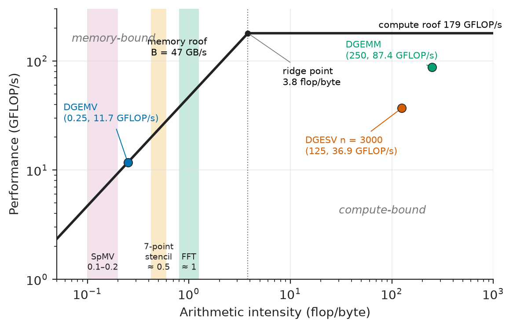
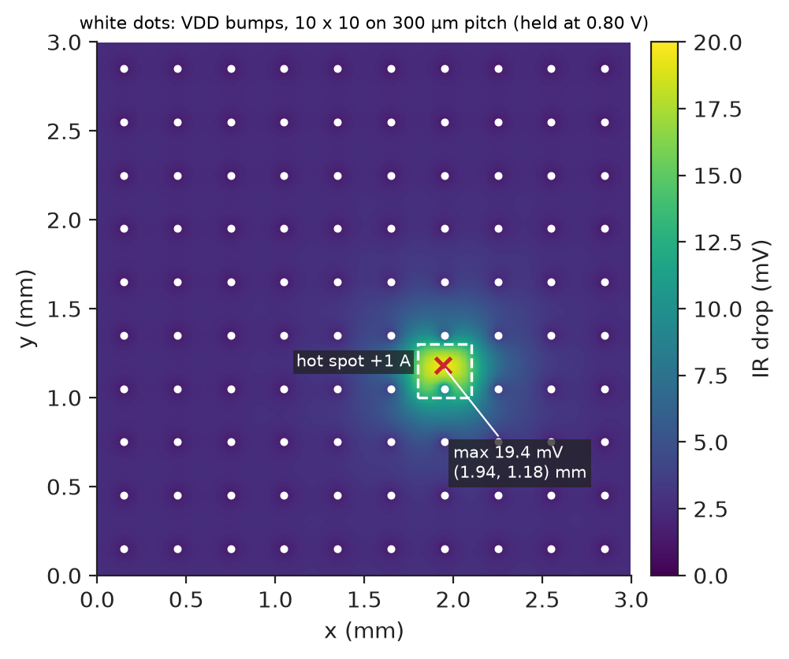
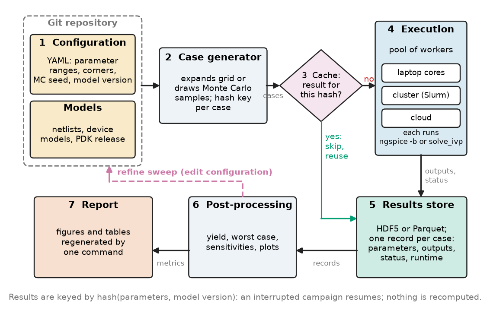
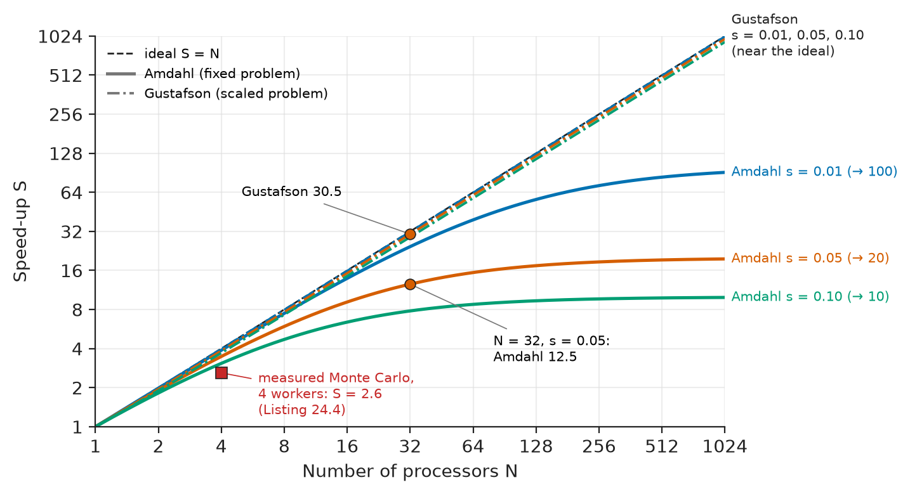
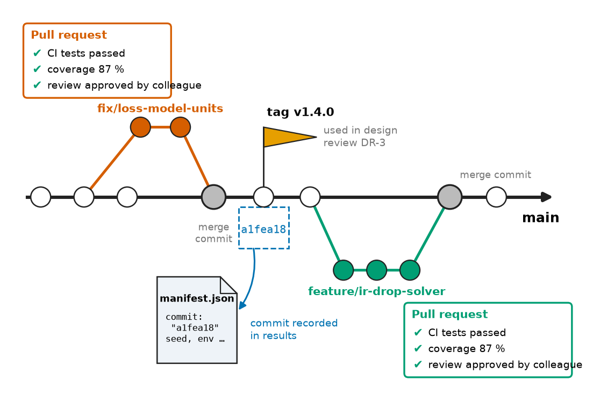

# Chapter 24 — Scientific Computing

*Part V · Programming and Computational Systems*

A power-electronics team runs a Monte Carlo study of a 48 V to 12 V converter: 4000 component draws at five temperatures, each a 40-second transient simulation. On the lead engineer's laptop it takes nine hours. A colleague parallelises it across the 32 cores of a workstation and gets a speed-up of three, not thirty: every worker process also started eight BLAS threads, and 256 threads fought over 32 cores. When the run finally finishes, the yield is 91.2 %; a rerun on the build server gives 90.7 %, and nobody can say which is right, because the random seed, the library versions and two edited model files were never recorded. A month later a "small cleanup" of the post-processing script silently changes the efficiency numbers in the design report, and no test notices. None of these failures is a physics or circuit problem. Each is a failure of the computing practice around the engineering: matrix libraries, parallel execution, profiling, numerical precision, reproducibility, testing and version control. This chapter collects that practice.

> **How are large engineering computations organised so that they run fast on real hardware: matrix libraries, sparse solvers, parallel cores and GPUs, profiling?**
> **How are their results made trustworthy: precision choices, recorded environments, automated tests and version-controlled collaboration?**

| Concept | Engineering destination |
|---|---|
| Numerical computing environments | Choosing between Python, MATLAB, Julia and compiled code for a team and a task |
| Matrix computation | Circuit and power-grid solvers, state-space models, FEM thermal and field models |
| Scientific data formats | Exchanging S-parameters, waveforms, disturbance records and simulation output |
| Simulation workflows | Corner, sweep and Monte Carlo campaigns; batch SPICE; co-simulation |
| Parallel computing fundamentals | Speeding up yield studies, EM solvers and design-space exploration |
| Performance profiling | Finding the 10 % of code that takes 90 % of the time before optimising |
| Numerical precision | float32 versus float64 on GPUs, phase accumulators, simulator tolerances |
| Reproducibility | Qualification reports that can be regenerated and audited |
| Software testing | Catching regressions in analysis scripts, models and firmware tools |
| Version control and collaboration | Shared code, models and data across a team with review and CI |

**Roadmap.** The environments (24.1) → dense and sparse matrix computation on real hardware (24.2) → data formats for exchange and archive (24.3) → simulation workflows (24.4) → parallel computing and its limits (24.5) → profiling (24.6) → precision as a design choice (24.7) → reproducibility at campaign scale (24.8) → testing (24.9) → Git and collaborative workflows (24.10).

---

## 24.1 Numerical computing environments

> **Boundary.** The mathematics of numerical computation (floating-point arithmetic, conditioning and stability, the cost and accuracy of LU, QR, SVD and eigenvalue algorithms, iterative and sparse solvers, Monte Carlo, reproducibility and the testing of numerical code) is in *The Mathematics Universe*, [Ch. 22](https://github.com/The-Studio-of-Sadiq/engineering-mathematics/blob/main/part-7-numerical-computational/22-numerical-methods.md) and [Ch. 24](https://github.com/The-Studio-of-Sadiq/engineering-mathematics/blob/main/part-7-numerical-computational/24-computational-mathematics.md). Python as a laboratory tool is Chapter 22 of this book, and algorithms and data structures Chapter 23. This chapter covers the engineering practice of computing at scale.

An engineering computation lives in an **environment**: a language, its numerical libraries, an editor or notebook, and the tooling for packages, tests and builds. All the mainstream environments call the same compiled kernels underneath (BLAS and LAPACK for linear algebra, FFTW-class FFTs, SUNDIALS-class ODE solvers), so for large array operations their speed is similar. They differ in licensing, ecosystem, speed of user-written loops, and fit to the engineering domain.

| Environment | Strengths | Weaknesses | Typical EEE use |
|---|---|---|---|
| Python (NumPy, SciPy, pandas, Jupyter) | Free; huge ecosystem; instrument control, ML, web, automation in one language | Interpreted loops slow; packaging needs discipline | Test automation, data analysis, ML, scripting EDA tools |
| MATLAB / Simulink | Polished toolboxes (control, signal, power systems, HDL Coder, code generation for MCUs); industry standard in control and automotive | Licence cost; closed source; loops historically slow (now JIT-compiled) | Control design, model-based design, Simulink to embedded C |
| Julia | Compiled (LLVM JIT) loops as fast as C with MATLAB-like syntax; strong differential-equation and optimisation packages | Smaller ecosystem; first-run compilation latency | Large ODE/DAE models, power-system dynamics, optimisation |
| C, C++, Fortran with libraries (Eigen, LAPACK, PETSc, Trilinos) | Full control and speed; HPC standard | Slow to write; memory errors | Production solvers (SPICE engines, FEM codes), embedded targets |

Mixed environments are the norm: Python calls compiled cores through **Cython**, **pybind11** or **f2py**, and **Numba** JIT-compiles numerical functions. A loop that runs $10^8$ times must run in compiled code; almost nothing else needs to.

---

## 24.2 Matrix computation

### BLAS, LAPACK and their implementations

Nearly every engineering simulation ends in linear algebra: a circuit's nodal matrix at every Newton step, a power-flow Jacobian, a finite-element stiffness matrix. The standard interfaces are **BLAS** (Basic Linear Algebra Subprograms) and **LAPACK** (Linear Algebra PACKage). BLAS defines three levels of kernels, vector–vector, matrix–vector and matrix–matrix; why only level 3 can reuse data in cache, and the blocked algorithms that recast LU and QR in level-3 form, are explained in *The Mathematics Universe*, [Ch. 24 §24.1](https://github.com/The-Studio-of-Sadiq/engineering-mathematics/blob/main/part-7-numerical-computational/24-computational-mathematics.md), with the flop counts of each factorisation in §24.3. LAPACK names its routines by a code: a precision letter (`s`, `d`, `c`, `z` for single, double, complex single, complex double), a matrix type (`ge` general, `po` symmetric positive definite, `sy` symmetric, `gb` banded, `tr` triangular) and an operation (`sv` solve, `trf` factor, `trs` solve with factors, `ev` eigenvalues, `svd`). So `dgesv` solves a general double-precision system by LU, `dpotrf` computes a Cholesky factor, and `zgeev` finds eigenvalues of a complex matrix. NumPy's `linalg.solve` calls `dgesv`.

Implementations (**OpenBLAS**, the NumPy default; **Intel oneMKL**; **AOCL-BLIS**; **Apple Accelerate**; **cuBLAS** on GPUs) tune the kernels to each processor, can differ by a factor of two on the same hardware, and are multithreaded by default.

### Peak, bandwidth and the roofline

A processor's **peak floating-point rate** is cores × clock × floating-point operations per cycle per core. A core with AVX2 and two 256-bit fused multiply–add (FMA) units does $2\times4\times2=16$ double-precision flops per cycle; a server core with two 512-bit FMA units does 32. The laptop used for this chapter, a four-core Core i7-1165G7 at a 2.8 GHz base clock with 16 double-precision flops per cycle per core, has a nominal peak of $4\times2.8\times16=179$ GFLOP/s. Its memory delivers roughly 47 GB/s in practice. The **roofline model** combines the two: a kernel that performs $I$ flops per byte moved from memory (its **arithmetic intensity**) can run no faster than

$$
P_{\text{attainable}}=\min\left(P_{\text{peak}},\;I\cdot B_{\text{mem}}\right).
$$

> **Status of the principle: Roofline bound**
> *Approximate.* A kernel cannot exceed either the arithmetic peak or the rate at which memory delivers its operands; the bound ignores cache reuse effects beyond the chosen memory level, latency limits and instruction overheads, so measured performance lies below the roof, often well below it for irregular access.

Listing 24.1 measures three kernels on that laptop.

```python
import time
import numpy as np

def gflops(f, flops, reps=5):
    f(); best = min(timed(f) for _ in range(reps))     # warm up, then best of reps
    return flops / best / 1e9, best
def timed(f):
    t0 = time.perf_counter(); f(); return time.perf_counter() - t0

rng = np.random.default_rng(0)
n = 3000
A, B = rng.standard_normal((n, n)), rng.standard_normal((n, n))
x, b = rng.standard_normal(n), rng.standard_normal(n)
for name, f, fl in [("dgemv  y = A x", lambda: A @ x, 2 * n**2),
                    ("dgemm  C = A B", lambda: A @ B, 2 * n**3),
                    ("dgesv  A x = b", lambda: np.linalg.solve(A, b), 2 * n**3 / 3)]:
    g, t = gflops(f, fl)
    print(f"{name}: {t*1e3:8.2f} ms  {g:6.1f} GFLOP/s")
```

```text
dgemv  y = A x:     1.54 ms    11.7 GFLOP/s
dgemm  C = A B:   617.59 ms    87.4 GFLOP/s
dgesv  A x = b:   487.47 ms    36.9 GFLOP/s
```

*Listing 24.1 — Measured rates of matrix–vector product, matrix–matrix product and LU solve (OpenBLAS, four-core laptop; numbers vary by machine and run).*

**Worked example — reading the roofline.** The matrix–vector product reads each of the $n^2$ doubles of $A$ once (8 bytes) and does 2 flops with it, so $I=0.25$ flop/byte. The roofline predicts at most $0.25\times47=11.7$ GFLOP/s, which is what the measurement shows: DGEMV is memory-bound, and a faster processor with the same memory would not speed it up. The matrix–matrix product performs $2n^3=5.4\times10^{10}$ flops on $3n^2$ doubles (216 MB), an intensity of $2n^3/(24n^2)=n/12=250$ flop/byte, far to the right of the ridge point $179/47\approx3.8$ flop/byte (Figure 24.1). It is compute-bound and reaches 87 GFLOP/s, about half the nominal peak. The shortfall is normal for a laptop that lowers its clock under sustained vector load. LU with partial pivoting achieves 37 GFLOP/s at this size, because its panel factorisation steps are level-2 operations; the fraction rises with $n$. The practical consequences are general. A sparse matrix–vector product (about 0.1 to 0.2 flop/byte in CSR double precision), an FFT (about 1 flop/byte) and an explicit time-stepping stencil are bandwidth-bound everywhere. Their speed is improved by touching memory less (blocking, fusing operations, using `float32`), not by adding cores beyond the point where the memory bus saturates.

<!-- FIGURE 24.1 | figures/ch24/fig-24-1-roofline-laptop.png | plot | Roofline of the four-core laptop used in this chapter with the measured kernels of Listing 24.1. | Content: log-log axes, x arithmetic intensity 0.05 to 1000 flop/byte, y performance 1 to 300 GFLOP/s. Sloped memory roof B = 47 GB/s from bottom left, horizontal compute roof at 179 GFLOP/s, ridge point at 3.8 flop/byte marked. Measured points: DGEMV at (0.25, 11.7) on the sloped roof; DGESV n = 3000 at (about 125, 36.9); DGEMM at (250, 87.4). Indicated ranges as shaded bands: sparse matrix-vector product 0.1 to 0.2 flop/byte, FFT about 1 flop/byte, 7-point stencil about 0.5 flop/byte. Labels memory-bound region left, compute-bound region right. -->



*Figure 24.1 — Roofline of the four-core laptop used in this chapter with the measured kernels of Listing 24.1.*

### Factor once, solve many

The most valuable matrix-computation habit in engineering simulation is to separate **factorisation** from **solution**. LU costs about $\tfrac23n^3$ flops; each subsequent solve with the stored factors costs $2n^2$ (*The Mathematics Universe*, Ch. 24 §24.3, cost summary). A linear circuit integrated with a fixed time step, a frequency sweep at one frequency with many excitations, a sensitivity analysis and an adjoint computation all solve the same matrix with many right-hand sides.

**Worked example — a fixed-step transient of a linear network.** A linear RC interconnect model with $n=1000$ nodes is integrated for 1000 time steps with backward Euler at a fixed step, so the system matrix $G+C/h$ never changes. Calling `solve` at every step costs $1000\times\tfrac23\times10^9=6.7\times10^{11}$ flops. Calling `scipy.linalg.lu_factor` once and `lu_solve` at each step costs $\tfrac23\times10^9+1000\times2\times10^6=2.7\times10^9$ flops, 250 times less. At the 37 GFLOP/s measured above, that is 18 s against 0.07 s. SPICE engines go one step further. A nonlinear circuit changes its matrix *values* at every Newton iteration but not its *sparsity pattern*, so the ordering and symbolic factorisation are computed once and only the numeric factorisation is repeated (*The Mathematics Universe*, [Ch. 24 §24.5](https://github.com/The-Studio-of-Sadiq/engineering-mathematics/blob/main/part-7-numerical-computational/24-computational-mathematics.md)).

### Sparse matrices in practice: on-chip IR drop

Engineering matrices are sparse: a node connects to a handful of neighbours. Storage formats (CSR, CSC, COO), fill-reducing orderings and the choice between sparse direct and preconditioned iterative solvers are developed in *The Mathematics Universe*, Ch. 24 §24.4–24.5. Listing 24.2 applies them to a problem every chip team solves before tape-out: the static **IR drop** of an on-chip power grid. The top-metal VDD mesh of a 3 mm × 3 mm die is modelled as a 300 × 300 grid of nodes at 10 µm pitch with 0.1 Ω per segment. Flip-chip VDD bumps every 300 µm hold their nodes at 0.80 V, and the logic draws 4 A spread uniformly plus an extra 1 A in a 300 µm × 300 µm hot spot.

```python
import numpy as np
import scipy.sparse as sp
from scipy.sparse.linalg import spsolve, cg

k, R_seg, vdd = 300, 0.1, 0.80              # 300 x 300 grid, 10 um pitch, 0.1 ohm per segment
n = k * k
idx = np.arange(n).reshape(k, k)
pads = np.zeros((k, k), bool); pads[15::30, 15::30] = True     # VDD bumps every 300 um
I = np.full((k, k), 4.0 / n)                                    # 4 A spread uniformly
I[100:130, 180:210] += 1.0 / 900                                # +1 A hot spot, 300 x 300 um

# Conductance (graph Laplacian) of the mesh, assembled in COO form
g = 1 / R_seg
right = (idx[:, :-1].ravel(), idx[:, 1:].ravel()); down = (idx[:-1, :].ravel(), idx[1:, :].ravel())
rows = np.concatenate([right[0], down[0]]); cols = np.concatenate([right[1], down[1]])
G = sp.coo_matrix((np.full(rows.size, -g), (rows, cols)), shape=(n, n))
G = (G + G.T).tocsr()
G = G - sp.diags(np.asarray(G.sum(axis=1)).ravel())            # row sums zero: KCL
# Pads held at VDD: eliminate them, solve for the drop d = VDD - v at the free nodes
free = ~pads.ravel()
Gff = G[free][:, free].tocsc()
d = np.zeros(n)
d[free] = spsolve(Gff, I.ravel()[free])
it = []
d_cg, info = cg(Gff, I.ravel()[free], rtol=1e-10, maxiter=5000, callback=lambda xk: it.append(1))
print(f"unknowns {Gff.shape[0]}, nonzeros {Gff.nnz}, density {Gff.nnz/Gff.shape[0]**2:.1e}")
r, c = np.unravel_index(d.argmax(), (k, k))
print(f"worst IR drop {d.max()*1e3:.1f} mV ({100*d.max()/vdd:.1f} % of VDD) at node ({r}, {c})")
print(f"CG: {len(it)} iterations, max difference {np.abs(d_cg - d[free]).max()*1e6:.3f} uV")
```

```text
unknowns 89900, nonzeros 447900, density 5.5e-05
worst IR drop 19.4 mV (2.4 % of VDD) at node (118, 194)
CG: 778 iterations, max difference 0.000 uV
```

*Listing 24.2 — Static IR drop of a 300 × 300 on-chip power grid by sparse direct and conjugate-gradient solves.*

**Worked example — IR-drop sign-off.** The grid has 89 900 unknown node voltages (90 000 nodes less 100 bump nodes) and five nonzeros per row; only $5.5\times10^{-5}$ of the matrix is nonzero. Stored densely it would need $89\,900^2\times8$ bytes = 64.7 GB, and LU would take $\tfrac23n^3=4.8\times10^{14}$ flops, about 1.7 hours at 80 GFLOP/s. The sparse direct solve takes a few seconds on the laptop, and conjugate gradients, valid because the conductance matrix is symmetric positive definite, agrees to well under a microvolt after 778 unpreconditioned iterations. The worst drop, 19.4 mV or 2.4 % of the 0.80 V supply, sits inside the hot spot, midway between two bumps (Figure 24.2); away from it the uniform load alone dips only about 2.7 mV between bumps. A typical static budget is 2–3 % of VDD, with a similar allowance for dynamic droop, so this design is marginal: the fix is a bump, or a wider top-metal strap, over the hot block. Production tools solve the same equations for $10^8$–$10^9$ nodes with multigrid-preconditioned CG. The physics is Kirchhoff's current law, *Circuits, Signals and Communications*, [Ch. 2](https://github.com/The-Studio-of-Sadiq/Circuits-Signals-and-Communications/blob/main/part-1-circuit-fundamentals/02-fundamental-circuit-laws.md); the engineering is in the sparse linear algebra.

<!-- FIGURE 24.2 | figures/ch24/fig-24-2-ir-drop-map.png | plot | Static IR-drop map of the 300 by 300 on-chip VDD grid of Listing 24.2, with the hot spot and bump locations. | Content: heat map over a 3 mm by 3 mm die, x and y axes in mm from 0 to 3, colour scale voltage drop 0 to 20 mV (perceptually uniform colour map). VDD bumps drawn as small white dots on a 300 um pitch (10 by 10 array, first at 0.15 mm). Uniform background drop forming shallow bowls of about 2.5 to 2.7 mV between bumps; hot-spot rectangle outlined at x 1.80 to 2.10 mm, y 1.00 to 1.30 mm, with the maximum 19.4 mV marked inside it near x 1.94 mm, y 1.18 mm, midway between bumps. Colour bar labelled IR drop (mV). -->



*Figure 24.2 — Static IR-drop map of the 300 by 300 on-chip VDD grid of Listing 24.2, with the hot spot and bump locations.*

---

## 24.3 Scientific data formats

### What a scientific format must carry

A data file is useful only if another program, years later, can read it correctly: the numbers in a defined binary layout (type, byte order, shape), the **metadata** that gives them meaning (units, sample rate, axes, reference impedance), and efficient partial access to large datasets. Formats that carry their own structure and metadata are **self-describing**. Chapter 22 compared CSV, JSON, NPY and HDF5 for laboratory data; Table 24.1 adds the formats an EEE engineer meets in exchange with tools, vendors and other disciplines.

| Format | Domain | Standard or owner | Content and notes |
|---|---|---|---|
| HDF5 | General scientific | The HDF Group | Hierarchical groups, chunked compressed arrays, attributes; parallel I/O via MPI; basis of MATLAB v7.3 `.mat` and NetCDF-4 |
| NetCDF-4 with CF conventions | Climate, weather, ocean, increasingly power-system resource data | Unidata; CF conventions | Gridded data with named dimensions and coordinate variables; wind and solar resource datasets |
| Parquet / Arrow | Large tables | Apache | Columnar, compressed, typed; fleet telemetry, production-test databases |
| Touchstone (`.sNp`) v1.1 / v2.0 | RF and signal integrity | IBIS Open Forum | $N$-port S-, Y- or Z-parameters versus frequency, reference impedance in the header |
| IBIS / IBIS-AMI | I/O buffer models | IBIS Open Forum (ANSI/EIA-656) | Driver and receiver I–V and V–t tables; SerDes equalisation models |
| SPICE raw | Circuit simulation output | De facto (Berkeley SPICE, ngspice, LTspice variants) | Header plus binary or ASCII vectors of node voltages and branch currents |
| VCD, FST | Digital waveforms | IEEE 1364 (VCD); GTKWave (FST) | Value changes with time stamps; VCD is text and huge, FST compressed |
| COMTRADE | Power-system disturbance records | IEEE C37.111 / IEC 60255-24 | Relay and fault-recorder waveforms: configuration file plus binary data |
| EDF / EDF+ | Biomedical signals | Open specification | Multichannel EEG, ECG, polysomnography; DICOM for imaging |
| GDSII, OASIS | IC layout | De facto; SEMI P39 (OASIS) | Hierarchical polygons per layer; the tape-out deliverable |

*Table 24.1 — Data formats in EEE scientific and engineering computing.*

Three practical rules cover most of the pitfalls. **Prefer the domain standard** over a private format: a Touchstone file opens in every RF tool, and a COMTRADE record in every protection-analysis package. **Never lose the metadata**: a Touchstone file whose header says `# GHZ S MA R 50` has its frequency unit, parameter type, number format and reference impedance in that one line, and a script that ignores it will misread every value. **Check binary layout explicitly** when reading foreign files: byte order (little-endian on x86 and Arm, big-endian in some older instrument formats and in network protocols), integer width, and whether arrays are stored row-major (C, NumPy) or column-major (Fortran, MATLAB).

---

## 24.4 Simulation workflows

### From one simulation to a campaign

A single simulation answers a single question. Engineering decisions need **campaigns**: parameter sweeps for design-space exploration, **corner analysis** at process, voltage and temperature extremes (an IC is signed off at slow and fast process corners, $\pm10\,\%$ supply and −40 to 125 °C junction temperature), **Monte Carlo** analysis for yield (statistical method in *The Mathematics Universe*, [Ch. 24 §24.6](https://github.com/The-Studio-of-Sadiq/engineering-mathematics/blob/main/part-7-numerical-computational/24-computational-mathematics.md)), **design of experiments** to fit response surfaces with few runs, and optimisation loops that call the simulator hundreds of times. A workflow turns those campaigns into a repeatable pipeline (Figure 24.3).

<!-- FIGURE 24.3 | figures/ch24/fig-24-3-simulation-workflow.png | flowchart | A simulation campaign as a pipeline: configuration, case generation, cached parallel execution, post-processing and reporting, all under version control. | Content: left to right boxes. 1 Configuration (YAML: parameter ranges, corners, MC seed, model version) and Models (netlists, device models, PDK release) both in a Git repository; 2 Case generator (expands grid or draws Monte Carlo samples, assigns each case a hash key); 3 Cache check (diamond: result for this hash exists? yes -> skip); 4 Execution on a pool of workers (laptop cores, cluster via a scheduler such as Slurm, or cloud), each running ngspice -b or solve_ivp; 5 Results store (HDF5 or Parquet, one record per case with parameters, outputs, status, runtime); 6 Post-processing (yield, worst case, sensitivities, plots); 7 Report (figures and tables regenerated by one command). Arrows labelled with data passed; a dashed feedback arrow from post-processing to configuration labelled refine sweep. -->



*Figure 24.3 — A simulation campaign as a pipeline: configuration, case generation, cached parallel execution, post-processing and reporting, all under version control.*

### Ingredients of a robust workflow

- **One versioned configuration file** per campaign: parameter ranges, corners, seeds, solver options, model versions.
- **Deterministic cases.** Each case is defined by its parameters and can be rerun alone; random draws use recorded seeds, one stream per case (*The Mathematics Universe*, [Ch. 24 §24.9](https://github.com/The-Studio-of-Sadiq/engineering-mathematics/blob/main/part-7-numerical-computational/24-computational-mathematics.md)).
- **External simulators in batch mode** (`ngspice -b netlist.cir -r out.raw`), launched by `subprocess` with a timeout, captured logs and a checked exit status.
- **Caching by content.** Results are stored under a hash of the parameters *and* the model version, so an interrupted campaign resumes and a post-processing change reruns nothing.
- **Failure as data.** Record non-converged cases and report the failure rate; 3 % failures concentrated at one corner is itself a finding.
- **Workflow tools** beyond a laptop: Make or Snakemake, cluster schedulers (Slurm), and the FMI co-simulation standard to couple, say, a Simulink controller with a Modelica thermal model.

Listing 24.3 shows content-addressed caching around an LC output-filter simulation, a buck converter's output stage starting up into a 1.2 Ω load. The first pass simulates eight cases; the second finds all eight in the cache.

```python
import hashlib, json, itertools
from pathlib import Path
import numpy as np
from scipy.integrate import solve_ivp

MODEL_VERSION = "lc-filter-v2"                 # bump when the model code changes
CACHE = Path("cache"); CACHE.mkdir(exist_ok=True)

def simulate(p):                               # LC output filter of a buck, 12 V input step
    L, C, R_esr, R_load = p["L"], p["C"], p["esr"], p["R"]
    def f(t, y):                               # y = [iL, vC], 12 V input step
        iL, vC = y
        vo = (vC * R_load + iL * R_esr * R_load) / (R_load + R_esr)
        return [(12.0 - vo) / L, (iL - vo / R_load) / C]
    sol = solve_ivp(f, (0, 2e-3), [0.0, 0.0], method="Radau", max_step=1e-6, rtol=1e-8)
    return {"overshoot_pct": 100 * (sol.y[1].max() / 12.0 - 1)}

def cached(p):
    key = hashlib.sha256(json.dumps([MODEL_VERSION, p], sort_keys=True).encode()).hexdigest()
    file = CACHE / f"{key[:16]}.json"
    if file.exists():
        return json.loads(file.read_text()), False
    out = simulate(p)
    file.write_text(json.dumps({"params": p, "result": out}))
    return {"params": p, "result": out}, True

grid = {"L": [4.7e-6, 10e-6], "C": [100e-6, 220e-6], "esr": [0.005, 0.03], "R": [1.2]}
for attempt in (1, 2):
    runs = [cached(dict(zip(grid, v))) for v in itertools.product(*grid.values())]
    print(f"pass {attempt}: {sum(new for _, new in runs)} simulated, "
          f"{sum(not new for _, new in runs)} from cache")
worst = max(runs, key=lambda r: r[0]["result"]["overshoot_pct"])[0]
print("worst overshoot", round(worst["result"]["overshoot_pct"], 1), "% at", worst["params"])
```

```text
pass 1: 8 simulated, 0 from cache
pass 2: 0 simulated, 8 from cache
worst overshoot 78.2 % at {'L': 4.7e-06, 'C': 0.00022, 'esr': 0.005, 'R': 1.2}
```

*Listing 24.3 — A parameter sweep with content-addressed result caching.*

The worst case is the expected one: with $L=4.7\ \mu\mathrm{H}$ and $C=220\ \mu\mathrm{F}$ the characteristic impedance $\sqrt{L/C}=0.146\ \Omega$ is far below the 1.2 Ω load, so the filter is very lightly damped ($Q\approx8$) and a hard start-up overshoots by 78 %. That is why converters soft-start (Chapter 30). The solver choice matters too: `Radau`, an implicit method, handles the stiff combination of a 5 mΩ ESR and a 1.2 Ω load without the tiny steps an explicit method would need.

**Worked example — budgeting a Monte Carlo corner campaign.** A converter controller is to be verified at 5 process corners and 3 temperatures, with 1000 Monte Carlo samples at each, so $5\times3\times1000=15\,000$ transient simulations of 40 s each: $6\times10^5$ CPU-seconds, or 167 hours on one core. On a 32-core workstation with perfect scaling that is 5.2 hours, an overnight run. Two refinements change the plan. First, Monte Carlo error scales as $1/\sqrt N$ (*The Mathematics Universe*, Ch. 24 §24.6). Estimating a yield near 99 % to $\pm0.3\,\%$ at 95 % confidence needs $N\approx1.96^2\times0.99\times0.01/0.003^2\approx4200$ samples per condition, not 1000, so the campaign must either grow fourfold or use variance reduction. Second, if the same netlist runs with only parameter changes, a simulator that reuses its symbolic factorisation and a warm-start operating point can cut per-run time by a third. Budgeting before launching is part of the workflow.

---

## 24.5 Parallel computing fundamentals

### Levels of parallelism

Modern hardware is parallel at every level, and each level has its own programming model and cost (Table 24.2).

| Level | Hardware | Programming model | Typical granularity | Main cost |
|---|---|---|---|---|
| SIMD (vector) | AVX2 (4 doubles), AVX-512 (8 doubles), Arm NEON and SVE | Compiler auto-vectorisation, NumPy and BLAS kernels | One instruction | Data layout and alignment |
| Multicore, shared memory | 4–128 cores per socket | Threads (OpenMP, C++ threads, threaded BLAS); in Python, processes because of the GIL | Loop iterations, matrix blocks | Synchronisation, memory bandwidth |
| Multi-process, one node | Same cores | `multiprocessing`, `concurrent.futures` | Independent tasks (simulation cases) | Process start-up, data copying |
| Distributed memory | Cluster nodes over InfiniBand or Ethernet | MPI | Domain-decomposed subproblems | Communication latency and bandwidth |
| Accelerators | GPUs with thousands of lanes | CUDA, HIP, OpenCL; CuPy, PyTorch, JAX from Python | Large data-parallel arrays | PCIe transfers, FP64 throughput |

*Table 24.2 — Levels of parallel computing.* Python's global interpreter lock (GIL) lets only one thread execute Python bytecode at a time, so CPU-bound pure-Python code is parallelised with processes; NumPy and BLAS release the GIL inside their kernels, and the optional free-threaded build of CPython (3.13 and later) removes it.

### Amdahl's and Gustafson's laws

If a fraction $s$ of a program's run time is inherently serial and the rest divides perfectly among $N$ processors, the speed-up is bounded by **Amdahl's law**:

$$
S_{\text{Amdahl}}(N)=\frac{1}{s+(1-s)/N}\;\le\;\frac1s .
$$

> **Status of the principle: Amdahl's law**
> *Derived.* Follows from splitting a fixed workload into a serial part and a perfectly parallel part; it is an upper bound, since real parallel parts also pay for communication, synchronisation and load imbalance.

Amdahl's law assumes a *fixed* problem. Engineers usually do the opposite: given more processors, they run more Monte Carlo samples or a finer mesh in the same time. If the serial part stays constant while the parallel part grows with $N$, the **scaled speed-up** is given by **Gustafson's law**,

$$
S_{\text{Gustafson}}(N)=N-s\,(N-1),
$$

where $s$ is now the serial fraction of the run time on the parallel machine (Figure 24.4).

> **Status of the principle: Gustafson's law**
> *Derived.* Follows from holding the run time fixed and scaling the parallel workload with $N$; it holds when the problem can grow, as Monte Carlo sample counts and mesh sizes can, and fails for fixed-size problems.

<!-- FIGURE 24.4 | figures/ch24/fig-24-4-amdahl-gustafson.png | plot | Speed-up versus number of processors under Amdahl's law (fixed problem) and Gustafson's law (scaled problem) for serial fractions of 1, 5 and 10 percent. | Content: x-axis processors N from 1 to 1024, log2 scale; y-axis speed-up from 1 to 1024, log2 scale. Dashed diagonal: ideal S = N. Three Amdahl curves saturating at 100, 20 and 10 for s = 0.01, 0.05 and 0.10. Three Gustafson lines nearly parallel to the ideal: S = N - s(N - 1). Mark the point N = 32, s = 0.05: Amdahl 12.5, Gustafson 30.5. Mark the measured 4-worker Monte Carlo point of Listing 24.4 at speed-up 2.6. -->



*Figure 24.4 — Speed-up versus number of processors under Amdahl's law (fixed problem) and Gustafson's law (scaled problem) for serial fractions of 1, 5 and 10 percent.*

**Worked example — what 32 cores buy.** A yield study spends 5 % of its single-core time in serial work: reading the netlist, generating cases, merging results. With $N=32$ cores and a fixed 15 000-run campaign, Amdahl gives $S=1/(0.05+0.95/32)=12.5$, not 32. Even infinitely many cores could not beat $1/0.05=20$. If the team instead keeps the run time fixed and lets each core run more samples, with the serial part a constant 5 % of the parallel run time, Gustafson gives $S=32-0.05\times31=30.5$: the 32-core run does 30.5 times the work of a one-core run in the same time. The two laws describe two decisions. For a deadline on a fixed design question, attack the serial fraction first (parallel case generation, parallel I/O). For better statistics, scale the workload.

### Embarrassingly parallel campaigns in Python

Sweeps and Monte Carlo studies are **embarrassingly parallel**: cases are independent, so they can run on separate processes with no communication. Listing 24.4 computes the yield of a second-order RC low-pass filter (1 % resistors, 5 % capacitors) whose cut-off must lie within 2 % of 1 kHz, with 32 million samples in 32 chunks. Each chunk receives its own random stream spawned from one recorded seed, so the answer is identical whatever the number of workers.

```python
import time
from concurrent.futures import ProcessPoolExecutor
import numpy as np

N_CHUNKS, PER_CHUNK = 32, 1_000_000            # 32 million Monte Carlo samples in total

def chunk_yield(seed):
    """Fraction of 2nd-order RC filters (1 % R, 5 % C) with fc within 1 kHz +/- 2 %."""
    rng = np.random.default_rng(seed)
    R = 1.0e3 * (1 + 0.01 * rng.uniform(-1, 1, (PER_CHUNK, 2)))
    C = 159.15e-9 * (1 + 0.05 * rng.uniform(-1, 1, (PER_CHUNK, 2)))
    fc = 1 / (2 * np.pi * np.sqrt(R.prod(axis=1) * C.prod(axis=1)))
    return np.count_nonzero(np.abs(fc - 1e3) <= 20)

def run(workers):
    seeds = np.random.SeedSequence(20251025).spawn(N_CHUNKS)   # one stream per chunk
    t0 = time.perf_counter()
    with ProcessPoolExecutor(max_workers=workers) as pool:
        passed = sum(pool.map(chunk_yield, seeds))
    return passed / (N_CHUNKS * PER_CHUNK), time.perf_counter() - t0

if __name__ == "__main__":                     # required for process pools on Windows/macOS
    for w in (1, 4):
        y, t = run(w)
        print(f"{w} worker(s): yield = {y:.6f}   ({t:.2f} s)")
```

```text
1 worker(s): yield = 0.633043   (7.86 s)
4 worker(s): yield = 0.633043   (3.02 s)
```

*Listing 24.4 — A process-parallel Monte Carlo yield estimate whose result does not depend on the number of workers (timings from one run; they vary with machine load).*

The yield is identical to the last digit with one or four workers, because the work is divided into a fixed number of chunks, each with its own stream, rather than into "one chunk per worker". The speed-up on the four-core laptop is $7.86/3.02=2.6$. Process start-up, the serial reduction, and the drop of the turbo clock when all cores are busy account for the rest; Amdahl's law with $s\approx0.18$ reproduces it.

### The oversubscription trap and the GPU transfer trap

The opening's workstation shows the commonest parallel bug in scientific Python. Each worker process calls NumPy, and NumPy's BLAS starts one thread per core by default. With 32 workers on 32 cores, 1024 threads compete; the cores spend their time switching contexts and thrashing caches. The fix is to set `OMP_NUM_THREADS=1` (and `OPENBLAS_NUM_THREADS` or `MKL_NUM_THREADS`) in the environment of each worker, or to use `threadpoolctl`, so that parallelism happens at exactly one level.

GPUs offer 10–100 times a CPU's throughput on data-parallel work, but data must cross the PCIe bus: at about 25 GB/s (PCIe 4.0 ×16), 1 GB takes 40 ms, time in which a data-centre GPU could perform some $10^{12}$ flops. A GPU pays off when data stay resident across many operations (FDTD field solvers, neural-network training) and loses when short kernels move data back and forth.

---

## 24.6 Performance profiling

### Measure before optimising

Intuition about where a program spends its time is usually wrong. A **profiler** measures it. Deterministic profilers (Python's `cProfile`) record every function call; **sampling profilers** (`py-spy`, Linux `perf`, Intel VTune, AMD uProf, NVIDIA Nsight for GPUs) interrupt the program periodically and record where it is, with little overhead, and can be attached to a running process. **Line profilers** (`line_profiler`) attribute time to individual lines, and memory profilers (`tracemalloc`, `memray`) to allocations. The output is often shown as a **flame graph**: stacked bars for the call hierarchy, width proportional to time.

Listing 24.5 profiles a two-stage post-processing pipeline: parse 300 000 lines of a logger's text file, then compute a windowed spectrum.

```python
import cProfile, pstats
import numpy as np

def make_log(n):                                # stand-in for a 300 000-line logger file
    t = np.arange(n) / 10e3
    v = np.sin(2 * np.pi * 50 * t)
    return [f"{a:.6f},{b:.6f}" for a, b in zip(t, v)]

def parse(lines):                               # pure-Python parsing: the suspect
    return np.array([float(s.split(",")[1]) for s in lines])

def spectrum(v):
    return np.abs(np.fft.rfft(v * np.hanning(v.size)))

def pipeline(lines):
    v = parse(lines)
    return spectrum(v).argmax()

lines = make_log(300_000)
prof = cProfile.Profile()
peak = prof.runcall(pipeline, lines)
st = pstats.Stats(prof)
total = st.total_tt
for name in ("parse", "spectrum"):
    ct = next(v[3] for k, v in st.stats.items() if k[2] == name)   # cumulative time
    print(f"{name:9s} {100 * ct / total:5.1f} % of run time")
print("peak bin:", peak)
```

```text
parse      74.4 % of run time
spectrum   25.6 % of run time
peak bin: 1500
```

*Listing 24.5 — Profiling a post-processing pipeline with cProfile (shares from one run; they vary noticeably between runs on a busy machine).*

**Worked example — what optimising the hot spot can buy.** The profile attributes about three-quarters of the run time to parsing and a quarter to the FFT. The peak lands in bin 1500, which is 50 Hz at a bin spacing of $10\,000/300\,000=0.033$ Hz, as it should. Amdahl's law applies to optimisation as well as to parallelism. If parsing is made infinitely fast, the run time falls to the remaining 26 %, a speed-up of at most $1/0.256=3.9$. Optimising the FFT, the part an engineer might instinctively suspect, could gain at most $1/0.744=1.34$. Replacing the Python parsing loop with pandas' C-coded CSV reader cut parsing time about fourfold on the same machine, from roughly 0.39 s to 0.09 s, for a total speed-up of about 2.3, close to what the profile predicted. The broader rule, sometimes quoted as the 90/10 rule, is that a small fraction of the code dominates the run time.

> **Status of the principle: The 90/10 rule of program hot spots**
> *Empirical.* Across many programs, a small fraction of the code (often around 10 %) accounts for most of the execution time (often around 90 %); the exact split varies widely, which is why it must be measured for each program rather than assumed.

### Benchmarking hygiene

Timing measurements are noisy. Warm up caches, JIT compilers and FFT plans before timing; repeat and report the minimum or the median with spread; use `time.perf_counter` or `timeit`; and remember that laptops change clock with temperature and load. Code already at the memory-bandwidth roof (§24.2) gets faster only by moving less data. Profile at realistic sizes: the hot spot of a 1000-node test case may not be the hot spot at $10^6$ nodes.

---

## 24.7 Numerical precision

> **Boundary.** The IEEE 754 formats, unit roundoff, the standard model of floating-point arithmetic, cancellation, and compensated and pairwise summation are in *The Mathematics Universe*, [Ch. 22 §22.1–22.2](https://github.com/The-Studio-of-Sadiq/engineering-mathematics/blob/main/part-7-numerical-computational/22-numerical-methods.md); bit-level formats, fixed point and binary arithmetic are in Chapter 11 of this book; finite-word-length effects in DSP are in *Circuits, Signals and Communications*, [Ch. 21](https://github.com/The-Studio-of-Sadiq/Circuits-Signals-and-Communications/blob/main/part-5-digital-signal-processing/21-dsp-fundamentals.md). This section treats precision as an engineering design choice.

### Precision costs and buys

Choosing a floating-point format trades accuracy against memory, bandwidth and arithmetic throughput:

| Format | Unit roundoff | Bytes | Relative throughput (CPU SIMD) | Relative throughput (GPU) | Typical engineering use |
|---|---|---|---|---|---|
| binary64 (double) | $1.1\times10^{-16}$ | 8 | 1 | 1/64 (consumer) to 1/2 (data-centre) of FP32 | Circuit and field simulation, linear algebra, accumulation |
| binary32 (single) | $6.0\times10^{-8}$ | 4 | 2 | 1 | Large waveform sets, real-time DSP on FPU-equipped MCUs, GPU simulation |
| bfloat16 | $3.9\times10^{-3}$ | 2 | — | 2–16 on tensor units | Neural-network training and inference |
| binary16 (half) | $4.9\times10^{-4}$ | 2 | — | 2–16 on tensor units | Inference, image processing |
| FP8 (E4M3, E5M2) | $6.3\times10^{-2}$, $1.3\times10^{-1}$ | 1 | — | 2× FP16 | Inference on recent accelerators |

Halving the word length doubles the numbers per cache line and per byte of memory bandwidth, so a bandwidth-bound kernel (§24.2) runs about twice as fast in `float32` even on a CPU. On GPUs the difference is far larger: consumer graphics cards execute double precision at 1/32 or 1/64 of their single-precision rate, while data-centre accelerators keep double precision at about half the single-precision rate, at a large price premium.

### Mixed precision: fast arithmetic, accurate answers

**Mixed-precision iterative refinement** gets double-precision accuracy from single-precision factorisation. Factor $A$ in `float32` (the $O(n^3)$ part), solve, then repeatedly compute the residual $r=b-Ax$ in `float64` (an $O(n^2)$ step) and correct $x$ by solving with the single-precision factors. Each step reduces the error by about $\kappa(A)\,u_{32}$, so the method converges whenever $\kappa(A)\ll1/u_{32}\approx10^7$. Listing 24.6 demonstrates it on a matrix with condition number $10^4$.

```python
import numpy as np
from scipy.linalg import lu_factor, lu_solve

rng = np.random.default_rng(5)
n = 500
Q, _ = np.linalg.qr(rng.standard_normal((n, n)))
A = Q @ np.diag(np.logspace(0, 4, n)) @ Q.T            # condition number 1e4
x_true = rng.standard_normal(n)
b = A @ x_true

lu32 = lu_factor(A.astype(np.float32))                 # O(n^3) work in single precision
x = lu_solve(lu32, b.astype(np.float32)).astype(np.float64)
for it in range(4):
    err = np.linalg.norm(x - x_true) / np.linalg.norm(x_true)
    print(f"iteration {it}: relative error {err:.1e}")
    r = b - A @ x                                       # residual in double precision, O(n^2)
    x += lu_solve(lu32, r.astype(np.float32))           # correction from the float32 factors
x64 = np.linalg.solve(A, b)
print(f"float64 LU for comparison: {np.linalg.norm(x64 - x_true)/np.linalg.norm(x_true):.1e}")
```

```text
iteration 0: relative error 1.2e-04
iteration 1: relative error 1.3e-08
iteration 2: relative error 1.4e-12
iteration 3: relative error 3.1e-13
float64 LU for comparison: 3.4e-13
```

*Listing 24.6 — Mixed-precision iterative refinement: float32 factorisation, float64 residuals.*

The single-precision solution starts with a relative error of $1.2\times10^{-4}$, consistent with $\kappa u_{32}=10^4\times6\times10^{-8}=6\times10^{-4}$. Each refinement step multiplies the error by roughly $10^{-4}$, and after three steps the result matches the full double-precision solve. On hardware where single precision is many times faster (GPUs, tensor units), this is how linear solvers and the HPL-MxP benchmark reach double-precision accuracy at mixed-precision speed.

> **Status of the principle: Convergence of mixed-precision iterative refinement**
> *Derived.* With residuals computed in the higher precision, each correction step contracts the error by a factor of order $\kappa(A)\,u_{\text{low}}$, so refinement converges to working accuracy when $\kappa(A)\,u_{\text{low}}\ll1$ and fails when the low-precision factorisation is itself too inaccurate.

### Precision traps in engineering code

**Worked example — the phase of a long simulation.** A system-level model of a 1 MHz clock evaluates $\sin(2\pi ft)$ with $t$ stored as a time in seconds. At $t=1000$ s, the spacing of `float32` numbers near 1000 is $2^{-14}\approx6.1\times10^{-5}$ s. Rounding $t$ to it introduces up to $3.05\times10^{-5}$ s of error, which at 1 MHz is $2\pi\times10^6\times3.05\times10^{-5}=192$ rad of phase: the output is noise. In `float64` the spacing near 1000 is $1.14\times10^{-13}$ s and the phase error at most $3.6\times10^{-7}$ rad, adequate. The robust fix, used in every numerically controlled oscillator (NCO) in FPGAs and DDS chips, is to never form the large product. Accumulate phase modulo $2\pi$, or better as an unsigned integer phase accumulator that wraps exactly. A 32-bit accumulator clocked at 100 MHz has frequency resolution $10^8/2^{32}=0.023$ Hz, with no drift however long it runs.

Other traps recur. **Subnormal numbers** can slow some processors 10–100-fold when a decaying filter state approaches zero; flush-to-zero modes trade gradual underflow for speed. **Simulator tolerances** are precision settings in disguise. SPICE's defaults (`reltol=1e-3`, `abstol=1e-12` A, `vntol=1e-6` V) set the accuracy of every Newton iteration and time step; a 0.1 % relative tolerance is adequate for most analog work and inadequate for, say, 16-bit ADC linearity or oscillator phase noise, where it must be tightened by orders of magnitude. **Accumulators** need more precision than their operands: an energy meter summing $10^9$ `float32` power samples loses everything below about $10^{-7}$ of the running total, so it accumulates in double or in a wide integer.

---

## 24.8 Reproducibility

> **Boundary.** Levels of reproducibility (repeatability, reproducibility, replicability), seeded and independent random streams, floating-point non-associativity in parallel reductions, version pinning and metadata are treated in *The Mathematics Universe*, [Ch. 24 §24.9](https://github.com/The-Studio-of-Sadiq/engineering-mathematics/blob/main/part-7-numerical-computational/24-computational-mathematics.md); the laboratory side (instrument records, run folders, hashed raw data) in Chapter 22 §22.10.

### Reproducibility at campaign scale

A team campaign adds three problems to the single-script reproducibility of Chapter 22.

**Environments that can be rebuilt.** A `requirements.txt` with exact versions is the minimum. A **lock file** (from `pip-tools`, `uv`, Poetry or `conda-lock`) pins every transitive dependency with hashes. A **container image** (Docker on workstations and cloud, Apptainer/Singularity on HPC clusters) freezes the operating system libraries, compilers and BLAS as well. For commercial tools the equivalent is recording the simulator version, PDK release and licence-server feature versions, since a "minor" simulator update can change convergence defaults.

**Parallel non-determinism.** Threaded BLAS and parallel reductions sum in an order that depends on thread count and scheduling, so the last bits of results vary between runs (*The Mathematics Universe*, Ch. 24 §24.9). Where bitwise repeatability is required, for regression debugging or audit, fix the thread count and enable deterministic modes, such as Intel MKL's conditional numerical reproducibility (`MKL_CBWR`) or the deterministic-algorithm flags of GPU libraries. Otherwise compare results with tolerances derived from the error analysis. Listing 24.4 shows the other half of the discipline: the decomposition of random streams must not depend on the number of workers.

**Provenance from raw data to report.** Every number in a design report should trace to a commit, a configuration, an environment and a set of inputs, through run manifests (Chapter 22), workflow records (§24.4) and CI (§24.9). Archives deposit code, environment and data together under a persistent identifier (a DOI), following the FAIR principles: findable, accessible, interoperable, reusable.

> **Status of the principle: Reproducibility of a computational campaign**
> *Approximate.* With pinned environments, recorded seeds and parameters, version-controlled code and immutable inputs, a rerun reproduces results bitwise on the same platform and within the numerical-error tolerance across platforms; anything unrecorded (an unpinned dependency, a hand-edited file, a licence-server tool update) breaks the guarantee.

---

## 24.9 Software testing

### What to test in engineering code

Engineering software fails quietly. A sign error in a loss model produces plausible efficiency curves; a unit slip between mV and V makes a margin look ten times larger; a refactored post-processing script changes a reported number. Tests are small programs that check other programs automatically, and they are written at several levels:

| Level | What it checks | Example in EEE work |
|---|---|---|
| Unit test | One function against known values and invariants | Parallel-resistance helper, unit conversions, CRC routine, CORDIC accuracy |
| Integration test | Several components together | Netlist generator plus simulator plus parser on a reference circuit |
| Regression test | Output unchanged from a trusted reference within tolerance | Efficiency table of the validated converter model |
| Property-based test | Invariants over many generated inputs | KCL residual zero, passivity, $Z=Z^{\mathsf T}$ for reciprocal networks |
| Hardware-in-the-loop test | Software against real or emulated hardware | Firmware with a plant simulator in real time (Chapter 28) |

How to set numerical tolerances, from $\kappa\varepsilon$ for linear algebra to $Ch^p$ for discretisations and $z\cdot\text{SE}$ for Monte Carlo, and how to test convergence order with manufactured solutions, are covered in *The Mathematics Universe*, [Ch. 24 §24.9](https://github.com/The-Studio-of-Sadiq/engineering-mathematics/blob/main/part-7-numerical-computational/24-computational-mathematics.md). The engineering additions are the tooling and the habit.

### pytest in practice

**pytest** is the standard Python test runner. Any function named `test_*` in a file named `test_*.py` is a test, and plain `assert` statements are its checks. `pytest.approx` compares floats with a tolerance, `pytest.mark.parametrize` runs one test over a table of cases, and `pytest.raises` checks that bad input is rejected. Listing 24.7 tests the divider helper used in Chapter 22's worked example.

```python
import math
import numpy as np
import pytest

def parallel(*r):                                  # code under test (normally imported)
    if any(x <= 0 for x in r):
        raise ValueError("resistances must be positive")
    return 1.0 / sum(1.0 / x for x in r)

def divider_out(v_in, r_top, r_bot, r_load=math.inf):
    r_eff = r_bot if math.isinf(r_load) else parallel(r_bot, r_load)
    return v_in * r_eff / (r_top + r_eff)

@pytest.mark.parametrize("r, expected", [((1e3, 1e3), 500.0), ((3e3, 6e3), 2e3),
                                         ((1e3, 1e3, 1e3), 1e3 / 3)])
def test_parallel_known_values(r, expected):       # exact references
    assert parallel(*r) == pytest.approx(expected, rel=1e-12)

def test_parallel_properties():                    # invariants on random inputs
    rng = np.random.default_rng(0)
    for a, b in rng.uniform(1.0, 1e6, (1000, 2)):
        p = parallel(a, b)
        assert p <= min(a, b) and p == pytest.approx(parallel(b, a), rel=1e-15)

def test_divider_loading():                        # regression of a design value (Ch. 22)
    assert divider_out(30.0, 130e3, 16e3) == pytest.approx(3.2877, abs=1e-4)
    assert divider_out(30.0, 130e3, 16e3, r_load=1e6) < divider_out(30.0, 130e3, 16e3)

def test_rejects_bad_input():
    with pytest.raises(ValueError):
        parallel(1e3, 0.0)
```

```text
$ python -m pytest -q test_divider.py
......                                                                   [100%]
6 passed in 0.70s
```

*Listing 24.7 — A pytest module with exact-value, property, regression and error-handling tests.*

The four kinds of test catch different bugs. The known-value cases catch formula errors. The property test checks, over a thousand random pairs, that a parallel combination is never larger than its smallest resistor and is symmetric; it catches errors no hand-picked case would. The regression test pins the 3.2877 V design value of Chapter 22, so a "cleanup" that changes it fails immediately, and its second assertion checks the direction of an engineering effect (loading lowers the output). The error test ensures that a zero resistance is rejected instead of producing a division by zero deep inside a sweep.

### Continuous integration

Tests help only if they run. **Continuous integration** (CI: GitHub Actions, GitLab CI, Jenkins) runs the suite on every proposed change on a clean machine built from the pinned environment, and a change that breaks a test cannot be merged. CI also measures coverage (`pytest-cov`), runs linters (`ruff`, `mypy`) and regenerates key figures; for firmware it cross-compiles, runs tests in an emulator (QEMU, Renode) and, in mature teams, on a hardware-in-the-loop rack (Chapter 28).

---

## 24.10 Version control and collaborative workflows

### Git's model

**Git** is the version-control system used for nearly all code, and increasingly for models, documentation and design files. Its model is simple and worth understanding. A **commit** is a snapshot of the whole project tree, plus metadata (author, date, message) and pointers to its parent commit or commits. Each commit is named by a cryptographic hash of its content and history (SHA-1, with SHA-256 repositories now supported), so a commit hash identifies the exact state of every file, and history cannot be altered without changing every later hash. A **branch** is just a movable name for a commit; **merging** creates a commit with two parents; a **tag** names a release (`v1.4.0`). Every clone holds the full history, so work continues offline and every copy is a backup.

```text
git switch -c fix/loss-model-units        # new branch for one change
git add src/loss_model.py tests/test_loss_model.py
git commit -m "Fix mW/W slip in switching-loss term; add regression test"
git push -u origin fix/loss-model-units   # then open a pull request for review
git tag -a v1.4.0 -m "Model used for design review DR-3"   # after merge, on main
git rev-parse --short HEAD                # the hash recorded in every result manifest
```

### Team workflows

Most engineering teams use a variant of **trunk-based development with short-lived branches** (Figure 24.5). The `main` branch is always in a working, tested state. Each change, whether a fix, a feature or a model update, is made on its own branch, pushed, and proposed as a **pull request** (merge request). CI runs the tests; at least one colleague **reviews** the change, reading the diff, asking questions and checking engineering assumptions as well as code. Only then is it merged. Releases used for design reviews, qualification or production test are tagged, so a report can cite exactly `v1.4.0` or commit `a1fea18`.

<!-- FIGURE 24.5 | figures/ch24/fig-24-5-git-branch-pr-workflow.png | block-diagram | Trunk-based Git workflow with short-lived feature branches, pull-request review, CI and tagged releases. | Content: horizontal main line of commits (circles) left to right labelled main. Two short branches: fix/loss-model-units with 2 commits and feature/ir-drop-solver with 3 commits, each leaving main and merging back with a merge commit. On each branch, a box labelled pull request with checks: CI tests passed (green tick), coverage 87 percent, review approved by colleague. A tag flag v1.4.0 on a main commit after the first merge, labelled used in design review DR-3. A dashed box on one commit showing a short hash a1fea18 with an arrow to a results manifest file icon labelled commit recorded in results. -->



*Figure 24.5 — Trunk-based Git workflow with short-lived feature branches, pull-request review, CI and tagged releases.*

Good practice keeps the history useful. **Small, focused commits** with messages that say *why* make review possible and let `git bisect` find a bad commit by binary search, $O(\log n)$ test runs for $n$ commits (Chapter 23). A **`.gitignore`** keeps build products and caches out. **Large binary data** go to **Git LFS** or DVC, which keep only pointers in Git. **Notebooks** are stripped of outputs before commit (`nbstripout`). **EDA files** diff well when text-based (KiCad); binary formats are versioned but reviewed in their own tools.

**Worked example — finding a regression with bisect.** The design report's efficiency at 20 A was 97.75 % in release `v1.2.0` and is 97.31 % at the head of `main`, 120 commits later; no one remembers changing the loss model. A script that recomputes the 20 A efficiency and exits with failure if it differs from 97.75 % by more than 0.01 points serves as the test. `git bisect start main v1.2.0` followed by `git bisect run python check_eff.py` tests the midpoint commit, keeps the half that contains the change, and repeats. It finds the culprit in at most $\lceil\log_2120\rceil=7$ runs, against up to 120 for a linear search. The offending commit turns out to be a "unit cleanup" that converted a switching-loss coefficient from µJ to mJ in one place but not another. The fix, with a regression test that pins 97.75 % (as in Listing 24.7), goes through a pull request like any other change.

> **Status of the principle: Content-addressed version history**
> *Fundamental.* Because each commit's name is a cryptographic hash of its content and ancestry, a commit hash identifies one exact project state; altering any past file changes every later hash, so recorded hashes make results traceable to the code that produced them, as long as the hash function resists collisions.

The practices of this chapter reinforce one another: version control records the code, pinned environments and seeds the conditions, tests and CI guard against silent change, profiling directs optimisation, and the right kernels, formats and parallelism make the computation feasible. With them, the opening's converter team gets one yield number that anyone can regenerate, scaled across 32 cores with one level of parallelism.

---

## What remains open

| Open question | Where it is answered |
|---|---|
| How do embedded targets constrain computation: memory, power, fixed point and real-time deadlines? | Chapters 25 and 27 |
| How is firmware tested on host, emulator and hardware-in-the-loop rigs? | Chapter 28 |
| When should a computation move from a processor to an FPGA or accelerator, and how is the data movement modelled? | Chapter 35 |
| How do EDA tools apply sparse solvers, graph algorithms and parallel computing to timing, power and IR-drop sign-off? | Chapter 34 |
| How are floating-point and fixed-point formats laid out in bits, and how does binary arithmetic overflow? | Chapter 11 |
| What are the error analysis, conditioning and convergence results behind the solvers used here? | *The Mathematics Universe*, [Ch. 22](https://github.com/The-Studio-of-Sadiq/engineering-mathematics/blob/main/part-7-numerical-computational/22-numerical-methods.md) and [Ch. 24](https://github.com/The-Studio-of-Sadiq/engineering-mathematics/blob/main/part-7-numerical-computational/24-computational-mathematics.md) |
| How do finite word length and quantisation affect DSP algorithms? | *Circuits, Signals and Communications*, [Ch. 21](https://github.com/The-Studio-of-Sadiq/Circuits-Signals-and-Communications/blob/main/part-5-digital-signal-processing/21-dsp-fundamentals.md) and [Ch. 23](https://github.com/The-Studio-of-Sadiq/Circuits-Signals-and-Communications/blob/main/part-5-digital-signal-processing/23-digital-filters.md) |

**Next:** Chapter 25 opens Part VI by taking computation into the device itself: embedded-system architecture, where the processor, memory, power budget, firmware structure and boot process are chosen together around a product's real-time job.
