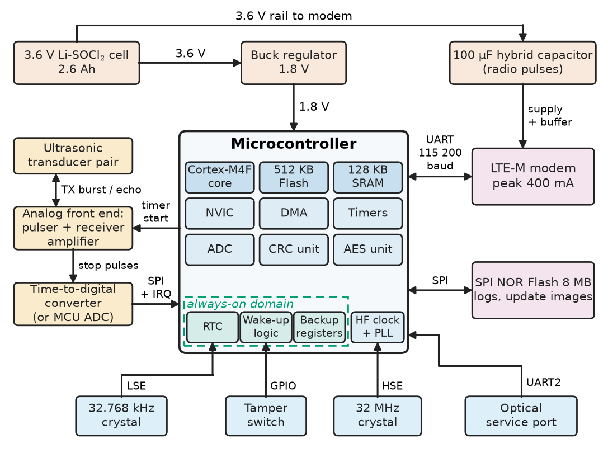
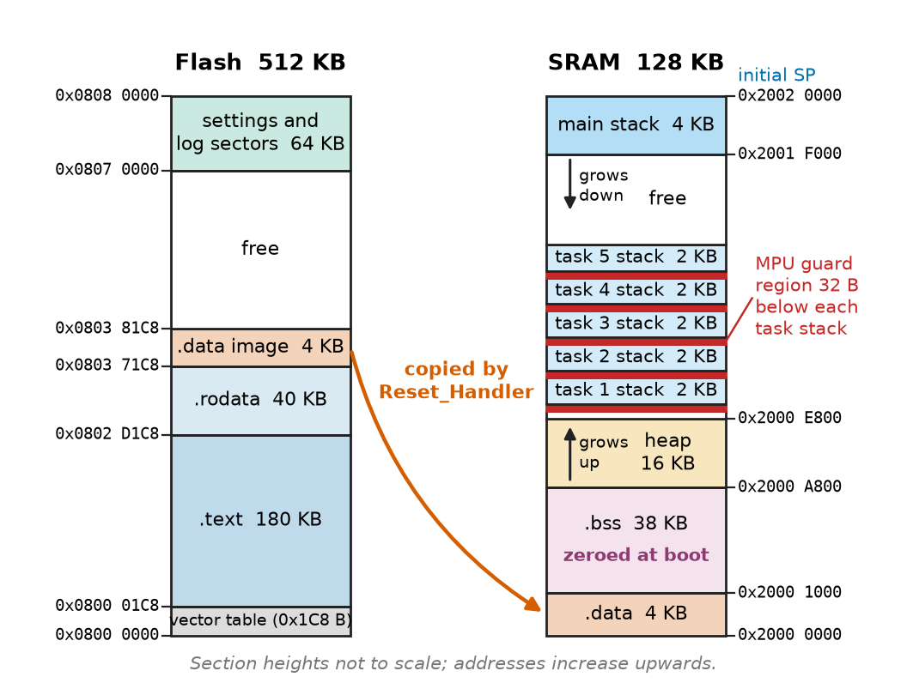
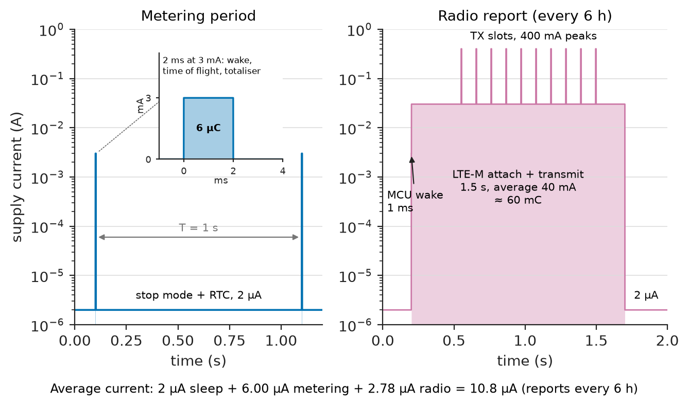
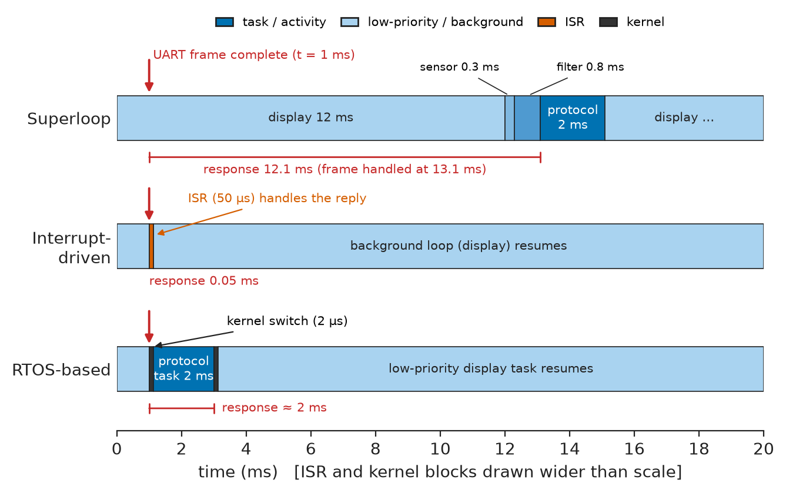
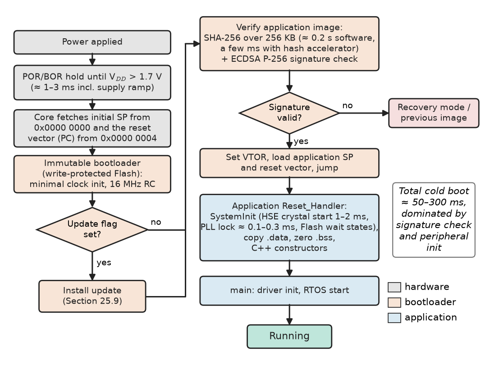
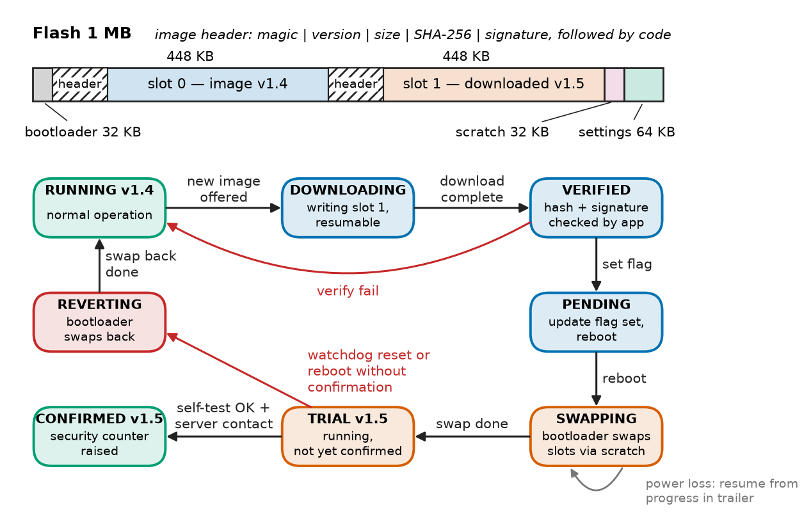

# Chapter 25 — Embedded-System Architecture

*Part VI · Embedded and Real-Time Systems*

A utility orders two hundred thousand ultrasonic water meters. Each must measure flow every second, report a reading over LTE-M four times a day, run for fifteen years on one lithium cell sealed in a potted housing, and accept firmware updates over the air because the metering standard will change during its life. The first prototype meets every functional requirement on the bench and would have flattened its battery in under five years in the field: the radio was left listening for ten seconds after each report, the microcontroller idled in a mode that kept its high-speed oscillator running, and nobody had written down an energy budget. A later pilot batch survived the battery test but bricked three hundred meters when a mains-powered gateway rebooted halfway through an update. None of this is a coding bug in the ordinary sense. It is architecture: which work goes into hardware and which into software, which microcontroller, how much memory and energy each activity may spend, how the firmware is structured, how the processor gets from reset to `main`, and how a new image replaces the old one without ever leaving the device unable to boot.

> **How is an embedded system decomposed into hardware, firmware and peripherals, and how are its microcontroller, memory and energy chosen against measurable budgets?**
> **Which firmware structure fits which timing problem, and how does a device boot and update itself safely in the field?**

| Concept | Engineering destination |
|---|---|
| Embedded-system models | Specifying sensor nodes, motor controllers, ECUs and medical devices as reactive, time-bounded systems |
| Hardware–software partitioning | Deciding what timers, DMA, CRC and crypto blocks do so the CPU does not have to |
| Microcontroller selection | Choosing core, memory, peripherals, package and supply for a product and its life cycle |
| Memory constraints | Linker budgets, stack sizing, Flash endurance and data logging that survives fifteen years |
| Power constraints | Average-current budgets, power modes and battery life of duty-cycled devices |
| Firmware architecture | Superloop, interrupt-driven and RTOS-based designs and their worst-case response |
| Peripheral drivers | Register access, interrupt and DMA drivers, buffering between ISRs and tasks |
| Boot processes | Reset vector to `main`, clock and memory initialisation, multi-stage boot chains |
| Firmware updates | Bootloaders, A/B slots, signed images, rollback and secure OTA updates |

**Roadmap.** What an embedded system is and how it is modelled (25.1) → the system-level split between hardware and software (25.2) → choosing the microcontroller (25.3) → budgeting memory (25.4) and energy (25.5) → structuring the firmware (25.6) and its drivers (25.7) → how the device starts (25.8) and how it replaces its own firmware (25.9).

---

## 25.1 Embedded-system models

### What makes a system embedded

An **embedded system** is a computer built into a product whose purpose is not computing: a meter, a pacemaker, a brake controller, a drone, a protection relay, a server's baseboard management controller. Four properties follow from that purpose and drive every decision in this part of the book.

1. **Dedicated function.** The software is fixed at design time and updated rarely; the hardware is sized for that function and no more, because the bill of materials is multiplied by production volume.
2. **Reactive and time-bounded.** The system responds to events in the physical world (a pulse from a flow sensor, a CAN frame, a fault current) within deadlines set by physics rather than by user patience. Chapter 27 develops the timing theory.
3. **Resource-constrained.** Memory is kilobytes to a few megabytes, energy may come from a coin cell or a harvester, and the processor runs at tens to hundreds of megahertz.
4. **Unattended and long-lived.** Nobody presses reset on a buried meter or a satellite. The system must recover from faults on its own and run for ten to twenty-five years.

### Models used to specify embedded behaviour

Designers describe embedded systems with a small set of models, each suited to a class of behaviour:

- **Sense–compute–actuate (dataflow).** Samples arrive periodically, are filtered and processed, and drive an output: a motor-current loop, a digital power supply, an audio pipeline. The model is a chain of blocks with rates and latencies; its timing is analysed as in Book 3, *Circuits, Signals and Communications*, [Ch. 21](https://github.com/The-Studio-of-Sadiq/Circuits-Signals-and-Communications/blob/main/part-5-digital-signal-processing/21-dsp-fundamentals.md) §21.3, and its control consequences as in [Ch. 35](https://github.com/The-Studio-of-Sadiq/Circuits-Signals-and-Communications/blob/main/part-7-control-system-fundamentals/35-control-design-fundamentals.md) §35.8.
- **Event-driven (reactive).** The system waits, an event arrives, it changes state and acts: a door controller, a protocol stack, a user interface. The natural model is a finite-state machine (Chapter 14 for the hardware form, Chapter 28 for firmware state machines).
- **Time-triggered versus event-triggered.** Time-triggered designs run every activity at a pre-planned instant (a cyclic schedule, a FlexRay slot) and are easy to verify but waste capacity; event-triggered designs are efficient and harder to bound. Most products mix both.
- **Layered.** Hardware, board support, drivers, middleware and application, each hiding the one below (Chapter 28).

<!-- FIGURE 25.1 | figures/ch25/fig-25-1-embedded-system-block-diagram.png | block-diagram | Generic architecture of a battery-powered embedded sensor node, using the ultrasonic water meter as the example. | Content: centre block microcontroller (Cortex-M4F core, 512 KB Flash, 128 KB SRAM, NVIC, DMA, timers, ADC, CRC and AES blocks drawn inside). Left: ultrasonic transducer pair -> analog front end (pulser and receiver amplifier) -> time-to-digital converter or ADC. Top: 3.6 V Li-SOCl2 cell 2.6 Ah -> buck regulator 1.8 V -> MCU, with a 100 uF hybrid capacitor for radio pulses. Right: LTE-M modem on UART (labelled 115200 baud, peak 400 mA), external SPI NOR Flash 8 MB for logs and update images. Bottom: 32.768 kHz crystal (RTC), 32 MHz crystal (HF clock), tamper switch on GPIO, optical service port on UART. Arrows labelled with interface names. Dashed boundary groups always-on domain (RTC, wake-up logic, backup registers). -->



*Figure 25.1 — Generic architecture of a battery-powered embedded sensor node, using the ultrasonic water meter as the example.*

Figure 25.1 shows the meter of the opening drawn this way. Every block on it has a budget — cost, board area, current in each mode, time per activity — and the rest of the chapter is about setting and meeting those budgets.

### The range of embedded platforms

**Table 25.1 — Representative classes of embedded systems (typical values).**

| Class | Example | Processor | Memory | Power | Software |
|---|---|---|---|---|---|
| Tiny sensor or actuator | Smoke detector, toy, battery charger | 8/16-bit or Cortex-M0+, 1–48 MHz | 4–64 KB Flash, 0.5–8 KB RAM | 0.5 µA sleep, 1–5 mA active | Superloop, interrupts |
| Connected sensor node | Water meter, asset tracker, wearable | Cortex-M4F/M33, 32–128 MHz | 256 KB–1 MB Flash, 64–256 KB RAM | 1–5 µA sleep, 5–20 mA active | RTOS, radio stack |
| Real-time controller | Motor drive, digital PSU, flight controller | Cortex-M4F/M7, DSP, 100–600 MHz | 0.5–2 MB Flash, 0.1–1 MB RAM | 0.1–1 W | RTOS or bare metal, hard deadlines |
| Safety ECU | Brake, airbag, steering controller | Lockstep Cortex-R5/TriCore, 200–400 MHz | 2–8 MB Flash | 1–3 W | AUTOSAR OS, ISO 26262 |
| Embedded Linux system | Gateway, HMI panel, camera | Cortex-A53/A72, 1–2 GHz | 256 MB–4 GB DRAM, eMMC | 1–10 W | Linux, often with a companion MCU |

---

## 25.2 Hardware–software partitioning

### The question at system level

Every function in a product can be implemented in software on the CPU, in an on-chip peripheral configured by software, in an external chip, or in custom logic (an FPGA or ASIC). **Hardware–software partitioning** is the assignment of functions to these resources so that deadlines, energy and cost are all met. At the system level treated here the question is qualitative and practical: which peripherals does the chosen microcontroller have, and which jobs should be handed to them? Chapter 35 returns to partitioning quantitatively, with performance models, accelerators and FPGAs.

The guiding observation is that a microcontroller's CPU is a scarce, serial resource, while its peripherals run in parallel and often at much lower energy per operation. A timer generating PWM costs the CPU nothing per cycle; the same waveform produced by toggling a pin in software costs the CPU everything. Good partitioning therefore moves to hardware every activity that is (a) periodic and fast, (b) bit-level and timing-critical, or (c) bulk data movement.

**Table 25.2 — Typical system-level partitioning in a microcontroller design.**

| Function | In software (CPU) | In hardware (peripheral) | Usual choice |
|---|---|---|---|
| PWM for a motor or LED | Pin toggling in a timed loop | Timer compare channels, dead-time unit | Hardware |
| Serial byte framing | Bit-banging GPIO | UART, SPI, I²C controllers | Hardware, software only for spare channels |
| Sample capture at fixed rate | Polling ADC in a loop | Timer-triggered ADC with DMA to RAM | Hardware |
| CRC of a frame or image | Table-driven loop, about 5–10 cycles/byte | CRC unit, about 1 cycle/word | Hardware for long data |
| AES, SHA-256, ECDSA | Software library | Crypto accelerator, key storage | Hardware when available (also protects keys) |
| Control law (PID, observer) | Firmware | CORDIC/FMAC units, FPGA | Software, unless the loop rate exceeds about 100 kHz |
| Protocol logic, state machines | Firmware | Rarely | Software |

> **Status of the principle: Offloading periodic and bit-level work to peripherals**
> *Approximate.* The saving holds when the peripheral can complete the job autonomously; it shrinks when the peripheral needs frequent CPU servicing (small DMA buffers, one interrupt per byte) or when configuring it costs more than the job itself.

**Worked example — Per-sample interrupts versus DMA.** A vibration monitor on a 64 MHz Cortex-M4 samples an accelerometer channel at 100 kSa/s. In the first design every conversion raises an interrupt whose handler reads the result and stores it in a buffer, costing about 60 cycles including entry and exit. The CPU load is

$$
\frac{100\,000\times 60}{64\times10^{6}}=9.4\ \%
$$

before any processing, and every other interrupt in the system now sees up to a microsecond of extra latency 100 000 times a second. In the second design a timer triggers the ADC, DMA moves each result into a 512-sample circular buffer, and the CPU is interrupted only at the half-full and full marks, once every 256 samples, or 391 times a second. At about 200 cycles per such interrupt the load falls to $391\times200/64\times10^{6}=0.12\ \%$, nearly eighty times less, and the sampling instants are now set by the timer rather than by interrupt latency, which removes sampling jitter as well (Book 3, [Ch. 19](https://github.com/The-Studio-of-Sadiq/Circuits-Signals-and-Communications/blob/main/part-4-signals-and-systems/19-sampling-and-reconstruction.md) §19.5).

### Functions outside the microcontroller

Partitioning also decides what stays off the MCU: analog front ends, radios, gate drivers and independent safety monitors such as an external watchdog (Section 27.11). A function stays off-chip when it needs a different process technology (high voltage, RF, precision analog), separate certification, or independence from the processor's failure modes.

---

## 25.3 Microcontroller selection

### Selection criteria

The microcontroller binds firmware, tools and board layout for the product's life. The criteria, roughly in the order they eliminate candidates:

1. **Peripherals and pins.** Count every interface the product needs (Chapter 26): UARTs, SPI, I²C, CAN FD, USB, Ethernet MAC, ADC channels and resolution, timer channels for PWM and capture, and the GPIO left over. A missing CAN FD controller or too few PWM channels with complementary outputs eliminates a part immediately.
2. **Compute.** Estimate the cycles per second of the heaviest work (control loops, filtering, protocol stacks, cryptography) and add a margin of at least 2 for growth over the product's life. A floating-point unit (Cortex-M4F/M7/M33F) or DSP instructions matter for control and signal processing.
3. **Memory.** Flash for code, constants and possibly two firmware images (Section 25.9); RAM for buffers, stacks and the heap of any network stack (Section 25.4).
4. **Energy.** Active current per megahertz and, for battery devices, sleep current with the RTC running and RAM retained (Section 25.5).
5. **Security.** Secure boot support, TrustZone-M (Armv8-M), a hardware crypto engine, a true random-number generator, read-out protection and key storage — increasingly required by regulation such as the EU Cyber Resilience Act and by standards such as IEC 62443 for industrial devices.
6. **Qualification and supply.** Temperature grade (commercial 0–70 °C, industrial −40–85 °C, automotive AEC-Q100 Grade 1 −40–125 °C), longevity commitments (10–15 years from some vendors), second sources, price at volume.
7. **Ecosystem.** Compilers, debuggers, RTOS ports, middleware, team experience.

### Representative parts

**Table 25.3 — Representative microcontrollers (typical datasheet values; check current datasheets before designing).**

| Part (core) | Clock | Flash / RAM | Active current | Lowest retention mode | Notable features |
|---|---|---|---|---|---|
| ATmega328P (AVR, 8-bit) | 20 MHz | 32 KB / 2 KB | about 0.2 mA/MHz at 1.8 V | 0.1 µA power-down | 1.8–5.5 V, simple, very robust I/O |
| MSP430FR5969 (16-bit) | 16 MHz | 64 KB FRAM / 2 KB | about 100 µA/MHz | 0.4 µA LPM3 with RTC | FRAM: fast, low-energy, high-endurance writes |
| STM32L073 (Cortex-M0+) | 32 MHz | 192 KB / 20 KB | about 76 µA/MHz | 0.86 µA Stop with RTC and RAM | 6 KB EEPROM, LCD driver, USB FS |
| nRF52840 (Cortex-M4F) | 64 MHz | 1 MB / 256 KB | about 52 µA/MHz (DC/DC) | 1.5–3 µA System ON with RTC | BLE 5, 802.15.4, USB, crypto cell |
| STM32F407 (Cortex-M4F) | 168 MHz | 1 MB / 192 KB | about 40 mA at 168 MHz | about 2 µA Standby | Ethernet MAC, 2×CAN, USB OTG HS, 3 ADCs |
| STM32H743 (Cortex-M7) | 480 MHz | 2 MB / 1 MB | about 100–250 mA | a few µA Standby | Caches, double-precision FPU, FD-CAN, 16-bit ADCs |
| RP2040 (2× Cortex-M0+) | 133 MHz | external QSPI / 264 KB | about 20–25 mA | about 0.2 mA dormant | Programmable I/O state machines, low cost |
| ESP32-C3 (RISC-V) | 160 MHz | external or in-package 4 MB / 400 KB | 20–30 mA CPU, about 300 mA Wi-Fi TX peaks | about 5 µA deep sleep | Wi-Fi and BLE, secure boot, flash encryption |

Active current per megahertz spans a factor of five between families and sleep current a factor of a thousand, so a meter and a drive need different chips even when both use a Cortex-M4. The most powerful part is rarely the right one: the H7's caches bring timing variability (Section 27.10) and its standby current is beyond a coin cell.

---

## 25.4 Memory constraints

### Where the bytes go

Chapter 17 introduced the memory map of a microcontroller and Chapter 18 the physics and organisation of SRAM and Flash. Here the concern is the budget. A linked firmware image is divided into sections that the linker places in Flash or RAM (Chapter 21 for compilation and linking):

- `.text` — machine code (Flash).
- `.rodata` — constant tables, strings (Flash).
- `.data` — initialised variables: stored in Flash, copied to RAM at boot (Section 25.8), so they cost both.
- `.bss` — zero-initialised variables (RAM only).
- **Stack(s)** — one main stack for interrupts and the startup code, plus one per task under an RTOS (RAM).
- **Heap** — dynamic allocation, if allowed (RAM).

<!-- FIGURE 25.2 | figures/ch25/fig-25-2-memory-layout.png | layout | Flash and SRAM layout of a Cortex-M firmware image after linking, with the boot-time copy of .data. | Content: two vertical address bars. Left bar Flash from 0x0800 0000 to 0x0808 0000 (512 KB): vector table at the bottom (0x0800 0000, 0x1C8 bytes), .text 180 KB, .rodata 40 KB, .data load image 4 KB, free space, top 64 KB labelled settings and log sectors. Right bar SRAM from 0x2000 0000 to 0x2002 0000 (128 KB): .data 4 KB, .bss 38 KB, heap 16 KB growing upward, RTOS task stacks 5 x 2 KB, free gap, main stack 4 KB at top growing downward with initial SP = 0x2002 0000. Arrow from .data load image in Flash to .data in SRAM labelled copied by Reset_Handler. Arrow at .bss labelled zeroed at boot. Small red band below each task stack labelled MPU guard region 32 bytes. -->



*Figure 25.2 — Flash and SRAM layout of a Cortex-M firmware image after linking, with the boot-time copy of .data.*

Figure 25.2 shows a typical layout. The build tools report section sizes after every link; a continuous-integration job should fail the build when Flash or RAM use crosses an agreed threshold (commonly 80 % at first release), because the product must leave room for features and security fixes over a decade.

### Static allocation and the heap

Embedded coding standards (MISRA C, AUTOSAR) restrict dynamic allocation after initialisation: `malloc` often has unbounded execution time, fragmentation can make an allocation fail after weeks of uptime, and an unattended device has no good recovery. The alternatives are static buffers, fixed-size block pools (constant-time, no fragmentation) and allocation only at start-up.

### Stack sizing

Stack overflow is the most common silent memory failure in embedded firmware, because it corrupts whatever lies below the stack without any immediate symptom. A stack must hold the deepest call chain of its task plus everything interrupts can push on top of it:

$$
S_{\text{task}}\ge S_{\text{calls,max}}+S_{\text{locals}}+\sum_{\text{nesting levels}}S_{\text{exception frame}}
$$

On a Cortex-M, each exception entry pushes 8 words (32 bytes) of basic frame, or 26 words (104 bytes) when the floating-point context is stacked as well; with RTOS-based designs the interrupt frames land on the main stack rather than on each task stack. Static analysis of the call graph (the compiler's `-fstack-usage` output, or a dedicated tool) gives a bound when there is no recursion and no function pointer whose target set is unknown; measurement by **stack painting** (filling the stack with a known pattern at boot and later finding the high-water mark) confirms it. A guard region at the bottom of each stack, enforced by the memory protection unit, turns a silent overflow into an immediate fault (Section 27.11).

> **Status of the principle: Static stack bound**
> *Derived.* The bound from the call graph is exact for programs without recursion, unbounded loops of calls or unresolved indirect calls; measurement alone only shows the deepest path that the test happened to exercise.

### Non-volatile memory and its endurance

Embedded systems store configuration, calibration and logs in non-volatile memory, and each technology has a different write model:

**Table 25.4 — Non-volatile storage for embedded data (typical values).**

| Technology | Erase unit | Write time | Endurance (cycles) | Retention |
|---|---|---|---|---|
| On-chip NOR Flash (MCU) | 2–128 KB page/sector | 10–100 µs per word; 20 ms–2 s per erase | 10 000 (some pages 100 000) | 10–20 years |
| External SPI NOR Flash | 4 KB sector, 64 KB block | 0.5–3 ms per 256 B page; 45–400 ms per 4 KB sector erase | 100 000 | 20 years |
| Emulated or true EEPROM | Byte or word | 3–5 ms | 100 000–1 000 000 | 20–40 years |
| FRAM (on-chip or SPI) | Byte, no erase | Bus speed (ns per byte) | $10^{12}$–$10^{14}$ | 10–100 years |
| SD card / eMMC (managed NAND) | Managed internally | Variable, 1–100+ ms stalls | Depends on internal wear levelling | Varies; power-fail behaviour vendor-specific |

The constraint that bites is endurance multiplied by write frequency. Flash cannot overwrite a bit from 0 to 1 without erasing a whole page, so a log or a frequently updated setting must be spread across many pages (**wear levelling**) and written as appended records rather than in place.

**Worked example — Will the log wear out the Flash?** The water meter appends a 64-byte record (timestamp, volume, temperature, status, CRC) once a minute to its on-chip Flash, which has 2 KB pages rated for 10 000 erase cycles.

- One page holds $2048/64=32$ records, so it fills every 32 minutes.
- A year has $365\times24\times60=525\,600$ minutes. If the log used a single page, that page would be erased $525\,600/32=16\,425$ times a year and would exceed its rated endurance in about seven months.
- Spread over the 64 KB settings-and-log region of Figure 25.2 (32 pages), each page is erased $16\,425/32=513$ times a year, and the rated 10 000 cycles last $10\,000/513=19.5$ years, just beyond the fifteen-year target.

The circular log holds only the last 1 024 minutes (17 hours), so long-term history goes to the head end or to the external SPI NOR. Each record carries a sequence number and CRC so that the newest valid record can be found after a power failure in mid-write.

---

## 25.5 Power constraints

### The average-current budget

A battery-powered device spends almost all of its life asleep and almost all of its energy awake. Its average current is the sleep current plus the charge of each activity divided by its period:

$$
\bar I=I_{\text{sleep}}+\sum_k \frac{I_k\,t_k}{T_k}
$$

and its life is the usable capacity divided by $\bar I$, reduced by self-discharge. The CMOS physics behind the currents — dynamic power proportional to $\alpha CV^2f$ and leakage growing with temperature — is developed in Chapter 33; here the currents are datasheet numbers and the problem is accounting.

> **Status of the principle: Charge-budget model of battery life**
> *Approximate.* It treats the battery as a fixed charge reservoir. Real cells deliver less charge at high pulse current and low temperature, and their voltage sags under load; a lithium thionyl-chloride cell that supplies 2.6 Ah at 1 mA may brown out on a 400 mA radio pulse unless a buffer capacitor carries it (Book 5, *Electrical Energy and Machines*, [Ch. 16](https://github.com/The-Studio-of-Sadiq/Electrical-Energy-and-Machines/blob/main/part-4-power-generation/16-energy-storage.md) §16.2, for capacity and rate ratings).

### Power modes

Every low-power microcontroller offers a ladder of modes that trade wake-up time and retained state for current.

**Table 25.5 — Power-mode ladder of a typical low-power Cortex-M MCU (representative values at 3 V, 25 °C).**

| Mode | What runs | What is retained | Current | Wake-up time |
|---|---|---|---|---|
| Run (from Flash, 32 MHz) | CPU, peripherals | Everything | 2–4 mA | — |
| Sleep (WFI) | Peripherals, DMA; CPU clock gated | Everything | 0.5–1.5 mA | 1–10 cycles |
| Stop / deep sleep | RTC, wake-up logic, low-power UART | RAM, registers | 1–5 µA | 5–20 µs |
| Standby | RTC, backup registers | Backup domain only (RAM lost) | 0.3–1 µA | 50 µs–1 ms (reboot) |
| Shutdown | Wake-up pins only | Nothing | 30–100 nA | Full boot |

The ladder makes a design rule: choose the deepest mode whose wake-up time and lost state the application can afford. Waking from standby means a full boot (Section 25.8), which costs time and charge each time; for an event every second it is usually better to stop with RAM retained. Leakage roughly doubles every 10–15 °C, so a sleep current quoted at 25 °C can be eight to twenty times larger at 70 °C inside a sunlit enclosure.

<!-- FIGURE 25.3 | figures/ch25/fig-25-3-duty-cycle-current-profile.png | waveform | Supply-current profile of the water meter over one metering period and over one radio report, on a logarithmic current axis. | Content: two panels. Left panel, time 0 to 1.2 s: baseline 2 uA (stop mode with RTC), a 2 ms pulse at 3 mA every 1 s (wake, measure ultrasonic time of flight, update totaliser), shaded area labelled 6 uC per event. Right panel, time 0 to 2 s around a report: MCU wake 1 ms, modem attach and transmit burst lasting 1.5 s with average 40 mA and peaks to 400 mA during transmission slots, shaded area labelled 60 mC, then return to 2 uA. Log current axis 1 uA to 1 A. Annotation: average current 10.8 uA with reports every 6 h. -->



*Figure 25.3 — Supply-current profile of the water meter over one metering period and over one radio report, on a logarithmic current axis.*

**Worked example — Will the meter last fifteen years?** The meter of Figure 25.3 sleeps at 2 µA, wakes every second for 2 ms at 3 mA to measure flow, and every six hours runs its LTE-M modem for 1.5 s at an average 40 mA. Its 2.6 Ah lithium thionyl-chloride cell is derated to 80 % usable capacity, and self-discharge is taken as 1 % of nominal capacity per year. The listing computes the budget:

```python
# Average-current and lifetime budget for a duty-cycled battery node
HOURS_PER_YEAR = 8760.0

def average_current(sleep_a, events):
    """events: list of (name, current_A, duration_s, period_s)."""
    total = sleep_a
    for name, i, t, period in events:
        share = i * t / period
        total += share
        print(f"{name:<12s} {share * 1e6:7.2f} uA")
    return total

def lifetime_years(capacity_ah, i_avg_a, usable=0.8, self_discharge=0.01):
    # self-discharge as a fraction of nominal capacity per year
    i_sd = capacity_ah * self_discharge / HOURS_PER_YEAR
    return usable * capacity_ah / (i_avg_a + i_sd) / HOURS_PER_YEAR

events = [
    ("metering", 3e-3, 2e-3, 1.0),          # wake each second, 2 ms at 3 mA
    ("radio", 40e-3, 1.5, 6 * 3600.0),      # 1.5 s LTE-M burst every 6 h
]
i_avg = average_current(2e-6, events)
print(f"average      {i_avg * 1e6:7.2f} uA")
print(f"life         {lifetime_years(2.6, i_avg):7.1f} years")
```

It prints a metering share of 6.00 µA, a radio share of 2.78 µA, an average of 10.78 µA and a life of 17.3 years. Self-discharge alone is equivalent to $2.6\times0.01/8760=2.97$ µA, comparable with the radio. Three observations follow. The once-a-second measurement, not the radio, dominates, so shaving its 2 ms awake time to 1 ms (by running the CPU faster and returning to sleep sooner, "race to sleep") is worth more than any radio optimisation. Reporting hourly instead of every six hours raises the radio share to 16.7 µA and cuts the life to 8.6 years — the margin is thin, and the requirement must say how often the meter may talk. And the prototype of the opening, which listened for 10 s after each report, added another $40\ \mathrm{mA}\times10\ \mathrm{s}$ per report, almost seven times the transmit charge; together with an idle mode that kept the high-speed oscillator running, that is how a fifteen-year design becomes a five-year one.

### Supply integrity

The brown-out reset threshold must sit above the minimum voltage for reliable Flash writes, because a write interrupted by a sagging supply corrupts its page; hence CRCs on log records, power-fail-safe updates (Section 25.9), bulk capacitance sized for radio bursts, and firmware that refuses to start an erase when the measured supply is near the threshold.

---

## 25.6 Firmware architecture

### Three structures

The **firmware architecture** is the top-level structure that decides what runs when. Three structures cover nearly all small embedded systems, and each has a worst-case response time that can be stated in advance.

**Superloop (round robin).** `main` initialises the hardware and then calls each activity in turn forever. Interrupt handlers do the minimum (capture a byte, set a flag) and the loop does the rest:

```c
#include <stdbool.h>

void board_init(void);
void sensor_sample(void);
void filter_update(void);
void protocol_handle_frame(void);
void display_refresh_if_due(void);
void sleep_until_interrupt(void);
void timer_clear_flag(void);

static volatile bool tick_10ms;          /* set by the timer ISR */
volatile bool rx_frame_ready;            /* set by the UART ISR  */

void TIM2_IRQHandler(void)
{
    timer_clear_flag();
    tick_10ms = true;
}

int main(void)
{
    board_init();
    for (;;) {
        if (tick_10ms) {
            tick_10ms = false;
            sensor_sample();             /* about 0.3 ms */
            filter_update();             /* about 0.8 ms */
        }
        if (rx_frame_ready) {
            rx_frame_ready = false;
            protocol_handle_frame();     /* up to 2 ms   */
        }
        display_refresh_if_due();        /* up to 12 ms over SPI */
        sleep_until_interrupt();         /* WFI, see text */
    }
}
```

The superloop is simple, needs no kernel and is easy to reason about. Its weakness is that every activity waits for every other: an event flagged just after its check is serviced only after a complete trip around the loop.

> **Status of the principle: Superloop worst-case response**
> *Derived.* With non-preemptive activities executed in a fixed cycle, the worst-case delay from a flag being set to its handler starting is the sum of the worst-case execution times of all activities in the loop, plus the interrupt time that steals from them.

**Worked example — Is the superloop fast enough?** In the listing the loop's worst case is $0.3+0.8+2+12=15.1$ ms of activities, plus interrupt overhead. A button press that must be acknowledged within 50 ms is served comfortably. A received protocol frame that must be answered within 5 ms (a Modbus slave with a tight master timeout, say) is not: the display refresh alone can hold it for 12 ms. The fixes are architectural. Splitting the display refresh into 1 ms slices bounds the loop at about 4.1 ms; moving the reply into the receive interrupt meets the deadline but makes the interrupt long; or the design moves to a preemptive scheduler.

The line `sleep_until_interrupt()` hides a classic defect. If an interrupt sets a flag after the loop has tested it but before the `WFI` instruction executes, the CPU sleeps with work pending until the next interrupt, up to 10 ms later. The standard cure on Cortex-M is to disable interrupts with `PRIMASK`, re-check all flags, and execute `WFI` with interrupts still masked: a pending interrupt wakes the core even when masked, and it is taken as soon as interrupts are re-enabled.

**Interrupt-driven (foreground/background).** Time-critical work moves into prioritised interrupt handlers (the foreground) while the background loop handles the rest. The response of an interrupt-level activity is now bounded by interrupt latency and higher-priority handlers rather than by the loop (Section 27.2). The price is shared data between handlers and the loop, which must be protected (Section 27.6), and long handlers that delay everything of lower priority.

**RTOS-based (preemptive multitasking).** Activities become tasks with priorities; a kernel preempts a low-priority task the moment a higher-priority one becomes ready (Section 27.8). Response times are bounded by the scheduling analysis of Chapter 27, independently of how long low-priority tasks run. The price is kernel memory, a stack per task, context-switch overhead and new defects: priority inversion, deadlock and races between tasks.

<!-- FIGURE 25.4 | figures/ch25/fig-25-4-firmware-architectures-timing.png | timing-diagram | The same event served by a superloop, an interrupt-driven design and an RTOS-based design. | Content: three horizontal timelines 0 to 20 ms, each with an event arrow at t = 1 ms (UART frame complete). Superloop row: display 12 ms (0-12 ms), then sensor 0.3 ms, filter 0.8 ms and protocol 2 ms (13.1-15.1 ms); event arrives during display, frame handled at 13.1 ms, response time bracket 12.1 ms. Interrupt-driven row: background display block interrupted at 1 ms by a short ISR (50 us) that handles the reply, response bracket 0.05 ms, background resumes. RTOS row: low-priority display task preempted at 1 ms, kernel switch (2 us), high-priority protocol task runs 2 ms, display resumes at 3 ms, response bracket about 2 ms. Legend shows ISR, task, kernel colours. -->



*Figure 25.4 — The same event served by a superloop, an interrupt-driven design and an RTOS-based design.*

Figure 25.4 compares the three on the same event. The rule is to choose the simplest structure whose worst-case response meets every deadline with margin: a superloop for a thermostat, interrupts for a controller with one fast loop, an RTOS once there are several activities with different deadlines or a network stack.

**Table 25.6 — Firmware architectures compared (typical).**

| Property | Superloop | Interrupt-driven | RTOS-based |
|---|---|---|---|
| Worst-case response | Sum of all activities | Interrupt latency plus higher-priority ISRs | Scheduling analysis (Ch. 27) |
| Kernel footprint | None | None | 5–20 KB Flash, 0.5–2 KB RAM plus stacks |
| Context-switch cost | None | Exception entry, about 12–30 cycles | Exception entry plus kernel, about 100–300 cycles |
| Typical defects | Starvation by long activities | Long ISRs, shared-data races | Priority inversion, deadlock, stack overflow |
| Typical use | Simple appliances, toys, chargers | Single-loop controllers, small sensors | Connected devices, multi-loop controllers |


---

## 25.7 Peripheral drivers

### What a driver is

A **peripheral driver** is the code that turns a block of memory-mapped registers into a service the rest of the firmware can use: "send these bytes", "start a conversion every 100 µs", "tell me when a CAN frame with this ID arrives". Chapter 17 describes the peripherals and their registers at the architecture level; Chapter 28 treats driver design, hardware abstraction and testability as disciplines. This section gives the overview that the architecture needs: the layers, the three service models and the shared-data boundary.

### Layers

Drivers are layered. At the bottom, a vendor or CMSIS header describes each peripheral as a C structure of `volatile` registers at a fixed address. Above it, a vendor HAL or low-level library wraps common sequences. The product's own driver adds buffering, error handling and an interface independent of the chip. Middleware (file systems, TCP/IP, USB stacks) and the application use only that interface. The `volatile` qualifier matters at the bottom layer: it forces the compiler to perform every register read and write in program order, because a status register can change on its own and a write to a data register has side effects. It does not make anything atomic (Section 27.5).

Two register-level hazards recur. A **read-modify-write** of a shared register (`GPIOA->ODR |= mask;`) interrupted between read and write silently undoes any change an interrupt handler made to another bit; atomic set/reset registers (`BSRR` on STM32, `OUTSET`/`OUTCLR` on nRF) exist for exactly this reason. And **clear-on-read** status flags mean that a debugger or a careless second read can lose an event.

### Polling, interrupt and DMA drivers

**Table 25.7 — The three driver service models.**

| Model | How it works | CPU cost | Latency | Use |
|---|---|---|---|---|
| Polling | Software loops on a status flag | Busy for the whole transfer | Lowest for a single short event | Start-up code, very short transfers, bootloaders |
| Interrupt | Peripheral raises an IRQ per byte or event | One ISR per event, tens of cycles each | Bounded by interrupt latency | Low-rate serial ports, buttons, timer events |
| DMA | DMA controller moves blocks; IRQ per block | One ISR per block | Block-sized buffering delay | ADC streams, SPI displays, audio, Ethernet |

The interrupt model needs a buffer between the interrupt handler, which produces data at the hardware's pace, and the task, which consumes it at its own. The standard structure is a single-producer, single-consumer ring buffer in which the handler writes only the head index and the task writes only the tail index, so no lock is needed as long as each index is updated with a single aligned store:

```c
#include <stdbool.h>
#include <stdint.h>
#include "stm32f4xx.h"   /* vendor CMSIS header: USART2, USART_SR_RXNE */

#define RX_SIZE 256u                       /* power of two */
static volatile uint8_t  rx_buf[RX_SIZE];
static volatile uint16_t rx_head;          /* written only by the ISR  */
static volatile uint16_t rx_tail;          /* written only by the task */
static volatile uint32_t rx_dropped;

void USART2_IRQHandler(void)
{
    if (USART2->SR & USART_SR_RXNE) {
        uint8_t byte = (uint8_t)USART2->DR;        /* reading DR clears RXNE */
        uint16_t next = (uint16_t)((rx_head + 1u) & (RX_SIZE - 1u));
        if (next != rx_tail) {
            rx_buf[rx_head] = byte;
            rx_head = next;                        /* publish after the data */
        } else {
            rx_dropped++;                          /* overflow is counted    */
        }
    }
}

bool uart_read_byte(uint8_t *out)
{
    if (rx_tail == rx_head)
        return false;                              /* empty */
    *out = rx_buf[rx_tail];
    rx_tail = (uint16_t)((rx_tail + 1u) & (RX_SIZE - 1u));
    return true;
}
```

The power-of-two size turns wrap-around into a mask; the head advances only after the byte is stored; overflow is counted, because a counter that rises in the field is a diagnosis. The buffer must hold all bytes that can arrive during the longest time the task may be kept from running: at 115 200 baud a byte arrives every 86.8 µs, so 256 bytes cover 22 ms. On a multicore part or with a cache between the CPU and DMA, the same pattern also needs memory barriers and cache maintenance (Section 27.5).

---

## 25.8 Boot processes

### From power-on to the reset vector

When power is applied, nothing in the processor is trustworthy until the supply is in range and a clock is running. The **power-on reset** (POR) and **brown-out reset** circuits hold the core in reset until the supply crosses its threshold (typically 1.6–2.7 V, with tens of millivolts of hysteresis); an internal RC oscillator starts within microseconds and clocks the first instructions. Reset can also come from an external pin, the watchdog (Section 27.11), a software request or a low-power wake-up, and a reset-cause register records which one, so that firmware can log it — the first piece of field diagnosis.

On an Arm Cortex-M the hardware then does exactly two things: it loads the main stack pointer from the first word of the vector table (address 0x0000 0000, normally aliased to the start of Flash) and the program counter from the second word, the **reset vector**. On a RISC-V microcontroller the reset address is a fixed implementation constant instead, but the principle is the same: the first instruction executed is at an address set by hardware.

### From the reset vector to main

The reset handler prepares the environment that C assumes, in a fixed order:

```c
#include <stdint.h>

extern uint32_t _sidata, _sdata, _edata, _sbss, _ebss, _estack; /* linker */
int main(void);
void SystemInit(void);
void Reset_Handler(void);
void Default_Handler(void);

/* GCC-specific: the linker script places .isr_vector at the start of Flash */
__attribute__((section(".isr_vector"), used))
void (* const vector_table[])(void) = {
    (void (*)(void))&_estack,   /* word 0: initial main stack pointer */
    Reset_Handler,              /* word 1: reset vector               */
    Default_Handler,            /* NMI                                */
    Default_Handler,            /* HardFault                          */
    /* ... remaining system and peripheral vectors ... */
};

void Reset_Handler(void)
{
    SystemInit();                          /* clocks, PLL, Flash wait states */
    uint32_t *src = &_sidata;
    for (uint32_t *dst = &_sdata; dst < &_edata; )
        *dst++ = *src++;                   /* copy .data from Flash to RAM */
    for (uint32_t *dst = &_sbss; dst < &_ebss; )
        *dst++ = 0u;                       /* zero .bss */
    (void)main();
    for (;;) { }                           /* main must never return */
}

void Default_Handler(void) { for (;;) { } }
```

`SystemInit` starts the external crystal, configures and locks the PLL, and — before raising the clock — sets the Flash wait states, because Flash access time does not scale with the clock: an STM32F407 at 168 MHz and 3.3 V needs 5 wait states, with a prefetch buffer and instruction cache hiding most of them. Raising the clock before the wait states is a classic cause of a board that boots in the debugger and crashes on its own. The reset handler then copies `.data` and zeroes `.bss` (Figure 25.2), runs C++ static constructors if any (`__libc_init_array` in the GNU toolchain), and calls `main`. The symbol names come from the linker script and differ between toolchains; the order does not.

<!-- FIGURE 25.5 | figures/ch25/fig-25-5-boot-flow.png | flowchart | Boot flow of a Cortex-M product with a secure first-stage bootloader, from power-on to the application's main loop, with typical durations. | Content: vertical flowchart. Power applied -> POR/BOR hold until VDD above 1.7 V (about 1-3 ms including supply ramp) -> core fetches initial SP from 0x0000 0000 and PC from 0x0000 0004 -> immutable bootloader in write-protected Flash: minimal clock init on internal 16 MHz RC -> check update flag (diamond; yes branch to install update, Section 25.9) -> verify application image: SHA-256 over 256 KB (about 0.2 s in software, a few ms with hash accelerator) and ECDSA P-256 signature check (diamond; fail branch to recovery mode / previous image) -> set VTOR, load application SP and reset vector, jump -> application Reset_Handler: SystemInit (HSE crystal start 1-2 ms, PLL lock about 0.1-0.3 ms, Flash wait states), copy .data, zero .bss, C++ constructors -> main: drivers init, RTOS start -> running. Side annotation: total cold boot about 50-300 ms, dominated by signature check and peripheral init. -->



*Figure 25.5 — Boot flow of a Cortex-M product with a secure first-stage bootloader, from power-on to the application's main loop, with typical durations.*

### Boot time

Boot time matters: an automotive ECU must answer on CAN within about 100–200 ms of wake-up, and a meter waking from standby pays each boot in charge. The contributors are the supply ramp, the crystal start-up (about 1–2 ms for an 8–25 MHz crystal, but up to one or two seconds for a 32.768 kHz watch crystal, which is why the RTC crystal is started early and left running), PLL lock (0.1–0.3 ms), image verification (Section 25.9) and peripheral and middleware initialisation, which usually dominates. Figure 25.5 shows the sequence with typical durations.

### Multi-stage boot chains

Larger systems boot in stages: a Cortex-A SoC runs mask ROM, which loads a first-stage loader into on-chip SRAM; that initialises DRAM and loads U-Boot, which loads the kernel and device tree. Secure microcontrollers use a shorter chain: an immutable bootloader verifies the application before jumping to it. Each stage that checks the signature of the next extends a **chain of trust** rooted in code and keys that cannot be modified in the field.

> **Status of the principle: Chain of trust**
> *Derived.* If every stage verifies the next before executing it and the first stage and its public key are immutable, then only signed code can run; the guarantee fails if any stage has an exploitable bug, if the root key leaks, or if debug access can bypass the first stage.

---

## 25.9 Firmware updates

### Why and how devices update

A connected device must be updatable: to fix defects, to close security vulnerabilities (now a regulatory obligation for many products — UNECE Regulation No. 156 for vehicle software updates, the EU Cyber Resilience Act for connected products), and to add features. Updating is also the most dangerous thing the device ever does to itself. The design goals are that an update can be interrupted at any instant by power loss or a dropped link without bricking the device, that only authentic images are accepted, that a bad image is rolled back automatically, and that an attacker cannot reinstall an old, vulnerable version.

### Bootloaders

A **bootloader** is a small program that runs after reset, decides which application image to run, and can install a new one. Three kinds are common:

- **ROM bootloaders** supplied by the chip vendor, entered through a boot pin or option byte, which accept an image over UART, USB DFU, CAN or I²C. They are invaluable in production programming and recovery, but they usually do not verify signatures and are disabled or locked in secured products.
- **Custom or open-source bootloaders** in protected Flash (MCUboot is the most widespread on Cortex-M, used by Zephyr and others) that verify and install images received by the application.
- **Multi-stage loaders** on Linux-class systems (U-Boot with A/B root file systems, or update frameworks such as SWUpdate, RAUC and Mender).

### Image layout and the A/B scheme

The robust layout keeps two image slots so that a complete, verified copy of a working image always exists.

**Table 25.8 — Flash partitioning of a 1 MB MCU for A/B updates (illustrative).**

| Region | Size | Contents |
|---|---|---|
| Bootloader | 32 KB | Immutable, write-protected; holds public key hash and verification code |
| Slot 0 (primary) | 448 KB | Image that runs |
| Slot 1 (secondary) | 448 KB | Downloaded candidate image |
| Scratch | 32 KB | Temporary sector for power-fail-safe swapping |
| Settings and log | 64 KB | Configuration, calibration, wear-levelled log |

<!-- FIGURE 25.6 | figures/ch25/fig-25-6-ab-update-states.png | state-diagram | Image slots and the update state machine of a power-fail-safe A/B firmware update with automatic rollback. | Content: top: horizontal Flash bar 1 MB divided into bootloader 32 KB, slot 0 448 KB (image v1.4), slot 1 448 KB (downloaded v1.5), scratch 32 KB, settings 64 KB; each image drawn with header (magic, version, size, SHA-256, signature) followed by code. Bottom: state diagram with states RUNNING v1.4, DOWNLOADING (writing slot 1, resumable), VERIFIED (hash and signature checked by application), PENDING (update flag set, reboot), SWAPPING (bootloader swaps slots sector by sector via scratch, progress recorded in trailer so a power loss resumes), TRIAL v1.5 (running, not yet confirmed), CONFIRMED v1.5 (security counter raised), REVERTING (swap back) . Transitions: download complete -> VERIFIED; verify fail -> RUNNING; reboot -> SWAPPING; swap done -> TRIAL; self-test passed and server contact -> CONFIRMED; watchdog reset or reboot without confirmation -> REVERTING -> RUNNING v1.4. -->



*Figure 25.6 — Image slots and the update state machine of a power-fail-safe A/B firmware update with automatic rollback.*

The sequence (Figure 25.6) runs as follows. The application downloads the new image into slot 1 while the old image keeps running, writing it in chunks that can be resumed after a dropped connection. It verifies the hash and signature and sets an update-pending flag. On reboot the bootloader verifies the image again — it trusts nothing the application says — and swaps the slots sector by sector through the scratch sector, recording its progress in a trailer so that a power failure mid-swap resumes where it stopped. The new image boots in **trial** state; if it passes its self-tests and reaches its server it **confirms** itself, and otherwise the next reset, whether a watchdog timeout or a deliberate reboot, makes the bootloader swap the old image back. Designs with execute-in-place from either slot avoid the swap (the bootloader simply jumps to the newer valid slot) at the cost of position-independent or twice-linked images; designs short of Flash use a single slot plus an external SPI Flash for the download, keeping the external copy until the new image is confirmed.

The bootloader's decision logic is short, and every line of it is load-bearing:

```c
#include <stdbool.h>
#include <stdint.h>

typedef struct {
    uint32_t magic;          /* marks a header; MCUboot uses 0x96f3b83d   */
    uint32_t version;        /* monotonic security version, anti-rollback */
    uint32_t image_size;     /* bytes of code following the header        */
    uint8_t  sha256[32];     /* hash of header fields and code            */
    uint8_t  signature[64];  /* ECDSA P-256 (r, s) over the hash          */
} image_header_t;

bool image_valid(const image_header_t *h);  /* magic, size, hash, signature */
bool update_pending(void);
bool trial_unconfirmed(void);
uint32_t security_counter(void);            /* in one-time-programmable bits */
void swap_slots_resumable(void);
void mark_trial(void);
void recovery_mode(void);                   /* never returns */
void jump_to_image(const image_header_t *h);

void boot_main(const image_header_t *slot0, const image_header_t *slot1)
{
    if (update_pending() && image_valid(slot1) &&
        slot1->version >= security_counter()) {
        swap_slots_resumable();             /* new image into slot 0  */
        mark_trial();                       /* app must confirm it     */
    } else if (trial_unconfirmed()) {
        swap_slots_resumable();             /* revert to the old image */
    }
    if (!image_valid(slot0))
        recovery_mode();                    /* never run a bad image   */
    jump_to_image(slot0);                   /* set VTOR and MSP, branch */
}
```

`jump_to_image` writes the image's vector-table address into the `VTOR` register, loads the main stack pointer from the image's first word and branches to its reset vector — exactly what the hardware does at reset (Section 25.8), repeated in software. Interrupts must be disabled and every peripheral the bootloader used returned to its reset state first, or the application inherits a half-configured system.

### Securing the update

**Authenticity.** Images are signed by the manufacturer with a private key kept in a hardware security module; the device holds only the public key (or its hash) in immutable storage and verifies an ECDSA P-256 or Ed25519 signature over the image hash. A CRC detects accidental corruption but provides no security, because anyone can compute one.

**Confidentiality.** If the firmware contains intellectual property or secrets, the image is also encrypted (AES with a device or fleet key), and the device decrypts it while installing.

**Anti-rollback.** A monotonic **security counter**, stored in one-time-programmable fuses or a protected counter, records the minimum acceptable version. Raising it only after the new image confirms itself prevents an attacker from reinstalling a signed but vulnerable old image, without preventing rollback of a faulty update to the immediately previous version when the counter was not raised.

**Manifest and transport.** The device fetches a signed **manifest** describing the image (version, size, hash, applicability to the hardware revision, dependencies), as standardised by the IETF SUIT architecture (RFC 9019), then the image itself over TLS or DTLS, BLE, CAN (UDS-based flashing in vehicles) or a local service port.

**Worked example — The cost of one over-the-air update.** The meter receives a 256 KB image over LTE-M.

- At an effective application throughput of 100 kbit/s, the download takes $256\times1024\times8/100\,000=21$ s. At an average modem current of 150 mA during the transfer, it consumes $21\times0.15=3.1$ C, or 0.87 mAh, about 0.03 % of the cell's 2.6 Ah. A yearly update is affordable; a design that retries a failed download from the beginning a hundred times in a poor-coverage cellar is not, which is why downloads must resume from the last good chunk.
- Writing the image erases and programs 256 KB of Flash; with 2 KB pages at about 20 ms per page erase that is $128\times20\ \mathrm{ms}=2.6$ s of erase time, during which code executing from the same Flash bank may stall. Dual-bank parts, or code that runs from RAM during the write, avoid stalling time-critical interrupts.
- Verification hashes the image with SHA-256: at about 50 cycles per byte in software on a 64 MHz Cortex-M4 it takes $262\,144\times50/64\times10^{6}=0.2$ s, plus a signature check of the order of 0.1–0.2 s in software or milliseconds with a crypto accelerator. Doing it twice (application, then bootloader) is affordable and removes any reliance on the application's honesty.
- The swap through a scratch sector costs roughly three erases per sector per update; 10 000-cycle Flash permits thousands of updates.

> **Status of the principle: Power-fail-safe update**
> *Derived.* If at every instant at least one complete, verified image exists in non-volatile memory and the bootloader can determine from persistent state which one to run, an interruption at any point leaves the device bootable; the property fails if the bootloader itself is updated non-atomically or if Flash writes can be corrupted by brown-out without detection.

The bootloader is therefore minimal, almost never updated in the field, and tested harder than any other code in the product. The pilot meters of the opening bricked because their single-slot design erased the running image before the new one had been completely received.

---

## What remains open

| Open question | Where it is answered |
|---|---|
| How do GPIO, UART, SPI, I²C, CAN, USB, Ethernet and converter interfaces behave at the electrical and bit level? | Chapter 26 |
| How are interrupt latency, task scheduling, priority inversion and watchdogs analysed and designed? | Chapter 27 |
| How are hardware abstraction layers, driver modularity, state machines, low-power techniques and firmware validation engineered? | Chapter 28 |
| How are peripherals, memory maps and interrupt controllers organised inside the microcontroller? | Chapter 17 |
| How do SRAM, Flash and memory interfaces work at circuit level? | Chapter 18 |
| How are compilation, linking and embedded-oriented C written? | Chapter 21 |
| Where does CMOS dynamic and leakage power come from, and how does it scale? | Chapter 33 |
| How is partitioning between processor, FPGA and accelerator quantified? | Chapter 35 |
| How are batteries rated and managed at system level? | *Electrical Energy and Machines*, [Ch. 16](https://github.com/The-Studio-of-Sadiq/Electrical-Energy-and-Machines/blob/main/part-4-power-generation/16-energy-storage.md) |

**Next:** Chapter 26 follows the signals out of the microcontroller's pins — GPIO electrical limits, the serial buses and their bit timing, converter interfaces and sensors — and shows how to find out why a link that should work does not.
