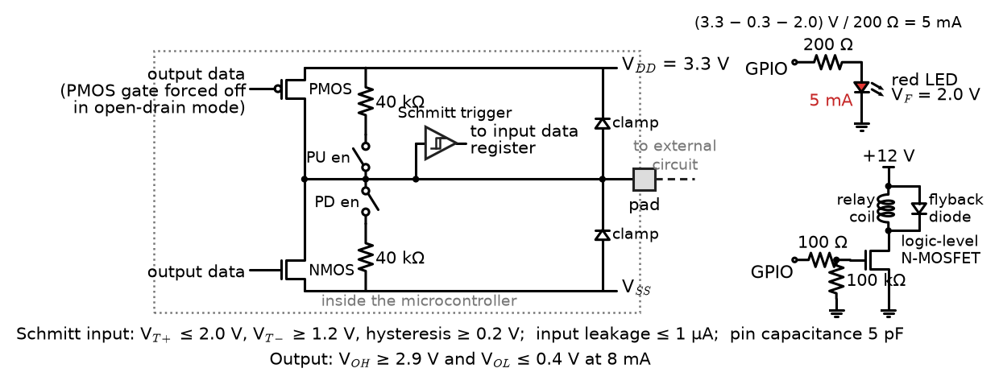
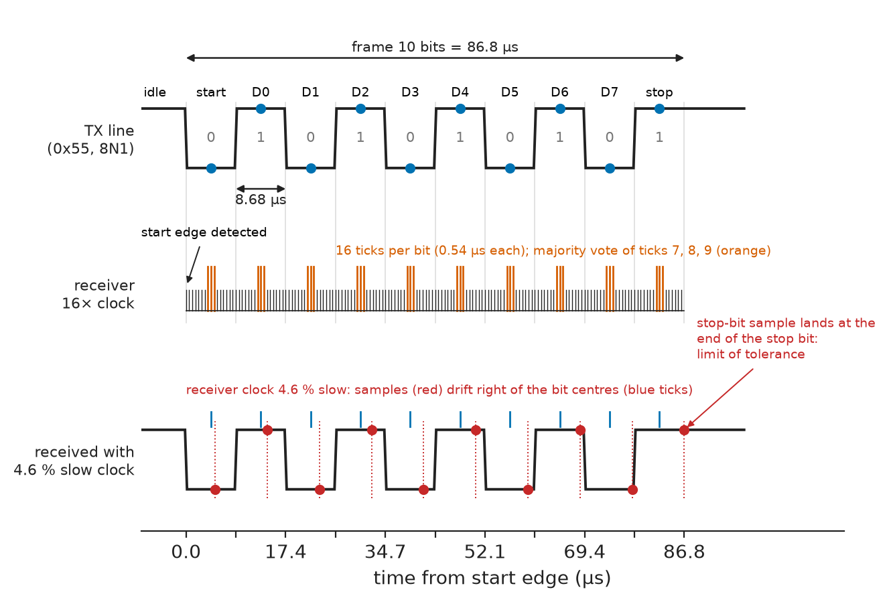
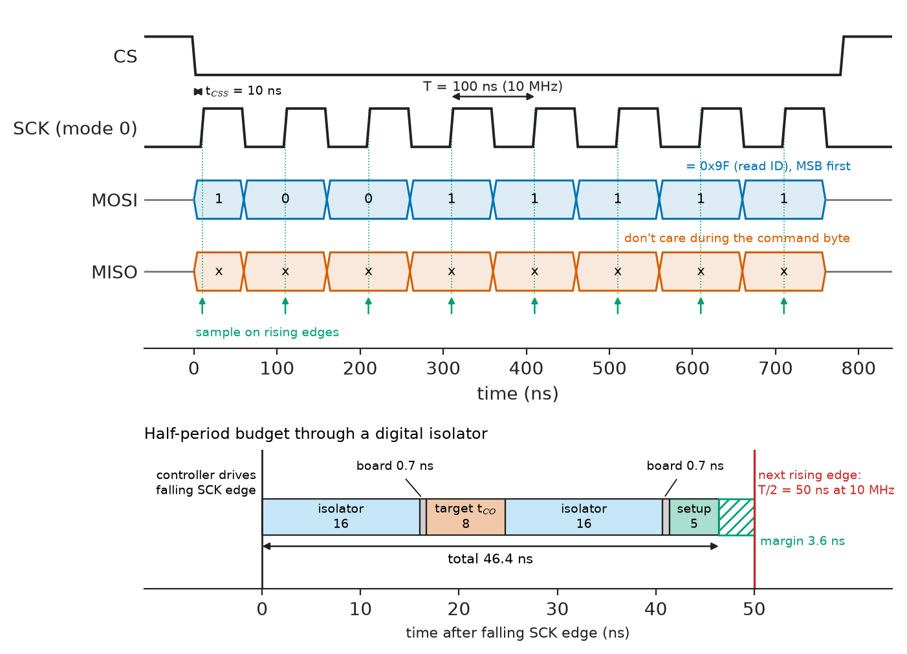
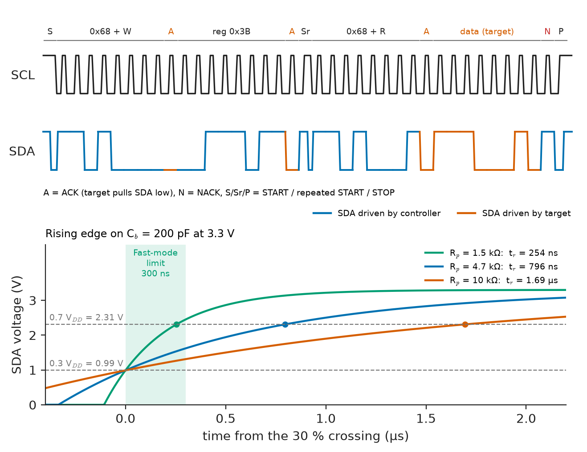
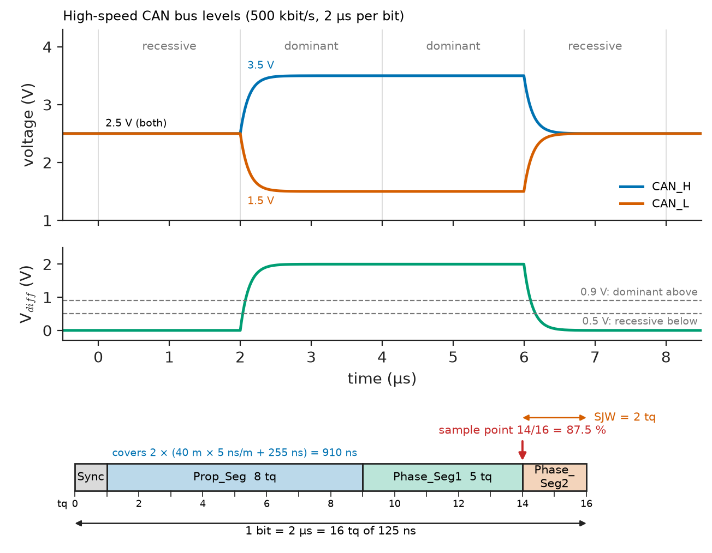
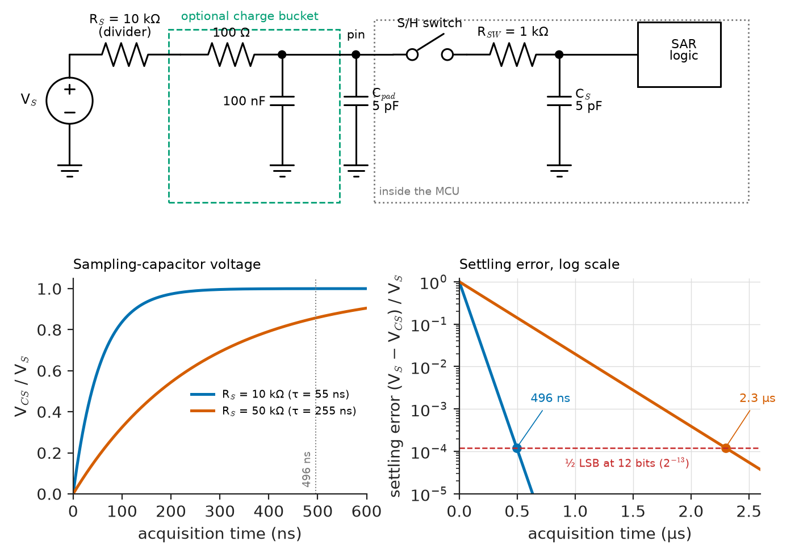

# Chapter 26 — Embedded Interfaces

*Part VI · Embedded and Real-Time Systems*

An agricultural-robot prototype runs flawlessly in the lab and fails in the field within an hour. The I²C bus to its soil sensors hangs whenever a motor starts: the supply dips, a sensor browns out halfway through sending a byte, and when it recovers it holds the data line low forever, waiting for clock pulses the master will never send. The CAN network linking its wheel modules logs error frames only on the longest harness, because the designer chose 1 Mbit/s and a sample point that the cable's round-trip delay cannot meet. A UART link to the GPS works at 9600 baud and garbles at 115 200, because the 16 MHz crystal cannot divide down to that rate within tolerance. And the strain-gauge load cell reads 2 % high on hot days, because the excitation and the ADC reference come from different regulators. Every one of these faults lives at an interface — the boundary where firmware meets electrical reality — and every one is predictable from the electrical limits and bit timing that the standards specify.

> **What electrical and timing limits govern GPIO and the common serial buses, and how are they designed in from the standards' numbers?**
> **How are converters and sensors connected without losing accuracy, and how is a failing link diagnosed with a scope and logic analyser?**

| Concept | Engineering destination |
|---|---|
| GPIO electrical limits | Driving LEDs, relays and MOSFET gates; level translation; ESD-robust inputs |
| UART and RS-232/RS-485 | Debug consoles, GPS and modem links, Modbus RTU fieldbuses |
| SPI | Flash memory, displays, high-rate ADCs, IMUs, isolated measurement channels |
| I²C | Sensor buses, PMICs, EEPROMs, board management |
| CAN and CAN FD | Vehicle networks, EV battery management, industrial and agricultural machines |
| USB fundamentals | Device firmware for HID, virtual COM ports, DFU, USB-C power |
| Ethernet fundamentals | Industrial controllers, gateways, automotive Ethernet, PoE devices |
| ADC and DAC interfaces | Accurate acquisition from on-chip and external converters |
| Sensor interfaces | Temperature, strain, current-loop and digital sensors in instruments and machines |
| Communication troubleshooting | Finding the fault on a bus with a scope, logic analyser and protocol decoder |

**Roadmap.** The pin itself (26.1) → asynchronous serial (26.2) → the two on-board synchronous buses, SPI (26.3) and I²C (26.4) → the robust field and vehicle bus, CAN (26.5) → the two big standard interfaces, USB (26.6) and Ethernet (26.7) → analog boundaries: converters (26.8) and sensors (26.9) → finding faults (26.10).

> **Boundary.** Chapter 17 describes the on-chip GPIO ports, serial controllers and converters as microcontroller peripherals — registers, clocks, interrupts and DMA. This chapter treats what happens outside the pin: electrical levels, bit timing, protocols and wiring. Transmission-line behaviour of traces and cables (reflections, termination, differential pairs) is from *Circuits, Signals and Communications*, [Ch. 14](https://github.com/The-Studio-of-Sadiq/Circuits-Signals-and-Communications/blob/main/part-3-advanced-network-theory/14-transmission-lines.md) §14.7 and §14.10; CRCs from [Ch. 28](https://github.com/The-Studio-of-Sadiq/Circuits-Signals-and-Communications/blob/main/part-6-communication-theory/28-information-theory-and-coding.md) §28.6; line codes from [Ch. 27](https://github.com/The-Studio-of-Sadiq/Circuits-Signals-and-Communications/blob/main/part-6-communication-theory/27-digital-communication.md) §27.3; sampling and quantization from [Ch. 19](https://github.com/The-Studio-of-Sadiq/Circuits-Signals-and-Communications/blob/main/part-4-signals-and-systems/19-sampling-and-reconstruction.md).

---

## 26.1 GPIO

### The pin as a circuit

A general-purpose I/O pin is a small CMOS circuit (Figure 26.1): a push-pull output stage whose PMOS half can be disabled for open-drain operation, optional weak pull-up and pull-down resistors, a Schmitt-trigger input buffer, and clamp diodes from the pad to each supply rail that protect the gate oxide from electrostatic discharge. Firmware sees a bit; the outside world sees a voltage source with a few tens of ohms of output resistance, an input with picofarads of capacitance and microamps of leakage, and diodes that conduct when the pin is driven beyond the rails.

<!-- FIGURE 26.1 | figures/ch26/fig-26-1-gpio-pin-structure.png | circuit | Internal structure of a 3.3 V microcontroller GPIO pin and two typical external connections. | Content: left: pad connected to output stage (PMOS to VDD 3.3 V, NMOS to VSS, PMOS gate disable labelled open-drain mode), switchable pull-up 40 kohm to VDD and pull-down 40 kohm to VSS, clamp diodes from pad to VDD and from VSS to pad, input path through Schmitt trigger (threshold limits V_T+ <= 2.0 V rising and V_T- >= 1.2 V falling, hysteresis >= 0.2 V) to the input data register. Right top: GPIO driving a red LED (Vf 2.0 V) through 200 ohm at 5 mA. Right bottom: GPIO driving a logic-level N-MOSFET gate through 100 ohm with 100 kohm gate pull-down, MOSFET switching a 12 V relay coil with flyback diode. Annotate VOH min 2.9 V at 8 mA, VOL max 0.4 V at 8 mA, input leakage 1 uA, pin capacitance 5 pF. -->



*Figure 26.1 — Internal structure of a 3.3 V microcontroller GPIO pin and two typical external connections.*

### Electrical limits

**Table 26.1 — Representative electrical characteristics of a 3.3 V microcontroller GPIO (typical datasheet values; JESD8C-style LVCMOS levels).**

| Parameter | Typical value | Consequence |
|---|---|---|
| $V_{IL,max}$ / $V_{IH,min}$ | $0.3V_{DD}$ / $0.7V_{DD}$ (CMOS); some pins 0.8 V / 2.0 V (TTL-compatible) | Thresholds for level compatibility |
| Schmitt hysteresis | 0.1–0.4 V | Clean edges from slow or noisy signals |
| $V_{OL}$ at 8 mA | ≤ 0.4 V | Sink capability; rises to about 1.3 V at 20 mA |
| $V_{OH}$ at 8 mA | ≥ $V_{DD}-0.4$ V | Source capability |
| Current per pin (abs. max) | ±20–25 mA | Exceeding it stresses metallisation |
| Total current per port or package | 80–240 mA | Limits how many LEDs one MCU can drive |
| Injection current (clamp diodes) | ±5 mA per pin, ±25 mA total | Overdriven pins can power the chip through the clamps |
| Internal pull-up / pull-down | 30–50 kΩ | Too weak for fast or noisy lines |
| Input leakage | ≤ 1 µA | Limits high-impedance dividers |
| Slew-rate setting | 2–100 MHz edge classes | Faster edges radiate more and ring more |
| ESD robustness | 2 kV HBM (JEDEC JS-001) at chip level | System pins need IEC 61000-4-2 protection (±8 kV contact) |

Three consequences come up constantly. First, **level compatibility**: a 3.3 V CMOS output (high ≥ 2.9 V) drives a 5 V TTL-threshold input (high ≥ 2.0 V) safely but not a 5 V CMOS input ($0.7\times5=3.5$ V), which needs a translator such as a 74HCT buffer or a dedicated level shifter; a 5 V signal into a non-5-V-tolerant 3.3 V pin forward-biases the upper clamp diode and must be limited below the injection current, or the chip may be back-powered through its I/O. Second, **load current**: an LED with a 2.0 V forward drop at 5 mA from a pin whose output drops about 0.3 V at that current needs $(3.3-0.3-2.0)/5\ \mathrm{mA}=200\ \Omega$; anything heavier than a few milliamps — relays, motors, long cables — gets a transistor or driver, with a flyback diode across inductive loads. Third, **external exposure**: a pin that leaves the board through a connector meets ESD, cable surges and miswiring, and needs a series resistor (100 Ω–1 kΩ), a TVS diode rated to IEC 61000-4-2 and often an RC filter, because the chip's own 2 kV HBM rating covers handling in the factory, not a user's finger.

### Inputs from the real world

A mechanical switch bounces for 1–10 ms; read directly, one press looks like dozens. Debouncing is done either in hardware (an RC filter of roughly 10 ms into a Schmitt input) or in firmware (sample every 1–5 ms and accept a new state only after it has been stable for several samples). An input left floating picks up mains hum and draws shoot-through current in its input buffer; every unused pin should be configured as an analog input or driven output, which is also the lowest-current configuration.

---

## 26.2 UART

### The frame

A **universal asynchronous receiver-transmitter** (UART) sends bytes without a shared clock. The line idles high (mark); each character starts with a low **start bit**, followed by 5–9 data bits sent least-significant first, an optional parity bit and one or two high **stop bits** (Figure 26.2). The common format 8N1 — eight data bits, no parity, one stop bit — takes 10 bit times per byte, so 115 200 baud carries 11 520 bytes per second and each byte takes 86.8 µs.

<!-- FIGURE 26.2 | figures/ch26/fig-26-2-uart-frame-sampling.png | timing-diagram | UART 8N1 frame for the byte 0x55 at 115 200 baud, with the receiver's 16x oversampling and mid-bit sampling points, and the effect of a clock mismatch. | Content: top trace TX line idle high, start bit low, data bits LSB first 1 0 1 0 1 0 1 0, stop bit high; bit period 8.68 us marked, total frame 86.8 us. Middle: receiver 16x sample clock ticks (0.54 us) with the start-edge detection and the majority-vote samples at ticks 7, 8, 9 of each bit, sampling instants marked with dots at the bit centres. Bottom: same frame with receiver clock 4.6 percent slow; sampling dots drift right and the stop-bit sample lands at the edge of the stop bit, labelled limit of tolerance. -->



*Figure 26.2 — UART 8N1 frame for the byte 0x55 at 115 200 baud, with the receiver's 16x oversampling and mid-bit sampling points, and the effect of a clock mismatch.*

The receiver detects the falling edge of the start bit and then samples each bit near its centre. With **16× oversampling** it locates the start edge to within 1/16 of a bit and samples at the middle (often as a majority vote of three samples), so it can tolerate drift until the last sample — the stop bit, 9.5 bit times after the start edge for 8N1 — leaves the stop bit.

> **Status of the principle: UART clock-tolerance budget**
> *Derived.* The last sample, at $9.5$ bit times for 8N1, must stay within half a bit of its nominal position less the start-edge uncertainty, so the combined transmitter–receiver rate error must satisfy $\lvert\Delta f/f\rvert<(0.5-1/16)/9.5=4.6\ \%$ with 16× oversampling and $3.9\ \%$ with 8×; edge distortion from slow cables and noise filtering reduce it further, which is why datasheets quote about 3.5–4 % and designers budget ±2 % per end.

**Worked example — Why 115 200 baud fails on a 16 MHz AVR.** The baud generator divides the peripheral clock by $16(\text{UBRR}+1)$ with an integer divisor. For 115 200 baud, $16\times10^{6}/(16\times115\,200)=8.68$, which rounds to 9, giving an actual rate of $16\times10^{6}/(16\times9)=111\,111$ baud, an error of −3.5 %. That alone consumes most of the 4.6 % budget; a GPS module whose own oscillator is 1 % fast on the other side brings the total to 4.5 %, and characters fail intermittently. Switching to 8× oversampling (double-speed mode) gives a divisor of 17.36 → 17 and 117 647 baud, +2.1 %, which works; 9600 baud gives 104.17 → 104 and only +0.16 %, which is why it always worked. The clean fixes are a "baud-rate crystal" (14.7456 MHz divides exactly to every standard rate) or a UART with a fractional divider: an STM32 at 84 MHz with a 4-bit fractional divisor reaches 115 226 baud, +0.02 %.

### Physical layers

The UART defines framing, not voltages. Three physical layers dominate:

**Table 26.2 — UART physical layers (from the standards).**

| Layer | Signalling | Levels | Distance and rate | Topology |
|---|---|---|---|---|
| Logic level (TTL/CMOS) | Single-ended | 0 / 3.3 V or 5 V | On-board, tens of cm; Mbit/s | Point to point |
| RS-232 (TIA-232-F) | Single-ended, inverted | Driver ±5 to ±15 V into 3–7 kΩ; receiver threshold ±3 V | 15 m nominal at up to 20 kbit/s (2500 pF load limit); 115 kbit/s over short cables in practice | Point to point |
| RS-485 (TIA-485-A) | Differential, half or full duplex | Driver ≥ 1.5 V differential into 54 Ω; receiver ±200 mV; common mode −7 to +12 V | 1200 m at 100 kbit/s; about 10 Mbit/s at 10–15 m | Multidrop bus, 32 unit loads, 120 Ω termination at both ends |

RS-485 is the industrial workhorse: Modbus RTU, DMX512 stage lighting, building automation and many proprietary fieldbuses use it. Its differential receiver rejects the ground shifts of a factory floor, the termination resistors absorb reflections on long cables (Book 3 §14.7), and **failsafe biasing** (a pull-up on A and a pull-down on B, or receivers with built-in failsafe) defines the idle state when no driver is active, so the line does not float through the ±200 mV threshold and generate false start bits. Protocols on top use time to delimit frames: Modbus RTU ends a frame with 3.5 character times of silence, 4.0 ms at 9600 baud with its 11-bit characters — which a firmware that pauses mid-frame to service other work can break.

---

## 26.3 SPI

### Signals and modes

The **Serial Peripheral Interface** is a synchronous, full-duplex bus with four wires: a clock (SCK) driven by the controller, data out (MOSI, or COPI/SDO), data in (MISO, or CIPO/SDI) and an active-low chip select (CS) per target device. Each clock cycle shifts one bit out of the controller's shift register and one bit in from the target's, so every transfer is an exchange. SPI has no formal standard; Motorola's original definition and each device's datasheet set its rules.

The clock polarity (CPOL, idle level of SCK) and phase (CPHA, which edge samples) give four **modes**:

**Table 26.3 — SPI modes.**

| Mode | CPOL | CPHA | Clock idle | Data sampled on | Typical devices |
|---|---|---|---|---|---|
| 0 | 0 | 0 | Low | Rising edge | Most Flash memories, many ADCs, SD cards in SPI mode |
| 1 | 0 | 1 | Low | Falling edge | Some ADCs and DACs |
| 2 | 1 | 0 | High | Falling edge | Less common |
| 3 | 1 | 1 | High | Rising edge | Many sensors and Flash memories (mode 0 and 3 both supported) |

<!-- FIGURE 26.3 | figures/ch26/fig-26-3-spi-mode-timing.png | timing-diagram | SPI mode 0 transfer of one byte and the round-trip timing budget that limits the clock rate through a digital isolator. | Content: traces CS (falls before first edge, tCSS 10 ns), SCK mode 0 (8 cycles at 10 MHz, period 100 ns), MOSI changing on falling edges with value 0x9F (read-ID command) MSB first, MISO changing on falling edges, sample points on rising edges marked with arrows. Inset below: one clock period expanded showing controller drives falling SCK edge at t = 0, isolator delay 16 ns, board 0.7 ns, target clock-to-output 8 ns, isolator 16 ns back, board 0.7 ns, controller setup 5 ns; total 46.4 ns must fit into half period; at 10 MHz half period 50 ns, margin 3.6 ns. -->



*Figure 26.3 — SPI mode 0 transfer of one byte and the round-trip timing budget that limits the clock rate through a digital isolator.*

### The round-trip limit

SPI clocks of 50–100 MHz are common for Flash memories on short traces, but the bus has a built-in round-trip constraint (Figure 26.3). In mode 0 the target changes MISO after the falling SCK edge and the controller samples it on the next rising edge, half a period later. The clock must travel out, the target must respond, and the data must travel back within that half-period:

$$
\frac{T_{SCK}}{2}\ge t_{\text{out}}+t_{CO,\text{target}}+t_{\text{back}}+t_{SU,\text{controller}}
$$

> **Status of the principle: SPI round-trip timing**
> *Derived.* Follows from the sampling edge being half a period after the launching edge in modes 0–3; it is relaxed by controllers that can delay their sampling point (late sampling, or clock feedback from a returned SCK) and is unchanged by the controller's own clock rate.

**Worked example — Isolated SPI to a battery-monitor ADC.** A BMS reads a cell-voltage ADC through a digital isolator with a 16 ns maximum propagation delay in each direction. The ADC's clock-to-output is 8 ns, the controller's setup time 5 ns, and each board crossing 0.7 ns. The half-period must be at least $2\times16+2\times0.7+8+5=46.4$ ns, so $f_{SCK}\le1/(2\times46.4\ \mathrm{ns})=10.8$ MHz. Without the isolator the same parts would run to $1/(2\times14.4\ \mathrm{ns})=34.7$ MHz. The isolator, not the ADC, sets the speed: designers run such links at 8–10 MHz, use controllers with adjustable sample delay, or use isolators with a returned clock.

### Variants and practice

Quad- and octal-SPI use 4 or 8 data lines, often double data rate, to read Flash at 50–400 MB/s and execute code in place. Practical rules: pull CS high during reset, respect each device's CS set-up and hold times, and make sure every target tri-states MISO when deselected — one that does not corrupts the whole bus.

---

## 26.4 I²C

### Open-drain signalling

The **Inter-Integrated Circuit** bus (NXP UM10204) uses two open-drain lines, serial clock (SCL) and serial data (SDA), each pulled high by a resistor. Any device can pull a line low; no device ever drives it high. This **wired-AND** makes multi-controller arbitration, clock stretching and acknowledgement possible on two wires — and makes the rising edge an RC charging curve set by the pull-up and the bus capacitance.

**Table 26.4 — I²C speed modes (NXP UM10204).**

| Mode | Max clock | Max rise time (30–70 %) | Max bus capacitance | $V_{OL}$ / sink current | $t_{LOW,min}$ / $t_{HIGH,min}$ |
|---|---|---|---|---|---|
| Standard (Sm) | 100 kHz | 1000 ns | 400 pF | 0.4 V at 3 mA | 4.7 / 4.0 µs |
| Fast (Fm) | 400 kHz | 300 ns | 400 pF | 0.4 V at 3 mA | 1.3 / 0.6 µs |
| Fast-mode Plus (Fm+) | 1 MHz | 120 ns | 550 pF | 0.4 V at 20 mA | 0.5 / 0.26 µs |
| High-speed (Hs) | 3.4 MHz | 10–80 ns | 100–400 pF | Current-source pull-up | — |

### The transaction

A transaction (Figure 26.4) begins with a **START** — SDA falling while SCL is high — followed by a 7-bit address and a read/write bit. Data change only while SCL is low; a change of SDA while SCL is high is a START or a **STOP** (SDA rising while SCL high). After every byte the receiver pulls SDA low during a ninth clock to **acknowledge** (ACK); leaving it high is a NACK. A **repeated START** turns a write (of a register address) into a read without releasing the bus. A target that needs time holds SCL low after the controller releases it — **clock stretching** — and the controller must wait. Reading six bytes of accelerometer data from a register at 400 kHz takes about 84 bit times including address phases and conditions, 210 µs.

<!-- FIGURE 26.4 | figures/ch26/fig-26-4-i2c-transaction-rise-time.png | timing-diagram | I2C register read with repeated START, and the RC rising edge set by the pull-up resistor and bus capacitance. | Content: top: SCL and SDA traces for START, address 0x68 + W, ACK, register 0x3B, ACK, repeated START, address 0x68 + R, ACK, data byte, NACK, STOP; label who drives SDA in each phase (controller or target). Bottom: zoom of one SDA rising edge at 3.3 V with three curves for Rp = 1.5 kohm, 4.7 kohm and 10 kohm on Cb = 200 pF; horizontal lines at 0.3 VDD (0.99 V) and 0.7 VDD (2.31 V); rise times 254 ns, 796 ns, 1.69 us; shaded band showing the Fast-mode limit 300 ns. -->



*Figure 26.4 — I2C register read with repeated START, and the RC rising edge set by the pull-up resistor and bus capacitance.*

### Sizing the pull-up

The pull-up has a minimum and a maximum. It must be large enough that a device sinking its rated current reaches $V_{OL}$, and small enough that the line rises from 30 % to 70 % of $V_{DD}$ within the mode's rise-time limit. For an RC edge that rise time is $t_r=RC\ln(0.7/0.3)=0.8473\,RC$, so

$$
R_{p,\min}=\frac{V_{DD}-V_{OL,\max}}{I_{OL}},\qquad R_{p,\max}=\frac{t_r}{0.8473\,C_b}
$$

> **Status of the principle: I²C pull-up window**
> *Derived.* From the static sink requirement and the exponential RC charge between the 30 % and 70 % thresholds of UM10204; it assumes a lumped bus capacitance and a purely resistive pull-up, and is replaced by the current-source pull-ups of Hs mode or active rise-time accelerators on long, heavily loaded buses.

**Worked example — Pull-ups for a 400 kHz sensor bus.** A 3.3 V bus carries an IMU, a barometer, an EEPROM and a PMIC; with traces and pins its capacitance is estimated at 200 pF. Then $R_{p,\min}=(3.3-0.4)/3\ \mathrm{mA}=967\ \Omega$ and $R_{p,\max}=300\ \mathrm{ns}/(0.8473\times200\ \mathrm{pF})=1.77$ kΩ. A 1.5 kΩ pull-up gives $t_r=254$ ns and 2.2 mA sink current, inside both limits. The habitual 4.7 kΩ gives 796 ns — legal at 100 kHz (limit 1000 ns, $R_{p,\max}=5.9$ kΩ) but not at 400 kHz, where the edges arrive late, the effective high time shrinks and devices miss bits. At 400 pF, $R_{p,\max}$ falls to 885 Ω, below $R_{p,\min}$: no resistor works, and the bus must be split with a buffer or slowed down.

### Bus hangs and recovery

I²C's weakness is the failure of the opening. If a target is mid-way through sending a 0 bit when the controller resets (or the target browns out and resumes in the wrong state), the target holds SDA low and waits for SCL edges. The controller sees a permanently busy bus and cannot even generate a START. UM10204 prescribes the **bus clear**: the controller toggles SCL up to nine times until the target finishes its byte and releases SDA, then issues a STOP. SMBus devices additionally reset themselves if SCL is held low for more than 25–35 ms. A robust driver runs the recovery at boot and after every timeout:

```c
#include <stdbool.h>

/* Board-specific primitives: lines are open-drain with pull-ups. */
void scl_low(void);  void scl_release(void);  bool scl_is_high(void);
void sda_low(void);  void sda_release(void);  bool sda_is_high(void);
void delay_us(unsigned us);

/* Bus clear (NXP UM10204): clock until the target releases SDA,
 * at most nine pulses, then START + STOP to reset every target. */
bool i2c_bus_clear(void)
{
    sda_release();
    for (int i = 0; i < 9 && !sda_is_high(); i++) {
        scl_low();      delay_us(5);           /* 100 kHz pace */
        scl_release();  delay_us(5);
        for (int t = 0; t < 1000 && !scl_is_high(); t++)
            delay_us(1);                       /* allow clock stretching */
    }
    if (!sda_is_high())
        return false;                          /* stuck: power-cycle target */
    sda_low();      delay_us(5);               /* START (SCL high)  */
    sda_release();  delay_us(5);               /* STOP  (SCL high)  */
    return sda_is_high() && scl_is_high();
}
```

The function runs with the pins switched from the I²C peripheral to GPIO open-drain mode. If nine clocks do not free the bus, the target is latched up and only cutting its supply helps — which is why robust designs power sensors from a GPIO-switched rail or a load switch.

---

## 26.5 CAN

### Physical layer

The **Controller Area Network** (ISO 11898-1 for the data link, ISO 11898-2 for the high-speed physical layer) was designed by Bosch for cars and now runs trucks, tractors, lifts, medical devices, EV battery packs and industrial machines (CANopen, J1939). It is a differential two-wire bus, CAN_H and CAN_L, terminated with 120 Ω at each physical end, so a healthy bus measures 60 Ω between the lines with power off — the first check in any CAN fault-finding. Its levels are not symmetric logic states but **dominant** and **recessive**: in the recessive state the transceiver drives nothing and both lines rest near 2.5 V; in the dominant state it pulls CAN_H to about 3.5 V and CAN_L to about 1.5 V. A dominant bit from any node overrides recessive bits from all others, the wired-AND that the protocol builds on.

**Table 26.5 — ISO 11898-2 high-speed CAN physical-layer values.**

| Parameter | Value |
|---|---|
| Recessive differential output | −0.5 to +0.05 V (nominal 0 V, both lines about 2.5 V) |
| Dominant differential output | 1.5–3.0 V (nominal 2.0 V) |
| Receiver thresholds | Recessive below 0.5 V, dominant above 0.9 V |
| Cable characteristic impedance; termination | 120 Ω nominal; 120 Ω at each end |
| Propagation delay of cable | About 5 ns/m |
| Transceiver loop delay (TXD to RXD) | Typically 100–255 ns |
| Classical CAN bit rates and practical bus length | 1 Mbit/s about 40 m; 500 kbit/s about 100 m; 250 kbit/s about 250 m; 125 kbit/s about 500 m |

### Arbitration, the frame and bit stuffing

Every node may start transmitting when the bus is idle. Each transmits its identifier bit by bit while reading the bus back; a node that sends recessive and reads dominant has lost arbitration and becomes a receiver, without destroying the winner's frame. The lowest identifier wins, so the identifier is also the message priority — a property that makes CAN analysable as a fixed-priority real-time system (Section 27.3).

A classical base-format data frame (CAN 2.0A) contains a start-of-frame bit, an 11-bit identifier, RTR, IDE and reserved bits, a 4-bit data length code, 0–8 data bytes, a 15-bit CRC with delimiter, an acknowledge slot in which every correct receiver drives dominant, and a 7-bit end of frame, followed by 3 bits of interframe space. To keep receivers synchronised, the transmitter inserts a complementary **stuff bit** after every five identical bits from the start of frame to the end of the CRC. Error handling is built in: every node checks the CRC, the bit stream, the stuffing and the frame format, and a node that sees an error destroys the frame with an error flag so that all nodes discard it and the transmitter retries. Transmit and receive error counters move a persistently faulty node from **error-active** to **error-passive** (counter above 127) and finally **bus-off** (transmit counter above 255), so that a broken node silences itself instead of jamming the network.

### Bit timing

Each bit is divided into **time quanta** (tq) of the CAN controller's prescaled clock and split into segments (Figure 26.5): a 1-tq synchronisation segment in which edges are expected, a propagation segment, and two phase segments with the **sample point** between them. Phase segments lengthen or shorten (by up to the synchronisation jump width) to resynchronise on each recessive-to-dominant edge.

<!-- FIGURE 26.5 | figures/ch26/fig-26-5-can-levels-and-bit-timing.png | timing-diagram | High-speed CAN bus levels and the segmentation of one bit at 500 kbit/s. | Content: top: CAN_H and CAN_L voltages versus time for bits recessive, dominant, dominant, recessive: recessive both at 2.5 V, dominant CAN_H 3.5 V and CAN_L 1.5 V; differential voltage trace below with thresholds 0.5 V and 0.9 V marked. Bottom: one bit of 2 us divided into 16 time quanta of 125 ns: Sync 1 tq, Prop_Seg 8 tq (labelled covers 2 x (40 m x 5 ns/m + 255 ns) = 910 ns), Phase_Seg1 5 tq, Phase_Seg2 2 tq, sample point arrow at 14/16 = 87.5 percent. Annotate SJW = 2 tq. -->



*Figure 26.5 — High-speed CAN bus levels and the segmentation of one bit at 500 kbit/s.*

The propagation segment must cover the round trip of a dominant bit between the two most distant nodes, because during arbitration a node must see the other end's dominant bit before it samples:

$$
t_{\text{PROP}}\ge2\left(t_{\text{cable}}+t_{\text{loop}}\right)
$$

with $t_{\text{loop}}$ the transceiver's TXD-to-RXD delay. This is why bit rate and bus length trade against each other.

> **Status of the principle: CAN bit-rate–length trade-off**
> *Derived.* Arbitration requires every node to sample a bit after the farthest node's response has arrived, so the round-trip delay must fit inside the bit before the sample point; the classical length figures assume 5 ns/m cable and fast transceivers, and CAN FD escapes the limit only in its data phase, after arbitration is over.

**Worked example — Bit timing for a 40 m tractor harness at 500 kbit/s.** The controller runs from 40 MHz with a prescaler of 5, so $t_q=125$ ns and the 2 µs bit has 16 tq. The harness is 40 m (200 ns one way) and the transceiver loop delay is at most 255 ns, so $t_{\text{PROP}}\ge2(200+255)=910$ ns, which needs $910/125=7.3$, rounded up to 8 tq. With Sync = 1, Prop = 8, Phase1 = 5 and Phase2 = 2 tq, the sample point is at $(1+8+5)/16=87.5\ \%$, the value recommended for automotive networks (SAE J2284, CiA 601). With these transceivers the same harness at 1 Mbit/s would need 910 ns of a 1000 ns bit before the sample point, leaving no room for the phase segments: the robot of the opening logged errors precisely on its longest cable.

### Frame length, bus load and CAN FD

Because the frame length depends on stuffing, timing analysis uses the worst case. The listing computes both and the bus load of a set of periodic messages:

```python
# Classical CAN 2.0A frame length and bus load (ISO 11898-1)
from math import floor

def can_frame_bits(n_bytes, worst_stuffing=True):
    """Bits on the wire for a standard (11-bit ID) data frame, incl. 3-bit IFS."""
    stuffed_region = 34 + 8 * n_bytes          # SOF ... end of CRC field
    fixed = stuffed_region + 13                # CRC delim, ACK, EOF, IFS
    stuff = floor((stuffed_region - 1) / 4) if worst_stuffing else 0
    return fixed + stuff

def bus_load(messages, bit_rate):
    """messages: list of (count, n_bytes, period_s)."""
    bits_per_s = sum(k * can_frame_bits(n) / p for k, n, p in messages)
    return bits_per_s / bit_rate

ecu = [(16, 8, 0.010), (40, 8, 0.100)]          # body-network example
print("frame bits:", can_frame_bits(8, False), "nominal,",
      can_frame_bits(8), "worst case")
print(f"bus load at 500 kbit/s: {bus_load(ecu, 500e3):.1%} (worst case)")
```

An 8-byte frame is 111 bits nominally and 135 bits with worst-case stuffing, 222–270 µs at 500 kbit/s. Sixteen messages every 10 ms and forty every 100 ms load the bus to 54.0 % in the worst case — within the 50–70 % that integrators typically allow, leaving headroom for diagnostics and error retransmissions. With 8 bytes carrying only 64 of 135 bits, classical CAN is less than half efficient; **CAN FD** (ISO 11898-1:2015) keeps arbitration at the nominal rate but switches to 2–5 Mbit/s (up to 8 in short networks) for the data phase, carries up to 64 bytes, and uses 17- or 21-bit CRCs. CAN XL extends payloads to 2048 bytes and data rates to about 20 Mbit/s.

---

## 26.6 USB fundamentals

### Topology and signalling

USB is a **host-centred, polled** bus: the host schedules every transaction and devices speak only when asked. USB 2.0 defines low speed (1.5 Mbit/s), full speed (12 Mbit/s) and high speed (480 Mbit/s) over one twisted pair, D+ and D−, of 90 Ω differential impedance, up to 5 m per cable segment. Full- and low-speed use 3.3 V single-ended-capable signalling; high speed uses 400 mV current-mode differential signalling with 45 Ω terminations to ground on each line. Data are NRZI-encoded with a stuffed 0 after six consecutive 1s so that the receiver's clock recovery always sees transitions (compare the line codes of Book 3 §27.3). Bit-rate accuracy must be within ±0.25 % for full speed and ±0.05 % for high speed (±1.5 % for low speed), which is why full-speed devices without a crystal must trim their RC oscillator against the host's 1 ms start-of-frame packets — the "crystal-less USB" of many microcontrollers.

A device announces itself by a pull-up on D+ (full speed, 1.5 kΩ to 3.3 V) or D− (low speed); high-speed devices attach as full-speed and then negotiate with a chirp sequence. The host resets the device, reads its **descriptors** (device, configuration, interface, endpoint, string), assigns an address and selects a configuration — **enumeration**. Device classes standardise the descriptors and protocols so no custom host driver is needed: CDC-ACM (virtual serial port), HID (keyboards, game controllers, many custom instruments), MSC (mass storage), audio, and DFU (firmware update, Section 25.9).

### Transfers and throughput

**Table 26.6 — USB 2.0 transfer types and maximum payload rates.**

| Transfer | Guarantee | Full-speed maximum | High-speed maximum | Typical use |
|---|---|---|---|---|
| Control | Reliable, reserved bandwidth share | 64-byte packets | 64-byte packets | Enumeration, configuration |
| Interrupt | Bounded latency (polling interval) | 64 B per 1 ms frame = 64 kB/s | 3 × 1024 B per 125 µs microframe = 24.6 MB/s | HID, status reports |
| Bulk | Reliable, uses leftover bandwidth | 19 × 64 B per frame = 1.216 MB/s | 13 × 512 B per microframe = 53.2 MB/s | Mass storage, CDC data |
| Isochronous | Guaranteed bandwidth, no retry | 1023 B per frame | 3 × 1024 B per microframe | Audio, video |

**Worked example — Is a full-speed HID fast enough for a data logger?** An instrument streams 4 channels × 2 bytes at 10 kSa/s, 80 kB/s. A full-speed HID interrupt endpoint carries at most one 64-byte report per 1 ms frame, 64 kB/s, so it cannot keep up. A full-speed CDC bulk endpoint offers up to 1.216 MB/s on an otherwise idle bus (practically 0.8–1 MB/s), ample margin; a high-speed device is unnecessary. If the product needs driverless HID for corporate IT reasons, the data must be decimated or packed into fewer samples per second.

### Power

USB also supplies power. A USB 2.0 device may draw 100 mA before configuration and up to 500 mA after (900 mA for USB 3.x); VBUS is 4.75–5.25 V at the host connector. USB Type-C adds 1.5 A or 3 A at 5 V, advertised by the source's pull-up on the CC pin and read by the sink's 5.1 kΩ pull-down; USB Power Delivery negotiates higher voltages over CC — up to 20 V at 5 A (100 W), and with PD 3.1 extended power range up to 48 V at 5 A (240 W). Missing 5.1 kΩ resistors on CC are the classic reason a Type-C gadget charges from a USB-A adapter but not from a C-to-C cable.

---

## 26.7 Ethernet fundamentals

### PHY, MAC and the media-independent interface

Ethernet (IEEE 802.3) splits into a **MAC**, which frames data and computes the CRC, and a **PHY**, which encodes bits onto the cable. Microcontrollers such as the STM32F4/F7/H7 contain the MAC and connect to an external PHY over **MII** (4 bits at 25 MHz for 100 Mbit/s), **RMII** (2 bits at a 50 MHz reference clock) or, for gigabit, **RGMII** (4 bits double data rate at 125 MHz); a two-wire management interface (MDIO/MDC) reads the PHY's link status and configuration registers. The PHY drives the twisted pairs through **magnetics** that provide the galvanic isolation required by 802.3 (1500 V rms) and common-mode rejection.

**Table 26.7 — Ethernet physical layers in embedded systems.**

| PHY | Standard | Encoding | Pairs and reach | Typical use |
|---|---|---|---|---|
| 10BASE-T | 802.3 clause 14 | Manchester, 10 Mbaud | 2 pairs, 100 m | Legacy, low-power devices |
| 100BASE-TX | 802.3 clause 25 | 4B5B + MLT-3, 125 Mbaud | 2 pairs Cat 5, 100 m | Industrial controllers, gateways |
| 1000BASE-T | 802.3 clause 40 | PAM-5 on 4 pairs, 125 Mbaud each | 4 pairs Cat 5e, 100 m | Cameras, embedded Linux |
| 100BASE-T1 | 802.3bw | PAM-3, 66.7 Mbaud | 1 pair, 15 m | Automotive Ethernet |
| 10BASE-T1S | 802.3cg | Differential Manchester, multidrop | 1 pair, 25 m, 8+ nodes | Automotive and building zones replacing CAN segments |

### The frame and its overhead

An Ethernet frame carries a 7-byte preamble and 1-byte start delimiter, 6-byte destination and source addresses, a 2-byte EtherType (or VLAN tag first), 46–1500 bytes of payload, and a 4-byte CRC-32 (Book 3 §28.6), followed by at least 12 byte times of interframe gap. The minimum frame of 64 bytes (from addresses to CRC) therefore occupies 84 byte times on the wire.

**Worked example — Throughput and packet rate at 100 Mbit/s.** A full-size frame with 1500 payload bytes occupies $1500+38=1538$ byte times, so the payload efficiency is $1500/1538=97.5\ \%$; a UDP application, after 20 bytes of IP and 8 bytes of UDP header, sees $1472/1538=95.7$ Mbit/s at most. At the other extreme, minimum-size frames arrive at up to $100\times10^{6}/(84\times8)=148\,810$ per second — one every 6.7 µs. A Cortex-M7 that takes an interrupt and walks a TCP/IP stack for every frame cannot sustain that, which is why embedded MACs use DMA descriptor rings, interrupt coalescing and hardware filtering of unwanted multicast and broadcast traffic, and why an industrial device must survive a broadcast storm without missing its control deadlines (IEC 62443 robustness testing includes exactly this).

### Embedded Ethernet in practice

Power over Ethernet delivers power on the same cable: 802.3af supplies 15.4 W at the source (12.95 W at the device), 802.3at 30 W (25.5 W), and 802.3bt up to 90 W (71.3 W), enough for cameras, access points and small controllers. **Time-Sensitive Networking** (IEEE 802.1AS, 802.1Qbv) and fieldbuses such as EtherCAT and PROFINET IRT give Ethernet bounded latency, with control cycles down to 100 µs or less.

---

## 26.8 ADC and DAC interfaces

### What the converter assumes

> **Boundary.** Quantization, SQNR and ENOB ($\mathrm{SQNR}=6.02N+1.76$ dB) are from *Circuits, Signals and Communications*, [Ch. 19](https://github.com/The-Studio-of-Sadiq/Circuits-Signals-and-Communications/blob/main/part-4-signals-and-systems/19-sampling-and-reconstruction.md) §19.8; jitter in §19.5; anti-aliasing filters in §19.9; oversampling and dither in [Ch. 21](https://github.com/The-Studio-of-Sadiq/Circuits-Signals-and-Communications/blob/main/part-5-digital-signal-processing/21-dsp-fundamentals.md) §21.2. The one-paragraph physics sketch is in *Engineering Physics*, [Ch. 18](https://github.com/The-Studio-of-Sadiq/Engineering-Physics/blob/main/CHAPTERS/CHAPTER%2018.md) §18.7.2. Converter architectures (SAR, pipeline, sigma–delta) belong to Chapter 10 of this book, and the on-chip ADC as a peripheral to Chapter 17. This section covers the interface: what the circuit outside the pin must do for the converter to deliver its datasheet accuracy.

Most microcontroller ADCs are successive-approximation (SAR) converters with a switched-capacitor input. During the acquisition (sampling) time the pin is connected through a switch resistance $R_{SW}$ to a sampling capacitor $C_S$ of a few picofarads; then the switch opens and the conversion runs on the stored charge. The external source must charge $C_S$ to within half an LSB during the acquisition window (Figure 26.6).

<!-- FIGURE 26.6 | figures/ch26/fig-26-6-sar-adc-input-model.png | circuit | Equivalent input circuit of a microcontroller SAR ADC with source, charge-bucket filter and sampling capacitor, and the settling of the sampled voltage. | Content: left: sensor source Vs with source resistance Rs = 10 kohm, optional external RC filter (series 100 ohm, 100 nF to ground) labelled charge bucket, pin with 5 pF pad capacitance, internal switch Rsw = 1 kohm, sampling capacitor Cs = 5 pF to ground, SAR logic block. Right: plot of capacitor voltage versus time during acquisition, 0 to 600 ns, exponential approach with tau = 55 ns (Rs + Rsw = 11 kohm), horizontal line at half-LSB error for 12 bits, crossing at 496 ns; second curve with Rs = 50 kohm needing 2.3 us. -->



*Figure 26.6 — Equivalent input circuit of a microcontroller SAR ADC with source, charge-bucket filter and sampling capacitor, and the settling of the sampled voltage.*

$$
t_{\text{acq}}\ge\left(R_S+R_{SW}\right)C_S\,\ln\!\left(2^{N+1}\right)
$$

> **Status of the principle: SAR acquisition-time requirement**
> *Approximate.* Treats the input as a single RC charging from a fully discharged (worst-case) capacitor to within half an LSB; real inputs add pin capacitance and charge sharing, so datasheet formulas include extra terms, and an external capacitor changes the problem from settling to charge sharing.

**Worked example — Can a 10 kΩ divider drive a 12-bit SAR?** With $C_S=5$ pF, $R_{SW}=1$ kΩ and a source resistance of 10 kΩ (a battery-voltage divider of 20 kΩ and 20 kΩ), $\tau=11\ \mathrm{k\Omega}\times5\ \mathrm{pF}=55$ ns and $\ln(2^{13})=9.01$, so the acquisition time must be at least 496 ns — 18 cycles of a 36 MHz ADC clock, which is available. A 100 kΩ/100 kΩ divider (50 kΩ source), chosen to save battery current, needs 2.3 µs, longer than many default settings, and the reading is then low by an amount that depends on the previous channel's voltage — a fault that looks like crosstalk. The usual cure is a **charge-bucket** capacitor at the pin: 100 nF supplies the sampling charge with a droop of only $5\ \mathrm{pF}/100\ \mathrm{nF}\times4096=0.2$ LSB, and is recharged by the high-impedance source between conversions — fine for slowly varying signals, but it turns the input into a low-pass filter (here with a time constant of 5 ms) and limits the usable sample rate on that channel.

### Reference, ground and ratiometric measurement

A converter measures the input relative to its reference; every error in $V_{REF}$ appears directly in the result. An MCU's supply used as reference may be ±2 % and noisy; a dedicated reference (an REF3030, ±0.2 %, 50 ppm/°C) improves absolute accuracy. For resistive sensors — potentiometers, thermistor dividers, strain-gauge bridges — the better solution is **ratiometric** measurement: excite the sensor from the same voltage that serves as the ADC reference, so that excitation drift cancels. The load cell of the opening, excited from one regulator and measured against another, inherits the difference of their temperature coefficients. Analog and digital grounds should meet at one point near the converter, with return currents of switching loads kept away from the reference and input paths.

**Table 26.8 — Representative converter interfaces.**

| Converter | Type | Interface | Typical use |
|---|---|---|---|
| MCU on-chip 12-bit SAR, 1–5 MSa/s | SAR | Internal bus, DMA | General acquisition; ENOB about 10–11 bits |
| ADS1115 | 16-bit ΔΣ, 860 Sa/s, PGA | I²C | Slow sensors, battery monitors |
| ADS8681 | 16-bit SAR, 1 MSa/s, ±12 V input | SPI | Industrial analog inputs |
| AD7124-8 | 24-bit ΔΣ, PGA, excitation sources | SPI | RTDs, thermocouples, bridges |
| MCP4725 | 12-bit DAC | I²C | Setpoints, bias adjustment |
| Timer PWM + RC filter | 1-bit DAC | GPIO | LED dimming, slow setpoints |

### DAC outputs and PWM as a DAC

On-chip DACs are usually resistor-string or R-2R types with an output buffer of limited drive (a few kilohms minimum load) and settling times of a few microseconds; the reconstruction filter and its consequences are covered in Book 3 §19.6. Where no DAC is available, a PWM output followed by an RC low-pass filter is a cheap substitute: the average of a PWM signal of duty cycle $D$ between 0 and $V_{DD}$ is $DV_{DD}$, and a first-order filter with $\tau\gg T_{PWM}$ leaves a ripple of about $V_{DD}D(1-D)T_{PWM}/\tau$ peak to peak. With 20 kHz PWM from a 3.3 V pin into 10 kΩ and 1 µF ($\tau=10$ ms), the ripple at 50 % duty is $3.3\times0.25\times50\ \mu\mathrm{s}/10\ \mathrm{ms}=4.1$ mV, about 5 LSB of a 12-bit scale, but the filter's corner is 16 Hz and it takes about 50 ms ($5\tau$) to settle — acceptable for a setpoint, useless for a waveform. Resolution is limited by the timer: a 16-bit timer at 20 kHz needs a 1.3 GHz clock; an 84 MHz timer gives only 4200 steps, about 12 bits.

---

## 26.9 Sensor interfaces

### Sensor output types

Sensors reach the microcontroller in a handful of electrical forms, each with its own interface circuit:

**Table 26.9 — Common sensor interfaces (typical values).**

| Output form | Example sensors | Signal level | Interface |
|---|---|---|---|
| Ratiometric voltage | Potentiometers, Hall position sensors, pressure sensors | 0.5–4.5 V on 5 V supply | ADC with supply as reference |
| Bridge (mV/V) | Strain-gauge load cells, pressure dies | 1–3 mV/V full scale | Instrumentation amplifier (Ch. 8) or ΔΣ ADC with PGA |
| Thermocouple | Type K, J, T | About 41 µV/°C (type K) | Cold-junction compensation, high-gain ADC |
| Resistance (RTD, thermistor) | Pt100/Pt1000 (IEC 60751), NTC 10 kΩ | 0.385 Ω/°C for Pt100; NTC strongly nonlinear | Current excitation, 3- or 4-wire connection |
| Current loop | 4–20 mA transmitters (process industry) | 4 mA = 0 %, 20 mA = 100 %; fault below 3.6 or above 21 mA (NAMUR NE 43) | Shunt resistor (e.g. 150 Ω → 0.6–3.0 V) |
| Digital bus | MEMS IMUs, humidity, pressure, ToF sensors | I²C or SPI | Sections 26.3–26.4 |
| Pulse, frequency, PWM | Flow meters, Hall speed sensors, encoders | Logic level | Timer capture, encoder mode (Ch. 17) |
| Automotive digital | SENT (SAE J2716), PSI5 | Single-wire nibble encoding, 3 µs ticks typical | Timer capture or dedicated peripheral |
| Industrial smart sensor | IO-Link (IEC 61131-9) | 24 V, 4.8/38.4/230.4 kbaud | Transceiver plus UART |

The 4–20 mA loop survives because a current is immune to wire resistance, and its live zero both powers two-wire transmitters and distinguishes "zero reading" from "broken wire".

### Resistance thermometers and lead resistance

A platinum RTD follows the IEC 60751 Callendar–Van Dusen equation; for $T\ge0$ °C, $R=R_0(1+AT+BT^2)$ with $A=3.9083\times10^{-3}$ /°C and $B=-5.775\times10^{-7}$ /°C², giving 100.00 Ω at 0 °C and 138.51 Ω at 100 °C for a Pt100 — a mean sensitivity of 0.385 Ω/°C.

**Worked example — Measuring a Pt100 to 0.01 °C.** A Pt100 is excited with 1 mA and read by a 24-bit ΔΣ converter (AD7124 class) with a 2.5 V reference and a PGA gain of 16.

- Sensitivity: $1\ \mathrm{mA}\times0.385\ \Omega/^\circ\mathrm{C}=0.385$ mV/°C.
- Even at 16-bit effective resolution the LSB is $2.5\ \mathrm{V}/2^{16}/16=2.38$ µV, or $2.38/385=0.0062$ °C per LSB, so the converter is not the limit.
- Self-heating: $I^2R=1\ \mathrm{mA}^2\times138.5\ \Omega=0.14$ mW at 100 °C, which with a typical self-heating coefficient of a few tenths of a degree per milliwatt in still air is already several hundredths of a degree — the reason excitation is kept at 1 mA or less.
- Lead resistance: with a 2-wire connection, two 0.5 Ω leads add 1 Ω, read as $1/0.385=2.6$ °C of error, and their copper changes resistance with ambient temperature. A 3-wire connection cancels matched leads; a 4-wire (Kelvin) connection sends the excitation down one pair and senses the voltage on the other, eliminating them.

The excitation current should come from the same reference as the ADC (ratiometric operation, with a precision reference resistor in series), so that excitation drift cancels. Here, as in most precision measurements, the interface — leads, excitation, reference, self-heating — dominates the error budget, not the bits.

### Digital sensors

A MEMS IMU or environmental sensor contains its own ADC, filters and FIFO behind I²C or SPI registers. The interface problems become timing and integrity: read the FIFO in bursts at a watermark interrupt, timestamp samples at the interrupt rather than when a task reads them, and after any brown-out read back the identity and configuration registers.

---

## 26.10 Communication troubleshooting

### Instruments

Interface faults are found with two instruments used together. The **oscilloscope** shows the analog truth: levels, rise times, ringing, noise, ground shifts. The **logic analyser** captures many digital channels over long periods and decodes them into protocol transactions. Look at the analog signal first and the decoded data second, because a decoder shows only what its idealised thresholds saw.

**Table 26.10 — Instrument requirements for interface debugging (rules of thumb).**

| Measurement | Requirement |
|---|---|
| Scope bandwidth for edges of rise time $t_r$ | Scope rise time is about $0.35/f_{BW}$; keep it below one third of $t_r$ |
| Logic-analyser timing capture | Sample at 4–10× the highest toggle rate (e.g. ≥ 100 MSa/s for a 10–25 MHz SPI) |
| Probing fast edges | Ground spring of a few mm instead of a 15 cm ground lead (which rings at about 100–300 MHz) |
| Differential buses (CAN, RS-485, USB) | Differential probe, or two channels with math subtraction |
| Current, inrush and sleep current | Current probe or a shunt with a high-dynamic-range power analyser |

**Worked example — Reading what the scope says.** On the robot's sensor bus the scope shows SDA rising from 0.99 V to 2.31 V in 450 ns with the 4.7 kΩ pull-ups fitted. The bus capacitance is therefore $450\ \mathrm{ns}/(0.8473\times4.7\ \mathrm{k\Omega})=113$ pF; the rise time violates the 300 ns limit at 400 kHz, and the pull-up window of Section 26.4 at 113 pF gives $R_{p,\max}=3.1$ kΩ, so 2.2 kΩ is a sound choice. A second measurement on a CAN transceiver's 2 ns edges taken with a 100 MHz scope (rise time $0.35/100\ \mathrm{MHz}=3.5$ ns) reads $\sqrt{2^2+3.5^2}=4.0$ ns, twice the real value — the measurement reports the scope, not the circuit. A 500 MHz scope (0.7 ns) reads 2.1 ns.

### A systematic method

Most interface faults fall into a few classes, and checking them in order from the physical layer upwards finds nearly all of them quickly:

**Table 26.11 — Common interface faults and their signatures.**

| Symptom | Likely cause | Check |
|---|---|---|
| Nothing received at all | TX/RX swapped, wrong pins muxed, peripheral clock not enabled, CS never asserted | Scope on each pin; peripheral and clock registers |
| UART garbage, framing errors | Baud mismatch, wrong format, inverted RS-232 levels | Measure a bit width on the scope (8.68 µs at 115 200) |
| SPI data shifted by one bit or all 0xFF | Wrong CPOL/CPHA, MISO not driven, CS timing | Compare edges with the datasheet mode diagram |
| I²C NACK on every address | Wrong 7-bit versus 8-bit address convention, missing pull-ups, device in reset | Decode address byte; measure idle levels |
| I²C bus stuck low | Target holding SDA after a reset or brown-out | Bus clear (Section 26.4); power-cycle target |
| CAN error frames, nodes going bus-off | Missing or extra termination (not 60 Ω), bit timing mismatch, stub too long, ground shift | Resistance between CAN_H and CAN_L; sample point of every node |
| Errors only on long cables or hot days | Timing margin consumed by delay or clock drift | Compute round-trip and tolerance budgets |
| Intermittent errors when a motor runs | Ground bounce, coupled noise, supply dip resets a device | Scope on supply and ground during events; trigger on error |
| Works on the bench, not in the enclosure | ESD or EMC events, unterminated long cables, temperature | IEC 61000-4-2/-4-4 testing, thermal chamber |

Two habits make these checks fast. Expose the error counters — CAN error counts, I²C NACKs and timeouts, UART framing and overrun counts, ring-buffer drops (Section 25.7) — because a counter that rises in the field points at the failing layer. And trigger the scope on the error itself (a GPIO toggled by the error handler) rather than on random traffic: only a capture triggered on the I²C timeout, with the supply rail on a second channel, showed the robot's brown-out.

---

## What remains open

| Open question | Where it is answered |
|---|---|
| How are GPIO ports, serial controllers, timers and ADCs organised as microcontroller peripherals? | Chapter 17 |
| How do SAR, pipeline and sigma–delta converters work inside, and how are references and comparators built? | Chapter 10 |
| How are bridge and sensor signals amplified before conversion? | Chapter 8 |
| How are CAN messages and interrupt-driven drivers scheduled to meet deadlines? | Chapter 27 |
| How are drivers for these interfaces structured, tested and validated, and how are communication stacks layered? | Chapter 28 |
| How do reflections, termination and differential pairs behave on traces and cables? | *Circuits, Signals and Communications*, [Ch. 14](https://github.com/The-Studio-of-Sadiq/Circuits-Signals-and-Communications/blob/main/part-3-advanced-network-theory/14-transmission-lines.md) |
| How do sampling, quantization, jitter and anti-aliasing limit an acquisition system? | *Circuits, Signals and Communications*, [Ch. 19](https://github.com/The-Studio-of-Sadiq/Circuits-Signals-and-Communications/blob/main/part-4-signals-and-systems/19-sampling-and-reconstruction.md) |
| How do CRCs and line codes protect and shape the bit streams of these buses? | *Circuits, Signals and Communications*, [Ch. 27](https://github.com/The-Studio-of-Sadiq/Circuits-Signals-and-Communications/blob/main/part-6-communication-theory/27-digital-communication.md) and [Ch. 28](https://github.com/The-Studio-of-Sadiq/Circuits-Signals-and-Communications/blob/main/part-6-communication-theory/28-information-theory-and-coding.md) |

**Next:** Chapter 27 turns from the wire to time itself — interrupt latency, scheduling, shared data and priority inversion — and shows how to prove that every one of these interfaces is serviced before its deadline.
