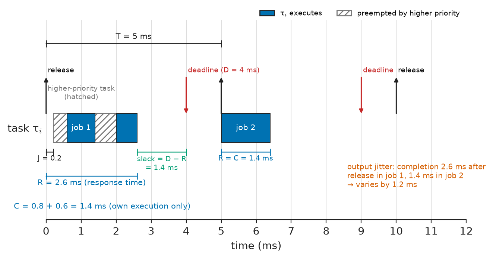
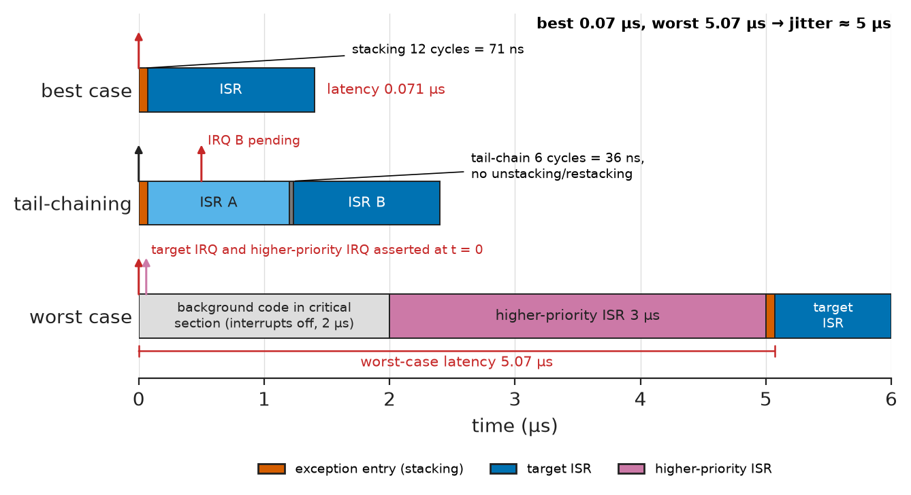
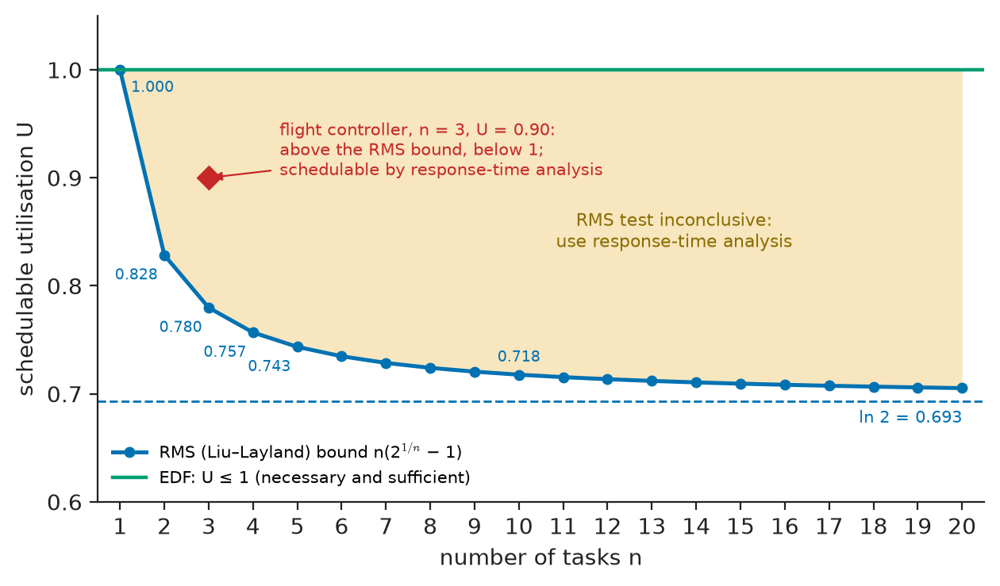
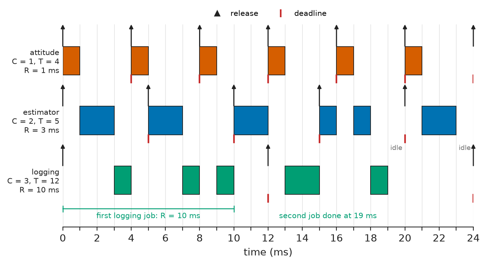
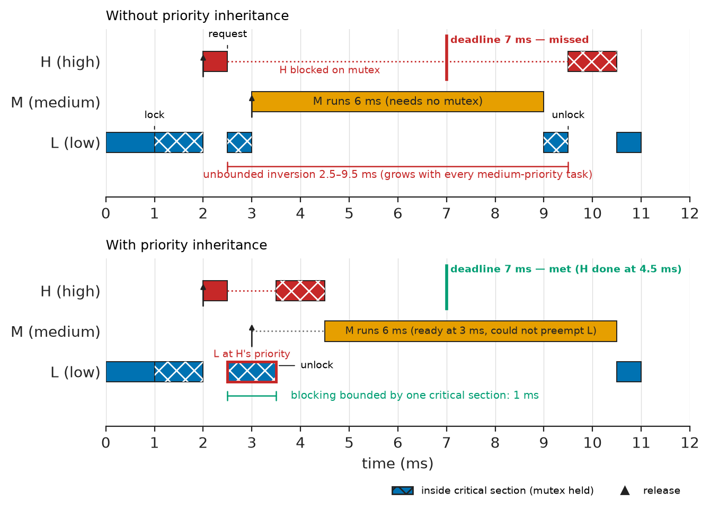
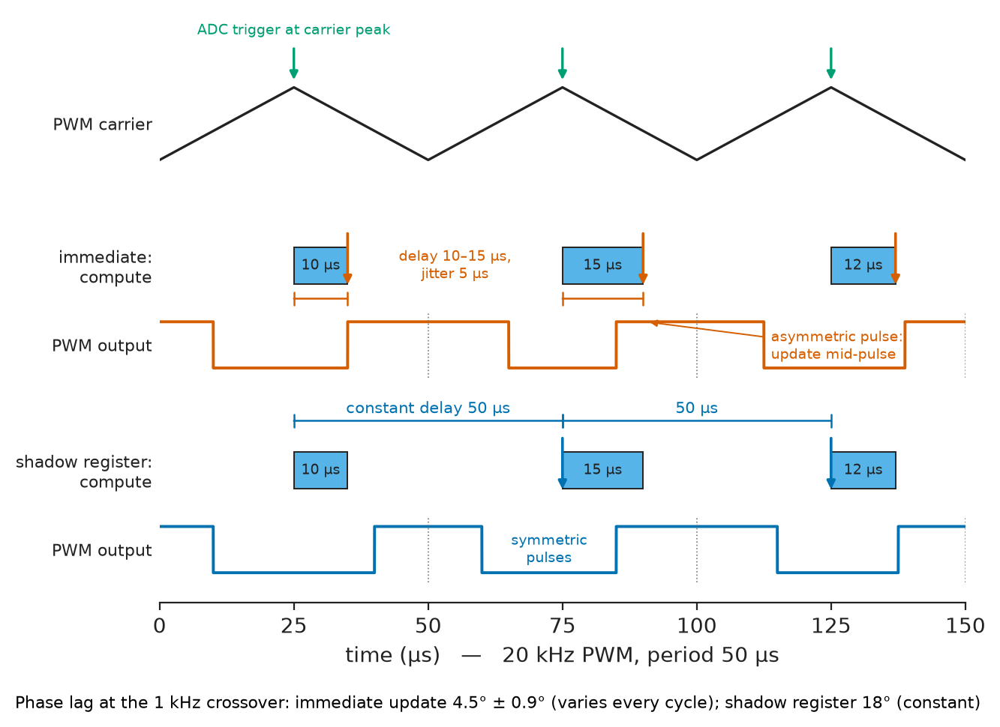

# Chapter 27 — Real-Time Computing

*Part VI · Embedded and Real-Time Systems*

Days after landing on Mars on 4 July 1997, the Pathfinder lander began resetting itself, losing data each time. Nothing was broken. A low-priority meteorological task held a mutex protecting a shared information bus; a high-priority bus-management task blocked waiting for it; and a medium-priority communications task, needing neither, preempted the low-priority task and kept it from ever releasing the mutex. A timer noticed that the bus-management task had missed its deadline and reset the computer. Engineers reproduced the fault on a ground replica, enabled the priority-inheritance option of the operating system's mutex, and uploaded the fix. Nearly thirty years later the same pattern still appears in drone flight controllers that wobble when the SD-card logger is busy, in motor drives that trip when a diagnostic task floods a shared SPI bus, and in medical pumps whose alarms arrive late under heavy display activity. A real-time system is not a fast system. It is one whose timing can be predicted and proved, and this chapter is about the models, analyses and mechanisms that make the proof possible.

> **How are interrupt latency and task response times bounded, and how do scheduling policies and analysis prove that every deadline will be met?**
> **What goes wrong when tasks share data and resources — races, deadlock, priority inversion — and how do synchronisation, RTOS services and watchdogs contain it?**

| Concept | Engineering destination |
|---|---|
| Real-time constraints | Specifying deadlines for control loops, protection, airbags, audio and communications |
| Interrupts | Bounding the latency from a hardware event to the code that serves it |
| Scheduling | Choosing cyclic, rate-monotonic or EDF scheduling and proving schedulability |
| Timers | Periodic activation, timeouts, timestamps and drift-free timing |
| Concurrency | Structuring firmware as tasks and handlers that share a processor |
| Race conditions | Finding and removing timing-dependent defects that appear once a week |
| Synchronisation | Critical sections, mutexes, semaphores, queues and lock-free buffers |
| Real-time operating systems | Selecting and configuring FreeRTOS, Zephyr and certified kernels |
| Task priorities | Priority assignment, priority inversion, inheritance and ceiling protocols |
| Latency and jitter | Keeping control loops and sampling instants predictable |
| Watchdogs and fault handling | Detecting hangs and faults and returning the system to a safe state |

**Roadmap.** What "real-time" demands (27.1) → the first source of delay, interrupts (27.2) → scheduling policies and their analysis (27.3) → the timers that drive them (27.4) → concurrency (27.5), the races it causes (27.6) and synchronisation to prevent them (27.7) → the RTOS that packages it all (27.8) → priorities and priority inversion (27.9) → latency and jitter end to end (27.10) → what to do when everything else fails (27.11).

> **Boundary.** Interrupt controllers, vector tables and hardware timers as processor and microcontroller mechanisms are developed in Chapters 16 and 17; firmware structures (superloop, interrupt-driven, RTOS-based) were introduced in Section 25.6. The consequences of loop delay for control stability are from *Circuits, Signals and Communications*, [Ch. 35](https://github.com/The-Studio-of-Sadiq/Circuits-Signals-and-Communications/blob/main/part-7-control-system-fundamentals/35-control-design-fundamentals.md) §35.8, and the throughput and latency budgets of signal-processing chains from [Ch. 21](https://github.com/The-Studio-of-Sadiq/Circuits-Signals-and-Communications/blob/main/part-5-digital-signal-processing/21-dsp-fundamentals.md) §21.3.

---

## 27.1 Real-time constraints

### Deadlines and their kinds

A **real-time system** is one whose correctness depends on when results are produced as well as on their values. The timing requirement is expressed as a **deadline**, and deadlines are classified by what a miss costs:

- **Hard** — a miss is a failure, possibly dangerous: airbag deployment, a protection relay's trip decision, a motor drive's overcurrent shutdown, fly-by-wire control.
- **Firm** — a late result is worthless but not harmful, and occasional misses are tolerated: a video frame, a sensor sample in a monitoring system.
- **Soft** — a late result loses value gradually: user-interface updates, logging, network throughput.

Most products contain all three, and the design task is to guarantee the hard deadlines while giving the rest what is left.

**Table 27.1 — Representative real-time requirements (typical values).**

| Application | Activity | Period or deadline | Kind |
|---|---|---|---|
| Digital power supply | Voltage/current loop | 1–20 µs | Hard |
| Engine control | Injection and ignition timing at 6000 rpm | 1° of crank angle = 27.8 µs | Hard |
| Motor drive | Current loop | 50–125 µs (8–20 kHz) | Hard |
| Motor drive | Speed and position loops | 0.1–1 ms | Hard |
| Flight controller | Attitude loop | 0.25–4 ms | Hard |
| Audio processing | 64-sample block at 48 kSa/s | 1.33 ms | Firm |
| Industrial PLC | I/O scan | 1–10 ms | Hard or firm |
| Vehicle ABS/ESC | Brake control loop | 5–10 ms | Hard |
| Airbag controller | Crash detection to firing decision | About 10–30 ms | Hard |
| Protection relay | Trip decision | About one mains cycle (20 ms at 50 Hz) | Hard |
| HMI display | Screen refresh | 16–50 ms | Soft |

### The task model

Real-time analysis abstracts each activity as a **task** $\tau_i$ that is released repeatedly and must complete each job before its deadline (Figure 27.1). The standard parameters are:

- $T_i$ — period (or minimum inter-arrival time for sporadic tasks driven by events);
- $C_i$ — **worst-case execution time** (WCET) of one job;
- $D_i$ — relative deadline, often equal to $T_i$ (implicit deadline);
- $J_i$ — release jitter, the variation in when a job becomes ready;
- $R_i$ — worst-case **response time**, from release to completion, which the analysis computes and compares with $D_i$;
- $U_i=C_i/T_i$ — utilisation, the fraction of the processor the task needs.

<!-- FIGURE 27.1 | figures/ch27/fig-27-1-task-timing-parameters.png | timing-diagram | Timing parameters of a periodic real-time task. | Content: horizontal time axis 0 to 12 ms for task tau_i with period T = 5 ms and deadline D = 4 ms. Release arrows (up) at 0, 5, 10 ms, deadline arrows (down) at 4 and 9 ms. First job: release at 0, starts at 0.6 ms after release jitter J = 0.2 ms and preemption by a higher-priority task (hatched block 0.2-0.6 ms), executes 0.6-1.4 ms, preempted again 1.4-2.0 ms, completes at 2.6 ms; brackets show C = 1.4 ms total execution (sum of own blocks), R = 2.6 ms response time, slack = D - R = 1.4 ms. Second job executes without interference: R = 1.4 ms. Label output jitter as the variation of completion time across jobs. -->



*Figure 27.1 — Timing parameters of a periodic real-time task.*

### Worst-case execution time

Every analysis in this chapter needs $C_i$, and obtaining a safe value is harder than it sounds. **Measurement** — running the code under stress with a cycle counter or a GPIO pin on a scope — finds the longest path that the tests exercised, not necessarily the longest that exists. **Static analysis** tools compute a bound from the machine code and a model of the processor's pipeline and caches; they are standard in avionics (DO-178C) and automotive (ISO 26262) work, but the bound can be pessimistic by tens of percent on processors with caches and branch prediction. Practice combines both: measure, add a margin (20–50 % is common for non-certified work), and keep the timing-critical code on simple paths in tightly coupled memory, where execution time hardly varies.

> **Status of the principle: Worst-case execution time**
> *Empirical.* A measured WCET is a sample maximum and can be exceeded by an untested path; a statically computed bound (an approximation from a processor model) is safe only if the processor model (caches, pipeline, bus contention) is correct.

---

## 27.2 Interrupts

### Anatomy of interrupt latency

**Interrupt latency** is the time from a hardware event to the first instruction of its handler. On an Arm Cortex-M3/M4/M7 the hardware part is fixed and short: the NVIC recognises the request, the core finishes or abandons the current instruction, pushes eight registers (R0–R3, R12, LR, PC, xPSR) onto the stack while fetching the vector, and begins the handler 12 cycles after the request with zero-wait-state memory — 71 ns at 168 MHz. With floating-point context stacked the entry grows to about 30 cycles, though **lazy stacking** defers the extra 18 words until the handler first touches the FPU. **Tail-chaining** runs a pending handler after the current one in 6 cycles without unstacking and restacking, and **late arrival** lets a higher-priority request that arrives during stacking take over the vector fetch.

<!-- FIGURE 27.2 | figures/ch27/fig-27-2-cortex-m-interrupt-latency.png | timing-diagram | Interrupt latency on a Cortex-M4 at 168 MHz: best case, tail-chaining, and the worst case with a critical section and a higher-priority handler. | Content: three rows on a common time axis 0 to 6 us. Row 1 best case: IRQ asserted at 0, stacking 12 cycles (71 ns) shaded, ISR starts at 0.071 us. Row 2 tail-chaining: ISR A ends, pending ISR B starts after 6 cycles (36 ns) without unstacking. Row 3 worst case: IRQ asserted at 0 while background code is inside a 2 us interrupts-disabled critical section; at 2 us critical section ends, a higher-priority IRQ pending at the same time runs first for 3 us; stacking 71 ns; target ISR starts at 5.07 us. Labels: latency best 0.07 us, worst 5.07 us, jitter about 5 us. -->



*Figure 27.2 — Interrupt latency on a Cortex-M4 at 168 MHz: best case, tail-chaining, and the worst case with a critical section and a higher-priority handler.*

The software part is usually much larger and is the designer's responsibility (Figure 27.2):

$$
L_{\max}=t_{\text{entry}}+t_{\text{masked,max}}+\sum_{j\in\text{hp}}C_j
$$

where $t_{\text{masked,max}}$ is the longest stretch during which interrupts at this priority are masked (critical sections, the RTOS kernel's own critical sections), and the sum covers higher-priority handlers that may run first.

> **Status of the principle: Interrupt latency bound**
> *Derived.* Assumes each higher-priority interrupt fires at most once during the interval and that bus masters (DMA) and Flash wait states are folded into $t_{\text{entry}}$; with bursty sources or heavy DMA contention, each term must be expanded as in the response-time analysis of Section 27.3.

**Worked example — Worst-case latency of an encoder interrupt.** A servo drive on a 168 MHz Cortex-M4 serves an encoder-index interrupt. The entry costs 12 cycles (71 ns). The longest interrupt-disabled critical section in the firmware is 2 µs (a 64-bit statistics update in a driver), and a higher-priority PWM-fault handler of 3 µs may be pending at the same moment. The worst-case latency is $0.071+2+3=5.07$ µs, against a best case of 71 ns. At 3000 rpm with a 10 000-line encoder (40 000 counts per revolution after quadrature), one count lasts 0.5 µs, so a position captured in software after 5 µs is ten counts stale — which is why the position is latched by the timer hardware at the index edge (Chapter 17) and the interrupt only reads it later. Lesson: interrupts bound *when software runs*; hardware capture bounds *when the event is recorded*.

### Priorities and design rules

The NVIC gives each interrupt a programmable priority (4 bits, 16 levels, on most Cortex-M4 parts); a higher-priority request preempts a running lower-priority handler. Critical sections can mask only the interrupts at or below a level with `BASEPRI`, leaving the most urgent handlers — overcurrent shutdown, for instance — untouched; FreeRTOS uses exactly this, so handlers above `configMAX_SYSCALL_INTERRUPT_PRIORITY` are never delayed by the kernel but must not call kernel services.

The design rules follow from the latency formula. Keep handlers short: acknowledge the hardware, move data to a buffer, signal a task, return. Do the work in a task, where the scheduler, not the interrupt priority, decides who waits:

```c
#include <stdint.h>
#include "FreeRTOS.h"
#include "task.h"
#include "stm32f4xx.h"            /* vendor CMSIS header: ADC1 */

void run_controller(uint16_t sample);

static TaskHandle_t control_task;
static volatile uint16_t latest_sample;

void ADC_IRQHandler(void)          /* priority below the syscall limit */
{
    BaseType_t woken = pdFALSE;
    latest_sample = (uint16_t)ADC1->DR;            /* read clears EOC   */
    vTaskNotifyGiveFromISR(control_task, &woken);  /* signal the task   */
    portYIELD_FROM_ISR(woken);                     /* switch on exit    */
}

static void control_loop(void *arg)
{
    (void)arg;
    for (;;) {
        (void)ulTaskNotifyTake(pdTRUE, portMAX_DELAY);  /* wait for sample */
        run_controller(latest_sample);
    }
}

void control_start(void)
{
    xTaskCreate(control_loop, "ctrl", 256, NULL,
                configMAX_PRIORITIES - 1, &control_task);
}
```

The handler costs a few hundred cycles; `portYIELD_FROM_ISR` requests a context switch at exception exit when the notified task outranks the interrupted one, so the controller starts within microseconds. Direct-to-task notifications are the lightest FreeRTOS signalling mechanism, faster and smaller than a semaphore.

---

## 27.3 Scheduling

### Cyclic executive

The oldest real-time scheduler builds the whole timetable offline. A **cyclic executive** divides time into **minor frames** of fixed length $f$, driven by a timer interrupt, and repeats a **major cycle** equal to the hyperperiod (least common multiple) of the task periods. Each frame runs a fixed list of task jobs to completion.

**Worked example — A cyclic schedule.** Three tasks have $(C,T)$ of $(1,10)$, $(3,20)$ and $(4,40)$ ms. The hyperperiod is 40 ms. A minor frame of $f=10$ ms satisfies the usual conditions: it is at least the longest $C$ (4 ms), it divides the hyperperiod, and $2f-\gcd(f,T_i)\le D_i$ for every task ($20-10=10\le10$, $\le20$, $\le40$), which guarantees a full frame between each release and its deadline. The four frames run $\{\tau_1,\tau_2\}$ (4 ms), $\{\tau_1,\tau_3\}$ (5 ms), $\{\tau_1,\tau_2\}$ (4 ms) and $\{\tau_1\}$ (1 ms), with the slack used for background work. The schedule is trivially verified by inspection, has zero scheduling overhead beyond the frame interrupt, and is fully deterministic — which is why cyclic executives still run flight-control and railway-signalling computers. Its weakness is brittleness: a new task or a changed period can force the whole table to be rebuilt, and sporadic events must wait for a frame that polls them.

### Fixed-priority preemptive scheduling and RMS

Most RTOSs use **fixed-priority preemptive scheduling**: each task has a static priority, and the highest-priority ready task always runs. For independent periodic tasks with implicit deadlines, **rate-monotonic scheduling** (RMS) — the shorter the period, the higher the priority — is optimal among fixed-priority assignments: if any fixed assignment meets all deadlines, RMS does. Liu and Layland (1973) proved a sufficient utilisation test:

$$
U=\sum_{i=1}^{n}\frac{C_i}{T_i}\le n\left(2^{1/n}-1\right)
$$

The bound falls from 1 for one task to 0.828 for two, 0.780 for three, 0.757 for four and 0.743 for five, approaching $\ln2=0.693$ for many tasks (Figure 27.3).

> **Status of the principle: Liu–Layland utilisation bound**
> *Derived.* Proved for independent, preemptible, periodic tasks with deadlines equal to periods, zero overhead and no blocking on one processor; it is sufficient but not necessary — task sets above the bound are often schedulable, and the exact answer comes from response-time analysis.

<!-- FIGURE 27.3 | figures/ch27/fig-27-3-utilisation-bounds.png | plot | Schedulable utilisation versus number of tasks for rate-monotonic and EDF scheduling. | Content: x axis number of tasks n from 1 to 20 (integer markers), y axis utilisation 0.6 to 1.05. Curve n(2^(1/n) - 1): 1.000, 0.828, 0.780, 0.757, 0.743 ... 0.718 at n = 10, asymptote dashed at ln 2 = 0.693. Horizontal line at U = 1.0 labelled EDF necessary and sufficient. Marker at n = 3, U = 0.90 for the flight-controller task set of Section 27.3, above the RMS bound but below 1, annotated schedulable by response-time analysis. Shaded band between curve and 1.0 labelled RMS: test inconclusive, use RTA. -->



*Figure 27.3 — Schedulable utilisation versus number of tasks for rate-monotonic and EDF scheduling.*

A tighter sufficient test, the **hyperbolic bound** of Bini and Buttazzo, requires $\prod_i(U_i+1)\le2$; it accepts every task set that Liu–Layland accepts and some more.

### Earliest deadline first

**Earliest-deadline-first** (EDF) scheduling assigns priorities dynamically: at every instant the ready job with the nearest absolute deadline runs. For the same task model EDF is optimal among all scheduling policies, and its test is exact:

$$
U=\sum_i\frac{C_i}{T_i}\le1
$$

> **Status of the principle: EDF schedulability**
> *Derived.* For independent preemptible tasks with implicit deadlines on one processor, $U\le1$ is necessary and sufficient; with deadlines shorter than periods a processor-demand test replaces it.

EDF uses the processor fully, but it is less common in commercial RTOSs because priorities change at run time, the implementation needs a deadline-ordered ready queue, and under overload it fails badly — a single overrunning job can make many tasks miss in a domino effect, whereas fixed priorities protect the high-priority tasks and sacrifice the low ones. Linux offers EDF as `SCHED_DEADLINE`; Zephyr offers an optional deadline scheduler.

### Response-time analysis

The exact test for fixed priorities is **response-time analysis** (RTA). A task's worst-case response occurs when it is released together with all higher-priority tasks (the critical instant). Its response time is then its own execution, plus blocking $B_i$ by lower-priority tasks holding shared resources (Section 27.9), plus the interference of every higher-priority task released during the window:

$$
R_i=C_i+B_i+\sum_{j\in hp(i)}\left\lceil\frac{R_i+J_j}{T_j}\right\rceil C_j
$$

The equation is solved by iteration, starting from $R_i=C_i+B_i$ and stopping when the value repeats (the task is schedulable if $R_i\le D_i$) or exceeds $D_i$.

> **Status of the principle: Response-time analysis**
> *Derived.* Exact for fixed-priority preemptive scheduling of independent sporadic tasks on one processor with $D_i\le T_i$, given correct $C_i$, $B_i$ and $J_i$; kernel overheads (context switches, tick handler) must be added to $C_i$ or modelled as extra tasks, and the analysis does not cover multicore interference through shared caches and buses.

**Worked example — Is the flight controller schedulable?** A flight controller runs an attitude loop ($C=1$ ms, $T=4$ ms), a state estimator ($C=2$, $T=5$) and a telemetry-and-logging task ($C=3$, $T=12$), with rate-monotonic priorities in that order. The listing applies the tests:

```python
# Response-time analysis for fixed-priority preemptive scheduling
from math import ceil

def response_times(tasks):
    """tasks: list of (name, C, T, D, B) sorted by priority, highest first.
    Returns the worst-case response time of each task, or None if R > D."""
    results = []
    for i, (name, c, t, d, b) in enumerate(tasks):
        r = c + b
        while True:
            r_next = c + b + sum(ceil(r / tj) * cj
                                 for _, cj, tj, _, _ in tasks[:i])
            if r_next == r or r_next > d:
                break
            r = r_next
        results.append((name, r_next if r_next <= d else None))
    return results

flight = [  # name, C, T, D, B  (ms)
    ("attitude", 1.0, 4.0, 4.0, 0.0),
    ("estimator", 2.0, 5.0, 5.0, 0.0),
    ("logging", 3.0, 12.0, 12.0, 0.0),
]
u = sum(c / t for _, c, t, _, _ in flight)
n = len(flight)
print(f"U = {u:.3f}, Liu-Layland bound = {n * (2 ** (1 / n) - 1):.3f}")
for name, r in response_times(flight):
    print(f"{name:<10s} R = {r}")
```

The utilisation is $0.25+0.4+0.25=0.900$, above the three-task bound of 0.780, and the hyperbolic product $1.25\times1.4\times1.25=2.19$ exceeds 2: both sufficient tests are inconclusive. RTA gives $R=1$, 3 and 10 ms, all within their deadlines of 4, 5 and 12 ms, so the set is schedulable. For the logging task the iteration runs $R=3\to6\to9\to10\to10$: at $R=10$ ms the window contains three attitude jobs and two estimator jobs, $3+3\times1+2\times2=10$. Figure 27.4 shows the resulting schedule; the same model is used for CAN messages, whose identifiers are fixed priorities (Section 26.5), with non-preemptive frame transmission entering as blocking.

<!-- FIGURE 27.4 | figures/ch27/fig-27-4-rms-gantt-flight-controller.png | timing-diagram | Rate-monotonic schedule of the flight-controller task set over the first 24 ms. | Content: Gantt chart with three rows (attitude C1 T4, estimator C2 T5, logging C3 T12) and time axis 0 to 24 ms in 1 ms steps; release arrows at multiples of each period, deadline marks. Execution slots: attitude at 0-1, 4-5, 8-9, 12-13, 16-17, 20-21; estimator at 1-3, 5-7, 10-12, 15-16 and 17-18, 21-23; logging at 3-4, 7-8, 9-10 (first job completes at 10 ms, R = 10 ms bracket), then 13-15 and 18-19 (second job completes at 19 ms). Idle at 19-20 and 23-24. Annotate worst-case responses 1, 3 and 10 ms. -->



*Figure 27.4 — Rate-monotonic schedule of the flight-controller task set over the first 24 ms.*

---

## 27.4 Timers

### Periodic activation and the system tick

Hardware timers (Chapter 17) provide the time base of every real-time system in three roles. A **periodic timer interrupt** releases tasks: the RTOS **tick**, typically 1 kHz from the Cortex-M SysTick or a low-power timer, advances the kernel's notion of time, wakes delayed tasks and enforces time slices. **Hardware-triggered events** start ADC conversions, update PWM duty cycles and capture inputs without software in the timing path (Section 27.10). **Free-running counters** timestamp events and measure execution time; the Cortex-M DWT cycle counter (`DWT->CYCCNT`) counts core clocks and is the standard tool for measuring WCET.

The tick sets the granularity of every software timeout. A delay of $n$ ticks requested at a random moment between ticks lasts between $n-1$ and $n$ tick periods: `vTaskDelay(10)` at 1 kHz waits 9–10 ms. Periodic tasks must therefore not be written as "work, then delay $T$", because the period then becomes $T$ plus the work plus scheduling delay and drifts; they should wait until an absolute time, `vTaskDelayUntil(&last_wake, period)` in FreeRTOS or `k_timer`-based periods in Zephyr, so that each release is computed from the previous release rather than from when the task happened to finish.

**Tickless idle** removes the periodic tick when no task is ready: the kernel programs a low-power timer for the next timeout and sleeps until then, which saves the energy of a thousand wake-ups per second — essential for the battery devices of Section 25.5.

### Clock accuracy and drift

All of these times are only as good as the oscillator. A crystal of ±20 ppm accumulates up to $20\times10^{-6}\times86\,400=1.7$ s of error per day, 52 s per month. A 32.768 kHz tuning-fork crystal used for the RTC has a parabolic temperature curve, about $-0.034$ ppm/°C² away from its 25 °C turnover, so at −20 °C or +70 °C it runs $0.034\times45^2=69$ ppm slow, 6 s per day. Devices that must keep time for months either calibrate the RTC against temperature, discipline it from a network (NTP, IEEE 1588 PTP, GNSS or cellular time), or use a temperature-compensated oscillator. Distributed control (synchronised sampling in a substation, coordinated motion axes) depends on such synchronisation to the microsecond.

> **Status of the principle: Tick-granularity error**
> *Fundamental.* A software timeout measured in ticks cannot resolve times finer than one tick and is uncertain by up to one tick at its start, whatever the processor speed; finer timing needs a hardware timer channel.

---

## 27.5 Concurrency

### Tasks, handlers and shared state

A **concurrent** program consists of activities whose executions overlap in time: tasks preempting one another, interrupt handlers preempting tasks, DMA engines writing memory in parallel, and on multicore parts true parallelism. Concurrency is how a single microcontroller meets several deadlines at once; it is also the source of the hardest defects in embedded software, because the interleaving of operations differs from run to run.

Three properties decide whether shared data is safe:

1. **Atomicity.** An operation is atomic if no other activity can observe it half-done. On a 32-bit Cortex-M an aligned 8-, 16- or 32-bit load or store is atomic; a 64-bit variable, a structure, or a read-modify-write such as `count++` (load, add, store) is not.
2. **Visibility and ordering.** The compiler may keep a variable in a register, merge or reorder accesses, unless told otherwise. `volatile` forces each access to happen in program order with respect to other volatile accesses, which is what device registers need — but it does not make `count++` atomic, and it does not order non-volatile accesses around it. C11 atomics (`<stdatomic.h>`) and compiler barriers express the intent properly.
3. **Hardware ordering.** On cores with write buffers, caches or multiple bus masters (Cortex-M7, multicore parts, DMA), memory barriers (`DMB`, `DSB`) and cache maintenance are needed so that, for example, a DMA engine sees a buffer's contents before it sees the descriptor that points to it.

### Reentrancy

A function is **reentrant** if it can be safely called again while a previous call is in progress — from an interrupt or another task. Functions that use only local variables and their arguments are reentrant; those that use static or global state, non-reentrant library calls (`strtok`, `rand`, many `printf` implementations, `malloc` without locking) or hardware peripherals without protection are not. Library documentation for embedded C runtimes (newlib, picolibc) states which functions need locking hooks under an RTOS.

---

## 27.6 Race conditions

### Definition and anatomy

A **race condition** exists when the result of a computation depends on the relative timing of concurrent activities. The classic embedded case is a variable shared between an interrupt handler and a task, where one of them performs a non-atomic sequence on it. The **race window** is the span of instructions during which an interruption corrupts the result. Races are pernicious because the window is short, so the failure is rare, irreproducible under the debugger and often blamed on hardware.

> **Status of the principle: Race-window failure rate**
> *Approximate.* If accesses of rate $f_a$ open a window of length $w$ and the conflicting interrupt arrives at rate $f_i$, independently of the access, the expected failure rate is about $f_a f_i w$; correlated timing (both driven by the same timer) can make the race either impossible or certain, which is why it must be removed by design rather than estimated away.

**Worked example — The sensor driver that hangs about twice a day.** A task updates a shared 32-bit status word ten times a second with a read-modify-write that takes 4 instructions (24 ns at 168 MHz). An interrupt handler that sets a different bit in the same word fires 100 times a second. The chance that the handler lands inside a given window is $100\times24\ \mathrm{ns}=2.4\times10^{-6}$; with ten windows a second the failure rate is $10\times2.4\times10^{-6}=2.4\times10^{-5}$ per second, one lost bit on average every 11.6 hours. In a lab test of an afternoon the bug probably never appears; in a fleet of ten thousand devices it appears about twenty thousand times a day. When the lost bit is a "transfer complete" flag, the driver waits forever — the intermittent hang that the field reports and the lab cannot reproduce.

### Torn reads of wide values

A second common race is a **torn read**: reading a value wider than the bus, or composed of two registers, while it changes. A 64-bit timestamp built from a 32-bit hardware counter and a software overflow count is the textbook example:

```c
#include <stdint.h>
#include "stm32f4xx.h"            /* vendor CMSIS header: TIM5 (32-bit) */

static volatile uint32_t overflow_count;

void TIM5_IRQHandler(void)          /* counter wrapped from 0xFFFFFFFF to 0 */
{
    TIM5->SR = ~TIM_SR_UIF;         /* clear the update flag */
    overflow_count++;
}

/* Broken: a wrap between the two reads gives an error of 2^32 counts. */
uint64_t now_broken(void)
{
    uint32_t hi = overflow_count;
    uint32_t lo = TIM5->CNT;
    return ((uint64_t)hi << 32) | lo;
}

/* Correct when called with interrupts enabled below the TIM5 priority:
 * repeat until the high word is unchanged across the low-word read. */
uint64_t now(void)
{
    uint32_t hi, lo;
    do {
        hi = overflow_count;
        lo = TIM5->CNT;
    } while (hi != overflow_count);
    return ((uint64_t)hi << 32) | lo;
}
```

The broken version returns a time about 2³² counts — 51 s at 84 MHz — too early whenever the wrap and its handler fall between its two reads. The corrected version re-reads until consistent and needs no lock, but its comment matters: called from code that masks the timer interrupt, the counter can wrap while the overflow handler is still pending, and only checking the timer's pending flag fixes that case. The other common race patterns are check-then-act (testing a flag, then acting on it after it may have changed), the lost wake-up of Section 25.6 (sleeping just after an interrupt set the flag), and double-buffer swaps signalled before the data are complete.

---

## 27.7 Synchronisation

### Critical sections

The simplest protection makes a sequence atomic by preventing preemption during it. On a single-core MCU, disabling interrupts (`__disable_irq()`, or raising `BASEPRI` to mask only interrupts that share the data) does this for a few instructions. Every critical section adds directly to the interrupt latency of Section 27.2 and must be short and bounded — microseconds, never a loop over a buffer of unknown length or a call to a blocking function. Hardware support often removes the need: atomic set/clear registers for GPIO and status words (Section 25.7), exclusive load/store instructions (`LDREX`/`STREX` on Armv7-M) behind C11 `atomic_fetch_or`, and the single-producer, single-consumer ring buffer that needs no lock at all.

### Kernel synchronisation objects

An RTOS provides objects that block a task instead of spinning or masking interrupts:

**Table 27.2 — RTOS synchronisation objects.**

| Object | Purpose | Ownership | Use from ISR | Typical use |
|---|---|---|---|---|
| Mutex | Mutual exclusion of a resource | Owned by the locking task; priority inheritance | No | Shared bus, file system, display |
| Binary semaphore | Signal an event | No owner | Give only | ISR-to-task signal (or a task notification) |
| Counting semaphore | Count events or free resources | No owner | Give only | Pool of buffers, pending events |
| Queue / message buffer | Pass data by copy, with blocking | — | Send and receive (non-blocking) | Sensor samples, commands, log records |
| Event group / flags | Wait for combinations of events | — | Set only | Start-up synchronisation, multi-source waits |
| Task notification | Lightweight signal or value to one task | — | Yes | Fastest ISR-to-task signal in FreeRTOS |

The distinction between a mutex and a binary semaphore matters. A mutex has an owner, may only be released by that owner, and implements priority inheritance (Section 27.9); a semaphore has no owner and is the right tool for signalling. Using a binary semaphore to protect a resource silently gives up inheritance — a common route to a Pathfinder-like inversion. Queues are often the best synchronisation of all: if tasks communicate only by passing messages and each piece of state has one owner, there is nothing to lock.

### Deadlock

A **deadlock** occurs when tasks wait for each other in a cycle: task A holds the SPI mutex and waits for the I²C mutex while task B holds the I²C mutex and waits for SPI. It requires four conditions together — mutual exclusion, hold-and-wait, no preemption of resources, and a circular wait — and is prevented by breaking any one. The practical rules are to acquire multiple locks always in one global order, to avoid holding a lock while waiting for anything else, and to use timeouts on every blocking call so that a deadlock becomes a detected, logged error rather than a silent hang. The priority-ceiling protocols of Section 27.9 prevent deadlock by construction.

---

## 27.8 Real-time operating systems

### What a kernel provides

A **real-time operating system** provides preemptive priority scheduling, the synchronisation objects of Section 27.7, timers and delays, and memory management for task stacks — with the guarantee that every kernel operation has a bounded execution time. It differs from a general-purpose OS less in its features than in that bound: no operation may take time proportional to the number of tasks or the amount of memory in use unless that number is fixed at design time.

On a Cortex-M the context switch uses two exceptions. The tick or a kernel call decides that a switch is needed and pends **PendSV**, the lowest-priority exception, which runs once all other handlers have finished, saves the remaining registers of the outgoing task on its stack, stores its stack pointer, selects the next task and restores its context. The whole switch takes roughly 100–300 cycles, about 1–2 µs at 168 MHz, and it never delays a higher-priority interrupt.

**Table 27.3 — Representative real-time kernels (typical values).**

| Kernel | Licence and origin | Footprint | Notable features |
|---|---|---|---|
| FreeRTOS | MIT; maintained by AWS | 5–10 KB Flash, about 1 KB RAM plus stacks | The most widely ported MCU kernel; SAFERTOS derivative certified to IEC 61508 SIL 3 |
| Zephyr | Apache 2.0; Linux Foundation | 8 KB to several hundred KB | Device tree, drivers, BLE, networking, MCUboot integration, memory protection |
| Eclipse ThreadX | MIT (formerly Azure RTOS) | 2–20 KB | Fast, pre-certified to IEC 61508, ISO 26262 and others |
| AUTOSAR Classic OS | Specification (OSEK-based); several vendors | Statically configured | Automotive ECUs, ISO 26262 ASIL D implementations |
| VxWorks | Commercial (Wind River) | Hundreds of KB | Aerospace and defence, DO-178C; flew on Pathfinder and later Mars missions |
| QNX Neutrino | Commercial (BlackBerry) | Microkernel, MB-scale | Automotive cockpits and safety systems, POSIX, ISO 26262 ASIL D |
| Linux PREEMPT_RT | GPL; mainline since kernel 6.12 (2024) | Full Linux | Worst-case latencies of tens of microseconds on tuned hardware |

### Configuration and memory protection

Real-time behaviour depends on configuration as much as on the kernel. Static allocation of all tasks, stacks and queues (FreeRTOS `configSUPPORT_STATIC_ALLOCATION`, Zephyr's compile-time definitions) removes the heap from the timing and failure picture. Stack-overflow checking and the memory protection unit turn corruption into faults (Section 27.11). Tracing tools (SEGGER SystemView, Percepio Tracealyzer, Zephyr's tracing) record every context switch and kernel call with cycle timestamps and are the fastest way to see priority inversions and overruns that the analysis did not predict. For mixed-criticality systems, a multicore part often runs an RTOS on a Cortex-M or Cortex-R core for the hard loops and Linux on Cortex-A cores for networking and user interface, communicating through shared memory and mailboxes.

---

## 27.9 Task priorities

### Assigning priorities

For independent periodic tasks, rate-monotonic order (shorter period, higher priority) is optimal when $D_i=T_i$, and **deadline-monotonic** order (shorter relative deadline, higher priority) is optimal when $D_i\le T_i$. Real systems deviate for good reasons — a short-period but soft task (a display animation) should not outrank a longer-period hard one (a protection check) — and the analysis of Section 27.3 then checks the actual assignment. Priorities should reflect deadlines, not importance: a crucial but slow task at top priority makes every fast task wait for it.

### Priority inversion

**Priority inversion** occurs when a high-priority task waits for a lower-priority one. Some inversion is unavoidable: if a low-priority task holds a mutex the high-priority task needs, the high-priority task must wait for the critical section to finish — bounded inversion. The danger is **unbounded inversion**: while the low-priority task holds the mutex, any number of medium-priority tasks, which need no resource at all, can preempt it and extend the high-priority task's wait indefinitely. This is the Pathfinder failure of the opening (Figure 27.5).

<!-- FIGURE 27.5 | figures/ch27/fig-27-5-priority-inversion-inheritance.png | timing-diagram | Unbounded priority inversion and its correction by priority inheritance. | Content: two Gantt charts with three task rows (H high, M medium, L low) on a time axis 0 to 12 ms. Top chart without inheritance: L runs at 0, locks mutex at 1 ms; H released at 2 ms, preempts L, requests mutex at 2.5 ms and blocks; L resumes its critical section 2.5-3 ms; M released at 3 ms, preempts L and runs 3-9 ms; L resumes 9-9.5 ms, unlocks at 9.5 ms; H runs 9.5-10.5 ms, deadline at 7 ms marked missed (red); L finishes 10.5-11 ms. Bracket labelled unbounded inversion 2.5-9.5 ms. Bottom chart with priority inheritance: same releases; when H blocks at 2.5 ms, L inherits H's priority and runs its critical section 2.5-3.5 ms, M (released at 3 ms) cannot preempt; L unlocks at 3.5 ms and drops back; H runs 3.5-4.5 ms and meets its deadline; M runs 4.5-10.5 ms. Bracket labelled blocking bounded by one critical section, 1 ms. -->



*Figure 27.5 — Unbounded priority inversion and its correction by priority inheritance.*

### Priority inheritance and priority ceiling

Two protocols bound the inversion:

- **Priority inheritance** (PIP): when a high-priority task blocks on a mutex, the holder temporarily inherits the waiter's priority, so medium-priority tasks cannot preempt it; it returns to its own priority on release. FreeRTOS, Zephyr, ThreadX and POSIX (`PTHREAD_PRIO_INHERIT`) mutexes implement it.
- **Priority ceiling** (PCP, and its simpler immediate form, IPCP, used by AUTOSAR OS as `GetResource` and by POSIX as `PTHREAD_PRIO_PROTECT`): each resource has a ceiling equal to the highest priority of any task that uses it, and a task that locks the resource runs at that ceiling immediately.

> **Status of the principle: Blocking bounds of the inheritance and ceiling protocols**
> *Derived.* Under priority inheritance a task can be blocked at most once by each lower-priority task (or once per resource), and chained blocking is possible; under the priority-ceiling protocols a task is blocked at most once, for the duration of one critical section of a lower-priority task, and deadlock cannot occur. Both assume critical sections do not suspend for other reasons.

The bound enters response-time analysis as the term $B_i$: the longest critical section of any lower-priority task on a resource whose ceiling is at least the priority of $\tau_i$.

**Worked example — How long may the logger hold the SPI bus?** In the flight controller of Section 27.3 the logging task writes to an SD card on the same SPI bus that the attitude and estimator tasks use to read the IMU, protected by a mutex with priority inheritance. If the logger holds the bus for one 1.5 ms block write, both higher-priority tasks can be blocked by up to $B=1.5$ ms. RTA then gives the attitude task $R=1+1.5=2.5$ ms (deadline 4 ms, met), but the estimator $R=2+1.5+\lceil4.5/4\rceil\times1=5.5$ ms, which misses its 5 ms deadline. Limiting each locked SD transfer to 1.0 ms (smaller blocks, or releasing the mutex between sectors) gives $R=2+1+\lceil4/4\rceil\times1=4$ ms, schedulable. Without inheritance no finite bound exists at all. The better architecture removes the shared bus — the IMU on its own SPI port, or the SD card served by DMA from a queue owned by one task — so that $B=0$.

---

## 27.10 Latency and jitter

### Definitions

**Latency** is a delay from a cause to an effect: interrupt latency (Section 27.2), scheduling latency (from a task becoming ready to it running), and end-to-end latency (from a sensor sample to the actuator output). **Jitter** is the variation of a latency, or of the instants of a periodic activity, from one occurrence to the next. Release jitter disturbs when a task starts; output jitter disturbs when its result takes effect. For control and signal processing, jitter often matters more than average latency, because a constant delay can be designed into a controller while a varying one cannot.

**Table 27.4 — Sources of latency and jitter in embedded systems (typical magnitudes).**

| Source | Typical magnitude | Mitigation |
|---|---|---|
| Interrupt entry (Cortex-M) | 12–30 cycles | None needed |
| Interrupt-disabled critical sections | 1–50 µs if careless | Short sections, `BASEPRI`, lock-free structures |
| Higher-priority handlers and tasks | Their execution times | Priority design, RTA |
| Flash wait states, caches, branch prediction | Tens of percent of execution time | Run critical code from tightly coupled RAM; lock caches |
| DMA and bus contention | Tens to hundreds of ns per access | Bus-matrix planning, separate RAM banks |
| Tick granularity | Up to one tick (1 ms) | Hardware timers for fine timing |
| General-purpose Linux | Milliseconds worst case | PREEMPT_RT, CPU isolation, or a companion MCU |

### Jitter in control loops

A digital controller assumes that it samples at exactly $kT$ and updates its output at a fixed delay after each sample. Book 3, [Ch. 35](https://github.com/The-Studio-of-Sadiq/Circuits-Signals-and-Communications/blob/main/part-7-control-system-fundamentals/35-control-design-fundamentals.md) §35.8 shows that a delay $\tau_d$ costs phase $\omega_c\tau_d$ at the crossover frequency. A delay that varies by $\Delta\tau$ therefore modulates the phase margin by $\omega_c\Delta\tau$ from one cycle to the next and injects noise proportional to the signal's slope, as sampling jitter does in a converter (Book 3 §19.5).

**Worked example — Fixed delay or minimum delay?** A motor drive's current loop runs at 20 kHz ($T=50$ µs) with a crossover of 1 kHz. The control computation takes 10–15 µs depending on the path through the code.

- If the PWM duty cycle is written as soon as the computation finishes, the delay is 10–15 µs: average phase loss about $360^\circ\times1000\times12.5\ \mu\mathrm{s}=4.5^\circ$, varying by $360^\circ\times1000\times5\ \mu\mathrm{s}=1.8^\circ$ from cycle to cycle — and an update that lands in the middle of a PWM period produces an asymmetric pulse.
- If the duty cycle is written into the timer's shadow register and loaded at the next carrier peak, one full PWM period after the sample, the delay is a constant 50 µs: $18^\circ$ of phase loss, but zero jitter and clean pulses.

Industrial drives almost always choose the second (Figure 27.6), sampling the current with a timer-triggered ADC at the carrier peak, the centre of the PWM period; loading the shadow register at the next valley instead halves the delay to 25 µs (9°) if the computation fits. The pattern generalises: let hardware fix the instants of sampling and actuation, and let software only have to finish in time. This is also the idea of the **logical execution time** model used in automotive and avionics frameworks, where each task reads its inputs at release and publishes its outputs exactly at its deadline.

<!-- FIGURE 27.6 | figures/ch27/fig-27-6-control-loop-jitter.png | timing-diagram | Jitter in a 20 kHz current loop: immediate update versus shadow-register update at the PWM period boundary. | Content: time axis 0 to 150 us (three PWM periods of 50 us). Top row: triangular PWM carrier, ADC trigger arrows at each carrier peak (centre of period). Middle row (immediate update): computation blocks of 10, 15 and 12 us after each trigger, duty-cycle change arrows at the end of each block, varying positions; bracket delay 10-15 us, jitter 5 us; one PWM pulse drawn asymmetric where the update lands mid-period. Bottom row (shadow register): same computation blocks, but duty-cycle change takes effect at the next carrier peak, one full PWM period after the sample; constant 50 us delay bracket; symmetric pulses. Side note: phase at 1 kHz crossover 4.5 deg plus or minus 0.9 deg versus constant 18 deg. -->



*Figure 27.6 — Jitter in a 20 kHz current loop: immediate update versus shadow-register update at the PWM period boundary.*

### Measuring latency and jitter

The simplest instrument is a GPIO pin set at the start and cleared at the end of an ISR or task, watched on an oscilloscope in persistence mode or a logic analyser over hours: the spread of the edges is the jitter, and the scope's histogram gives its distribution. The DWT cycle counter records maxima in firmware. On Linux, `cyclictest` measures scheduling latency; a tuned PREEMPT_RT system on a modern Arm or x86 processor typically shows worst cases of tens of microseconds over long runs, against milliseconds for a standard kernel under load. Worst cases must be measured under the worst load — all interrupts active, all DMA streams running, the flash being written, the network flooded — because that is when they occur.

---

## 27.11 Watchdogs and fault handling

### Watchdog timers

A **watchdog** is a counter that resets the processor unless software restarts ("kicks") it before it expires. It is the last line of defence against hangs: an infinite loop, a deadlock, a task starved by a priority error, a peripheral that never completes, a corrupted program counter. Microcontrollers offer two kinds. An **independent watchdog** runs from its own low-speed RC oscillator, so it keeps counting even if the main clock fails; once started it often cannot be stopped by software. A **window watchdog** resets the processor if it is kicked too late *or too early*, catching code that runs too fast (skipped work, a tight loop that kicks the dog). Safety-related designs add an **external watchdog** chip with its own oscillator, which also catches a processor whose clock or supply has failed in a way the internal watchdog shares.

A watchdog helps only if the kick means the whole system is healthy. Kicking from a timer interrupt proves only that the timer interrupt runs; kicking from the idle task proves that something lets the idle task run. The robust pattern is a supervisor that kicks only when every monitored task has reported progress:

```c
#include <stdint.h>
#include "FreeRTOS.h"
#include "task.h"

#define N_MONITORED 4u
static volatile uint32_t progress[N_MONITORED];  /* bumped by each task */
static uint32_t last_seen[N_MONITORED];

void health_checkin(unsigned id) { progress[id]++; }
void watchdog_kick(void);                    /* e.g. write 0xAAAA to IWDG->KR */
void fault_log_stalled(unsigned id);         /* record in no-init RAM */

static void supervisor_task(void *arg)
{
    (void)arg;
    TickType_t wake = xTaskGetTickCount();
    for (;;) {
        vTaskDelayUntil(&wake, pdMS_TO_TICKS(100));
        int all_alive = 1;
        for (unsigned i = 0; i < N_MONITORED; i++) {
            uint32_t now = progress[i];
            if (now == last_seen[i]) {           /* no progress in 100 ms */
                fault_log_stalled(i);
                all_alive = 0;
            }
            last_seen[i] = now;
        }
        if (all_alive)
            watchdog_kick();                 /* only a healthy system kicks */
    }
}
```

Each monitored task calls `health_checkin` at least once per 100 ms from its main loop; a task with a longer period checks in from a timeout path. A single late check-in costs one missed kick, which the watchdog's longer timeout absorbs; a task that stays stalled stops the kicks for good and the watchdog resets the system, with the stalled task's identity already logged.

**Worked example — Choosing the watchdog timeout.** An STM32F4's independent watchdog runs from an internal RC oscillator specified between 17 and 47 kHz (nominal 32 kHz). With a prescaler of 32 and a count of 1000, the timeout is $32\times1000/32\ \mathrm{kHz}=1.0$ s nominally, but anywhere from $32\,000/47\ \mathrm{kHz}=0.68$ s to $32\,000/17\ \mathrm{kHz}=1.88$ s across parts and temperature. The minimum, 0.68 s, must exceed the longest legitimate interval between kicks with margin. The supervisor kicks every 100 ms, comfortably inside it — until a firmware update erases a 128 KB Flash sector, which takes about 1–2 s and stalls code executing from the same Flash bank. The watchdog fires in the middle of the update. The fixes are to run the erase from RAM while kicking between operations, to erase in smaller sectors, or to use a dual-bank part; lengthening the timeout to cover the erase would also make the watchdog useless as a guard for a 100 ms control loop. The maximum, 1.88 s, is the longest time the system may be hung before recovery, and must be acceptable to the application's safety analysis.

### Faults and safe states

A watchdog catches hangs; processor **fault exceptions** catch illegal operations. On Cortex-M the HardFault, MemManage, BusFault and UsageFault exceptions fire on invalid memory accesses, MPU violations, undefined instructions, division by zero (when enabled) and unaligned accesses; the configurable fault status registers (CFSR, HFSR) and the fault address registers say what happened, and the stacked program counter says where. A fault handler in production firmware should:

1. capture the stacked registers, the fault status registers and the reset cause into a **no-init RAM** region (not cleared by the startup code of Section 25.8) or a reserved Flash page;
2. drive outputs to a **safe state** — PWM off, valves closed, heater off — directly through registers, without relying on drivers or the RTOS that may be corrupted;
3. reset the system, and on the next boot report the stored record and count consecutive faults, entering a degraded or service mode instead of resetting forever.

Stack overflow, the most common cause of mysterious faults, is detected by MPU guard regions below each task stack (an overflow faults immediately at the offending instruction) or, more weakly, by the RTOS checking a canary pattern at each context switch. Safety standards build these layers into requirements: IEC 60730 Annex H (Class B) for household appliance controls requires periodic CPU-register, RAM and Flash self-tests and an independent clock check; IEC 61508 and ISO 26262 call for diagnostic coverage figures that combine watchdogs, memory protection, lockstep cores and plausibility checks.

> **Status of the principle: Watchdog coverage**
> *Approximate.* A watchdog detects failures that stop the kick, so its coverage is only as good as the condition that gates the kick; faults that leave the kicking path alive — wrong but timely outputs, a stuck sensor — need plausibility checks, redundancy and independent monitoring.

The Pathfinder engineers were lucky in one respect: the watchdog-style timer that detected the missed deadline reset the system into a safe, communicating state every time, and the logs it preserved let them diagnose a priority inversion from more than a hundred million miles away. Designing that outcome in — bounded timing, proven schedules, and a recovery path that leaves evidence — is what distinguishes a real-time system from a fast one.

---

## What remains open

| Open question | Where it is answered |
|---|---|
| How do interrupt controllers, vector tables and hardware timers work inside the processor? | Chapters 16 and 17 |
| How are superloop, interrupt-driven and RTOS-based firmware structures chosen, and how does the device boot? | Chapter 25 |
| How are CAN, SPI, I²C and UART links timed at the bit level? | Chapter 26 |
| How are state machines, drivers, low-power modes, hardware-in-the-loop tests and firmware validation engineered around these timing guarantees? | Chapter 28 |
| How do caches, pipelines and memory hierarchies affect execution time? | Chapter 16 |
| How are real-time constraints met when work is split between processors, FPGAs and accelerators? | Chapter 35 |
| How much loop delay can a feedback controller tolerate? | *Circuits, Signals and Communications*, [Ch. 35](https://github.com/The-Studio-of-Sadiq/Circuits-Signals-and-Communications/blob/main/part-7-control-system-fundamentals/35-control-design-fundamentals.md) |
| How are motor-drive current and speed loops designed and tuned? | *Electrical Energy and Machines*, [Ch. 12](https://github.com/The-Studio-of-Sadiq/Electrical-Energy-and-Machines/blob/main/part-3-motor-drives/12-ac-motor-drives.md) |

**Next:** Chapter 28 assembles the pieces of this part into a design method — hardware abstraction, modular drivers, state machines, low-power design, logging, debugging and hardware-in-the-loop validation.
