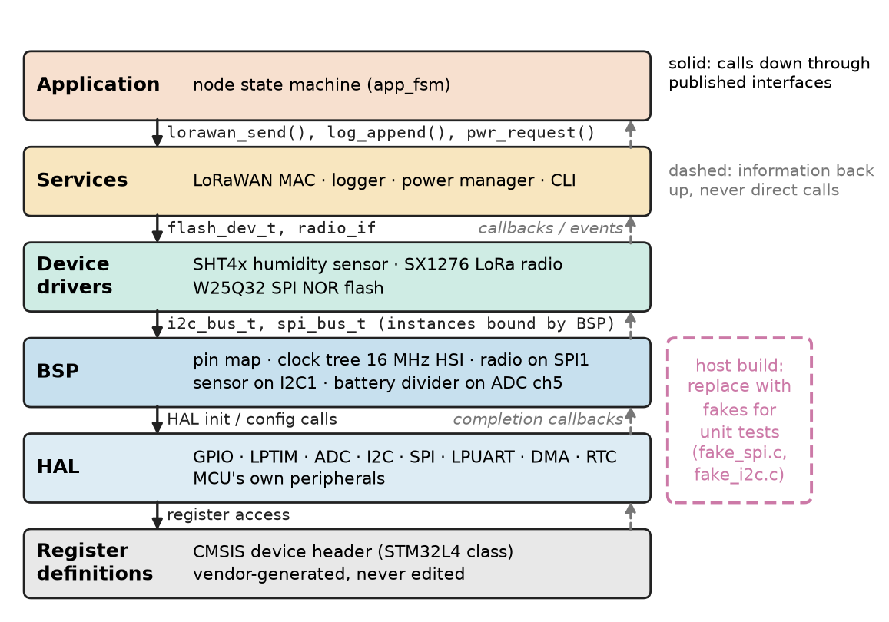
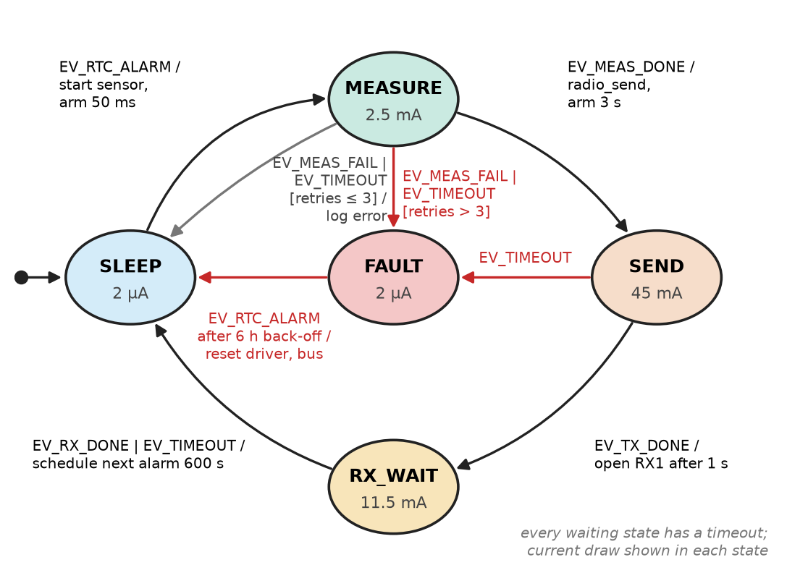
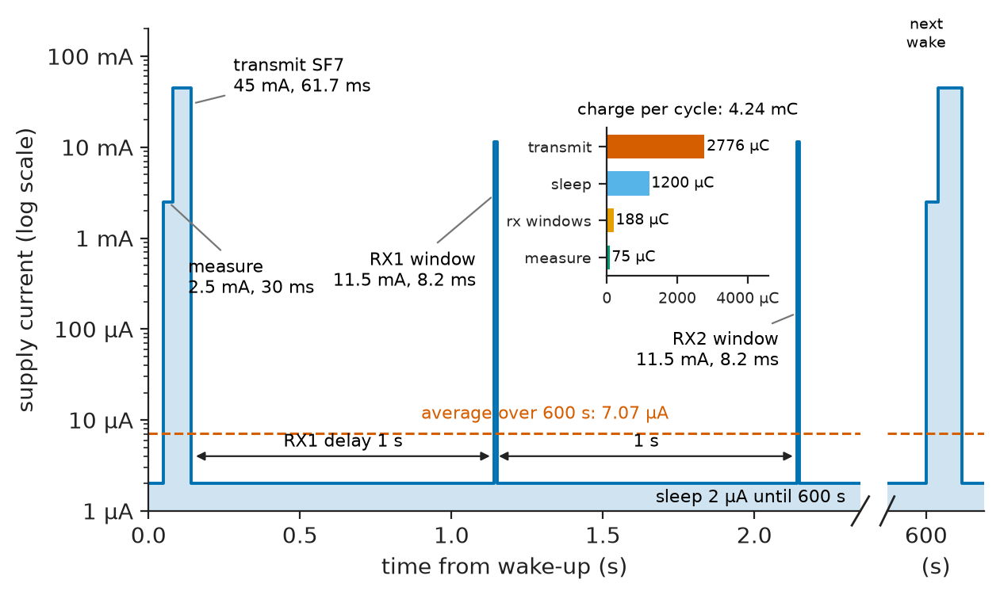
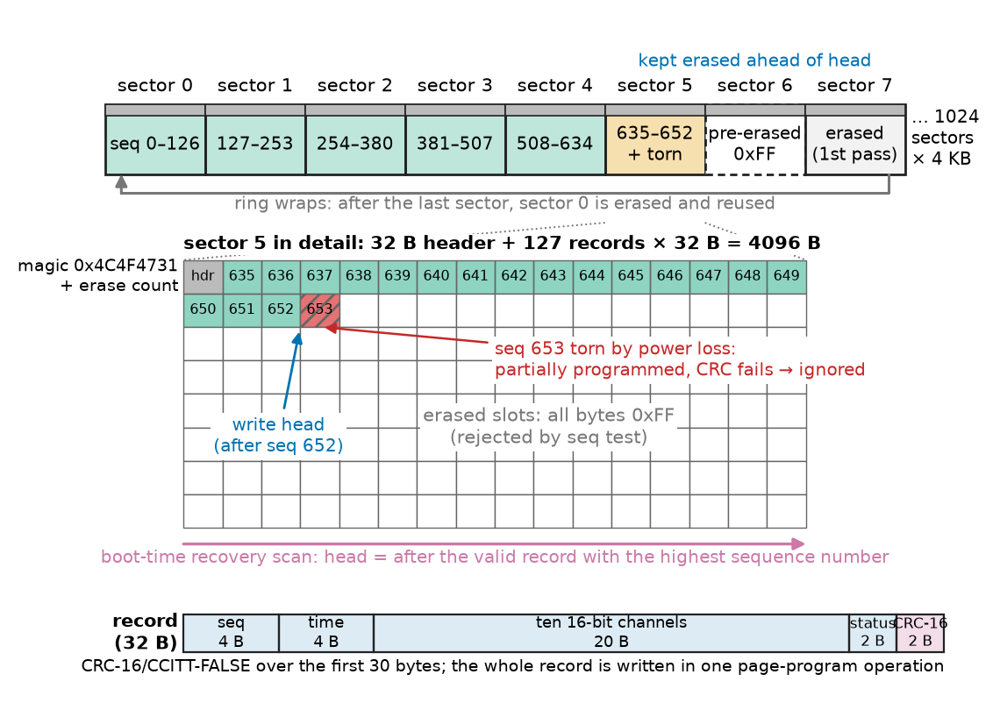
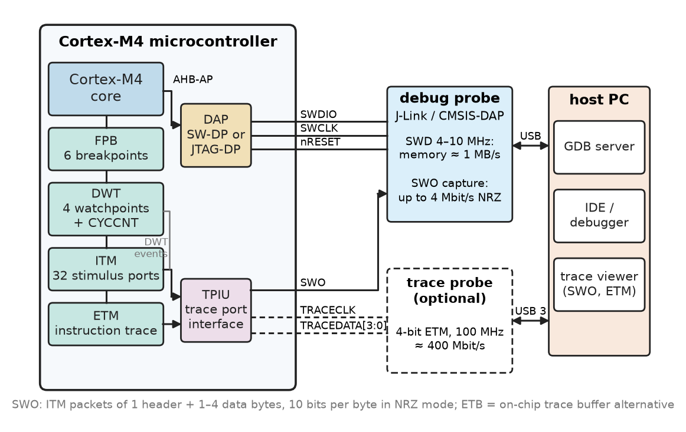
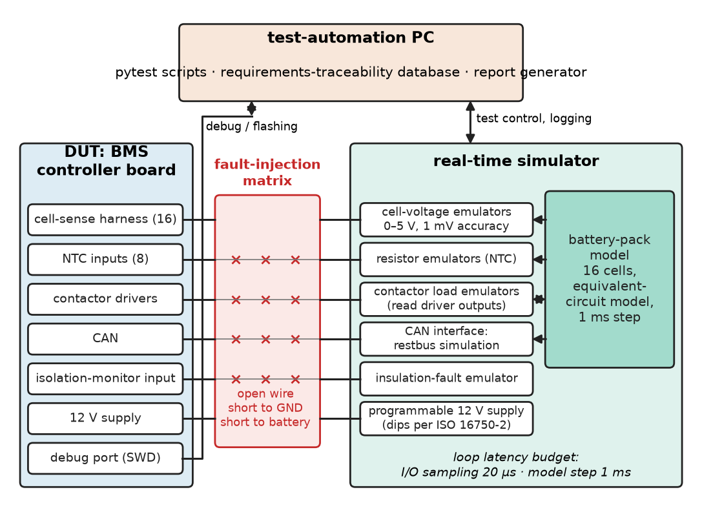

# Chapter 28 — Embedded System Design

*Part VI · Embedded and Real-Time Systems*

A utility deploys 5,000 battery-powered soil-moisture sensors with LoRaWAN radios, each specified for ten years on one lithium–thionyl-chloride AA cell. Fourteen months later a fifth of them are dead. The hardware is fine. Two firmware decisions killed them: a sensor driver that busy-waits on an I²C acknowledge, so a sensor browning out in frost keeps the processor out of its 2 µA stop mode for minutes, and a logger that rewrites one sector of internal flash on every sample until it wears out, starting a reset loop that transmits at the highest spreading factor after every reboot. Each module passed its unit tests. What failed was design: an abstraction that hid time, a driver without a timeout, a state machine with no way out of a fault, an energy budget nobody wrote down, and a validation plan that never ran the device cold, on a dying battery, for a month.

> **How is firmware structured so that drivers, protocols and application logic can be developed, replaced and tested independently, without hiding the timing and power behaviour that matter on real hardware?**
> **How does an engineer budget energy, store data safely, find faults on a running target and prove that the firmware meets its requirements before it ships?**

| Concept | Engineering destination |
|---|---|
| Hardware abstraction | Porting firmware across MCU families; host-side unit testing with fake hardware |
| Firmware modularity | Teams working in parallel; reuse of drivers and stacks across products |
| Device drivers | Non-blocking, timeout-bounded access to sensors, radios, memories and converters |
| State machines | Application control logic, protocol handlers, chargers, motor and power sequencing |
| Low-power design | Battery life of IoT nodes, wearables, medical implants and asset trackers |
| Data logging | Event recorders, flight and vehicle data loggers, metering, black boxes |
| Communications | Framing, integrity and retry layers on top of UART, CAN, radio and Ethernet links |
| Debugging | SWD/JTAG, breakpoints, watchpoints, SWO and ETM trace, fault analysis |
| Hardware-in-the-loop testing | ECUs, BMS and inverter controllers tested against simulated plants |
| Firmware validation | Unit, integration and system test; static analysis; coverage; safety standards |

**Roadmap.** Layers and interfaces (28.1) → modules built on them (28.2) → drivers that never block or hang (28.3) → control logic as explicit state machines (28.4) → energy budgets and low-power practice (28.5) → logging that survives power loss and wear (28.6) → communication stacks (28.7) → debugging on the target (28.8) → hardware-in-the-loop testing (28.9) → validation against requirements and standards (28.10).

---

## 28.1 Hardware abstraction

> **Boundary.** Chapter 25 sets out firmware architectures (super-loop, event-driven, RTOS-based), peripheral drivers at the architecture level, boot and update; Chapter 26 owns the interface protocols themselves; Chapter 27 owns interrupts, scheduling and synchronisation. Chapter 21 covers the C and C++ used here. This chapter is the design practice that sits on top of all four.

### Layers and what each one knows

Chapter 25 (§25.7) introduced the layering of drivers. In design practice the layers, and what each is allowed to know, are fixed explicitly (Figure 28.1):

1. **Register definitions** — the vendor's generated device header; never edited.
2. **Hardware abstraction layer (HAL)** — drivers for the MCU's *own* peripherals, offering operations such as "transfer these bytes on this bus" instead of register writes.
3. **Board support package (BSP)** — pin assignments, which SPI instance the radio is on, clock sources. A new board with the same MCU changes only this layer.
4. **Device drivers** — for *external* chips (sensor, radio, SPI flash, gate-driver IC), written against HAL interfaces, never registers.
5. **Services** — protocol stacks, file systems, logger, power manager, command shell.
6. **Application** — the product's behaviour, usually state machines (Section 28.4).

<!-- FIGURE 28.1 | figures/ch28/fig-28-1-firmware-layers.png | block-diagram | Layered firmware architecture of a battery-powered LoRaWAN sensor node, with the interfaces each layer exposes. | Content: six horizontal layers stacked bottom to top: Register definitions (CMSIS device header, STM32L4 class); HAL (GPIO, LPTIM, ADC, I2C, SPI, LPUART, DMA, RTC); BSP (pin map, clock tree 16 MHz HSI, radio on SPI1, sensor on I2C1, battery divider on ADC ch5); Device drivers (SHT4x humidity sensor, SX1276 LoRa radio, W25Q32 SPI NOR flash); Services (LoRaWAN MAC, logger, power manager, CLI); Application (node state machine). Arrows only downward between adjacent layers labelled with interface names (i2c_bus_t, spi_bus_t, flash_dev_t, radio_if); dashed upward arrows labelled callbacks and events. Side bar on the right spanning HAL and BSP labelled host build: replace with fakes for unit tests. -->



*Figure 28.1 — Layered firmware architecture of a battery-powered LoRaWAN sensor node, with the interfaces each layer exposes.*

The dependency rule is simple: a layer calls only downward through published interfaces, and information comes back up only through return values, callbacks or queued events. A device driver that includes the MCU's register header has broken the rule, and that driver will not move to the next product.

### Binding an interface to an implementation

An interface can be bound to its implementation at three moments, each with a different cost:

**Table 28.1 — Ways to bind a HAL interface (Cortex-M4 class, GCC -O2).**

| Binding | Mechanism | Run-time cost | Flexibility | Typical use |
|---|---|---|---|---|
| Compile time | Macros, `static inline` functions in a per-target header | None; fully inlined | One target per build | GPIO set/clear, register-level LL drivers |
| Link time | Same header, different `.c` file linked per target or for the host test build | One direct call, about 4–6 cycles | One implementation per symbol per image | Most HAL modules; unit-test fakes |
| Run time | `struct` of function pointers (a C "vtable") | One indirect call, about 5–8 cycles; no inlining | Several implementations in one image | Two SPI buses with different drivers; plug-in sensors |

The listing shows a run-time-bound SPI interface and a fake that a host-side unit test links in place of the real port. The interface is *transaction-shaped* (one call per chip-select framed transfer), asynchronous (completion arrives through a callback), and it reports errors in a type every driver understands.

```c
/* spi_bus.h -- capability-level SPI interface (C11) */
#include <stddef.h>
#include <stdint.h>

typedef enum { BUS_OK = 0, BUS_TIMEOUT, BUS_NACK, BUS_BUSY, BUS_ERROR } bus_status_t;
typedef void (*bus_done_cb)(void *user, bus_status_t st);

typedef struct spi_bus spi_bus_t;
struct spi_bus {
    bus_status_t (*transfer)(spi_bus_t *bus, uint8_t cs,
                             const uint8_t *tx, uint8_t *rx, size_t n,
                             bus_done_cb done, void *user);
    void *impl;                          /* port-specific state */
};

extern spi_bus_t spi1_bus;               /* defined in spi_stm32l4.c */

/* test/fake_spi.c -- linked into the host build instead of the real port */
static uint8_t fake_rx[16];
static bus_status_t fake_transfer(spi_bus_t *bus, uint8_t cs, const uint8_t *tx,
                                  uint8_t *rx, size_t n, bus_done_cb done, void *user)
{
    (void)bus; (void)cs; (void)tx;
    for (size_t i = 0; rx != NULL && i < n && i < sizeof fake_rx; ++i) rx[i] = fake_rx[i];
    if (done != NULL) done(user, BUS_OK);
    return BUS_OK;
}
spi_bus_t fake_bus = { fake_transfer, NULL };
```

### Where abstraction leaks

A HAL that hides *what* a peripheral does is useful; one that hides *how long it takes* or *what it costs in power* is dangerous. The leaks that bite:

- **Time.** A blocking call that spins up to its timeout keeps the core at full current and starves other work; the interface must make blocking visible or remove it.
- **DMA and memory.** DMA buffers may need alignment, DMA-reachable RAM and, on cached Cortex-M7 cores, cache maintenance around each transfer; an interface that accepts any pointer invites silent corruption.
- **Power.** A peripheral clock left enabled by a HAL `init` call costs tens of microamps in stop mode; the HAL must expose suspend and resume.
- **Interrupt context.** Callbacks usually run in interrupt context; the interface contract must say so (Chapter 27).

Vendor HALs (STM32Cube, NXP MCUXpresso) are quick to start with but tie code to one family; the Zephyr device model is portable but brings its own kernel and build system. A common compromise is the vendor's low-level layer underneath a thin, product-owned interface like the one above.

---

## 28.2 Firmware modularity

### The module as the unit of design

In C, a **module** is a header that declares the interface and a source file that holds the implementation and its `static` state. Nothing outside the module touches that state directly. Four habits keep modules independent:

- **Opaque handles.** The header declares `typedef struct logger logger_t;` without its body, so callers cannot depend on fields.
- **Dependency injection.** A driver receives its bus (`spi_bus_t *`) at initialisation instead of naming `spi1_bus`, so one driver serves two instances and a test injects a fake.
- **Events, not calls, upward.** A lower module posts an event or invokes a registered callback; it never calls application code.
- **Static allocation.** Memory is allocated at build time or initialisation, never in steady state (MISRA C:2012 Directive 4.12), so heap fragmentation cannot fail the device after weeks.

The sensor node splits into `app_fsm` (behaviour and retry policy), `sht4x` and `sx127x` (sensor and radio drivers), `lorawan` (MAC layer), `logger`, `power` (sleep-mode selection) and `bsp`, each depending only on the interfaces below it.

### Shared resources

Two drivers on one I²C bus, or a logger and a radio on one SPI bus, need an owner for the bus. A **bus manager** serialises transactions: drivers queue requests, and the manager runs them one at a time, with a mutex under an RTOS or a queue in an event-driven system (Chapter 27). Without it, a radio interrupt that starts an SPI transfer in the middle of a flash program corrupts both.

---

## 28.3 Device drivers

### Anatomy of a driver

A device driver for an external chip does five things: **probe** (confirm the expected part is present, from an ID or serial-number register), **configure**, **operate**, **manage power** (enter the lowest-power state and wake), and **recover** (detect a stuck bus, a missing acknowledge or a bad CRC, report it, and restore a known state, for instance with the I²C bus-clear procedure of Chapter 26). It also documents its **contract**: from which context each function may be called, whether it is re-entrant, and its worst-case duration and energy per operation.

### Blocking, non-blocking and DMA

Chapter 25 (§25.7) compares polling, interrupt and DMA service models for the MCU's own peripherals. For an external device the same choice appears one level up: a blocking driver is simplest and wrong for most products, because while it waits for an 8.3 ms humidity conversion the CPU does nothing useful at several milliamps. The better shape is a **non-blocking driver with a completion callback**: it starts an operation and returns, a timer or bus interrupt advances it, and a callback reports the result, so the driver is itself a small state machine; any heavy processing is deferred from interrupt to task level (Chapter 27).

The listing drives a Sensirion SHT4x humidity sensor without ever blocking. It sends the high-repeatability measurement command, arms a 10 ms one-shot timer (the datasheet maximum conversion time is about 8.3 ms), reads six bytes, checks the two CRC-8 values and converts the raw words to milli-degrees Celsius and milli-percent relative humidity. Every step can fail, and every failure returns the driver to `S_IDLE` and reports to the caller; the soft timer reuses the bus-completion callback type so that one function, `step`, advances the machine.

```c
/* sht4x.c -- non-blocking SHT4x driver (C11, illustrative HAL names) */
#include <stdbool.h>
#include <stdint.h>
#include "i2c_bus.h"     /* i2c_write_async(), i2c_read_async(), bus_status_t */
#include "soft_timer.h"  /* timer_oneshot_ms(ms, bus_done_cb, user)           */

#define SHT4X_ADDR      0x44u
#define SHT4X_MEAS_HIGH 0xFDu                 /* high repeatability */

typedef void (*sht_cb)(bool ok, int32_t m_degC, int32_t m_RH);
typedef enum { S_IDLE, S_CMD, S_WAIT, S_READ } sht_state_t;
static struct { sht_state_t st; uint8_t buf[6]; sht_cb cb; } s;

static uint8_t crc8(const uint8_t *p, int n)  /* poly 0x31, init 0xFF */
{
    uint8_t c = 0xFF;
    while (n--) {
        c ^= *p++;
        for (int i = 0; i < 8; ++i)
            c = (c & 0x80u) ? (uint8_t)((c << 1) ^ 0x31u) : (uint8_t)(c << 1);
    }
    return c;
}

static void fail(void) { s.st = S_IDLE; s.cb(false, 0, 0); }

static void step(void *user, bus_status_t r)
{
    (void)user;
    if (r != BUS_OK) { fail(); return; }
    switch (s.st) {
    case S_CMD:  s.st = S_WAIT; timer_oneshot_ms(10, step, NULL); break;
    case S_WAIT:
        s.st = S_READ;
        if (i2c_read_async(SHT4X_ADDR, s.buf, 6, step, NULL) != BUS_OK) fail();
        break;
    case S_READ: {
        if (crc8(&s.buf[0], 2) != s.buf[2] || crc8(&s.buf[3], 2) != s.buf[5]) { fail(); return; }
        int64_t t  = ((int64_t)s.buf[0] << 8) | s.buf[1];
        int64_t rh = ((int64_t)s.buf[3] << 8) | s.buf[4];
        s.st = S_IDLE;
        s.cb(true, (int32_t)(-45000 + 175000 * t / 65535),
                   (int32_t)(-6000 + 125000 * rh / 65535));
        break;
    }
    default: fail(); break;
    }
}

bool sht4x_start(sht_cb cb)
{
    static const uint8_t cmd = SHT4X_MEAS_HIGH;
    if (s.st != S_IDLE) return false;
    s.cb = cb; s.st = S_CMD;
    if (i2c_write_async(SHT4X_ADDR, &cmd, 1, step, NULL) != BUS_OK) { s.st = S_IDLE; return false; }
    return true;
}
```

The arithmetic is done in 64 bits because $175000\times65535\approx1.15\times10^{10}$ overflows a 32-bit integer: in 32-bit arithmetic the temperature conversion wraps for every raw value above about 12,270 (about −12 °C) and the humidity conversion above about 27 % RH, a classic bug that a test at one fixed condition can miss. Note also what the driver does not do: it never waits, and the bus layer below it owns the timeout on each transfer.

**Worked example — DMA buffer for a 921.6 kbaud UART.** Chapter 25 sized an interrupt-driven ring buffer for 115,200 baud; at eight times the rate the per-byte interrupt itself becomes the problem. A GNSS receiver streams to an MCU at 921,600 baud, 8N1, so 10 bits per byte and $921600/10=92{,}160$ bytes/s. The worst-case delay before the task that drains the buffer runs, measured on the target under full load, is 5 ms.

- Bytes arriving in that time: $92160\times0.005=461$. A 1024-byte circular DMA buffer with half- and full-transfer interrupts gives 512 bytes per half, enough.
- Interrupt rate with DMA: one per 512 bytes, $92160/512=180$ interrupts/s.
- Interrupt rate with a per-byte receive interrupt: 92,160/s. At about 1 µs per interrupt (entry, handler and exit at 168 MHz), that is $92160\times1\ \mu\mathrm{s}=92$ ms of every second, 9.2 % of the CPU, before any parsing.

An idle-line interrupt delivers short bursts promptly. Size buffers from the line rate and a *measured* worst-case service latency, never from the average message size.

---

## 28.4 State machines

### Why explicit state machines

Chapters 14 and 15 build finite-state machines in hardware. In firmware the same idea organises control logic: a battery charger, a protocol handler, a power-up sequence for an FPGA's rails. The alternative, Boolean flags tested in `if` statements, has $2^n$ implicit states for $n$ flags, most of them unintended and untested. An explicit machine names every state, every event and every transition, and a reviewer can ask of each state the two questions that would have saved the sensor fleet: *what ends this state if the expected event never arrives?* and *what happens to each event this state does not expect?*

### Event-driven, run-to-completion

Firmware state machines are usually **event-driven**: interrupts and drivers post events (timer expired, measurement done, packet received) into a queue, and a dispatcher hands one event at a time to the machine, which runs its transition to completion before taking the next.

> **Status of the principle: Run-to-completion event processing**
> *Derived.* If each event is handled atomically from the machine's point of view, the machine is never observed between states and no locking is needed inside it; this holds only while the worst-case handler time, multiplied by the queue depth, stays below the minimum event inter-arrival interval, otherwise the queue overflows and events are lost.

Figure 28.2 shows the node's machine. Every waiting state has a timeout, and a fault state with a bounded retry count prevents the reset-and-transmit loop of the opening paragraph.

<!-- FIGURE 28.2 | figures/ch28/fig-28-2-node-state-machine.png | state-diagram | Event-driven state machine of the sensor node, with a timeout on every waiting state. | Content: states SLEEP (initial), MEASURE, SEND, RX_WAIT, FAULT. Transitions: SLEEP to MEASURE on EV_RTC_ALARM / start sensor, arm 50 ms; MEASURE to SEND on EV_MEAS_DONE / radio_send, arm 3 s; MEASURE to SLEEP on EV_MEAS_FAIL or EV_TIMEOUT [retries 3 or fewer] / log error; MEASURE to FAULT on EV_MEAS_FAIL or EV_TIMEOUT [retries over 3]; SEND to RX_WAIT on EV_TX_DONE / open RX1 after 1 s; SEND to FAULT on EV_TIMEOUT; RX_WAIT to SLEEP on EV_RX_DONE or EV_TIMEOUT / schedule next alarm 600 s; FAULT to SLEEP on EV_RTC_ALARM after back-off of 6 h / reset driver and bus. Annotate each state with its current draw: SLEEP 2 uA, MEASURE 2.5 mA, SEND 45 mA, RX_WAIT 11.5 mA, FAULT 2 uA. -->



*Figure 28.2 — Event-driven state machine of the sensor node, with a timeout on every waiting state.*

### Implementations

A **switch on the state** is compact and readable up to about ten states. A **transition table** (state × event → action, next state) is data, so it can be generated from a model and checked mechanically. **State functions** (a pointer to the current state's handler) underlie hierarchical frameworks such as QP, which implement UML statecharts with entry and exit actions and nested states, so that every operational state can inherit one "battery critical" transition.

```c
/* app_fsm.c -- switch-based node state machine (C11) */
#include "node_services.h"  /* sensor_start(), radio_send(), ERR_SENSOR, ... */

typedef enum { ST_SLEEP, ST_MEASURE, ST_SEND, ST_RX_WAIT, ST_FAULT } state_t;
typedef enum { EV_RTC_ALARM, EV_MEAS_DONE, EV_MEAS_FAIL,
               EV_TX_DONE, EV_RX_DONE, EV_TIMEOUT } event_t;

static state_t state = ST_SLEEP;
static unsigned retries;

void app_dispatch(event_t ev)
{
    switch (state) {
    case ST_SLEEP:
        if (ev == EV_RTC_ALARM) { sensor_start(); timeout_arm_ms(50); state = ST_MEASURE; }
        break;
    case ST_MEASURE:
        if (ev == EV_MEAS_DONE) {
            retries = 0; radio_send(); timeout_arm_ms(3000); state = ST_SEND;
        } else if (ev == EV_MEAS_FAIL || ev == EV_TIMEOUT) {
            log_error(ERR_SENSOR);
            if (++retries > 3) { fault_enter(); state = ST_FAULT; }
            else               { alarm_next_s(600); state = ST_SLEEP; }
        }
        break;
    case ST_SEND:
        if (ev == EV_TX_DONE)      { rx1_open_after_ms(1000); state = ST_RX_WAIT; }
        else if (ev == EV_TIMEOUT) { radio_reset(); fault_enter(); state = ST_FAULT; }
        break;
    case ST_RX_WAIT:
        if (ev == EV_RX_DONE || ev == EV_TIMEOUT) { radio_sleep(); alarm_next_s(600); state = ST_SLEEP; }
        break;
    case ST_FAULT:
        if (ev == EV_RTC_ALARM) { bus_recover(); retries = 0; alarm_next_s(600); state = ST_SLEEP; }
        break;
    }
    /* events not listed for a state are ignored deliberately; count them */
}
```

The comment at the end matters: ignoring an unexpected event must be a decision, logged in a diagnostic counter, not an accident. A transition table makes the decision visible as an explicit "ignore" cell.

### Checking a machine

Unit tests that drive every (state, event) pair and assert the next state give complete **transition coverage**; for protocol machines talking across a lossy link, model checkers (SPIN, TLA+, UPPAAL) find deadlocks and livelocks that tests rarely hit.

---

## 28.5 Low-power design

> **Boundary.** Chapter 25 (§25.5) sets up the average-current budget $\bar I=I_{\text{sleep}}+\sum_k I_kt_k/T_k$, the charge-reservoir model of battery life with its limits, and the MCU power-mode ladder; Chapter 33 gives the CMOS physics behind the currents. This section uses the budget as a design tool: where the charge goes in a radio node, which board-level leaks spoil it, and which firmware practices make it come true.

### The energy budget as a design tool

The budget is a table of phases, currents and measured durations, written before the firmware and checked against a power profiler (Nordic PPK2, Joulescope, Otii) that resolves 100 nA to 100 mA with microsecond timing. A multimeter on a shunt cannot: its burden voltage browns out the device at 45 mA radio peaks, and its averaging hides the pulses that dominate the budget.

**Table 28.2 — Representative currents of the parts around a sleeping MCU (typical datasheet values at 3 V, 25 °C; MCU modes are in Table 25.5).**

| Block | Mode | Current |
|---|---|---|
| LoRa transceiver (SX127x class) | Sleep | 0.2 µA |
| | RX | 10–12 mA |
| | TX +14 dBm (module, incl. MCU) | about 45 mA |
| Digital humidity sensor (SHT4x class) | Idle / measuring | 0.08 µA / 0.3–0.5 mA |
| Nano-power LDO (TPS7A02 class) | Quiescent | 25 nA |
| 10 kΩ pull-up held low at 3.3 V | — | 330 µA |
| 1 MΩ + 1 MΩ battery divider at 3.6 V | — | 1.8 µA |

The last two rows are the traps. A pull-up resistor on a line that a sleeping peripheral holds low, or a battery-measurement divider left permanently connected, can cost more than the whole sleeping MCU. Good boards switch the divider with a MOSFET, use the MCU's internal pull-ups only while needed, and leave no input floating (a floating CMOS input near mid-rail can draw tens of microamps through its input stage).

**Worked example — ten years on one AA cell?** The node wakes every $T=600$ s, measures for 30 ms at 2.5 mA, transmits an 11-byte payload (24 bytes with the 13-byte LoRaWAN header) at 45 mA, and opens two receive windows of about eight symbols each at 11.5 mA; it sleeps at 2.0 µA in between. The cell is a 2.6 Ah Li-SOCl₂ AA, derated to 80 % usable for temperature and pulse load, with 1 % per year self-discharge. LoRa time on air follows from the spreading factor (Semtech's formula, in the listing):

```python
import math

def lora_toa(payload, sf, bw=125e3, cr=1, n_pre=8):
    """LoRa time on air (s), explicit header, CRC on (Semtech AN1200.13)."""
    de = 1 if (sf >= 11 and bw == 125e3) else 0
    t_sym = 2**sf / bw
    n = 8 + max(math.ceil((8*payload - 4*sf + 44) / (4*(sf - 2*de))) * (cr + 4), 0)
    return (n_pre + 4.25 + n) * t_sym, t_sym

def budget(sf, period=600.0, i_sleep=2.0e-6, cap_ah=2.6, usable=0.8,
           self_dis=0.01):
    t_tx, t_sym = lora_toa(24, sf)               # 11-byte payload + 13 B MAC
    phases = {"measure": (2.5e-3, 0.030),        # (current A, duration s)
              "transmit": (45e-3, t_tx),
              "rx windows": (11.5e-3, 2*8*t_sym)}
    q = {k: i*t for k, (i, t) in phases.items()}
    t_active = sum(t for _, t in phases.values())
    q["sleep"] = i_sleep * (period - t_active)
    i_avg = sum(q.values()) / period
    i_sd = self_dis * cap_ah / 8760              # self-discharge as a current
    years = cap_ah*usable / (i_avg + i_sd) / 8760
    return t_tx, q, i_avg, years

for sf in (7, 10):
    t_tx, q, i_avg, yrs = budget(sf)
    parts = ", ".join(f"{k} {v*1e6:.0f} uC" for k, v in q.items())
    print(f"SF{sf}: ToA {t_tx*1e3:.1f} ms; per cycle {parts}")
    print(f"      average {i_avg*1e6:.2f} uA -> {yrs:.1f} years")
```

```text
SF7: ToA 61.7 ms; per cycle measure 75 uC, transmit 2776 uC, rx windows 188 uC, sleep 1200 uC
      average 7.07 uA -> 23.7 years
SF10: ToA 370.7 ms; per cycle measure 75 uC, transmit 16681 uC, rx windows 1507 uC, sleep 1199 uC
      average 32.44 uA -> 6.7 years
```

At SF7 the arithmetic gives 23.7 years, so the cell's 10–15-year shelf life is the real limit. At SF10, which adaptive data rate assigns to nodes far from a gateway, the transmit charge rises sixfold and the life falls to 6.7 years: the specification is missed by radio physics, not firmware. Two more numbers explain the failed fleet. A sensor that never acknowledges, polled in a busy loop at 2 mA, costs $2\ \mathrm{mA}\times600\ \mathrm{s}=1.2$ C per period if it hangs for a whole period, nearly 300 times the normal 4.2 mC; a few days of this per winter consume years of budget. And a reset loop that transmits at SF12 (1.48 s on air) every few seconds empties the cell in weeks.

<!-- FIGURE 28.3 | figures/ch28/fig-28-3-energy-profile.png | plot | Current profile of one 600 s reporting cycle of the sensor node at SF7, on a logarithmic current axis. | Content: x-axis time 0 to 1.2 s (cycle start, then break marker to 600 s); y-axis current 1 uA to 100 mA, log scale. Segments: sleep 2 uA; measure 2.5 mA for 30 ms; transmit 45 mA for 61.7 ms; sleep 2 uA for 1 s RX1 delay; RX1 window 11.5 mA for 8.2 ms; sleep 2 uA for 1 s; RX2 window 11.5 mA for 8.2 ms; sleep 2 uA to 600 s. Inset bar chart of charge per cycle: transmit 2776 uC, sleep 1200 uC, rx windows 188 uC, measure 75 uC. Annotate average current 7.07 uA. -->



*Figure 28.3 — Current profile of one 600 s reporting cycle of the sensor node at SF7, on a logarithmic current axis.*

### Firmware practices that make the budget true

- **Race to sleep.** At about 100 µA/MHz the charge per operation barely depends on clock frequency, while every extra millisecond awake adds peripheral and regulator current; so run fast and sleep. The exception is a core whose supply voltage scales with frequency, where energy per cycle falls as $V^2$ (Chapter 33).
- **A power manager chooses the sleep mode.** Drivers *request* the shallowest mode they tolerate (a receiving UART needs its clock); the manager enters the deepest mode compatible with all requests. No driver executes the sleep instruction itself.
- **Clock and pin hygiene.** Gate peripheral clocks after use, put unused pins in analogue mode, and never back-power an unpowered chip through its protection diodes.
- **Tickless idle.** Replace the 1 kHz RTOS tick by a low-power timer programmed for the next due event (Chapter 27).
- **Measure across corners.** Leakage roughly doubles every 10–15 K; a 2 µA stop current at 25 °C may be 10–20 µA at 60 °C.

---

## 28.6 Data logging

### What a logger must guarantee

A lift's event recorder, a drone's flight-data logger, an energy meter's billing register and an infusion pump's history share four requirements: **integrity** (a record is fully correct or recognisably absent), **power-fail safety** (power loss at any instant leaves the log readable), **endurance** (the medium outlives the product), and **ordering** (sequence numbers and timestamps).

Chapter 25 (§25.4, Table 25.4) compares the non-volatile media and shows why a log on flash must be appended and spread over many pages, since a bit can be programmed from 1 to 0 but returns to 1 only when a whole sector is erased. This section designs such a log on an external SPI NOR flash (W25Q class: 4 KB sectors, 256-byte pages, 100,000 cycles, page program 0.7 ms typical and 3 ms maximum, sector erase 45 ms typical and 400 ms maximum) so that it also survives power loss at any instant.

### An append-only log with sequence numbers and CRCs

The robust structure (Figure 28.4) is a circular array of sectors, each starting with a small header (magic number, erase count) and filled with fixed-size records appended in order. Each record carries a 32-bit sequence number and a CRC over its contents. One sector ahead of the write position is always kept erased, so that the slow erase never happens at the moment a record must be stored. At boot, the logger scans the records and takes the head to be just after the valid record with the highest sequence number; a record torn by a power failure fails its CRC and is ignored, and everything before it remains intact.

<!-- FIGURE 28.4 | figures/ch28/fig-28-4-flash-log-layout.png | schematic | Circular append-only log on a 4 MB SPI NOR flash: sector headers, records with sequence numbers and CRCs, the pre-erased sector and a torn record after power loss. | Content: a ring of 8 representative sectors out of 1024 (each 4 KB) drawn as a horizontal strip with wrap-around arrow. Each sector: 32 B header (magic 0x4C4F4731, erase count) then 127 records of 32 B. Sectors 0 to 4 full (seq 0 to 634). Sector 5 shown in detail: records seq 635 to 652 valid (green, CRC ok), record seq 653 torn (red, CRC fail, partially programmed), remaining slots erased 0xFF. Sector 6 marked pre-erased (kept ahead of head); sector 7 erased (first pass of the ring). Arrows: write head after seq 652; recovery scan direction. Record layout box: seq 4 B, time 4 B, ten 16-bit channels 20 B, status 2 B, CRC-16 2 B. -->



*Figure 28.4 — Circular append-only log on a 4 MB SPI NOR flash: sector headers, records with sequence numbers and CRCs, the pre-erased sector and a torn record after power loss.*

```c
/* log.c -- append and recovery for 32-byte records (C11, illustrative flash API) */
#include <stdbool.h>
#include <stddef.h>
#include <stdint.h>
#include "flash_dev.h"   /* flash_read(), flash_program(); SECTOR_SIZE, HDR_SIZE, LOG_SIZE */

typedef struct {
    uint32_t seq;
    uint32_t time_s;
    int16_t  ch[10];
    uint16_t status;
    uint16_t crc;          /* CRC-16/CCITT-FALSE over the first 30 bytes */
} log_rec_t;
_Static_assert(sizeof(log_rec_t) == 32, "record must be 32 bytes");

static uint32_t head, next_seq;

uint16_t crc16_ccitt(const uint8_t *p, size_t n)
{
    uint16_t c = 0xFFFFu;
    while (n--) {
        c ^= (uint16_t)(*p++ << 8);
        for (int i = 0; i < 8; ++i)
            c = (c & 0x8000u) ? (uint16_t)((c << 1) ^ 0x1021u) : (uint16_t)(c << 1);
    }
    return c;
}

static bool rec_valid(const log_rec_t *r)
{
    return r->seq != 0xFFFFFFFFu &&
           r->crc == crc16_ccitt((const uint8_t *)r, offsetof(log_rec_t, crc));
}

void log_recover(void)                       /* called once at boot */
{
    bool found = false;
    for (uint32_t a = 0; a < LOG_SIZE; a += sizeof(log_rec_t)) {
        if (a % SECTOR_SIZE == 0) a += HDR_SIZE;       /* skip sector header */
        log_rec_t r;
        flash_read(a, &r, sizeof r);
        if (rec_valid(&r) && (!found || (int32_t)(r.seq - next_seq) >= 0)) {
            found = true; next_seq = r.seq + 1u; head = a + sizeof r;
        }
    }
}
```

Three details carry the robustness. The comparison `(int32_t)(r.seq - next_seq) >= 0` survives sequence-number wrap-around. The record's CRC is computed by the writer before programming and the record is programmed in a single page-program operation, so a power failure leaves it either erased (all 0xFF, rejected by the `seq` test) or torn (rejected by the CRC). And the C and Python CRC routines are checked against the same catalogue value, which turns the CRC into a testable interface between firmware and the PC tool that reads the logs:

```python
def crc16_ccitt_false(data: bytes) -> int:
    crc = 0xFFFF
    for b in data:
        crc ^= b << 8
        for _ in range(8):
            crc = ((crc << 1) ^ 0x1021) if crc & 0x8000 else (crc << 1)
            crc &= 0xFFFF
    return crc

assert crc16_ccitt_false(b"123456789") == 0x29B1   # catalogue check value
print(hex(crc16_ccitt_false(bytes(range(30)))))    # a 30-byte test payload
```

```text
0x3554
```

The printed value becomes a test vector for the C unit test of `crc16_ccitt`.

**Worked example — will the log wear out?** A pump-station logger stores one 32-byte record every 10 s.

- *SPI NOR, 4 MB, 1024 sectors of 4 KB, 100,000 cycles.* Each sector holds $(4096-32)/32=127$ records. The ring fills in $1024\times127\times10=1.30\times10^6$ s, 15.1 days, so each sector is erased once per 15.1 days and the endurance limit is reached after $15.05\times10^5$ days, about 4,100 years. Retention (20 years), not wear, limits this design.
- *The naive design* that erases and rewrites one sector to update a "latest value" record every 10 s reaches 100,000 cycles in $10^6$ s, 11.6 days, even on the SPI NOR part.

**Worked example — hold-up for a page program.** To guarantee that a record write which has started also finishes, the supply must hold up through the worst-case page-program time of 3 ms at a total load of 25 mA, while the rail falls from 3.3 V to the flash's 2.7 V minimum: $C=It/\Delta V=0.025\times0.003/0.6=125\ \mu\mathrm{F}$. A sector erase (400 ms worst case) cannot be held up economically, which is exactly why the design pre-erases a sector ahead and relies on CRCs and sequence numbers rather than on finishing every operation.

FAT on an SD card is convenient for PC readout but not power-fail safe, because its tables are updated in place; littlefs and similar file systems use copy-on-write metadata and wear levelling instead. SD cards also draw 50–100 mA bursts during internal housekeeping, which belong in the energy and hold-up budgets.

---

## 28.7 Communications

> **Boundary.** The electrical and link-level behaviour of UART, SPI, I²C, CAN, USB and Ethernet belongs to Chapter 26. The theory of error-detecting codes, including the CRC's detection guarantees, is in *Circuits, Signals and Communications*, [Ch. 28 §28.6](https://github.com/The-Studio-of-Sadiq/Circuits-Signals-and-Communications/blob/main/part-6-communication-theory/28-information-theory-and-coding.md): an $r$-bit CRC detects every burst error of length up to $r$ and lets through about $2^{-r}$ of random error patterns. This section is about building a firmware stack from those pieces.

### The layers of an embedded stack

A link that carries a byte stream (UART, RS-485, a USB CDC port, a TCP socket) needs the firmware to provide what the physical link does not:

1. **Framing** — byte stuffing (SLIP, HDLC) or **COBS** (at most one extra byte per 254) makes the frame delimiter unambiguous, so a receiver resynchronises after any corruption.
2. **Integrity** — CRC-16 for frames up to a few hundred bytes, CRC-32 beyond.
3. **Reliability** — sequence numbers, acknowledgements, timeouts and retransmission, where every message matters.
4. **Message encoding** — packed C structures (fast, but tied to compiler packing and endianness), CBOR, or Protocol Buffers via nanopb, which lets a newer peer add fields an older one skips.
5. **Application protocol** — Modbus, CANopen, MQTT, LoRaWAN, a BLE GATT service, or a product command set.

Links that already frame and check (CAN, Ethernet, LoRa) start at layer 3 or 4. Security is a further layer: TLS or DTLS through Mbed TLS costs 60–100 KB of flash and 20–40 KB of RAM on a Cortex-M4, plus seconds of CPU per handshake, all of which belong in the code-size and energy budgets. Every layer must also decide what happens when the next one is slower: the protocol states which messages may be dropped (periodic telemetry, superseded by the next sample) and which may not (alarms, configuration, billing data).

**Worked example — stop-and-wait over RS-485.** A data concentrator pulls logs from field units over RS-485 at 115,200 baud (10 bits per byte). Each frame carries 128 payload bytes plus 8 bytes of header and CRC; each acknowledgement is 8 bytes; each line turnaround (driver enable and receiver processing) takes 1 ms.

- Frame time $136\times10/115200=11.81$ ms; acknowledgement 0.69 ms; cycle $11.81+0.69+2\times1=14.50$ ms.
- Efficiency $= (128\times10/115200)/14.50=0.766$; throughput $128/0.0145=8.83$ kB/s against a raw 11.52 kB/s.
- On a noisy line with bit-error rate $10^{-5}$, the frame-error probability is $1-(1-10^{-5})^{1088}=1.08\ \%$, and the retransmissions lower efficiency only slightly, to 0.758.

The turnaround, not the errors, costs most. A sliding-window protocol that keeps several frames in flight, or larger frames, recovers most of the 23 % lost; but larger frames raise the frame-error probability and the time to resend one, so frame size is chosen from the measured error rate.

---

## 28.8 Debugging

### The on-chip debug infrastructure

Arm Cortex-M devices carry CoreSight debug logic reached through a **debug access port**. Two physical interfaces reach it:

- **JTAG** (IEEE 1149.1: TCK, TMS, TDI, TDO), which daisy-chains devices and adds **boundary scan** to find opens and shorts on assembled boards.
- **SWD** (Serial Wire Debug: SWCLK and bidirectional SWDIO), the same access with two pins; a third pin, SWO, carries trace.

Through it a probe (J-Link, ST-LINK, CMSIS-DAP, TRACE32) halts and steps the core, accesses memory while running and programmes flash. The resources inside are limited:

**Table 28.3 — Debug resources of a Cortex-M4 and what they are for.**

| Resource | Capacity (typical) | Intrusiveness | Use |
|---|---|---|---|
| Hardware breakpoints (FPB) | 6 instruction + 2 literal comparators | Halts core | Breakpoints in flash code |
| Watchpoints (DWT) | 4 comparators | Halts core or emits trace | Find who corrupts a variable |
| DWT cycle counter `CYCCNT` | 32 bits at core clock | None | Execution-time measurement |
| ITM stimulus ports over SWO | 32 ports, 1-, 2- or 4-byte payloads | Microseconds per message | printf-style and event tracing |
| ETM instruction trace | 4-bit trace port, or on-chip ETB buffer | None | Reconstruct every instruction executed |
| Memory access while running | Through the debug port | Small bus contention | Live variable watch, SEGGER RTT logging |
| Semihosting | — | Halts core on every call | Host file I/O in early bring-up only |

Two warnings. Semihosting asks the debugger for service through a breakpoint instruction, so without a debugger attached it causes a HardFault. And the "debug in stop mode" option keeps clocks running so that the probe stays connected, making measured sleep current wrong by milliamps; measure power with the probe disconnected.

<!-- FIGURE 28.5 | figures/ch28/fig-28-5-debug-architecture.png | block-diagram | Debug and trace paths of a Cortex-M4 microcontroller from the core to the host PC. | Content: left, MCU box containing Cortex-M4 core, FPB (6 breakpoints), DWT (4 watchpoints, CYCCNT), ITM (32 stimulus ports), ETM, connected to TPIU and to a DAP (SW-DP or JTAG-DP). Pins out of the MCU: SWDIO, SWCLK, SWO, nRESET, and optional TRACECLK plus TRACEDATA[3:0]. Middle: debug probe (J-Link or CMSIS-DAP) with SWD at 4 to 10 MHz and SWO capture at up to 4 Mbit/s NRZ; optional trace probe for 4-bit ETM. Right: host PC running GDB server, IDE, trace viewer. Annotate bandwidths: SWD memory access about 1 MB/s; SWO 4 Mbit/s; 4-bit ETM at 100 MHz about 400 Mbit/s. -->



*Figure 28.5 — Debug and trace paths of a Cortex-M4 microcontroller from the core to the host PC.*

### Fault analysis

On a HardFault the Cortex-M hardware has already pushed eight registers, including the faulting PC, onto the active stack, and the configurable fault status register (CFSR) records the cause. A handler that saves these into retained RAM turns a mysterious field reset into a line number:

```c
/* fault.c -- capture the stacked frame on HardFault (Cortex-M3/M4/M7, GCC) */
#include <stdint.h>

#define SCB_CFSR  (*(volatile uint32_t *)0xE000ED28u)
#define SCB_HFSR  (*(volatile uint32_t *)0xE000ED2Cu)
#define SCB_BFAR  (*(volatile uint32_t *)0xE000ED38u)

typedef struct { uint32_t r0, r1, r2, r3, r12, lr, pc, xpsr, cfsr, hfsr, bfar, magic; } crash_t;
__attribute__((section(".noinit"))) volatile crash_t crash;   /* survives reset */

void hardfault_c(const uint32_t *f)
{
    crash.r0 = f[0]; crash.r1 = f[1]; crash.r2 = f[2]; crash.r3 = f[3];
    crash.r12 = f[4]; crash.lr = f[5]; crash.pc = f[6]; crash.xpsr = f[7];
    crash.cfsr = SCB_CFSR; crash.hfsr = SCB_HFSR; crash.bfar = SCB_BFAR;
    crash.magic = 0xDEADFA17u;
    __asm volatile ("dsb");
    *(volatile uint32_t *)0xE000ED0Cu = 0x05FA0004u;          /* AIRCR: system reset */
    for (;;) { }
}

__attribute__((naked)) void HardFault_Handler(void)
{
    __asm volatile (
        "tst   lr, #4      \n"   /* EXC_RETURN bit 2: which stack was in use? */
        "ite   eq          \n"
        "mrseq r0, msp     \n"
        "mrsne r0, psp     \n"
        "b     hardfault_c \n");
}
```

At the next boot the application finds `crash.magic`, logs the record (Section 28.6) and reports it; on the bench, `arm-none-eabi-addr2line -e app.elf 0x<pc>` maps the saved PC to a source line. Stack overflow, the most common cause, is better caught at once by the MPU guard regions and bounded in advance by the stack analysis of Chapter 25 (§25.4).

### Timing on the target

Two cheap instruments answer most timing questions. Toggling a spare GPIO at the entry and exit of an interrupt and watching it on a logic analyser shows latency, duration and jitter together. The DWT cycle counter, enabled by setting TRCENA in DEMCR (`0xE000EDFC`, bit 24) and CYCCNTENA in `DWT_CTRL` (`0xE0001000`, bit 0), reads elapsed core cycles from `0xE0001004` with no intrusion; at 168 MHz it wraps after 25.6 s.

**Worked example — can SWO keep up with a control-loop trace?** A 20 kHz motor-current loop logs two 32-bit values per cycle through ITM. Each ITM packet is one header byte plus four data bytes, 5 bytes, and SWO in UART (NRZ) mode sends 10 bits per byte.

- At SWO 4 Mbit/s: $4\times10^6/(5\times10)=80{,}000$ packets/s capacity, against $2\times20{,}000=40{,}000$ needed. It fits, at 50 % load.
- At 2 Mbit/s: capacity 40,000 packets/s, exactly the demand. Any other ITM traffic overflows the ITM FIFO, and the trace shows overflow packets and gaps.

The remedy, when the trace exceeds the link, is to log at a lower rate, log 16-bit values (3-byte packets), or capture into a RAM buffer and dump it afterwards, which is what SEGGER RTT and the ETB do.

---

## 28.9 Hardware-in-the-loop testing

### From model to hardware

Embedded control software is verified on a ladder of increasingly real configurations: **model-in-the-loop** (algorithm model against plant model), **software-in-the-loop** (production C compiled for the host, against the plant model), **processor-in-the-loop** (production code on the target processor, exchanging data with the simulation, not in real time), and **hardware-in-the-loop** (HIL): the real, unmodified controller board, connected through its own connectors to a real-time simulator that emulates sensors, actuators, buses and the physical plant (Figure 28.6).

HIL is where the electrical interfaces, the timing and the fault handling are tested together. An automotive battery-management system on a HIL bench sees emulated cell voltages from programmable cell simulators (accurate to about 1 mV), emulated NTC thermistors as programmable resistances, a CAN bus on which the rest of the vehicle is simulated (restbus simulation), and an insulation-fault emulator. An inverter controller sees emulated phase-current sensor signals and an emulated encoder, computed from a motor and power-stage model.

<!-- FIGURE 28.6 | figures/ch28/fig-28-6-hil-bench.png | block-diagram | Hardware-in-the-loop bench for a battery-management controller. | Content: left, the device under test (BMS controller board) with its real connectors: cell-sense harness (16 channels), NTC inputs (8), contactor drivers, CAN, isolation monitor input, 12 V supply. Right, real-time simulator: battery pack model (16 cells, equivalent-circuit model, 1 ms step) feeding cell voltage emulators (0 to 5 V, 1 mV accuracy) and resistor emulators for NTCs; contactor load emulators reading driver outputs; CAN interface running restbus simulation of vehicle ECUs; fault-injection matrix (open wire, short to ground, short to battery) between simulator and DUT. Top: test-automation PC running pytest scripts, requirements traceability database and report generator, connected to simulator and to the DUT debug port. Annotate loop latency budget: I/O sampling 20 us, model step 1 ms. -->



*Figure 28.6 — Hardware-in-the-loop bench for a battery-management controller.*

### Real-time fidelity

The simulator must compute the plant fast enough that its step size and I/O latency do not change the closed-loop behaviour being tested. A useful rule is that the total delay (input sampling, one model step, output update) should add no more than a few degrees of phase at the bandwidth of the fastest loop under test, since a delay $\tau$ costs $360^\circ f\tau$ of phase at frequency $f$.

> **Status of the principle: Loop delay as phase lag**
> *Derived.* A pure delay $\tau$ has the transfer function $e^{-s\tau}$, with unit magnitude and phase $-360^\circ f\tau$ (*Circuits, Signals and Communications*, Ch. 34 §34.8); it is exact for a fixed delay, while a simulator with step-time jitter adds further error that grows with frequency.

**Worked example — choosing a HIL platform for an inverter controller.** The controller runs a 10 kHz current loop with 1 kHz closed-loop bandwidth.

- An FPGA-based simulator with a 1 µs model step and 2 µs of I/O conversion has a 3 µs loop delay: $360\times1000\times3\times10^{-6}=1.1^\circ$ at 1 kHz. Negligible.
- A CPU-based simulator with a 50 µs step and 50 µs of I/O and scheduling has 100 µs delay: $36^\circ$ at 1 kHz, enough to turn a loop with 50° of phase margin into one with 14°. The test would show oscillations that the real motor never has.

A battery pack, with electrochemical time constants of seconds, is well served by the 1 ms CPU step; a power stage switching at tens of kilohertz needs an FPGA solver with sub-microsecond steps to reproduce current ripple. Matching the simulator to the fastest physics under test is the first HIL design decision.

### Fault injection and automation

HIL earns its cost in faults that are dangerous or impossible to create on real hardware: a cell sense wire breaking at full charge, an encoder losing a channel at 6,000 rpm, a CAN node going bus-off mid-sequence, a supply dip shaped as in ISO 16750-2. A relay matrix opens and shorts lines under script control; the scripts (pytest, dSPACE AutomationDesk, NI TestStand) are traced to requirements and run unattended against every new build.

---

## 28.10 Firmware validation

### Verification and validation

**Verification** asks whether the firmware was built right (does it meet its specification?); **validation** asks whether the right firmware was built (does the product do what users and regulators need?). In the V-model used by safety standards, each specification level on the way down (system requirements, software requirements, architecture, detailed design) has a matching test level on the way up (system test on HIL and real hardware, software integration test, unit test), and every requirement is traced to the tests that verify it.

### Unit, integration and system tests

The layering of Section 28.1 pays for itself here. Drivers and application logic that depend only on interfaces compile on the PC and run against fakes under a unit-test framework (Unity, CppUTest, GoogleTest), fast and under sanitizers that catch out-of-bounds accesses and undefined behaviour. Integration tests run on the target; system tests on the HIL bench and in environmental chambers. Building on Chapters 20 and 24, the embedded continuous-integration server also builds every variant, flashes a board farm and runs the HIL suites.

### Static analysis and coding rules

Many embedded C failures (an uninitialised variable, an out-of-range index, a signed overflow, a missing `volatile`) are invisible in normal testing, so the code is analysed statically, in layers from cheap to rigorous: compiler warnings (`-Wall -Wextra -Wconversion`) as errors; checkers such as clang-tidy and cppcheck; a tool-checked coding standard (MISRA C:2012/2023 in automotive and industrial work, CERT C for security); sound abstract-interpretation analysers (Polyspace Code Prover, Astrée) that prove the absence of overflow and division by zero over all inputs; and worst-case stack and execution-time analysis (Section 28.8; Chapter 27).

### Coverage and the safety standards

Coverage measures how much of the code the tests exercised. **Statement coverage** asks whether every statement ran; **branch coverage** whether every decision went both ways; **modified condition/decision coverage (MC/DC)** whether each condition in a decision was shown to affect the outcome independently.

**Table 28.4 — Software assurance levels and coverage expectations (summary).**

| Standard | Domain | Levels (lowest to highest) | Structural coverage at the highest level |
|---|---|---|---|
| IEC 61508-3 | Industrial functional safety | SIL 1–4 | MC/DC highly recommended at SIL 4 |
| ISO 26262-6 | Road vehicles | ASIL A–D | MC/DC highly recommended at ASIL D |
| IEC 62304 | Medical-device software | Class A, B, C | Unit verification required for class C; coverage set by the manufacturer's process |
| DO-178C | Airborne software | DAL E–A | MC/DC required at DAL A |

**Worked example — MC/DC for an interlock.** A gate-driver enable decision in an inverter is `enable = armed && !(overtemp || overcurrent)`, three conditions. Exhaustive testing needs $2^3=8$ cases; MC/DC needs at least $N+1=4$. One minimal set, written as (armed, overtemp, overcurrent) → enable:

```text
T1: (1, 0, 0) -> 1    baseline
T2: (0, 0, 0) -> 0    differs from T1 only in armed       -> armed shown independent
T3: (1, 1, 0) -> 0    differs from T1 only in overtemp    -> overtemp shown independent
T4: (1, 0, 1) -> 0    differs from T1 only in overcurrent -> overcurrent shown independent
```

Each condition flips the outcome while the others are held fixed. For a decision with 10 conditions, MC/DC needs at least 11 tests instead of 1,024, which is why it is affordable as a requirement for the most critical software.

> **Status of the principle: Structural coverage as evidence**
> *Empirical.* High coverage correlates with fewer escaped defects in practice, but coverage shows only that code was executed, not that its behaviour was checked; missing code (an absent timeout, an unhandled event) has no coverage to miss, which is why coverage supplements requirements-based testing and review rather than replacing them.

### Robustness beyond functional tests

Products that pass every functional test still fail from conditions nobody scripted. Four activities close the gap: **fault injection** (corrupt memory, drop interrupts, force bus errors and watchdog expiries, and check that the safe state is reached); **fuzzing** of protocol parsers on the host with a coverage-guided fuzzer such as libFuzzer; **soak testing** for weeks across temperature, on a dying battery, with power cut at random instants to exercise the logger's recovery; and **EMC immunity** testing to IEC 61000-4-2, -4-4 and -4-5, after which the firmware must restart cleanly and its fault-capture path must record what happened.

The sensor fleet of the opening paragraph would have been saved by any one of these: a soak test in a freezer would have shown the hung sensor, a power-interruption test the log wear, and an energy budget checked against a profiler the cost of SF12 after every reboot.

---

## What remains open

| Open question | Where it is answered |
|---|---|
| How are interrupts, priorities, RTOS tasks and watchdogs designed so that deadlines are met? | [Chapter 27](27-real-time-computing.md) |
| How are firmware images booted, authenticated and updated in the field? | [Chapter 25](25-embedded-system-architecture.md) |
| What do UART, SPI, I²C, CAN, USB and Ethernet look like on the wire, and how are their faults diagnosed? | [Chapter 26](26-embedded-interfaces.md) |
| How does a microcontroller drive the switches of a power converter, and what does the gate driver need from it? | [Chapter 29](../part-7-power-electronics/29-power-electronic-fundamentals.md) |
| How is a converter's feedback loop implemented in firmware, and how do sampling and computation delay limit it? | [Chapter 30](../part-7-power-electronics/30-dc-dc-converters.md) |
| When should a function move from firmware into an FPGA or a hardware accelerator, and how is the whole system verified? | [Chapter 35](../part-8-integrated-circuits-and-vlsi/35-hardware-software-co-design.md) |
| How are CRCs and error-correcting codes designed and analysed? | *Circuits, Signals and Communications*, [Ch. 28](https://github.com/The-Studio-of-Sadiq/Circuits-Signals-and-Communications/blob/main/part-6-communication-theory/28-information-theory-and-coding.md) |
| How are control loops designed and their margins specified? | *Circuits, Signals and Communications*, [Ch. 34–35](https://github.com/The-Studio-of-Sadiq/Circuits-Signals-and-Communications/blob/main/part-7-control-system-fundamentals/35-control-design-fundamentals.md) |

**Next:** Chapter 29 leaves the microcontroller and turns to the switches it commands, the power semiconductors whose switching and conduction losses, gate drive and protection decide whether a converter is efficient and survives.
