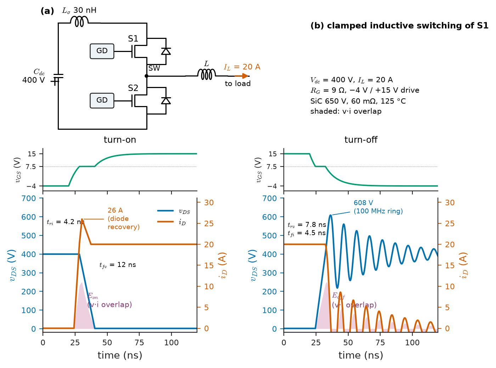
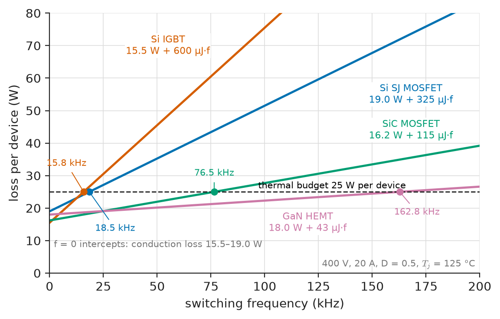
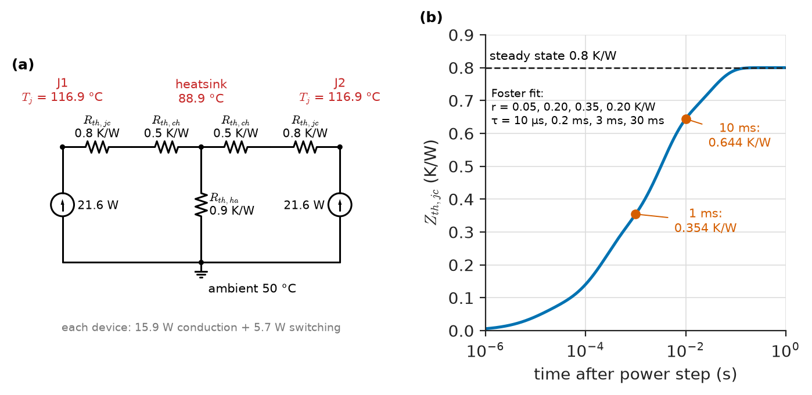
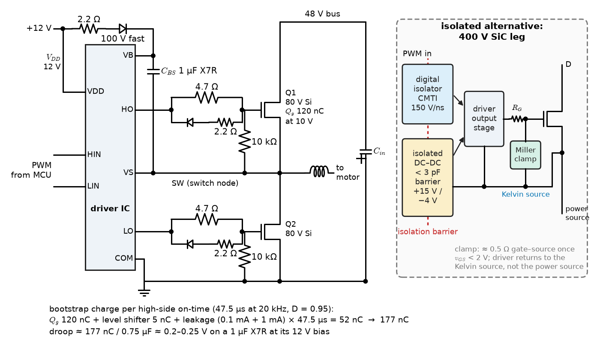
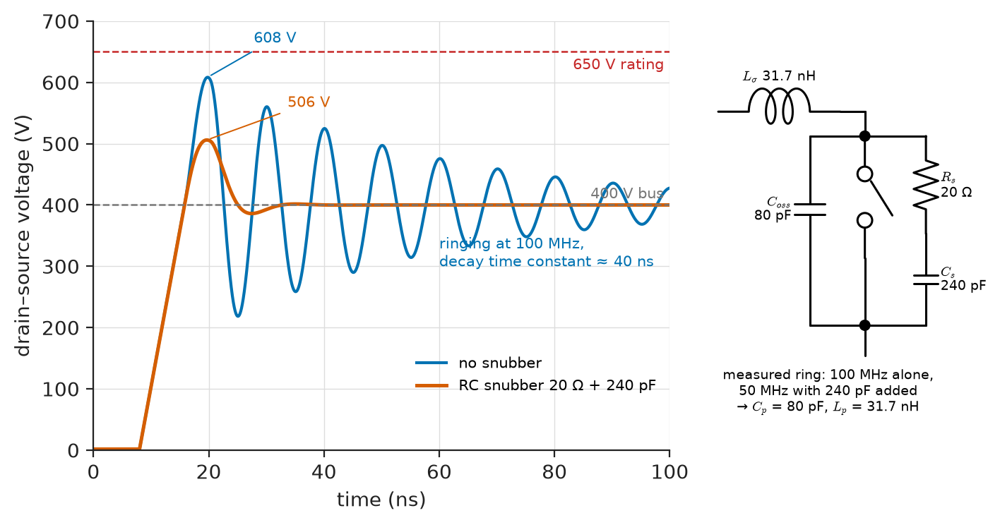
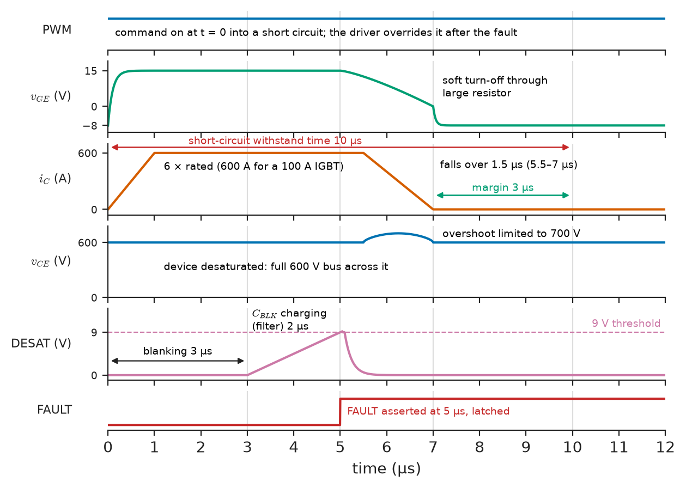

# Chapter 29 — Power-Electronic Fundamentals

*Part VII · Power Electronics*

A team redesigns one leg of a 10 kW, 400 V battery inverter, replacing its 650 V IGBTs switching at 20 kHz with SiC MOSFETs at 100 kHz so that the filter inductor shrinks to a fifth. The first prototype destroys a pair of transistors within a second of power-up: the fast voltage edge of one switch, coupled through the gate–drain capacitance of the other, lifts its gate above threshold and the leg shoots through. The second prototype survives but rings at 100 MHz with 200 V of overshoot on every turn-off and fails its conducted-emission test. The third runs, but its heatsink is 20 K hotter than the spreadsheet promised, because the spreadsheet used the on-resistance at 25 °C. None of these is a device failure. Each is a failure to treat the switch as what it is: a component with a finite transition time, parasitic capacitances and inductances around it, a gate that must be driven and protected, and a junction whose temperature closes a loop with its own losses. This chapter builds those models.

> **How much power does a semiconductor switch dissipate as it conducts and as it switches, and how do Si MOSFETs, IGBTs, SiC MOSFETs and GaN HEMTs compare with real datasheet numbers?**
> **How are the junction temperature, the gate drive, the snubbers, the protection and the switching frequency chosen so that the switch is efficient and survives?**

| Concept | Engineering destination |
|---|---|
| Power switching | Every converter of Chapters 30–32: chargers, server supplies, inverters, drives |
| Semiconductor switch characteristics | Choosing between Si MOSFET, IGBT, SiC and GaN for a voltage class and frequency |
| Switching losses | Loss budgets from datasheet $E_{on}$, $E_{off}$, $Q_{rr}$ and $E_{oss}$ |
| Conduction losses | RMS-current design, synchronous rectification, dead-time loss |
| Thermal constraints | Heatsink and interface selection, junction-temperature margin, pulse overloads |
| Gate driving | Drive voltages, gate resistors, Miller clamps, isolation, bootstrap supplies |
| Snubbers | Overshoot and ringing control, EMI, turn-off loss transfer |
| Protection | Desaturation detection, soft turn-off, active clamping, UVLO |
| Switching-frequency trade-offs | Size versus efficiency, EMI bands, control bandwidth, minimum on-time |

**Roadmap.** Why converters switch, and the commutation cell (29.1) → what distinguishes the four switch technologies (29.2) → switching losses (29.3) and conduction losses (29.4), combined in a device comparison → the junction temperature they produce (29.5) → driving the gate (29.6) → taming the parasitics with layout and snubbers (29.7) → protecting the switch (29.8) → choosing the switching frequency (29.9).

> **Boundary.** The rectifier and switching-converter sketch of *Engineering Physics*, [Ch. 18 §18.8](https://github.com/The-Studio-of-Sadiq/Engineering-Physics/blob/main/CHAPTERS/CHAPTER%2018.md), is the starting point, and its thermal-resistance network, [Ch. 14 §14.7](https://github.com/The-Studio-of-Sadiq/Engineering-Physics/blob/main/CHAPTERS/CHAPTER%2014.md), is used without re-derivation. Device structures and ratings come from this book: diode reverse recovery from [Chapter 2](../part-1-electronic-devices/02-semiconductor-junction-devices.md) (§2.2) and SiC Schottky diodes (§2.5); the gate-charge curve, $t_v\approx Q_{gd}/I_G$, the electrothermal equilibrium of a conducting MOSFET, avalanche and SOA ratings from [Chapter 4](../part-1-electronic-devices/04-field-effect-transistors.md) (§4.9–4.10); IGBT, SiC and GaN device physics and ratings from [Chapter 5](../part-1-electronic-devices/05-advanced-semiconductor-devices.md). The material reasons behind wide-bandgap performance are in *Materials Science and Engineering*, [Ch. 33 §33.4–33.5 and §33.10](https://github.com/The-Studio-of-Sadiq/Materials-Science-and-Engineering/blob/main/Chapters/CHAPTER%2033.md). The first- and second-order transients behind inductive kicks and ringing are from *Circuits, Signals and Communications*, [Ch. 6](https://github.com/The-Studio-of-Sadiq/Circuits-Signals-and-Communications/blob/main/part-2-transient-and-ac-analysis/06-first-order-circuits.md) and [Ch. 7](https://github.com/The-Studio-of-Sadiq/Circuits-Signals-and-Communications/blob/main/part-2-transient-and-ac-analysis/07-second-order-circuits.md).

---

## 29.1 Power switching

### Why converters switch

A linear regulator controls power by dropping the unwanted voltage across a transistor in its active region. Delivering 20 A at 200 V from a 400 V bus that way dissipates $(400-200)\times20=4$ kW in the transistor to deliver 4 kW to the load: 50 % efficiency at best, and a heatsink the size of a suitcase. A switch that is either fully on (current, almost no voltage) or fully off (voltage, almost no current) dissipates almost nothing in either state. If it alternates rapidly, an inductor and a capacitor average the chopped voltage into the wanted DC or AC value; *Engineering Physics* [§18.8](https://github.com/The-Studio-of-Sadiq/Engineering-Physics/blob/main/CHAPTERS/CHAPTER%2018.md) sketches the result ($V_{out}=DV_{in}$ for the buck), and Chapter 30 designs it. The same 4 kW conversion with real switches loses 20–60 W.

> **Status of the principle: The lossless ideal switch**
> *Fundamental.* An ideal switch has zero voltage when on and zero current when off, so the product $v\,i$ is zero in both states and it dissipates no power; every loss in a real switch comes from a non-zero on-state voltage, a finite transition time during which voltage and current coexist, stored charge and capacitance that must be charged or discharged, and leakage.

### The commutation cell

Almost every converter, from a 5 W phone charger to a 5 MW wind turbine, is built from one repeated unit, the **commutation cell** (Figure 29.1a): two switches (or a switch and a diode) connected in series across a stiff voltage $V_{dc}$ held by a capacitor, with their midpoint, the **switch node**, feeding an inductor that carries a nearly constant current $I_L$ through a switching period. When the upper switch turns on, the current commutates from the lower device to the upper; when it turns off, the current commutates back. The buck, boost and buck–boost converters of Chapter 30 and the inverter legs of Chapter 31 differ only in where the cell's terminals are connected.

The cell defines the hardest-working condition a switch faces, **clamped inductive switching** (Figure 29.1b). At turn-on, the switch must first take over the full inductor current while its voltage is still clamped at $V_{dc}$ by the conducting diode; only when it carries all of $I_L$ (plus the diode's reverse-recovery current) can the diode block and the voltage fall. At turn-off the order reverses: the voltage must rise all the way to $V_{dc}$ before the diode can forward-bias and take the current, so the full current flows at rising voltage. In both transitions voltage and current overlap, and the energy dissipated is roughly $\tfrac12V_{dc}I_L$ times the overlap time. This **hard switching** is the default; resonant and soft-switching converters (zero-voltage or zero-current switching) arrange for one of the two quantities to be near zero during the transition, at the cost of circulating current and narrower operating ranges.

<!-- FIGURE 29.1 | figures/ch29/fig-29-1-commutation-cell.png | waveform | (a) The commutation cell: a half-bridge across a 400 V capacitor with an inductor carrying 20 A from the switch node. (b) Clamped inductive turn-on and turn-off waveforms of the upper switch S1, with the overlap energy shaded. | Content: (a) circuit: 400 V DC-link capacitor, upper switch S1 (with antiparallel diode), lower switch S2, switch node to inductor L carrying constant 20 A to the load; parasitic loop inductance L_sigma 30 nH drawn in series with the capacitor; gate drivers on both switches. (b) time axis 0 to 120 ns per transition, two side-by-side panels. Turn-on: gate voltage rising from -4 V to plateau 7.5 V then to 15 V; drain current rising from 0 to 20 A in 4.2 ns, overshooting to 26 A from diode recovery; drain voltage staying at 400 V until current reaches 20 A, then falling to 1.6 V in 12 ns; shaded overlap labelled E_on. Turn-off: gate falling to plateau then to -4 V; drain voltage rising from 1.6 V to 400 V in 7.8 ns and overshooting to about 610 V with ringing at 100 MHz; current staying at 20 A until voltage reaches 400 V then falling to 0 in 4.5 ns; shaded overlap labelled E_off. -->



*Figure 29.1 — (a) The commutation cell: a half-bridge across a 400 V capacitor with an inductor carrying 20 A from the switch node. (b) Clamped inductive turn-on and turn-off waveforms of the upper switch S1, with the overlap energy shaded.*

---

## 29.2 Semiconductor switch characteristics

### What a power switch is asked to do

A designer reads a power-semiconductor datasheet for seven properties: **blocking voltage** (with margin for overshoot and cosmic-ray derating; Chapter 31 gives the classes), thermally limited **current**, **on-state characteristic**, **switching energies**, **gate** levels and charge, **reverse conduction**, and **ruggedness** (avalanche, short-circuit withstand). Chapter 5 explains the values; here they are design inputs.

Two on-state models cover all devices. A unipolar device (Si MOSFET, SiC MOSFET, GaN HEMT) is a resistance:

$$
v_{DS}=R_{DS(on)}(T_j)\,i_D
$$

A bipolar or conductivity-modulated device (IGBT, PN diode, thyristor) has a threshold plus a slope resistance, fitted to the datasheet curve at the operating temperature:

$$
v_{CE}=V_{CE0}+r_{CE}\,i_C,\qquad v_F=V_{F0}+r_F\,i_F
$$

> **Status of the principle: Piecewise-linear on-state models**
> *Approximate.* Straight-line fits to the datasheet output characteristic at the stated gate drive and junction temperature; accurate to a few percent over the current range used for the fit, they fail at very low current (where the IGBT's exponential knee matters) and must be refitted at each temperature, since $R_{DS(on)}$ rises 1.3–2.2 times from 25 °C to 150 °C while $V_{CE0}$ falls slightly and $r_{CE}$ rises.

### Four technologies at 650 V

The 650 V class, used for 400 V DC links in PFC stages, single-phase inverters, server supplies and 400 V EV systems, is the one place where all four technologies compete directly. Table 29.1 gives representative values for devices of similar die cost and roughly 40–50 mΩ or 40 A class.

**Table 29.1 — Representative 650 V switches (typical datasheet values; switching energies at 400 V, 20 A, 125 °C in a hard-switched half-bridge with the recommended gate resistor).**

| Property | Si superjunction MOSFET (fast-diode type) | Si trench field-stop IGBT (with copack diode) | SiC MOSFET | GaN enhancement-mode HEMT |
|---|---|---|---|---|
| On-state at 25 °C | 45 mΩ | $V_{CE(sat)}$ 1.5 V at 20 A | 60 mΩ | 50 mΩ |
| On-state at 125 °C | 95 mΩ (×2.1) | $V_{CE0}=0.95$ V, $r_{CE}=30$ mΩ | 81 mΩ (×1.35) | 90 mΩ (×1.8) |
| Gate drive (on / off) | +10 to 12 V / 0 V | +15 V / 0 to −8 V | +15 to 18 V / −3 to −5 V | +6 V / 0 to −3 V |
| Total gate charge $Q_g$ | 90 nC | 95 nC | 60 nC | 6 nC |
| $E_{on}$ (incl. opposite device's recovery) | 300 µJ | 350 µJ | 90 µJ | 35 µJ |
| $E_{off}$ | 25 µJ | 250 µJ (tail current) | 25 µJ | 8 µJ |
| Reverse-recovery charge $Q_{rr}$ | 0.6 µC | 1 µC | 0.1 µC | 0 |
| Reverse-conduction drop | 0.9 V body diode | 1.5 V copack diode | 3–4 V body diode | 2–3 V plus off-bias |
| Short-circuit withstand | Not rated | 5–10 µs | 2–3 µs | Under 1 µs |
| Typical hard-switched frequency | 20–100 kHz (PFC, LLC) | 2–30 kHz | 20–200 kHz | 100 kHz–1 MHz |

Three features stand out. The IGBT's turn-off energy is ten times larger than the others', because after the channel turns off, the minority carriers stored in its drift region must recombine, producing a **tail current** that flows at full voltage; this caps IGBTs at tens of kilohertz. The superjunction MOSFET has low switching energy as a switch but a body diode with large reverse-recovery charge, which is why standard SJ devices are used where their body diode never conducts in hard commutation (boost PFC with a SiC diode, LLC converters with soft switching) and fast-diode variants are needed for bridges. SiC and GaN combine low switching energy with little or no recovery charge, at the price of fast edges that demand careful gate drive and layout (Sections 29.6–29.7).

The product $R_{DS(on)}Q_g$ is a **figure of merit**: the charge moved per cycle for a given conduction loss. From Table 29.1 it is about 4 Ω·nC for the SJ MOSFET, 3.6 for SiC and 0.3 for GaN. At 40–150 V the contest is between trench Si MOSFETs (Table 4.5) and GaN: a 5 mΩ, 100 V GaN device needs about 10 nC of gate charge against about 50 nC for silicon, which is why 48 V converters at 0.5–1 MHz increasingly use GaN.

---

## 29.3 Switching losses

### Where the energy goes

At each hard-switched transition, four mechanisms dissipate energy in the switch:

1. **Current–voltage overlap.** During turn-on the current rises at full voltage, then the voltage falls at full current; during turn-off, the reverse.
2. **Reverse recovery** of the opposite diode (Chapter 2, §2.2): the switch turning on carries the load current plus the recovery current while still supporting most of $V_{dc}$, adding roughly $Q_{rr}V_{dc}$ per turn-on, mostly in the switch.
3. **Output capacitance.** At hard turn-on the switch discharges its own $C_{oss}$ through its channel, dissipating the stored energy $E_{oss}$ (the datasheet gives $E_{oss}$ at the bus voltage, because $C_{oss}$ is strongly nonlinear), and it also charges the opposite device's $C_{oss}$, drawing that charge from the bus through its own channel.
4. **Gate-drive energy** $Q_g\Delta V_{GS}$ per cycle, dissipated in the driver and gate resistors, not in the channel (Section 29.6).

The overlap intervals follow from the gate-charge picture of Chapter 4 (§4.9). With a driver swinging from $V_{off}$ to $V_{on}$ through a total gate resistance $R_G$ (external plus internal), input capacitance $C_{iss}$, threshold $V_{th}$ and plateau $V_{pl}$:

$$
t_{ri}\approx R_GC_{iss}\ln\frac{V_{on}-V_{th}}{V_{on}-V_{pl}},\qquad t_{fv}\approx\frac{Q_{gd}R_G}{V_{on}-V_{pl}}
$$

$$
t_{rv}\approx\frac{Q_{gd}R_G}{V_{pl}-V_{off}},\qquad t_{fi}\approx R_GC_{iss}\ln\frac{V_{pl}-V_{off}}{V_{th}-V_{off}}
$$

$$
E_{on}\approx\tfrac12V_{dc}I_L\,(t_{ri}+t_{fv})+Q_{rr}V_{dc}+E_{oss},\qquad E_{off}\approx\tfrac12V_{dc}I_L\,(t_{rv}+t_{fi})
$$

> **Status of the principle: Overlap model of switching energy**
> *Approximate.* Assumes linear current and voltage ramps, a constant plateau, a lumped $Q_{gd}$ and negligible stray inductance; it predicts trends with gate resistance, voltage and current well but is typically within a factor of 1.5–2 of measurement, and it overestimates the turn-off loss of fast unipolar devices, whose channel can turn off before the voltage rises, letting the load current charge $C_{oss}$ losslessly.

**Worked example — estimating a SiC MOSFET's switching energy from its gate charge.** A 650 V, 60 mΩ SiC MOSFET switches 20 A at 400 V. At 125 °C its datasheet gives $C_{iss}\approx1.0$ nF, $Q_{gd}\approx10$ nC at 400 V, $V_{th}\approx3.0$ V and a plateau of about 7.5 V at 20 A. The driver swings from −4 V to +15 V through $R_G=9\ \Omega$ (5 Ω external plus 4 Ω internal).

- Turn-on: $t_{ri}=9\times1.0\ \mathrm{nF}\times\ln(12/7.5)=4.2$ ns; $t_{fv}=10\ \mathrm{nC}\times9/7.5=12.0$ ns. Overlap energy $\tfrac12\times400\times20\times16.2\ \mathrm{ns}=64.9$ µJ. Adding $Q_{rr}V_{dc}=0.1\ \mu\mathrm{C}\times400=40$ µJ and $E_{oss}\approx10$ µJ gives $E_{on}\approx115$ µJ.
- Turn-off: $t_{rv}=10\ \mathrm{nC}\times9/11.5=7.8$ ns; $t_{fi}=9\times1.0\ \mathrm{nF}\times\ln(11.5/7)=4.5$ ns; $E_{off}\approx\tfrac12\times400\times20\times12.3\ \mathrm{ns}=49$ µJ.
- The edges imply $di/dt\approx20/4.2=4.7$ A/ns and $dv/dt\approx33$ V/ns at turn-on, 51 V/ns at turn-off.

The datasheet, measured in a double-pulse test, gives $E_{on}\approx90$ µJ and $E_{off}\approx25$ µJ. The turn-on estimate is 28 % high, a typical agreement; the turn-off estimate is twice the measurement, for the reason in the status box. Use the model to see how energies scale with $R_G$ and drive voltage, and use measured energies for the loss budget.

### Datasheet switching energies and how to scale them

Datasheet $E_{on}$, $E_{off}$ and $E_{rr}$ are measured by the **double-pulse test** (IEC 60747-8 for MOSFETs, IEC 60747-9 for IGBTs): a first pulse ramps an inductor's current to the test value, a short off-time captures turn-off, and a second pulse captures turn-on at that current. They hold only for the stated voltage, current, temperature, gate resistor, drive voltages, fixture loop inductance and diode. Three scaling rules extend them:

- **Voltage:** roughly proportional to $V_{dc}$ (exponent 1 to 1.4 for IGBTs).
- **Current:** roughly proportional to $I$ for IGBTs; for fast unipolar devices $E_{on}$ has a constant part ($E_{oss}$, $Q_{rr}V$) that does not shrink at light load.
- **Temperature:** IGBT and Si-diode energies rise 30–60 % from 25 °C to 125 °C; SiC MOSFET energies change by about 10 %.

The switching loss is then $P_{sw}=(E_{on}+E_{off})f_{sw}$ for each switch at constant current; in an inverter, where the current varies sinusoidally, the energies are averaged over the output cycle (Chapter 31, §31.8).

---

## 29.4 Conduction losses

### RMS for resistors, average plus RMS for thresholds

Conduction loss is the time average of $v\,i$ over a switching period. For a unipolar device, it depends only on the RMS current through it; for a threshold device, also on the average:

$$
P_{cond,MOS}=I_{rms}^2\,R_{DS(on)}(T_j),\qquad P_{cond,IGBT}=V_{CE0}\,I_{avg}+r_{CE}\,I_{rms}^2
$$

For a switch carrying a trapezoidal current of mean value $I$ and peak-to-peak ripple $\Delta I$ for a fraction $D$ of the period, $I_{avg}=DI$ and $I_{rms}^2=D\left(I^2+\Delta I^2/12\right)$; the ripple term is small at the usual ripple ratios (Chapter 30). Because the on-resistance depends on junction temperature, and junction temperature on the loss, conduction losses must be evaluated at the operating temperature: the electrothermal loop of Chapter 4 (§4.10), which for a combined conduction and switching loss is solved iteratively in Section 29.5.

### Reverse conduction and dead time

In a bridge, the lower device conducts in the **third quadrant** (current from source to drain) while the upper device is off. A MOSFET whose channel is turned on in the third quadrant behaves as the same resistor, which is **synchronous rectification**: at 20 A a 5 mΩ channel drops 0.1 V where a Schottky diode would drop 0.5 V. But both devices must be off for a short **dead time** at each transition to avoid shoot-through (Chapter 31, §31.2), and during it the current flows through the body diode or its equivalent. That is cheap for a silicon MOSFET (0.9 V) and expensive for SiC (3–4 V, because of its wide bandgap) and GaN (2–3 V plus the magnitude of any negative off-bias, because the HEMT conducts in reverse by turning its own channel on).

**Worked example — dead-time loss with a SiC body diode.** A SiC half-bridge at 20 A uses 100 ns of dead time at each of two transitions per period, with a body-diode drop of 3.5 V. The dead-time loss per period is $20\times3.5\times2\times100\ \mathrm{ns}=14$ µJ: 0.7 W at 50 kHz, 1.4 W at 100 kHz, about 5 % of the device's total loss at 100 kHz. Cutting the dead time to 40 ns, which the fast turn-off of SiC allows, saves 60 % of it; an antiparallel SiC Schottky diode would also take the current, at the cost of its capacitance.

### Combining the losses: four technologies compared

The listing combines conduction and switching losses for one switch of a hard-switched 400 V half-bridge carrying 20 A at $D=0.5$, with the 125 °C values of Table 29.1, and finds the highest frequency at which each device stays within a 25 W thermal budget (Section 29.5 shows where such a budget comes from).

```python
# One switch of a hard-switched 400 V half-bridge leg, 20 A, D = 0.5, Tj = 125 C
V, I, D = 400.0, 20.0, 0.5
devices = {   # on-state model at 125 C, switching energies at 400 V / 20 A / 125 C
    "Si SJ MOSFET": dict(R=0.095, Eon=300e-6, Eoff=25e-6),
    "Si IGBT":      dict(V0=0.95, r=0.030, Eon=350e-6, Eoff=250e-6),
    "SiC MOSFET":   dict(R=0.081, Eon=90e-6, Eoff=25e-6),
    "GaN HEMT":     dict(R=0.090, Eon=35e-6, Eoff=8e-6),
}
P_max = 25.0                               # W per device the heatsink allows
print(f"{'device':13s} {'Pcond':>6s} {'Esw uJ':>7s} {'20 kHz':>7s} "
      f"{'50 kHz':>7s} {'100 kHz':>8s} {'f_max kHz':>9s}")
for name, d in devices.items():
    if "R" in d:                           # MOSFET/HEMT: I_rms^2 R, square wave
        p_c = D * I**2 * d["R"]
    else:                                  # IGBT: V0 I_avg + r I_rms^2
        p_c = D * (d["V0"]*I + d["r"]*I**2)
    e_sw = d["Eon"] + d["Eoff"]
    tot = [p_c + e_sw*f for f in (20e3, 50e3, 100e3)]
    f_max = (P_max - p_c) / e_sw
    print(f"{name:13s} {p_c:6.1f} {e_sw*1e6:7.0f} {tot[0]:7.1f} "
          f"{tot[1]:7.1f} {tot[2]:8.1f} {f_max/1e3:9.1f}")
```

```text
device         Pcond  Esw uJ  20 kHz  50 kHz  100 kHz f_max kHz
Si SJ MOSFET    19.0     325    25.5    35.2     51.5      18.5
Si IGBT         15.5     600    27.5    45.5     75.5      15.8
SiC MOSFET      16.2     115    18.5    21.9     27.7      76.5
GaN HEMT        18.0      43    18.9    20.1     22.3     162.8
```

Conduction losses are similar, 15.5–19 W, because the devices were chosen for similar on-state performance; the IGBT's threshold model gives the lowest figure at this current. Switching energies differ by a factor of 14. At 20 kHz all four lie within 9 W of one another and the IGBT, cheapest per ampere, is a reasonable choice; at 100 kHz the IGBT would dissipate 75 W and the SiC and GaN devices 22–28 W. This is the quantitative content of the prototype story in the opening: moving from IGBTs at 20 kHz to SiC at 100 kHz is possible, but only for a device whose switching energy is about a fifth of the IGBT's. Figure 29.2 plots the totals against frequency.

<!-- FIGURE 29.2 | figures/ch29/fig-29-2-loss-vs-frequency.png | plot | Total loss of one switch in a hard-switched 400 V, 20 A half-bridge versus switching frequency for four 650 V technologies at 125 C. | Content: x-axis switching frequency 0 to 200 kHz, y-axis loss per device 0 to 80 W. Four straight lines: Si SJ MOSFET 19.0 W + 325 uJ times f; Si IGBT 15.5 W + 600 uJ times f; SiC MOSFET 16.2 W + 115 uJ times f; GaN HEMT 18.0 W + 43 uJ times f. Horizontal dashed line at 25 W labelled thermal budget per device. Mark the intersections: IGBT 15.8 kHz, SJ MOSFET 18.5 kHz, SiC 76.5 kHz, GaN 162.8 kHz. Annotate the conduction-loss intercepts at f = 0. -->



*Figure 29.2 — Total loss of one switch in a hard-switched 400 V, 20 A half-bridge versus switching frequency for four 650 V technologies at 125 C.*

---

## 29.5 Thermal constraints

### The steady-state path

Losses become a junction temperature through the thermal-resistance network of *Engineering Physics* [§14.7](https://github.com/The-Studio-of-Sadiq/Engineering-Physics/blob/main/CHAPTERS/CHAPTER%2014.md): junction to case $R_{th,jc}$ (from the datasheet), case to heatsink $R_{th,ch}$ (the interface), heatsink to ambient $R_{th,ha}$. Chapter 1 (§1.7) applies it to a single device and Chapter 4 (§4.10) to a conducting MOSFET. In a converter three practical points dominate.

**Table 29.2 — Representative thermal resistances for discrete power packages (typical values).**

| Element | Range | Notes |
|---|---|---|
| $R_{th,jc}$, TO-247, 650 V SiC or SJ MOSFET | 0.4–1.0 K/W | Lower for larger dies |
| $R_{th,jc}$, top-cooled GaN (e.g. 7 × 9 mm) | 0.2–0.5 K/W | Heat leaves through the top pad |
| $R_{th,ch}$, thermal grease, non-isolated | 0.1–0.2 K/W | Heatsink at switch-node potential |
| $R_{th,ch}$, silicone-elastomer insulating pad | 0.4–1.0 K/W | Isolation to several kV; most common |
| $R_{th,ch}$, AlN ceramic with grease | 0.2–0.3 K/W | Isolated, low resistance, brittle |
| $R_{th,ha}$, natural convection, 100 mm extrusion | 1–3 K/W | Orientation-dependent |
| $R_{th,ha}$, forced air, small fan | 0.2–0.8 K/W | Fan life limits reliability |
| $R_{th,ha}$, liquid cold plate | 0.02–0.1 K/W | EV traction, server and telecom rectifiers |

First, the **interface** often equals or exceeds $R_{th,jc}$: an insulating pad under a TO-247 can double the junction-to-heatsink resistance, which is why designers accept a heatsink at switch-node potential or pay for ceramic isolation. Second, **several devices share one heatsink**, so the heatsink temperature rises with the sum of their losses while each junction sits above it by its own loss times its own $R_{th,jc}+R_{th,ch}$. Third, the design target is not the absolute maximum junction temperature (150 °C for most silicon, 175 °C for many SiC and Si trench devices) but a working value 25–50 K lower, which keeps margin for overload, ambient extremes and lifetime.

### Combined conduction and switching loss in a loop

Chapter 4 solved the electrothermal equilibrium of a purely conducting MOSFET in closed form. With switching losses that also depend on temperature, and two devices on one heatsink, a fixed-point iteration is simpler and shows the loop gain directly.

**Worked example — junction temperature of a SiC half-bridge leg.** Both switches of the 400 V, 20 A, 50 kHz leg are SiC MOSFETs ($R_{DS(on)}=60$ mΩ at 25 °C, rising 0.35 %/K; $E_{on}+E_{off}=105$ µJ at 25 °C, rising 0.1 %/K) with $R_{th,jc}=0.8$ K/W and an insulating pad of 0.5 K/W, sharing a forced-air heatsink of 0.9 K/W in 50 °C air.

```python
# Electrothermal fixed point for a SiC half bridge on a shared heatsink
R25, alpha = 0.060, 0.0035        # ohm, 1/K  (1.35x at 125 C)
I, D, f = 20.0, 0.5, 50e3          # A, duty, Hz
Esw25, beta = 105e-6, 0.001        # J at 25 C, 1/K (Esw rises ~10 %/100 K)
Rjc, Rch, Rsa, Ta = 0.8, 0.5, 0.9, 50.0   # K/W, K/W, K/W (shared), C

def losses(Tj):
    pc = I**2 * R25 * (1 + alpha*(Tj - 25)) * D
    ps = Esw25 * (1 + beta*(Tj - 25)) * f
    return pc, ps

Tj = Ta
for it in range(50):
    pc, ps = losses(Tj)
    p = pc + ps
    Ths = Ta + 2*p*Rsa                  # two devices share the sink
    Tj_new = Ths + p*(Rjc + Rch)
    if abs(Tj_new - Tj) < 0.01:
        break
    Tj = Tj_new
print(f"iterations {it}: Pcond {pc:.1f} W, Psw {ps:.1f} W, "
      f"Ths {Ths:.1f} C, Tj {Tj_new:.1f} C")
# loop gain of the electrothermal feedback: dP/dTj * Rth_total
dP = I**2*R25*alpha*D + Esw25*beta*f
print(f"dP/dTj {dP:.3f} W/K, loop gain {dP*(Rjc+Rch+2*Rsa):.2f}")
```

```text
iterations 5: Pcond 15.9 W, Psw 5.7 W, Ths 88.9 C, Tj 116.9 C
dP/dTj 0.047 W/K, loop gain 0.15
```

Each device dissipates 21.6 W; the heatsink runs at 88.9 °C and the junctions at 116.9 °C, inside a 125 °C working target and 58 K below the 175 °C rating. The 25 °C losses would have been 12 W of conduction and 5.3 W of switching, 17.3 W in all, predicting a 104 °C junction: 13 K optimistic, the third prototype of the opening. The loop gain of 0.15 means the temperature feedback multiplies any loss disturbance by $1/(1-0.15)=1.18$; a silicon superjunction device, whose resistance doubles over the same range, on a poorer heatsink, can approach a loop gain of 0.5, where small errors in the thermal path produce large temperature errors.

### Pulses and transient thermal impedance

A junction does not reach steady state instantly: the die, solder, baseplate and heatsink are thermal capacitances (the RC network of *Engineering Physics* §14.7.3). Datasheets give the **transient thermal impedance** $Z_{th,jc}(t)$, the junction temperature rise per watt of a power step after time $t$, usually as a Foster network:

$$
Z_{th,jc}(t)=\sum_i r_i\left(1-e^{-t/\tau_i}\right)
$$

For the SiC device above, a typical fit is $r_i=(0.05, 0.20, 0.35, 0.20)$ K/W with $\tau_i=(10\ \mu\mathrm{s}, 0.2\ \mathrm{ms}, 3\ \mathrm{ms}, 30\ \mathrm{ms})$, which sums to the steady 0.8 K/W. Evaluated, $Z_{th,jc}(1\ \mathrm{ms})=0.35$ K/W and $Z_{th,jc}(10\ \mathrm{ms})=0.64$ K/W.

**Worked example — a 10 ms overload.** A locked-rotor motor start triples the current for 10 ms. Conduction loss rises ninefold (15.9 to 143 W) and switching loss threefold (5.7 to 17 W), adding about 139 W to one device's loss. The heatsink barely moves in 10 ms, so the junction rises above its steady 116.9 °C by about $139\times0.64=89$ K, to about 206 °C: far past the 175 °C limit, and more as $R_{DS(on)}$ climbs during the pulse. Limiting the start current to twice rated adds only 53 W (conduction quadruples, switching doubles), a rise of $53\times0.64=34$ K to about 151 °C; keeping the triple current but cutting its duration to 1 ms ($139\times0.35=49$ K, to about 166 °C) also stays inside. Single-pulse $Z_{th}$ is also what the SOA chart's pulse lines (Chapter 4, §4.10) are built from.

<!-- FIGURE 29.3 | figures/ch29/fig-29-3-thermal-network-zth.png | plot | (a) Thermal network of the SiC half-bridge leg on a shared heatsink with its solved temperatures; (b) transient thermal impedance of one device from its Foster fit. | Content: (a) circuit-style thermal network: two current sources of 21.6 W (junctions J1 and J2), each through Rjc 0.8 K/W and Rch 0.5 K/W to a common heatsink node, then Rha 0.9 K/W to ambient 50 C; node temperatures labelled Tj 116.9 C, heatsink 88.9 C. (b) x-axis time 1 us to 1 s, log scale; y-axis Zth,jc 0 to 0.9 K/W. Curve Zth(t) = sum of four terms r = 0.05, 0.20, 0.35, 0.20 K/W with tau = 10 us, 0.2 ms, 3 ms, 30 ms, approaching 0.8 K/W. Mark points 1 ms at 0.354 K/W and 10 ms at 0.644 K/W, and a dashed horizontal line at the steady 0.8 K/W. -->



*Figure 29.3 — (a) Thermal network of the SiC half-bridge leg on a shared heatsink with its solved temperatures; (b) transient thermal impedance of one device from its Foster fit.*

Figure 29.3 shows the steady network of the worked example and the transient impedance used for the overload.

> **Status of the principle: Foster-network transient thermal model**
> *Approximate.* A sum of exponentials fitted to a measured junction-temperature step response; it predicts the junction temperature for any loss waveform by superposition, but its internal nodes have no physical meaning, it cannot be cascaded with a heatsink model without conversion to a Cauer network, and it assumes temperature-independent material properties.

Repeated temperature swings fatigue bond wires and solder; the resulting power-cycling lifetime, which sizes traction and wind converters, is treated in Chapter 31 (§31.9).

---

## 29.6 Gate driving

### What a gate driver does

A gate driver translates a logic-level PWM signal from a controller (Chapter 17 for the timer, Chapter 28 for the firmware) into the voltage and current the power switch's gate needs, referenced to the switch's own source or emitter, which in a bridge may swing by hundreds of volts at tens of volts per nanosecond.

**Table 29.3 — Gate-drive requirements by technology (typical values).**

| | Si MOSFET | Si IGBT | SiC MOSFET | GaN e-mode HEMT |
|---|---|---|---|---|
| Recommended on-voltage | 10–12 V (logic level 4.5–5 V) | 15 V | 15–18 V | 5–6 V |
| Off-voltage | 0 V | 0 V or −5 to −8 V | −3 to −5 V | 0 V or −2 to −3 V |
| Absolute gate limits | ±20 V | ±20 V | +22/−8 V typical | +7/−10 V typical, device-dependent |
| Threshold at 125 °C | 2–3 V | 5–6 V | 2–3 V | 1.2–1.5 V |
| Typical edge rate | 5–30 V/ns | 2–10 V/ns | 20–100 V/ns | 50–150 V/ns |
| Required driver CMTI | 25–50 V/ns | 25–50 V/ns | at least 100 V/ns | at least 100–200 V/ns |

The driver's main numbers follow directly from the gate charge:

$$
P_{G}=Q_g\,\Delta V_{GS}\,f_{sw},\qquad I_{G,pk}\approx\frac{\Delta V_{GS}}{R_{G,total}}
$$

For the SiC device of Section 29.3 ($Q_g=60$ nC, $\Delta V_{GS}=19$ V, 50 kHz) the gate power is 57 mW and the peak current $19/9=2.1$ A; for the IGBT of Table 29.1 at 20 kHz with +15/−8 V, $95\ \mathrm{nC}\times23\times20\ \mathrm{kHz}=44$ mW; for the GaN HEMT at 500 kHz, $6\ \mathrm{nC}\times6\times500\ \mathrm{kHz}=18$ mW. The power is small, but it must be delivered in peaks of amperes from a supply referenced to a moving node.

### Choosing the gate resistor

The external gate resistor is the main knob on switching speed (Section 29.3): a larger $R_G$ slows the edges, lowers $di/dt$, $dv/dt$, overshoot and EMI, and raises switching loss roughly in proportion. Separate turn-on and turn-off resistors, steered by a diode or by a driver with split outputs, set the two edges independently; it is common to turn on slowly (limiting diode-recovery current and EMI) and turn off fast (limiting loss). Two layout details matter as much as the value. A **Kelvin source** pin (TO-247-4, D2PAK-7, most GaN packages) separates the gate return from the power current, removing the common-source inductance that would otherwise subtract $L_S\,di/dt$ from the gate voltage and slow the switch. And the gate loop itself must be small, because its inductance with $C_{iss}$ forms a resonator that rings unless $R_G$ damps it.

### Miller-induced turn-on

When the upper switch of a leg turns on, the switch node rises at $dv/dt$, and the lower (off) device's gate–drain capacitance injects a current $C_{gd}\,dv/dt$ into its gate, which the driver must sink through its off-path resistance.

**Worked example — the first prototype's shoot-through.** The lower SiC MOSFET has an effective $C_{gd}$ of about 10 pF over the transition, the upper switches at 50 V/ns, and the lower gate is held at 0 V through 9 Ω.

- Injected current: $10\ \mathrm{pF}\times50\ \mathrm{V/ns}=0.5$ A.
- Gate voltage bump: $0.5\times9=4.5$ V, well above the 2–3 V threshold at temperature. The lower device turns on partially while the upper turns on fully: shoot-through.
- Remedies: a negative off-voltage of −4 V puts the bump at +0.5 V, below threshold; an **active Miller clamp**, a transistor in the driver that shorts gate to source through about 0.5 Ω once the gate is below 2 V, reduces the bump to $0.5\times0.5=0.25$ V; a small gate–source capacitor helps at the cost of drive power.

GaN HEMTs, with thresholds near 1.3 V and a gate limit of about +7 V, are even more sensitive, which is why GaN drivers sit millimetres from the device or are integrated into the same package.

### Isolation

The high-side driver of a bridge must be referenced to the switch node. Non-isolated level-shifting half-bridge driver ICs, powered by a bootstrap, serve cost-sensitive designs up to about 600–1200 V. Isolated drivers carry the signal across a barrier: optocouplers (IEC 60747-5-5) or, in most new designs, capacitive and magnetic digital isolators (IEC 60747-17), whose 30–100 ns propagation delays are shorter, better matched and more stable with age. Pulse transformers survive in thyristor firing.

The critical isolated-driver number is **common-mode transient immunity** (CMTI), the switch-node $dv/dt$ the barrier can withstand without corrupting the output; 100 V/ns or more is needed for SiC and GaN. The isolated supply that powers the driver matters just as much: every picofarad of interwinding capacitance in its transformer carries a common-mode current $C\,dv/dt$ back into the controller ground, so a 10 pF supply at 100 V/ns injects 1 A spikes. Drivers for SiC and GaN use supplies with under 2–5 pF of barrier capacitance.

### The bootstrap supply

The cheapest high-side supply is a **bootstrap** (Figure 29.4): a capacitor $C_{BS}$ between the high-side driver's supply pin and the switch node, charged through a diode from the low-side 10–15 V rail whenever the low-side switch is on and the switch node is near ground. While the high-side switch is on, the capacitor alone powers its driver and holds its gate up.

<!-- FIGURE 29.4 | figures/ch29/fig-29-4-gate-driver-bootstrap.png | circuit | Half-bridge gate drive: low-side driver, bootstrap high-side driver and an isolated alternative, with gate resistors, Miller clamp and Kelvin source. | Content: left, 48 V half-bridge with two 80 V Si MOSFETs (Qg 120 nC at 10 V) and output inductor. Driver IC with low-side output (VDD 12 V) and high-side floating output referenced to switch node SW; bootstrap diode (fast, 100 V) from 12 V to VB pin through 2.2 ohm resistor; bootstrap capacitor 1 uF ceramic between VB and SW; gate resistors 4.7 ohm on, 2.2 ohm off with steering diode; 10 kohm gate-source resistors. Right inset: isolated driver alternative for a 400 V SiC leg: digital isolator barrier (CMTI 150 V/ns), isolated DC-DC with less than 3 pF barrier capacitance providing +15 V / -4 V, Kelvin source connection, active Miller clamp transistor between gate and source. Annotate charge budget: Qg 120 nC plus level shifter 5 nC plus leakage 52 nC equals 177 nC; droop about 0.2 V on 1 uF at its 12 V bias. -->



*Figure 29.4 — Half-bridge gate drive: low-side driver, bootstrap high-side driver and an isolated alternative, with gate resistors, Miller clamp and Kelvin source.*

**Worked example — sizing a bootstrap capacitor.** A 48 V motor-drive half-bridge uses 80 V silicon MOSFETs with $Q_g=120$ nC at 10 V, switching at 20 kHz with a maximum duty of 0.95, so the longest high-side on-time is $0.95/20\ \mathrm{kHz}=47.5$ µs. The high-side driver draws 100 µA quiescent, its level shifter consumes 5 nC per cycle, and a 10 kΩ gate–source resistor draws 1 mA at 10 V.

- Charge drawn per high-side on-time: $Q=120+5+(0.1+1.0)\ \mathrm{mA}\times47.5\ \mu\mathrm{s}=120+5+52=177$ nC.
- For at most 0.5 V of droop, $C_{BS}\ge177\ \mathrm{nC}/0.5\ \mathrm{V}=354$ nF. A 1 µF X7R capacitor rated 25 V, which still offers 0.7–0.8 µF at 12 V bias, droops by about 0.2–0.25 V.
- The 1 mA of the gate–source resistor costs nearly as much as the gate charge itself; at a low switching frequency or a long on-time it dominates. Raising that resistor to 47 kΩ, or choosing a driver with a charge pump, is the fix for long on-times.

The bootstrap has two structural limits. It cannot hold the high-side switch on indefinitely, so 100 % duty needs a charge pump or an isolated supply; and the low-side switch must be on long enough each cycle to recharge the capacitor, which with a 2.2 Ω charging resistor and 1 µF ($\tau=2.2$ µs) means a minimum low-side time of a few microseconds. In SiC half-bridges the bootstrap can also overcharge, because the negative switch-node excursion during dead time adds to the charging voltage; a Zener clamp on $V_{BS}$ protects the gate.

---

## 29.7 Snubbers

### Parasitic inductance and ringing

Every commutation loop (the DC-link capacitor, both switches and the connections between them) has a stray inductance $L_\sigma$: 2–5 nH for a well-laid-out GaN half-bridge on a multilayer board, 10–40 nH for TO-247 devices, 15–30 nH inside a modern power module plus its busbar. At turn-off, the current through $L_\sigma$ collapses at $di/dt$, and the switch sees an overshoot

$$
\Delta V\approx L_\sigma\,\frac{di}{dt}
$$

on top of $V_{dc}$. The overshoot is followed by ringing of $L_\sigma$ with the switch's output capacitance: a lightly damped series RLC (the second-order circuit of *Circuits, Signals and Communications*, [Ch. 7](https://github.com/The-Studio-of-Sadiq/Circuits-Signals-and-Communications/blob/main/part-2-transient-and-ac-analysis/07-second-order-circuits.md)) whose frequency $f_r=1/(2\pi\sqrt{L_\sigma C_{oss}})$ lies at 30–300 MHz and radiates efficiently. Two examples set the scale: a SiC MOSFET turning off 20 A in 5 ns through 32 nH gives $32\ \mathrm{nH}\times4\ \mathrm{A/ns}=128$ V, and a 1200 V IGBT module turning off 400 A at 5 kA/µs through 20 nH overshoots by 100 V on an 800 V bus. The first estimate is optimistic: a current fall shorter than half a ring period (5 ns at 100 MHz) also excites the $L_\sigma C_{oss}$ resonance, and the peak approaches twice $L_\sigma\,di/dt$. The SiC leg of Figure 29.5, its current falling in 4.5 ns, takes the 400 V bus to about 610 V on a 650 V device.

The first remedy is layout: decoupling capacitors (0.1–1 µF per leg) millimetres from the switches, the loop routed as overlapping planes on adjacent layers so its field cancels, and low-inductance packages. Halving $L_\sigma$ halves the overshoot at no cost in loss; only then is a snubber added.

### The RC damping snubber

A series RC across the switch (or across the DC link close to the devices) damps the ringing by placing a resistor equal to the loop's characteristic impedance across it. The parasitic $L_\sigma$ and $C_{oss}$ are rarely known accurately, so they are measured:

1. Measure the ringing frequency $f_1$ at turn-off.
2. Add a known capacitor $C_a$ across the switch and measure the new frequency $f_2$. Since $f\propto1/\sqrt{C}$, $C_p=C_a/\left[(f_1/f_2)^2-1\right]$ and $L_p=1/\left[(2\pi f_1)^2C_p\right]$.
3. Choose $R_s=\sqrt{L_p/C_p}$, the characteristic impedance, and $C_s$ three to four times $C_p$ so that the capacitor is a short at the ringing frequency while $R_s$ does the damping.
4. Check the snubber loss $P_s=C_sV_{dc}^2f_{sw}$: the capacitor is charged and discharged each cycle, and the energy $\tfrac12C_sV^2$ is lost in $R_s$ twice.

**Worked example — damping the second prototype.** The SiC leg rings at $f_1=100$ MHz. Adding $C_a=240$ pF lowers it to $f_2=50$ MHz.

- $C_p=240/(2^2-1)=80$ pF; $L_p=1/[(2\pi\times10^8)^2\times80\ \mathrm{pF}]=31.7$ nH.
- $R_s=\sqrt{31.7\ \mathrm{nH}/80\ \mathrm{pF}}=19.9\ \Omega$; take a 20 Ω low-inductance thick-film resistor with $C_s=240$ pF (three times $C_p$), C0G dielectric, 1 kV.
- Loss: $240\ \mathrm{pF}\times400^2\times50\ \mathrm{kHz}=1.9$ W, dissipated in the resistor, and it rises to 3.8 W if the converter later runs at 100 kHz.

The snubber reduces the ringing to one or two cycles and cuts the radiated emissions around 100 MHz by 10–20 dB; it trims the first overshoot peak back towards the $L_\sigma\,di/dt$ estimate (from about 610 V to about 505 V in Figure 29.5) but cannot remove it, which only a smaller $L_\sigma$ or a slower $di/dt$ does. A 2 W loss in a 10 kW converter is acceptable; the same snubber on every switch of a 1 MHz GaN converter is not, which is why high-frequency designs rely on layout almost entirely.

> **Status of the principle: Lumped RC snubber design**
> *Approximate.* Treats the ringing loop as a single series $L_\sigma C_{oss}$ resonator with constant values; $C_{oss}$ is strongly voltage-dependent, so the measurement is made at the operating bus voltage, and loops with several resonances (module, busbar, capacitor bank) may need snubbers at more than one point.

### The RCD turn-off snubber and clamps

An RCD snubber (capacitor in series with a diode across the switch, a resistor across the diode) slows the voltage rise at turn-off: the load current charges $C_s$ through the diode while the switch current falls, so voltage and current overlap less, and the energy moves from the switch to the resistor. For an IGBT with a 200 ns current fall at 20 A and 400 V, a capacitor that lets the voltage reach the bus only as the current fall ends needs $C_s\approx I\,t_f/(2V)=5$ nF (it absorbs the charge $It_f/2=2\ \mu\mathrm{C}$); it must discharge through $R_s$ during the minimum on-time (2 µs gives $R_s<2\ \mu\mathrm{s}/(3\times5\ \mathrm{nF})=133\ \Omega$) and costs $\tfrac12C_sV^2f=8$ W at 20 kHz. That is often as much as it saves, so turn-off snubbers survive mainly in thyristor circuits and high-power IGBT stacks. Two relatives remain essential: the **RCD clamp** that absorbs a flyback transformer's leakage energy (Chapter 30), and the 0.1–1 µF film **DC-link snubber capacitor** mounted on IGBT module terminals to shorten the commutation loop.

<!-- FIGURE 29.5 | figures/ch29/fig-29-5-snubber-ringing.png | waveform | Turn-off drain voltage of the SiC leg without and with the RC snubber, and the snubber circuit. | Content: x-axis time 0 to 100 ns, y-axis drain-source voltage 0 to 700 V. Trace 1 (no snubber): rise from 0 to 400 V in 8 ns, current fall 4.5 ns, overshoot to about 610 V, ringing at 100 MHz decaying with time constant about 40 ns. Trace 2 (RC snubber 20 ohm and 240 pF): same rise slightly slower, overshoot to about 505 V, ringing damped within about one and a half cycles. Horizontal dashed lines at 400 V bus and 650 V rating. Inset circuit: switch with Coss 80 pF, loop inductance 31.7 nH, snubber Rs 20 ohm in series with Cs 240 pF across drain-source. Annotate measured ring frequencies 100 MHz without and 50 MHz with an added 240 pF. -->



*Figure 29.5 — Turn-off drain voltage of the SiC leg without and with the RC snubber, and the snubber circuit.*

---

## 29.8 Protection

Chapter 31 (§31.9) covers protection at converter level: precharge, fuses, surge arresters and earth faults. This section covers the switch itself, which in a fault has microseconds to live.

### Short circuit and its two forms

A **hard switching fault** (type I) occurs when a switch turns on into an existing short, for example a shorted motor cable; a **fault under load** (type II) when a short appears while the switch is already on. In both, the current rises until the device leaves its low-resistance region and limits it by its saturation characteristic, typically 4–10 times rated current, at the full bus voltage. The dissipated power is enormous: a 650 V SiC MOSFET saturating at 200 A on a 400 V bus dissipates 80 kW, and in 2 µs absorbs $80\ \mathrm{kW}\times2\ \mu\mathrm{s}=160$ mJ in a die of about 10 mm². The device survives only for its rated **short-circuit withstand time** (Table 29.1): 5–10 µs for IGBTs designed for drives, 2–3 µs for most SiC MOSFETs (whose smaller dies have less thermal mass), under 1 µs for GaN, at specified bus voltage, gate voltage and starting temperature.

### Detection: desaturation and current sensing

**Desaturation detection** (Figure 29.6) senses the collector or drain voltage through a high-voltage diode while the device is commanded on. In normal conduction the voltage is 1–3 V; in a short circuit the device leaves saturation and its voltage rises toward the bus. A comparator in the driver trips when the sensed voltage exceeds a threshold (7–9 V for IGBTs, 4–6 V for SiC), after a **blanking time** that masks the voltage fall at turn-on: 1.5–3 µs for IGBTs, 0.3–1 µs for SiC. Total response, from fault to turn-off command, must fit inside the withstand time with margin. For GaN, whose withstand time is too short for desaturation sensing, current is measured directly with a shunt or a sense-FET and compared in tens of nanoseconds.

<!-- FIGURE 29.6 | figures/ch29/fig-29-6-desat-protection.png | timing-diagram | Desaturation detection and soft turn-off of an IGBT during a hard switching fault. | Content: time axis 0 to 12 us. Signals top to bottom: PWM command (goes high at t = 0); gate voltage (rises to 15 V by 0.5 us; at fault detection drops slowly through soft turn-off resistor, reaching 0 V at 7 us, then -8 V); collector current (rises to 6 times rated, 600 A for a 100 A IGBT, within 1 us and stays there; falls to zero during soft turn-off between 5.5 and 7 us); collector-emitter voltage (stays at bus 600 V since device is desaturated; overshoot limited to 700 V during soft turn-off); DESAT pin voltage (blanking capacitor charging from 0 V, crossing 9 V threshold at 5 us after blanking time 3 us plus filter delay); FAULT output (asserted at 5 us, latched). Annotate short-circuit withstand time 10 us and the margin. -->



*Figure 29.6 — Desaturation detection and soft turn-off of an IGBT during a hard switching fault.*

### Turning off a fault safely

Turning off a fault current of several hundred amperes at normal speed would produce $L_\sigma\,di/dt$ overshoot several times the normal value: 200 A collapsing in 50 ns through 30 nH adds 120 V. Drivers therefore use **soft turn-off**, discharging the gate through a larger resistor or a weak current source so that the fault current falls over 1–2 µs, or **two-level turn-off**, which first drops the gate to an intermediate voltage to reduce the saturation current before turning off. A further safeguard is **active clamping**: a chain of TVS diodes from collector to gate that turns the IGBT partially back on if the collector voltage exceeds a set level, so the device absorbs the excess energy in its linear region instead of avalanching.

> **Status of the principle: Short-circuit withstand time**
> *Empirical.* A rating found by destructive testing at stated bus voltage, gate voltage and starting junction temperature; it falls with higher bus voltage, higher gate drive and higher starting temperature, and repeated short circuits degrade the device, so the rating is a single-event limit, not a repetitive one.

### The other switch-level protections

- **Undervoltage lockout (UVLO).** A gate driven at 9 V instead of 15 V leaves an IGBT or SiC MOSFET partly on, with several times its conduction loss; drivers inhibit switching until each supply exceeds 11–13 V.
- **Interlock** logic that refuses to turn on both switches of a leg, backing up the PWM dead time.
- **Gate clamps** (Zener or TVS), critical for GaN; **overtemperature** sensing by module NTC or on-die diode, with derating before tripping; and **overvoltage** prevention by clamps and slower edges, since avalanche ratings (Chapter 4, §4.10) cover only rare unclamped events.

---

## 29.9 Switching-frequency trade-offs

### What rises and what falls with frequency

The switching frequency is the master design variable of a converter. Raising it:

- **Raises switching loss** in proportion, $P_{sw}=(E_{on}+E_{off})f_{sw}$, plus gate-drive and snubber losses.
- **Shrinks the passive components.** For a given current ripple the inductance falls as $1/f_{sw}$, and so does the output capacitance for a given voltage ripple (Chapter 30); the inductor's stored energy, which sets its volume, falls with it.
- **Raises core and winding losses per unit volume.** Magnetic core loss per unit volume follows the empirical Steinmetz relation $P_v=k\,f^{\alpha}\hat B^{\beta}$ with $\alpha\approx1.2$–1.6 and $\beta\approx2.5$–3 for power ferrites, and AC winding resistance rises with skin and proximity effects; the designer reduces flux swing as frequency rises, so magnetics shrink less than $1/f$.
- **Raises the achievable control bandwidth**, since loop crossover is usually limited to a tenth to a fifth of $f_{sw}$ (Chapter 30).
- **Shortens the minimum duty cycle** that can be resolved: a 48 V to 1 V step-down at 1 MHz needs an on-time of $1/(48\times1\ \mathrm{MHz})=20.8$ ns, below the minimum on-time of most silicon controllers, which is one reason such conversions use two stages or GaN.

> **Status of the principle: Steinmetz core-loss relation**
> *Empirical.* A power-law fit of measured core loss per unit volume to frequency and peak flux density for sinusoidal excitation, valid over the fitted range for one material at one temperature; for the triangular flux of converter inductors, modified forms (the improved generalised Steinmetz equation) or the manufacturer's loss curves are used.

### Constraints from outside the converter

Frequency is also chosen to place harmonics where they do least harm:

- **Audible noise.** Above about 20 kHz for anything near people; HVAC and appliance drives run at 8–16 kHz with randomised PWM or above 20 kHz.
- **Conducted-emission bands.** CISPR 11 and CISPR 32 limits start at 150 kHz, so a PFC stage at 65–70 kHz has its fundamental and second harmonic below the band and a smaller filter.
- **Automotive radio bands.** CISPR 25 protects the AM band (530–1,800 kHz), so automotive point-of-load converters run either below about 400 kHz or above 1.8 MHz, typically 2.1–2.2 MHz.

**Table 29.4 — Typical hard-switched frequencies by application (representative values).**

| Application | Power | Devices | Switching frequency |
|---|---|---|---|
| Industrial drive inverter | 1–500 kW | Si IGBT modules | 2–16 kHz |
| EV traction inverter | 50–300 kW | Si IGBT or SiC modules | 8–30 kHz |
| PV string inverter | 5–100 kW | SiC, Si IGBT | 16–50 kHz |
| Server PSU PFC stage | 1–3 kW | SJ MOSFET + SiC diode, GaN | 65–140 kHz |
| USB-C laptop adapter | 45–140 W | GaN | 100 kHz–1 MHz |
| Point-of-load buck (12 V to 1 V) | 10–100 W per phase | Integrated Si power stages | 0.4–1.5 MHz |

**Worked example — the highest frequency each device can sustain.** With a heatsink that allows 25 W per device (the budget used in Section 29.4), the maximum frequency is $f_{max}=(P_{max}-P_{cond})/(E_{on}+E_{off})$: 15.8 kHz for the IGBT, 18.5 kHz for the SJ MOSFET, 76.5 kHz for SiC and 163 kHz for GaN (the listing in Section 29.4). If the filter inductor of the 10 kW inverter is 1 mH at 20 kHz for a given ripple, it can be 200 µH at 100 kHz, about a fifth of the energy storage and roughly a third of the volume once core-loss limits on flux swing are included. SiC makes 100 kHz possible only with a heatsink allowing $16.2+115\ \mu\mathrm{J}\times100\ \mathrm{kHz}=27.7$ W per device, slightly larger than the 25 W budget; GaN does it at 22.3 W. The choice is therefore made on total system cost and volume, with switching losses, heatsink and magnetics traded against one another, and the optimum frequency rises as switching energy falls.

---

## What remains open

| Open question | Where it is answered |
|---|---|
| How are buck, boost and buck–boost converters built from the commutation cell, and how are their inductors, capacitors and control loops designed? | [Chapter 30](30-dc-dc-converters.md) |
| How are rectifier and inverter losses averaged over an AC cycle, and how are power cycling, precharge and fuses handled? | [Chapter 31](31-ac-dc-and-dc-ac-conversion.md) |
| How do motor drives, chargers and grid converters use these switches at system level? | [Chapter 32](32-motor-drives-and-power-conversion.md) |
| Why do IGBTs have tail currents, and why are SiC and GaN faster at the same voltage? | [Chapter 5](../part-1-electronic-devices/05-advanced-semiconductor-devices.md); *Materials Science and Engineering*, [Ch. 33](https://github.com/The-Studio-of-Sadiq/Materials-Science-and-Engineering/blob/main/Chapters/CHAPTER%2033.md) |
| How does a microcontroller generate the PWM signals, dead times and fault inputs that drive these gates? | [Chapter 17](../part-4-computer-architecture-and-digital-hardware/17-microprocessors-and-microcontrollers.md), [Chapter 28](../part-6-embedded-and-real-time-systems/28-embedded-system-design.md) |
| How are conducted and radiated emissions of a converter limited at the installation level? | *Electrical Energy and Machines*, [Ch. 25](https://github.com/The-Studio-of-Sadiq/Electrical-Energy-and-Machines/blob/main/part-7-power-quality-and-grid-modernization/25-power-quality.md) |
| How does heat conduct through layers and spread into a heatsink? | *Engineering Physics*, [Ch. 14 §14.7](https://github.com/The-Studio-of-Sadiq/Engineering-Physics/blob/main/CHAPTERS/CHAPTER%2014.md) |

**Next:** Chapter 30 connects the commutation cell to an inductor and a capacitor and designs the three basic DC–DC converters, from their waveforms and component sizing to the small-signal model that their feedback loop is designed on.
