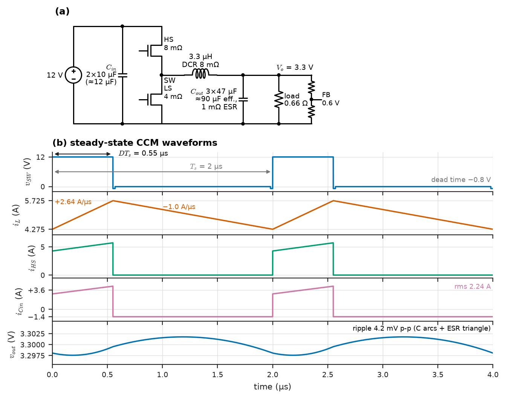
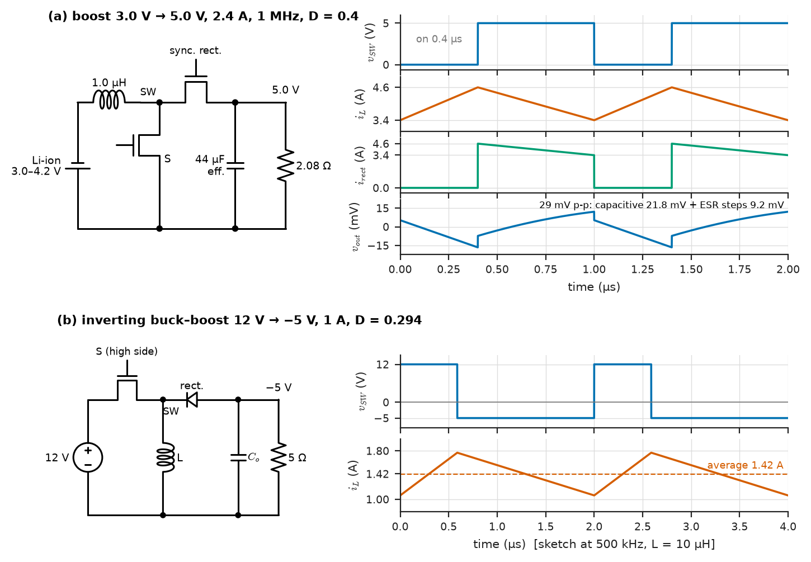
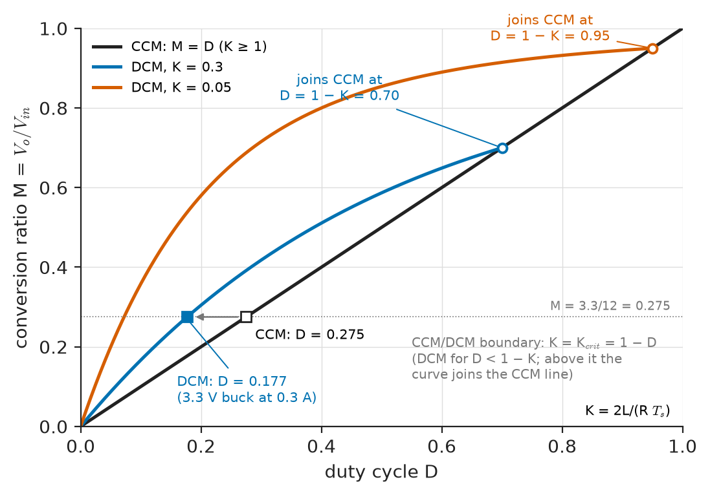
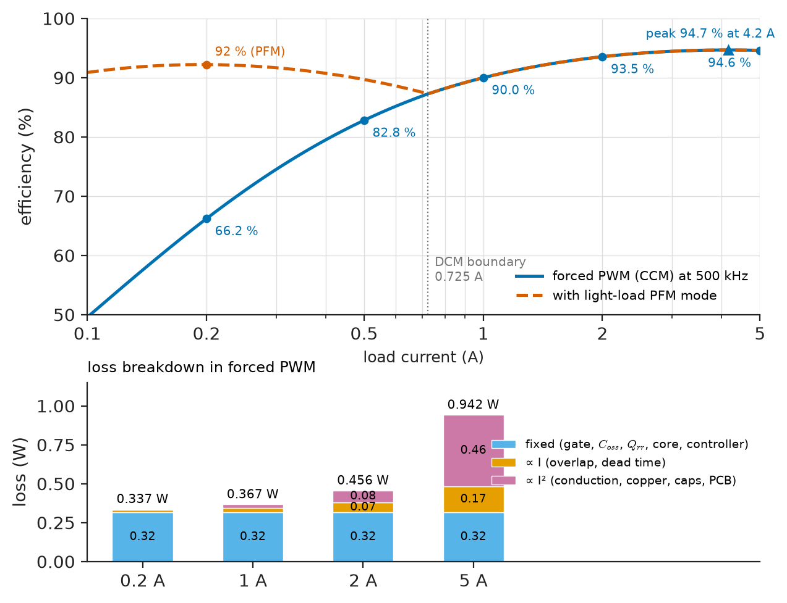
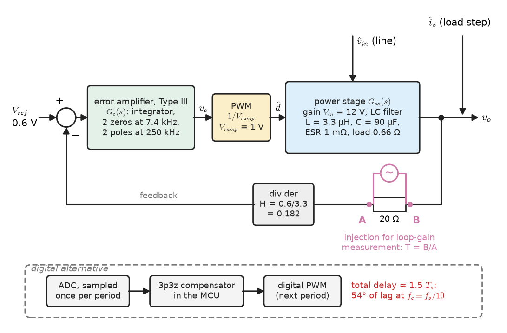
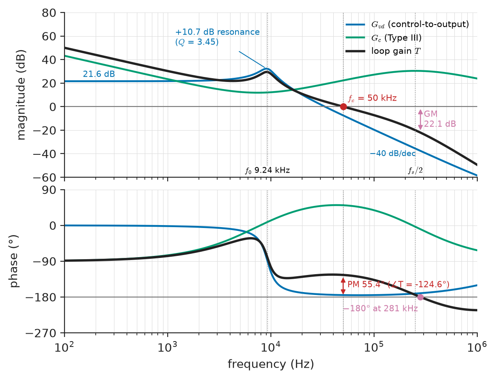

# Chapter 30 — DC–DC Converters

*Part VII · Power Electronics*

The 3.3 V rail of an industrial controller comes from a 12 V, 5 A synchronous buck converter switching at 500 kHz. On the bench it is 94.6 % efficient at full load and its ripple is a few millivolts. In the field three complaints arrive. In standby, with the board drawing 0.2 A, the converter wastes a third of a watt inside a sealed enclosure: its efficiency has fallen to 66 %. When the FPGA it feeds steps from 2.5 A to 5 A, the rail dips by more than 200 mV and the FPGA resets, because the ceramic output capacitors, 47 µF each on the label, keep only about two-thirds of that at 3.3 V of DC bias. And a sister board's boost converter, which makes 5 V from a lithium-ion cell, oscillates when the cell runs low, although it was stable on a full cell. Each complaint has a one-page explanation: fixed switching losses that do not scale with load, capacitance that depends on voltage, and a right-half-plane zero that moves with the operating point. This chapter designs the three basic converters with those explanations built in.

> **How do the buck, boost and buck–boost converters set their conversion ratios, what do their currents and voltages look like, and how are their inductors and capacitors sized for ripple, transients and efficiency?**
> **What changes at light load when the inductor current reaches zero, and what model of the converter does its feedback loop see?**

| Concept | Engineering destination |
|---|---|
| Buck converter | Point-of-load supplies for processors and FPGAs, LED drivers, battery chargers, 48 V to 12 V buses |
| Boost converter | Power-factor correction, PV and battery interfaces, single-cell to 5 V, LED backlights |
| Buck–boost converter | Negative rails, USB Power Delivery, battery-powered systems whose input spans the output |
| Continuous and discontinuous conduction | Light-load efficiency modes, conversion-ratio changes, simpler dynamics |
| Converter waveforms | Component stresses, probing and debugging on the bench |
| Inductor and capacitor sizing | Saturation current, ripple ratio, DC-bias derating, RMS current ratings |
| Ripple | Output and input ripple specifications, input filters and conducted emissions |
| Efficiency | Loss budgets, thermal design, light-load modes |
| Feedback control interface | Averaged small-signal models, compensators, crossover and phase margin, digital control |

**Roadmap.** The buck (30.1), boost (30.2) and buck–boost families (30.3) in continuous conduction → what changes in discontinuous conduction (30.4) → the waveforms that set component stresses (30.5) → inductor and capacitor sizing (30.6) and the ripple they leave (30.7) → the loss budget and efficiency across load (30.8) → the averaged model and the feedback loop (30.9).

> **Boundary.** *Engineering Physics*, [Ch. 18 §18.8](https://github.com/The-Studio-of-Sadiq/Engineering-Physics/blob/main/CHAPTERS/CHAPTER%2018.md), states the ideal conversion ratios $D$, $1/(1-D)$ and $-D/(1-D)$ and the switching-frequency trade-off. The inductor's constitutive law and a first buck-ripple calculation are in *Circuits, Signals and Communications*, [Ch. 5](https://github.com/The-Studio-of-Sadiq/Circuits-Signals-and-Communications/blob/main/part-1-circuit-fundamentals/05-capacitors-and-inductors.md); the output filter as a second-order circuit in [Ch. 7](https://github.com/The-Studio-of-Sadiq/Circuits-Signals-and-Communications/blob/main/part-2-transient-and-ac-analysis/07-second-order-circuits.md); Laplace, Bode and pole–zero methods in [Ch. 11](https://github.com/The-Studio-of-Sadiq/Circuits-Signals-and-Communications/blob/main/part-3-advanced-network-theory/11-laplace-domain-circuit-analysis.md) and [Ch. 13](https://github.com/The-Studio-of-Sadiq/Circuits-Signals-and-Communications/blob/main/part-3-advanced-network-theory/13-network-frequency-response.md); stability margins, loop shaping and digital control in [Ch. 34](https://github.com/The-Studio-of-Sadiq/Circuits-Signals-and-Communications/blob/main/part-7-control-system-fundamentals/34-feedback-and-stability.md) and [Ch. 35](https://github.com/The-Studio-of-Sadiq/Circuits-Signals-and-Communications/blob/main/part-7-control-system-fundamentals/35-control-design-fundamentals.md). Switch losses, gate drive and snubbers are from [Chapter 29](29-power-electronic-fundamentals.md).

---

## 30.1 Buck converter

### Operation and volt-second balance

The buck converter (Figure 30.1a) is the commutation cell of Chapter 29 with its switch node driving an inductor $L$ into an output capacitor $C$ and load. During the on-time $DT_s$ the high-side switch connects the switch node to $V_{in}$ and the inductor sees $V_{in}-V_o$; during the off-time $(1-D)T_s$ the low-side switch (or a freewheeling diode) connects it to ground and the inductor sees $-V_o$. In periodic steady state the inductor current returns to the same value at the end of each period, so the average inductor voltage over a period is zero (**volt-second balance**); likewise the average capacitor current is zero (**charge balance**). For the buck:

$$
(V_{in}-V_o)\,DT_s-V_o(1-D)T_s=0\quad\Rightarrow\quad V_o=DV_{in},\qquad I_{in}=DI_o
$$

> **Status of the principle: Volt-second and charge balance**
> *Derived.* Follows from $v=L\,di/dt$ and $i=C\,dv/dt$ integrated over one period in periodic steady state; it is exact for any waveform, and the familiar ratios follow once the switches and passive components are taken as lossless and the ripple as small compared with the DC values.

The peak-to-peak inductor ripple follows from the on-interval slope:

$$
\Delta I_L=\frac{(V_{in}-V_o)\,D}{f_sL}=\frac{V_o(1-D)}{f_sL}
$$

Book 3 [Ch. 5](https://github.com/The-Studio-of-Sadiq/Circuits-Signals-and-Communications/blob/main/part-1-circuit-fundamentals/05-capacitors-and-inductors.md) evaluated this for a 10 µH inductor; Section 30.6 chooses $L$ from it.

<!-- FIGURE 30.1 | figures/ch30/fig-30-1-buck-waveforms.png | waveform | (a) Synchronous buck converter, 12 V to 3.3 V at 5 A, 500 kHz; (b) its steady-state CCM waveforms over two switching periods. | Content: (a) circuit: 12 V input with Cin 2 x 10 uF (about 12 uF effective), high-side MOSFET 8 milliohm, low-side MOSFET 4 milliohm, switch node SW, inductor 3.3 uH (DCR 8 milliohm), Cout 3 x 47 uF ceramic (about 90 uF effective, 1 milliohm ESR), load 0.66 ohm, divider to 0.6 V reference. (b) time axis 0 to 4 us, five stacked panels: v_SW rectangle 0 to 12 V with on-time 0.55 us, small negative dead-time steps to -0.8 V; i_L triangle 4.275 to 5.725 A; i_HS pulses following i_L during on-time, zero otherwise; i_Cin from +3.6 A to -1.4 A (rms 2.23 A); v_out ripple about 4.2 mV p-p around 3.3 V showing the capacitive arcs plus the ESR triangle. Mark D Ts = 0.55 us, Ts = 2 us, slopes +2.64 A/us and -1.0 A/us. -->



*Figure 30.1 — (a) Synchronous buck converter, 12 V to 3.3 V at 5 A, 500 kHz; (b) its steady-state CCM waveforms over two switching periods.*

### Real switches and the duty cycle

With losses, the controller must supply a slightly larger duty cycle than $V_o/V_{in}$. Including the switch and inductor resistances, volt-second balance gives

$$
D\approx\frac{V_o+I_o\left(R_{LS}+R_L\right)}{V_{in}-I_o\left(R_{HS}-R_{LS}\right)}
$$

and with a freewheeling diode of drop $V_F$ instead of a low-side switch, $D\approx(V_o+V_F)/(V_{in}-V_{sw}+V_F)$. The difference between a diode and a synchronous switch is large at low output voltage. In the 12 V to 3.3 V, 5 A converter of the opening, a 0.45 V Schottky diode conducting for $1-D=72.5\ \%$ of the time dissipates $0.45\times5\times0.725=1.63$ W, against $0.725\times5^2\times5.2\ \mathrm{m\Omega}=0.09$ W for a 5 mΩ low-side MOSFET (5.2 mΩ hot). Below about 5 V of output, synchronous rectification is the norm; above about 24 V, or at a few hundred milliamperes, a diode is often cheaper and simpler.

### Where bucks are used

Bucks supply nearly every processor, memory and FPGA rail: a 12 V to 1.0 V, 200 A server CPU regulator is a buck with 8–12 **interleaved** phases, each switching at 400–800 kHz with its PWM shifted by $360^\circ/N$, so that the phase ripples partly cancel at $N$ times the switching frequency and the load current is shared. LED drivers are bucks regulating inductor current instead of output voltage; battery chargers are bucks with current and voltage loops (Chapter 32); and 48 V to 12 V intermediate-bus converters in data centres use multiphase bucks or their switched-capacitor hybrids.

---

## 30.2 Boost converter

### Operation and conversion ratio

The boost (Figure 30.2a) puts the inductor on the input side. With the switch on, the inductor is connected across $V_{in}$ and its current rises; with the switch off, the inductor current flows through the rectifier into the output at $V_o>V_{in}$, and it falls at a rate set by $V_o-V_{in}$. Volt-second balance gives

$$
V_{in}DT_s+(V_{in}-V_o)(1-D)T_s=0\quad\Rightarrow\quad V_o=\frac{V_{in}}{1-D},\qquad I_{in}=I_L=\frac{I_o}{1-D}
$$

The input current is continuous (it is the inductor current), which makes the boost the natural power-factor corrector (Chapter 31) and PV interface. The output current is pulsating: the output capacitor supplies the whole load during each on-time, so the boost needs more output capacitance than a buck of the same power (Section 30.7).

### Real gain and its limit

The ideal gain diverges as $D\to1$; real gain does not. With a total series resistance $R_L$ in the inductor path (inductor DCR plus switch resistance) and load resistance $R$, volt-second balance with the resistive drop gives

$$
\frac{V_o}{V_{in}}=\frac{1}{1-D}\cdot\frac{1}{1+\dfrac{R_L}{(1-D)^2R}},\qquad \left(\frac{V_o}{V_{in}}\right)_{max}=\frac{1}{2}\sqrt{\frac{R}{R_L}}\ \text{at}\ 1-D=\sqrt{\frac{R_L}{R}}
$$

For a single-cell lithium-ion to 5 V, 2.4 A boost ($R=2.08\ \Omega$) with $R_L=20$ mΩ, the gain peaks at 5.1 at $D=0.90$; beyond that, increasing $D$ *reduces* the output, which reverses the sign of the feedback loop and latches the converter at its duty limit. The efficiency from this conduction loss alone, $1/[1+R_L/((1-D)^2R)]$, is 97.4 % at $D=0.4$ but falls to 50 % at the gain peak. Practical boosts are designed for gains of 1.2–4; higher step-up ratios use coupled inductors, transformers or cascaded stages.

Two further properties shape boost designs. There is always a path from input to output through the inductor and rectifier, so a boost cannot limit the current into a shorted output; battery-powered boosts add a disconnect switch, which synchronous boost ICs with "true output disconnect" build into the rectifier MOSFET by switching its body connection. And the output responds to an increase in duty cycle by first *falling* (more time charging the inductor, less time delivering), a right-half-plane zero that limits the feedback loop (Section 30.9).

---

## 30.3 Buck–boost converter

### The inverting buck–boost

When the input range spans the output voltage, or a negative rail is needed, the inductor is placed between the switch node and ground (Figure 30.2b). With the switch on, the inductor charges from $V_{in}$; with it off, the inductor discharges through the rectifier into the output capacitor, whose polarity is therefore reversed:

$$
V_{in}D+V_o(1-D)=0\quad\Rightarrow\quad V_o=-\frac{D}{1-D}V_{in},\qquad I_L=I_{in}+\lvert I_o\rvert=\frac{\lvert I_o\rvert}{1-D}
$$

The price of the flexibility is stress: the switch and rectifier block $V_{in}+\lvert V_o\rvert$, and the inductor carries the sum of input and output currents. Making −5 V at 1 A from 12 V needs $D=5/17=0.294$, switches rated for 17 V plus overshoot, and an inductor carrying 1.42 A. Both input and output currents are pulsating, so both capacitors work hard.

<!-- FIGURE 30.2 | figures/ch30/fig-30-2-boost-buckboost.png | waveform | (a) Synchronous boost converter, 3.0 V to 5.0 V at 2.4 A, 1 MHz, and its waveforms; (b) inverting buck-boost, 12 V to -5 V at 1 A, and its switch-node and inductor waveforms. | Content: (a) circuit: input 3.0 to 4.2 V Li-ion cell, inductor 1.0 uH, low-side switch, synchronous rectifier to Cout 44 uF effective, load 2.08 ohm. Waveforms over 2 us at Vin = 3.0 V, D = 0.4: switch-node voltage 0 V during on-time 0.4 us, 5.0 V during off-time; inductor current triangle 3.4 to 4.6 A; rectifier current pulses 4.6 falling to 3.4 A during off-time, zero during on-time; output ripple about 22 mV p-p (capacitive) plus ESR steps of about 9 mV at the edges. (b) circuit: 12 V input, high-side switch, inductor to ground, rectifier to -5 V output. Waveforms: switch node between +12 V and -5 V, D = 0.294; inductor current average 1.42 A. -->



*Figure 30.2 — (a) Synchronous boost converter, 3.0 V to 5.0 V at 2.4 A, 1 MHz, and its waveforms; (b) inverting buck-boost, 12 V to -5 V at 1 A, and its switch-node and inductor waveforms.*

### Non-inverting relatives

Several topologies give the buck–boost's flexibility without the inversion:

- **SEPIC** and **Ćuk** converters add a second inductor and a coupling capacitor; the SEPIC gives a positive output with continuous input current (automotive supplies that must work from 6 V cranking to 18 V), the Ćuk an inverted output with both currents continuous.
- The **four-switch (non-inverting) buck–boost** places a buck leg and a boost leg around one inductor and runs as a buck, a boost, or in a blended mode near $V_{in}=V_o$. It is the standard USB Power Delivery source and sink converter, producing 5–20 V (up to 48 V with Extended Power Range) from a 2S to 4S battery at 95–97 % efficiency.
- The **flyback** replaces the inductor with a coupled inductor (a "transformer" that stores energy), adding galvanic isolation and a turns-ratio gain $V_o=\frac{N_s}{N_p}\frac{D}{1-D}V_{in}$. It dominates isolated supplies below about 100 W (phone chargers, auxiliary supplies); the energy in its leakage inductance is absorbed by the RCD clamp of Chapter 29 or recycled by an active clamp.

**Table 30.1 — The three basic converters in continuous conduction (ideal components).**

| Property | Buck | Boost | Inverting buck–boost |
|---|---|---|---|
| Conversion ratio $M=V_o/V_{in}$ | $D$ | $1/(1-D)$ | $-D/(1-D)$ |
| Switch and rectifier voltage | $V_{in}$ | $V_o$ | $V_{in}+\lvert V_o\rvert$ |
| Average inductor current | $I_o$ | $I_o/(1-D)$ | $\lvert I_o\rvert/(1-D)$ |
| Input current | Pulsating | Continuous | Pulsating |
| Output current into the capacitor | Continuous (triangular ripple) | Pulsating | Pulsating |
| Inductor ripple $\Delta I_L$ | $V_o(1-D)/(f_sL)$ | $V_{in}D/(f_sL)$ | $V_{in}D/(f_sL)$ |
| Critical $K_{crit}(D)$ | $1-D$ | $D(1-D)^2$ | $(1-D)^2$ |
| Small-signal control-to-output zero | LHP (capacitor ESR) | RHP and ESR | RHP and ESR |

---

## 30.4 Continuous and discontinuous conduction

### The boundary

With a diode rectifier, the inductor current cannot reverse. As the load falls, the average inductor current falls while the ripple $\Delta I_L$ stays the same, and when the valley reaches zero the converter enters **discontinuous conduction mode** (DCM): each period now has a third interval in which both switch and diode are off and the inductor current is zero. The boundary is where the average inductor current equals half the ripple. It is conveniently expressed with the dimensionless parameter

$$
K=\frac{2L}{RT_s}
$$

The converter is in continuous conduction (CCM) when $K>K_{crit}(D)$, with $K_{crit}$ given in Table 30.1. For the 3.3 V buck ($L=3.3$ µH, $f_s=500$ kHz, $\Delta I_L=1.45$ A) the boundary load is $I_{o,b}=\Delta I_L/2=0.725$ A; for the single-cell boost of Section 30.2 at $V_{in}=3$ V ($L=1$ µH, 1 MHz, $\Delta I_L=1.2$ A), $K=0.96$ against $K_{crit}=0.144$ at full load, and the boundary is reached at $I_o=\tfrac12\Delta I_L(1-D)=0.36$ A.

### The conversion ratio in DCM

In DCM the inductor current starts each period from zero, and the conversion ratio depends on load as well as duty cycle. Applying volt-second balance to the three intervals, and charge balance at the output, gives for the three converters:

$$
M_{buck}=\frac{2}{1+\sqrt{1+4K/D^2}},\qquad M_{boost}=\frac{1+\sqrt{1+4D^2/K}}{2},\qquad M_{buck\text{–}boost}=-\frac{D}{\sqrt K}
$$

> **Status of the principle: DCM conversion ratios**
> *Derived.* Follow from volt-second and charge balance with an inductor current that starts and ends each period at zero, for ideal switches and small output ripple; they hold only for $K<K_{crit}(D)$, and ringing of the inductor with the switch capacitances during the idle interval, ignored here, perturbs the light-load ratio slightly.

**Worked example — the 3.3 V buck at 0.3 A with a diode rectifier.** If the converter of the opening used diode emulation (the low-side switch turned off when its current reaches zero), then at 0.3 A the load resistance is $3.3/0.3=11\ \Omega$ and $K=2\times3.3\ \mu\mathrm{H}\times500\ \mathrm{kHz}/11=0.30$, below $K_{crit}=1-0.275=0.725$: the converter is in DCM. Inverting the DCM buck ratio, the duty cycle needed for $M=0.275$ is $D=M\sqrt{K/(1-M)}=0.275\sqrt{0.30/0.725}=0.177$, not 0.275. The feedback loop finds it automatically, but the plant it controls has changed (Section 30.9).

Figure 30.3 shows how the buck's conversion ratio departs from $M=D$ as $K$ falls.

<!-- FIGURE 30.3 | figures/ch30/fig-30-3-ccm-dcm-ratio.png | plot | Buck conversion ratio versus duty cycle in continuous and discontinuous conduction for several values of K = 2L/(R Ts). | Content: x-axis duty cycle D 0 to 1, y-axis M = Vo/Vin 0 to 1. Straight line M = D labelled CCM (K at least 1). DCM curves M = 2/(1 + sqrt(1 + 4K/D^2)) for K = 0.05 and K = 0.3, each joining the CCM line at D = 1 - K (D = 0.95 and D = 0.7). Dashed boundary curve where K = 1 - D. Mark design point: D = 0.177, M = 0.275 on the K = 0.3 curve (3.3 V buck at 0.3 A), and the CCM point D = 0.275, M = 0.275. -->



*Figure 30.3 — Buck conversion ratio versus duty cycle in continuous and discontinuous conduction for several values of K = 2L/(R Ts).*

### Forced CCM, DCM and light-load modes

A synchronous converter can avoid DCM entirely: in **forced CCM** the low-side switch stays on even when the inductor current reverses, so $M=D$ at every load and the dynamics never change, but the ripple current circulates at zero load and the frequency-proportional losses remain (Section 30.8). Most controllers instead offer **diode emulation** (DCM) at light load, and below that **pulse-frequency modulation** or **burst mode**: the converter delivers a few pulses at full ripple amplitude and then idles, so that switching losses scale with load. The cost is variable-frequency ripple and noise, sometimes audible, which is why audio, RF and measurement equipment often specify forced CCM.

DCM is also used deliberately: boundary-conduction (critical-conduction) PFC stages up to a few hundred watts and flybacks in phone chargers run at the CCM/DCM boundary to turn their switches on at zero current, and a DCM converter has a simpler small-signal model because the inductor current no longer carries information from one period to the next.

---

## 30.5 Converter waveforms

### The buck in CCM

Figure 30.1 shows the steady-state waveforms of the 12 V to 3.3 V, 5 A buck at 500 kHz, $T_s=2$ µs, $DT_s=0.55$ µs:

- **Switch node** $v_{sw}$: a rectangle between 12 V and about −0.05 V (the low-side MOSFET's $I\,R_{DS(on)}$ drop), with two short excursions to about −0.8 V during the dead times when the body diode conducts, and ringing at the edges from the commutation-loop inductance (Chapter 29, §29.7).
- **Inductor current** $i_L$: a triangle between 4.275 A and 5.725 A, rising at $(12-3.3)/3.3\ \mu\mathrm{H}=2.64$ A/µs and falling at $3.3/3.3\ \mu\mathrm{H}=1.0$ A/µs.
- **High-side switch current**: the rising part of $i_L$ during $DT_s$, zero otherwise; it is the pulsating input current that the input capacitor must supply.
- **Input capacitor current**: $i_{HS}-I_{in}$, about +3.6 A during the on-time and −1.4 A during the off-time, with an RMS value of $I_o\sqrt{D(1-D)}=2.23$ A.
- **Output capacitor current**: $i_L-I_o$, a triangle of ±0.725 A.
- **Output ripple**: the integral of the capacitor current (a train of parabolic arcs), plus the ESR drop (a triangle in phase with $i_L$), plus spikes at the switching edges.

### The boost and buck–boost

In the boost the roles reverse: the input capacitor sees only the inductor ripple, while the output capacitor sees the rectifier's current pulses, from 0 to $I_{L,pk}$, every period. In the single-cell boost of Section 30.2 at $V_{in}=3$ V, the inductor current runs between 3.4 A and 4.6 A, the switch node swings between 0 and 5 V, and the output capacitor must absorb pulses up to 4.6 A while the load draws a steady 2.4 A. In the buck–boost both capacitors see pulses, and the switch node swings from $V_{in}$ to $V_o$ (negative).

### Measuring the waveforms

Converter waveforms are easy to mismeasure. A passive probe with its 15 cm ground lead forms a loop that picks up the switch node's $dv/dt$ and the inductor's field, adding tens of millivolts of spurious "ripple"; output ripple is measured with the probe tip and barrel pressed directly across the output capacitor (or with a 50 Ω coaxial pickoff), usually with the 20 MHz bandwidth limit that ripple specifications assume. The switch node of a high-side switch is measured with a high-voltage differential or optically isolated probe, whose common-mode rejection at the edge frequencies matters more than its bandwidth. Inductor current is measured with a current probe on a short wire loop inserted for the purpose, which adds inductance to whatever loop it is placed in.

---

## 30.6 Inductor and capacitor sizing

### The inductor

The inductor is chosen in four steps.

1. **Ripple ratio.** Choose the peak-to-peak ripple as a fraction $r=\Delta I_L/I_L$ of the average inductor current, typically 0.2–0.4. A smaller $r$ means a larger, slower inductor with lower RMS and core losses; a larger $r$ means a smaller inductor, faster transient response, more output ripple and an earlier entry into DCM. For a buck, size at maximum input voltage, where the ripple is largest; for a boost, the ripple $V_{in}D/(f_sL)$ peaks at $D=0.5$.
2. **Inductance.** From the ripple equation, $L=V_o(1-D)/(f_s\,r\,I_o)$ for a buck.
3. **Saturation current.** The core must not saturate at the highest peak current, which is set not by the normal peak $I_L+\Delta I_L/2$ but by the controller's current limit during start-up, overload and load steps. Ferrite cores saturate abruptly; powder-iron and metal-composite cores (molded power inductors) saturate gradually and tolerate brief overloads.
4. **Loss.** Copper loss $I_{rms}^2R_{DC}$ plus core loss from the manufacturer's calculator (Chapter 29, §29.9), within the inductor's temperature-rise rating.

**Worked example — the 3.3 V, 5 A buck.** At $V_{in}=12$ V, $D=0.275$, $f_s=500$ kHz and $r=0.3$: $L=3.3\times0.725/(500\ \mathrm{kHz}\times0.3\times5)=3.19$ µH. With the standard value of 3.3 µH, $\Delta I_L=1.45$ A, the peak is 5.725 A, and the RMS current $\sqrt{I_o^2+\Delta I_L^2/12}=5.02$ A, barely above the DC value. With a current limit at 7 A, choose a molded inductor rated at least 8 A saturation and 6 A for 40 K rise, with about 8 mΩ DCR: a 5 × 5 mm or 7 × 7 mm part.

### The output capacitor

The output capacitor must satisfy three requirements, and the largest of the three sets its value.

- **Ripple** (Section 30.7): for a buck, $\Delta V_C\approx\Delta I_L/(8f_sC)$ plus $\Delta I_L\,R_{ESR}$.
- **Load transient**: after a load step $\Delta I$, the capacitor supplies the difference until the loop responds, roughly within $1/(2\pi f_c)$ for a loop crossover $f_c$, giving $\Delta V\approx\Delta I/(2\pi f_cC)$; and the inductor's slew rate ($V_o/L$ for an unloading step) limits how fast the converter can respond at all.
- **Stability**: the capacitor and its ESR set the output filter's double pole and ESR zero (Section 30.9).

**Table 30.2 — Output-capacitor technologies (typical values).**

| Type | Typical value per part | ESR | Notes |
|---|---|---|---|
| Multilayer ceramic, X5R/X7R | 10–100 µF at 4–25 V | 1–5 mΩ | Loses 30–70 % of capacitance at rated DC bias; piezoelectric "singing" |
| Polymer aluminium or tantalum | 100–1,000 µF at 2.5–25 V | 5–30 mΩ | Stable capacitance; bulk energy for load steps |
| Aluminium electrolytic | 100 µF–10 mF | 20–500 mΩ | Cheap bulk; life halves per 10 K rise (Section 30.8) |
| Film (polypropylene) | 1–100 µF at 250–1,000 V | 2–10 mΩ | DC links, high-voltage outputs; very long life |

DC-bias derating is the trap of the opening. A 47 µF, 6.3 V X5R capacitor in a 1206 case may retain only 25–35 µF at 3.3 V, and a 22 µF, 6.3 V part in 0805 may retain less than half; the manufacturer's bias curve, not the nominal value, goes into the calculation.

**Worked example — output capacitance for a 2.5 A load step.** The FPGA rail must stay within ±3 % (99 mV) for a step from 2.5 A to 5 A. With a loop crossover of 50 kHz (a tenth of $f_s$), the needed effective capacitance is $C\ge2.5/(2\pi\times50\ \mathrm{kHz}\times0.099)=80$ µF. Three 47 µF ceramics that retain about 30 µF each at 3.3 V give 90 µF, for a dip of $2.5/(2\pi\times50\ \mathrm{kHz}\times90\ \mu\mathrm{F})=88$ mV. The original design used two of them, assuming 94 µF nominal; with the 60 µF actually present the dip is about 130 mV, and with the slower loop the converter actually had, more than 200 mV.

### The input capacitor

The input capacitor of a buck carries the pulsating switch current minus its average. Its RMS current $I_o\sqrt{D(1-D)}$ is largest at $D=0.5$ ($I_o/2$) and is 2.23 A in the example; ceramics handle it easily, while an electrolytic must be chosen by its ripple-current rating. The input voltage ripple is $\Delta V_{in}\approx I_oD(1-D)/(f_sC_{in})$: 0.17 V with 12 µF effective. The input capacitor also closes the high-frequency commutation loop of Chapter 29, so a small ceramic (100 nF to 1 µF) sits directly at the switch pins regardless of the bulk capacitance.

---

## 30.7 Ripple

### Output ripple and its three parts

The output ripple of a buck is the sum of three terms that peak at different instants:

$$
\Delta V_o\approx\frac{\Delta I_L}{8f_sC}+\Delta I_L\,R_{ESR}+L_{ESL}\frac{\Delta I_L}{(1-D)T_s}
$$

The capacitive term assumes all the ripple current flows into an ideal capacitor and the load takes the DC; the ESR term is a triangle in phase with the inductor current; the ESL term is a small step at each slope change. For the example, $1.45/(8\times500\ \mathrm{kHz}\times90\ \mu\mathrm{F})=4.0$ mV and $1.45\times1\ \mathrm{m\Omega}=1.45$ mV. The two do not simply add, because the capacitive arcs peak midway through each slope while the ESR triangle peaks at its ends; the combined waveform is 4.2 mV peak to peak. With electrolytic capacitors the ESR term dominates by an order of magnitude; with ceramics the capacitive term dominates. What usually exceeds both on the oscilloscope are the high-frequency spikes coupled from the switch-node edges, which are reduced by layout and by a small ferrite-bead or LC post-filter, not by more bulk capacitance.

> **Status of the principle: Linear-ripple approximation**
> *Approximate.* Treats the inductor current as an exact triangle (constant voltages across $L$ during each interval) and the output voltage as constant when computing that current; valid when the ripple is a few percent of the DC values, which is the design intent, and it fails in DCM, during transients, and when the capacitor's impedance is not dominated by one of $C$, ESR or ESL at the switching frequency.

For the boost, the output capacitor supplies the full load during each on-time, so the capacitive ripple is $\Delta V\approx I_oD/(f_sC)$, and the ESR term sees the full rectifier pulse, $I_{L,pk}R_{ESR}$. In the single-cell boost ($I_o=2.4$ A, $D=0.4$, 1 MHz, 44 µF effective, 2 mΩ) these are $2.4\times0.4/(1\ \mathrm{MHz}\times44\ \mu\mathrm{F})=21.8$ mV and $4.6\times2\ \mathrm{m\Omega}=9.2$ mV, several times the buck's despite the higher frequency.

### Input ripple, input filters and negative resistance

The pulsating input current of a buck is the converter's main source of conducted emissions. Meeting CISPR 32 or CISPR 25 limits usually needs an input filter, a series inductor or ferrite bead with additional capacitance, giving a second-order attenuation of 40 dB/decade above its resonance. The filter brings a stability trap first identified by R. D. Middlebrook. A regulated converter draws constant power, so its incremental input resistance is negative:

$$
r_{in}=\frac{dv_{in}}{di_{in}}=-\frac{V_{in}^2}{P_{in}}
$$

For the 3.3 V buck at full load, $P_{in}=16.5/0.946=17.4$ W and $r_{in}=-144/17.4=-8.3\ \Omega$. If the input filter's output impedance near its resonance approaches 8.3 Ω, filter and converter together form an oscillator. The rule is to damp the filter (an electrolytic with suitable ESR across the filter capacitor, or an RC damping branch) so that its peak output impedance stays well below $\lvert r_{in}\rvert$ at the lowest input voltage and highest load. The same mechanism makes cascaded converters on a DC bus (a 48 V bus feeding many point-of-load bucks) a stability problem at system level.

Spread-spectrum modulation of the switching frequency (dithering by ±5–10 %) lowers the peak emission in a measurement bandwidth by spreading each harmonic, a common addition in automotive converters.

---

## 30.8 Efficiency

### The loss budget

Combining the loss mechanisms of Chapter 29 with the inductor, capacitor and controller losses gives the converter's loss budget. The listing evaluates it for the 3.3 V, 5 A buck with representative parts: a 30 V high-side MOSFET of 8 mΩ (10.5 mΩ hot) with 3 nC of switching charge, a 4 mΩ (5.2 mΩ hot) low-side MOSFET with 15 nC of body-diode $Q_{rr}$, 20 ns dead times, 26 nC of total gate charge at 5 V, the 3.3 µH inductor with 8 mΩ DCR and 0.1 W of core loss, and the controller's 2 mA quiescent current.

```python
import math
# 12 V -> 3.3 V, 5 A synchronous buck at 500 kHz
Vin, Vo, Io, f = 12.0, 3.3, 5.0, 500e3
D = Vo / Vin
L = 3.3e-6                                   # chosen from r = 0.3 -> 3.19 uH
dI = (Vin - Vo) * D / (f * L)                # inductor ripple, p-p
C_out, esr = 90e-6, 1e-3                     # effective at 3.3 V bias
print(f"D = {D:.3f}, dI = {dI:.2f} A, Ipk = {Io + dI/2:.3f} A")
print(f"ripple: C {dI/(8*f*C_out)*1e3:.1f} mV + ESR {dI*esr*1e3:.2f} mV")
print(f"Cin rms current {Io*math.sqrt(D*(1-D)):.2f} A")

def losses(I):
    """Loss budget (W) at load I; parts at Tj ~ 100 C."""
    i2 = I**2 + dI**2/12                     # inductor I_rms^2
    i_v, i_p = I - dI/2, I + dI/2            # valley and peak current
    return {
        "HS conduction": D * i2 * 10.5e-3,
        "LS conduction": (1 - D) * i2 * 5.2e-3,
        "HS overlap":    0.5*Vin*(max(i_v, 0)*3.75e-9 + i_p*2.31e-9)*f,
        "Coss":          0.5 * 1.0e-9 * Vin**2 * f,
        "dead time":     0.8 * (abs(i_v) + i_p) * 20e-9 * f,
        "LS Qrr":        15e-9 * Vin * f,
        "gate drive":    26e-9 * 5.0 * f,
        "L copper":      i2 * 8e-3,
        "L core":        0.10,
        "caps + PCB":    (I*math.sqrt(D*(1-D)))**2 * 3e-3 + i2 * 3e-3,
        "controller":    Vin * 2e-3,
    }

for k, v in losses(Io).items():
    print(f"  {k:14s} {v*1e3:6.1f} mW")
for I in (0.2, 0.5, 1, 2, 5):
    p = sum(losses(I).values())
    print(f"Io = {I:3.1f} A: loss {p:.3f} W, efficiency {Vo*I/(Vo*I + p)*100:.1f} %")
```

```text
D = 0.275, dI = 1.45 A, Ipk = 5.725 A
ripple: C 4.0 mV + ESR 1.45 mV
Cin rms current 2.23 A
  HS conduction    72.7 mW
  LS conduction    94.9 mW
  HS overlap       87.8 mW
  Coss             36.0 mW
  dead time        80.0 mW
  LS Qrr           90.0 mW
  gate drive       65.0 mW
  L copper        201.4 mW
  L core          100.0 mW
  caps + PCB       90.5 mW
  controller       24.0 mW
Io = 0.2 A: loss 0.337 W, efficiency 66.2 %
Io = 0.5 A: loss 0.343 W, efficiency 82.8 %
Io = 1.0 A: loss 0.367 W, efficiency 90.0 %
Io = 2.0 A: loss 0.456 W, efficiency 93.5 %
Io = 5.0 A: loss 0.942 W, efficiency 94.6 %
```

The 0.94 W total at full load gives 94.6 % efficiency. The largest single loss is the inductor's copper (0.20 W), and the MOSFET conduction losses together (0.17 W) are smaller than the switching-related ones (overlap, $C_{oss}$, dead time, $Q_{rr}$ and gate drive: 0.36 W). This is typical of low-voltage converters at 0.5–1 MHz, and it is the reason for the integrated power stages (driver and both MOSFETs in one package, with a few nanohenries of loop inductance and 5–10 ns of dead time) used in server and graphics regulators.

### Efficiency across load

The loss budget splits into three parts with different load dependence: losses proportional to $I^2$ (conduction, copper), roughly proportional to $I$ (overlap, dead time), and independent of load at fixed frequency (gate drive, $C_{oss}$, $Q_{rr}$, core loss, controller). The fixed part, about 0.32 W here, sets the light-load efficiency: at 0.2 A the converter delivers 0.66 W and loses 0.34 W, the 66 % of the opening. Efficiency peaks where the load-dependent and fixed losses are comparable, typically at 30–60 % of rated load (Figure 30.4), and falls at both ends.

**Worked example — what a light-load mode recovers.** At 0.2 A, about 0.31 W of the 0.34 W loss is proportional to switching frequency. A controller that switches to pulse-frequency modulation, cutting the effective switching rate tenfold at this load, reduces that part to about 31 mW; with the 24 mW controller and a few milliwatts of conduction, the efficiency rises to roughly $0.66/(0.66+0.031+0.024+0.005)=92\ \%$. The 0.3 W saved inside a sealed enclosure, multiplied across a building's worth of controllers in standby, is why light-load efficiency is regulated in external power supplies (US DOE Level VI, EU Ecodesign) and specified for most battery-powered products.

<!-- FIGURE 30.4 | figures/ch30/fig-30-4-efficiency-vs-load.png | plot | Efficiency and loss breakdown of the 12 V to 3.3 V, 5 A buck versus load, in forced PWM and with a light-load PFM mode. | Content: upper panel: x-axis load current 0.1 to 5 A (log scale), y-axis efficiency 50 to 100 percent. Forced-PWM curve through 66.2 percent at 0.2 A, 82.8 at 0.5 A, 90.0 at 1 A, 93.5 at 2 A, 94.6 at 5 A (peak near 3 to 4 A at about 94.7 percent). PFM curve dashed, about 92 percent at 0.2 A, merging with PWM above the 0.725 A DCM boundary (marked). Lower panel: stacked bars at 0.2, 1, 2 and 5 A of loss split into fixed (gate, Coss, Qrr, core, controller), proportional to I (overlap, dead time) and proportional to I squared (conduction, copper, capacitor and PCB). At 5 A: total 0.942 W. -->



*Figure 30.4 — Efficiency and loss breakdown of the 12 V to 3.3 V, 5 A buck versus load, in forced PWM and with a light-load PFM mode.*

### Losses outside the loss budget

The capacitors' ESR losses are small but heat the capacitors themselves, and capacitor life sets converter life. Aluminium electrolytic capacitors are the usual limit: their electrolyte evaporates at a rate that roughly doubles for every 10 K rise in core temperature, so a capacitor rated 5,000 h at 105 °C lasts about 40,000 h at 75 °C. Ceramic and film capacitors have no such wear-out mechanism, which is one reason modern converters use them wherever their values suffice.

> **Status of the principle: The 10 °C rule for electrolytic-capacitor life**
> *Empirical.* An Arrhenius-type fit to manufacturer life tests, valid between roughly 40 °C and the rated temperature; ripple current adds self-heating that must be included in the core temperature, and at low temperatures other mechanisms (seal ageing, vibration, voltage stress) dominate.

---

## 30.9 Feedback control interface

### The control loop of a converter

A converter's output must stay regulated against changes in input voltage, load and component values. A controller measures the output through a divider, compares it with a reference, and adjusts the duty cycle through a pulse-width modulator (Figure 30.5). Four control architectures are common:

- **Voltage mode**: an error amplifier with a compensation network drives a comparator against a fixed sawtooth ramp of amplitude $V_{ramp}$; the modulator gain is $1/V_{ramp}$, often made proportional to $V_{in}$ (input feedforward) so that loop gain does not vary with input voltage.
- **Peak current mode**: an inner loop turns the switch off when the inductor current reaches a level set by the outer voltage loop. The inductor then behaves as a current source, removing the output filter's double pole from the voltage loop, and the converter gains cycle-by-cycle current limiting. Above $D=0.5$ the inner loop shows subharmonic oscillation unless a compensating ramp of at least half the inductor's down-slope is added.
- **Average current mode**, used in PFC and battery chargers, where the inductor current is the controlled quantity.
- **Hysteretic and constant-on-time control**, used in processor regulators for their fast response, at the cost of variable frequency.

<!-- FIGURE 30.5 | figures/ch30/fig-30-5-control-block-diagram.png | block-diagram | Voltage-mode feedback loop of the buck converter with its averaged small-signal blocks. | Content: signal path left to right: reference 0.6 V into summing junction; error amplifier with Type III compensation network Gc(s) (integrator, two zeros at 7.4 kHz, two poles at 250 kHz); PWM modulator with gain 1/Vramp (Vramp = 1 V); power stage with gain Vin = 12 V and output filter L = 3.3 uH, C = 90 uF, ESR 1 milliohm, load 0.66 ohm, transfer function Gvd(s); output vo; feedback divider H = 0.6/3.3 = 0.182 back to summing junction. Disturbance inputs: input voltage vin into power stage, load current step io into output node. Injection point for loop-gain measurement: 20 ohm resistor in the feedback path with signal source and two analyser channels A and B across it. Below, a dashed alternative path labelled digital: ADC sampled once per period, 3p3z compensator in the MCU, digital PWM, with total delay 1.5 Ts. -->



*Figure 30.5 — Voltage-mode feedback loop of the buck converter with its averaged small-signal blocks.*

### The averaged small-signal model

The converter's state variables (inductor current, capacitor voltage) move slowly compared with the switching period, so the switches can be replaced by their averages over one period, and the resulting nonlinear averaged model linearised around the operating point (state-space averaging, or the averaged PWM-switch model). The linearisation, Laplace transformation and Bode analysis are the methods of Book 3 ([Ch. 33](https://github.com/The-Studio-of-Sadiq/Circuits-Signals-and-Communications/blob/main/part-7-control-system-fundamentals/33-dynamic-system-modeling.md), [Ch. 11](https://github.com/The-Studio-of-Sadiq/Circuits-Signals-and-Communications/blob/main/part-3-advanced-network-theory/11-laplace-domain-circuit-analysis.md), [Ch. 13](https://github.com/The-Studio-of-Sadiq/Circuits-Signals-and-Communications/blob/main/part-3-advanced-network-theory/13-network-frequency-response.md)); the results for duty-cycle control in CCM are:

$$
G_{vd,buck}(s)=\frac{\hat v_o}{\hat d}=V_{in}\,\frac{1+sR_{ESR}C}{1+s\left(\dfrac{L}{R}+R_{ESR}C\right)+s^2LC}
$$

$$
G_{vd,boost}(s)=\frac{V_o}{1-D}\cdot\frac{\left(1-s\dfrac{L}{(1-D)^2R}\right)\left(1+sR_{ESR}C\right)}{1+s\dfrac{L}{(1-D)^2R}+s^2\dfrac{LC}{(1-D)^2}}
$$

The buck's control-to-output response is the output LC filter driven by an amplifier of gain $V_{in}$: a double pole at $f_0=1/(2\pi\sqrt{LC})$ with quality factor $Q\approx R\sqrt{C/L}$, a $-180^\circ$ phase drop around it, and a left-half-plane ESR zero. The boost has the same structure with an effective inductance $L/(1-D)^2$, so its resonance moves with operating point, and a **right-half-plane zero** at

$$
f_{RHPZ}=\frac{R(1-D)^2}{2\pi L}
$$

which adds gain like a zero but phase lag like a pole: the mathematical form of the boost's initial wrong-way response (Section 30.2). In peak current mode the buck's control-to-output response reduces to a single pole near $1/(2\pi RC)$ (2.7 kHz for the example) with a double pole at $f_s/2$ from the sampling action of the current loop; the boost's RHP zero remains in every control mode.

> **Status of the principle: Averaged small-signal converter model**
> *Approximate.* Valid for small perturbations about a CCM operating point at frequencies well below the switching frequency, about $f_s/5$ or less; it misses the sampling effects near $f_s/2$ (subharmonic oscillation in current mode), the change of structure in DCM (where the inductor pole moves near $f_s$ and the response becomes first-order), and large-signal effects such as duty-cycle saturation during big transients.

### Compensation and crossover

The compensator shapes the loop gain $T(s)=G_c(s)\,G_{vd}(s)\,H/V_{ramp}$ by the loop-shaping rules of Book 3 [Ch. 35 §35.4](https://github.com/The-Studio-of-Sadiq/Circuits-Signals-and-Communications/blob/main/part-7-control-system-fundamentals/35-control-design-fundamentals.md): an integrator for zero steady-state error, crossover at the desired speed with enough phase margin (45–70° for SMPS voltage loops, Book 3 Table 35.5) and roll-off above it. Three practical constraints set the crossover frequency $f_c$:

- **Switching frequency**: $f_c\le f_s/10$ to $f_s/5$, where the averaged model is valid and the switching ripple is attenuated before reaching the modulator.
- **Right-half-plane zero**: $f_c\le f_{RHPZ}/5$ for boost and buck–boost, at the worst-case (lowest) $f_{RHPZ}$, which occurs at minimum input voltage and maximum load.
- **The LC double pole** in voltage mode: crossing above $f_0$ requires two compensator zeros to recover the 180° lost, the **Type III** compensator (an integrator, two zeros near $f_0$ and two poles at or above the ESR zero or $f_s/2$); with a large ESR zero below $f_c$ (electrolytic output capacitors), the simpler **Type II** (integrator, one zero, one pole) suffices, and it is also the standard compensator for current mode.

**Worked example — Type III compensation of the 3.3 V buck.** The plant has $V_{in}=12$ V, $V_{ramp}=1$ V, $L=3.3$ µH, $C=90$ µF effective with 1 mΩ ESR (zero at 1.77 MHz, useless), full load $R=0.66\ \Omega$, and a divider $H=0.6/3.3$. The double pole is at $f_0=9.24$ kHz with $Q=3.45$. Target $f_c=50$ kHz, a tenth of $f_s$. Place both compensator zeros at $0.8f_0=7.4$ kHz and both high-frequency poles at $f_s/2=250$ kHz, then set the integrator gain for unity loop gain at 50 kHz:

```python
import numpy as np
# Voltage-mode buck: 12 V -> 3.3 V, 5 A, 500 kHz, L = 3.3 uH, C = 90 uF, ESR 1 mOhm
Vin, Vramp, L, C, esr, R = 12.0, 1.0, 3.3e-6, 90e-6, 1e-3, 0.66
H = 0.6/3.3                                   # divider to a 0.6 V reference
fsw, fc = 500e3, 50e3
f0 = 1/(2*np.pi*np.sqrt(L*C))
s = lambda f: 2j*np.pi*f
def Gvd(f):                                   # averaged control-to-output
    x = s(f)
    return Vin*(1 + x*C*esr)/(1 + x*(L/R + C*esr) + x**2*L*C)
# Type III: integrator, two zeros near f0, two poles at fsw/2
fz1, fz2, fp1, fp2 = 0.8*f0, 0.8*f0, fsw/2, fsw/2
def Gc(f, k=1.0):
    x = s(f)
    return k*(1 + x/(2*np.pi*fz1))*(1 + x/(2*np.pi*fz2)) / (
        x*(1 + x/(2*np.pi*fp1))*(1 + x/(2*np.pi*fp2)))
T1 = lambda f, k=1.0: Gc(f, k)*Gvd(f)*H/Vramp
k = 1/abs(T1(fc))                             # set crossover at fc
f = np.logspace(2, 6, 4001)
T = T1(f, k)
ic = np.argmin(abs(abs(T) - 1)); pm = 180 + np.degrees(np.angle(T[ic]))
ph = np.unwrap(np.angle(T)); i180 = np.argmin(abs(ph + np.pi))
print(f"f0 = {f0/1e3:.2f} kHz, Q = {R*np.sqrt(C/L):.2f}, k = {k:.4g}")
print(f"crossover {f[ic]/1e3:.1f} kHz, PM {pm:.1f} deg, "
      f"GM {-20*np.log10(abs(T[i180])):.1f} dB at {f[i180]/1e3:.0f} kHz")
# extra phase lag of a digital loop with 1.5 Ts total delay sampled at fsw
print(f"digital delay lag at fc: {360*1.5*fc/fsw:.0f} deg")
```

```text
f0 = 9.24 kHz, Q = 3.45, k = 9.07e+04
crossover 50.0 kHz, PM 55.4 deg, GM 22.1 dB at 281 kHz
digital delay lag at fc: 54 deg
```

The loop crosses at 50 kHz with 55° of phase margin and 22 dB of gain margin, inside the SMPS targets, and the load-step estimate of Section 30.6 (88 mV for a 2.5 A step) assumed exactly this crossover. At light load the double pole's $Q$ rises (the load no longer damps it), which an analog Type III tolerates because the gain near $f_0$ is well above unity. Figure 30.6 shows the plant, compensator and loop gain.

<!-- FIGURE 30.6 | figures/ch30/fig-30-6-loop-bode.png | plot | Bode plots of the buck's control-to-output response, the Type III compensator and the loop gain, with crossover and margins marked. | Content: x-axis 100 Hz to 1 MHz log scale. Magnitude panel -60 to +80 dB: Gvd (21.6 dB flat, resonant peak of about 11 dB near 9.24 kHz, then -40 dB/decade); Gc (integrator -20 dB/decade, flattening after two zeros at 7.4 kHz, rising +20 dB/decade, flattening again after poles at 250 kHz); loop gain T crossing 0 dB at 50 kHz. Phase panel -270 to +90 degrees: Gvd dropping from 0 to -180 degrees around 9.24 kHz; T phase at crossover -124.6 degrees (PM 55.4 degrees) and crossing -180 degrees at 281 kHz where gain margin is 22.1 dB. Mark f0, fc, fsw/2. -->



*Figure 30.6 — Bode plots of the buck's control-to-output response, the Type III compensator and the loop gain, with crossover and margins marked.*

**Worked example — why the low-battery boost oscillates.** The single-cell boost of Section 30.2 ($L=1$ µH, $R=2.08\ \Omega$) has its RHP zero at $f_{RHPZ}=2.08\times0.6^2/(2\pi\times1\ \mu\mathrm{H})=119$ kHz at $V_{in}=3.0$ V, but at 234 kHz on a full cell ($V_{in}=4.2$ V, $D=0.16$). A loop designed on a full cell with 40 kHz crossover has margin to spare there; at 3.0 V the zero has moved to three times the crossover, contributing $\tan^{-1}(40/119)=19^\circ$ of extra lag, and the effective double pole $(1-D)/(2\pi\sqrt{LC})$ has moved down from 20.2 kHz to 14.4 kHz, adding further lag and gain. The margin vanishes and the converter oscillates near the end of discharge. The fix is to design at the worst case, $f_c\le f_{RHPZ,min}/5\approx24$ kHz, in peak current mode so that the double pole is gone.

### Digital control

Many converters, from server supplies and EV chargers to solar inverters, close their loops in a microcontroller or DSP (TI C2000, Microchip dsPIC, Infineon XMC, STM32G4). The ADC samples the output once per switching period, usually triggered by the PWM timer at the midpoint of the on- or off-time to avoid switching noise; the compensator runs in an interrupt; and the result updates the PWM compare register for the next period. The continuous compensator is discretised by the bilinear transform or by pole–zero matching (Book 3 [Ch. 35 §35.8](https://github.com/The-Studio-of-Sadiq/Circuits-Signals-and-Communications/blob/main/part-7-control-system-fundamentals/35-control-design-fundamentals.md)), giving a difference equation with three poles and three zeros for a Type III design:

```c
/* cntl_3p3z.c -- Type III voltage-loop compensator in Q15, run once per PWM period (C11) */
#include <stdint.h>

typedef struct {
    int32_t b[4];          /* b0..b3, Q15: zeros                               */
    int32_t a[4];          /* a1..a3 in a[1..3], Q15: poles (a[0] unused)      */
    int32_t e[4];          /* error history e[n], e[n-1], e[n-2], e[n-3]       */
    int32_t u[4];          /* output history in u[1..3] (PWM counts)           */
    int32_t u_min, u_max;  /* duty-cycle limits in PWM counts                  */
} cntl3p3z_t;

/* u[n] = sum_{k=0..3} b_k e[n-k] + sum_{k=1..3} a_k u[n-k] */
int32_t cntl3p3z_run(cntl3p3z_t *c, int32_t ref, int32_t adc)
{
    c->e[3] = c->e[2]; c->e[2] = c->e[1]; c->e[1] = c->e[0];
    c->e[0] = ref - adc;

    int64_t acc = 0;
    for (int k = 0; k < 4; ++k) acc += (int64_t)c->b[k] * c->e[k];
    for (int k = 1; k < 4; ++k) acc += (int64_t)c->a[k] * c->u[k];

    int32_t u = (int32_t)(acc / 32768);          /* back from Q15 */
    if (u > c->u_max) u = c->u_max;              /* clamping also stops */
    if (u < c->u_min) u = c->u_min;              /* integrator wind-up  */

    c->u[3] = c->u[2]; c->u[2] = c->u[1]; c->u[1] = u;
    return u;                                    /* next PWM compare value */
}
```

Storing the *clamped* output in the history is what prevents integrator wind-up: when the duty cycle saturates during start-up or a large transient, the stored state stays at the limit instead of growing. The division by 32768 rather than a right shift keeps the rounding well defined for negative values in standard C.

The price of digital control is delay. Sampling, computation and the PWM update together add about 1.5 switching periods of delay, which costs $360^\circ\times1.5\,f_c/f_s$ of phase at crossover: 54° at $f_c=f_s/10$, almost all of the analog design's margin. Digital loops therefore cross at $f_s/20$ to $f_s/30$, or use sampling at twice the switching frequency and computation within a fraction of a period, and the averaged model is supplemented by a discrete-time model that includes the delay. In return, digital control adds adaptive compensation, nonlinear transient response, telemetry over PMBus, and the ability to change the loop in firmware (Chapter 28).

### Measuring the loop

The loop gain of a built converter is measured, not just computed. A small resistor (10–50 Ω) is inserted in the feedback path between the output and the divider; a network analyser injects a small sinusoid across it and measures the ratio of the signals on its two sides, which equals the loop gain at that frequency without opening the loop. The injected amplitude must be small enough (typically a few percent of the output) to keep the converter linear. A measured phase margin below about 30°, or a gain margin below 6 dB, at any input voltage, load and temperature corner, is a design that will oscillate somewhere in the field.

---

## What remains open

| Open question | Where it is answered |
|---|---|
| How are switching and conduction losses, gate drive, snubbers and the switching frequency chosen for each switch? | [Chapter 29](29-power-electronic-fundamentals.md) |
| How does a boost converter shape the input current of a rectifier for power-factor correction, and how do inverters reuse the buck cell? | [Chapter 31](31-ac-dc-and-dc-ac-conversion.md) |
| How are battery chargers, MPPT stages and bidirectional DC–DC converters for EVs and storage built and controlled? | [Chapter 32](32-motor-drives-and-power-conversion.md) |
| How are isolated converters (forward, full-bridge, LLC resonant) designed? | Beyond the scope of this book; the flyback of Section 30.3 is the entry point |
| How are compensators designed in general, and what are the theory of margins and digital control? | *Circuits, Signals and Communications*, [Ch. 34](https://github.com/The-Studio-of-Sadiq/Circuits-Signals-and-Communications/blob/main/part-7-control-system-fundamentals/34-feedback-and-stability.md), [Ch. 35](https://github.com/The-Studio-of-Sadiq/Circuits-Signals-and-Communications/blob/main/part-7-control-system-fundamentals/35-control-design-fundamentals.md) |
| How is the control interrupt scheduled and its latency bounded on a microcontroller? | [Chapter 27](../part-6-embedded-and-real-time-systems/27-real-time-computing.md) |
| How are energy-storage systems and battery packs dimensioned at system level? | *Electrical Energy and Machines*, [Ch. 16](https://github.com/The-Studio-of-Sadiq/Electrical-Energy-and-Machines/blob/main/part-4-power-generation/16-energy-storage.md) |

**Next:** Chapter 31 turns from DC to AC, building rectifiers and inverters from the same switches and commutation cells, and dealing with the harmonics, filters and thermal limits that AC conversion brings.
