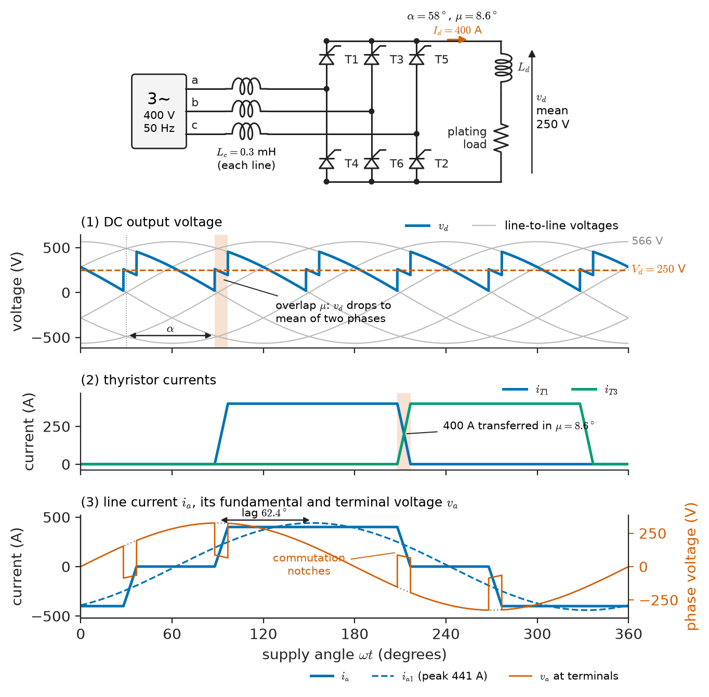
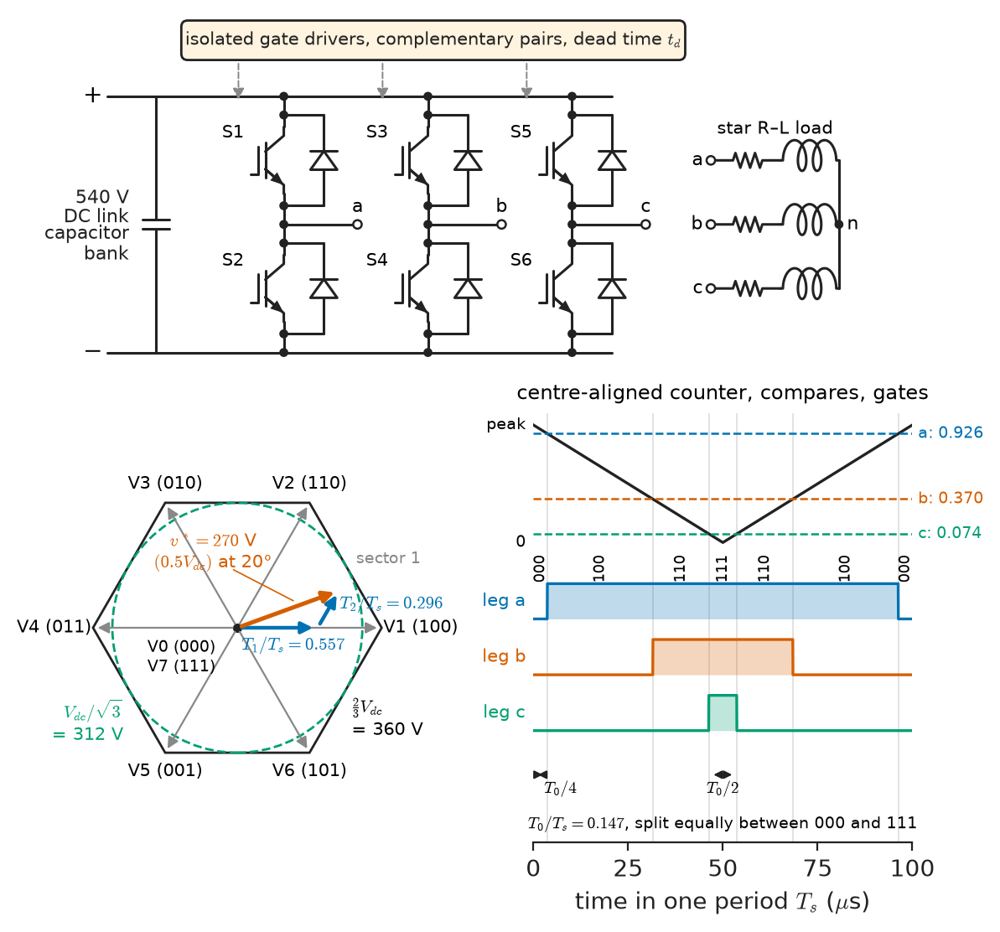
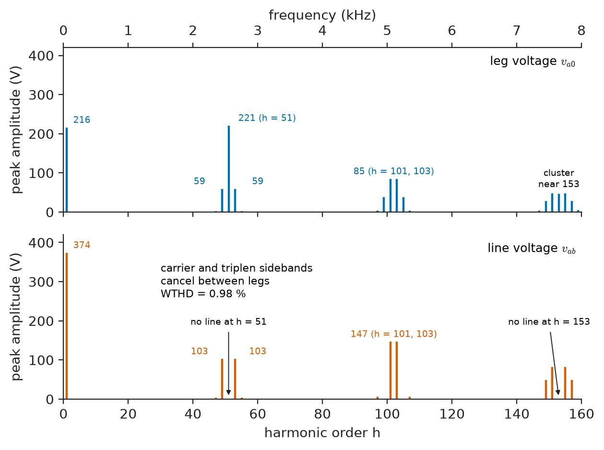
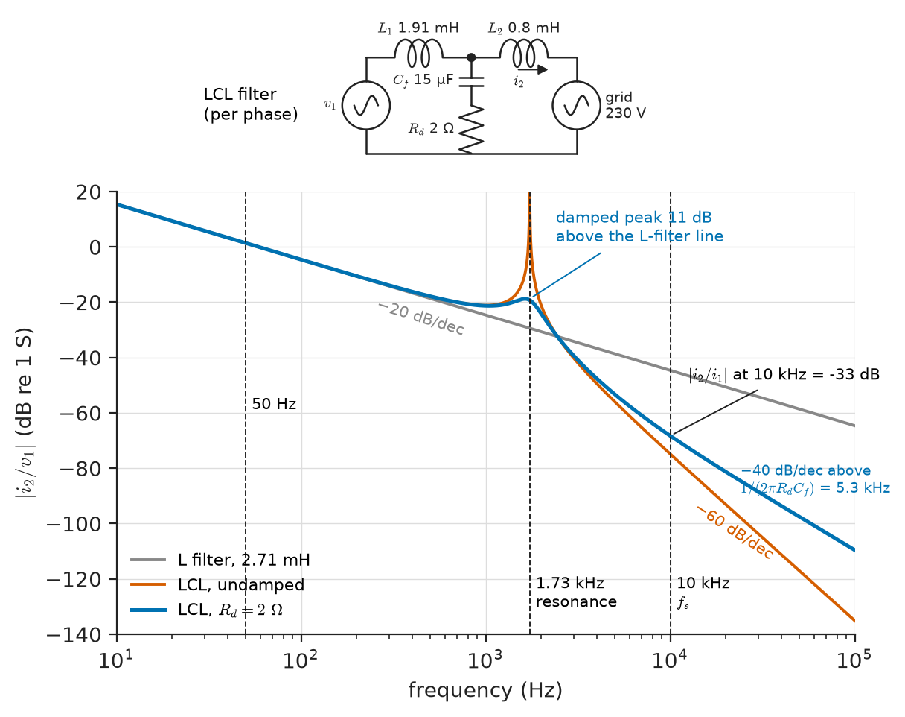
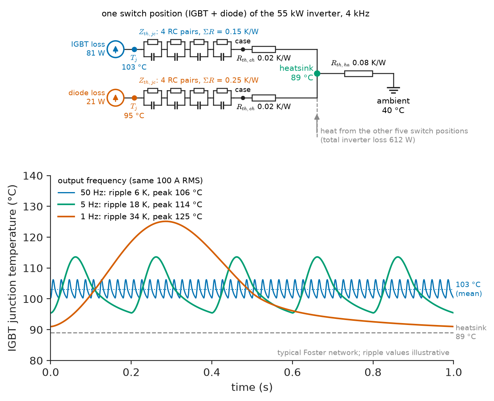

# Chapter 31 — AC–DC and DC–AC Conversion

*Part VII · Power Electronics*

A plating shop connects a 100 kW thyristor rectifier (250 V, 400 A) directly to its 400 V supply and three months later receives a utility letter: its power factor has fallen to 0.45 and a neighbour complains of notched voltage on the feeder. Across town, a 55 kW pump drive reprogrammed from 4 kHz to 16 kHz to quieten a hospital plant room trips on IGBT over-temperature within an hour. A 15 kW rooftop PV inverter fails the grid operator's emission check because the resonance of its output filter was left undamped. All three failures are predictable from one-page circuit models: thyristor commutation through the supply inductance, the loss and thermal budget of an inverter leg, and the transfer function of an LCL filter. This chapter builds those models and turns them into design procedures.

> **How do diode and thyristor rectifiers turn AC into DC, and what do overlap, firing angle and pulse number cost the supply?**
> **How does a PWM inverter synthesise AC from a DC link, what spectrum does it produce, and how are its filter, switches, protection and heatsink chosen?**

| Concept | Engineering destination |
|---|---|
| Uncontrolled and controlled rectifiers | Drive front ends, battery chargers, electroplating and electrolysis, DC traction substations, HVDC terminals |
| Commutation overlap | DC voltage regulation, line notching, power factor of phase-controlled loads |
| Inverters (half-bridge, H-bridge, three-phase, multilevel) | UPS, PV and battery inverters, motor drives, induction heating, EV traction |
| PWM (sine-triangle, space-vector, discontinuous) | Timer configuration in a drive or inverter MCU, DC-link utilisation, switching-loss budget |
| Harmonic spectra | Filter design, EMC compliance, motor and transformer heating |
| L and LCL filters | Grid-connected inverters, active front ends, UPS output stages |
| Switching strategies | Bipolar versus unipolar PWM, selective harmonic elimination in MV drives, soft switching |
| Semiconductor selection | Voltage and current ratings, Si IGBT versus SiC and GaN, cosmic-ray derating |
| Protection and thermal design | DC-link precharge, fuses, short-circuit turn-off, junction temperature and power-cycling life |

**Roadmap.** Rectifiers with and without phase control, including overlap (31.1) → inverter topologies and dead time (31.2) → PWM as a modulator circuit (31.3) → single- and three-phase inverter design (31.4) → the harmonic spectra both sides produce (31.5) → filters that remove them (31.6) → switching strategies (31.7) → choosing the semiconductors (31.8) → protection and thermal design (31.9).

> **Boundary.** The rectifier and switching-converter sketch of *Engineering Physics*, [Ch. 18 §18.8](https://github.com/The-Studio-of-Sadiq/Engineering-Physics/blob/main/CHAPTERS/CHAPTER%2018.md), and the single-phase diode bridge with capacitor filter of [Chapter 6](../part-2-analog-electronics/06-diode-circuits.md) are the starting point; thyristor, IGBT and wide-bandgap devices are introduced in [Chapter 5](../part-1-electronic-devices/05-advanced-semiconductor-devices.md); switching and conduction losses, gate drive and snubbers in [Chapter 29](29-power-electronic-fundamentals.md); the buck and boost cells reused here in [Chapter 30](30-dc-dc-converters.md). Fourier series, THD and active power with harmonics are from *Circuits, Signals and Communications*, [Ch. 18 §18.1](https://github.com/The-Studio-of-Sadiq/Circuits-Signals-and-Communications/blob/main/part-4-signals-and-systems/18-frequency-domain-system-analysis.md) and [Ch. 9 §9.8](https://github.com/The-Studio-of-Sadiq/Circuits-Signals-and-Communications/blob/main/part-2-transient-and-ac-analysis/09-ac-power.md). Harmonic limits at the point of common coupling (IEEE 519, IEC 61000-3-2/-12) are owned by *Electrical Energy and Machines*, [Ch. 25 §25.3](https://github.com/The-Studio-of-Sadiq/Electrical-Energy-and-Machines/blob/main/part-7-power-quality-and-grid-modernization/25-power-quality.md), and how a drive uses the inverter (V/f, FOC, DTC) by [Ch. 12](https://github.com/The-Studio-of-Sadiq/Electrical-Energy-and-Machines/blob/main/part-3-motor-drives/12-ac-motor-drives.md).

---

## 31.1 Controlled and uncontrolled rectifiers

### From the single-phase bridge to the six-pulse bridge

Chapter 6 treated the single-phase diode bridge feeding a smoothing capacitor: the capacitor charges near the voltage peaks and the line current flows in short pulses. That circuit powers almost every product under a kilowatt. Above a few kilowatts two things change. The supply is three-phase, and the DC side usually contains enough inductance (a DC choke, a motor armature, a plating cell's leads plus a reactor) that the DC current $I_d$ is nearly constant over a supply cycle. With a constant DC current, a rectifier becomes a set of switches that route $I_d$ from one supply line to another, and its behaviour is set by *which* switch conducts *when*.

In the **three-phase diode bridge** (six diodes, two per phase), the upper group connects the DC positive rail to whichever line voltage is most positive and the lower group connects the negative rail to the most negative. The DC voltage is the envelope of the six line-to-line voltages, a waveform with six pulses per supply cycle and average

$$
V_{d0}=\frac{3\sqrt2}{\pi}V_{LL}=1.35\,V_{LL}
$$

540 V from a 400 V supply, 931 V from 690 V. Each diode conducts for 120° and carries average current $I_d/3$ and RMS current $I_d/\sqrt3$; each line current is a quasi-square wave of 120° positive and 120° negative blocks, whose fundamental is $3/\pi=0.955$ of its RMS value. The peak reverse voltage on each diode is the peak line voltage, $\sqrt2V_{LL}$: 566 V on a 400 V line, which together with the 2–2.5× margin for line surges is why 400 V bridges use 1200–1600 V diodes and 690 V bridges 2200 V.

### Phase control with thyristors

Replacing the diodes by thyristors lets the controller delay each commutation by a **firing angle** $\alpha$ measured from the instant the diode would have started conducting (the natural commutation point: the voltage zero crossing in a single-phase bridge, 30° after the phase-voltage zero crossing in a three-phase one). A single-phase fully controlled bridge with continuous DC current gives

$$
V_d=\frac{2\sqrt2}{\pi}V\cos\alpha=0.90\,V\cos\alpha
$$

and the three-phase fully controlled bridge

$$
V_d=1.35\,V_{LL}\cos\alpha
$$

Both follow from averaging the segment of supply voltage that is connected to the DC side between successive firings. For $\alpha<90^\circ$ the bridge rectifies; for $90^\circ<\alpha<180^\circ$ the average voltage reverses while the current, which a thyristor passes in one direction only, does not, so power flows from the DC side to the AC supply: the converter **inverts**. Line-commutated inversion is how a thyristor DC drive regenerates and how classic HVDC terminals transfer power; its use in drives is described in *Electrical Energy and Machines*, [Ch. 11 §11.1](https://github.com/The-Studio-of-Sadiq/Electrical-Energy-and-Machines/blob/main/part-3-motor-drives/11-dc-motor-drives.md).

A **half-controlled bridge** (three thyristors, three diodes) cannot invert but freewheels at large $\alpha$, improving power factor; it serves battery chargers and field supplies. A **12-pulse** converter feeds two bridges from star and delta secondaries 30° apart, cancelling the 5th and 7th harmonics.

### Commutation overlap

Current cannot transfer from one thyristor to the next instantaneously: the supply and transformer have leakage inductance $L_c$ per phase. For an **overlap angle** $\mu$ both devices conduct, the two lines are short-circuited through $2L_c$, and the DC rail sits at the mean of the two phase voltages. Integrating the commutation loop's voltage over the overlap interval, with the DC current constant, gives the overlap equation

$$
\cos\alpha-\cos(\alpha+\mu)=\frac{2\omega L_c I_d}{\sqrt2\,V_{LL}}
$$

The lost volt-seconds, repeated six times per cycle, lower the average DC voltage by

$$
\Delta V_d=\frac{3\omega L_c}{\pi}I_d
$$

so the loaded bridge behaves as $V_d=1.35V_{LL}\cos\alpha-R_{ov}I_d$ with $R_{ov}=3\omega L_c/\pi$, a "resistance" that dissipates nothing. Overlap also carves six **commutation notches** of width $\mu$ per cycle into the terminal voltage, which upset zero-crossing detectors of other loads on a weak feeder.

> **Status of the principle: Overlap equation for a line-commutated bridge**
> *Derived.* Follows from Faraday's law applied to the commutation loop under constant DC current and sinusoidal source voltage; it fails when the DC current is discontinuous, when the source contains significant resistance or distortion, and when two commutations overlap ($\mu>60^\circ$ in a six-pulse bridge, reached only on very weak supplies or under faults).

Overlap also limits inversion. A thyristor needs a reverse-bias interval after its current reaches zero (its turn-off time $t_q$, 100–400 µs for phase-control types) before forward voltage returns. The extinction angle $\gamma=180^\circ-\alpha-\mu$ must therefore exceed $\omega t_q$ plus margin; firing circuits clamp $\alpha$ to about 150°. If a supply dip enlarges $\mu$ unexpectedly, the outgoing thyristor refires and the bridge short-circuits the AC supply through the DC load: **commutation failure**, the classic fault of regenerating DC drives and HVDC inverters.

### Power factor of rectifiers

With a sinusoidal supply voltage, only the fundamental line current carries power (*Circuits, Signals and Communications*, Ch. 9 §9.8). The rectifier's power factor is then the product of a **distortion factor** $I_1/I_{rms}$ (0.955 for 120° blocks, 0.5–0.7 for a capacitor-input bridge) and a **displacement factor** $\cos\varphi_1$. For a phase-controlled bridge the fundamental lags the voltage by about $\alpha+\mu/2$, so

$$
\mathrm{PF}\approx0.955\cos\!\left(\alpha+\tfrac{\mu}{2}\right)
$$

The diode bridge ($\alpha=0$) runs near 0.95 with a DC choke. A capacitor-input bridge without a choke has a displacement factor near unity but a distortion factor of 0.5–0.7. Phase control buys a variable DC voltage at the price of reactive power that does not fall when the DC power does.

**Worked example — the plating rectifier.** A three-phase fully controlled bridge must supply 250 V, 400 A (100 kW) to a plating line. Case A connects it to the 400 V, 50 Hz supply through a commutating reactor of $L_c=0.3$ mH per phase.

- $V_{d0}=1.35\times400=540.2$ V; $R_{ov}=3\times(2\pi\cdot50)\times0.3\times10^{-3}/\pi=0.090\ \Omega$, so overlap costs $0.090\times400=36.0$ V.
- $\cos\alpha=(250+36)/540.2=0.529$, $\alpha=58.0^\circ$.
- Overlap: $\cos(\alpha+\mu)=0.529-2\times314.2\times0.3\times10^{-3}\times400/(\sqrt2\times400)=0.529-0.133$, so $\mu=8.6^\circ$.
- $\mathrm{PF}\approx0.955\cos(62.3^\circ)=0.44$. The line current is $\sqrt{2/3}\times400=327$ A RMS and the apparent power $\sqrt3\times400\times327=226$ kVA for 100 kW.

Case B adds a 400/230 V transformer so that the bridge works near full output. With $L_c=0.1$ mH referred to the 230 V side, $V_{d0}=310.6$ V, the overlap drop is 12.0 V, $\alpha=32.5^\circ$, $\mu=7.5^\circ$, and $\mathrm{PF}\approx0.77$; the supply now sees 130 kVA instead of 226 kVA. The rule that comes out of the numbers: size the converter transformer so that the bridge runs at $\alpha$ of 15–35° at rated output, and keep phase-controlled rectifiers for applications that genuinely need deep voltage control or line-commutated regeneration. Where they are kept, the reactive power and the 5th and 7th harmonic currents become a power-quality problem for the plant (*Electrical Energy and Machines*, [Ch. 25 §25.8](https://github.com/The-Studio-of-Sadiq/Electrical-Energy-and-Machines/blob/main/part-7-power-quality-and-grid-modernization/25-power-quality.md)).

<!-- FIGURE 31.1 | figures/ch31/fig-31-1-thyristor-bridge-overlap.png | waveform | Three-phase fully controlled thyristor bridge with commutation overlap: circuit and waveforms for the plating rectifier at alpha = 58 degrees and mu = 8.6 degrees. | Content: left, circuit: 400 V 50 Hz three-phase source, commutating inductance Lc = 0.3 mH in each line, six thyristors T1 to T6 in a bridge, DC smoothing reactor and plating load drawing Id = 400 A. Right, three stacked panels over one supply cycle 0 to 360 degrees: (1) the six line-to-line voltages (peak 566 V) faint, the DC output voltage vd bold following segments fired at alpha = 58 degrees with the overlap intervals mu = 8.6 degrees where vd drops to the mean of two phases, average 250 V marked; (2) thyristor currents iT1 and iT3 showing trapezoidal transfer of 400 A over 8.6 degrees; (3) line current ia as 120 degree blocks of plus and minus 400 A with sloped edges, its fundamental (peak 441 A) dashed and lagging the phase voltage va by 62.3 degrees; line-voltage notches marked at the AC terminals. -->



*Figure 31.1 — Three-phase fully controlled thyristor bridge with commutation overlap: circuit and waveforms for the plating rectifier at alpha = 58 degrees and mu = 8.6 degrees.*

Figure 31.1 shows the waveforms for case A: the notches in the DC voltage during overlap, the trapezoidal current transfer between thyristors, and the line-current fundamental lagging its phase voltage by about $\alpha+\mu/2$.

---

## 31.2 Inverters

### The switching leg

Every voltage-source inverter is built from a **leg**: two switches with antiparallel diodes in series across the DC link, output at the midpoint. One switch is on at a time, so the output sits at $+V_{dc}$ or $0$ whatever the current direction, the diodes carrying current that flows against the conducting transistor. The leg is the buck cell of Chapter 30 made bidirectional; the inverter varies its duty ratio sinusoidally.

Three arrangements cover most applications:

- **Half-bridge**: one leg and a split DC-link capacitor; output $\pm V_{dc}/2$. Small UPS and induction-heating stages.
- **Full bridge (H-bridge)**: two legs; output $+V_{dc}$, $0$ or $-V_{dc}$. Single-phase PV, UPS and battery inverters to about 10 kW; the cell of cascaded multilevel converters.
- **Three-phase two-level bridge**: three legs, eight switching states; drives, EV traction, three-phase grid inverters.

Driven by square waves, the three-phase bridge runs in **six-step** mode: its line voltage contains only $h=6k\pm1$ with $\hat V_h=\hat V_1/h$ and a fundamental of $0.780V_{dc}$ RMS, the most a two-level bridge can give, used at the top speed of traction drives. Everything else uses PWM (Section 31.3).

Voltage-source inverters dominate because a DC-link capacitor is cheaper than the DC-link inductor of a **current-source inverter**, which survives in multi-megawatt synchronous-motor drives. **Multilevel** legs give more than two output levels: the three-level **neutral-point-clamped** (NPC) leg, in which each device blocks only $V_{dc}/2$; the **T-type** leg for 400–690 V at 10–20 kHz; **flying-capacitor**, **cascaded H-bridge** and, for HVDC, **modular multilevel** converters that stack cells. More levels mean smaller voltage steps, lower dv/dt, a smaller filter and lower-voltage devices.

### Dead time

A real leg cannot switch both devices at the same instant: the outgoing device takes 0.1–1 µs to turn off (an IGBT's tail current lasts longer), and if the incoming one turns on first the DC link is shorted through the leg, a **shoot-through**. The gate driver therefore inserts a **dead time** $t_d$ during which both gates are off (0.5–3 µs for Si IGBTs, 50–300 ns for SiC MOSFETs, 10–50 ns for GaN). During the dead time the load current itself chooses the path: positive current freewheels through the lower diode, negative current through the upper, so the leg voltage is decided by the current sign, not by the command. The result is a volt-second error once per switching edge pair, an average voltage error of

$$
\Delta V\approx t_d\,f_s\,V_{dc}\,\operatorname{sgn}(i)
$$

which opposes the current like a nonlinear resistance and distorts the output near current zero crossings.

> **Status of the principle: Dead-time voltage error**
> *Approximate.* Counts only the dead interval and assumes the current does not change sign within it and that the devices switch instantaneously; turn-on and turn-off delays, diode forward drop and the finite edge rate add to or partly cancel the error, and at small currents the edge itself is slowed by the device capacitances so the error is less than predicted.

**Worked example — dead time at low speed.** A 400 V drive with $V_{dc}=540$ V switches at 8 kHz with 2 µs dead time: the error is $2\times10^{-6}\times8000\times540=8.6$ V per leg. At 50 Hz (327 V phase peak) that is under 3 %. At 2 Hz, constant V/f asks for 16 V line, a 13 V phase peak, and the error is two-thirds of the command: the current flattens at each zero crossing and torque pulsates at six times the output frequency. Every drive therefore adds a current-sign-dependent compensation to the duty ratio (Chapter 32), and SiC inverters with 100 ns dead time have far cleaner low-speed waveforms.

---

## 31.3 PWM

### The modulator as a circuit

> **Boundary.** The averaged leg-voltage relation of sine-triangle PWM, the linear-range limits ($V_{LL1}=0.612\,mV_{dc}$ for sine-triangle, $0.707V_{dc}$ with third-harmonic injection or SVPWM, $0.780V_{dc}$ in six-step) and the space-vector hexagon are stated in *Electrical Energy and Machines*, [Ch. 12 §12.2 and §12.5](https://github.com/The-Studio-of-Sadiq/Electrical-Energy-and-Machines/blob/main/part-3-motor-drives/12-ac-motor-drives.md). This section is about how a modulator is built and what it does to the spectrum and losses.

Sine-triangle PWM compares a reference $v^*(t)$ with a triangular carrier of frequency $f_s$; the upper switch is on while the reference is higher. In an analogue implementation (still found in small UPS and class-D audio stages) a comparator does this continuously: **natural sampling**. In a digital controller the reference is updated once or twice per carrier period and held: **regular sampling**, symmetric if updated at one peak of the carrier, asymmetric if at both. The digital modulator is a hardware timer in **centre-aligned** (up–down) mode: a counter counts from 0 to a period value and back, a compare register per phase holds $D\times$ period, and the output is high while the counter is below the compare value. At a 168 MHz timer clock, a 10 kHz carrier needs a period of $168\times10^6/(2\times10^4)=8400$ counts, a duty resolution of 0.012 %. The timer's dead-time generator inserts $t_d$ in hardware on complementary outputs, and the counter's peak or valley triggers the ADC so that currents are sampled midway between switching edges, where the ripple passes through its average (Chapter 32).

### Space-vector PWM in practice

The two-level three-phase bridge has eight states: six active vectors of length $2V_{dc}/3$ and two zero vectors (all upper or all lower switches on). Space-vector PWM synthesises a reference vector $\vec v^*$ of magnitude $V^*$ at angle $\theta$ within a 60° sector from the two adjacent active vectors for times

$$
T_1=\sqrt3\,T_s\frac{V^*}{V_{dc}}\sin(60^\circ-\theta),\qquad T_2=\sqrt3\,T_s\frac{V^*}{V_{dc}}\sin\theta,\qquad T_0=T_s-T_1-T_2
$$

and splits $T_0$ equally between the two zero vectors, placed at the start, middle and end of the period. That split has a simpler equivalent that needs no sector logic: add to all three sinusoidal references the common-mode offset $v_{off}=-\tfrac12(\max v^*+\min v^*)$ and run ordinary centre-aligned carrier PWM on the result (**min–max injection**). The line voltages are unchanged because the offset is common to all phases; the leg duty ratios become identical to those of SVPWM. Listing 31.1 is the whole modulator.

```c
#include <stdint.h>

/* Min-max injection modulator, equivalent to symmetric SVPWM.
   va, vb, vc: phase-voltage references (V); vdc: measured DC link (V).
   Returns compare values for a centre-aligned timer counting 0..period;
   the upper switch of a leg is on while the counter is below its value. */
typedef struct { uint16_t ccr[3]; } pwm_cmp_t;

static float clampf(float x, float lo, float hi)
{
    return x < lo ? lo : (x > hi ? hi : x);
}

pwm_cmp_t svpwm_compare(float va, float vb, float vc, float vdc, uint16_t period)
{
    float vmax = va, vmin = va;
    if (vb > vmax) vmax = vb;
    if (vc > vmax) vmax = vc;
    if (vb < vmin) vmin = vb;
    if (vc < vmin) vmin = vc;

    const float voff = -0.5f * (vmax + vmin);     /* common-mode offset */
    const float v[3] = { va + voff, vb + voff, vc + voff };
    pwm_cmp_t out;
    for (int k = 0; k < 3; k++) {
        float d = clampf(0.5f + v[k] / vdc, 0.0f, 1.0f);   /* leg duty */
        out.ccr[k] = (uint16_t)(d * (float)period + 0.5f);
    }
    return out;
}
```

Dividing by the *measured* $V_{dc}$ makes the output volt-seconds immune to DC-link sag and 300 Hz rectifier ripple; the clamp is a crude overmodulation rule. For a reference of 0.5 $V_{dc}$ at 20° the listing gives duties 0.926, 0.370 and 0.074, whose differences 0.557 and 0.296 equal $T_1/T_s$ and $T_2/T_s$ from the dwell-time formulas, as they must.

> **Status of the principle: Equivalence of min–max injection and SVPWM**
> *Derived.* Both place the same active-vector times $T_1$, $T_2$ in each period and split the zero-vector time equally; the equivalence is exact for regular sampling and holds in the linear range ($V^*\le V_{dc}/\sqrt3$), beyond which both must be supplemented by an overmodulation rule.

### Discontinuous PWM

Putting all of $T_0$ on one zero vector clamps each leg to a DC rail for a third of the cycle: **discontinuous PWM** (DPWM). Switching losses fall by about one-third, or up to half if the clamp is placed where the leg current peaks, at the price of more ripple at low modulation index; drives change to DPWM above about half speed, and traction and PV inverters use it throughout.

### Unipolar and bipolar PWM in the H-bridge

An H-bridge can be modulated in two ways. **Bipolar** PWM drives the two legs complementarily, so the output jumps between $+V_{dc}$ and $-V_{dc}$ at $f_s$. **Unipolar** PWM compares two references of opposite sign with the same carrier (or one reference with two opposite carriers); the output steps between $+V_{dc}$ and 0 in the positive half-cycle and between $-V_{dc}$ and 0 in the negative one, and its first harmonic cluster sits at $2f_s$ because the two legs' carrier components cancel. For the same switching frequency, unipolar PWM halves the voltage step and doubles the ripple frequency, quartering the inductance needed for a given ripple (Section 31.4).

---

## 31.4 Single-phase and three-phase inverters

### The single-phase inverter and its twice-line-frequency power

A single-phase inverter delivering $v=\sqrt2V\cos\omega t$ and $i=\sqrt2I\cos\omega t$ delivers instantaneous power $p=VI(1+\cos2\omega t)$: the power pulsates between zero and twice its average at $2f$ (100 Hz). The DC source (a PV string, a battery, the DC link of a UPS) wants constant power, so the difference must be buffered by the DC-link capacitor, which absorbs and releases energy $\pm P/(2\omega)$ per half-cycle. For a peak-to-peak DC-link ripple $\Delta V$ around $V_{dc}$,

$$
C_{dc}=\frac{P}{\omega\,V_{dc}\,\Delta V}
$$

and the capacitor carries a 100 Hz current of RMS value $P/(\sqrt2V_{dc})$ on top of its switching ripple. This buffer makes single-phase inverters bulky and limits electrolytic-capacitor life in microinverters; balanced three-phase power is constant and needs none.

**Worked example — a 5 kW single-phase PV inverter stage.** The H-bridge runs from a 400 V DC link, delivers 5 kW at 230 V, 50 Hz, and switches at 20 kHz.

- Output current $5000/230=21.7$ A RMS, 30.7 A peak.
- DC-link capacitor for 5 % (20 V peak-to-peak) ripple: $C=5000/(314.2\times400\times20)=1.99$ mF, carrying $5000/(\sqrt2\times400)=8.8$ A RMS at 100 Hz.
- Output inductor for a peak-to-peak ripple of 20 % of the peak current, 6.1 A. With bipolar PWM the worst-case ripple is $V_{dc}/(2Lf_s)$ (at zero output voltage), so $L=400/(2\times20\,000\times6.15)=1.63$ mH. With unipolar PWM the worst case is $V_{dc}/(8Lf_s)$ (at half the peak output), so $L=0.41$ mH.

Unipolar PWM cuts the inductor to a quarter, but in a transformerless PV inverter it makes the array's common-mode voltage jump and drives leakage current to earth; Chapter 32 shows the topologies (H5, HERIC) that solve this.

### The three-phase inverter

A three-phase two-level inverter has three design quantities: the DC-link voltage, the semiconductor current rating and the DC-link capacitor.

- **DC-link voltage.** In the linear range of SVPWM the peak line-to-line output equals $V_{dc}$, so a grid inverter at 400 V needs $V_{dc}\ge\sqrt2\times400=566$ V plus the drop across its filter and control headroom, typically 650–750 V; a drive fed from its own diode bridge has only $1.35V_{LL}$ and accepts the 5 % voltage shortfall at base speed discussed in *Electrical Energy and Machines*, Ch. 12 §12.2.
- **Current rating.** From peak current (overload plus ripple) and the thermal calculation of Section 31.8.
- **DC-link capacitor.** It buffers no line-frequency power but must absorb the switching-frequency current. The RMS capacitor current for sinusoidal PWM with modulation index $M$ (referred to $V_{dc}/2$) and load power factor $\cos\varphi$ is

$$
I_{C,rms}=I_{rms}\sqrt{2M\left[\frac{\sqrt3}{4\pi}+\cos^2\varphi\left(\frac{\sqrt3}{\pi}-\frac{9M}{16}\right)\right]}
$$

about 0.5–0.65 of the output phase current over the usual operating range.

> **Status of the principle: DC-link capacitor RMS current**
> *Derived.* Obtained by integrating the square of the switched input current of the bridge over a fundamental cycle, assuming sinusoidal output currents with negligible ripple, a switching frequency much higher than the output frequency and a stiff DC link; ripple, dead time and overmodulation change the result by a few per cent.

For the 55 kW drive of Section 31.8 ($I_{rms}=100$ A, $M=1.0$, $\cos\varphi=0.86$) the formula gives 50.9 A. Electrolytic capacitors of 450 V cannot stand a 560 V link alone, so cans are used in series pairs with balancing resistors; with 2200 µF, 450 V cans each rated about 12 A RMS at the switching frequency and 85 °C, five parallel strings of two give 5.5 mF and 60 A of ripple capability. Capacitor life roughly doubles for every 10 °C reduction in core temperature, an empirical rule that makes the capacitor's ripple heating, not its capacitance, the usual sizing criterion. Film capacitors carry far more ripple per microfarad and dominate in EV traction inverters, where the DC link is stiffened by the battery and only 0.5–1 mF is needed.

<!-- FIGURE 31.2 | figures/ch31/fig-31-2-three-phase-inverter-svpwm.png | circuit | Three-phase two-level inverter with its eight switching states and one centre-aligned SVPWM period. | Content: left, circuit: DC link 540 V with capacitor bank, three legs of IGBTs S1 to S6 with antiparallel diodes, outputs a, b, c to a star-connected R-L load; gate driver blocks with dead time td. Centre, the voltage hexagon: active vectors V1 (100) to V6 (101) of length 2Vdc/3 = 360 V at 60 degree steps, zero vectors V0 (000) and V7 (111) at the origin, inscribed circle of radius Vdc/sqrt(3) = 312 V, reference vector of magnitude 270 V (0.5 Vdc) at 20 degrees in sector 1 resolved into T1/Ts = 0.557 along V1 and T2/Ts = 0.296 along V2. Right, timing diagram of one switching period Ts = 100 microseconds: triangular up-down counter, three compare levels at duties 0.926, 0.370 and 0.074, resulting gate signals for legs a, b, c symmetric about the period centre, with the state sequence 000-100-110-111-110-100-000 labelled and the zero-vector time T0/Ts = 0.147 split equally. -->



*Figure 31.2 — Three-phase two-level inverter with its eight switching states and one centre-aligned SVPWM period.*

Figure 31.2 collects the inverter, the hexagon of switching states and one modulation period; the symmetric state sequence 000–100–110–111–110–100–000 is the switching pattern the min–max modulator produces.

---

## 31.5 Harmonics

### Rectifier-side spectra

A $p$-pulse rectifier with constant DC current draws the **characteristic harmonics** $h=kp\pm1$ with $I_h=I_1/h$ ideally (20 % 5th, 14.3 % 7th for $p=6$). Overlap reduces the higher orders; a capacitor-input bridge without a choke raises the 5th and 7th to 30–80 %; unbalance and asymmetrical firing add non-characteristic orders. Real spectra and limits are tabulated in *Electrical Energy and Machines*, Ch. 25 §25.3. The circuit levers are pulse number, DC chokes and 3–5 % AC reactors, and the PWM rectifier, the inverter of Section 31.4 run in reverse.

### Inverter-side spectra

A PWM inverter's output contains the fundamental plus harmonic clusters around multiples of the carrier frequency. For naturally sampled sine-triangle PWM of one leg, a double Fourier analysis (in the time variables of carrier and reference) gives the harmonic at $mf_s+nf_1$ the peak amplitude

$$
\hat V_{mn}=\frac{4}{m\pi}\,\frac{V_{dc}}{2}\,\left\lvert J_n\!\left(m\,M\frac{\pi}{2}\right)\sin\frac{(m+n)\pi}{2}\right\rvert
$$

where $J_n$ is the Bessel function of the first kind and $M$ the modulation index. The odd-$m$ clusters (around $f_s$, $3f_s$, ...) contain even sidebands $n=0,\pm2,\pm4$; the even-$m$ clusters (around $2f_s$) contain odd sidebands. In the line-to-line voltage of a three-phase inverter, components with $n$ a multiple of 3, including the carrier itself, are common to all three legs and cancel; the largest remaining harmonics are the sidebands $f_s\pm2f_1$ and $2f_s\pm f_1$.

> **Status of the principle: Bessel-function spectrum of carrier PWM**
> *Derived.* Exact for naturally sampled PWM with an ideal leg; regular sampling adds small baseband harmonics and sideband asymmetry that grow as the carrier ratio $f_s/f_1$ falls, and dead time adds low-order (5th, 7th) harmonics that this formula does not contain.

Listing 31.2 checks the formula by brute force for a 540 V link, $M=0.8$ and a carrier ratio of 51 (2.55 kHz at 50 Hz), computing the FFT of the switched leg and line voltages over one fundamental period.

```python
import numpy as np
from scipy.special import jv

Vdc, M, f1, mf = 540.0, 0.8, 50.0, 51       # DC link, modulation index, carrier ratio
N = 2**18                                    # samples in one fundamental period
t = np.arange(N) / (N * f1)
carrier = 2 / np.pi * np.arcsin(np.sin(2 * np.pi * mf * f1 * t + np.pi / 2))  # triangle, +-1
ref = lambda ph: M * np.sin(2 * np.pi * f1 * t - ph)
leg = lambda ph: np.where(ref(ph) > carrier, Vdc / 2, -Vdc / 2)  # natural sampling
va, vb = leg(0.0), leg(2 * np.pi / 3)

def spectrum(v):                             # peak amplitude of each harmonic h
    return 2 * np.abs(np.fft.rfft(v)) / N

Sa, Sab = spectrum(va), spectrum(va - vb)
bessel = lambda m, n: 4 / (m * np.pi) * Vdc / 2 * abs(jv(n, m * M * np.pi / 2))
for h, mn in [(1, None), (mf, (1, 0)), (mf - 2, (1, -2)), (2 * mf - 1, (2, -1))]:
    theory = M * Vdc / 2 if mn is None else bessel(*mn)
    print(f"h={h:3d}  leg {Sa[h]:6.1f} V (theory {theory:6.1f})  line {Sab[h]:6.1f} V")
wthd = np.sqrt(sum((Sab[h] / h) ** 2 for h in range(2, 2000))) / Sab[1]
print(f"line-voltage WTHD = {100 * wthd:.3f} %")
```

Its output:

```text
h=  1  leg  216.0 V (theory  216.0)  line  374.1 V
h= 51  leg  220.9 V (theory  220.9)  line    0.0 V
h= 49  leg   59.3 V (theory   59.4)  line  102.8 V
h=101  leg   84.9 V (theory   84.9)  line  147.0 V
line-voltage WTHD = 0.982 %
```

The leg's carrier component (220.9 V) exceeds its fundamental yet vanishes in the line voltage; the surviving sidebands are $\sqrt3$ times the leg sidebands; and the **weighted THD** (harmonics divided by their order, a proxy for current distortion in an inductive load) is under 1 %, although the plain voltage THD of PWM is 60–100 %. Current ripple, WTHD and the spectrum near the filter resonance, not voltage THD, are an inverter's figures of merit.

<!-- FIGURE 31.3 | figures/ch31/fig-31-3-spwm-spectrum.png | plot | Spectrum of naturally sampled sine-triangle PWM for Vdc = 540 V, M = 0.8 and carrier ratio 51: one leg versus the line-to-line voltage. | Content: two stacked bar spectra, x-axis harmonic order 0 to 160 (frequency 0 to 8 kHz at 50 Hz), y-axis peak amplitude 0 to 400 V. Top, leg voltage va0: fundamental 216 V at h = 1, carrier line 221 V at h = 51, sidebands 59 V at h = 49 and 53, cluster around h = 102 with 85 V at h = 101 and 103, smaller cluster around h = 153. Bottom, line voltage vab: fundamental 374 V, no line at h = 51 or 153, sidebands 103 V at h = 49 and 53, 147 V at h = 101 and 103. Annotate "carrier and triplen sidebands cancel between legs" and the WTHD of 0.98 percent. -->



*Figure 31.3 — Spectrum of naturally sampled sine-triangle PWM for Vdc = 540 V, M = 0.8 and carrier ratio 51: one leg versus the line-to-line voltage.*

The two spectra are plotted in Figure 31.3. At low carrier ratios (MV drives, high-speed spindles) the carrier must be **synchronised** to the fundamental with an odd integer ratio that is a multiple of three, as 51 is here, or subharmonics appear; above a ratio of about 20 a fixed asynchronous carrier is acceptable.

---

## 31.6 Filtering

### What has to be filtered and where

Filters sit at three interfaces: the **DC side** (DC-link capacitor, DC choke), the **AC side** (an L, LC or LCL network that turns PWM voltage into sinusoidal current or voltage), and the **EMI path** (common- and differential-mode filters for the 150 kHz–30 MHz limits of CISPR 11 and IEC 61800-3). The passive-filter methods and second-order resonance used below are those of *Circuits, Signals and Communications*, [Ch. 13 §13.4–13.7](https://github.com/The-Studio-of-Sadiq/Circuits-Signals-and-Communications/blob/main/part-3-advanced-network-theory/13-network-frequency-response.md).

### The L filter

The simplest grid interface is an inductor in each phase. The inverter impresses a PWM voltage on one side and the grid holds a sinusoid on the other, so the inductor sees the difference and the ripple current is set by volt-seconds. For a three-phase leg with carrier PWM, the worst-case peak-to-peak ripple is approximately

$$
\Delta I_{max}\approx\frac{V_{dc}}{6\,L\,f_s}
$$

The trouble is attenuation. An L filter falls only at 20 dB per decade, so meeting a grid operator's high-frequency current limit at 10 kHz needs an inductor of 10–20 % per unit, which drops so much fundamental voltage that the DC link must rise, and which is large, lossy and expensive.

### The LCL filter

Splitting the inductance into a converter-side inductor $L_1$ and a grid-side inductor $L_2$ with a capacitor $C_f$ between them gives a third-order filter. Neglecting resistances, the transfer from converter voltage to grid current is

$$
\frac{i_2}{v_1}(s)=\frac{1}{s\,L_1L_2C_f\,\left(s^2+\omega_{res}^2\right)},\qquad \omega_{res}=\sqrt{\frac{L_1+L_2}{L_1L_2C_f}}
$$

and the switching ripple of $i_1$ reaches the grid attenuated by

$$
\frac{i_2}{i_1}(\omega_s)=\frac{1}{\left\lvert1-\omega_s^2L_2C_f\right\rvert}
$$

Above resonance the attenuation falls at 60 dB per decade. At resonance the undamped filter has infinite gain: any switching harmonic, grid harmonic or control action near $\omega_{res}$ excites it. The filter must be damped, either **passively** with a resistor $R_d$ in series with $C_f$ (cheap, costs a few watts, reduces high-frequency attenuation slightly) or **actively** by feeding back the capacitor current in the inverter's control loop (Chapter 32).

A standard design procedure, for rated power $P$, line voltage $V$, DC link $V_{dc}$ and switching frequency $f_s$:

1. **Base values**: $Z_b=V^2/P$, $C_b=1/(\omega Z_b)$.
2. **Capacitor**: $C_f\le0.05\,C_b$, so that the filter draws no more than 5 % of rated reactive power at the fundamental.
3. **Converter-side inductor** from the allowed ripple (10–40 % of rated peak current, here 20 %) with the formula above.
4. **Grid-side inductor** from the required attenuation at $f_s$, keeping the total inductance below about 0.1 pu so that the voltage drop is acceptable.
5. **Check resonance**: $10f_1<f_{res}<f_s/2$, far enough from the grid's harmonics and from the switching frequency.
6. **Damping**: $R_d\approx1/(3\omega_{res}C_f)$ as a starting value, then check loss and the margin of the current loop.

> **Status of the principle: LCL design rules**
> *Empirical.* The 5 % capacitor limit, the ripple fraction and the resonance window are engineering conventions that balance reactive power, losses, size and control stability; the transfer functions they rest on are exact for ideal components, but core saturation, inductance roll-off with current (powder cores lose 20–40 % at full load) and grid impedance shift the real resonance.

**Worked example — an LCL filter for a 15 kW grid inverter.** Three-phase, 400 V, 50 Hz, $V_{dc}=700$ V, $f_s=10$ kHz.

- $Z_b=400^2/15\,000=10.67\ \Omega$, $C_b=298\ \mu$F, so $C_f\le14.9\ \mu$F; choose $15\ \mu$F per phase (star). Its reactive power is $3\times230.9^2\times2\pi50\times15\times10^{-6}=754$ var, 5.0 % of rating.
- Rated current $15\,000/(\sqrt3\times400)=21.7$ A RMS, 30.6 A peak. Ripple target 20 %: 6.1 A peak-to-peak, so $L_1=700/(6\times10^4\times6.12)=1.91$ mH.
- Grid side: with $L_2=0.8$ mH, $\omega_s^2L_2C_f=(2\pi\times10^4)^2\times0.8\times10^{-3}\times15\times10^{-6}=47.4$, so the attenuation is $1/46.4=0.0216$ and the grid ripple is 0.13 A, 0.43 % of rated peak current. Raising $L_2$ to 1.0 mH brings it to 0.34 %; at 0.5 mH it would be 0.70 %.
- Resonance with $L_2=0.8$ mH: $f_{res}=\frac{1}{2\pi}\sqrt{(2.71\times10^{-3})/(1.91\times10^{-3}\times0.8\times10^{-3}\times15\times10^{-6})}=1.73$ kHz, inside the window 500 Hz to 5 kHz.
- Damping: $R_d=1/(3\times2\pi\times1731\times15\times10^{-6})=2.0\ \Omega$. The fundamental capacitor current (1.09 A per phase) dissipates 7 W in the three resistors, plus the ripple current's contribution of a few watts more.
- Total inductance: $\omega(L_1+L_2)=0.85\ \Omega$, or $0.85/10.67=0.080$ pu, an acceptable fundamental voltage drop.

This is the filter that the PV inverter of the opening lacked: its designer chose $L_1$, $C_f$ and $L_2$ correctly but omitted $R_d$ to save 10 W, and the grid's own 35th harmonic (1.75 kHz) sat on the resonance.

<!-- FIGURE 31.4 | figures/ch31/fig-31-4-lcl-filter-bode.png | plot | LCL filter of the 15 kW grid inverter: circuit and grid-current transfer function, undamped and with a 2 ohm damping resistor, compared with an L filter of the same total inductance. | Content: inset circuit: inverter leg voltage v1, L1 = 1.91 mH, capacitor branch Cf = 15 microfarad in series with Rd = 2.0 ohm to the star point, L2 = 0.8 mH, grid voltage 230 V phase. Main plot: x-axis frequency 10 Hz to 100 kHz logarithmic, y-axis magnitude of i2/v1 in dB (admittance, reference 1 S) from -140 to +20 dB. Curves: L filter with 2.71 mH falling at -20 dB per decade; undamped LCL with a sharp resonant peak at 1.73 kHz then falling at -60 dB per decade; damped LCL with the peak about 10 dB above the L-filter line, falling at -40 dB per decade above 5.3 kHz. Vertical dashed lines at 50 Hz, 1.73 kHz (resonance) and 10 kHz (switching frequency); annotate attenuation of i2/i1 at 10 kHz = -33 dB. -->



*Figure 31.4 — LCL filter of the 15 kW grid inverter: circuit and grid-current transfer function, undamped and with a 2 ohm damping resistor, compared with an L filter of the same total inductance.*

Figure 31.4 compares the three responses. Damping lowers the peak to 10 dB above the L-filter line but leaves only 40 dB per decade above $1/(2\pi R_dC_f)=5.3$ kHz (−68 instead of −75 dB at 10 kHz).

A UPS or off-grid inverter needs a sinusoidal *voltage* and uses an LC filter with closed-loop voltage control. Motor drives normally rely on the motor's leakage inductance; their dv/dt and sine filters belong to Chapter 32.

---

## 31.7 Switching strategies

The modulation choice sets the converter's losses, ripple and spectrum. Table 31.1 compares the strategies in common use.

**Table 31.1 — Switching strategies for AC–DC and DC–AC converters (typical).**

| Strategy | Device switching frequency | Strengths | Typical use |
|---|---|---|---|
| Line-commutated (phase control) | Supply frequency | Simple, robust, no switching loss | Thyristor rectifiers, DC drives, LCC HVDC |
| Square wave / six-step | Output frequency | Maximum voltage, minimum switching loss | Top speed of traction drives, induction heating |
| Selective harmonic elimination | 3–15 × output frequency | Chosen low-order harmonics removed exactly | MV drives, high-power rectifiers |
| Sine-triangle PWM | 2–20 kHz (Si), up to 100 kHz (SiC, GaN) | Simple, clean spectrum | Single-phase inverters, low-cost drives |
| SVPWM (min–max injection) | 2–20 kHz | 15 % more voltage than sine-triangle | Standard three-phase drive and grid inverter |
| Discontinuous PWM | Two-thirds of carrier, on average | One-third to one-half less switching loss | Traction, PV and high-speed drives |
| Hysteresis current control | Variable, 5–30 kHz | Fast, inherently current-limited | Simple servo drives, active filters, BLDC |
| Soft switching (ZVS/ZCS) | 50 kHz–1 MHz | Very low switching loss and EMI | Resonant DC–DC stages, induction heating |

**Selective harmonic elimination** (SHE) computes a few switching angles offline so that chosen harmonics are exactly zero. With three angles per quarter-cycle in a two-level leg, the fundamental can be set and the 5th and 7th removed; for $M=0.8$ (referred to $V_{dc}/2$) the angles are 18.35°, 37.03° and 48.45°. Each device switches at seven times the output frequency (350 Hz at 50 Hz) and the 11th becomes the lowest line-voltage harmonic (the leg's triplens cancel between phases). This low switching frequency with a controlled spectrum is why SHE and its optimised relatives run MV drives whose IGCTs and 4.5 kV IGBTs cannot switch faster than a few hundred hertz.

**Hysteresis control** switches whenever the current touches the edge of a band around its reference; it is fast and inherently current-limiting, but its switching frequency wanders with load, which complicates filter design. **Soft switching** makes each transistor turn on at zero voltage with a resonant tank; it is standard in the isolated DC–DC stages of chargers (Chapter 32), while in hard-switched inverters SiC devices now give most of its benefit without resonant parts.

---

## 31.8 Semiconductor selection

### Voltage rating

The blocking voltage must cover the highest DC-link voltage (regeneration, surges), the turn-off overshoot $L_\sigma\,di/dt$ (Chapter 29) and cosmic-ray derating: atmospheric neutrons trigger single-event burnout at a rate that rises steeply with DC voltage, so the continuous DC voltage is kept at about 55–70 % of the rated blocking voltage at sea level, less at altitude. The resulting pairings:

**Table 31.2 — Device voltage classes and typical applications.**

| DC link (typical) | Device class | Devices | Application |
|---|---|---|---|
| 12–60 V | 40–150 V | Si MOSFET, GaN HEMT | Automotive auxiliaries, telecom, e-bikes, servers |
| 350–450 V | 650 V | Si superjunction MOSFET, Si IGBT, SiC MOSFET, GaN HEMT | Single-phase PV and UPS, 400 V EV traction, PFC |
| 540–800 V | 1200 V | Si IGBT, SiC MOSFET | 400–480 V drives, 800 V EV traction, three-phase PV |
| 900–1100 V | 1700 V | Si IGBT, SiC MOSFET | 690 V drives and wind converters, 1500 V PV (three-level) |
| 1.8–3.6 kV | 3.3–6.5 kV | Si IGBT, IGCT, SiC (emerging) | MV drives, traction at 1.5–3 kV DC, MMC cells |
| Line-commutated | 1.6–8.5 kV | Phase-control thyristors, rectifier diodes | Rectifiers, DC drives, LCC HVDC valves |

### Current rating and losses in an inverter leg

The current rating follows from losses and temperature, not from the nameplate current. In a sinusoidal PWM inverter the IGBT and diode of each switch position share the current according to the modulation index and load power factor. Modelling each device's on-state characteristic as a threshold plus a resistance ($V_{CE}=V_{CE0}+r_{CE}i$, $V_F=V_{F0}+r_Fi$, Chapter 29) and integrating over a fundamental cycle gives the conduction losses

$$
P_{c,T}=V_{CE0}\hat I\left(\frac{1}{2\pi}+\frac{M\cos\varphi}{8}\right)+r_{CE}\hat I^2\left(\frac18+\frac{M\cos\varphi}{3\pi}\right)
$$

$$
P_{c,D}=V_{F0}\hat I\left(\frac{1}{2\pi}-\frac{M\cos\varphi}{8}\right)+r_F\hat I^2\left(\frac18-\frac{M\cos\varphi}{3\pi}\right)
$$

and, scaling the datasheet switching energies linearly with current and voltage, the switching losses

$$
P_{s,T}=\frac{f_s}{\pi}\left(E_{on}+E_{off}\right)\frac{\hat I}{I_{ref}}\frac{V_{dc}}{V_{ref}},\qquad P_{s,D}=\frac{f_s}{\pi}E_{rec}\frac{\hat I}{I_{ref}}\frac{V_{dc}}{V_{ref}}
$$

> **Status of the principle: Averaged inverter-leg loss model**
> *Approximate.* Assumes sinusoidal current, carrier frequency much higher than output frequency, piecewise-linear on-state curves and switching energy proportional to current and voltage at a fixed junction temperature; it underestimates loss at very low output frequency (where the junction temperature follows each half-cycle), in DPWM (where a different integral applies) and with SiC devices, whose switching energy is not linear in current.

**Worked example — loss and junction temperature of a 55 kW drive inverter.** A 400 V drive at full load near base speed: $V_{dc}=560$ V, 100 A RMS ($\hat I=141$ A) at $\cos\varphi=0.86$, $M=1.0$, $f_s=4$ kHz. Three 1200 V, 200 A half-bridge IGBT modules sit on one forced-air heatsink with $R_{th,ha}=0.08$ K/W in 40 °C air. Listing 31.3 applies the formulas with typical datasheet values at 125 °C.

```python
import numpy as np

# Operating point: 55 kW, 400 V drive near base speed (SVPWM, M referred to Vdc/2)
Vdc, Ipk, M, pf, fs = 560.0, 141.0, 1.0, 0.86, 4e3
# 1200 V / 200 A IGBT half-bridge module, typical datasheet values at Tj = 125 C
Vce0, rce, Esw_igbt = 0.85, 5.0e-3, 33e-3     # V, ohm, J (Eon+Eoff at 600 V, 200 A)
Vf0, rf, Erec = 0.90, 4.0e-3, 14e-3           # diode
Vref, Iref = 600.0, 200.0
Rjc_t, Rjc_d, Rch, Rha, Ta = 0.15, 0.25, 0.02, 0.080, 40.0   # K/W, C

a, b = 1 / (2 * np.pi), M * pf / 8
c, d = 1 / 8, M * pf / (3 * np.pi)
P_ct = Vce0 * Ipk * (a + b) + rce * Ipk**2 * (c + d)        # IGBT conduction
P_cd = Vf0 * Ipk * (a - b) + rf * Ipk**2 * (c - d)          # diode conduction
scale = fs / np.pi * (Ipk / Iref) * (Vdc / Vref)
P_st, P_sd = Esw_igbt * scale, Erec * scale                  # switching / recovery
Pt, Pd = P_ct + P_st, P_cd + P_sd
P_inv = 6 * (Pt + Pd)
Ts = Ta + P_inv * Rha                                        # one heatsink, six switches
Tj_t = Ts + Pt * (Rch + Rjc_t)                               # Rch per switch position
Tj_d = Ts + Pd * (Rch + Rjc_d)
print(f"IGBT: cond {P_ct:.1f} W + sw {P_st:.1f} W = {Pt:.1f} W")
print(f"diode: cond {P_cd:.1f} W + rec {P_sd:.1f} W = {Pd:.1f} W")
print(f"inverter loss {P_inv:.0f} W ({100 * P_inv / 55e3:.2f} % of 55 kW)")
print(f"heatsink {Ts:.0f} C, Tj IGBT {Tj_t:.0f} C, Tj diode {Tj_d:.0f} C")
```

```text
IGBT: cond 53.5 W + sw 27.6 W = 81.1 W
diode: cond 9.2 W + rec 11.7 W = 21.0 W
inverter loss 612 W (1.11 % of 55 kW)
heatsink 89 C, Tj IGBT 103 C, Tj diode 95 C
```

At 4 kHz the IGBT junction runs at 103 °C, comfortably below a 150 °C rating with margin for overload. Changing only `fs` to 16 kHz quadruples the switching losses: the IGBT loss rises to 164 W, the inverter loss to 1.32 kW, the heatsink to 146 °C and the IGBT junction to 174 °C, beyond its maximum. Holding the junction at its 4 kHz value would require halving the output current, to about 70 A peak (50 A RMS). That is the hospital pump drive of the opening, and it is why drive catalogues publish current derating against switching frequency. A 1200 V SiC MOSFET module, with switching energies a fifth to a tenth of the IGBT's and no diode recovery charge to speak of, would run the same 16 kHz with lower total loss than the IGBT at 4 kHz.

### Silicon or wide bandgap

At 650–1700 V the choice between Si IGBTs and SiC MOSFETs is now economic. SiC wins where frequency, efficiency or weight pay: EV traction (3–8 % less loss over a drive cycle), PV, on-board and fast chargers. Si IGBTs stay cheaper per ampere in 2–8 kHz industrial drives, where conduction loss dominates and motors dislike fast edges. GaN HEMTs take the 650 V class at 100 kHz–1 MHz in adapters, server supplies and PFC stages. The material reasons (bandgap, critical field, thermal conductivity) are developed in *Materials Science and Engineering*, [Ch. 33](https://github.com/The-Studio-of-Sadiq/Materials-Science-and-Engineering/blob/main/Chapters/CHAPTER%2033.md); the device consequences in Chapter 5.

---

## 31.9 Protection and thermal design

### Protection at converter level

Chapter 29 covered protection of the individual switch: desaturation detection, active clamping, snubbers and soft turn-off. A converter adds faults that only appear at system level.

- **Inrush and DC-link precharge.** An uncharged DC link is a short circuit to the rectifier; drives insert a precharge resistor (an NTC in small units, half-controlled thyristors in some) and bypass it once the link is charged.
- **Overcurrent and short circuit.** Si IGBTs withstand a hard short circuit for about 10 µs (specified at a stated $V_{CC}$ and $T_j$), SiC MOSFETs for 2–3 µs, GaN HEMTs for less than 1 µs. The gate driver's desaturation or current-sense protection must act within that time; software current limits act more slowly on overloads.
- **Shoot-through.** Hardware dead time plus a gate-driver interlock that refuses to turn on both devices of a leg.
- **DC-link overvoltage.** Brake chopper, ramp stretching or crowbar (Chapter 32).
- **Line surges.** Varistors coordinated with the IEC 61000-4-5 surge levels (1.2/50 µs, 2–4 kV line to earth for industrial equipment).
- **Fuses.** Thyristor rectifiers and the input of drives use semiconductor fuses (IEC 60269-4, classes aR and gR) whose total clearing $I^2t$ is below the device's surge $I^2t$ rating (given for a 10 ms half-sine), so that the fuse clears an internal short before the silicon melts.
- **Earth faults.** Summation of output currents; PV inverters also monitor insulation resistance and residual current (IEC 62109).

**Worked example — precharging a 55 kW drive.** The DC link of 4.7 mF charges to 565 V (the no-load peak of a 400 V supply).

- Energy stored: $\tfrac12\times4.7\times10^{-3}\times565^2=750$ J. Charging through any resistor from a constant source dissipates the same energy in the resistor, so a precharge resistor must absorb 750 J in one pulse, regardless of its value.
- With $R=47\ \Omega$ the initial current is $565/47=12.0$ A, the time constant $47\times4.7\times10^{-3}=0.22$ s, and the link reaches 99 % in $5\tau=1.1$ s, after which the bypass contactor closes.
- The resistor is therefore chosen for pulse energy (a wirewound or ceramic type rated, for example, 1 kJ for 1 s with a recovery time between pulses), not for continuous power, and the controller limits the number of mains connections per minute so that the resistor cools between them.

### Thermal design

The steady-state thermal path from junction through case, interface material and heatsink to ambient is a series network of thermal resistances (*Engineering Physics*, [Ch. 14 §14.7](https://github.com/The-Studio-of-Sadiq/Engineering-Physics/blob/main/CHAPTERS/CHAPTER%2014.md)), already used in Listing 31.3. Two additional effects decide real designs.

The first is **transient thermal impedance**. Datasheets give $Z_{th,jc}(t)$ as a Foster network with time constants from about 1 ms to 1 s. At high output frequency the junction sees the average loss; at low output frequency (a heavy start at 1–2 Hz, a crane holding a load at zero speed) each device conducts for a whole half-cycle and its peak temperature rises well above the average. Drives therefore derate current below a few hertz, typically to 50–70 % at 0 Hz.

The second is **power cycling**. The junction temperature swing $\Delta T_j$ at each load cycle strains the bond wires and the solder layers, whose thermal expansion coefficients differ from silicon's, and they crack and lift after a number of cycles that falls steeply with $\Delta T_j$. Fitted lifetime models of the LESIT type have the form

$$
N_f=A\,\Delta T_j^{-\alpha}\exp\!\left(\frac{E_a}{k_BT_{j,m}}\right)
$$

with $\alpha\approx5$ and $T_{j,m}$ the mean junction temperature, so halving the swing from 80 K to 40 K multiplies life by about $2^5=32$. Traction, wind and lift converters are sized on power cycling rather than peak temperature; sintered-silver die attach and copper bond wires raise $A$ by an order of magnitude.

> **Status of the principle: Power-cycling lifetime of power modules**
> *Empirical.* LESIT, CIPS and similar models are fits to accelerated test data on specific module technologies; extrapolation outside the tested range of $\Delta T_j$, $T_{j,m}$, heating time and construction is uncertain by factors of two to ten, and mission-profile analysis with rainflow counting is used to apply them to real load histories.

Natural convection serves up to a few hundred watts, forced air reaches $R_{th,ha}$ of 0.02–0.1 K/W, and liquid cold plates (EV traction, wind, MV drives) 0.01 K/W or less. Capacitor life, power cycling and cosmic-ray derating together are why converter ratings are published as derating curves against temperature, altitude, switching frequency and output frequency.

<!-- FIGURE 31.5 | figures/ch31/fig-31-5-inverter-thermal-network.png | schematic | Thermal model of one inverter switch position for the 55 kW drive: Foster network, heatsink and the junction-temperature ripple at low output frequency. | Content: left, thermal circuit: IGBT loss source 81 W and diode loss source 21 W each feeding its own junction-to-case Foster network (IGBT four RC pairs totalling 0.15 K/W, diode 0.25 K/W), case-to-heatsink 0.02 K/W, all six switch positions joining at the heatsink node, heatsink-to-ambient 0.08 K/W to 40 C ambient; node temperatures labelled heatsink 89 C, IGBT junction 103 C, diode junction 95 C. Right, plot: x-axis time 0 to 1 s, y-axis IGBT junction temperature 80 to 140 C; curves for output frequency 50 Hz (ripple about 6 K around 103 C), 5 Hz (ripple about 18 K) and 1 Hz (ripple about 34 K, peak near 125 C), with the heatsink temperature 89 C as a flat dashed line; ripple values illustrative for a typical Foster network. -->



*Figure 31.5 — Thermal model of one inverter switch position for the 55 kW drive: Foster network, heatsink and the junction-temperature ripple at low output frequency.*

Figure 31.5 shows the thermal network and the junction-temperature ripple growing as output frequency falls.

---

## What remains open

| Open question | Where it is answered |
|---|---|
| How are switching and conduction losses, gate drive and snubbers characterised for a single device? | [Chapter 29](29-power-electronic-fundamentals.md) |
| How are the buck and boost cells inside PFC stages, chargers and MPPT stages designed? | [Chapter 30](30-dc-dc-converters.md) |
| How do these converters become drives, chargers and renewable interfaces, and how are reflected waves, bearing currents and grid synchronisation handled in hardware? | [Chapter 32](32-motor-drives-and-power-conversion.md) |
| How does a drive controller use the inverter (V/f, FOC, DTC)? | *Electrical Energy and Machines*, [Ch. 12](https://github.com/The-Studio-of-Sadiq/Electrical-Energy-and-Machines/blob/main/part-3-motor-drives/12-ac-motor-drives.md) |
| What harmonic limits apply at the point of common coupling, and how are plant-level filters sized? | *Electrical Energy and Machines*, [Ch. 25](https://github.com/The-Studio-of-Sadiq/Electrical-Energy-and-Machines/blob/main/part-7-power-quality-and-grid-modernization/25-power-quality.md) |
| How is the PWM timer and ADC trigger programmed on a microcontroller, and how is the control ISR scheduled? | [Chapter 17](../part-4-computer-architecture-and-digital-hardware/17-microprocessors-and-microcontrollers.md), [Chapter 27](../part-6-embedded-and-real-time-systems/27-real-time-computing.md) |
| Why are SiC and GaN switches faster and more rugged at high voltage? | [Chapter 5](../part-1-electronic-devices/05-advanced-semiconductor-devices.md); *Materials Science and Engineering*, [Ch. 33](https://github.com/The-Studio-of-Sadiq/Materials-Science-and-Engineering/blob/main/Chapters/CHAPTER%2033.md) |

**Next:** Chapter 32 puts the rectifiers, inverters and filters of this chapter to work in motor drives, battery chargers, PV and wind converters and grid-connected inverters.
