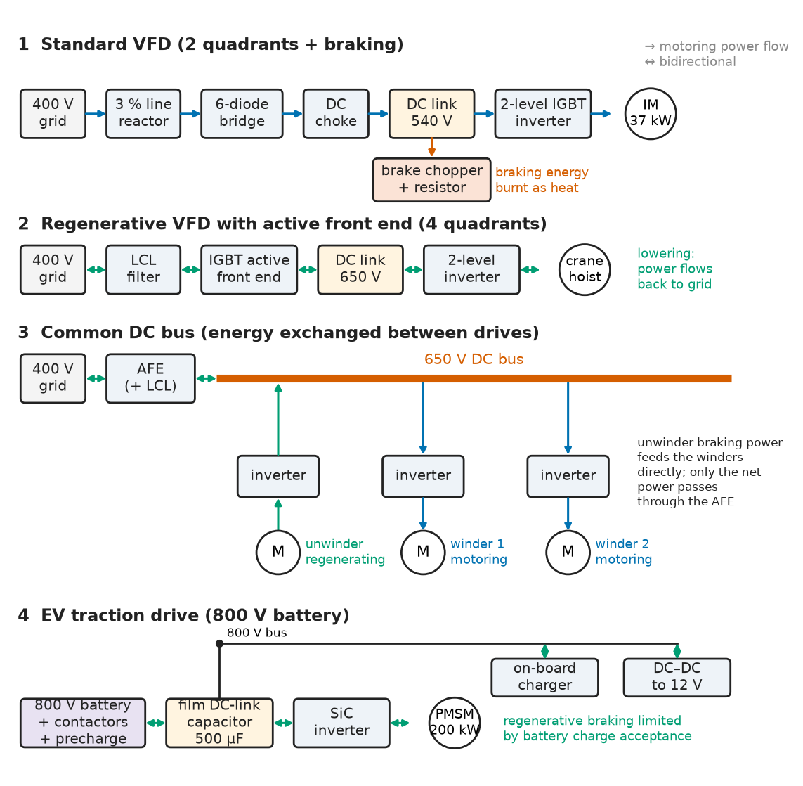
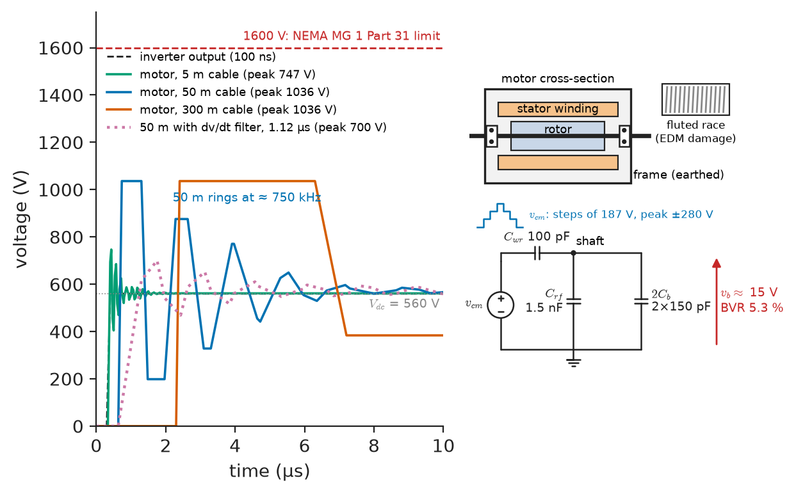
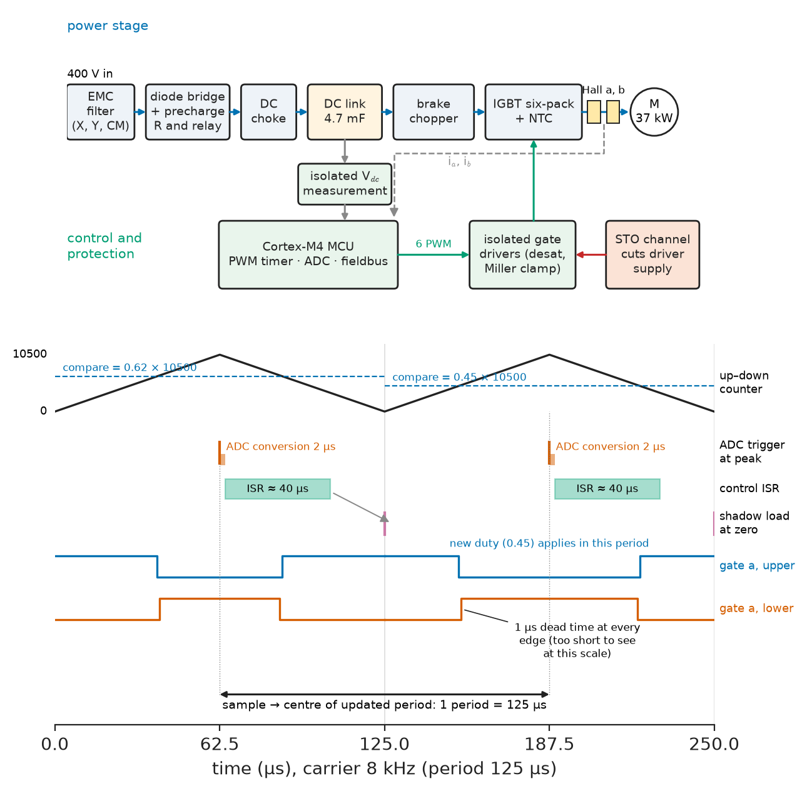
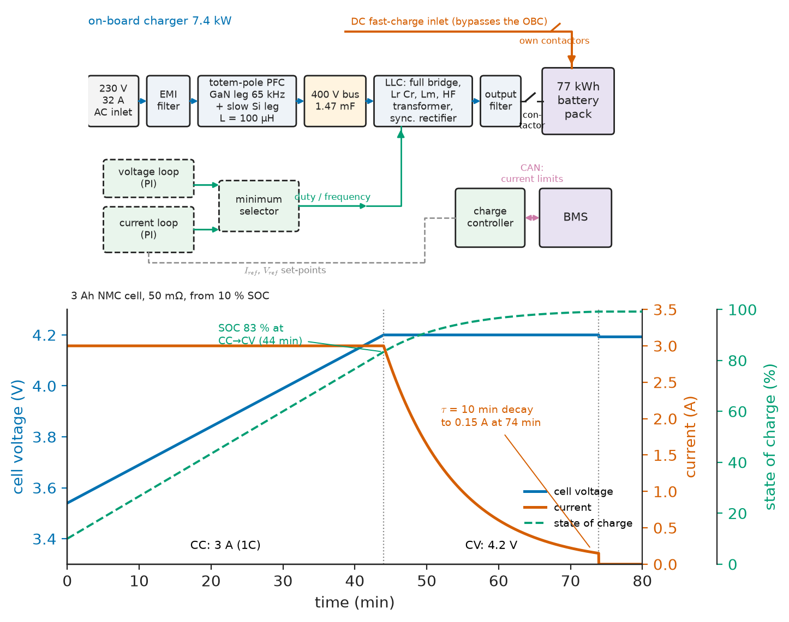
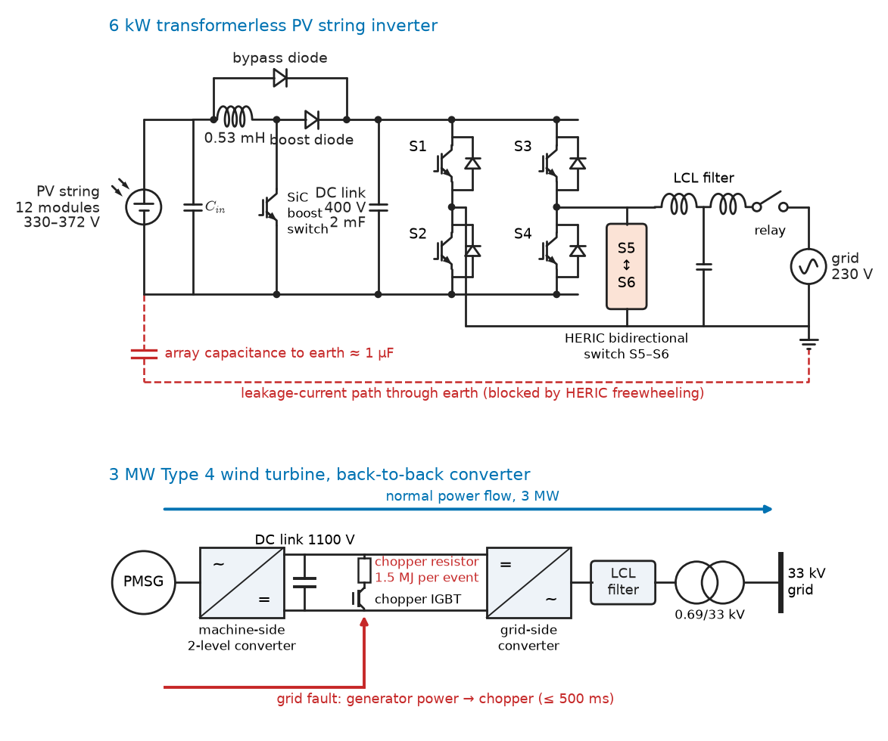
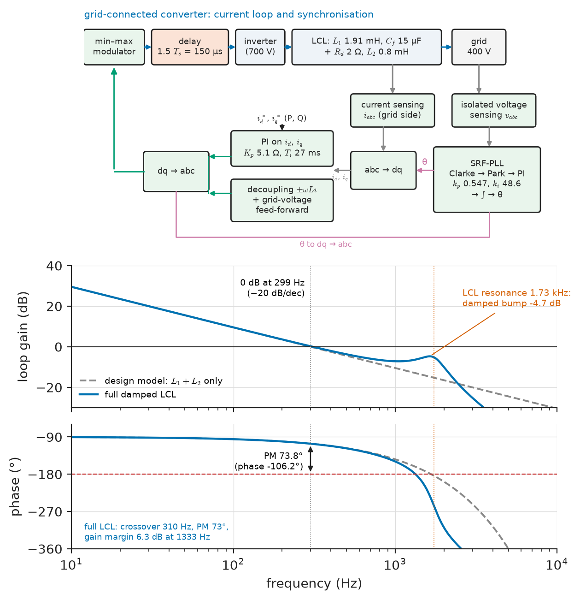

# Chapter 32 — Motor Drives and Power Conversion

*Part VII · Power Electronics*

A water utility replaces the starters of its borehole pumps with variable-frequency drives and, within eighteen months, three of the 75 kW submersible motors fail with turn-to-turn insulation breakdown, 300 m of cable below the drive. A logistics company's electric forklifts regenerate on every descent of the warehouse ramp until a firmware update raises the regenerative current, and the battery contactor starts opening on overvoltage when the pack is full. A wind farm's converters ride through a grid fault perfectly in simulation but trip in the field, because the DC-link chopper was sized for 100 ms and the grid code asked for 500 ms. None of these is a control-theory failure. They are failures of the power-electronic hardware that sits between a source and a machine or a grid: the edge rate of an inverter meeting a long cable, the receptivity of a battery meeting a regenerating motor, the energy rating of a resistor meeting a grid code. This chapter assembles the converters of Chapters 29–31 into drives, chargers and renewable converters, and follows each one to the interface where it usually fails.

> **How are rectifiers, inverters and DC–DC stages combined into motor drives, battery chargers and renewable-energy converters, and what does each interface (cable, motor, battery, PV array, grid) demand of the hardware?**
> **How are regeneration, synchronisation and current control implemented at the circuit level, and where do they break?**

| Concept | Engineering destination |
|---|---|
| Drive architectures | Choosing between diode front end, active front end, common DC bus, matrix and multilevel drives |
| DC motor drive converters | Thyristor DC drive retrofits, automotive and servo H-bridges, battery-vehicle choppers |
| Induction motor drive interfaces | Cable length limits, dv/dt and sine filters, insulation and bearing protection |
| Variable-frequency drives | Power module, DC link, current sensing, gate supply, the control ISR, EMC filter |
| Converter-fed machines | PMSM safe states, BLDC commutation, switched-reluctance converters, high-speed machines |
| Regenerative operation | Brake choppers, active front ends, common DC buses, EV regeneration limits |
| Battery charging | CC–CV chargers, EV on-board chargers, DC fast chargers, portable-device chargers |
| Renewable-energy converters | PV MPPT boost stages, transformerless string inverters, wind back-to-back converters |
| Grid-connected converter fundamentals | PLL and current-loop implementation, delays, LCL damping, synchronisation sequence |

**Roadmap.** Architectures (32.1) → DC drive converters (32.2) → what a PWM inverter does to a motor and its cable (32.3) → the hardware of a VFD (32.4) → machine-specific converter issues (32.5) → regeneration (32.6) → chargers (32.7) → PV and wind converters (32.8) → grid-connected converter hardware, PLL and current control (32.9).

> **Boundary.** Drive mechanics, four-quadrant operation and drive selection are owned by *Electrical Energy and Machines*, [Ch. 10](https://github.com/The-Studio-of-Sadiq/Electrical-Energy-and-Machines/blob/main/part-3-motor-drives/10-drive-system-fundamentals.md); DC drive control by [Ch. 11](https://github.com/The-Studio-of-Sadiq/Electrical-Energy-and-Machines/blob/main/part-3-motor-drives/11-dc-motor-drives.md); V/f, FOC, DTC and PMSM control by [Ch. 12](https://github.com/The-Studio-of-Sadiq/Electrical-Energy-and-Machines/blob/main/part-3-motor-drives/12-ac-motor-drives.md); battery cells, BMS and state estimation by [Ch. 16](https://github.com/The-Studio-of-Sadiq/Electrical-Energy-and-Machines/blob/main/part-4-power-generation/16-energy-storage.md); PV and wind resources and MPPT algorithms by [Ch. 15](https://github.com/The-Studio-of-Sadiq/Electrical-Energy-and-Machines/blob/main/part-4-power-generation/15-renewable-energy-systems.md); harmonic limits by [Ch. 25](https://github.com/The-Studio-of-Sadiq/Electrical-Energy-and-Machines/blob/main/part-7-power-quality-and-grid-modernization/25-power-quality.md); grid codes, PLL concepts and P–Q control by [Ch. 27](https://github.com/The-Studio-of-Sadiq/Electrical-Energy-and-Machines/blob/main/part-7-power-quality-and-grid-modernization/27-grid-integration-of-renewable-energy.md). This chapter cites those results and supplies the converter hardware; the converter circuits themselves are from [Chapter 29](29-power-electronic-fundamentals.md), [Chapter 30](30-dc-dc-converters.md) and [Chapter 31](31-ac-dc-and-dc-ac-conversion.md).

---

## 32.1 Power-electronic drive architectures

A drive is a chain: supply → front end → DC link (or none) → machine-side converter → cable → machine. Each link is chosen from a small menu, and the combinations that survive in practice are summarised in Table 32.1.

**Table 32.1 — Power-electronic drive architectures (typical).**

| Architecture | Front end | Machine side | Quadrants | Typical range and use |
|---|---|---|---|---|
| Thyristor DC drive | 6-pulse thyristor bridge (dual for 4Q) | None (DC armature) | 2 or 4 | 5 kW–10 MW; mill retrofits, excavators |
| DC chopper drive | DC source or diode bridge | 1-, 2- or 4-quadrant chopper | 1–4 | 0.1–50 kW; forklifts, actuators, servo amplifiers |
| Standard VFD | 6-pulse diode bridge, DC choke | 2-level IGBT inverter, brake chopper | 2 (+braking) | 0.2 kW–2 MW; pumps, fans, conveyors |
| Regenerative VFD | Active front end (IGBT, LCL) | 2-level inverter | 4 | 5 kW–5 MW; cranes, lifts, test benches |
| Common DC bus | One AFE or diode bridge | Several inverters on one bus | 4 (internal exchange) | Paper machines, printing lines, CNC cells |
| EV traction inverter | Battery (400 or 800 V) | 2-level SiC or IGBT inverter | 4 | 50–500 kW; cars, buses, trucks |
| MV drive | Multi-pulse transformer or AFE | 3-level NPC, cascaded H-bridge, MMC | 2–4 | 0.5–100 MW; compressors, mills, ship propulsion |
| Matrix converter | None (direct AC–AC, 9 bidirectional switches) | — | 4 | 5–500 kW; niche, lifts, compact drives |
| LCI / CSI | Thyristor or PWM current-source rectifier | Thyristor or GTO/IGCT current-source inverter | 4 | 5–100 MW synchronous motors |

<!-- FIGURE 32.1 | figures/ch32/fig-32-1-drive-architectures.png | block-diagram | Four drive architectures compared on one page: standard VFD, regenerative VFD, common DC bus and EV traction inverter. | Content: four rows, each left to right with power-flow arrows. Row 1: 400 V grid, 3 percent line reactor, 6-diode bridge, DC choke, DC link 540 V, brake chopper with resistor, 2-level IGBT inverter, induction motor 37 kW. Row 2: 400 V grid, LCL filter, IGBT active front end, DC link 650 V, 2-level inverter, crane hoist motor; bidirectional arrows. Row 3: one AFE feeding a 650 V DC bus shared by three inverters (unwinder motor regenerating, two winders motoring) with arrows showing energy exchanged on the bus. Row 4: 800 V battery with contactors and precharge, DC-link film capacitor 500 microfarad, SiC inverter, PMSM 200 kW, on-board charger and DC-DC converter branching from the same bus. -->



*Figure 32.1 — Four drive architectures compared on one page: standard VFD, regenerative VFD, common DC bus and EV traction inverter.*

The architecture is decided by three questions. *Does the load regenerate, how often and how much?* (Section 32.6). *What does the supply tolerate?* A six-pulse diode bridge draws 30–45 % current THD, acceptable for one drive on a stiff bus but not for a dozen (*Electrical Energy and Machines*, Ch. 25 §25.3). *What does the machine tolerate?* Fast edges and long cables call for filters or multilevel converters (Section 32.3). Figure 32.1 shows the four architectures that cover most low-voltage applications. The matrix converter, which promises a drive without a DC-link capacitor, has stayed niche because its output voltage is limited to 86.6 % of the input, it has no ride-through energy and its 18 switches cost more than a capacitor bank.

---

## 32.2 DC motor drives

### Thyristor converters: the firing hardware

The thyristor armature converter and its averaged behaviour, power factor and four-quadrant dual-bridge arrangement are covered in *Electrical Energy and Machines*, Ch. 11 §11.1 and §11.6; the bridge equations, overlap and inversion limit in Section 31.1. What makes a thyristor drive work in hardware is its firing system.

- **Synchronisation.** Firing angles are measured from the natural commutation points of the supply. Old drives derived them from a ramp reset at each zero crossing of a filtered line voltage (the "cosine-crossing" or ramp-comparator method); modern digital drives run a PLL on the measured line voltages (Section 32.9) so that the timing survives notched, distorted and frequency-varying supplies.
- **Gate pulses.** A phase-control thyristor needs a gate current well above its $I_{GT}$ (typically 100–200 mA for a 100–500 A device) with a fast rise (about 1 A/µs) to spread conduction across the die and avoid $di/dt$ failure. The gate is driven through a **pulse transformer** for isolation, with a **pulse train** (for example 10 kHz bursts for 120°) rather than a single pulse, so that the thyristor still turns on if the anode current is momentarily below its latching current, as happens with an inductive load or in discontinuous conduction.
- **Double pulsing.** In a six-pulse bridge two thyristors (one upper, one lower) must conduct to start current; each thyristor is fired again 60° after its main pulse so that the bridge can start from zero current.
- **Dual-converter logic.** In a circulating-current-free dual converter, current-zero detection must confirm that the conducting bridge has stopped before the other is released, with a dead interval of a few milliseconds; a false zero detection fires both bridges into a supply short circuit.

### Choppers and H-bridges

Below about 50 kW and wherever the source is DC, the armature supply is a chopper (*Electrical Energy and Machines*, Ch. 11 §11.3, for the quadrants, averaged model and ripple). The hardware is the half-bridge or H-bridge of Section 31.2 built from MOSFETs at 12–80 V and IGBTs or SiC above. In an H-bridge for a brushed motor, one leg is usually held static (selecting direction) while the other is PWM-switched, which halves the switching loss compared with switching both legs.

**Worked example — an automotive H-bridge.** A 12 V brushed-DC actuator (an electric parking brake or seat motor; supply 9–16 V, 14 V nominal) draws 30 A at stall-limited peak. Four 40 V MOSFETs with $R_{DS(on)}=1.0$ mΩ at 25 °C (about 1.6 mΩ at 125 °C) switch at 20 kHz, above audibility, with 100 ns rise and fall times.

- Conduction: two MOSFETs carry the current at every instant, $2\times30^2\times1.6\times10^{-3}=2.9$ W.
- Switching, one leg switching: $\tfrac12\times14\times30\times(200\times10^{-9})\times20\,000=0.84$ W.
- Gate drive: with $Q_g=100$ nC at 10 V, two gates switching give $2\times100\times10^{-9}\times10\times20\,000=0.04$ W, negligible.

About 3.8 W in four small packages is removable through a PCB with thermal vias into the aluminium housing. The design constraints that remain are automotive ones: reverse-battery protection (a series MOSFET or a high-side driver that blocks reverse current), load-dump surges of tens of volts per ISO 16750-2 (clamped by a TVS diode), and an AEC-Q101-qualified MOSFET. Raising the switching frequency further would buy nothing: the motor's armature inductance already keeps ripple small, and switching loss would grow.

---

## 32.3 Induction motor drive interfaces

### What the inverter's edges do to the motor

A PWM inverter delivers voltage pulses with rise times of 50–200 ns (IGBT) or 10–50 ns (SiC). To such edges the motor cable is a transmission line (*Circuits, Signals and Communications*, [Ch. 14 §14.5](https://github.com/The-Studio-of-Sadiq/Circuits-Signals-and-Communications/blob/main/part-3-advanced-network-theory/14-transmission-lines.md), for the reflection coefficient). The cable's characteristic impedance is 30–100 Ω; the motor's high-frequency impedance is several hundred to a few thousand ohms, so the reflection coefficient at the motor is $\Gamma_m=0.8$–0.95, while the inverter end, a low impedance, reflects with $\Gamma_s\approx-1$. Once the cable's one-way propagation time exceeds about half the rise time, the reflected wave arrives before the edge has finished and the motor terminal voltage approaches

$$
\hat V_m\approx V_{dc}\,(1+\Gamma_m)
$$

The cable length at which this happens is the **critical length**

$$
l_c\approx\frac{v\,t_r}{2}
$$

with $v\approx150$ m/µs for typical PVC and XLPE motor cables.

> **Status of the principle: Reflected-wave overvoltage**
> *Approximate.* A lossless-line model with a resistive termination; cable losses damp the ringing on very long runs, the motor's capacitance shapes the waveform, and two successive edges closer together than the ring-down time (minimum pulse width, polarity reversal) can push the peak toward $3V_{dc}$, which is why drives enforce a minimum pulse spacing.

**Worked example — the borehole pumps.** The drives of the opening run at $V_{dc}=560$ V with IGBT rise times of 100 ns into 300 m of cable.

- Critical length: $150\times0.1/2=7.5$ m, so at 300 m full reflection is certain; with SiC at 20 ns it would be 1.5 m.
- Motor terminal peak with $\Gamma_m=0.85$: $560\times1.85=1036$ V per edge, more with double pulsing. NEMA MG 1 Part 31 inverter-duty motors at 600 V and below are specified for 1600 V peak with rise times of at least 0.1 µs, and IEC TS 60034-25 gives similar limit curves; the submersible motors, rewound to an old specification, were not inverter-duty, and partial discharge in the first turns eroded the enamel.
- The same arithmetic for a 690 V drive ($V_{dc}\approx930$ V) gives 1720 V, above the 1600 V class even for inverter-duty motors: 690 V drives on long cables need filters or reinforced insulation as a rule.
- A **dv/dt filter** (a series reactor of about 0.5–1 % with an RC network) that limits the edge to 500 V/µs stretches the rise time to $560/500=1.12$ µs, raising the critical length to 84 m and keeping the peak well below 1.2 kV on most cable runs; for 300 m of cable, a full **sine filter** (an LC low-pass at about one-sixth of the switching frequency) is the robust choice, at the cost of a few per cent voltage drop and of the drive's ability to identify the motor at standstill.

### Common-mode voltage and bearing currents

The three phase voltages of a two-level inverter never sum to zero: their average, the **common-mode voltage** $v_{cm}=(v_{a0}+v_{b0}+v_{c0})/3$, steps by $V_{dc}/3$ (187 V on a 560 V link) at every switching edge and swings between $\pm V_{dc}/2$ during zero vectors. It drives current through every stray capacitance from winding to earth. With 5 nF of cable-plus-winding capacitance and a 100 ns edge, each 187 V step pushes a pulse of about $5\times10^{-9}\times187/10^{-7}\approx9$ A peak into the protective earth, which is why drives need careful earthing and why residual-current devices of type B (IEC 60755) with high-frequency immunity are specified upstream.

Inside the motor, the stator winding couples capacitively to the rotor ($C_{wr}$), the rotor to the frame ($C_{rf}$) and the bearings form small capacitors ($C_b$) while their lubricating film is intact. The shaft voltage is a capacitive divider of the common-mode voltage, set by the **bearing voltage ratio**

$$
\mathrm{BVR}=\frac{C_{wr}}{C_{wr}+C_{rf}+2C_b}
$$

typically 2–10 %. With $C_{wr}=100$ pF, $C_{rf}=1.5$ nF and $C_b=150$ pF, $\mathrm{BVR}=5.3\,\%$ and a 280 V common-mode peak puts about 15 V across each bearing, enough to break down a lubricant film of a fraction of a micrometre. The discharge (**EDM bearing current**) melts microscopic craters, and after months the races show the washboard **fluting** pattern. Large motors (frame sizes above about 280, roughly 100 kW and up) also suffer **circulating bearing currents** driven by high-frequency flux around the shaft, and poorly earthed motors **rotor-earth currents** through the bearings into the driven machine.

> **Status of the principle: Bearing-voltage capacitive divider**
> *Approximate.* Treats the motor's internal coupling as lumped capacitances and the bearing as a capacitor until breakdown; film thickness varies with speed, temperature and load, so breakdown is statistical, and circulating and rotor-earth currents, which the divider does not describe, dominate in large motors.

The mitigation hierarchy is: symmetrical shielded cable with 360° bonding at both ends (gives the common-mode current a low-impedance path home); a shaft-grounding ring or brush on small and medium motors; an insulated non-drive-end bearing (or ceramic hybrid bearings) on large ones; common-mode chokes (nanocrystalline cores on the output) to slow the common-mode edges; and, at the root, three-level inverters, whose common-mode steps are half as large, or sine filters with a common-mode return path.

<!-- FIGURE 32.2 | figures/ch32/fig-32-2-reflected-wave-bearing.png | waveform | Reflected-wave overvoltage at the motor terminals and the bearing-voltage capacitive divider. | Content: left panel: x-axis time 0 to 10 microseconds, y-axis voltage 0 to 1200 V; inverter output edge 0 to 560 V with 100 ns rise; motor terminal voltage for 5 m cable (overshoot to about 750 V), 50 m cable (overshoot to 1036 V ringing at about 750 kHz) and 300 m cable (peak 1036 V, slower ringing); dashed line at 1600 V labelled NEMA MG 1 Part 31; dotted curve with a dv/dt filter, rise 1.12 microseconds, peak about 700 V. Right panel: motor cross-section sketch with stator winding, rotor, two bearings and frame; capacitors Cwr 100 pF, Crf 1.5 nF and Cb 150 pF per bearing drawn as a divider from the common-mode source vcm (steps of 187 V, peak 280 V); bearing voltage about 15 V marked, with an inset of a fluted bearing race. -->



*Figure 32.2 — Reflected-wave overvoltage at the motor terminals and the bearing-voltage capacitive divider.*

Figure 32.2 shows both effects for the borehole pump: the terminal overshoot rising with cable length, the dv/dt-filtered edge, and the capacitive divider that places a few per cent of the common-mode voltage across the bearings.

---

## 32.4 Variable-frequency drives

### The hardware

The VFD's power circuit, ratings and control modes are described in *Electrical Energy and Machines*, Ch. 12 §12.1. Opened up, a 37 kW drive contains:

- **Input stage**: EMC filter (X and Y capacitors, common-mode choke) to IEC 61800-3 category C2 or C3, varistors, a diode or half-controlled thyristor bridge, precharge resistor and bypass relay (Section 31.9), and a DC choke of 2–4 % or an AC reactor.
- **DC link**: electrolytic capacitors (series pairs, Section 31.4) of 50–150 µF/kW, or in **slim DC-link** drives film capacitors of only 2–10 µF/kW, which leaves the link voltage with 300 Hz ripple but draws a line current closer to the ideal six-pulse blocks (THD near 30 % without a choke).
- **Inverter**: a six-pack or three half-bridge IGBT modules with an NTC thermistor, on a forced-air heatsink; brake chopper IGBT in the same module.
- **Gate drive**: isolated gate drivers (optocoupler, capacitive or magnetic isolation, rated for common-mode transient immunity above 50 kV/µs), each with a desaturation detector, active Miller clamp and soft turn-off; isolated supplies at +15/−8 V for IGBTs or +18/−3 V for SiC, often a bootstrap supply for the lower devices and a multi-winding flyback for the upper ones.
- **Sensing**: two or three output currents (Hall or fluxgate sensors above about 30 A, shunts with isolated sigma–delta modulators below), the DC-link voltage through a resistive divider and isolated amplifier, heatsink temperature, and an encoder or resolver interface when fitted.
- **Control board**: a microcontroller or DSP (a Cortex-M4/M7 at 150–600 MHz, or a C2000-class DSP), with the PWM timer, ADCs triggered by the timer, fieldbus interfaces and a separate safety channel for STO that removes gate-driver power in hardware.

### The control interrupt

Everything the drive does is synchronised to the PWM carrier. The timer's centre-aligned counter (Section 31.3) triggers the ADCs at its peak, where the upper switches of all legs are off for the zero vector 000: low-side shunts then carry the phase currents, and the switching ripple of an inductive load passes through its average at exactly that instant. The conversion-complete interrupt runs the control law, which belongs to the drive (*Electrical Energy and Machines*, Ch. 12 §12.3–12.8), then corrects for dead time and writes the new compare values, which the timer loads at the next period boundary. Listing 32.1 is that interrupt, reusing the modulator of Listing 31.1.

```c
#include <stdint.h>
#include "pwm.h"     /* pwm_cmp_t and svpwm_compare() from Listing 31.1 */

#define TD_S       1.0e-6f    /* dead time, s */
#define FS_HZ      8000.0f    /* switching frequency, Hz */
#define I_BAND     0.5f       /* A: current sign linearised inside this band */
#define PWM_PERIOD 10500u     /* 168 MHz timer clock / (2 x 8 kHz) */

enum { ADC_IA, ADC_IB, ADC_VDC };
extern float adc_amps(int ch);
extern float adc_volts(int ch);
extern void  control_update(float ia, float ib, float vdc,
                            float *va, float *vb, float *vc);
extern volatile uint32_t TIM1_CCR[3];   /* illustrative compare registers */

/* Volt-second correction for one leg, added to its voltage reference. */
static inline float dt_comp(float i, float vdc)
{
    float s = i / I_BAND;
    if (s > 1.0f)  s = 1.0f;
    if (s < -1.0f) s = -1.0f;
    return s * TD_S * FS_HZ * vdc;
}

void adc_pwm_peak_isr(void)          /* triggered at the counter peak */
{
    float ia = adc_amps(ADC_IA), ib = adc_amps(ADC_IB), ic = -ia - ib;
    float vdc = adc_volts(ADC_VDC);
    float va, vb, vc;

    control_update(ia, ib, vdc, &va, &vb, &vc);   /* V/f or FOC */
    va += dt_comp(ia, vdc);
    vb += dt_comp(ib, vdc);
    vc += dt_comp(ic, vdc);

    pwm_cmp_t c = svpwm_compare(va, vb, vc, vdc, (uint16_t)PWM_PERIOD);
    for (int k = 0; k < 3; k++) TIM1_CCR[k] = c.ccr[k];
}
```

The compensation term is the dead-time error of Section 31.2 with the opposite sign. Near current zero the sign is uncertain (ripple crosses zero several times per period), so the listing linearises it over a small band instead of switching abruptly, which would itself inject distortion. The whole interrupt must finish well inside one period (125 µs at 8 kHz); its timing budget, priority and jitter are real-time-system problems treated in [Chapter 27](../part-6-embedded-and-real-time-systems/27-real-time-computing.md). The latency from sampling to new PWM output, about one period (half a period until the new compare values load at the counter zero, plus half a period because the new duty's volt-seconds are centred in the following period), is the dominant delay of every current loop (Section 32.9).

<!-- FIGURE 32.3 | figures/ch32/fig-32-3-vfd-hardware-timing.png | timing-diagram | Inside a 37 kW VFD: hardware blocks and the timing of one control period at 8 kHz. | Content: top half, block diagram: EMC filter, diode bridge with precharge relay, DC choke, 4.7 mF DC link, IGBT six-pack with NTC, brake chopper, isolated gate drivers with desat, Hall current sensors on phases a and b, isolated DC-link voltage measurement, Cortex-M4 MCU (timer, ADC, fieldbus), STO channel cutting gate-driver supply. Bottom half, timing over two periods of 125 microseconds: up-down counter triangle 0 to 10500; ADC trigger pulses at each counter peak; ADC conversion 2 microseconds; ISR execution about 40 microseconds; compare-register shadow load at the next counter zero; resulting gate signals of leg a with 1 microsecond dead time; annotate total sampling-to-output delay of 1 period (125 microseconds), from the sample to the centre of the updated period. -->



*Figure 32.3 — Inside a 37 kW VFD: hardware blocks and the timing of one control period at 8 kHz.*

Figure 32.3 places the blocks and the interrupt timing side by side.

### Ride-through

A drive's DC link stores little energy relative to its power. When the supply dips, the inverter keeps drawing power and the link voltage falls toward the undervoltage trip.

**Worked example — how long does a 37 kW drive ride through?** The DC link is 4.7 mF at 540 V and the undervoltage trip is 430 V. The usable energy is $\tfrac12\times4.7\times10^{-3}\times(540^2-430^2)=251$ J, which supplies 37 kW for only 6.8 ms. A 100 ms voltage sag, the most common disturbance on industrial networks (*Electrical Energy and Machines*, Ch. 25 §25.6), would trip the drive. **Kinetic buffering** solves it: on detecting the dip the controller lowers the output frequency slightly so that the motor regenerates from the load's inertia and holds the link at a setpoint near 480 V, trading speed for time; a fan or pump loses a few per cent of speed and rides through a sag of several hundred milliseconds. Drives on processes that cannot tolerate speed loss use a DC-link supercapacitor or battery module instead.

---

## 32.5 Converter-fed machines

Each machine type asks something specific of the converter.

**Permanent-magnet synchronous machines.** A PMSM generates a back-EMF whenever it turns, whether or not the inverter is switching. If the gates are turned off at high speed, the inverter's six diodes form a rectifier, and once the motor's peak line-to-line EMF exceeds the DC-link voltage, current flows uncontrolled into the link: **uncontrolled generator mode** (UCG). The alternative safe state is the **active short circuit** (ASC), which turns on all three lower (or upper) switches so that the windings are shorted; the short-circuit current settles at about $\psi_{PM}/L_d$, independent of speed at high speed, and the braking torque is small there.

**Worked example — the safe state of a traction motor.** A PMSM with 4 pole pairs, magnet flux linkage $\psi_{PM}=0.08$ Wb (peak, per phase) and $L_d=0.3$ mH runs from a 400 V battery to 14 000 rpm.

- The peak line-to-line EMF equals $\sqrt3\,\omega_e\psi_{PM}$. It reaches 400 V at $\omega_e=400/(\sqrt3\times0.08)=2887$ rad/s, which is $2887/4\times60/(2\pi)=6890$ rpm.
- At 14 000 rpm ($\omega_e=5864$ rad/s) the EMF is 813 V peak line to line, twice the battery voltage. Opening the gates there would push a large uncontrolled current into the battery and the DC-link capacitor, and if the battery contactor is also open, the capacitor charges toward 813 V, beyond the 650 V rating of its devices.
- ASC current: $0.08/0.3\times10^{-3}=267$ A peak, below the inverter's 300 A rating, so the windings and switches can carry it indefinitely at high speed.

The fault strategy is therefore speed-dependent: freewheel (gates off) below about 6000 rpm, ASC above, with a hardware path that applies ASC even if the controller fails. This is the emergency-stop problem of *Electrical Energy and Machines*, Ch. 12, seen from the converter side, and it is one of the safety goals (typically ASIL C or D under ISO 26262) of every traction inverter.

**Brushless DC (BLDC) motors** with trapezoidal back-EMF use **six-step commutation**: three Hall sensors (or back-EMF zero-crossing detection on the floating phase) select which two phases conduct in each 60° sector, and PWM on one switch sets the current. The hardware is the three-phase bridge with a simpler modulator; fans, pumps, drones and power tools use it by the hundred million.

**Switched-reluctance motors** need unipolar current and are fed from an **asymmetric half-bridge** per phase (two switches, two diodes), which cannot shoot through (each switch is in series with the winding) and gives each phase independent control; their torque ripple and acoustic noise confine them to rugged applications (mining, some appliances, a few EVs).

**High-speed machines** (spindles at 30 000–100 000 rpm, compressors, turbo-generators) have fundamental frequencies of 1–3 kHz. A carrier ratio of at least 10–20 then forces switching frequencies of 20–60 kHz, which is SiC territory, and their low inductance makes current ripple large unless an output filter or a multilevel inverter is used.

---

## 32.6 Regenerative operation

Where braking energy goes, and the system-level choice between dissipation and regeneration, is set out in *Electrical Energy and Machines*, Ch. 10 §10.4. Here is the hardware of each option.

### The brake chopper

A brake chopper is an IGBT and a resistor in series across the DC link, with a freewheeling diode across the resistor's inductance. A comparator with hysteresis turns it on when the link rises above a threshold (750 V on a 400 V drive) and off a few tens of volts lower; some drives modulate it with PWM proportional to the excess voltage instead. Its design has three numbers: the resistance (from the peak power at the threshold voltage), the IGBT current, and the resistor's energy and duty rating.

**Worked example — a crane hoist chopper.** A 22 kW hoist lowers its rated load for 15 s in every 120 s cycle, with peak braking power up to 150 % (33 kW) during deceleration.

- Resistance: $R\le750^2/33\,000=17\ \Omega$. With 17 Ω the chopper absorbs 33.1 kW at 750 V and carries $750/17=44$ A, so a 1200 V, 50–75 A IGBT (often the seventh switch in the inverter module) suffices.
- Energy per lowering: $22\times15=330$ kJ; average power $22\times15/120=2.75$ kW.
- The resistor is specified for 2.75 kW continuous *and* for a 330 kJ, 15 s pulse every 120 s; a resistor rated only for average power would overheat during each pulse, and one rated for 22 kW continuous would be eight times larger than necessary.

### The active front end

An active front end is the three-phase inverter of Chapter 31 connected to the grid through an L or LCL filter and run as a **boost rectifier**: it controls its AC currents to be sinusoidal and in phase (or antiphase, when regenerating) with the grid voltage, and regulates the DC link above the peak line voltage. Because its PWM can only synthesise line-to-line voltages up to $V_{dc}$, a 400 V AFE needs at least 566 V on its link plus the filter drop; at 650 V it can synthesise up to $650/\sqrt2=460$ V line, a 15 % margin for the inductor drop and grid overvoltage. The control is that of the grid-connected converter of Section 32.9 with an outer DC-voltage loop. An AFE costs roughly 1.5–2 times a diode front end and adds 1–1.5 % loss, so it is chosen where regeneration is frequent (lifts, cranes, centrifuges, test benches) or harmonic limits are tight (3–5 % THD).

### Common DC bus and battery receptivity

A **common DC bus** connects several inverters to one link, so that a braking machine (an unwinder) feeds a motoring one (a winder) directly; only the net power passes through the front end. In battery systems the receiver is the battery, whose **charge acceptance** falls when it is full, cold or near its voltage limit (*Electrical Energy and Machines*, Ch. 16 §16.3). The forklift of the opening regenerated into a full pack: its BMS saw cell overvoltage and opened the contactor, leaving the inverter regenerating into a capacitor alone. The correct arrangement is a regenerative current limit computed from the BMS's live charge-power limit, with a brake chopper or mechanical brake taking the rest, and an inverter strategy that never regenerates into an open contactor.

---

## 32.7 Battery charging

### CC–CV charging

Lithium-ion cells are charged **constant current, then constant voltage** (CC–CV): the charger supplies a set current (0.5–1C for most cells, 2–4C for fast-charge cells) until the cell voltage reaches its limit (4.2 V for NMC, 3.65 V for LFP), then holds that voltage while the current decays, and terminates when the current falls to a set fraction (C/10 to C/20). A deeply discharged cell (below about 3.0 V for NMC) is first **precharged** at C/10 so that a damaged cell is not forced, and a timer and a temperature window (typically 0–45 °C on charge) abort the charge. The cell physics and the limits come from *Electrical Energy and Machines*, Ch. 16 §16.1–16.3; the charger enforces them.

In hardware, CC–CV is two error amplifiers, one for current and one for voltage, whose outputs are combined by a **minimum selector** (diode-OR in analogue chargers, a `min()` in digital ones) before driving the PWM stage: whichever loop demands less output controls, so the transition from CC to CV is automatic and bumpless. Firmware supervises the states around it, as in Listing 32.2.

```c
#include <stdbool.h>

typedef enum { CHG_PRECHARGE, CHG_CC, CHG_CV, CHG_DONE, CHG_FAULT } chg_state_t;

typedef struct {
    float v_pre, v_cv, v_abort;   /* V per cell: precharge exit, CV set, abort */
    float i_pre, i_cc, i_term;    /* A: precharge, constant current, termination */
    float t_max_s;                /* safety timer, s */
} chg_cfg_t;

/* Called every 100 ms. Returns the current limit for the power stage, whose
   inner voltage loop is always set to v_cv; the minimum selector in the
   stage makes the voltage loop take over automatically in CV. */
float chg_step(const chg_cfg_t *c, chg_state_t *s, float v, float i,
               bool temp_ok, float *t_s)
{
    *t_s += 0.1f;
    if (!temp_ok || v > c->v_abort || *t_s > c->t_max_s)
        *s = CHG_FAULT;

    switch (*s) {
    case CHG_PRECHARGE:
        if (v >= c->v_pre) *s = CHG_CC;
        return c->i_pre;
    case CHG_CC:
        if (v >= c->v_cv) *s = CHG_CV;
        return c->i_cc;
    case CHG_CV:
        if (i <= c->i_term) *s = CHG_DONE;
        return c->i_cc;           /* voltage loop is now limiting */
    default:                      /* CHG_DONE, CHG_FAULT */
        return 0.0f;
    }
}
```

The firmware never commands the CV phase directly; it only decides when charging may start and must stop. That division (fast analogue or fixed-function loops, slow supervisory firmware) is typical of every safe power-electronic product.

**Worked example — CC–CV timing of a phone cell.** A 3 Ah NMC cell is charged at 1C (3 A) to 4.2 V and terminated at C/20 (0.15 A). Model its open-circuit voltage as rising linearly from 3.3 V (empty) to 4.2 V (full), with a lumped resistance of 50 mΩ.

- CC ends when $\mathrm{OCV}+IR=4.2$ V, i.e. at an OCV of $4.2-0.15=4.05$ V, a state of charge of $0.75/0.9=83\,\%$. From 10 % this takes $0.733\times3\ \mathrm{Ah}/3\ \mathrm{A}=0.733$ h, 44 min.
- In CV, $I=(4.2-\mathrm{OCV})/R$ decays exponentially with time constant $\tau=RQ/(dV_{oc}/ds)=0.05\times10\,800/0.9=600$ s. Falling from 3 A to 0.15 A takes $\tau\ln20=1800$ s, 30 min, to add the last 17 %.

The CV phase takes 40 % of the time for 17 % of the charge, the familiar slow finish of every phone. Fast-charge protocols raise the CC current, not the CV voltage, and split the CC phase into steps that follow the cell's lithium-plating limit.

> **Status of the principle: CC–CV charge timing with a linear-OCV, single-resistance cell**
> *Approximate.* Captures the automatic CC-to-CV transition and the exponential current decay; real cells have a curved OCV, a diffusion time constant and temperature-dependent resistance, so the CV phase is usually longer than predicted and the transition point moves with temperature and age.

### EV chargers

An EV has an **on-board charger** (OBC) for AC charging and accepts **DC fast charging** from an off-board charger that bypasses the OBC. Both follow the same two-stage pattern (Figure 32.4):

1. **PFC stage.** A boost converter (Chapter 30) after the rectifier, or a bridgeless **totem-pole** PFC with GaN or SiC switches, draws a sinusoidal input current at unity power factor (IEC 61000-3-2/-12 compliance) and regulates an intermediate bus of 400–800 V.
2. **Isolated DC–DC stage.** An **LLC resonant** converter or a **dual-active-bridge** (DAB) converter with a high-frequency transformer gives galvanic isolation (required by IEC 61851-1 and ISO 6469) and controls the battery current; the DAB is bidirectional, enabling vehicle-to-load and vehicle-to-grid operation.

Typical OBCs are 3.7–7.4 kW single-phase or 11–22 kW three-phase at 94–96 % efficiency; DC fast chargers are 50–400 kW, built from 20–60 kW modules in parallel, with CCS, CHAdeMO, GB/T or NACS connectors and charging communication per ISO 15118 or DIN 70121.

**Worked example — a 7.4 kW single-phase OBC.** The OBC runs from 230 V, 32 A with a boost PFC at 65 kHz to a 400 V bus, and charges a 77 kWh battery from 10 % to 80 %.

- Input current peak at 7.4 kW drawn from the line: $\sqrt2\times7400/230=45.5$ A.
- PFC inductor for a ripple of 20 % of that peak at the line-voltage peak (325 V, duty $1-325/400=0.187$): $L=325\times0.187/(0.2\times45.5\times65\,000)=103\ \mu$H, so a 100 µH inductor is chosen. The ripple is worst where the input is half the output (200 V), $200\times0.5/(100\times10^{-6}\times65\,000)=15.4$ A peak-to-peak.
- Bus capacitor for 40 V peak-to-peak 100 Hz ripple: $7400/(2\pi50\times400\times40)=1.47$ mF; the LLC stage regulates through that ripple.
- Charging time: $0.7\times77=53.9$ kWh at 92 % wall-to-battery efficiency takes $53.9/(7.4\times0.92)=7.9$ h; an 11 kW three-phase OBC needs 5.3 h, and a 150 kW DC charger roughly 25–30 min, limited by the battery's current acceptance and taper, not by the charger.

<!-- FIGURE 32.4 | figures/ch32/fig-32-4-obc-cccv.png | block-diagram | EV on-board charger architecture and the CC-CV charge profile it delivers. | Content: top: 230 V 32 A AC inlet, EMI filter, totem-pole PFC (GaN half-bridge at 65 kHz plus slow Si leg, boost inductor 100 microhenry), 400 V bus with 1.47 mF capacitor, LLC resonant converter (full bridge, resonant tank Lr Cr, magnetising inductance Lm, high-frequency transformer, synchronous rectifier), output filter, battery contactors to a 77 kWh pack; DC fast-charge inlet bypassing the OBC directly to the pack through its own contactors; BMS and charge controller exchanging current limits over CAN; dashed control blocks for current loop, voltage loop and minimum selector. Bottom: plot of the phone-cell example, x-axis time 0 to 80 min, left axis cell voltage 3.3 to 4.3 V, right axis current 0 to 3.5 A; CC at 3 A for 44 min while voltage rises to 4.2 V, then CV at 4.2 V while current decays exponentially (tau 10 min) to 0.15 A at 74 min; state of charge curve on a secondary scale reaching 83 percent at the CC-CV transition. -->



*Figure 32.4 — EV on-board charger architecture and the CC-CV charge profile it delivers.*

---

## 32.8 Renewable-energy converters

### PV: the MPPT stage

A PV string's maximum-power voltage varies with temperature and irradiance by tens of per cent (*Electrical Energy and Machines*, Ch. 15 §15.1, which also names the MPPT algorithms: perturb-and-observe and incremental conductance). The converter must present the array with an adjustable input voltage while delivering a DC link fit for the inverter. In a single-phase string inverter, a **boost stage** does this: its input capacitor holds the array voltage, its duty ratio sets that voltage relative to the DC link, and the MPPT algorithm, running every 10–100 ms, perturbs the input-voltage reference by a fixed step and keeps the direction that raised power.

**Worked example — the boost stage of a 6 kW string inverter.** Twelve modules give a maximum-power voltage of 372 V at 25 °C, falling to about 330 V on a hot afternoon. The H-bridge needs a 400 V link to make 230 V.

- At 330 V the duty ratio is $1-330/400=0.175$; the input current is $6000/330=18.2$ A.
- Inductor for a 30 % ripple (5.45 A) at 20 kHz: $L=330\times0.175/(5.45\times20\,000)=0.53$ mH.
- On a cold, bright morning the array sits above 400 V and the boost stage simply conducts through its diode (or bypass relay), the H-bridge's own modulation then tracking the MPP; many inverters therefore run a variable DC link.

Three hardware details decide how well MPPT works. The input capacitor must keep the 100 Hz ripple coupled back from the single-phase output small (under about 1 % of the array voltage), or the array oscillates around its MPP and loses energy. The perturbation step must be larger than the measurement noise of $\Delta P$ but small enough that the steady oscillation costs little (1–3 V on a 400 V string is typical). And a periodic scan of the whole P–V curve is needed to escape the local maxima created by partial shading.

### Transformerless PV inverters and leakage current

Removing the line-frequency transformer raises efficiency by 1–2 % but connects the PV array to the grid. A PV array has a capacitance to earth of 50–200 nF per kW (more when wet), and any switching-frequency component in the array's common-mode voltage drives leakage current through it, a safety and EMC hazard: IEC 62109-2 and VDE 0126-1-1 require disconnection when the residual current jumps by 30 mA or exceeds 300 mA. The unipolar H-bridge of Section 31.4 is the problem case; the solutions keep the array's common-mode voltage constant by disconnecting it from the grid during the freewheeling intervals. **H5** adds a fifth switch in the DC link; **HERIC** adds a bidirectional switch across the AC output; the **NPC** and **T-type** three-level legs clamp the output to the grounded neutral during freewheeling. All achieve 97.5–98.5 % European efficiency.

### Wind: back-to-back converters

A full-converter (Type 4) wind turbine feeds its permanent-magnet or induction generator through a **back-to-back** converter: a machine-side inverter (run as a drive, controlling generator torque) and a grid-side inverter (an AFE controlling DC-link voltage and grid current), sharing a DC link of 1050–1200 V at 690 V (*Electrical Energy and Machines*, Ch. 27 §27.1, for the voltage sizing). A doubly fed induction generator (Type 3) uses the same back-to-back pair in its rotor circuit, rated for only the slip power, about 30 % of turbine rating, with a crowbar that short-circuits the rotor during grid faults.

During a grid fault the grid-side converter cannot export power, but the generator keeps producing it for the fraction of a second the pitch system needs to respond. The surplus goes into a **DC-link chopper** (brake resistor). Its energy rating follows directly from the grid code's ride-through duration: a 3 MW turbine required to ride through 500 ms at near-zero voltage must dump up to $3\times0.5=1.5$ MJ per event. The wind farm of the opening had choppers rated for 100 ms, a fifth of that.

<!-- FIGURE 32.5 | figures/ch32/fig-32-5-pv-wind-converters.png | circuit | Renewable converter power stages: a 6 kW single-phase transformerless PV inverter with boost MPPT stage and HERIC output, and a 3 MW Type 4 wind back-to-back converter. | Content: top: PV string 12 modules (330 to 372 V), input capacitor, boost inductor 0.53 mH, SiC boost switch and diode with bypass diode, 400 V DC link 2 mF, H-bridge S1 to S4, HERIC bidirectional switch S5-S6 across the output, LCL filter, relay, 230 V grid; array capacitance to earth 1 microfarad drawn dashed with leakage-current path. Bottom: PMSG, machine-side 2-level converter, DC link 1100 V with chopper (IGBT plus resistor labelled 1.5 MJ per event), grid-side converter, LCL filter, 0.69/33 kV transformer, grid; arrows for normal power flow and for fault-time power into the chopper. -->



*Figure 32.5 — Renewable converter power stages: a 6 kW single-phase transformerless PV inverter with boost MPPT stage and HERIC output, and a 3 MW Type 4 wind back-to-back converter.*

Figure 32.5 shows both power stages, including the leakage-current path through the PV array capacitance that the HERIC switch interrupts.

---

## 32.9 Grid-connected converter fundamentals

The grid-connected voltage-source converter is the common core of the AFE, the PV and battery inverter, the wind grid-side converter, the STATCOM and the active harmonic filter. Its system behaviour (power-angle relations, P–Q control, grid-following versus grid-forming, grid codes) is owned by *Electrical Energy and Machines*, Ch. 27 §27.1–27.4; its filter by Section 31.6. What remains is the implementation: sensing, synchronisation, current control and start-up.

### Synchronisation: the PLL in firmware

The synchronous-reference-frame PLL (*Electrical Energy and Machines*, Ch. 27 §27.2) transforms the measured grid voltages into a frame rotating at the estimated angle, drives the quadrature component $v_q$ to zero with a PI controller and integrates the resulting frequency. With $v_q\approx V_m(\theta_g-\theta)$ for small errors, the loop is second order, and the PI gains for a natural frequency $\omega_n$ and damping $\zeta$ are $k_p=2\zeta\omega_n/V_m$ and $k_i=\omega_n^2/V_m$. Listing 32.3 runs a 20 Hz PLL at 10 kHz against a grid that starts 0.5 Hz off nominal and jumps 30° in phase at 150 ms, as during a nearby fault.

```python
import numpy as np

Ts, Vm, f0 = 1e-4, 325.0, 50.0                 # 10 kHz sampling, phase peak, nominal f
wn, zeta = 2 * np.pi * 20, 0.707               # PLL design: 20 Hz natural frequency
kp, ki = 2 * zeta * wn / Vm, wn**2 / Vm        # PI gains on vq (rad/s per volt)
t = np.arange(0, 0.3, Ts)
theta_g = 2 * np.pi * 50.5 * t + np.where(t >= 0.15, np.radians(30), 0.0)  # +0.5 Hz, 30 deg jump

theta, integ, err, freq = 0.0, 0.0, [], []
for tg in theta_g:
    va, vb, vc = (Vm * np.cos(tg - k * 2 * np.pi / 3) for k in range(3))
    alpha = (2 * va - vb - vc) / 3                       # Clarke (amplitude-invariant)
    beta = (vb - vc) / np.sqrt(3)
    vq = -alpha * np.sin(theta) + beta * np.cos(theta)   # Park, q-axis
    err.append(np.degrees(np.angle(np.exp(1j * (tg - theta)))))
    integ += ki * vq * Ts
    w = 2 * np.pi * f0 + kp * vq + integ                 # estimated angular frequency
    theta = (theta + w * Ts) % (2 * np.pi)
    freq.append(w / (2 * np.pi))

err, freq = np.array(err), np.array(freq)
for t_end in (0.05, 0.149, 0.16, 0.20, 0.30):
    k = int(round(t_end / Ts)) - 1
    print(f"t = {t_end * 1e3:5.0f} ms  phase error {err[k]:6.2f} deg  f = {freq[k]:6.3f} Hz")
settle = t[(np.abs(err) > 2) & (t >= 0.15)].max() - 0.15
print(f"time to stay within 2 deg after the jump: {settle * 1e3:.0f} ms")
```

```text
t =    50 ms  phase error  -0.02 deg  f = 50.496 Hz
t =   149 ms  phase error   0.00 deg  f = 50.500 Hz
t =   160 ms  phase error  -1.68 deg  f = 54.403 Hz
t =   200 ms  phase error   0.24 deg  f = 50.455 Hz
t =   300 ms  phase error   0.00 deg  f = 50.500 Hz
time to stay within 2 deg after the jump: 32 ms
```

The PLL locks to the 0.5 Hz offset with zero steady phase error (the integrator holds the frequency difference) and recovers from the 30° jump within about 32 ms. The price is visible in the frequency estimate: the proportional path kicks it to 64.8 Hz at the instant of the jump and it is still 4 Hz high 10 ms later. A loss-of-mains relay fed with this raw estimate would see an enormous rate of change of frequency and disconnect, which is part of what happened in the 2019 British event described in *Electrical Energy and Machines*, Ch. 27; frequency used for protection or grid support must come from a slower, filtered estimate. Under unbalanced faults the negative-sequence voltage adds a 100 Hz ripple to $v_q$, and practical PLLs separate the sequences first (DSOGI or decoupled double-frame PLL).

> **Status of the principle: Linearised SRF-PLL model**
> *Approximate.* The small-angle approximation $v_q\approx V_m(\theta_g-\theta)$ makes the PLL a linear second-order loop; it holds for phase errors below about 30° and balanced voltages, and the loop gain changes with grid-voltage magnitude unless $v_q$ is normalised, which is why voltage dips also detune an un-normalised PLL.

### Current control at circuit level

In the PLL frame the converter's output currents become DC quantities $i_d$ and $i_q$, regulated by two PI controllers with cross-coupling compensation $\pm\omega L i$ and grid-voltage feedforward. At frequencies well below the LCL resonance the filter looks like its total inductance $L=L_1+L_2$ with resistance $R$, so the plant is $1/(sL+R)$, preceded by the digital delay of sampling, computation and PWM update: about $1.5T_s$ for single-update PWM when the currents are sampled at the start of a period and the new duty applies from the start of the next ($T_s$ with the mid-period sampling of Listing 32.1, Section 32.4). The standard tuning cancels the plant pole with the PI zero ($T_i=L/R$) and chooses the proportional gain for a crossover frequency $\omega_c$, $K_p=\omega_cL$. The delay then costs phase $\omega_c\times1.5T_s$, and the phase margin is about $90^\circ-\omega_c\times1.5T_s$.

**Worked example — tuning the 15 kW inverter's current loop.** With the LCL filter of Section 31.6 ($L=2.71$ mH, $R\approx0.1\ \Omega$) and $f_s=10$ kHz, sampled at the start of each period (delay 150 µs):

- $T_i=L/R=27$ ms for any bandwidth.
- At $f_c=1$ kHz: $K_p=2\pi\times1000\times2.71\times10^{-3}=17.0\ \Omega$, but the delay costs $360^\circ\times1000\times150\times10^{-6}=54^\circ$, leaving a 36° margin: too oscillatory.
- At $f_c=600$ Hz: $K_p=10.2\ \Omega$, delay phase 32.4°, margin 57.6°, but only on the $L_1+L_2$ model. On the full LCL with $R_d=2\ \Omega$ the loop crosses over at 720 Hz with a 49° margin, and the resonance lifts the gain to +1.3 dB near 1.6 kHz, where the phase is already past −180°: the gain margin (at 1.33 kHz) is 0.3 dB, and without $R_d$ the loop is unstable.
- At $f_c=300$ Hz: $K_p=5.1\ \Omega$, margin 74° on the simple model; on the full model, crossover 310 Hz, phase margin 73°, gain margin 6.3 dB. This is the setting adopted.

With an L filter the digital delay alone limits current-loop bandwidth to about $f_s/15$–$f_s/20$; with an LCL filter the resonance must also be checked on the full model, because near $f_s/6$ (1.67 kHz here) the delay has already brought the phase to −180°. Keeping 600 Hz would need active damping. If the resonance falls below about $f_s/6$, the delay makes the loop unstable unless the filter is damped passively ($R_d$ of Section 31.6) or actively by feeding back the filter-capacitor current. Double-update PWM (sampling at both counter peak and valley) halves the delay and lets the bandwidth roughly double.

<!-- FIGURE 32.6 | figures/ch32/fig-32-6-grid-current-loop.png | block-diagram | Implementation of the grid-connected converter's current loop and synchronisation, with the open-loop Bode plot of the tuned loop. | Content: left, block diagram: grid voltage sensing through isolated amplifiers into an SRF-PLL (Clarke, Park, PI with kp 0.547 and ki 48.6, integrator, theta), current sensing into abc-to-dq; d and q PI controllers (Kp 5.1 ohm, Ti 27 ms) with decoupling omega L and voltage feedforward; dq-to-abc, min-max modulator, delay block 1.5 Ts = 150 microseconds, LCL filter (L1 1.91 mH, Cf 15 microfarad with Rd 2 ohm, L2 0.8 mH), grid. Right, Bode plot of the loop gain, design model (L1 + L2 only, dashed) and full damped LCL: x-axis 10 Hz to 10 kHz, design-model magnitude crossing 0 dB at 300 Hz with -20 dB per decade slope, phase from -90 degrees falling with the delay (phase margin about 74 degrees marked); full-model crossover 310 Hz, LCL resonance at 1.73 kHz shown as a damped bump below 0 dB, gain margin 6.3 dB at 1.33 kHz annotated. -->



*Figure 32.6 — Implementation of the grid-connected converter's current loop and synchronisation, with the open-loop Bode plot of the tuned loop.*

Figure 32.6 shows the whole loop as implemented and its open-loop frequency response at the adopted 300 Hz design point.

### Sensing, start-up and protection

A grid-connected converter measures the grid voltages before the relay, the converter-side or grid-side currents, and the DC-link voltage, all through isolated sensors so that the control electronics stay at safety-extra-low voltage. Its start-up sequence is fixed by physics and by the grid code: precharge the DC link (from the DC source or through resistors from the grid); run the PLL and verify voltage, frequency and phase sequence within limits for the connection delay the code requires; start PWM with the current references at zero so that the converter matches the grid voltage; close the grid relay; then ramp power at the permitted rate. Anti-islanding (*Electrical Energy and Machines*, Ch. 27 §27.5), ride-through and current limiting run continuously on top. Residual-current monitoring (Section 32.8), relay-weld detection by comparing voltages across two series relays, and an independent overvoltage trip complete the hardware protection that standards such as IEC 62109 and IEEE 1547.1 test.

---

## What remains open

| Open question | Where it is answered |
|---|---|
| How are switching losses, gate drives and snubbers designed for each device? | [Chapter 29](29-power-electronic-fundamentals.md) |
| How are the PFC boost, LLC and DAB stages of chargers designed in detail? | [Chapter 30](30-dc-dc-converters.md) |
| How are rectifiers, PWM, LCL filters and semiconductor ratings derived? | [Chapter 31](31-ac-dc-and-dc-ac-conversion.md) |
| How does the controller decouple flux and torque (V/f, FOC, DTC, MTPA)? | *Electrical Energy and Machines*, [Ch. 12](https://github.com/The-Studio-of-Sadiq/Electrical-Energy-and-Machines/blob/main/part-3-motor-drives/12-ac-motor-drives.md) |
| What do grid codes require during faults and frequency events, and how does grid-forming control work? | *Electrical Energy and Machines*, [Ch. 27](https://github.com/The-Studio-of-Sadiq/Electrical-Energy-and-Machines/blob/main/part-7-power-quality-and-grid-modernization/27-grid-integration-of-renewable-energy.md) |
| How are state of charge, state of health and charge-power limits estimated by the BMS? | *Electrical Energy and Machines*, [Ch. 16](https://github.com/The-Studio-of-Sadiq/Electrical-Energy-and-Machines/blob/main/part-4-power-generation/16-energy-storage.md) |
| How is the control ISR scheduled and verified, and how is drive firmware tested in the loop? | [Chapter 27](../part-6-embedded-and-real-time-systems/27-real-time-computing.md), [Chapter 28](../part-6-embedded-and-real-time-systems/28-embedded-system-design.md) |
| How are gate-driver and controller ICs themselves designed? | [Chapter 33](../part-8-integrated-circuits-and-vlsi/33-cmos-fundamentals.md), [Chapter 34](../part-8-integrated-circuits-and-vlsi/34-vlsi-design.md) |

**Next:** Chapter 33 leaves the kilowatt scale for the femtojoule scale, building the CMOS inverter, gates and flip-flops from which every controller in this part is made.
