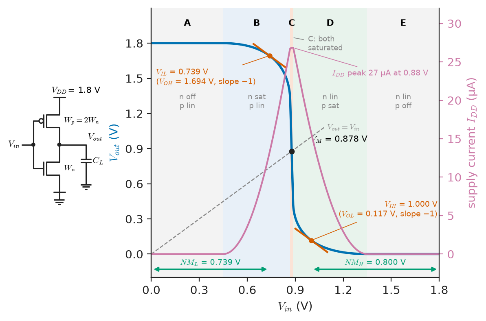
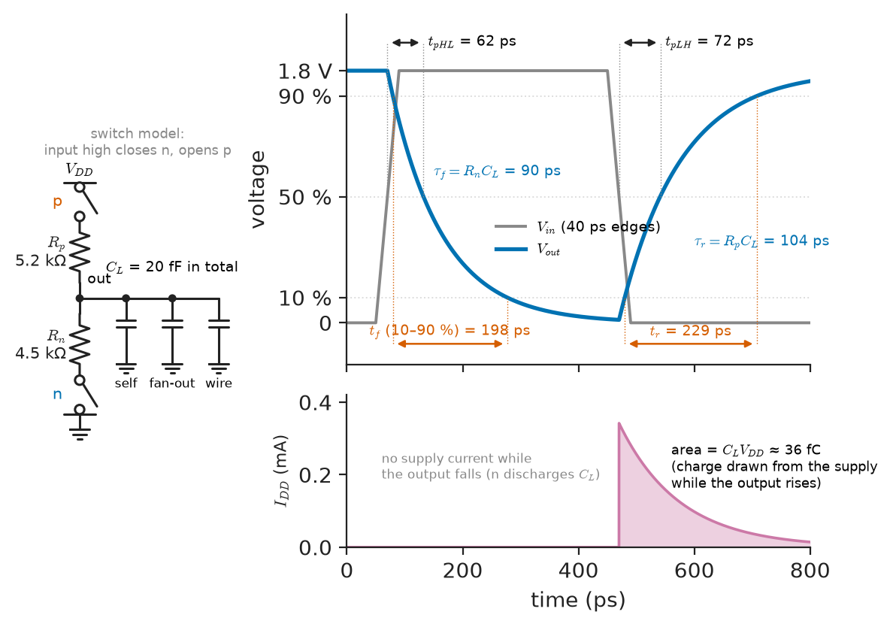
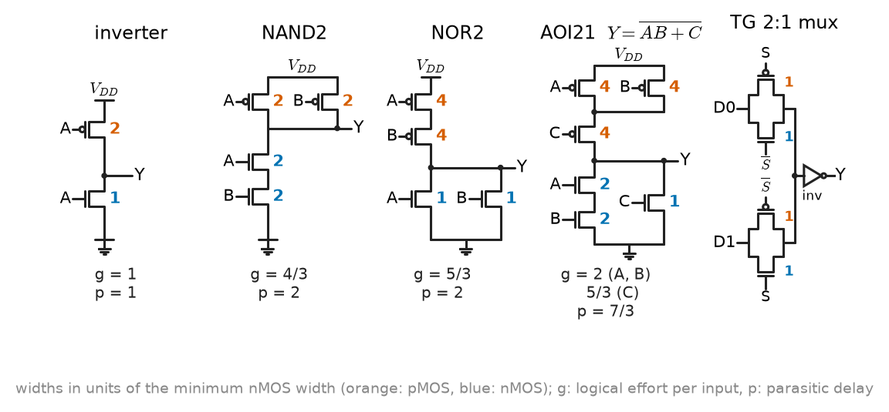
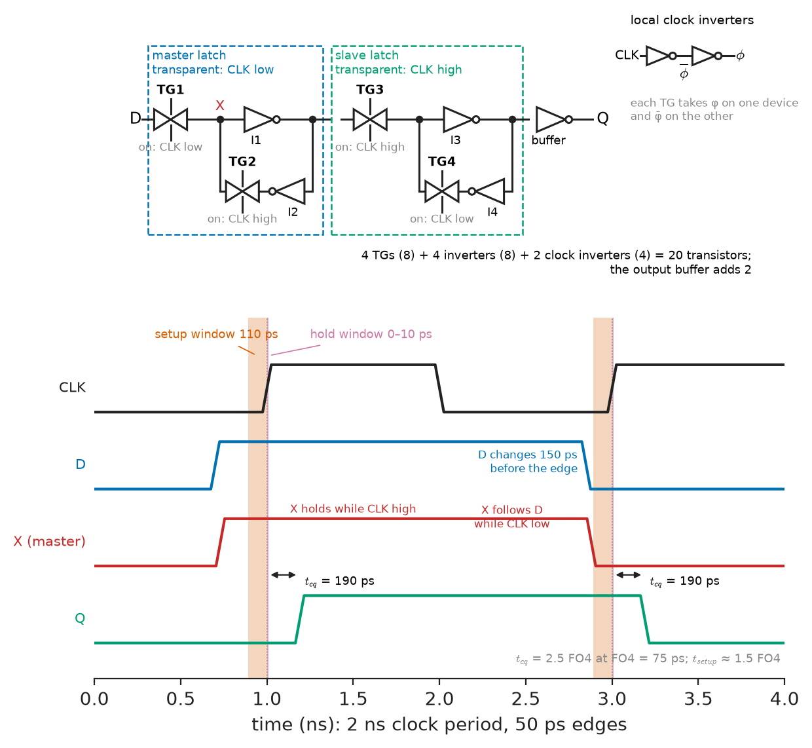
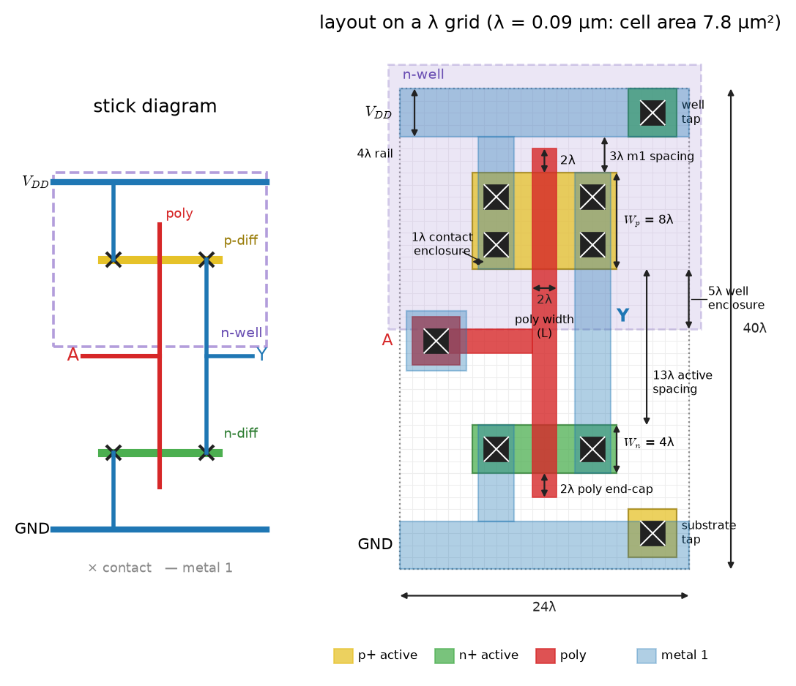

# Chapter 33 — CMOS Fundamentals

*Part VIII · Integrated Circuits and VLSI*

A sensor-hub microcontroller is ported from a 180 nm process to 40 nm. Its active current falls by a factor of five, exactly as the datasheet of the new process promised, but its standby current rises twentyfold and the coin-cell product it lives in now lasts four months instead of two years. On another project, a register file that worked at every corner in a 1.2 V process loses data when the supply is scaled to 0.7 V for a low-power mode, because two cross-coupled inverters no longer win the fight against a write transistor. In a third, a clock tree that met timing in synthesis misses it after layout because a single long wire in metal 2 adds more delay than the eight gates it connects. Each of these follows from a handful of circuit facts about the complementary MOS inverter and its relatives: where its switching threshold lies, how much charge it moves per transition, how its delay scales with load and wire, how much noise it can reject, and what geometry the process lets it occupy. This chapter builds those facts from the transistor models of Chapter 4 up to gates, latches, flip-flops and layout.

> **Why does a pair of complementary MOSFETs make an almost ideal logic gate, and what sets its noise margins, power and delay?**
> **How are gates, latches and flip-flops built and sized at the transistor level, and how does a transistor schematic become a layout?**

| Concept | Engineering destination |
|---|---|
| CMOS logic and the inverter VTC | Logic thresholds, regeneration, I/O level compatibility, standard-cell libraries |
| MOSFET switching | Effective resistance and capacitance models, pass transistors, transmission gates |
| Static and dynamic power | Battery life, thermal design power of processors, DVFS, power and clock gating |
| Propagation delay | Gate sizing, buffer chains, logical effort, wire delay and repeaters |
| Noise margins | Supply-voltage scaling limits, crosstalk and ground-bounce budgets |
| CMOS gates | NAND, NOR, AOI/OAI, multiplexers, tristate drivers in standard-cell libraries |
| Latches and flip-flops | Register design, setup and hold times, clock-to-Q delay, metastability |
| Layout fundamentals | Stick diagrams, lambda rules, cell area, latch-up prevention |

**Roadmap.** The complementary principle and the inverter's transfer characteristic (33.1) → the MOSFET as a switch with resistance and capacitance (33.2) → where the power goes (33.3) → how long a transition takes, and how to size a path (33.4) → how much noise a gate tolerates (33.5) → static CMOS and transmission-gate logic (33.6) → latches and flip-flops at transistor level (33.7) → from schematic to layout (33.8).

> **Boundary.** MOSFET structure, threshold voltage, square-law and short-channel models, body effect and capacitances are developed in [Chapter 4](../part-1-electronic-devices/04-field-effect-transistors.md), from the physics sketch of *Engineering Physics*, [Ch. 18 §18.3.3](https://github.com/The-Studio-of-Sadiq/Engineering-Physics/blob/main/CHAPTERS/CHAPTER%2018.md), which already states the CMOS inverter's static and dynamic power in one line. Boolean algebra and gates as logic are in [Chapter 12](../part-3-digital-electronics/12-boolean-algebra-and-logic-gates.md), latches and flip-flops as logic elements with their timing constraints in [Chapter 14](../part-3-digital-electronics/14-sequential-digital-systems.md), and metastability and synchronisers in [Chapter 15](../part-3-digital-electronics/15-digital-system-design.md). The fabrication steps behind each layout layer (oxidation, implantation, lithography, etching, metallisation) are owned by *Materials Science and Engineering*, [Ch. 50](https://github.com/The-Studio-of-Sadiq/Materials-Science-and-Engineering/blob/main/Chapters/CHAPTER%2050.md). Chip-level timing analysis, power estimation and design-rule checking belong to [Chapter 34](34-vlsi-design.md).

---

## 33.1 CMOS logic

### The complementary principle

Chapter 4 showed that an n-channel MOSFET conducts when its gate is high relative to its source and a p-channel MOSFET when its gate is low. A **CMOS** gate exploits this by building every logic function from two networks: a **pull-down network** (PDN) of nMOS transistors between the output and ground, and a **pull-up network** (PUN) of pMOS transistors between the supply $V_{DD}$ and the output. The two networks are logical complements: for every input combination exactly one of them conducts. The output is therefore always connected, through a conducting path, to exactly one rail, and the inactive network blocks.

Three properties follow, and together they explain why CMOS displaced every other logic family by the late 1980s:

1. **Rail-to-rail output.** With no conducting path to the opposite rail, the output settles at exactly $0$ or $V_{DD}$, independent of transistor sizes. Logic levels are set by the supply, not by device ratios (unlike nMOS or TTL logic).
2. **No static current.** In either steady state one network is off, so apart from leakage no current flows from $V_{DD}$ to ground. Power is consumed only when nodes switch (Section 33.3).
3. **Infinite input resistance.** The gate of a MOSFET draws no DC current, so one gate can drive many others without loading their DC levels; fan-out affects speed, not levels.

> **Status of the principle: Complementary pull-up/pull-down networks**
> *Fundamental.* Follows from the definition of the circuit: if the PDN conducts exactly when $F=0$ and the PUN exactly when $F=1$, one and only one network conducts for every input, so the static output is a rail and no static path exists; the ideal holds up to leakage currents.

### The inverter and its transfer characteristic

The simplest CMOS gate, the **inverter**, has one nMOS and one pMOS transistor with joined gates (input) and joined drains (output). Its **voltage transfer characteristic** (VTC), output voltage against input voltage, is found by equating the nMOS and pMOS drain currents at every input voltage. It has five regions:

| Region | Input range | nMOS | pMOS | Output |
|---|---|---|---|---|
| A | $0\le V_{in}<V_{Tn}$ | Cut off | Linear | $V_{DD}$ |
| B | $V_{Tn}<V_{in}<V_M$ | Saturated | Linear | Slightly below $V_{DD}$ |
| C | $V_{in}\approx V_M$ | Saturated | Saturated | Falls steeply through $V_M$ |
| D | $V_M<V_{in}<V_{DD}-\lvert V_{Tp}\rvert$ | Linear | Saturated | Slightly above 0 |
| E | $V_{DD}-\lvert V_{Tp}\rvert<V_{in}\le V_{DD}$ | Linear | Cut off | $0$ |

The **switching threshold** $V_M$ is the input voltage at which $V_{out}=V_{in}$. With both transistors saturated and the square-law model of Chapter 4 (gain factors $k_n=\mu_nC_{ox}W_n/L_n$ and $k_p=\mu_pC_{ox}W_p/L_p$), equating currents gives

$$
V_M=\frac{V_{Tn}+r\,(V_{DD}-\lvert V_{Tp}\rvert)}{1+r},\qquad r=\sqrt{\frac{k_p}{k_n}}
$$

A symmetric inverter ($V_M=V_{DD}/2$ when $V_{Tn}=\lvert V_{Tp}\rvert$) needs $k_p=k_n$, so the pMOS must be wider than the nMOS by the mobility ratio $\mu_n/\mu_p$, about 2–3 in planar silicon and nearer 1–1.5 in strained-silicon and FinFET processes. Most libraries compromise at $W_p/W_n\approx2$, which saves area and input capacitance at the cost of a slightly low $V_M$; $V_M$ depends only on the square root of the size ratio, so it is insensitive to it.

> **Status of the principle: Switching threshold of the CMOS inverter**
> *Approximate.* Derived from the long-channel square law with both devices saturated and channel-length modulation neglected; in short-channel devices velocity saturation makes the currents closer to linear in overdrive and $V_M$ is better found from the $\alpha$-power law or simulation, but the conclusion (set $V_M$ by the $W_p/W_n$ ratio, weakly) is unchanged.

**Worked example — switching threshold of a 180 nm-class inverter.** Take $V_{DD}=1.8$ V, $V_{Tn}=\lvert V_{Tp}\rvert=0.45$ V, $\mu_nC_{ox}=270\ \mu$A/V² and $\mu_pC_{ox}=110\ \mu$A/V² (illustrative long-channel values), and a pMOS twice as wide as the nMOS. Then $r=\sqrt{220/270}=0.903$ and $V_M=(0.45+0.903\times1.35)/1.903=0.877$ V, 26 mV below mid-supply. Making the pMOS 2.45 times wider would centre it exactly; making it equal in width to the nMOS would move $V_M$ only to 0.80 V. Figure 33.1 shows this VTC.

<!-- FIGURE 33.1 | figures/ch33/fig-33-1-inverter-vtc.png | plot | Voltage transfer characteristic of a 1.8 V CMOS inverter with its five operating regions, switching threshold and noise margins. | Content: inset schematic: pMOS (Wp/Wn = 2) from VDD = 1.8 V to output, nMOS to ground, joined gates as input, load capacitance. Main plot: x-axis Vin 0 to 1.8 V, y-axis Vout 0 to 1.8 V; VTC computed with VTn = 0.45 V, magnitude VTp = 0.45 V, kn' = 270 and kp' = 110 microamps per volt squared, lambda = 0.1 per volt. Unity-slope line Vout = Vin crossing the VTC at VM = 0.878 V. Points of slope -1 at VIL = 0.739 V (Vout = 1.694 V) and VIH = 1.000 V (Vout = 0.117 V) marked with short tangent segments; regions A to E shaded with labels of nMOS and pMOS states. Second y-axis: supply current from 0 to about 30 microamps, a peaked curve with its maximum of 27 microamps at Vin = 0.885 V, near VM. Bars beside the axes showing NML = 0.739 V and NMH = 0.800 V. -->



*Figure 33.1 — Voltage transfer characteristic of a 1.8 V CMOS inverter with its five operating regions, switching threshold and noise margins.*

---

## 33.2 MOSFET switching

### The switch model

For digital timing a transistor is modelled as a switch in series with an **effective resistance** $R_{eq}$, driving and loaded by capacitances. A conducting nMOS discharging a load from $V_{DD}$ to $V_{DD}/2$ starts saturated and ends in the linear region, so its resistance varies along the transition; averaging $V_{DS}/I_D$ over the swing gives, to good accuracy for velocity-saturated devices,

$$
R_{eq}\approx\frac{3}{4}\,\frac{V_{DD}}{I_{DSAT}}\left(1-\frac{7}{9}\lambda V_{DD}\right)
$$

$R_{eq}$ is inversely proportional to width, so it is quoted per unit width. With a saturation current of 600 µA/µm for nMOS and 260 µA/µm for pMOS (typical of 180 nm at 1.8 V), $R_{eq}\approx2.25$ kΩ·µm and 5.2 kΩ·µm respectively, ignoring $\lambda$. Table 33.1 collects representative values across process generations.

**Table 33.1 — Representative CMOS process parameters (typical, high-performance logic transistors; low-power flavours have 3–10× lower leakage and 20–40 % lower drive).**

| Node | $V_{DD}$ (V) | Gate dielectric (EOT) | $I_{DSAT,n}$ (µA/µm) | $I_{off}$ per µm | Gate cap. (fF/µm) | FO4 delay (ps) |
|---|---|---|---|---|---|---|
| 350 nm | 3.3 | 7 nm SiO$_2$ | 500 | ~1 pA | 1.6 | 150–180 |
| 180 nm | 1.8 | 4 nm SiO$_2$ | 600 | 10–100 pA | 1.5 | 65–90 |
| 90 nm | 1.0–1.2 | 1.6 nm SiON | 900–1100 | 10–100 nA | 1.0 | 30–40 |
| 45 nm | 1.0 | 1.0 nm high-$k$/metal gate | 1200–1400 | 50–200 nA | 0.9 | 15–20 |
| 16/14 nm FinFET | 0.75–0.8 | 0.9 nm high-$k$ | 1300–1600 (per footprint) | 10–100 nA | 0.8 | 8–12 |
| 5 nm FinFET | 0.7–0.75 | 0.8 nm high-$k$ | 1500–2000 (per footprint) | 10–100 nA | 0.7 | 4–7 |

The capacitances that the switches charge are of three kinds. **Gate capacitance** is about $C_{ox}WL$ plus overlap, roughly 1 fF per µm of width in modern processes, and is what each fan-out input adds. **Diffusion capacitance** of source and drain junctions, about the same per µm, loads the gate's own output (its "parasitic" or self-loading). **Wire capacitance**, about 0.15–0.2 fF per µm of length on any metal layer of any node (the geometry scales together), dominates long nets.

### Pass transistors and transmission gates

A MOSFET used as a series switch between two signal nodes, rather than to a rail, is a **pass transistor**. An nMOS passes a strong 0 but a weak 1: when passing $V_{DD}$, its source rises until $V_{GS}$ falls to $V_{Tn}$ (raised further by the body effect, Chapter 4), so the output stops at about $V_{DD}-V_{Tn}$, 1.2–1.3 V of a 1.8 V supply. A gate driven by that degraded high has both its transistors partly on, drawing static current, and its noise margin shrinks. A pMOS passes a strong 1 and a weak 0.

Putting an nMOS and a pMOS in parallel with complementary gate signals gives the **transmission gate** (TG), which passes both levels fully: whichever device is losing drive near one rail, the other is gaining it. Its on-resistance is roughly constant across the signal range. Transmission gates are the switches inside multiplexers, XOR gates, latches and flip-flops (Sections 33.6–33.7) and the analogue switches of sample-and-hold circuits and ADC input multiplexers.

> **Status of the principle: Effective-resistance (RC) switch model**
> *Approximate.* Replaces the nonlinear transistor by a linear resistor fitted to the 50 % transition and the load by a lumped capacitor; it predicts delays to within 10–30 % and scales correctly with width and load, but fails for slow input edges, for strongly nonlinear loads such as long resistive wires, and in near-threshold operation, where the current is exponential in voltage.

---

## 33.3 Static and dynamic power

### Dynamic power

Each time a gate output rises from 0 to $V_{DD}$, the supply delivers charge $C_LV_{DD}$ at voltage $V_{DD}$, energy $C_LV_{DD}^2$; half is stored on the capacitor and half is dissipated in the pull-up network. On the falling transition the stored half is dissipated in the pull-down network. One full cycle therefore costs $C_LV_{DD}^2$ from the supply, independent of transistor resistance. If a node makes a 0→1 transition with probability $\alpha$ per clock cycle (its **activity factor**) at clock frequency $f$,

$$
P_{dyn}=\alpha\,C_L\,V_{DD}^2\,f
$$

summed over all nodes. Clock nets have $\alpha=1$, datapaths 0.1–0.3, control logic and memories often below 0.05.

> **Status of the principle: CMOS dynamic power**
> *Derived.* Follows from charge conservation and the energy delivered by a constant-voltage source charging a capacitor through any resistance; it is exact for full-swing transitions and excludes short-circuit and leakage power, glitches (which raise the effective $\alpha$) and reduced-swing nodes.

The quadratic dependence on $V_{DD}$ is the most powerful lever in low-power design. **Dynamic voltage and frequency scaling** (DVFS) lowers $V_{DD}$ and $f$ together when performance is not needed; **clock gating** stops the clock to idle registers, setting their $\alpha$ to zero; reducing capacitance by shorter wires and smaller devices helps linearly.

**Short-circuit power** flows during each input transition while the input passes between $V_{Tn}$ and $V_{DD}-\lvert V_{Tp}\rvert$, when both transistors conduct (the supply-current peak in Figure 33.1). It stays below about 10 % of dynamic power when input and output edges have similar rise times, which is one reason libraries limit maximum slew.

### Static power

An "off" transistor still conducts. Four leakage mechanisms matter:

- **Subthreshold conduction**, the dominant one, is exponential in gate overdrive:

$$
I_{sub}\approx I_0\,10^{(V_{GS}-V_T)/S}
$$

with $S$, the **subthreshold swing**, at least $(k_BT/q)\ln10=60$ mV per decade at room temperature and typically 70–100 mV per decade in planar bulk devices, 65–75 in FinFETs. Lowering $V_T$ by 100 mV at $S=90$ mV/dec raises leakage by $10^{100/90}=13$ times. Drain-induced barrier lowering (Chapter 4) makes $V_T$ fall with $V_{DS}$, so leakage rises with $V_{DD}$ too.
- **Gate tunnelling** through thin oxides; it became significant at 90–65 nm (1.2–1.6 nm SiON) and was cut by two to three orders of magnitude by high-$k$ dielectrics at 45 nm.
- **Junction leakage** and **gate-induced drain leakage** (GIDL), important in low-power processes and at high temperature.

Leakage roughly doubles every 10–15 °C, so a chip's static power is often quoted at 85 °C or 125 °C junction temperature. The remedies are circuit and architectural: **multi-threshold libraries** (high-$V_T$ cells off the critical path, low-$V_T$ on it), **power gating** with header or footer switches that disconnect idle blocks, **body biasing** in FD-SOI processes, and **retention** registers that keep state while the rest of a block is powered down.

**Worked example — DVFS and leakage in an SoC block.** A processor block has 2 nF of total switched capacitance and an average activity factor of 0.1, at 0.9 V and 1 GHz.

- Dynamic power: $0.1\times2\times10^{-9}\times0.9^2\times10^9=0.162$ W.
- In a low-performance mode at 0.7 V and 700 MHz: $0.1\times2\times10^{-9}\times0.7^2\times0.7\times10^9=0.069$ W, a 58 % saving for a 30 % loss of speed.
- Leakage: 10 million transistors averaging 2 nA each at 0.9 V give 20 mA, 18 mW, about 11 % of the full-speed dynamic power but 26 % in the low mode; at 85 °C, with leakage four or five times higher, it is comparable to the dynamic power.

This is the sensor hub of the opening. Its 40 nm port cut $C$ and $V_{DD}$, hence active power, but its standby current was set by subthreshold leakage of millions of low-$V_T$ transistors that never switch off completely; a high-$V_T$ library for the always-on domain and power gating of the rest restored the battery life.

> **Status of the principle: End of Dennard scaling**
> *Empirical.* Constant-field (Dennard) scaling, in which voltage, dimensions and capacitance all shrink by the same factor so that power density stays constant, held approximately until about the 130–90 nm generations; because subthreshold swing cannot fall below 60 mV per decade, $V_T$ and hence $V_{DD}$ stopped scaling near 0.7–1 V, and power density, not transistor count, has limited clock frequency since about 2005.

---

## 33.4 Propagation delay

### Definitions and the RC estimate

The **propagation delay** $t_{pHL}$ ($t_{pLH}$) is the time from the input crossing 50 % of the swing to the output crossing 50 % on its falling (rising) transition; $t_p=(t_{pHL}+t_{pLH})/2$. Rise and fall times are measured between 10 % and 90 % (some libraries use 20–80 %). With the switch model, an output node of capacitance $C_L$ discharged through $R_{eq}$ follows an exponential, and the 50 % point is reached after

$$
t_p=\ln2\;R_{eq}C_L=0.69\,R_{eq}C_L
$$

where $C_L$ includes the gate's own diffusion capacitance, the input capacitance of every fan-out gate and the wire. The step-input assumption makes this optimistic by 10–20 % for realistic input edges.

**Worked example — delay of a 180 nm inverter.** An inverter with $W_n=0.5$ µm and $W_p=1.0$ µm drives a total load of 20 fF. Then $R_n=0.75\times1.8/(600\ \mu\mathrm{A/\mu m}\times0.5\ \mu\mathrm{m})=4.5$ kΩ and $R_p=0.75\times1.8/(260\times1.0\ \mu\mathrm{A})=5.2$ kΩ, giving $t_{pHL}=0.69\times4.5\ \mathrm{k\Omega}\times20\ \mathrm{fF}=62$ ps, $t_{pLH}=72$ ps and $t_p=67$ ps. Each transition draws $C_LV_{DD}^2=65$ fJ from the supply per cycle. Doubling both widths halves the resistances, but only helps if the load is dominated by fan-out and wire rather than by the gate's own diffusion capacitance, which doubles too.

<!-- FIGURE 33.2 | figures/ch33/fig-33-2-inverter-delay.png | timing-diagram | Propagation delay of a CMOS inverter and its RC model. | Content: left, switch model: input step, pMOS drawn as switch with Rp = 5.2 kilohm, nMOS as switch with Rn = 4.5 kilohm, load CL = 20 fF split into self-load, fan-out gate capacitance and wire capacitance. Right, waveforms on a common time axis 0 to 800 ps: input voltage ramp 0 to 1.8 V with 40 ps rise starting at 50 ps and falling again at 450 ps; output voltage falling exponentially (time constant 90 ps) and rising (time constant 104 ps). Mark 50 percent crossings, tpHL = 62 ps and tpLH = 72 ps, and output 10 to 90 percent fall and rise times (198 ps and 229 ps). Small inset: supply current pulse during the rising output transition, area labelled CL VDD = 36 fC. -->



*Figure 33.2 — Propagation delay of a CMOS inverter and its RC model.*

Figure 33.2 shows the waveforms and the delay definitions.

### Logical effort

Sizing a chain of gates by trial and error is hopeless; **logical effort** turns it into arithmetic. Express delay in units of $\tau=R_{eq}C_{in}$ of a reference inverter (about FO4/5, so 13–18 ps at 180 nm, about 1 ps at 5 nm). The delay of one gate is then

$$
d=g\,h+p
$$

where $h=C_{out}/C_{in}$ is the **electrical effort** (fan-out ratio), $p$ the **parasitic delay** from the gate's own diffusion capacitance (1 for an inverter, about $n$ for an $n$-input NAND or NOR), and $g$ the **logical effort**: how much more input capacitance the gate presents than an inverter delivering the same output current. Sized for equal drive (Section 33.6), a two-input NAND has nMOS of width 2 and pMOS of width 2 per input, input capacitance 4 against the inverter's 3, so $g=4/3$; a two-input NOR has nMOS 1 and pMOS 4, so $g=5/3$. For a path of $N$ stages with logical efforts $g_i$, branching factors $b_i$ (the ratio of total to on-path capacitance where a signal fans out) and overall electrical effort $H=C_{load}/C_{in}$, the **path effort** is

$$
F=G\,B\,H=\prod g_i\,\prod b_i\,\frac{C_{load}}{C_{in}}
$$

and delay is minimised when every stage bears the same effort $\hat f=F^{1/N}$, giving

$$
\hat D=N\,F^{1/N}+\sum p_i
$$

The best number of stages makes $\hat f$ about 4 (between 3 and 5, where the optimum is flat), so $\hat N\approx\log_4F$. Listing 33.1 applies this to two paths that drive a 1 pF load (an off-chip pad driver's input, say) from a 4 fF input.

```python
import numpy as np

G = {"inv": 1.0, "nand2": 4 / 3, "nor2": 5 / 3, "nand3": 5 / 3}   # logical effort
P = {"inv": 1.0, "nand2": 2.0, "nor2": 2.0, "nand3": 3.0}         # parasitic delay

def size_path(gates, branch, c_in, c_load):
    """Optimal stage effort, delay (in tau) and input capacitance of each stage."""
    g = np.array([G[x] for x in gates]); b = np.array(branch, float)
    F = g.prod() * b.prod() * c_load / c_in                        # path effort
    N = len(gates); f = F ** (1 / N)
    D = N * f + sum(P[x] for x in gates)
    cins, c = [], c_load                                           # walk back from the load
    for gi, bi in zip(g[::-1], b[::-1]):
        c = gi * bi * c / f
        cins.append(c)
    return F, f, D, cins[::-1]

for name, gates, branch in [("4 inverters", ["inv"] * 4, [1] * 4),
                            ("NAND2-NOR2-INV-INV", ["nand2", "nor2", "inv", "inv"], [1, 2, 1, 1])]:
    F, f, D, cins = size_path(gates, branch, c_in=4e-15, c_load=1e-12)
    print(f"{name}: F = {F:.0f}, f = {f:.2f}, D = {D:.1f} tau, "
          f"Cin = {', '.join(f'{c * 1e15:.1f}' for c in cins)} fF")
print(f"best N for F = 250: {np.log(250) / np.log(4):.2f}")
```

```text
4 inverters: F = 250, f = 3.98, D = 19.9 tau, Cin = 4.0, 15.9, 63.2, 251.5 fF
NAND2-NOR2-INV-INV: F = 1111, f = 5.77, D = 29.1 tau, Cin = 4.0, 17.3, 30.0, 173.2 fF
best N for F = 250: 3.98
```

The inverter chain is the classic buffer: each stage four times larger than the last, 19.9τ in total, about 300 ps at 180 nm (τ = 15 ps). A single inverter driving the load directly would take $250+1=251\tau$, 3.8 ns. In the second path the NOR2's output feeds two identical branches (branching factor 2), and the NAND2 and NOR2 add logical effort, so the path effort is 1111 and the optimal stage effort 5.8, slightly above the ideal: a fifth stage would reduce the delay a little but would invert the logic. The listing's input capacitances are the sizes the designer picks from the library.

> **Status of the principle: Logical effort delay model**
> *Approximate.* Rests on the linear RC model of Section 33.2 with $g$ and $p$ fitted per gate type; it assumes equal rise and fall effort, ignores input slope and wire resistance, and treats branching as fixed, so it is a sizing and topology tool accurate to 10–20 %, with final numbers from static timing analysis (Chapter 34).

### Wires

A wire is a distributed RC line. For a wire of resistance $r$ and capacitance $c$ per unit length and length $l$, the **Elmore delay**, the first moment of the impulse response, is $0.5\,rcl^2$, and the actual 50 % delay of the wire alone is about $0.38\,rcl^2$: both quadratic in length. A 0.28 µm wide, 0.5 µm thick copper line (2.2 µΩ·cm) has $r=0.157$ Ω/µm and $c\approx0.2$ fF/µm. One millimetre has $R=157$ Ω and $C=200$ fF, and its intrinsic delay is $0.38\times157\times200\times10^{-15}=12$ ps, small beside the driver's $R_{eq}C$. Ten millimetres has $R=1.57$ kΩ, $C=2$ pF and an intrinsic delay of 1.2 ns, a hundred times larger. Long wires are therefore broken by **repeaters** (inverters every 1–3 mm in older nodes, every 100–300 µm in the narrow lower metals of advanced ones), which make delay linear in length again; and timing-critical long nets are routed on the thick upper metal layers. As lines narrow, surface and grain-boundary scattering and barrier layers raise copper's effective resistivity (*Materials Science and Engineering*, Ch. 50 §50.9), which is why wire delay has grown relative to gate delay at every node since 130 nm: the clock tree of the opening.

> **Status of the principle: Elmore delay of RC networks**
> *Approximate.* The first moment of the impulse response is an upper bound on the 50 % delay of an RC tree with monotone step response and is exact in the limit of one dominant pole; it ignores inductance (significant for wide, fast clock and power lines above a few GHz) and coupling to neighbouring wires.

---

## 33.5 Noise margins

### Definitions

A logic gate must tolerate noise on its input without passing it on. The input voltage ranges a gate accepts as low and high are bounded by the points where the VTC's slope is $-1$: below $V_{IL}$ the output stays high and the gain magnitude is below one, so input noise is attenuated; above $V_{IH}$ the same holds for a low output; between them is the **transition region**, where the gain exceeds one and small disturbances are amplified. With driver output levels $V_{OH}$ and $V_{OL}$, the **noise margins** are

$$
NM_L=V_{IL}-V_{OL},\qquad NM_H=V_{OH}-V_{IH}
$$

For a static CMOS driver $V_{OL}=0$ and $V_{OH}=V_{DD}$; a conservative variant takes the output levels at the unity-gain points instead. Listing 33.2 computes the VTC of the inverter of Section 33.1 numerically (square law with $\lambda=0.1$ V⁻¹) and extracts the threshold, the unity-gain points and the noise margins.

```python
import numpy as np
from scipy.optimize import brentq

VDD, VTn, VTp, lam = 1.8, 0.45, 0.45, 0.1        # V, V, |V|, 1/V
kn, kp = 270e-6 * 1.0, 110e-6 * 2.0              # A/V^2: k' x (W/L), Wp/Wn = 2

def ids(k, vgs, vds, vt):                         # square law with channel-length modulation
    if vgs <= vt: return 0.0
    vov = vgs - vt
    core = k * (vov * vds - vds**2 / 2) if vds < vov else k / 2 * vov**2
    return core * (1 + lam * vds)

def vout(vin):                                    # solve I_n = I_p for the output node
    f = lambda vo: ids(kn, vin, vo, VTn) - ids(kp, VDD - vin, VDD - vo, VTp)
    return brentq(f, 0.0, VDD)

vin = np.linspace(0.0, VDD, 3601)
vo = np.array([VDD if v <= VTn else 0.0 if v >= VDD - VTp else vout(v) for v in vin])
gain = np.gradient(vo, vin)
VM = vin[np.argmin(np.abs(vo - vin))]
idx = np.where(gain <= -1)[0]
VIL, VIH = vin[idx[0]], vin[idx[-1]]
VOH, VOL = np.interp(VIL, vin, vo), np.interp(VIH, vin, vo)
print(f"VM = {VM:.3f} V, peak gain = {gain.min():.1f}")
print(f"VIL = {VIL:.3f} V (VOH = {VOH:.3f}), VIH = {VIH:.3f} V (VOL = {VOL:.3f})")
print(f"NML = {VIL:.3f} V, NMH = {VDD - VIH:.3f} V (driver static VOL = 0, VOH = VDD)")
r = np.sqrt(kp / kn)
print(f"analytic VM = {(VTn + r * (VDD - VTp)) / (1 + r):.3f} V")
```

```text
VM = 0.878 V, peak gain = -48.6
VIL = 0.739 V (VOH = 1.694), VIH = 1.000 V (VOL = 0.117)
NML = 0.739 V, NMH = 0.800 V (driver static VOL = 0, VOH = VDD)
analytic VM = 0.877 V
```

**Worked example — reading the noise margins.** The transition region is only 0.26 V wide (from 0.739 to 1.000 V) because the peak gain is about 49; the margins are 0.74 V low and 0.80 V high, 41 % and 44 % of the supply, close to the ideal of 50 %. With the conservative definition they are $0.739-0.117=0.62$ V and $1.694-1.000=0.69$ V. The numerically found $V_M$ agrees with the formula of Section 33.1 to 1 mV, since channel-length modulation shifts both currents nearly equally. Scaling the same design to $V_{DD}=0.7$ V with $V_T=0.35$ V leaves a supply only twice the threshold; the gain falls, the transition region widens relative to the supply and the margins shrink to well under 0.2 V, which is why near-threshold designs need careful noise budgeting and why the register file of the opening failed at 0.7 V.

### Regeneration and the noise budget

CMOS logic restores levels: because the gain magnitude exceeds one in the transition region and is far below one at the rails, a degraded level passing through a chain of gates is pushed back toward the rails at each stage. This **regenerative property** is what makes the digital abstraction of [Chapter 12](../part-3-digital-electronics/12-boolean-algebra-and-logic-gates.md) work: errors do not accumulate. The noise margin must, however, cover every disturbance at once. The main contributors are **crosstalk** (capacitive coupling from a switching neighbour, a fraction $C_c/(C_c+C_g)$ of its swing, 10–30 % for long parallel wires), **supply and ground bounce** ($L\,di/dt$ on package and grid inductance and $IR$ drop across the power grid, typically budgeted at 5–10 % of $V_{DD}$), and **process, voltage and temperature variation** shifting $V_M$ from gate to gate. Static noise analysis in sign-off tools checks the sum.

> **Status of the principle: Unity-gain definition of noise margins**
> *Approximate.* A static, single-stage criterion: it treats noise as a DC offset and assumes a chain of identical gates; dynamic noise (short glitches that the next gate's capacitance filters) and correlated noise on supply and input are assessed by simulation-based noise analysis.

---

## 33.6 CMOS gates

### Static CMOS: NAND, NOR and complex gates

Parallel nMOS transistors in the PDN implement OR of their inputs (the output is pulled low if any input is high), series nMOS implement AND. The PUN is the **dual**: series becomes parallel and vice versa. A two-input **NAND** has two series nMOS and two parallel pMOS; a two-input **NOR** two parallel nMOS and two series pMOS. Static CMOS gates are inherently inverting, because nMOS pull down when their inputs go high; AND and OR are a NAND or NOR followed by an inverter.

A **complex gate** realises any inverted sum of products in one stage. The **AOI21** (AND–OR–INVERT), $Y=\overline{AB+C}$, has a PDN of A and B in series, in parallel with C, and a PUN of A and B in parallel, in series with C: six transistors instead of the ten of a NAND2 followed by a NOR2 and an inverter. AOI and OAI gates are the backbone of adders and multiplexers in standard-cell libraries.

**Sizing for equal drive.** Each gate is sized so that its worst-case pull-up and pull-down resistances equal those of a reference inverter (nMOS width 1, pMOS width 2). Transistors in series add resistance, so each of $n$ series transistors must be $n$ times wider. A NAND2 has nMOS of width 2 and pMOS of width 2; a NOR2 has nMOS of width 1 and pMOS of width 4; a NAND3 nMOS 3, pMOS 2; a NOR3 nMOS 1, pMOS 6. These sizes give the logical efforts of Section 33.4, and they show why designers prefer NAND to NOR: series pMOS, already the weaker device, become very wide. Stacks deeper than three or four are avoided because the series resistance and the internal-node capacitance grow together. Stacks do have one benefit: two off transistors in series leak 5–10 times less than one (the **stack effect**), because the intermediate node rises and reverse-biases the upper device's gate–source.

<!-- FIGURE 33.3 | figures/ch33/fig-33-3-static-cmos-gates.png | circuit | Static CMOS gates sized for equal drive: inverter, NAND2, NOR2, AOI21 and a transmission-gate 2:1 multiplexer. | Content: five transistor-level schematics side by side, each between VDD and ground with widths written next to each transistor in units of the minimum nMOS: inverter (P 2, N 1); NAND2 (two parallel pMOS of width 2, two series nMOS of width 2); NOR2 (two series pMOS of width 4, two parallel nMOS of width 1); AOI21 Y = not(AB + C) (pMOS A and B in parallel, width 4, in series with pMOS C width 4; nMOS A and B in series, width 2, in parallel with nMOS C width 1); TG multiplexer with two transmission gates (nMOS and pMOS width 1 each) controlled by S and not S, followed by an output inverter. Under the first four gates their logical effort per input (1, 4/3, 5/3, and 2 for A and B with 5/3 for C) and parasitic delay (1, 2, 2, 7/3). -->



*Figure 33.3 — Static CMOS gates sized for equal drive: inverter, NAND2, NOR2, AOI21 and a transmission-gate 2:1 multiplexer.*

### Transmission-gate and pass-transistor logic

Transmission gates make some functions much cheaper. A **2:1 multiplexer** is two TGs driven by a select signal and its complement, joined at the output: four transistors plus an inverter for the select, against 12 for a static AOI-based mux. An **XOR** in TG form uses six to eight transistors against 12 in static CMOS. The penalty is that a TG has no gain and no connection to the rails: a chain of $n$ TGs has an RC delay growing as $n^2$ (Elmore again) and passes noise straight through, so TG stages are limited to two or three in series and are followed by a restoring inverter. **Tristate buffers**, a static inverter with series enable transistors in both networks (or an inverter followed by a TG), let several drivers share a bus.

### Ratioed and dynamic logic

Two other styles appear in specialised circuits. **Pseudo-nMOS** replaces the PUN by one always-on pMOS: fewer transistors and fast wide NORs, at the cost of static current when the output is low and a low level set by the ratio of pull-up to pull-down strength; it survives in some ROM and PLA arrays. **Dynamic (domino) logic** precharges the output high during one clock phase and conditionally discharges it through an nMOS network in the other: smaller input capacitance and faster wide gates, but it needs a clock, keepers against leakage and careful noise design. High-performance processors used domino logic heavily until leakage and design effort pushed most datapaths back to static CMOS around the 65–45 nm generations.

> **Status of the principle: Duality of pull-up and pull-down networks**
> *Derived.* From De Morgan's laws (Chapter 12): if the PDN conducts when $F=0$ for a series–parallel function, its dual network of complementary devices conducts exactly when $F=1$; the construction holds for any series–parallel network and guarantees rail-to-rail static outputs.

---

## 33.7 Latches and flip-flops

### The bistable element

Storage in CMOS rests on two inverters connected in a loop. The loop has three equilibrium points where the two VTCs (one mirrored) intersect: two stable ones at the rails and one unstable one at $V_M$, where the loop gain exceeds one. A loop disturbed away from the unstable point diverges exponentially toward a stable state with time constant $\tau_m\approx C/g_m$ of the inverters, roughly one FO1 delay; how long it can hover near the unstable point is the **metastability** problem whose statistics and synchroniser remedies are treated in [Chapter 15](../part-3-digital-electronics/15-digital-system-design.md). The SRAM cell built from the same loop is in [Chapter 18](../part-4-computer-architecture-and-digital-hardware/18-memory-and-programmable-logic.md).

### The transmission-gate latch

A **D latch** must store a value and let a new one in when its clock is active. The standard static CMOS latch has an input transmission gate, an inverter, and a feedback path through a second inverter and a second transmission gate (or a clocked inverter). When the clock $\phi$ is high, the input TG is on and the feedback TG off: the latch is **transparent** and $Q$ follows $D$ after one TG and one inverter delay. When $\phi$ falls, the input TG turns off and the feedback TG on, closing the loop and holding the value. Because the feedback is broken while new data enter, the input driver never fights the stored value; a cheaper version with a weak always-on feedback inverter (a **keeper**) saves the second TG but makes writing a ratioed contest, the failure of the register file in the opening when its supply was lowered and the write driver weakened faster than the keeper.

A **clocked inverter** (C²MOS stage: an inverter with an extra series pMOS and nMOS gated by $\overline{\phi}$ and $\phi$) combines the inverter and the transmission gate in one stage and is equivalent for storage purposes; most standard-cell latches use clocked inverters in the feedback path.

### The master–slave flip-flop

An edge-triggered **D flip-flop** is two latches in series, transparent on opposite clock phases. With the **master** transparent while the clock is low and the **slave** while it is high, data pass through the master during the low phase, are frozen in the master at the rising edge, and appear at $Q$ through the slave, which is then transparent; while the clock is high, the closed master isolates $Q$ from changes at $D$. A static TG master–slave flip-flop uses about 16–24 transistors including local clock inverters, and its timing parameters follow from its internal paths:

- **Setup time** $t_{setup}$: $D$ must arrive early enough to propagate through the master's input TG and inverter and set up the feedback loop before the clock edge closes it; typically 1–2 FO4.
- **Hold time** $t_{hold}$: $D$ must not change until the master's input TG has fully turned off after the edge; with locally generated $\overline{\phi}$, slow complementary clocks can make both TGs briefly conduct, so hold time is zero or slightly negative in a well-designed cell and positive under clock skew.
- **Clock-to-Q delay** $t_{cq}$: the slave's TG plus its inverter and output buffer; typically 2–3 FO4.

These three numbers enter every timing constraint of Chapter 14 ($T_{clk}\ge t_{cq}+t_{logic}+t_{setup}+t_{skew}$, and $t_{cq}+t_{logic,min}\ge t_{hold}+t_{skew}$). The flip-flop overhead, $t_{cq}+t_{setup}$, is 3–5 FO4, a large fraction of a high-speed processor's 15–20 FO4 cycle, which is why such processors use **pulsed latches** (a latch made transparent for a narrow pulse after each clock edge) to shave a gate delay from every pipeline stage.

**Worked example — the cycle time budget.** At 180 nm with FO4 = 75 ps, a register with $t_{cq}=2.5$ FO4 and $t_{setup}=1.5$ FO4 costs 300 ps of every cycle. A target clock of 500 MHz (2 ns) leaves $2000-300-100=1600$ ps for logic after a 100 ps skew allowance, about 21 FO4 of logic per stage. At 1 GHz only 600 ps, 8 FO4, remains: pipeline stages must be cut in half, and the register overhead becomes a third of the cycle. Porting the design to 45 nm (FO4 ≈ 17 ps) reduces all three terms together, which is why process migration speeds up the clock without changing the logic depth.

<!-- FIGURE 33.4 | figures/ch33/fig-33-4-tg-master-slave-ff.png | circuit | Static transmission-gate master-slave D flip-flop and its timing parameters. | Content: top: schematic with clock inverters generating phi and phi-bar locally; master latch: input TG1 (on when CLK low), inverter I1, feedback inverter I2 and TG2 (on when CLK high) closing the loop; slave latch: TG3 (on when CLK high), inverter I3, feedback inverter I4 with TG4 (on when CLK low); output buffer to Q. Annotate transistor count 20 excluding the output buffer (22 with it). Bottom: timing diagram over 4 ns: CLK with 2 ns period and 50 ps edges, D changing at 0.7 ns and 2.85 ns, master node X following D while CLK low, Q changing after the rising edges at 1 ns and 3 ns. Mark setup window 110 ps before the edge, hold window 0 to 10 ps after, and clock-to-Q 190 ps (2.5 FO4 at FO4 = 75 ps). -->



*Figure 33.4 — Static transmission-gate master-slave D flip-flop and its timing parameters.*

Figure 33.4 shows the circuit and its timing; the windows marked around the clock edge are the setup and hold times that static timing analysis checks on every register (Chapter 34).

> **Status of the principle: Bistability of a cross-coupled inverter pair**
> *Derived.* Follows from the fixed points of two cascaded transfer characteristics: with loop gain above one at the crossing, the middle equilibrium is unstable and the outer ones stable; it holds as long as each inverter's peak gain exceeds one, which fails when the supply approaches the threshold voltage or the cell is overpowered by a write driver.

---

## 33.8 Layout fundamentals

### Layers seen from above

A layout is the set of mask polygons from which the chip is made. For a basic CMOS process the designer draws, from the substrate up:

- **n-well**: the region doped n-type to hold pMOS transistors in a p-type substrate (twin-well processes also draw p-wells);
- **active** (diffusion): areas where transistors and substrate or well contacts are formed, bounded by shallow trench isolation;
- **polysilicon** (or the metal-gate placeholder in high-$k$ processes): a transistor exists wherever poly crosses active, with channel length set by the poly width and channel width by the active width;
- **n+ and p+ select**: the implant masks that dope source and drain regions on either side of the gate;
- **contact**: holes from metal 1 down to active or poly;
- **metal 1, via 1, metal 2, ...**: the interconnect stack, 6–15 levels in modern logic processes.

The processes that turn each mask into structure (oxidation, implantation, lithography, etching, silicide, copper damascene) are described in *Materials Science and Engineering*, [Ch. 50 §50.4–50.9](https://github.com/The-Studio-of-Sadiq/Materials-Science-and-Engineering/blob/main/Chapters/CHAPTER%2050.md); the layout designer sees them only through the design rules.

### Lambda rules

**Design rules** state the minimum widths, spacings, enclosures and extensions the process can reliably build. In the scalable approach introduced by Mead and Conway, every rule is a multiple of a single parameter $\lambda$, half the minimum drawn gate length, so that a layout can be ported between processes by scaling. Table 33.2 lists representative rules in the style of the MOSIS scalable CMOS (SCMOS) set; exact values differ between rule decks.

**Table 33.2 — Representative scalable (lambda) design rules.**

| Rule | Value |
|---|---|
| Poly width (minimum channel length) | $2\lambda$ |
| Poly spacing | $2\lambda$ |
| Active width (minimum channel width) | $3\lambda$ |
| Active spacing | $3\lambda$ |
| Poly extension beyond active (gate end-cap) | $2\lambda$ |
| Active extension beyond poly (source/drain) | $3\lambda$ |
| Poly to unrelated active spacing | $1\lambda$ |
| Contact size | $2\lambda\times2\lambda$ |
| Active or poly enclosure of contact | $1\lambda$ |
| Contact to gate spacing | $2\lambda$ |
| Metal 1 width and spacing | $3\lambda$ |
| Via size; metal 2 width and spacing | $2\lambda$; $3\lambda$ and $4\lambda$ |
| n-well width; well enclosure of p+ active | $10\lambda$; $5\lambda$ |

Each rule has a physical reason: poly extension prevents a misaligned gate from leaving a conducting sliver of active; contact enclosure tolerates overlay error; metal spacing avoids shorts from lithographic bridging; well enclosure keeps the p+ junction away from the well edge where the doping changes.

> **Status of the principle: Scalable lambda design rules**
> *Approximate.* A single scaling parameter captures the proportions of processes down to about 0.25 µm; below that, rules no longer scale together (metal pitches, via enclosures, well spacings and gate-to-contact distances follow different physics), lithography introduces forbidden pitches and orientation rules, multiple patterning adds colouring constraints, and real rule decks are written in absolute dimensions with hundreds to thousands of rules (Chapter 34).

### Stick diagrams and cell layout

A **stick diagram** is a topological sketch of a layout: lines in the colour of each layer (poly, n- and p-diffusion, metal), crosses for contacts, no dimensions. It decides the order of transistors and the routing before any rule is applied. For an inverter, two horizontal strips of diffusion (p-diffusion in the n-well at the top, n-diffusion at the bottom) are crossed by one vertical poly line, the input; metal 1 power rails run horizontally at top ($V_{DD}$) and bottom (ground), and a metal 1 strap joins the two drains as the output.

For multi-input gates the transistor order matters. If the nMOS and pMOS transistors can be ordered along a single unbroken strip of diffusion each, with the same input order in both, every poly line crosses both strips straight and adjacent transistors share source and drain regions, minimising area and diffusion capacitance. Such an order is an **Euler path** through the graph of each network, visiting every transistor (edge) once. For the AOI21 the order A–B–C works for both networks; a gate with no common Euler path needs a break in the diffusion and costs width.

Standard cells fix the height (typically 7–12 metal-1 tracks), the positions of the power rails and the well boundary, so that cells abut in rows with shared rails; their width varies with function. Figure 33.5 shows an inverter cell drawn to the rules of Table 33.2, about $24\lambda$ wide and $40\lambda$ high including rails.

**Worked example — the area of an inverter cell.** In a 180 nm process ($\lambda=0.09$ µm) the $24\lambda\times40\lambda=960\lambda^2$ cell occupies $960\times0.09^2=7.8\ \mu$m², close to the 5–10 µm² of real 180 nm libraries. The same 960 $\lambda^2$ at 45 nm ($\lambda=22.5$ nm) would be 0.49 µm², but a real 45 nm inverter cell is closer to 0.5–1 µm² because fixed-pitch metal and contact rules prevent pure scaling; in FinFET processes width is quantised in fins (each fin about 30–50 nm effective width) and cell area is counted in track heights and contacted-poly pitches rather than $\lambda$.

<!-- FIGURE 33.5 | figures/ch33/fig-33-5-inverter-layout-stick.png | layout | Stick diagram and lambda-rule layout of a CMOS inverter cell. | Content: left: stick diagram with VDD and GND metal-1 rails (blue lines), p-diffusion strip (yellow) inside n-well outline (dashed) at top, n-diffusion strip (green) at bottom, one vertical poly line (red) labelled A, contacts as crosses, metal-1 output strap labelled Y. Right: layout on a lambda grid, cell 24 lambda wide by 40 lambda high: n-well covering the top half with 5 lambda enclosure of p+ active; pMOS active 8 lambda wide, nMOS active 4 lambda wide; poly gate 2 lambda wide with 2 lambda end-caps; 2 by 2 lambda contacts with 1 lambda enclosure; metal-1 rails 4 lambda wide; well tap and substrate tap contacts at the rails. Dimension arrows on poly width, poly end-cap, active spacing, contact enclosure and metal spacing. Note: lambda = 0.09 micrometre in 180 nm gives a cell area of 7.8 square micrometres. -->



*Figure 33.5 — Stick diagram and lambda-rule layout of a CMOS inverter cell.*

### Latch-up

The n-well, p-substrate and the p+ and n+ diffusions of every CMOS inverter form a parasitic pnpn structure: a vertical pnp transistor (p+ source in the n-well, the well, the substrate) and a lateral npn (n+ source, substrate, well), connected as the thyristor of [Chapter 5](../part-1-electronic-devices/05-advanced-semiconductor-devices.md). If a transient (an I/O pin driven beyond the rails, a supply surge, an ionising particle) injects enough current to forward-bias either base–emitter junction through the well or substrate resistance, the structure latches and short-circuits $V_{DD}$ to ground until power is removed, often destroying the chip. Layout prevents it by keeping the well and substrate resistances low: **well and substrate taps** (contacts to $V_{DD}$ and ground) placed at regular intervals, tens of micrometres apart (standard-cell rows include tap cells or taps in every cell); **guard rings** of tied diffusion around I/O transistors, which collect injected carriers; and spacing between I/O nMOS and pMOS. Latch-up immunity is qualified by JEDEC JESD78, which injects ±100 mA into each I/O pin and overvoltages the supplies without triggering latch-up.

---

## What remains open

| Open question | Where it is answered |
|---|---|
| How do short-channel effects, body effect and capacitances of a single MOSFET arise and how are they modelled? | [Chapter 4](../part-1-electronic-devices/04-field-effect-transistors.md) |
| How are latches and flip-flops used in registers, counters and state machines, and how are clock-domain crossings made safe? | [Chapter 14](../part-3-digital-electronics/14-sequential-digital-systems.md), [Chapter 15](../part-3-digital-electronics/15-digital-system-design.md) |
| How are SRAM and DRAM cells and arrays built? | [Chapter 18](../part-4-computer-architecture-and-digital-hardware/18-memory-and-programmable-logic.md) |
| How are millions of gates synthesised, placed, routed, timed, power-analysed and checked against full design-rule decks? | [Chapter 34](34-vlsi-design.md) |
| How are the masks turned into silicon (lithography, implantation, etching, metallisation)? | *Materials Science and Engineering*, [Ch. 50](https://github.com/The-Studio-of-Sadiq/Materials-Science-and-Engineering/blob/main/Chapters/CHAPTER%2050.md) |
| How are energy and delay traded at system level between processors and accelerators? | [Chapter 35](35-hardware-software-co-design.md) |

**Next:** Chapter 34 scales these gates and flip-flops to complete chips, following a design from RTL through synthesis, placement, routing and timing sign-off to the fabrication constraints that bound it.
