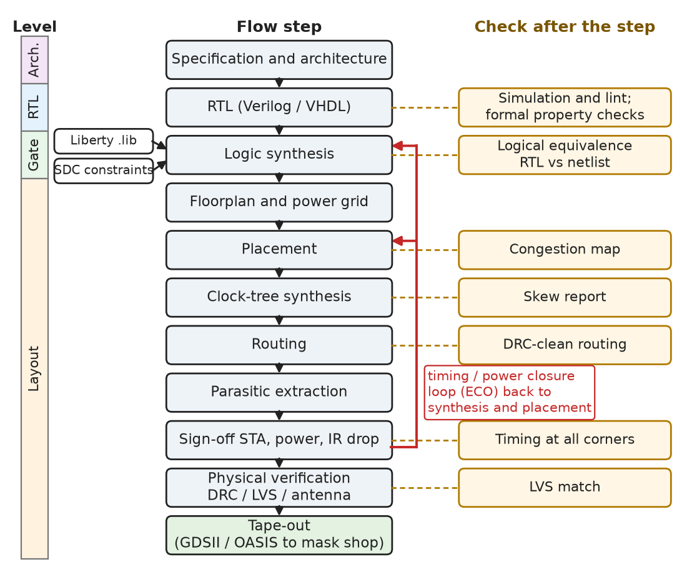
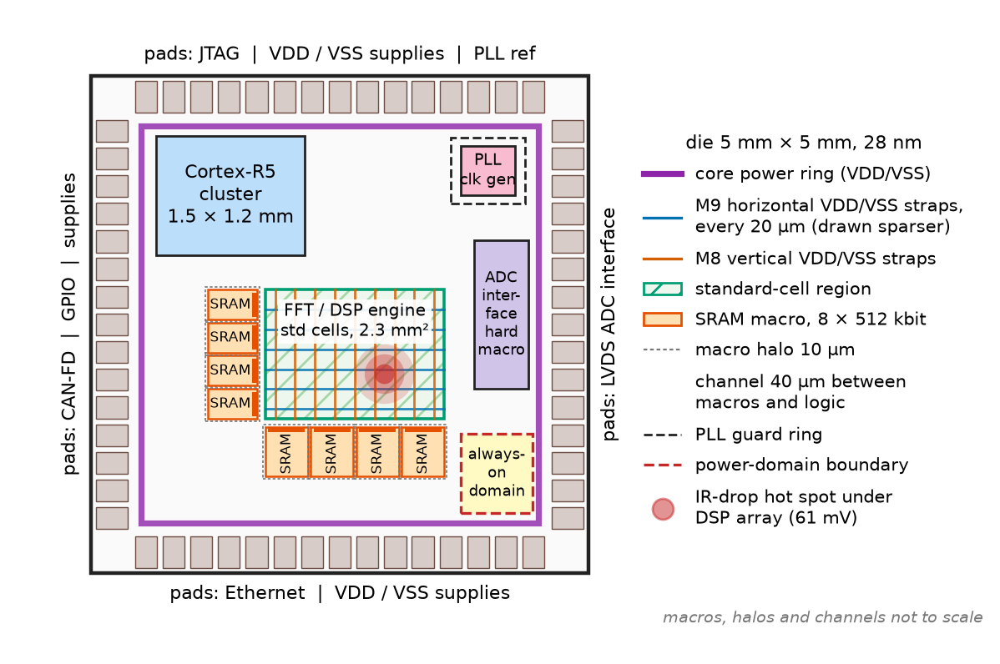
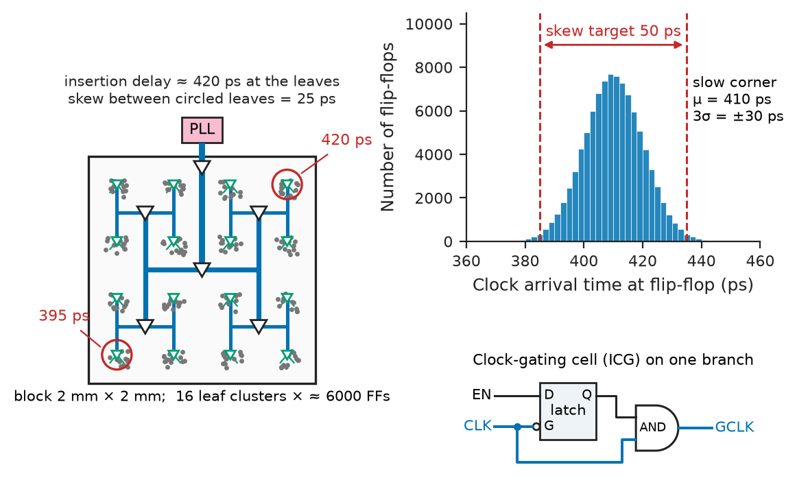
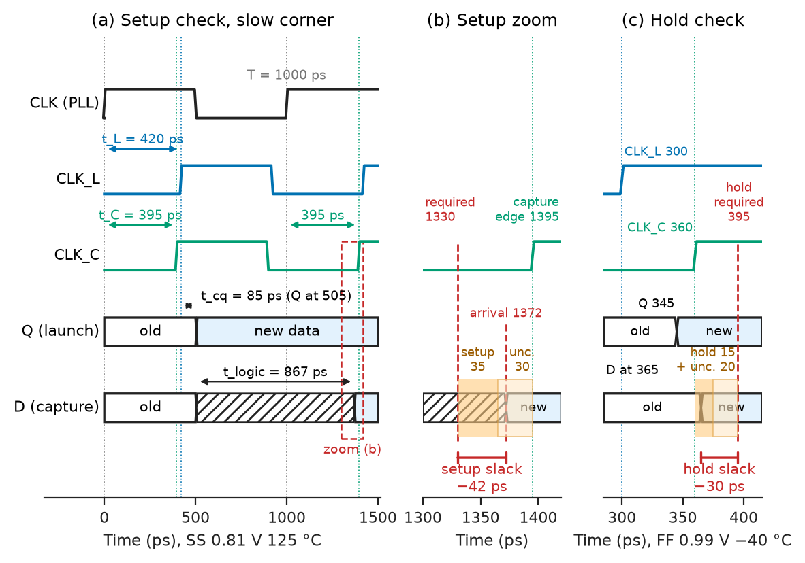
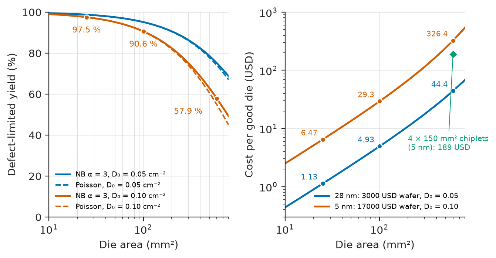

# Chapter 34 — VLSI Design

*Part VIII · Integrated Circuits and VLSI*

An automotive radar processor in a 28 nm process passes every simulation, synthesises cleanly and fits its 25 mm² die budget. Two weeks before tape-out the sign-off timing run reports that one path in the FFT engine misses its 1 GHz clock by 42 ps — but only at the slow-process, 0.81 V, 125 °C corner. At the opposite corner (fast process, 0.99 V, −40 °C) another path fails its *hold* check by 30 ps; that one cannot be fixed by slowing the clock, and in silicon the chip would work at no frequency at all. The physical-verification run lists 1 400 antenna violations, the power-grid analysis shows a 61 mV droop under the DSP array, and the yield model says a 5 % larger die would add 0.06 USD to every part — 0.3 million USD over a five-million-unit lifetime. None of this is visible in the Verilog. Each problem comes from turning a register-transfer description into millions of placed and wired transistors, manufactured at a given yield on a real process with real variation. This chapter is about that transformation.

> **How does a design described as registers and logic become a manufacturable layout, and which models decide whether it meets timing, power and area?**
> **Where does each abstraction of the VLSI flow — the synthesised netlist, the timing graph, the power estimate, the design rules — hold, and where does the silicon depart from it?**

| Concept | Engineering destination |
|---|---|
| Design hierarchy and abstraction levels | Partitioning a system-on-chip into blocks, IP reuse, NRE budgeting |
| RTL design for synthesis | Synthesis-friendly Verilog/VHDL, pipelining, clock gating, reset strategy |
| Logic synthesis and timing constraints | Standard-cell netlists, SDC files, area–delay trade-offs |
| Floorplanning and power-grid design | Die size, macro placement, IR-drop budgets |
| Placement, clock-tree synthesis, routing | Congestion, clock skew, wire delay, repeater insertion |
| Static timing analysis | Setup and hold slack, PVT corners, on-chip variation, sign-off |
| Power estimation | Battery life, thermal design power, package and regulator choice |
| DRC, LVS, antenna and density rules | A layout the foundry will accept and that matches the schematic |
| Functional, formal and test verification | First-silicon success, test coverage, defect levels in DPPM |
| Yield, variability, design for manufacturing | Cost per good die, SRAM margins, redundant vias and fill |

**Roadmap.** How a chip is organised and what it costs (34.1) → writing RTL that synthesises well (34.2) → synthesis to gates under constraints (34.3) → floorplan and power grid (34.4) → placement, clock tree and routing (34.5) → static timing analysis (34.6) → power estimation (34.7) → design-rule checking and LVS (34.8) → verification and test (34.9) → yield, variability and manufacturing constraints (34.10).

> **Boundary.** Verilog, SystemVerilog and VHDL syntax, simulation semantics and test benches are developed in [Chapter 19](../part-4-computer-architecture-and-digital-hardware/19-hardware-description-languages.md); CMOS gates, their delay, static and dynamic power, latches and flip-flops and layout fundamentals (layers, stick diagrams, lambda rules) in [Chapter 33](33-cmos-fundamentals.md); setup and hold constraints, clock-domain crossings and reset strategies in [Chapter 14 §14.8–14.10](../part-3-digital-electronics/14-sequential-digital-systems.md) and [Chapter 15](../part-3-digital-electronics/15-digital-system-design.md); SDC constraints, assertions, coverage and formal checking in [Chapter 19 §19.8–19.11](../part-4-computer-architecture-and-digital-hardware/19-hardware-description-languages.md). The manufacturing steps themselves — lithography, etching, copper damascene metallization, low-$k$ dielectrics, CMP and process-induced defects — are treated as materials processes in *Materials Science and Engineering*, [Ch. 50](https://github.com/The-Studio-of-Sadiq/Materials-Science-and-Engineering/blob/main/Chapters/CHAPTER%2050.md). This chapter uses those results as constraints on design.

---

## 34.1 Design hierarchy

### Abstraction levels

A chip is described at several levels of abstraction, each hiding the level below behind a model; the design flow is the chain of tools that translates each level into the next and checks that behaviour is preserved (Figure 34.1).

**Table 34.1 — Abstraction levels of a digital IC.**

| Level | Primitive objects | Description | Typical tools and checks |
|---|---|---|---|
| System / architecture | Processors, accelerators, memories, buses | C/C++, SystemC, spreadsheets, performance models | Architecture exploration (Chapter 35) |
| Register-transfer (RTL) | Registers, adders, multiplexers, FSMs | Verilog, SystemVerilog, VHDL | Simulation, lint, formal property checking |
| Gate (netlist) | Standard cells: NAND2, DFF, MUX2, ICG | Structural Verilog netlist plus Liberty timing | Equivalence checking, STA, gate-level simulation |
| Transistor | MOSFETs, parasitic R and C | SPICE netlist | Circuit simulation, cell characterisation |
| Layout | Polygons on mask layers | GDSII or OASIS | DRC, LVS, parasitic extraction |

The vertical hierarchy is matched by a horizontal one. A system-on-chip (SoC) is divided into blocks — a CPU cluster, a DSP, a DDR controller, PHYs, SRAM macros, PLLs and ADCs — each designed or bought as intellectual property (IP) and verified separately, then assembled at the top level. A licensed Cortex-M core arrives as RTL (soft IP); a DDR4 PHY arrives as a finished layout for one process (hard IP). Analog blocks follow a custom flow ([Chapter 10](../part-2-analog-electronics/10-analog-integrated-circuits.md)) and enter the digital flow as hard macros with timing and power models.

<!-- FIGURE 34.1 | figures/ch34/fig-34-1-vlsi-design-flow.png | flowchart | The digital VLSI design flow from specification to tape-out, with the check performed after each step. | Content: vertical chain of boxes on the left: Specification and architecture -> RTL (Verilog/VHDL) -> Logic synthesis (inputs: Liberty .lib, SDC constraints) -> Floorplan and power grid -> Placement -> Clock-tree synthesis -> Routing -> Parasitic extraction -> Sign-off STA, power and IR-drop -> Physical verification DRC/LVS/antenna -> Tape-out (GDSII/OASIS to mask shop). To the right of each box, a check box connected by a dashed line: simulation and lint, formal property checks, logical equivalence RTL vs netlist, congestion map, skew report, DRC-clean routing, timing at all corners, LVS match. Feedback arrows from sign-off back to synthesis and placement labelled 'timing/power closure loop (ECO)'. Side bar labelled with abstraction level (RTL, gate, layout) spanning the relevant boxes. -->



*Figure 34.1 — The digital VLSI design flow from specification to tape-out, with the check performed after each step.*

### Why hierarchy is also a wiring problem

The number of signals that must cross a block boundary grows with the block's size, but sub-linearly. Empirically, a block of $G$ gates has

$$
T=t\,G^{p}
$$

external terminals, with $t\approx3$–4 terminals per gate and Rent exponent $p\approx0.5$–0.75 for random logic. A 100 000-gate block with $t=4$ and $p=0.6$ needs about $4\times10^{5\times0.6}=4\,000$ terminals; a 10-million-gate chip would need 63 000, far beyond any package, so the rule breaks at the chip boundary and off-chip traffic is serialised into a few fast links (Chapter 26). Inside the chip, Rent's rule sets the wire-length distribution, hence the number of metal layers and the share of delay and power spent in wires.

> **Status of the principle: Rent's rule**
> *Empirical.* A power-law fit to the terminal counts of partitioned logic, valid over several decades of block size inside a chip; it fails at the package boundary and for regular arrays, and $p$ must be measured for each design style.

### What a chip costs before it is made

VLSI economics are set by non-recurring engineering (NRE) cost, which grows steeply with each node.

**Table 34.2 — Representative process nodes and non-recurring costs (typical; varies by foundry, library and design).**

| Node | Core $V_{DD}$ (V) | FO4 delay (ps) | NAND2 area (µm²) | 6T SRAM cell (µm²) | Metal layers | Mask set (MUSD) |
|---|---|---|---|---|---|---|
| 180 nm | 1.8 | 60–90 | ≈ 10 | ≈ 5 | 5–6 | ≈ 0.1 |
| 65 nm | 1.0–1.2 | 20–30 | ≈ 1.4 | ≈ 0.55 | 8–9 | 0.5–1 |
| 28 nm (planar HKMG) | 0.9–1.0 | 15–20 | ≈ 0.5 | 0.12–0.15 | 9–11 | 1.5–3 |
| 7 nm (FinFET) | 0.75 | 8–12 | ≈ 0.05 | ≈ 0.027 | 13–15 | 10–15 |
| 3 nm (FinFET/GAA) | 0.70–0.75 | 6–9 | ≈ 0.03 | ≈ 0.021 | 15–19 | 25–40 |

A 28 nm re-spin costs a few million USD and three months; at 3 nm, tens of millions. Every step below exists to make first silicon work.

---

## 34.2 RTL design

### The synchronous discipline

The flow from RTL to layout works because almost all digital chips obey one rule: **every storage element is an edge-triggered flip-flop on a clock, and every combinational path between flip-flops settles within a clock period.** Under that rule behaviour can be simulated cycle by cycle without delays, synthesis can optimise logic freely between registers, and timing can be checked separately by static analysis (Section 34.6). Latches, combinational loops and hand-gated clocks break the rule and appear only in reviewed places (clock-gating cells, synchronisers, analog interfaces).

Good ASIC RTL adds a few conventions to the language rules of [Chapter 19](../part-4-computer-architecture-and-digital-hardware/19-hardware-description-languages.md):

- **Few clock domains.** Each crossing needs a synchroniser or asynchronous FIFO ([Chapter 15](../part-3-digital-electronics/15-digital-system-design.md)) and a constraint that excludes it from timing.
- **Deliberate reset** ([Chapter 14 §14.10](../part-3-digital-electronics/14-sequential-digital-systems.md)). In an ASIC, datapath registers overwritten before use get no reset at all, saving area and the routing of a high-fanout net.
- **Pipelining.** Registers cut long arithmetic paths so each stage fits the period; latency in cycles grows, while throughput stays one result per cycle at a shorter period, so results per second rise.
- **Clock enables, not hand-gated clocks.** A register written as "update when `en`" lets synthesis insert an integrated clock-gating (ICG) cell — a latch plus an AND gate, characterised to be glitch-free — that stops the clock to a whole register bank, the most effective dynamic-power technique (Section 34.7).
- **No inferred latches.** Every combinational block assigns every output on every path.

### A synthesis-ready datapath

Listing 34.1 is a two-stage pipelined multiply–accumulate unit of the kind replicated many times in the radar processor's FFT and filter engines.

```verilog
// Two-stage pipelined multiply-accumulate, Verilog-2001, synthesis-ready
module mac_pipe #(
    parameter W  = 16,
    parameter AW = 40
) (
    input  wire                 clk,
    input  wire                 rst_n,   // synchronous, active low
    input  wire                 en,      // input valid; becomes an ICG enable
    input  wire                 clr,     // first sample of a new accumulation
    input  wire signed [W-1:0]  a,
    input  wire signed [W-1:0]  b,
    output reg  signed [AW-1:0] acc
);
    reg signed [2*W-1:0] prod_q;
    reg                  clr_q, vld_q;

    always @(posedge clk) begin
        if (!rst_n) begin
            vld_q <= 1'b0;
            acc   <= {AW{1'b0}};
        end else begin
            vld_q <= en;
            if (vld_q)                    // stage 2: accumulate
                acc <= (clr_q ? {AW{1'b0}} : acc)
                     + {{(AW-2*W){prod_q[2*W-1]}}, prod_q};
        end
    end

    always @(posedge clk)                 // stage 1: no reset needed
        if (en) begin
            prod_q <= a * b;
            clr_q  <= clr;
        end
endmodule
```

The critical path is the slower of the 16 × 16 multiplier and the 40-bit adder rather than their sum; at 28 nm the multiplier alone is about 30 FO4 delays (0.5 ns), so an unpipelined version would not reach 1 GHz. The 8 guard bits of the accumulator allow 256 full-scale accumulations without overflow. The stage-1 registers have no reset, because they are ignored until `vld_q` is set, and their `en` condition is exactly the pattern synthesis turns into one ICG cell driving 33 flip-flops.

---

## 34.3 Logic synthesis

### What synthesis does

Logic synthesis turns RTL into a netlist of cells from a **standard-cell library**: hundreds to thousands of pre-characterised layouts (inverters and buffers in many drive strengths, NAND, NOR, AOI/OAI gates, multiplexers, adders, flip-flops with scan, reset and enable, ICG cells, level shifters), all of one height so they abut in rows. Each cell is described in a **Liberty** (.lib) file at every process–voltage–temperature (PVT) corner: delay and output transition as look-up tables indexed by input transition and output load (NLDM, or the current-source models CCS and ECSM at advanced nodes), pin capacitances, setup and hold tables, and internal and leakage power.

Synthesis proceeds in three steps:

1. **Elaboration.** The RTL becomes a generic network of operators, registers and multiplexers; FSMs may be re-encoded (binary, Gray, one-hot).
2. **Technology-independent optimisation.** Boolean minimisation, sharing, constant propagation, retiming, and choice of arithmetic architecture (ripple or parallel-prefix adders, Booth or Wallace-tree multipliers).
3. **Technology mapping and sizing.** The network is covered by library cells for minimum area under the timing constraints; critical cells are then upsized, buffered or swapped to faster threshold-voltage flavours, and cells with slack are downsized.

Optimal mapping is an NP-hard covering problem; tools decompose the network into trees or cuts and use dynamic programming and heuristics, so "the" area of a design is never unique.

> **Status of the principle: Logic-synthesis optimality**
> *Approximate.* Synthesis returns a good, not optimal, cover of the logic: tree-decomposition mapping is exact only within each tree, and sizing uses the library's table models, which are themselves interpolations of characterised SPICE data.

### Timing constraints drive everything

Synthesis learns what "fast enough" means only from the constraints, written in SDC and reused unchanged by placement, routing and sign-off; the core commands — clocks, input and output delays, false and multicycle paths, clock groups — are those of [Chapter 19 §19.8](../part-4-computer-architecture-and-digital-hardware/19-hardware-description-languages.md), Table 19.5. An ASIC block adds constraints for what does not exist yet at synthesis time: the clock tree, and the cells and wires of its neighbours. Listing 34.2 shows those additions for the radar block (ns, pF).

```text
create_clock -name clk -period 1.000 [get_ports clk]
set_clock_uncertainty -setup 0.080 [get_clocks clk]  ;# pre-CTS: jitter + skew estimate
set_clock_uncertainty -hold  0.020 [get_clocks clk]
set_clock_transition 0.040 [get_clocks clk]          ;# ideal clock until CTS
set_driving_cell -lib_cell BUFX4 [remove_from_collection [all_inputs] [get_ports clk]]
set_load 0.010 [all_outputs]
set_max_transition 0.150 [current_design]
set_max_fanout 32 [current_design]
```

Before clock-tree synthesis the clock is ideal, so the setup uncertainty carries an estimate of the skew still to come (here 50 ps on top of 30 ps of jitter and margin); after CTS the tool switches to propagated clocks and the uncertainty shrinks to 30 ps. The driving cell and load model the neighbouring blocks' gates and wires, and the transition and fanout limits keep every net inside the range over which the library's tables were characterised.

Tightening the clock constraint makes synthesis choose faster architectures and larger cells, and area rises steeply near the fastest achievable delay: a 32-bit adder in a 28 nm library occupies about 150 µm² as a ripple-carry adder at 2 ns but about three times that as a parallel-prefix adder at 250 ps. Over-constraining a block wastes area and leakage.

**Worked example — Estimating the radar block's area.** Synthesis reports 2.0 million NAND2-equivalent gates of logic and 4 Mbit of SRAM. At 28 nm a NAND2 occupies about 0.5 µm², and placement can use about 70 % of a row's area before routing congestion becomes unmanageable, so the logic needs

$$
A_{\text{logic}}=\frac{2.0\times10^{6}\times0.5\ \mathrm{\mu m^2}}{0.70}=1.43\ \mathrm{mm^2}
$$

The SRAM, built from 0.127 µm² high-density bitcells with an array efficiency (bitcells over total macro area, including decoders, sense amplifiers and redundancy) of about 60 %, needs

$$
A_{\text{SRAM}}=\frac{4\times1\,048\,576\times0.127\ \mathrm{\mu m^2}}{0.60}=0.89\ \mathrm{mm^2}
$$

About 2.3 mm² in all, plus 15–25 % for power straps, macro halos and wiring channels.

---

## 34.4 Physical design

Physical design turns the netlist into polygons in stages, each fixing some decisions and passing better estimates to the next.

### Floorplanning

The **floorplan** fixes the die or block outline, the I/O pads or bumps, the locations of hard macros (SRAMs, PLLs, PHYs, analog blocks) and the standard-cell regions (Figure 34.2). Macros go to block edges with pins facing the logic they serve; blocks that exchange many signals sit side by side, because a wire across a 10 mm die costs several cycles at 1 GHz (Section 34.5); noisy digital blocks are separated from analog ones by guard rings, separate supplies and deep-n-well isolation; and switchable or separately supplied power domains get their own regions (Section 34.7).

<!-- FIGURE 34.2 | figures/ch34/fig-34-2-soc-floorplan.png | layout | Floorplan of a 5 mm x 5 mm 28 nm radar SoC with hard macros, standard-cell regions and the power grid. | Content: square die 5 mm x 5 mm with a ring of I/O pads on all four sides (labelled LVDS ADC interface, CAN-FD, Ethernet, JTAG, supplies). Inside: Cortex-R5 cluster block (top left, 1.5 x 1.2 mm), FFT/DSP engine standard-cell region (centre, about 2.3 mm2, hatched), eight SRAM macros of 512 kbit each lined along the left and bottom edges of the DSP region with pins facing it, PLL and clock generator (top right corner, with guard ring), ADC interface hard macro (right edge), always-on domain (small region bottom right) separated by a dashed power-domain boundary. Overlaid: horizontal VDD/VSS straps on M9 every 20 um (drawn sparser for clarity) and vertical straps on M8, a core power ring around the standard-cell region. Annotations: macro halo 10 um, channel width 40 um, IR-drop hot spot marked under DSP array. -->



*Figure 34.2 — Floorplan of a 5 mm x 5 mm 28 nm radar SoC with hard macros, standard-cell regions and the power grid.*

### Power-grid design and IR drop

Every cell draws current through a metal mesh: a core ring, wide straps on the thick top layers, narrower straps below and the rails of the cell rows on metal 1, joined by via stacks. The mesh resistance causes a static **IR drop**; package inductance against on-chip decoupling causes a dynamic droop when activity changes suddenly. Near 0.9 V a 28 nm gate slows by roughly 1–1.5 % per 10 mV lost, so sign-off assumes the worst supply the grid delivers; a common budget is 5 % of $V_{DD}$, static plus dynamic.

**Worked example — Static IR drop in a strap grid.** The DSP region is 2 mm wide and draws 0.5 A at 0.9 V. Vertical VDD straps on a thick metal layer (sheet resistance 0.02 Ω/□) are 2 µm wide, run 2 mm between core rings on both sides, and repeat every 20 µm, giving 100 straps each carrying $0.5/100=5$ mA spread uniformly along its length. Each strap has a resistance

$$
R_s=0.02\ \Omega\times\frac{2000\ \mathrm{\mu m}}{2\ \mathrm{\mu m}}=20\ \Omega
$$

and a line fed at both ends with uniformly distributed load current $I$ has its largest drop at its centre, $\Delta V=IR_s/8$:

$$
\Delta V=\frac{5\ \mathrm{mA}\times20\ \Omega}{8}=12.5\ \mathrm{mV}
$$

The VSS grid adds the same, so cells at the centre see a 25 mV (2.8 %) lower supply — inside a 5 % budget. The opening example's 61 mV droop came from a hot spot drawing three times the average current density; doubling the strap density there fixed it at the cost of routing tracks. Flip-chip packages, with a bump every 150–200 µm, feed the grid from above and cut the drop by an order of magnitude.

> **Status of the principle: Static IR-drop analysis**
> *Approximate.* The grid is a linear resistive network solved by nodal analysis (*Circuits, Signals and Communications*, [Ch. 3](https://github.com/The-Studio-of-Sadiq/Circuits-Signals-and-Communications/blob/main/part-1-circuit-fundamentals/03-network-analysis.md)) with cell currents averaged over a cycle; it misses the dynamic droop set by package inductance, decoupling capacitance and simultaneous switching, which needs a time-domain (vectored or vectorless) analysis.

The power grid also has to survive **electromigration**: the average current density in each strap and via must stay below the foundry's limit (of order 1–2 mA/µm of width for Cu at 105–125 °C), set from Black's equation for the median time to failure (*Materials Science and Engineering*, [Ch. 44 §44.8](https://github.com/The-Studio-of-Sadiq/Materials-Science-and-Engineering/blob/main/Chapters/CHAPTER%2044.md)).

---

## 34.5 Placement and routing

### Placement

**Placement** assigns each cell a legal site in a row. *Global placement* minimises an estimate of total wirelength — usually each net's half-perimeter bounding box (HPWL) — while spreading cells out of overfilled regions, by analytic optimisation (the gradient methods of *The Mathematics Universe*, [Ch. 23](https://github.com/The-Studio-of-Sadiq/engineering-mathematics/blob/main/part-7-numerical-computational/23-optimization.md)); *legalisation* snaps cells to sites and *detailed placement* swaps neighbours. Critical nets get higher weights, and cells are resized and buffered as placement proceeds. The key outputs are timing with real distances and a **congestion map** showing where more wires want to pass than there are tracks; congestion is fixed by lowering local utilisation or moving macros, not by hoping the router copes.

### Clock-tree synthesis

Until now the clock has been ideal. **Clock-tree synthesis** (CTS) builds the real buffer-and-wire network from the PLL output to the 10⁵–10⁶ flip-flops of a block (Figure 34.3). Its targets are **skew** between communicating flip-flops below 20–50 ps at 28 nm; small **insertion delay** (typically 300–600 ps for a large block), because every tree buffer varies with PVT and only the shared part of the tree is common to launch and capture; and sink **transition times** within the library's characterised range (40–80 ps). Structures range from symmetric H-trees through clustered buffered trees to **clock meshes**, which short the tree's last level together and trade 20–40 % more clock power for skew below 10 ps. Toggling every cycle into every flip-flop, the clock network typically takes 25–45 % of a block's dynamic power before gating.

<!-- FIGURE 34.3 | figures/ch34/fig-34-3-clock-tree.png | schematic | A buffered H-tree clock distribution and the resulting arrival-time spread at the flip-flops. | Content: left panel: square block 2 mm x 2 mm, PLL at the top centre feeding a three-level H-tree drawn in thick lines with clock buffers (triangles) at each branch point and 16 leaf clusters, each cluster a small local tree driving about 6000 flip-flops (dots). Label insertion delay 420 ps typical at the leaves; a pair of leaves on opposite sides labelled 395 ps and 420 ps (skew 25 ps). Right panel: histogram of clock arrival times at all flip-flops at the slow corner, x-axis 360 to 460 ps, y-axis number of flip-flops, roughly Gaussian centred at 410 ps with 3-sigma spread of plus or minus 30 ps; vertical dashed lines marking the skew target window of 50 ps. Small inset: an integrated clock-gating cell (latch plus AND) on one branch, with EN input. -->



*Figure 34.3 — A buffered H-tree clock distribution and the resulting arrival-time spread at the flip-flops.*

Delivering the clock deliberately late to the capture flip-flop of a long path borrows time from the next stage; tools use this **useful skew** routinely to fix setup, at the cost of hold margin downstream.

### Routing

**Routing** connects every net with metal and vias under the design rules of Section 34.8: a *global router* assigns nets to coarse tiles and layers, and the *detailed router* draws exact wires obeying every spacing, enclosure and multiple-patterning rule. A 28 nm process offers 9–11 copper layers: tightly pitched lower layers (about 90–100 nm) for local wiring, intermediate layers at twice the pitch, and thick top layers for power, clock trunks and long buses. Resistance per unit length rises steeply as wires shrink, because copper's effective resistivity climbs from 1.7 µΩ·cm in bulk to 4–8 µΩ·cm in narrow lines (*Materials Science and Engineering*, [Ch. 50 §50.9](https://github.com/The-Studio-of-Sadiq/Materials-Science-and-Engineering/blob/main/Chapters/CHAPTER%2050.md)), while capacitance stays near 0.15–0.25 fF/µm on every layer.

**Table 34.3 — Representative on-chip wire parasitics (typical, 28 nm class).**

| Layer class | Width/pitch (nm) | $r$ (Ω/µm) | $c$ (fF/µm) | 0.38 $rc$ (ps/mm²) | Use |
|---|---|---|---|---|---|
| Local (M1–M3) | 45/90 | 6–10 | 0.18–0.22 | ≈ 600 | Inside cells and between neighbours |
| Intermediate (2×) | 100/200 | 1.5–2.5 | 0.18–0.22 | ≈ 150 | Block-level routes up to ~1 mm |
| Top thick | 400/800 and wider | 0.05–0.2 | 0.20–0.25 | 4–20 | Clock trunks, power, long buses |

### Wire delay and repeaters

A wire of length $L$ with resistance $r$ and capacitance $c$ per unit length is a distributed RC line with 50 % delay $0.38\,rcL^2$, against $0.69RC$ for a lumped RC (first-order transients: *Circuits, Signals and Communications*, [Ch. 6](https://github.com/The-Studio-of-Sadiq/Circuits-Signals-and-Communications/blob/main/part-2-transient-and-ac-analysis/06-first-order-circuits.md); inductance and transmission-line behaviour matter only for wide, low-resistance top-layer wires with fast edges, *Circuits, Signals and Communications*, [Ch. 14 §14.10](https://github.com/The-Studio-of-Sadiq/Circuits-Signals-and-Communications/blob/main/part-3-advanced-network-theory/14-transmission-lines.md)). Driven by a gate of output resistance $R_d$ into a load $C_L$, the Elmore-type estimate is

$$
t_{50}\approx0.69R_d\,(cL+C_L)+0.69\,rL\,C_L+0.38\,rcL^2
$$

The quadratic term makes wire delay overtake gate delay beyond a few hundred micrometres. Cutting the wire into $N$ segments driven by repeaters $h$ times a minimum inverter (resistance $R_0$, input and parasitic capacitances $C_0$, $C_p$) makes growth linear; minimising delay gives

$$
N_{\text{opt}}=\sqrt{\frac{0.38\,rcL^2}{0.69\,R_0(C_0+C_p)}},\qquad h_{\text{opt}}=\sqrt{\frac{R_0\,c}{r\,C_0}}
$$

> **Status of the principle: Distributed-RC wire delay and optimal repeaters**
> *Approximate.* Derived from the Elmore delay of an RC ladder with linearised driver resistances; accurate to 10–20 % for on-chip wires with $R_{\text{wire}}$ comparable to or larger than the driver resistance. It fails for low-resistance top-metal wires (inductance, $L\,di/dt$ ringing), ignores slope effects and coupling capacitance to switching neighbours, and assumes repeaters can be placed anywhere along the route.

**Worked example — A 2 mm route across the DSP block.** Take a 28 nm minimum inverter with $R_0=5$ kΩ and $C_0=C_p=1$ fF, which gives an FO4 delay of $0.69\times5\ \mathrm{k\Omega}\times(1+4)\ \mathrm{fF}=17$ ps, consistent with Table 34.2. On an intermediate layer with $r=2$ Ω/µm and $c=0.2$ fF/µm, the 2 mm wire has $R_w=4$ kΩ and $C_w=400$ fF, and its intrinsic delay alone is $0.38\times4\ \mathrm{k\Omega}\times400\ \mathrm{fF}=608$ ps. Driven by a single 22× inverter it takes 738 ps. With repeaters,

$$
N_{\text{opt}}=\sqrt{\frac{0.38\times4\,000\times400\times10^{-15}}{0.69\times5\,000\times2\times10^{-15}}}=9.4,\qquad h_{\text{opt}}=\sqrt{\frac{5\,000\times0.2}{2\times1}}=22
$$

Nine 22× repeaters bring the delay to 253 ps — a quarter of the cycle, too much to share a stage with logic, so the route gets its own pipeline register. On a local layer with $r=8$ Ω/µm the unrepeated delay would be 2.7 ns, and even 19 optimal repeaters only reach 506 ps. This is why routers promote long nets to upper layers and why physical synthesis inserts tens of thousands of buffers into a large block.

At pitches below 100 nm most of a wire's capacitance is to its neighbours, so a switching *aggressor* injects a glitch into a quiet *victim* or changes its delay when both switch (the effective coupling capacitance ranges from zero to twice its value). Sign-off therefore uses crosstalk-aware delay calculation, and routers fix violations by spacing, shielding clocks with grounded wires or changing layers.

---

## 34.6 Timing analysis

### Static timing analysis

**Static timing analysis** (STA) checks every path against its constraints without simulating any input pattern. Netlist and parasitics become a directed acyclic graph of cell pins, cell arcs and net delays; the tool propagates the latest and earliest **arrival times** forward from every start point (launching clock pins, inputs) and **required times** backward from every end point (capturing data pins, outputs). Their difference is the **slack**, negative for a violation. The analysis is linear in graph size, so a million-cell block is checked at a dozen corners in minutes — exhaustively, as simulation never could.

The setup and hold constraints of a register-to-register path, with their skew and jitter terms and the reason hold violations survive any clock slow-down, are derived in [Chapter 14 §14.8](../part-3-digital-electronics/14-sequential-digital-systems.md). On chip, skew is no longer a single number: it is the difference between the propagated latencies $t_L$ (launch) and $t_C$ (capture) of two branches of the clock tree, and the remaining jitter and margin are lumped into an uncertainty $t_{\text{unc}}$. STA then evaluates, for every path,

$$
\text{setup slack}=\bigl(T+t_{C}-t_{\text{unc}}-t_{\text{setup}}\bigr)-\bigl(t_{L}+t_{cq}+t_{\text{logic}}\bigr)_{\max},\qquad
\text{hold slack}=\bigl(t_{L}+t_{cq}+t_{\text{logic}}\bigr)_{\min}-\bigl(t_{C}+t_{\text{hold}}+t_{\text{unc}}\bigr)
$$

with maximum delays at the slow corner for setup and minimum delays at the fast corner for hold (Figure 34.4).

<!-- FIGURE 34.4 | figures/ch34/fig-34-4-setup-hold-slack.png | timing-diagram | Setup and hold checks on a register-to-register path with clock skew and uncertainty. | Content: time axis 0 to 1500 ps. Row 1: source clock CLK at the PLL, rising edges at 0 and 1000 ps. Row 2: launch flip-flop clock CLK_L, edges delayed by latency 420 ps (at 420 and 1420 ps). Row 3: capture flip-flop clock CLK_C, edges at 395 and 1395 ps (latency 395 ps). Row 4: launch flop Q, changes at 505 ps (clk-to-Q 85 ps). Row 5: capture flop D, new data arriving at 1372 ps after logic delay 867 ps. Shaded windows on row 5: setup window 35 ps before the capture edge minus 30 ps uncertainty, ending at required time 1330 ps; red bracket from 1330 to 1372 labelled 'setup slack -42 ps'. Second small panel to the right for the hold check at the fast corner: CLK_L edge at 300 ps, Q at 345 ps, D at 365 ps; CLK_C edge at 360 ps with hold window plus uncertainty ending at 395 ps; red bracket labelled 'hold slack -30 ps'. -->



*Figure 34.4 — Setup and hold checks on a register-to-register path with clock skew and uncertainty.*

**Worked example — The radar path at two corners.** At the slow corner (SS, 0.81 V, 125 °C) the failing path has $t_L=420$ ps, $t_{cq}=85$ ps, $t_{\text{logic}}=867$ ps, $t_C=395$ ps, $t_{\text{setup}}=35$ ps and a setup uncertainty of 30 ps, with $T=1000$ ps:

$$
\text{required}=1000+395-30-35=1330\ \mathrm{ps},\qquad \text{arrival}=420+85+867=1372\ \mathrm{ps}
$$

so the setup slack is $-42$ ps. Swapping the six cells on the path to low-$V_t$ versions and upsizing two of them saves 60 ps, giving $+18$ ps at a cost of extra leakage on those cells only. At the fast corner (FF, 0.99 V, −40 °C) a short path between neighbouring registers has $t_L=300$ ps, $t_{cq,\min}=45$ ps and only 20 ps of logic, while its capture clock arrives late, $t_C=360$ ps, because the capture flip-flop sits at the far end of a different clock branch; with $t_{\text{hold}}=15$ ps and 20 ps hold uncertainty,

$$
\text{hold slack}=(300+45+20)-(360+15+20)=-30\ \mathrm{ps}
$$

The fix is a 35 ps delay cell in the data path (after checking setup at the slow corner) or rebalanced clock branches.

Listing 34.3 is the core of a block-based STA engine: a topological traversal propagating the latest arrival time to each endpoint. Real tools add rise and fall transitions, slews, early arrivals and millions of nodes.

```python
# Tiny block-based STA: late arrival times on a DAG, setup slack at each endpoint.
from graphlib import TopologicalSorter

T_CLK, UNC = 1000.0, 30.0                       # ps
launch = {"ffA": 420.0, "ffB": 410.0}           # clock latency at launch flops
capture = {"ffC": (395.0, 35.0), "ffD": (430.0, 35.0)}   # (latency, setup)
CLK_Q = 85.0
arcs = {                                        # (from, to): delay in ps (SS corner)
    ("ffA", "u1"): 210, ("ffB", "u1"): 160, ("u1", "u2"): 240,
    ("u2", "u3"): 190, ("u3", "ffC"): 227, ("u2", "ffD"): 300, ("ffB", "ffD"): 520,
}
preds = {}
for (a, b) in arcs:
    preds.setdefault(b, set()).add(a)
    preds.setdefault(a, set())

arrival = {}
for node in TopologicalSorter(preds).static_order():
    if node in launch:
        arrival[node] = launch[node] + CLK_Q
    else:
        arrival[node] = max(arrival[p] + arcs[(p, node)] for p in preds[node])

for ff, (lat, setup) in capture.items():
    required = T_CLK + lat - UNC - setup
    print(f"{ff}: arrival {arrival[ff]:6.0f} ps  required {required:6.0f} ps"
          f"  slack {required - arrival[ff]:+5.0f} ps")
```

It reproduces the −42 ps slack into `ffC` and reports +110 ps for `ffD`, whose worst path runs through `u2`, not the 520 ps arc from `ffB`.

### Corners, modes and on-chip variation

The foundry supplies libraries at **PVT corners** and interconnect models at **RC corners**, and sign-off checks every relevant combination in every operating mode (functional, scan, low-power): multi-corner multi-mode (MCMM) analysis.

**Table 34.4 — Representative sign-off corners for a 28 nm automotive block (nominal 0.90 V).**

| Corner | Process | $V_{DD}$ | $T_j$ | Interconnect | Main check |
|---|---|---|---|---|---|
| SS 0.81 V 125 °C | slow n, slow p | −10 % | 125 °C (150 °C for AEC-Q100 Grade 1, rated 125 °C ambient; higher for Grade 0) | RC-worst | Setup |
| SS 0.81 V −40 °C | slow n, slow p | −10 % | −40 °C | RC-worst | Setup (temperature inversion) |
| TT 0.90 V 25 °C | typical | nominal | 25 °C | typical | Power reporting |
| FF 0.99 V −40 °C | fast n, fast p | +10 % | −40 °C | C-best | Hold |
| FF 0.99 V 125 °C | fast n, fast p | +10 % | 125 °C | C-best | Hold, leakage, EM |

At low supply voltage a gate can be slower at −40 °C than at 125 °C (**temperature inversion**: the threshold rises faster than mobility improves), so both extremes are checked for setup.

Corners model die-to-die variation. **On-chip variation** (OCV) within a die is handled by derates. A flat ±3 % derate on the radar path (late on launch clock and data, early on capture clock) costs $0.03\times1372+0.03\times395=53$ ps of slack. The clock path shared by launch and capture cannot be fast and slow at once, so **clock-reconvergence pessimism removal** (CRPR) returns $0.06\times300=18$ ps for a 300 ps common path. Flat derates over-penalise long paths, whose random stage variations average out; advanced and parametric OCV (AOCV, POCV) give each cell a mean and standard deviation and combine paths statistically.

> **Status of the principle: Corner-based timing sign-off**
> *Approximate.* Corners bound global variation by placing all devices at the same extreme, which no real die does; OCV derates and statistical models add local variation. The method is deliberately conservative, and the margin it leaves is part of the price of first-silicon success.

---

## 34.7 Power estimation

### Where the power goes

The switching power $P_{\text{dyn}}=\alpha CV_{DD}^2f$, short-circuit power and the leakage mechanisms are derived in [Chapter 33](33-cmos-fundamentals.md); the task here is to estimate them for millions of cells before silicon exists, well enough to choose a package, a regulator and a battery. Tools combine the netlist with extracted capacitances, the Liberty power tables at the chosen corner, and **switching activity** on every net — propagated statistically (vectorless) or recorded from simulation of real workloads (VCD, FSDB or SAIF files). Activity dominates the accuracy: the same block idling and running a dense FFT differs 3–10× in dynamic power. Gate-level simulation with delays also captures **glitch power**, 10–30 % of the power of deep arithmetic such as multipliers.

**Worked example — Power budget of the radar DSP block.** At the typical corner (0.9 V, 1 GHz) the block has 2 million gates whose nets carry on average 1.5 fF each (pin plus wire) and toggle with activity $\alpha=0.1$, and 150 000 flip-flops each loading the clock network with about 3 fF (pin plus its share of tree wiring and buffers), with the clock's $\alpha=1$:

$$
P_{\text{data}}=0.1\times2\times10^{6}\times1.5\ \mathrm{fF}\times(0.9\ \mathrm{V})^2\times1\ \mathrm{GHz}=0.243\ \mathrm{W}
$$

$$
P_{\text{clock}}=150\,000\times3\ \mathrm{fF}\times(0.9\ \mathrm{V})^2\times1\ \mathrm{GHz}=0.365\ \mathrm{W}
$$

Ungated, the clock is 60 % of dynamic power; gating 60 % of the registers on an average cycle cuts it to 0.146 W. With 10 % for short-circuit current the dynamic total is $1.1\times(0.243+0.146)=0.43$ W. Leakage at about 5 nW per gate is 10 mW at 25 °C but ten times that at a 125 °C junction, so the hot total is about 0.53 W. Package and regulator are sized for this plus margin, with the thermal-resistance model of *Engineering Physics*, [Ch. 14 §14.7](https://github.com/The-Studio-of-Sadiq/Engineering-Physics/blob/main/CHAPTERS/CHAPTER%2014.md).

**Table 34.5 — Effect of common low-power techniques (typical ranges).**

| Technique | What it saves | Typical saving | Cost |
|---|---|---|---|
| Clock gating (ICG insertion) | Clock and register dynamic power | 20–50 % of block dynamic power | Small area; gating-enable timing |
| Multi-$V_t$ cell assignment | Leakage | 2–5× lower leakage, few % delay | Library flavours, sign-off effort |
| Operand isolation, data gating | Glitch and datapath power | 5–20 % in arithmetic blocks | Extra gates |
| Dynamic voltage and frequency scaling (DVFS) | Dynamic power ∝ $V^2f$ | 2–4× at reduced performance | Regulator, characterisation at several voltages |
| Power gating (header/footer switches) | Leakage when idle | 10–50× lower idle leakage | Switch area (5–10 %), wake-up time µs, state retention |
| Multiple voltage domains | Dynamic power of slow blocks | 20–40 % | Level shifters, more corners |

Supply-changing techniques are described in a **power-intent** file (IEEE 1801 UPF) that every tool reads, so all agree which domains are on and which signals must be isolated.

> **Status of the principle: Leakage–temperature dependence**
> *Empirical.* Subthreshold leakage rises roughly 5–20× between 25 °C and 125 °C junction temperature, depending on threshold voltage, process and corner; tools use characterised tables, not a formula, and the dependence couples power, temperature and package into one loop (thermal runaway in the worst case).

---

## 34.8 Design-rule checking

### Design rules

A foundry guarantees its process only for layouts that obey its **design rules**, thousands of geometric constraints coded as a rule deck for a physical-verification tool. They exist because the steps of *Materials Science and Engineering*, [Ch. 50 §50.7–50.10](https://github.com/The-Studio-of-Sadiq/Materials-Science-and-Engineering/blob/main/Chapters/CHAPTER%2050.md) — lithography near its resolution limit, etching with finite anisotropy, CMP with pattern-dependent dishing and erosion — reproduce shapes reliably only within limits.

**Table 34.6 — Kinds of design rule (values illustrative of a 28 nm-class process, not from any foundry's manual).**

| Rule | Example | Physical reason |
|---|---|---|
| Minimum width | M1 width ≥ 45 nm | Line must print and not neck or open |
| Minimum spacing | M1 space ≥ 45 nm; larger next to wide lines | Bridging defects, lithographic resolution |
| Enclosure | Via must be enclosed by metal ≥ 10 nm on two sides | Overlay error between layers |
| Minimum area | M1 area ≥ 0.01 µm² | Small islands lift off or do not print |
| Density | Each layer 20–80 % filled in every 50 µm window | Uniform CMP and etch loading |
| Antenna ratio | Metal area connected to a gate ≤ 400× gate area | Plasma charging of thin gate oxide |
| Multiple patterning | Same-colour M1 shapes ≥ 2 pitches apart | Two masks split one dense layer |
| End-of-line, tip-to-tip | Line end to line end ≥ 60 nm | Line-end shortening in lithography |

Design-rule checking (DRC) runs these rules on the full layout and reports every violation; a chip is taped out only "DRC clean", with any waived violation agreed in writing with the foundry.

### Antenna and density rules

During plasma etching a wire collects charge; if it connects only to a gate (the diffusion that would bleed it off is reached through a metal layer not yet built), the charge stresses the gate oxide (plasma-induced damage, *Materials Science and Engineering*, [Ch. 50 §50.12](https://github.com/The-Studio-of-Sadiq/Materials-Science-and-Engineering/blob/main/Chapters/CHAPTER%2050.md)). The **antenna rule** limits the ratio of connected metal area to gate area at each layer.

**Worked example — An antenna violation.** A 600 µm signal wire on metal 2, 0.05 µm wide, runs from a driver to the input of a minimum inverter with total gate area $0.3\ \mathrm{\mu m}\times0.03\ \mathrm{\mu m}=0.009\ \mathrm{\mu m^2}$. While metal 2 is etched, the connection to the driver's drain exists only through metal 3. The antenna ratio is

$$
\frac{0.05\times600\ \mathrm{\mu m^2}}{0.009\ \mathrm{\mu m^2}}=3\,333
$$

eight times an illustrative limit of 400. The router either breaks the wire near the gate and hops briefly to metal 3 (a "jumper"), so the long segment is not attached to the gate while it is etched, or adds an antenna diode beside the gate. The opening example's 1 400 violations were of this kind and were cleared automatically.

**Density rules** exist because CMP polishes sparse regions faster than dense ones (*Materials Science and Engineering*, [Ch. 50 §50.12](https://github.com/The-Studio-of-Sadiq/Materials-Science-and-Engineering/blob/main/Chapters/CHAPTER%2050.md)); after routing, tools insert **dummy fill** into empty areas and re-extract timing, because fill adds capacitance.

### LVS, ERC and extraction

**Layout-versus-schematic** (LVS) extracts devices and connectivity from the polygons and compares them with the netlist, catching shorts, opens, missing well taps and mis-connected macros: it is the definitive check that the drawn chip is the designed chip. **Electrical rule checks** (ERC) find floating gates, contending drivers, missing substrate ties (latch-up) and unprotected I/O devices (ESD, tested to JEDEC JS-001 and JS-002). **Parasitic extraction** (PEX) computes every wire's R and C from the layer stack and writes them (SPEF) for sign-off timing, power and IR drop, which are only as correct as the extraction.

---

## 34.9 Verification

### Functional verification

A timing-clean, DRC-clean chip can still be wrong. Test benches, assertions, coverage, formal property checking and equivalence checking — and what each finds and misses — are developed in [Chapter 19 §19.9–19.11](../part-4-computer-architecture-and-digital-hardware/19-hardware-description-languages.md). What changes for an ASIC is scale and irreversibility: functional verification takes more than half the engineering effort of a large SoC, and a missed bug costs a re-spin (Table 34.2). An SoC sign-off therefore stacks the methods:

- **Block-level constrained-random simulation** in a reusable methodology (UVM, IEEE 1800.2), with reference models, scoreboards and functional-coverage closure as the tape-out criterion; SoC-level tests run the real boot code and drivers on the processor models.
- **Formal apps** beyond property checking: structural **clock- and reset-domain-crossing** checks over the whole netlist, connectivity checks of the top-level wiring and pad multiplexing, and X-propagation analysis.
- **Logical equivalence checking** at every hand-off — RTL to synthesised netlist, netlist to scan-inserted netlist, placed and clock-tree netlist, and every engineering change order (ECO) — so that gate-level simulation is needed only for resets, power-up, asynchronous interfaces and test modes.
- **Low-power verification** of the UPF intent: every signal leaving a switchable domain is isolated, every level crossing has a shifter, retention registers save and restore correctly through a power-down sequence.
- **Emulation and FPGA prototyping** at 1–100 MHz, to boot operating systems and run application software before silicon (Chapter 35).

### Design for test

Verification asks whether the design is right; **manufacturing test** asks whether each die is the design, since one particle can short two wires on one die in thousands. **Design for test** (DFT) makes testing a million-gate block on automatic test equipment tractable. **Scan** replaces every flip-flop by one with a multiplexed input and stitches them into shift chains: the tester shifts a pattern in, pulses the functional clock once or twice, and shifts the response out, with on-chip compression cutting test time 10–100×. **ATPG** computes patterns for fault models — stuck-at, transition (two at-speed pulses), path-delay and cell-aware faults inside cells. **Memory BIST** runs march algorithms on every SRAM and repairs failing rows or columns from spares by blowing fuses, and **boundary scan** (IEEE 1149.1 JTAG) tests board interconnect.

The quality of a test is its **fault coverage** $T_c$, the fraction of modelled faults detected. The defect level — the fraction of dies that pass the test but are faulty — follows approximately the Williams–Brown relation

$$
DL=1-Y^{\,1-T_c}
$$

where $Y$ is the process yield.

> **Status of the principle: Williams–Brown defect level**
> *Approximate.* It assumes that faults are equally likely and independent and that fault coverage equals defect coverage; real defects cluster and are not all modelled by stuck-at faults, so measured field-return rates are used to calibrate it.

**Worked example — Test coverage for an automotive part.** With a yield of 80 %, stuck-at coverage of 99 % gives

$$
DL=1-0.8^{\,0.01}=2.23\times10^{-3}=2\,230\ \mathrm{DPPM}
$$

(defective parts per million); 99.9 % gives 223 DPPM and 99.99 % gives 22 DPPM. Automotive customers expect below 1 DPPM, so stuck-at testing alone is never enough: the radar processor's test program adds at-speed transition and cell-aware patterns, IDDQ screening, memory BIST at several voltages and a voltage-stress step for latent defects, following AEC-Q100 and ISO 26262.

---

## 34.10 Fabrication constraints

### Yield

The defects that process steps introduce are described in *Materials Science and Engineering*, [Ch. 50 §50.12](https://github.com/The-Studio-of-Sadiq/Materials-Science-and-Engineering/blob/main/Chapters/CHAPTER%2050.md). The designer sees them through the density $D_0$ of **killer defects** — those that cause a short or open. If they fall independently and uniformly, a die of area $A$ escapes them all with the Poisson yield

$$
Y=e^{-AD_0}
$$

Real defects cluster on wafers (a scratch, a contaminated region, an edge effect), which leaves more dies untouched than Poisson predicts. The negative-binomial model with clustering parameter $\alpha$ (typically 1–4) captures this:

$$
Y=\left(1+\frac{AD_0}{\alpha}\right)^{-\alpha}
$$

which tends to the Poisson form as $\alpha\to\infty$ (distributions from *The Mathematics Universe*, [Ch. 20 §20.4](https://github.com/The-Studio-of-Sadiq/engineering-mathematics/blob/main/part-6-probability-statistics/20-statistical-analysis.md)). Mature processes reach $D_0\approx0.03$–$0.1$ cm⁻²; new nodes start higher. **Parametric** losses (dies that work but miss frequency or leakage limits) and systematic, layout-sensitive losses come on top.

> **Status of the principle: Defect-limited yield models**
> *Approximate.* Poisson and negative-binomial yields follow from assuming randomly located point defects with a fixed (or gamma-distributed) density; $D_0$ and $\alpha$ are fitted to each fab's data, and the models do not describe parametric or systematic yield loss.

The number of whole dies on a wafer of diameter $d$ is approximately $\pi(d/2)^2/A-\pi d/\sqrt{2A}$, the second term counting partial dies lost at the edge. Listing 34.4 combines the two into a cost per good die.

```python
# Gross dies per wafer, defect-limited yield and cost per good die.
import math

def dies_per_wafer(area_mm2, d_mm=300.0):
    return int(math.pi * (d_mm / 2) ** 2 / area_mm2 - math.pi * d_mm / math.sqrt(2 * area_mm2))

def yield_nb(area_mm2, d0_per_cm2, alpha=3.0):      # negative binomial (clustered defects)
    return (1 + area_mm2 / 100 * d0_per_cm2 / alpha) ** -alpha

for node, wafer_usd, d0 in (("28 nm", 3000, 0.05), ("5 nm", 17000, 0.10)):
    for area in (25, 100, 600):
        n = dies_per_wafer(area)
        y = yield_nb(area, d0)
        print(f"{node:5s} {area:4d} mm2: {n:5d} dies, yield {y:5.1%}, "
              f"{wafer_usd / (n * y):8.2f} USD per good die")
```

**Table 34.7 — Output of Listing 34.4 (300 mm wafer, $\alpha=3$; wafer prices are representative).**

| Node (wafer price) | Die area (mm²) | Gross dies | Yield | Cost per good die (USD) |
|---|---|---|---|---|
| 28 nm (3 000 USD), $D_0=0.05$ cm⁻² | 25 | 2 694 | 98.8 % | 1.13 |
| | 100 | 640 | 95.2 % | 4.93 |
| | 600 | 90 | 75.1 % | 44.37 |
| 5 nm (17 000 USD), $D_0=0.10$ cm⁻² | 25 | 2 694 | 97.5 % | 6.47 |
| | 100 | 640 | 90.6 % | 29.31 |
| | 600 | 90 | 57.9 % | 326.40 |

**Worked example — Why large chips are split into chiplets.** A 600 mm² data-centre accelerator at 5 nm costs 326 USD per good die before packaging and test (Table 34.7): a 24-fold area increase over a 25 mm² die costs 50 times as much, because both the gross die count and the yield fall. Splitting it into four 150 mm² chiplets, each with gross count $\pi\times150^2/150-\pi\times300/\sqrt{300}=471-54\approx416$ and yield $(1+1.5\times0.1/3)^{-3}=86.4\ \%$, costs $17\,000/(416\times0.864)=47.3$ USD per chiplet, or 189 USD for four — 42 % less silicon cost, partly repaid in die-to-die interfaces, advanced packaging and the energy of moving data between chiplets (Chapter 35). Large server processors and GPUs take this route; a 25 mm² radar chip gains nothing from it.

### Variability

Random dopant fluctuation, line-edge roughness and work-function granularity make the thresholds of identical adjacent transistors differ, with a standard deviation that scales as the inverse square root of gate area (Pelgrom's rule):

$$
\sigma_{\Delta V_t}=\frac{A_{V_t}}{\sqrt{WL}}
$$

with $A_{V_t}\approx1$–$2.5$ mV·µm for modern high-$k$ metal-gate processes (and 3–5 mV·µm in older planar nodes).

> **Status of the principle: Pelgrom mismatch scaling**
> *Empirical.* The inverse-square-root dependence follows from averaging many independent microscopic fluctuations over the gate area, and the coefficient $A_{V_t}$ is measured on test structures for each process; it under-predicts mismatch for very short channels and ignores systematic gradients across the die.

**Worked example — SRAM margins.** A 28 nm SRAM pass-gate transistor with $W=0.1$ µm and $L=0.03$ µm in a process with $A_{V_t}=1.8$ mV·µm has

$$
\sigma_{\Delta V_t}=\frac{1.8\ \mathrm{mV\,\mu m}}{\sqrt{0.1\times0.03}\ \mathrm{\mu m}}=33\ \mathrm{mV}
$$

— over 10 % of the threshold itself. For a 90 % chance that no cell of the 4 Mbit memory of Section 34.3 fails, the per-cell failure probability must be below $0.1/4\,194\,304=2.4\times10^{-8}$: the cell must work out to $5.5\sigma$ of a Gaussian margin. Hence foundry-characterised bitcells, spare rows and columns, and an SRAM minimum voltage $V_{\min}$ that limits voltage scaling (Section 34.7) long before logic fails. The same rule sizes matched analog pairs ([Chapter 10](../part-2-analog-electronics/10-analog-integrated-circuits.md)).

<!-- FIGURE 34.5 | figures/ch34/fig-34-5-yield-versus-die-area.png | plot | Defect-limited yield and cost per good die versus die area for two defect densities. | Content: left panel: x-axis die area 10 to 800 mm2 (log scale), y-axis yield 0 to 100 percent; four curves: Poisson and negative-binomial (alpha = 3) for D0 = 0.05 per cm2 and for D0 = 0.10 per cm2; markers at 25, 100 and 600 mm2 with the values 97.5, 90.6 and 57.9 percent on the NB D0 = 0.10 curve. Right panel: x-axis die area 10 to 800 mm2 (log), y-axis cost per good die in USD (log, 0.5 to 1000) for a 3000 USD wafer with D0 = 0.05 and a 17000 USD wafer with D0 = 0.10, with the six points of Table 34.7 marked, and a single marker for four 150 mm2 chiplets at 189 USD next to the 600 mm2 point at 326 USD. -->



*Figure 34.5 — Defect-limited yield and cost per good die versus die area for two defect densities.*

### Design for manufacturing and reliability

Design for manufacturing (DFM) raises yield beyond what minimum rules guarantee, by shrinking the area at risk (Figure 34.5): **redundant vias** wherever space allows, since single vias are among the commonest opens; **wire spreading** in uncongested areas to cut the critical area for particle shorts and opens; **restricted design rules** — at 28 nm and below, gates on one fixed pitch and orientation with dummy gates at cell edges, because lithography (*Materials Science and Engineering*, [Ch. 50 §50.7](https://github.com/The-Studio-of-Sadiq/Materials-Science-and-Engineering/blob/main/Chapters/CHAPTER%2050.md)) prints regular gratings far better than arbitrary shapes, and FinFETs quantise widths to whole fins; **lithography hotspot checks** that simulate the printed image; and density-balancing fill.

A chip must also last — ten years for consumer parts, fifteen or more for automotive. Wear-out enters as margins: electromigration limits (Section 34.4); bias-temperature instability (BTI) and hot-carrier injection, which shift thresholds over years and are covered by "aged" libraries or a few per cent of timing margin; and time-dependent dielectric breakdown, which caps the supply voltage. The physics is in *Materials Science and Engineering*, [Ch. 44 §44.8](https://github.com/The-Studio-of-Sadiq/Materials-Science-and-Engineering/blob/main/Chapters/CHAPTER%2044.md); the designer keeps currents, voltages and temperatures inside the limits the foundry derives from it.

---

## What remains open

| Open question | Where it is answered |
|---|---|
| How is the CMOS gate whose delay, power and layout this chapter assumes built and sized? | [Chapter 33](33-cmos-fundamentals.md) |
| How are HDL descriptions, test benches and FPGA implementations written and simulated? | [Chapter 19](../part-4-computer-architecture-and-digital-hardware/19-hardware-description-languages.md) |
| How are FPGA fabrics organised, and when is an FPGA used instead of an ASIC? | [Chapter 18](../part-4-computer-architecture-and-digital-hardware/18-memory-and-programmable-logic.md); [Chapter 35](35-hardware-software-co-design.md) |
| How do clock-domain crossings and metastability enter the design? | [Chapter 14](../part-3-digital-electronics/14-sequential-digital-systems.md); [Chapter 15](../part-3-digital-electronics/15-digital-system-design.md) |
| How are the analog blocks of a mixed-signal SoC (references, PLLs, ADCs) designed? | [Chapter 10](../part-2-analog-electronics/10-analog-integrated-circuits.md) |
| How do lithography, etching, metallization and CMP create the rules and defects used here? | *Materials Science and Engineering*, [Ch. 50](https://github.com/The-Studio-of-Sadiq/Materials-Science-and-Engineering/blob/main/Chapters/CHAPTER%2050.md) |
| What sets electromigration, BTI and dielectric-breakdown lifetimes? | *Materials Science and Engineering*, [Ch. 44](https://github.com/The-Studio-of-Sadiq/Materials-Science-and-Engineering/blob/main/Chapters/CHAPTER%2044.md) |
| How do on-chip and off-chip interconnects behave as transmission lines at high edge rates? | *Circuits, Signals and Communications*, [Ch. 14](https://github.com/The-Studio-of-Sadiq/Circuits-Signals-and-Communications/blob/main/part-3-advanced-network-theory/14-transmission-lines.md) |
| What should be built in silicon at all, and how is the split between hardware and software decided and verified? | [Chapter 35](35-hardware-software-co-design.md) |

**Next:** Chapter 35 steps back from how a chip is built to what should be built — how computation is partitioned between processors, FPGAs, GPUs and custom accelerators, and how the whole hardware–software system is modelled and verified.
