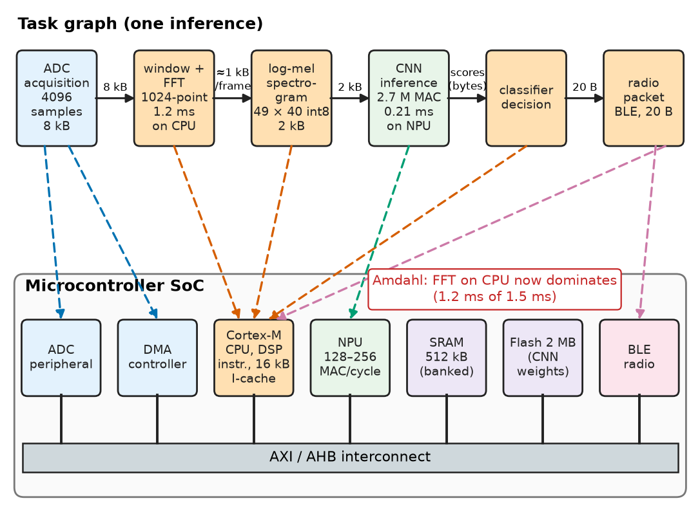
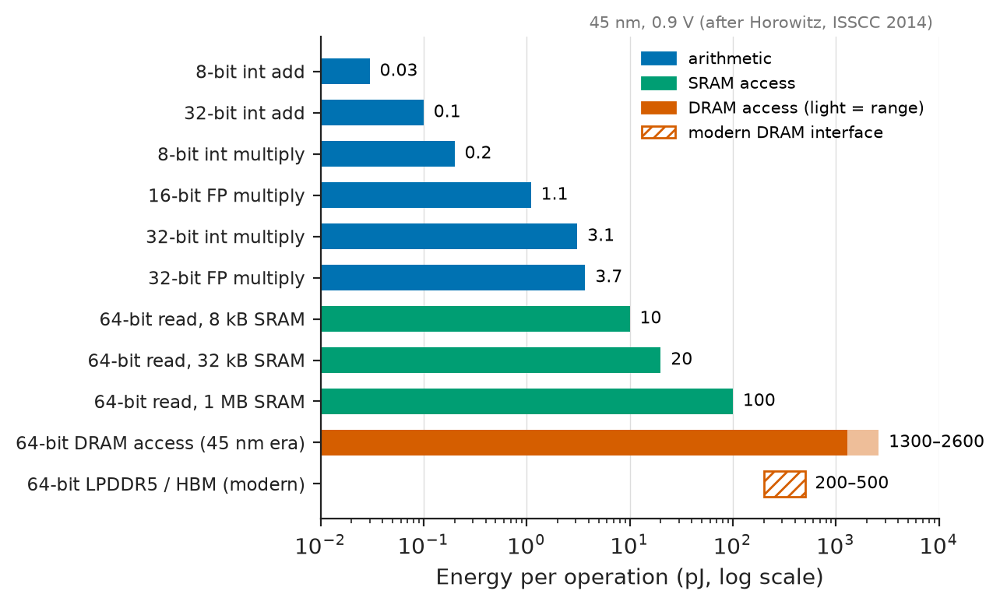
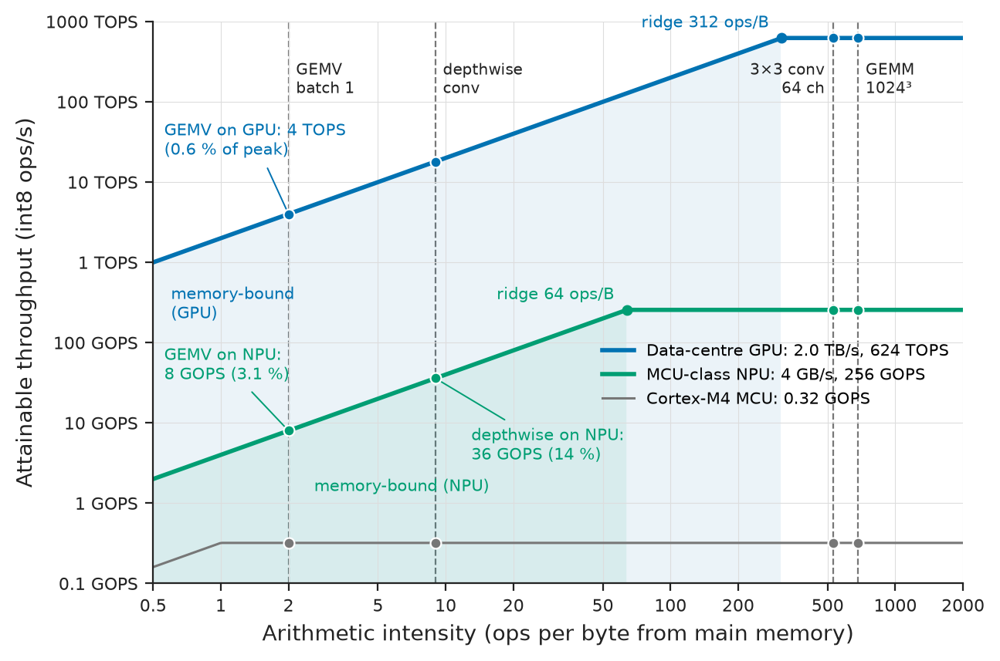
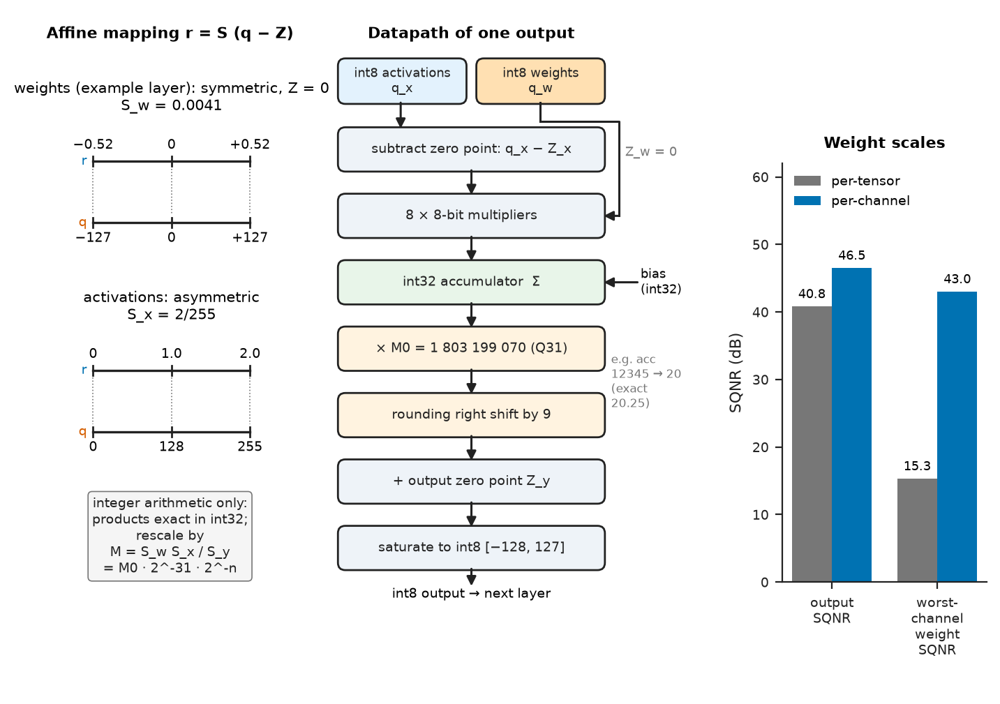
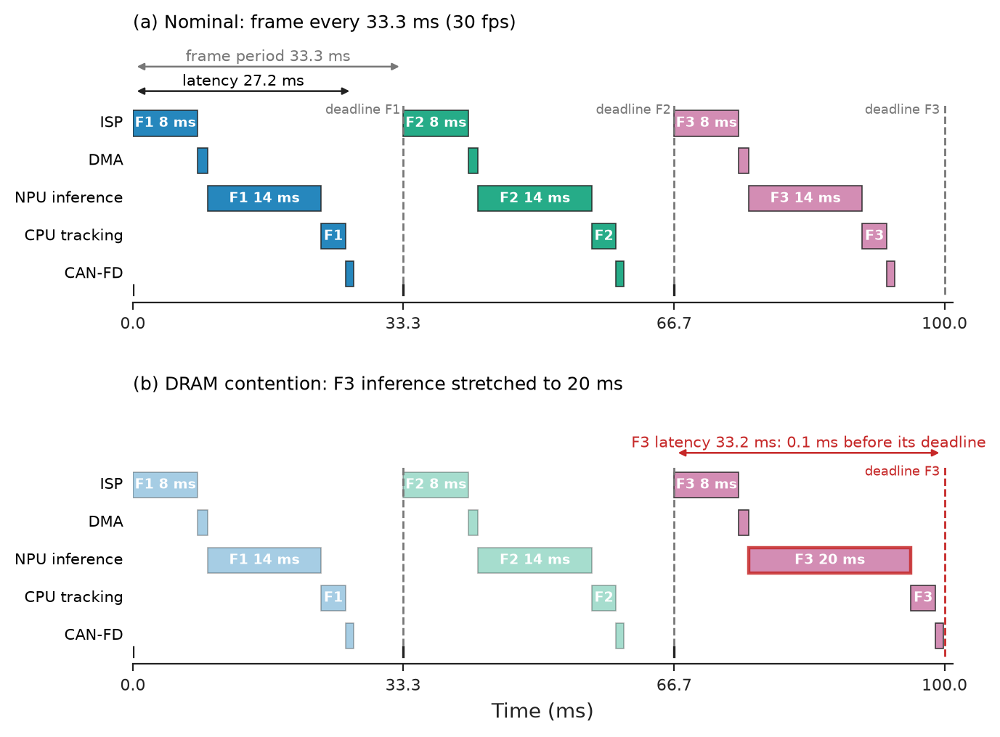
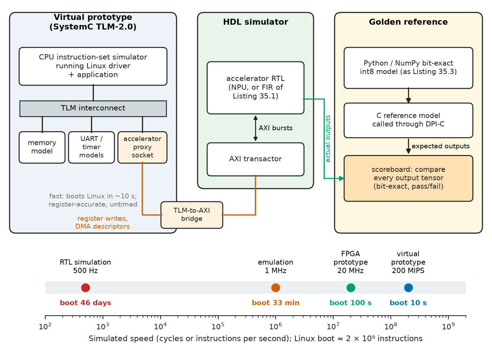

# Chapter 35 — Hardware–Software Co-Design

*Part VIII · Integrated Circuits and VLSI*

A wireless vibration sensor bolted to a paper-mill pump classifies bearing faults with a small convolutional network. On its Cortex-M4 at 80 MHz one inference takes 56 ms and 0.68 mJ — fine at one inference a second, hopeless when the customer asks for continuous classification at 100 Hz on the same battery. The team moves to a microcontroller with a neural processing unit (NPU) whose datasheet promises 250 times the throughput, and measures a speed-up of only 38: the network now runs in 0.2 ms, but the FFT that prepares its input still runs on the CPU and takes 1.2 ms. In a data centre two buildings away, a recommendation model runs on a GPU rated at 624 TOPS and achieves less than 1 % of that, because at batch size one every weight is fetched from memory to be used exactly once. Both teams bought the right hardware for the wrong part of their problem. Deciding which computation goes where — processor, FPGA, GPU, NPU or custom silicon — and predicting, before committing, what the whole system will achieve, is hardware–software co-design. It is the last step of the book's argument: every abstraction built in the earlier chapters is now a resource to be allocated.

> **Which parts of a computation belong in software on a processor, and which in an FPGA, a GPU, an NPU or an ASIC — and what will the split really gain?**
> **How do memory traffic, numerical precision and deadlines limit an accelerated system, and how is the combination verified before it is built?**

| Concept | Engineering destination |
|---|---|
| Partitioning and offload break-even | Deciding what to accelerate; sizing DMA and interfaces |
| Processor, FPGA, GPU, ASIC trade-offs | Platform choice by throughput, energy per operation, NRE and volume |
| Amdahl's law, custom instructions, HLS | Realistic speed-up estimates; accelerator design from C++ |
| Memory hierarchy and data-movement energy | Tiling, data reuse, scratchpads, DMA double buffering |
| Roofline and Little's law | Diagnosing memory- versus compute-bound kernels; required concurrency |
| Quantisation and int8 inference | Neural networks on MCUs, NPUs and FPGAs within flash, RAM and energy budgets |
| Real-time constraints with accelerators | Worst-case latency budgets for control loops and perception pipelines |
| Co-simulation and virtual prototypes | Running software on hardware that does not yet exist |

**Roadmap.** What to put where (35.1) → the platforms compared with numbers (35.2) → how much acceleration buys, and how accelerators are built (35.3) → why moving data costs more than computing on it (35.4) → predicting performance before building (35.5) → deploying neural networks on small hardware (35.6) → meeting deadlines with accelerators in the loop (35.7) → verifying hardware and software together (35.8).

> **Boundary.** Qualitative hardware–software partitioning for microcontroller products — which jobs go to on-chip peripherals — is in [Chapter 25 §25.2](../part-6-embedded-and-real-time-systems/25-embedded-system-architecture.md); FPGA architecture in [Chapter 18](../part-4-computer-architecture-and-digital-hardware/18-memory-and-programmable-logic.md); caches and memory hierarchy in [Chapter 16 §16.7–16.8](../part-4-computer-architecture-and-digital-hardware/16-computer-architecture.md); parallel computing and profiling in [Chapter 24](../part-5-programming-and-computational-systems/24-scientific-computing.md); scheduling, WCET and RTOS behaviour in [Chapter 27](../part-6-embedded-and-real-time-systems/27-real-time-computing.md); how a custom chip is designed in [Chapter 34](34-vlsi-design.md). Quantisation noise and fixed-point formats are from *Circuits, Signals and Communications*, [Ch. 21 §21.2 and §21.5](https://github.com/The-Studio-of-Sadiq/Circuits-Signals-and-Communications/blob/main/part-5-digital-signal-processing/21-dsp-fundamentals.md), which also lists DSP implementation platforms qualitatively (§21.3). This chapter makes those choices quantitative.

---

## 35.1 Partitioning computation

### From profile to task graph

Co-design starts from a working software implementation and a measurement, not from a block diagram. The application is written (usually in C, C++ or Python with NumPy), run on representative data, and profiled ([Chapter 24](../part-5-programming-and-computational-systems/24-scientific-computing.md)). The profile is redrawn as a **task graph**: nodes are computations with their operation counts, edges are the data passed between them with their sizes. For the vibration sensor: ADC samples (4 096 × 16 bit) → windowing and 1 024-point FFTs → log-magnitude spectrogram (49 × 40 values) → CNN (2.7 million multiply–accumulates, MACs) → decision → radio message. Figure 35.1 maps such a graph onto a typical SoC.

<!-- FIGURE 35.1 | figures/ch35/fig-35-1-task-graph-partitioning.png | block-diagram | A task graph for a sensor-inference pipeline mapped onto the resources of a microcontroller SoC with an NPU. | Content: top half: task graph as boxes left to right: ADC acquisition (4096 samples, 8 kB) -> window + FFT (1024-point, 1.2 ms on CPU) -> log-mel spectrogram (49 x 40 int8, 2 kB) -> CNN inference (2.7 M MAC) -> classifier decision -> radio packet (BLE, 20 bytes); each edge labelled with bytes transferred. Bottom half: SoC block diagram: Cortex-M class CPU with 16 kB I-cache, NPU (128 or 256 MAC/cycle), DMA controller, 512 kB SRAM in banks, 2 MB flash holding weights, ADC peripheral, radio, AXI/AHB interconnect. Coloured dashed arrows map each task to its resource: ADC -> ADC + DMA, FFT -> CPU (DSP instructions), CNN -> NPU, decision and radio -> CPU. Annotation: 'Amdahl: FFT on CPU now dominates (1.2 ms of 1.5 ms)'. -->



*Figure 35.1 — A task graph for a sensor-inference pipeline mapped onto the resources of a microcontroller SoC with an NPU.*

### What favours hardware, what favours software

**Table 35.1 — Properties of a computation and where they push it.**

| Property | Pushes towards hardware (FPGA, NPU, ASIC) | Pushes towards software (CPU) |
|---|---|---|
| Operation count per byte of data | High and regular (convolution, FFT, matrix multiply) | Low, irregular (parsing, protocol stacks) |
| Parallelism | Wide data parallelism or deep pipelines | Sequential dependence, data-dependent branches |
| Precision | Fixed, narrow (int8, int16, custom widths) | Mixed, floating point, wide dynamic range |
| Determinism | Cycle-exact latency needed (µs control loops) | Soft deadlines, average throughput |
| Stability of the algorithm | Frozen standard (AES, CRC, H.264, LDPC) | Changing, field-updatable, many variants |
| Volume and cost target | High volume (ASIC) or low-latency niche (FPGA) | Low volume, short time to market |

### Offload break-even

Moving a computation to an accelerator is worth it only if the time saved exceeds the cost of getting the data there and back. For a kernel that takes $t_{sw}$ in software and $t_{hw}$ on the accelerator,

$$
t_{\text{setup}}+t_{\text{in}}+t_{hw}+t_{\text{out}}<t_{sw}
$$

where $t_{\text{setup}}$ is driver and synchronisation overhead (cache maintenance, descriptor set-up, interrupt) and $t_{\text{in}}$, $t_{\text{out}}$ are the transfer times. When transfers and computation can overlap in a streaming pipeline, the steady-state cost per item becomes the largest of $t_{\text{in}}$, $t_{hw}$ and $t_{\text{out}}$ instead of their sum.

**Worked example — FFT offload over AXI.** A 1 024-point complex FFT (single-precision, 8 kB per transform) takes 15 µs on a Cortex-A53 core with NEON. An FPGA FFT core in the same Zynq-class device computes one in 1 024 cycles at 250 MHz, 4.1 µs, but data move over an AXI port at an effective 1.6 GB/s, so each direction takes $8\,192/1.6\times10^{9}=5.12$ µs, and the driver costs 3 µs per call. One transform at a time costs $3+5.12+4.1+5.12=17.3$ µs — slower than software. Streamed in batches with input and output DMA running concurrently, the cost per transform falls to 5.12 µs (transfer-bound), a speed-up of $15/5.12=2.9$. The FFT core already outruns the link that feeds it, so a faster core would gain nothing; the partitioning decision is really a decision about the interface, and it is worth taking only if the FFT results stay on the FPGA side for further processing.

Granularity is the third design variable. A **custom instruction** (a few cycles; no data movement beyond registers), a **tightly coupled coprocessor** (tens to thousands of cycles, sharing the CPU's local memory) and a **loosely coupled accelerator** on the system bus with its own DMA (thousands of cycles and up) amortise very different overheads; the coarser the offload, the larger the amount of work that must be handed over at once to make it pay.

---

## 35.2 Processor versus FPGA

### Temporal and spatial computation

A processor computes *in time*: one instruction stream, a few wide functional units, reused every cycle, at 0.1–5 GHz. Its strength is generality; its cost is that most of the energy of each instruction goes into fetching, decoding, scheduling and moving operands through register files and caches rather than into the arithmetic — for a scalar 32-bit add on a modern core, well over 90 %. SIMD and vector units (Arm Helium and NEON, x86 AVX-512, RISC-V V) amortise that overhead over 4–64 operations per instruction.

An FPGA computes *in space* ([Chapter 18](../part-4-computer-architecture-and-digital-hardware/18-memory-and-programmable-logic.md)): the algorithm is laid out as a circuit of LUTs, DSP slices and block RAMs, each doing one job every cycle at 200–600 MHz. There is no instruction overhead, and pipelines thousands of operations deep run with cycle-exact latency. The price is the programmable interconnect: compared with a standard-cell ASIC in the same process, an FPGA implementation typically needs 20–40 times the area, runs 3–4 times slower and uses roughly 7–14 times the dynamic power, the gap narrowing when the design maps onto hard DSP and memory blocks. A GPU sits between the two: thousands of simple cores executing the same instruction on different data (SIMT), with very high memory bandwidth, excellent for large batched dense arithmetic and poor for small, latency-critical, branchy work. An ASIC or a fixed-function NPU removes both the instruction and the interconnect overhead for one class of computation.

**Table 35.2 — Representative compute platforms for int8 inference and signal processing (peak values; sustained values are often 10–60 % of peak).**

| Platform (example) | Peak int8 throughput | Power | Energy per op at peak | NRE | Latency behaviour |
|---|---|---|---|---|---|
| MCU core (Cortex-M4, 80 MHz, SIMD MAC) | 0.32 GOPS | ≈ 12 mW | ≈ 40 pJ | Firmware only | Predictable; interrupts add jitter |
| Server CPU (32 cores, AVX-512 VNNI, 2.5 GHz) | ≈ 20 TOPS | ≈ 250 W | ≈ 12 pJ | Software only | Caches, OS: ms-scale tails |
| MCU-class NPU (256 MAC/cycle, 500 MHz) | 256 GOPS | ≈ 0.12 W | ≈ 0.5 pJ | Model compilation | Deterministic per network |
| FPGA (2 520 DSP slices, 600 MHz) | ≈ 6 TOPS | 20–30 W | 3–5 pJ | 0.1–2 MUSD design | Cycle-exact pipelines |
| Data-centre GPU (A100 class) | 624 TOPS | ≈ 400 W | ≈ 0.6 pJ | Software only | Batching, kernel launch µs–ms |
| Edge inference ASIC (4 TOPS at 2 W) | 4 TOPS | ≈ 2 W | ≈ 0.5 pJ | 5–50 MUSD at 28–16 nm; 100 MUSD+ at 5 nm | Deterministic |

(Throughput is counted as two operations per MAC. The NPU figure is per MAC array alone; the system around it adds SRAM and DMA energy, Section 35.4.)

> **Status of the principle: Energy-efficiency ordering of compute platforms**
> *Empirical.* The ordering CPU → GPU/FPGA → NPU/ASIC, each step gaining roughly an order of magnitude in operations per joule for regular arithmetic, is observed across process generations; it reverses for irregular, branchy or rapidly changing workloads, where the specialised platforms sit idle or cannot express the computation.

### When an FPGA, when an ASIC

The choice between programmable and custom hardware is mostly economics. With FPGA unit price $c_F$, ASIC unit price $c_A$ and ASIC NRE $N_A$ (masks, design, verification, test development; Chapter 34), the ASIC is cheaper above the volume

$$
V^{*}=\frac{N_A}{c_F-c_A}
$$

> **Status of the principle: FPGA–ASIC break-even volume**
> *Derived.* It follows from equating total costs linear in volume; it ignores time to market, the cost of a re-spin, FPGA design cost, and the option value of reprogramming in the field, which often dominate the decision.

**Worked example — An industrial camera's image-processing pipeline.** A mid-range FPGA that implements the pipeline costs 120 USD in volume; an equivalent 28 nm ASIC would cost 8 USD per unit after an NRE of 4 MUSD. The break-even volume is

$$
V^{*}=\frac{4\times10^{6}}{120-8}=35\,700\ \text{units}
$$

A machine-vision camera selling 5 000 units a year stays on the FPGA, and keeps the ability to add features in the field; a consumer dash-camera selling a million units a year moves to an ASIC — or, more often, to a commercial SoC that already contains a suitable image processor and NPU, which removes the NRE altogether. FPGAs also win outright where the algorithm is not yet frozen (5G radio prototypes, new radar waveforms), where volumes are small and lives long (test equipment, aerospace, defence), and where nanosecond-scale deterministic latency is needed (high-frequency trading, protection relays, motor-drive current loops; Section 35.7).

---

## 35.3 Hardware acceleration

### Amdahl's law

If a fraction $f$ of a program's run time is accelerated by a factor $s$, and the offload adds an overhead equal to a fraction $o$ of the original run time, the overall speed-up is

$$
S=\frac{1}{(1-f)+\dfrac{f}{s}+o}
$$

and even an infinitely fast accelerator cannot beat $1/(1-f)$.

> **Status of the principle: Amdahl's law**
> *Derived.* It follows from splitting a fixed workload's run time into a serial and an accelerable part; it assumes a fixed problem size and no overlap between the parts. When the problem grows with the available hardware (larger images, more channels), Gustafson's scaled form applies instead, and overlap of transfers with computation reduces the effective $o$.

**Worked example — The vibration sensor's speed-up.** Profiling the original firmware shows 80 % of the time in the CNN layers. An accelerator 20 times faster on those layers, with transfers and synchronisation costing 5 % of the original time, gives

$$
S=\frac{1}{0.2+0.8/20+0.05}=\frac{1}{0.29}=3.4
$$

against 4.2 without the overhead and a ceiling of 5 for any accelerator. In the opening example the NPU was 267 times faster on the network itself ($56.25/0.211$), but the end-to-end time went from $1.2+56.25=57.45$ ms to $1.2+0.21+0.1=1.51$ ms, a speed-up of 38: the 1.2 ms FFT is now 80 % of the remaining time, so the next step is to move the FFT too — into the CPU's DSP instructions with a tuned library, or into a hardware FFT block — not to buy a faster NPU.

### Ways to accelerate

- **Instruction-set extensions.** Many processors reserve opcode space for custom instructions ([Chapter 16](../part-4-computer-architecture-and-digital-hardware/16-computer-architecture.md) for RISC-V's custom opcodes); Arm's Custom Datapath Extension does the same for Cortex-M33/M55-class cores. A CRC step, a Galois-field multiply or a saturating fixed-point MAC becomes a one-cycle instruction with no data movement at all, typically gaining 2–10× on the kernel.
- **Coprocessors** sharing the CPU's tightly coupled memory, for kernels of hundreds of cycles (crypto, FFT butterflies).
- **Streaming accelerators** with their own DMA on the system interconnect (AXI), the usual FPGA and NPU arrangement.
- **Systolic arrays** for matrix arithmetic: a grid of MAC units through which operands flow from neighbour to neighbour, so each operand fetched from memory is used by a whole row or column of units. A $128\times128$ array reuses each fetched weight 128 times, the property that makes NPUs and tensor units efficient (Section 35.4).

### High-level synthesis

Writing an accelerator in RTL ([Chapter 19](../part-4-computer-architecture-and-digital-hardware/19-hardware-description-languages.md)) gives full control at a high design cost. **High-level synthesis** (HLS) compiles C or C++ with directives into RTL: the tool schedules operations into clock cycles, binds them to hardware units and builds the control FSM. Listing 35.1 is a 32-tap FIR filter in the style accepted by AMD Vitis HLS.

```cpp
// 32-tap FIR for high-level synthesis (C++17; Vitis-HLS-style pragmas, illustrative)
#include <cstdint>

constexpr int N_TAPS = 32;

void fir32(const int16_t *x_in, int32_t *y_out, int n_samples,
           const int16_t coef[N_TAPS])
{
#pragma HLS INTERFACE m_axi port=x_in  bundle=gmem0 depth=4096
#pragma HLS INTERFACE m_axi port=y_out bundle=gmem1 depth=4096
#pragma HLS ARRAY_PARTITION variable=coef complete
    static int16_t shift_reg[N_TAPS];
#pragma HLS ARRAY_PARTITION variable=shift_reg complete

sample_loop:
    for (int n = 0; n < n_samples; ++n) {
#pragma HLS PIPELINE II=1
        int32_t acc = 0;
    tap_loop:
        for (int k = N_TAPS - 1; k > 0; --k) {
            shift_reg[k] = shift_reg[k - 1];
            acc += static_cast<int32_t>(shift_reg[k]) * coef[k];
        }
        shift_reg[0] = x_in[n];
        acc += static_cast<int32_t>(shift_reg[0]) * coef[0];
        y_out[n] = acc;
    }
}
```

The `PIPELINE II=1` directive asks for one new sample every clock (initiation interval 1), which forces the inner loop to be fully unrolled into 32 parallel multipliers — 32 DSP slices — and requires the coefficient and delay-line arrays to be split into individual registers (`ARRAY_PARTITION`), since a block RAM has only two ports. At 300 MHz the filter processes 300 MS/s, 9.6 GMAC/s. With Q15 coefficients whose absolute values sum to at most one, the Q30 accumulator cannot overflow 32 bits. The same source compiles and runs as ordinary C++, which is how it is tested (Section 35.8); the pragmas are ignored by a normal compiler. HLS removes most hand-written RTL for datapaths, but not the need to think in hardware: the code above is fast only because it was written as a shift register, and an innocent-looking pointer dereference inside the loop could raise the initiation interval tenfold.

---

## 35.4 Memory and data movement

### Data movement costs more than arithmetic

The energy of an arithmetic operation is set by the switched capacitance of a small circuit; the energy of fetching its operands is set by the length of the wires to the memory that holds them (*Circuits, Signals and Communications*, [Ch. 14 §14.10](https://github.com/The-Studio-of-Sadiq/Circuits-Signals-and-Communications/blob/main/part-3-advanced-network-theory/14-transmission-lines.md) for off-chip links; Chapter 34 for on-chip wires). Widely quoted measurements for a 45 nm process show how lopsided the comparison is (Figure 35.2).

**Table 35.3 — Energy per operation and per access (45 nm, 0.9 V; after Horowitz, ISSCC 2014). Newer nodes lower all entries, but the ratios persist.**

| Operation | Energy (pJ) | Relative to 8-bit add |
|---|---|---|
| 8-bit integer add | 0.03 | 1 |
| 8-bit integer multiply | 0.2 | 7 |
| 32-bit integer add | 0.1 | 3 |
| 32-bit integer multiply | 3.1 | 100 |
| 16-bit floating-point multiply | 1.1 | 37 |
| 32-bit floating-point multiply | 3.7 | 120 |
| 64-bit read, 8 kB SRAM | 10 | 330 |
| 64-bit read, 32 kB SRAM | 20 | 670 |
| 64-bit read, 1 MB SRAM | 100 | 3 300 |
| 64-bit DRAM access | 1 300–2 600 | 43 000–87 000 |

Modern LPDDR5 and HBM interfaces have reduced DRAM energy to roughly 3–8 pJ per bit (0.2–0.5 nJ per 64 bits), still about a thousand times an 8-bit MAC.

<!-- FIGURE 35.2 | figures/ch35/fig-35-2-energy-per-operation.png | plot | Energy of arithmetic operations compared with memory accesses, on a logarithmic scale. | Content: horizontal bar chart, x-axis energy in pJ on a log scale from 0.01 to 10000. Bars from top: 8-bit add 0.03, 32-bit add 0.1, 8-bit multiply 0.2, 16-bit FP multiply 1.1, 32-bit int multiply 3.1, 32-bit FP multiply 3.7, 8 kB SRAM 64-bit read 10, 32 kB SRAM read 20, 1 MB SRAM read 100, DRAM 64-bit access 1300 to 2600 (drawn as a range bar). Arithmetic bars in one colour, SRAM in a second, DRAM in a third. Secondary annotation: modern LPDDR5/HBM range 200 to 500 pJ per 64 bits drawn as a hatched bar. Caption note: 45 nm, 0.9 V. -->



*Figure 35.2 — Energy of arithmetic operations compared with memory accesses, on a logarithmic scale.*

> **Status of the principle: Dominance of data-movement energy**
> *Empirical.* Measured energies across many processes show memory access costing 10–10 000 times an arithmetic operation, depending on distance; the ratio follows from wire capacitance per unit length staying nearly constant while logic shrinks, and it is the main reason specialised accelerators are efficient.

**Worked example — Energy of one convolution layer.** A $3\times3$ convolution with 64 input and 64 output channels on a $56\times56$ feature map performs $56\times56\times64\times64\times9=115.6$ million MACs. At 0.23 pJ per int8 MAC (multiply plus add) the arithmetic costs 26.6 µJ. The layer's data are 36 864 bytes of weights and 200 704 bytes each of input and output activations, 438 kB in all; reading each byte once from DRAM at about 160 pJ per byte (1.3 nJ per 64 bits) costs 71 µJ — already 2.7 times the arithmetic, even with perfect reuse. With no reuse at all, fetching two operand bytes from DRAM for every MAC would cost $2\times115.6\times10^{6}\times162.5\ \mathrm{pJ}=37.6$ mJ, 1 400 times the arithmetic; fetching them from a 32 kB SRAM instead (2.5 pJ per byte) would cost 0.58 mJ. The design of every efficient accelerator is the design of the reuse that turns the third number into the second.

### Reuse, tiling and dataflow

The tools for reducing data movement are the same on a CPU, a GPU, an FPGA or an NPU:

- **Tiling.** Split a large computation into blocks that fit the fastest memory level (registers, a 32–512 kB scratchpad, a cache), and finish all the work on a block before evicting it.
- **Dataflow choice.** Keep one operand stationary in the processing elements and stream the others past it: *weight-stationary* arrays hold weights and stream activations; *output-stationary* arrays hold partial sums. Which is best depends on the layer shape, and NPU compilers choose per layer.
- **Scratchpads and DMA.** A software-managed scratchpad has no tags or misses, so its timing is deterministic; a DMA engine fills one half while the accelerator computes on the other (**double buffering**), hiding transfer time when compute time per tile exceeds transfer time.
- **Narrow data.** int8 instead of float32 quarters both storage and traffic (Section 35.6).
- **Coherence discipline.** When a DMA engine writes memory that a cached CPU then reads, the CPU's cache must be invalidated first, and cleaned before the DMA reads CPU-written data; a missing cache-maintenance call produces the classic bug of an accelerator that "works in the debugger" and returns stale results at full speed. Hardware-coherent interconnects (ACE, CHI, CXL) remove the problem at a cost in area and latency.

**Table 35.4 — Representative memory and interconnect bandwidths (peak, per direction where relevant).**

| Interface | Configuration | Peak bandwidth |
|---|---|---|
| On-chip SRAM bank | 128 bit at 500 MHz | 8 GB/s per bank |
| AXI4 port | 128 bit at 250 MHz | 4 GB/s |
| LPDDR4X | 32 bit at 4 266 MT/s | 17 GB/s |
| DDR4-3200 DIMM | 64 bit | 25.6 GB/s |
| DDR5-4800 DIMM | 64 bit (2 × 32) | 38.4 GB/s |
| PCIe 4.0 × 16 | 16 GT/s per lane, 128b/130b | 31.5 GB/s |
| HBM2e stack | 1 024 bit at 3.2–3.6 Gb/s | 410–460 GB/s |

---

## 35.5 Performance modeling

### A hierarchy of models

Performance can be estimated at several levels of effort and fidelity: analytical models (Amdahl, roofline, Little's law, a spreadsheet of operation counts and bandwidths) in minutes; instruction-set and cycle-approximate simulators (gem5, or the performance report of an NPU compiler such as Arm's Vela) in hours; RTL simulation or FPGA prototypes in days; and measurement on silicon with hardware performance counters — Linux `perf` on application processors, the cycle counter `DWT->CYCCNT` on Cortex-M cores — which is the ground truth against which all models are calibrated. The right first step is almost always the analytical model: it is wrong in detail, but it shows which resource limits the design and how far it is from that limit.

### The roofline model

A kernel with **arithmetic intensity** $I$ — operations per byte moved from main memory — running on a machine with peak compute $\pi$ (operations per second) and memory bandwidth $\beta$ (bytes per second) can attain at most

$$
P=\min\left(\pi,\ \beta I\right)
$$

The two lines cross at the **ridge point** $I_r=\pi/\beta$. Kernels left of the ridge are memory-bound: faster arithmetic does nothing for them, and only more bandwidth or more reuse (higher $I$) helps. Kernels right of it are compute-bound (Figure 35.3).

> **Status of the principle: Roofline model**
> *Approximate.* It is an upper bound assuming perfect overlap of computation and memory transfer and a single bandwidth-limited memory level; real kernels sit below it because of latency, cache conflicts, pipeline stalls and limited parallelism, and extended rooflines add ceilings for each cache level and for vector or tensor-unit use.

Listing 35.2 applies the model to four kernels on the platforms of Table 35.2.

```python
# Roofline: attainable throughput = min(peak, bandwidth x arithmetic intensity).
platforms = {                       # peak int8 ops/s, memory bandwidth bytes/s
    "Cortex-M4 @ 80 MHz": (0.32e9, 0.32e9),
    "Small NPU (256 MAC)": (256e9, 4e9),
    "FPGA, 2520 DSP": (6.05e12, 19.2e9),
    "Data-centre GPU": (624e12, 2.0e12),
}
kernels = {                         # ops per byte moved from main memory
    "GEMV 1024x1024 (batch 1)": 2.0,
    "Depthwise 3x3 conv": 9.0,
    "3x3 conv, 64 ch": 528.0,
    "GEMM 1024^3": 683.0,
}
for pname, (peak, bw) in platforms.items():
    print(f"{pname}: ridge at {peak / bw:6.1f} ops/B")
    for kname, ai in kernels.items():
        att = min(peak, bw * ai)
        bound = "compute" if att == peak else "memory"
        print(f"   {kname:26s} {att / 1e9:10.2f} GOPS ({bound}-bound, {att / peak:6.1%} of peak)")
```

The output says that the microcontroller (ridge at 1 op/B, because its SRAM keeps up with its single MAC unit) is compute-bound on everything. The NPU, with its ridge at 64 ops/B, reaches only 3.1 % of peak on a batch-1 matrix–vector product and 14 % on a depthwise convolution, but 100 % on a dense convolution whose weights and activations are reused from on-chip memory ($I=2\times115.6\times10^6/438\,272=528$ ops/B for the layer above). The GPU, with its ridge at 312 ops/B, attains 4 TOPS of its 624 on the batch-1 GEMV — 0.6 % — which is the data-centre puzzle of the opening: the fix is to batch requests, raising $I$, not to buy a faster GPU.

<!-- FIGURE 35.3 | figures/ch35/fig-35-3-roofline.png | plot | Roofline model for an MCU-class NPU and a data-centre GPU with representative kernels. | Content: log-log axes, x-axis arithmetic intensity 0.5 to 2000 ops/byte, y-axis attainable throughput 0.1 GOPS to 1000 TOPS. Two rooflines: NPU (sloped line 4 GB/s, flat at 256 GOPS, ridge at 64 ops/B) and GPU (sloped line 2.0 TB/s, flat at 624 TOPS, ridge at 312 ops/B); also a thin MCU roof flat at 0.32 GOPS with ridge at 1 op/B. Vertical dashed lines at the four kernel intensities: GEMV batch 1 (2), depthwise conv (9), 3x3 conv 64 ch (528), GEMM 1024 (683), each labelled. Markers where each kernel meets each roof, e.g. GEMV on GPU at 4 TOPS (0.6 percent of peak) and on NPU at 8 GOPS; depthwise on NPU at 36 GOPS. Shaded region left of each ridge labelled memory-bound. -->



*Figure 35.3 — Roofline model for an MCU-class NPU and a data-centre GPU with representative kernels.*

### Little's law and the concurrency a memory system needs

A memory system with latency $W$ that is to deliver bandwidth $\beta$ in requests of $B$ bytes must have, on average,

$$
N=\frac{\beta W}{B}
$$

requests in flight. This is Little's law ($N=\lambda W$, with arrival rate $\lambda=\beta/B$) applied to memory.

> **Status of the principle: Little's law**
> *Derived.* It holds for any stable queueing system in steady state, independent of arrival and service distributions; it says nothing about how latency grows as the system approaches saturation, which needs a queueing model.

**Worked example — Why one core cannot saturate DRAM.** A DDR4-3200 channel delivers 25.6 GB/s with a loaded latency of about 90 ns and 64-byte cache lines, so keeping it busy needs $25.6\times10^{9}\times90\times10^{-9}/64=36$ outstanding line requests. A core that can track 10 outstanding misses (its miss-status holding registers) is limited to $10\times64\ \mathrm{B}/90\ \mathrm{ns}=7.1$ GB/s however fast it computes. Accelerators and GPUs reach high bandwidth precisely by keeping hundreds of requests in flight, and DMA engines are given deep outstanding-transaction queues for the same reason.

Pipelines obey the same arithmetic in the time domain: a hardware pipeline with initiation interval II at clock $f$ delivers $f/\mathrm{II}$ results per second regardless of its depth; its depth sets only the latency.

---

## 35.6 Embedded AI deployment

### The deployment flow

Neural networks are trained in floating point on GPUs and deployed on whatever the product contains: a microcontroller core, an NPU, an FPGA or a mobile GPU. The deployment flow is a co-design loop in its own right: choose a model architecture that fits the target (depthwise-separable convolutions, small input resolution); **quantise** it to 8-bit integers; compile it for the target (TensorFlow Lite for Microcontrollers with Arm's CMSIS-NN kernels on Cortex-M, the Vela compiler for Ethos-U NPUs, Vitis AI for AMD FPGAs, TensorRT for NVIDIA GPUs, vendor tools for others); measure latency, memory and accuracy on the real device; and iterate.

### Quantisation

> **Boundary.** The uniform quantiser, its noise model ($\approx6.02$ dB of SQNR per bit) and fixed-point Q formats with guard bits and rounding modes are from *Circuits, Signals and Communications*, [Ch. 21 §21.2 and §21.5](https://github.com/The-Studio-of-Sadiq/Circuits-Signals-and-Communications/blob/main/part-5-digital-signal-processing/21-dsp-fundamentals.md); two's-complement integers from [Chapter 11](../part-3-digital-electronics/11-digital-number-systems.md). Here they are applied to tensors.

Integer inference represents each real tensor value $r$ by an integer $q$ through an **affine mapping** with a real scale $S$ and an integer zero point $Z$:

$$
r=S\,(q-Z)
$$

Weights are usually quantised *symmetrically* ($Z=0$, $q\in[-127,127]$) and activations *asymmetrically* (a zero point lets a post-ReLU range such as 0 to 6 use all 256 codes). A layer $y=\sum_i w_i x_i$ then becomes integer arithmetic: products of int8 values accumulate exactly in an int32 register, and the result is rescaled to the output's scale by the real factor $M=S_wS_x/S_y$, itself implemented in integers as a 32-bit fixed-point multiplier $M_0$ and a right shift $n$, $M=M_0\,2^{-31}\,2^{-n}$, with $0.5\le M_02^{-31}<1$ (Figure 35.4). No floating-point hardware is needed anywhere.

Two choices dominate the accuracy. **Per-channel** weight scales (one $S_w$ for each output channel) instead of one per tensor protect channels whose weights are small. **Post-training quantisation** (PTQ), which calibrates activation ranges on a few hundred representative inputs, typically costs less than 1 % accuracy for convolutional networks at int8; **quantisation-aware training** (QAT), which simulates quantisation during training, recovers most of the remainder and is needed for int4 or for sensitive models. Listing 35.3 shows the effect of per-channel scales and the integer rescaling step.

```python
# Symmetric int8 weights (per-tensor vs per-channel), int32 accumulation, requantisation.
import numpy as np

rng = np.random.default_rng(1)
W = rng.normal(0, 1, (16, 64)) * np.linspace(0.02, 0.4, 16)[:, None]  # 16 output channels
x = rng.uniform(0, 2.0, 64)                                        # post-ReLU activations

def quant_sym(w, axis=None):
    s = np.max(np.abs(w), axis=axis, keepdims=axis is not None) / 127.0
    return np.clip(np.round(w / s), -127, 127).astype(np.int8), s

def sqnr_db(ref, approx):
    return 10 * np.log10(np.sum(ref**2) / np.sum((ref - approx) ** 2))

s_x = 2.0 / 255.0                                   # asymmetric uint8 input, zero point 0
q_x = np.round(x / s_x).astype(np.int32)
y_ref = W @ x
for name, axis in (("per-tensor", None), ("per-channel", 1)):
    q_w, s_w = quant_sym(W, axis)
    acc = q_w.astype(np.int32) @ q_x                # exact int32 accumulators
    y = acc * (np.ravel(s_w) * s_x)                 # real-valued result before requantisation
    w_hat = q_w * s_w
    worst = min(sqnr_db(W[i], w_hat[i]) for i in range(16))
    print(f"{name:11s}: output SQNR {sqnr_db(y_ref, y):5.1f} dB, worst-channel weight"
          f" SQNR {worst:5.1f} dB, max |acc| {np.max(np.abs(acc))}")

# Requantise to int8 output with an integer multiplier M0 (Q31) and a right shift.
# Illustrative layer, not W above: S_x = 0.02, S_w = 0.0041, S_y = 0.05.
M = 0.02 * 0.0041 / 0.05
shift = int(np.floor(-np.log2(M)))
M0 = int(round(M * 2**shift * 2**31))
acc = 12345
y_q = (acc * M0 + (1 << (30 + shift))) >> (31 + shift)
print(f"M = {M:.6f} = {M0}/2^31 x 2^-{shift}; acc {acc} -> {y_q} (exact {acc * M:.2f})")
```

The layer's weight magnitudes vary twentyfold across its 16 output channels. With one scale for the whole tensor the output SQNR is 40.8 dB, but the channel with the smallest weights is represented with only 15.3 dB, because it uses just a handful of the 255 codes; per-channel scales raise that channel to 43.0 dB and the output SQNR to 46.5 dB. The largest accumulator value, 170 367, needs 19 bits including the sign, far inside int32. The requantisation step uses an illustrative layer rather than the matrix above (whose per-tensor scale is $1.31/127=0.0103$): with $S_x=0.02$, $S_w=0.0041$ (weights within ±0.52) and $S_y=0.05$, the rescaling factor $M=0.02\times0.0041/0.05=0.00164$ is represented as $M_0=1\,803\,199\,070$ with a shift of 9, and maps an accumulator of 12 345 to 20, the correctly rounded value of 20.25.

On the device the same arithmetic is a short C loop. Listing 35.4 computes one output channel of a fully connected int8 layer the way CMSIS-NN-style kernels do, in portable C.

```c
#include <stdint.h>

/* acc * M0 * 2^-31 * 2^-shift with round-half-up; shift >= 0. */
static inline int32_t requantise(int32_t acc, int32_t m0, int shift)
{
    int64_t prod = (int64_t)acc * m0;
    int64_t half = (int64_t)1 << (30 + shift);
    return (int32_t)((prod + half) >> (31 + shift));
}

/* One output channel of an int8 fully connected layer (symmetric weights). */
int8_t fc_channel(const int8_t *x, const int8_t *w, int n, int32_t x_zero,
                  int32_t bias, int32_t m0, int shift, int32_t y_zero)
{
    int32_t acc = bias;                      /* bias pre-scaled to S_w * S_x */
    for (int i = 0; i < n; ++i)
        acc += ((int32_t)x[i] - x_zero) * (int32_t)w[i];
    int32_t y = requantise(acc, m0, shift) + y_zero;
    if (y > 127)  y = 127;                   /* saturate to int8 */
    if (y < -128) y = -128;
    return (int8_t)y;
}
```

Right-shifting a negative signed integer is implementation-defined in C11; every mainstream compiler for Arm, RISC-V and x86 implements it as an arithmetic shift, and the production kernels rely on that (or on the target's saturating-rounding instructions). On a Cortex-M4 the inner loop is rewritten with the `SMLAD` instruction to perform two 16-bit MACs per cycle, which is where Table 35.2's 2 MACs per cycle peak comes from; on a Cortex-M55 the Helium vector extension raises it to 8 int8 MACs per cycle.

### Memory budgets and targets

On a microcontroller the binding constraints are usually memory, not arithmetic. Weights are constant and live in flash; activations live in an SRAM **tensor arena** whose peak size the converter computes by planning which tensors are alive at once. A 38 600-parameter keyword-spotting or vibration network needs 38.6 kB of flash at int8 instead of 154 kB at float32, and an arena of a few tens of kilobytes; a 300 000-parameter image classifier at $96\times96$ resolution needs about 300 kB of flash and 100–250 kB of arena, which rules out parts with less than 256 kB of SRAM. On FPGAs, int8 MACs pack two per DSP slice (the source of Table 35.2's FPGA figure) and weights for small networks stay entirely in on-chip block RAM, eliminating the DRAM term of Section 35.4.

**Worked example — Vibration classifier on a CPU and on an NPU.** The network performs 2.7 million MACs per inference. On the Cortex-M4 at 80 MHz, CMSIS-NN kernels sustain about 0.6 MAC per cycle (memory accesses, im2col copies and requantisation take the rest of the 2-per-cycle peak), so one inference takes

$$
t=\frac{2.7\times10^{6}}{0.6\times80\times10^{6}}=56\ \mathrm{ms}
$$

and, at 12 mW for core and memory, 0.68 mJ. An Ethos-U55-class NPU with 128 MACs per cycle at 250 MHz, at a utilisation of 40 % on this small network, takes $2.7\times10^{6}/(128\times0.4\times250\times10^{6})=0.21$ ms, and at 30 mW uses 6.3 µJ — 107 times less energy per inference. At 100 inferences per second the network itself then costs 0.63 mW on average, and the battery budget is dominated by the 1.2 ms CPU FFT, the radio and the sensor, which is where the next round of co-design goes.

<!-- FIGURE 35.4 | figures/ch35/fig-35-4-int8-quantised-layer.png | block-diagram | Integer-only inference of one quantised layer: affine mapping, int32 accumulation and requantisation. | Content: left: number line of real values -0.52 to +0.52 mapped to int8 codes -127 to +127 with scale S_w = 0.0041 (symmetric, Z = 0; labelled as an example layer, the one used for the requantisation step, not Listing 35.3's matrix), and a second line 0 to 2.0 mapped to codes 0 to 255 (asymmetric, S_x = 2/255). Centre: datapath blocks: int8 activation vector and int8 weight vector -> subtract zero point -> 8x8 multipliers -> int32 accumulator (with bias input) -> multiply by M0 = 1803199070 (Q31) -> rounding right shift by 9 -> add output zero point -> saturate to int8 -> next layer. Right: small bar chart comparing per-tensor and per-channel quantisation, output SQNR 40.8 vs 46.5 dB and worst-channel weight SQNR 15.3 vs 43.0 dB. -->



*Figure 35.4 — Integer-only inference of one quantised layer: affine mapping, int32 accumulation and requantisation.*

---

## 35.7 Real-time constraints

> **Boundary.** Deadlines, worst-case execution time (WCET), interrupt latency, jitter and schedulability analysis are developed in [Chapter 27](../part-6-embedded-and-real-time-systems/27-real-time-computing.md); this section adds what accelerators change.

An accelerator changes a real-time system in three ways. It **shortens** the computation, often by orders of magnitude. It **adds** fixed costs — set-up, DMA transfers, a completion interrupt — that must be included in the WCET. And it introduces **interference**: an accelerator streaming from DRAM competes with the CPU, the display controller and other masters for the same memory, so the CPU's cache-miss latency, and the accelerator's own transfer time, depend on what everything else is doing. Platforms differ sharply in how analysable their timing is: an FPGA pipeline is cycle-exact; an NPU running one compiled network from private SRAM is nearly deterministic; a GPU, which batches work, schedules kernels non-preemptively and shares memory with a host operating system, is designed for throughput and typically shows millisecond-scale latency tails.

**Worked example — A 20 kHz current loop: MCU or FPGA.** A motor drive's current controller runs every 50 µs: sample phase currents, Clarke and Park transforms, two PI controllers, inverse transforms, space-vector PWM update (the control law itself is from *Electrical Energy and Machines*, [Ch. 12](https://github.com/The-Studio-of-Sadiq/Electrical-Energy-and-Machines/blob/main/part-3-motor-drives/12-ac-motor-drives.md)). On a 200 MHz Cortex-M4 the interrupt service routine takes 2 400 cycles (12 µs) typically, but 4 200 cycles (21 µs) worst case once flash wait states, a cache miss and preemption by a higher-priority communication interrupt are included: 42 % of the period, with 9 µs of jitter in when the PWM update lands. The same loop in FPGA fabric takes 120 cycles at 100 MHz — 1.2 µs, the same every time — which allows the loop to run at 100 kHz for a high-speed spindle or a GaN inverter. The partition used in many industrial drives is exactly this: the fast, fixed current loop and protection in FPGA logic or a dedicated control accelerator, the slower speed loop, communication and diagnostics in software.

**Worked example — An automotive camera pipeline.** A front camera produces 30 frames per second, a frame every 33.3 ms, and the braking function requires each frame's result within one frame period. The stages are image signal processing (8 ms), DMA of the scaled frame into NPU memory (1.2 ms), CNN inference on the NPU (14 ms), tracking and decision on the CPU (3 ms) and a CAN-FD message (1 ms): end-to-end latency 27.2 ms. Because the stages work on successive frames concurrently (Figure 35.5), the frame *rate* could rise to $1/14\ \mathrm{ms}=71$ fps, limited by the slowest stage, but the *latency* of each frame stays 27.2 ms. Measured under full load, though, inference stretches to 20 ms when the ISP and the display controller saturate DRAM, making the latency $8+1.2+20+3+1=33.2$ ms — 0.1 ms inside the deadline. The fix is architectural, not a faster NPU: memory-bandwidth regulation (quality-of-service limits on the other DRAM masters), keeping the network's weights in on-chip SRAM, or reducing the input resolution. Safety standards make this analysis mandatory — ISO 26262 for road vehicles, DO-178C for airborne software and DO-254 for airborne FPGA and ASIC hardware, IEC 62304 for medical software.

<!-- FIGURE 35.5 | figures/ch35/fig-35-5-pipelined-camera-latency.png | timing-diagram | Pipelined processing of camera frames showing per-frame latency and frame rate, nominal and under memory contention. | Content: time axis 0 to 100 ms. Five lanes: ISP, DMA, NPU inference, CPU tracking, CAN-FD. Frames F1, F2, F3 start every 33.3 ms (vertical ticks at 0, 33.3, 66.7 ms). Each frame drawn as coloured blocks: ISP 8 ms, DMA 1.2 ms, NPU 14 ms, CPU 3 ms, CAN 1 ms, so F1 ends at 27.2 ms; deadline markers at 33.3 ms after each frame start. Bracket on F1 labelled 'latency 27.2 ms'; bracket between F1 and F2 starts labelled 'frame period 33.3 ms'. Lower copy of the diagram for frame F3 under DRAM contention with NPU block stretched to 20 ms, ending at 33.2 ms after its start, 0.1 ms before its deadline marker, highlighted in red. -->



*Figure 35.5 — Pipelined processing of camera frames showing per-frame latency and frame rate, nominal and under memory contention.*

---

## 35.8 System-level verification

### Verifying hardware and software together

The hardware of Chapter 34 and the software of Parts V and VI can each be verified separately and still fail together: a driver writes a register in the wrong order, an interrupt arrives before the accelerator's status is valid, a DMA descriptor uses a physical address the IOMMU does not map, a quantised model compiled with one tool version behaves differently on the device. **System-level verification** runs the real software on a model of the real hardware, as early as possible. The methods form a ladder of speed against fidelity.

**Table 35.5 — Platforms for running software on hardware under development (typical speeds for a multi-core SoC).**

| Platform | What models the hardware | Speed | Fidelity | Available |
|---|---|---|---|---|
| Virtual prototype (loosely timed) | SystemC/TLM-2.0 models, instruction-set simulators | 100–1 000 MIPS | Functional, register-accurate; no cycle timing | Before RTL |
| Virtual prototype (approximately timed) | TLM models with timing annotations | 1–50 MIPS | Performance estimates within 10–30 % | Before RTL |
| Co-simulation | RTL of one block in a simulator, rest as virtual models or C via DPI | 1–100 kHz | Cycle-exact for the RTL block | With block RTL |
| RTL simulation of the SoC | Full RTL | 10–1 000 Hz | Cycle-exact | With full RTL |
| Hardware emulation | RTL mapped to a dedicated emulator | 0.5–5 MHz | Cycle-exact, full visibility | With full RTL |
| FPGA prototype | RTL partitioned over FPGAs | 5–100 MHz | Cycle-exact, limited visibility | With full RTL |
| Hardware-in-the-loop | Real device with simulated plant | Real time | Real hardware | With silicon or board |

A **virtual prototype** models each block at the level the software sees — its registers, interrupts and DMA behaviour — in SystemC with the TLM-2.0 transaction-level interfaces (IEEE 1666), around fast instruction-set simulators of the processors (QEMU, Arm Fast Models). It lets firmware and drivers be written and tested months before RTL exists and later serves as the reference against which the RTL is checked. **Co-simulation** couples models at different levels: an accelerator's RTL runs in an HDL simulator while the processor runs as an instruction-set simulator, or a C/C++ reference model is called directly from a SystemVerilog test bench through the DPI-C interface to predict each output (Figure 35.6). **Hardware-in-the-loop** testing of the finished device against a simulated plant is the last rung ([Chapter 28 §28.9](../part-6-embedded-and-real-time-systems/28-embedded-system-design.md)).

<!-- FIGURE 35.6 | figures/ch35/fig-35-6-virtual-prototype-cosimulation.png | block-diagram | A virtual prototype with an RTL accelerator in co-simulation, and the bit-exact reference model used as the golden check. | Content: left box 'Virtual prototype (SystemC TLM-2.0)': CPU instruction-set simulator running Linux driver + application, TLM interconnect, memory model, UART/timer models, and an 'accelerator proxy' socket. Middle box 'HDL simulator': accelerator RTL (NPU or FIR from Listing 35.1) with AXI transactor connected to the proxy socket by a TLM-to-AXI bridge. Right box 'Golden reference': Python/NumPy bit-exact int8 model (as Listing 35.3) and C reference called through DPI-C into a scoreboard comparing every output tensor. Arrows labelled 'register writes, DMA descriptors', 'AXI bursts', 'expected outputs'. Bottom strip: speed scale from RTL simulation (500 Hz) through emulation (1 MHz), FPGA prototype (20 MHz) to virtual prototype (200 MIPS), with time to boot Linux at each: 46 days, 33 min, 100 s, 10 s. -->



*Figure 35.6 — A virtual prototype with an RTL accelerator in co-simulation, and the bit-exact reference model used as the golden check.*

**Worked example — How long to boot an operating system?** Booting embedded Linux to a shell on the SoC takes about $2\times10^{9}$ instructions, roughly as many cycles. RTL simulation of the full SoC at 500 cycles per second needs $4\times10^{6}$ s, 46 days; an emulator at 1 MHz needs 2 000 s, 33 minutes; an FPGA prototype at 20 MHz, 100 s; a loosely timed virtual prototype at 200 MIPS, 10 s. Hence the division of labour: software bring-up and regression on the virtual prototype, hardware–software integration and performance validation on emulation and FPGA prototypes, cycle-level debugging of individual blocks in RTL simulation or co-simulation.

### Golden models and bit-exactness

The most effective single practice in co-design verification is a **bit-exact golden model**: an executable reference — in Python, C or C++ — that computes exactly the integers the hardware should produce, including rounding, saturation and quantisation, as Listings 35.3 and 35.4 do. The HLS source of Listing 35.1 is already such a model; an NPU compiler's reference kernels are another. Every level of the ladder is compared against it: the RTL in co-simulation output by output, the FPGA prototype on recorded data sets, the silicon in production test. Floating-point stages are compared with a tolerance derived from the numerical analysis (*Circuits, Signals and Communications*, [Ch. 21 §21.6](https://github.com/The-Studio-of-Sadiq/Circuits-Signals-and-Communications/blob/main/part-5-digital-signal-processing/21-dsp-fundamentals.md)), never with "looks close". For machine-learning systems a second level of checking is needed above bit-exactness: the deployed int8 model's accuracy on a held-out test set, measured on the target, must match the accuracy recorded when the model was quantised, because a model that is bit-exact to a badly calibrated reference is exactly as wrong as its reference.

> **Status of the principle: Bit-exact reference modelling**
> *Approximate* as a guarantee of correctness. Matching a reference proves the implementation computes what the reference computes on the tested inputs, no more; coverage of the input space (Chapter 19) and validation of the reference against the specification remain separate obligations.

---

## What remains open

| Open question | Where it is answered |
|---|---|
| How do the transistors, gates and memories that every platform here is built from actually work? | [Chapter 4](../part-1-electronic-devices/04-field-effect-transistors.md); [Chapter 33](33-cmos-fundamentals.md); [Chapter 18](../part-4-computer-architecture-and-digital-hardware/18-memory-and-programmable-logic.md) |
| How are processors, caches and interrupts organised, and how do instructions execute on a microcontroller? | [Chapter 16](../part-4-computer-architecture-and-digital-hardware/16-computer-architecture.md); [Chapter 17](../part-4-computer-architecture-and-digital-hardware/17-microprocessors-and-microcontrollers.md) |
| How is accelerator RTL written, constrained and tested, and how is a custom chip carried to tape-out? | [Chapter 19](../part-4-computer-architecture-and-digital-hardware/19-hardware-description-languages.md); [Chapter 34](34-vlsi-design.md) |
| How are firmware, drivers and real-time schedules built around the accelerators? | [Chapter 25](../part-6-embedded-and-real-time-systems/25-embedded-system-architecture.md); [Chapter 27](../part-6-embedded-and-real-time-systems/27-real-time-computing.md); [Chapter 28](../part-6-embedded-and-real-time-systems/28-embedded-system-design.md) |
| How are the analog front ends and converters that feed these systems designed? | [Chapter 10](../part-2-analog-electronics/10-analog-integrated-circuits.md); *Circuits, Signals and Communications*, [Ch. 19](https://github.com/The-Studio-of-Sadiq/Circuits-Signals-and-Communications/blob/main/part-4-signals-and-systems/19-sampling-and-reconstruction.md) |
| Which FFTs and digital filters should the accelerators compute, and with what numerical error? | *Circuits, Signals and Communications*, [Ch. 22](https://github.com/The-Studio-of-Sadiq/Circuits-Signals-and-Communications/blob/main/part-5-digital-signal-processing/22-discrete-fourier-transform.md), [Ch. 23](https://github.com/The-Studio-of-Sadiq/Circuits-Signals-and-Communications/blob/main/part-5-digital-signal-processing/23-digital-filters.md), [Ch. 21](https://github.com/The-Studio-of-Sadiq/Circuits-Signals-and-Communications/blob/main/part-5-digital-signal-processing/21-dsp-fundamentals.md) |
| How are the feedback loops that run on these controllers designed and proved stable? | *Circuits, Signals and Communications*, [Ch. 34](https://github.com/The-Studio-of-Sadiq/Circuits-Signals-and-Communications/blob/main/part-7-control-system-fundamentals/34-feedback-and-stability.md), [Ch. 35](https://github.com/The-Studio-of-Sadiq/Circuits-Signals-and-Communications/blob/main/part-7-control-system-fundamentals/35-control-design-fundamentals.md) |
| How do the radios and links that carry the results work? | *Circuits, Signals and Communications*, [Ch. 27](https://github.com/The-Studio-of-Sadiq/Circuits-Signals-and-Communications/blob/main/part-6-communication-theory/27-digital-communication.md), [Ch. 30](https://github.com/The-Studio-of-Sadiq/Circuits-Signals-and-Communications/blob/main/part-6-communication-theory/30-wireless-and-mobile-communications.md) |
| How do embedded controllers drive machines, and how are field-oriented control and its current loops tuned? | *Electrical Energy and Machines*, [Ch. 10](https://github.com/The-Studio-of-Sadiq/Electrical-Energy-and-Machines/blob/main/part-3-motor-drives/10-drive-system-fundamentals.md), [Ch. 12](https://github.com/The-Studio-of-Sadiq/Electrical-Energy-and-Machines/blob/main/part-3-motor-drives/12-ac-motor-drives.md); power stage in [Chapter 32](../part-7-power-electronics/32-motor-drives-and-power-conversion.md) |
| How do power converters, storage and data centres connect to the grid, and how is their energy managed? | *Electrical Energy and Machines*, [Ch. 16](https://github.com/The-Studio-of-Sadiq/Electrical-Energy-and-Machines/blob/main/part-4-power-generation/16-energy-storage.md), [Ch. 27](https://github.com/The-Studio-of-Sadiq/Electrical-Energy-and-Machines/blob/main/part-7-power-quality-and-grid-modernization/27-grid-integration-of-renewable-energy.md), [Ch. 28](https://github.com/The-Studio-of-Sadiq/Electrical-Energy-and-Machines/blob/main/part-7-power-quality-and-grid-modernization/28-energy-efficiency-and-management.md); converters in [Chapters 29–31](../part-7-power-electronics/29-power-electronic-fundamentals.md) |
| How will computation keep scaling as transistors stop getting cheaper — chiplets, 3D stacking, in-memory and analog computing? | Open research; the yield and data-movement arithmetic of [Chapter 34](34-vlsi-design.md) and Section 35.4 is where every proposal must start |

The book began with a nonlinear device and ends with a decision about where to put a computation; between them lies one idea, applied at every level — a physical device, biased and switched, made into a reliable abstraction that holds only within the limits of voltage, current, time, power and temperature set by the device beneath it, and the engineer's craft is to know both the abstraction and its limits.
